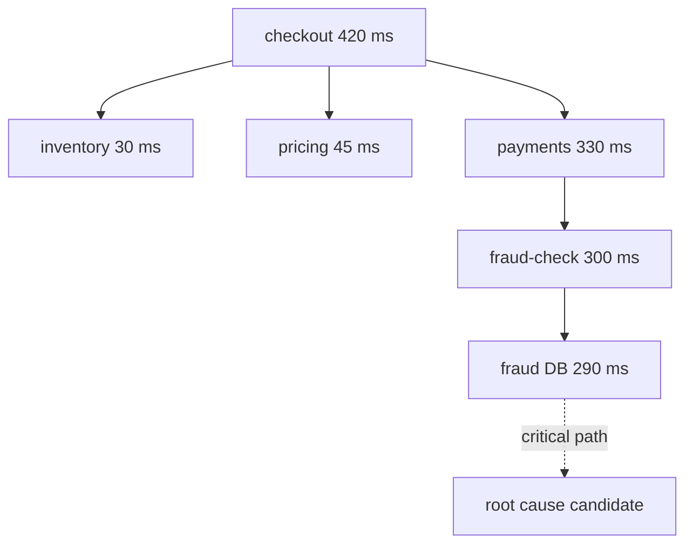

## In one minute
- In a distributed system, a symptom in one service often has its cause in another. The first job is to find where the problem is, before working out what it is.
- Follow the request, not the server: a trace ID propagated through every hop lets you reconstruct one request's path, timing and errors across dozens of services.
- Expect partial and gray failures: a dependency that is slow rather than down, one bad host out of fifty, a network path that drops 1 percent of packets. Averages hide them; break metrics down by host, zone, version and dependency.
- Retries and timeouts change the shape of failures: they can turn a brief slowdown into a retry storm that keeps the system down after the trigger is gone (a metastable failure).
- Clocks disagree across machines, so do not trust cross-host timestamps for ordering within milliseconds; use trace parent-child structure and logical ordering instead.

## How it works

### Where before what
A user sees a slow checkout. The checkout service's latency is up, but checkout calls inventory, pricing, payments and a fraud check, each of which calls others. Debugging checkout's code first is often wasted time. Localise first, as Google's troubleshooting chapter advises: stabilise the service, then ask what changed recently and bisect the system by checking the communication paths on each side of a split ([SRE book, ch. 12](https://sre.google/sre-book/effective-troubleshooting/)). Which hop added the latency or produced the error? Distributed tracing answers this directly; without it, compare each dependency's latency and error metrics from the caller's side and the callee's side.

### Traces
A trace is the tree of spans for one request. Each span records a service, an operation, start and end times, status and attributes, plus its parent span. The W3C Trace Context standard defines the `traceparent` header, four dash-separated fields (version, a 16-byte trace ID, an 8-byte parent span ID and flags), that carries them across HTTP calls ([W3C Recommendation, 2021](https://www.w3.org/TR/trace-context/)); message queues carry the same in message headers. Google's Dapper paper (2010) built its tracing around sampling and a small set of instrumented common libraries, which kept overhead low enough to run everywhere ([Dapper](https://research.google/pubs/dapper-a-large-scale-distributed-systems-tracing-infrastructure/)). Two analyses matter most: **self time** (time a span spent in its own code, excluding its children) and the **critical path** (the chain of spans that determined the total duration; speeding up anything off it does not help).

### Partial and gray failures
Distributed systems rarely fail cleanly. A Microsoft Research paper (HotOS 2017) named this "gray failure" and traced it to differential observability: failure detectors may not notice problems that applications plainly suffer ([Gray Failure](https://www.microsoft.com/en-us/research/publication/gray-failure-achilles-heel-cloud-scale-systems/)). Examples: a host whose disk is slow, a service that answers health checks but times out on real work. Signs: errors or latency concentrated on one host, zone, version or client. Always split your metrics: by host, availability zone, deploy version, dependency and customer. A 2 percent error rate overall might be 100 percent on one of fifty hosts.

### Timeouts, retries and metastability
Timeouts and retries protect against transient failures but change system behaviour under stress. If every layer retries three times, a failure at the bottom of a five-layer stack can multiply load by 3^5 = 243 times. A brief slowdown causes timeouts, timeouts cause retries, retries add load, load keeps latency high, and the system stays down after the original trigger is gone. A HotOS 2021 paper called these metastable failures: a trigger pushes the system into a bad state that persists after the trigger is removed, because a sustaining effect, often work amplification, keeps goodput low. Retries are one of the most common sustaining mechanisms, and failures that end when the trigger ends, such as a plain DoS attack, are not metastable ([Bronson et al.](https://sigops.org/s/conferences/hotos/2021/papers/hotos21-s11-bronson.pdf)). Their example: a database that handles 300 queries a second, an app at 280 QPS with one retry per request, and a 10-second network blip. The retries double the offered load to 560 QPS, so the database never recovers until load drops or retries stop. The fixes are retry budgets (retry only if fewer than, say, 10 percent of recent requests were retries), exponential backoff with jitter, retrying at one layer only, and load shedding.

### Clocks and ordering
Each machine's clock drifts; NTP typically keeps servers within a few milliseconds, sometimes worse. Two log lines from different hosts 2 ms apart may be in the wrong order. Use the trace's parent-child structure for causality, use per-key sequence numbers where order matters, and treat cross-host timestamp comparisons below the clock error as unknown.

### The same shape everywhere
Localising a fault in a chain of dependencies is the same problem as finding the slow step in a business process or the bottleneck in a supply chain: measure each stage's own contribution, find the critical path, split by segment to find concentrated problems.

## Down the stack

### Layer 1: The contract
A debuggable distributed system promises that every request carries a trace ID end to end, that every service emits metrics split by dependency, host and version, that logs include the trace ID, and that retries and timeouts follow a documented budget. With those in place, any user-visible symptom can be localised to a hop within minutes.

### Layer 2: The mechanism
Instrumentation libraries (OpenTelemetry SDKs) create spans automatically for incoming and outgoing HTTP, gRPC and database calls, inject `traceparent` into outgoing requests and extract it from incoming ones. Spans are exported to a collector that samples (head sampling decides at the start of a request; tail sampling decides after it completes, so it can keep all slow or failed traces) and stores them. Self time is computed by subtracting the union of child span intervals from a span's duration. The critical path is found by walking from the root, at each step following the child that finished last, since the parent could not finish before it.

### Layer 3: The machine
At the network level, a "slow dependency" can be many things: TCP retransmissions after packet loss (the first retransmission timeout on Linux is at least 200 ms, so 1 percent loss creates a long latency tail), connection pool exhaustion where requests wait for a socket, DNS lookups timing out, or TLS handshakes on new connections adding round trips. Tools such as `ss -ti` show per-connection retransmit counts and round-trip times; `tcpdump` shows what is really on the wire. A trace span that shows 200 ms on the client side but 5 ms on the server side means the time was spent between them: in queues, the network or connection setup.

### Why it's built this way
1. Requests cross many processes, so the cause is often far from the symptom.
2. Each process sees only its own part, so correlation needs a shared ID propagated everywhere.
3. Failures are partial and gray, so aggregates must be split to reveal them.
4. Retries and timeouts interact across layers, so they need budgets and coordination.
5. Clocks differ, so causality must come from structure, not timestamps.

## Diagram


## Worked example
Checkout p99 latency rises from 400 ms to 2.5 seconds at 14:10, and the error rate from 0.2 to 3 percent. No deploys in the last six hours. The checkout team's dashboards show nothing wrong in their own code.

Opening 20 slow traces, the critical path in 18 of them runs through payments, then fraud-check, where the fraud-check span shows 2 seconds on the payments (client) side but only 40 ms on the fraud-check (server) side. The time is between the services. Splitting fraud-check's client metrics by destination host shows it: 1 of 12 fraud-check hosts has p99 of 2 seconds; the other 11 are normal. That host's `ss -ti` output shows retransmissions on 4 percent of segments. The cloud provider later confirms a degraded network card.

Meanwhile, the error rate keeps climbing even after the bad host is removed at 14:25: payments retries fraud-check 3 times, and checkout retries payments 2 times, so slow calls produced up to 6 times the normal load on fraud-check, whose queues are now full. The team sheds non-essential traffic (fraud scoring for low-value orders falls back to rules) for 10 minutes, the queues drain, and latency recovers. Follow-ups: retry only at the payments layer, a 10 percent retry budget, outlier detection to eject slow hosts automatically, and tail-based sampling so every slow trace is kept.

## In the wild
- **AWS DynamoDB, 2015: retries sustaining an overload.** A brief network disruption made some storage servers miss their window to fetch membership data from the metadata service, and responses had grown slow because rapid adoption of Global Secondary Indexes enlarged membership lists. Servers that timed out dropped out and kept retrying, which slowed responses for healthy servers too; errors reached about 55% by 2:37 AM PDT. Engineers only got relief by pausing metadata requests at 5:06 AM, and most customers recovered by 7:10 AM. AWS added metadata capacity, tightened monitoring of membership size, and lowered the request rate from storage nodes ([AWS summary](https://aws.amazon.com/message/5467D2/)).
- **Healthchecks.io, 2025: a safeguard that made it worse.** When one load balancer ran short of connection slots, it was automatically removed from DNS rotation, which shifted its load onto the others and started a chain reaction. The lesson for debugging: check that a protective action reduces load rather than moving it ([post-mortem](https://blog.healthchecks.io/2025/11/post-mortem-outage-on-november-1/)).

## Trade-offs
| Technique | Strengths | Weaknesses | Choose when |
| --- | --- | --- | --- |
| Distributed tracing | Shows the path and timing of one request | Instrumentation and storage cost | Any system with more than a few services |
| Split metrics by host, zone, version | Reveals gray and partial failures | High-cardinality storage cost | Always for critical dependencies |
| Logs with trace IDs | Detail per request | Volume, needs search | Error investigation |
| Packet capture | Ground truth on the network | Heavy, needs expertise | Suspected network problems |
| Head versus tail sampling | Head is cheap; tail keeps all slow requests | Tail needs buffering and a collector | Tail when slow requests are rare and important |

## Pitfalls in production
- Debugging the service where the symptom appears. Fix: localise with traces and per-dependency metrics first.
- Averages across hosts. Fix: split by host, zone and version; look at the worst, not the mean.
- Retries at every layer. Fix: retry at one layer, with backoff, jitter and a retry budget.
- Trusting cross-host timestamps for ordering. Fix: use trace structure or sequence numbers.
- Trace context lost at queues and thread pools. Fix: propagate context through message headers and async boundaries, and test it.

## Leadership lens
- Make trace propagation and per-dependency metrics part of the service template, so every new service gets them.
- Set a company-wide retry and timeout policy: who retries, how many times, with what budget and deadlines.
- Add outlier detection and automatic ejection of bad hosts in load balancers or service meshes.
- In postmortems, record how long it took to localise the fault; it is the metric observability work improves most.

## Check yourself
1. A client span shows 2 seconds and the matching server span shows 40 ms. Where did the time go?
   **Answer:** Between the two: network delays or retransmissions, connection setup or pool waits, or queueing before the server started processing.
2. Why can retries at every layer turn a short outage into a long one?
   **Answer:** They multiply load on the failing component exponentially with depth, keeping it overloaded after the original trigger has gone.
3. Why follow the child that finished last when computing a critical path?
   **Answer:** The parent cannot finish before that child, so it is the one that determines the parent's end time; speeding up earlier-finishing children would not help.
4. What is a gray failure, and how do you spot it?
   **Answer:** A component that looks healthy to its own checks but is degraded for real work; you spot it by splitting metrics by host, zone or version and comparing callers' views.

## Practice
**Task:** Build two trace analyses. Each span has `id`, `parent` (or `None` for the root), `service`, `start` and `end` in milliseconds. `self_times(spans)` returns a dict of service to total self time, where a span's self time is its duration minus the total length of the union of its children's intervals clipped to the span. `critical_path(spans)` returns the list of span IDs from the root, at each step following the child with the latest end time (ties broken by the smaller ID), until a span with no children.

```python starter
def self_times(spans):
    # TODO
    raise NotImplementedError

def critical_path(spans):
    # TODO
    raise NotImplementedError
```

```python tests
def s(i, parent, service, start, end):
    return {"id": i, "parent": parent, "service": service, "start": start, "end": end}

TRACE = [
    s("1", None, "checkout", 0, 420),
    s("2", "1", "inventory", 10, 40),
    s("3", "1", "pricing", 10, 55),
    s("4", "1", "payments", 60, 400),
    s("5", "4", "fraud", 80, 380),
    s("6", "5", "fraud-db", 85, 375),
]

def test_self_times():
    assert self_times(TRACE) == {"checkout": 35, "inventory": 30, "pricing": 45, "payments": 40, "fraud": 10, "fraud-db": 290}

def test_critical_path():
    assert critical_path(TRACE) == ["1", "4", "5", "6"]

def test_overlapping_children_counted_once():
    spans = [s("a", None, "api", 0, 100), s("b", "a", "db", 10, 60), s("c", "a", "cache", 40, 70)]
    assert self_times(spans) == {"api": 40, "db": 50, "cache": 30}

def test_children_clipped_to_parent():
    spans = [s("a", None, "api", 0, 50), s("b", "a", "slow", 40, 90)]
    assert self_times(spans)["api"] == 40

def test_ties_pick_smaller_id():
    spans = [s("r", None, "api", 0, 100), s("y", "r", "x", 0, 90), s("b", "r", "x", 10, 90)]
    assert critical_path(spans) == ["r", "b"]

def test_single_span():
    assert critical_path([s("only", None, "api", 0, 5)]) == ["only"]
    assert self_times([s("only", None, "api", 0, 5)]) == {"api": 5}
```

```python solution
from collections import defaultdict

def _children(spans):
    kids = defaultdict(list)
    for sp in spans:
        if sp["parent"] is not None:
            kids[sp["parent"]].append(sp)
    return kids

def self_times(spans):
    kids = _children(spans)
    out = defaultdict(int)
    for sp in spans:
        intervals = sorted((max(c["start"], sp["start"]), min(c["end"], sp["end"])) for c in kids[sp["id"]])
        covered, cur_s, cur_e = 0, None, None
        for a, b in intervals:
            if a >= b:
                continue
            if cur_e is None or a > cur_e:
                if cur_e is not None:
                    covered += cur_e - cur_s
                cur_s, cur_e = a, b
            else:
                cur_e = max(cur_e, b)
        if cur_e is not None:
            covered += cur_e - cur_s
        out[sp["service"]] += (sp["end"] - sp["start"]) - covered
    return dict(out)

def critical_path(spans):
    kids = _children(spans)
    node = next(sp for sp in spans if sp["parent"] is None)
    path = [node["id"]]
    while kids[node["id"]]:
        node = sorted(kids[node["id"]], key=lambda c: (-c["end"], c["id"]))[0]
        path.append(node["id"])
    return path
```

```typescript starter
export interface Span { id: string; parent: string | null; service: string; start: number; end: number; }

export function selfTimes(spans: Span[]): Record<string, number> {
  throw new Error("TODO");
}

export function criticalPath(spans: Span[]): string[] {
  throw new Error("TODO");
}
```

```typescript tests
const s = (id: string, parent: string | null, service: string, start: number, end: number): Span => ({ id, parent, service, start, end });
const TRACE = [
  s("1", null, "checkout", 0, 420), s("2", "1", "inventory", 10, 40), s("3", "1", "pricing", 10, 55),
  s("4", "1", "payments", 60, 400), s("5", "4", "fraud", 80, 380), s("6", "5", "fraud-db", 85, 375),
];

test("self times", () => {
  assertEqual(selfTimes(TRACE), { checkout: 35, inventory: 30, pricing: 45, payments: 40, fraud: 10, "fraud-db": 290 });
});

test("critical path", () => {
  assertEqual(criticalPath(TRACE), ["1", "4", "5", "6"]);
});

test("overlapping children counted once", () => {
  assertEqual(selfTimes([s("a", null, "api", 0, 100), s("b", "a", "db", 10, 60), s("c", "a", "cache", 40, 70)]), { api: 40, db: 50, cache: 30 });
});

test("children clipped to parent", () => {
  assertEqual(selfTimes([s("a", null, "api", 0, 50), s("b", "a", "slow", 40, 90)]).api, 40);
});

test("ties pick smaller id", () => {
  assertEqual(criticalPath([s("r", null, "api", 0, 100), s("y", "r", "x", 0, 90), s("b", "r", "x", 10, 90)]), ["r", "b"]);
});

test("single span", () => {
  assertEqual(criticalPath([s("only", null, "api", 0, 5)]), ["only"]);
  assertEqual(selfTimes([s("only", null, "api", 0, 5)]), { api: 5 });
});
```

```typescript solution
export interface Span { id: string; parent: string | null; service: string; start: number; end: number; }

function children(spans: Span[]): Record<string, Span[]> {
  const kids: Record<string, Span[]> = {};
  for (const sp of spans) if (sp.parent !== null) (kids[sp.parent] = kids[sp.parent] || []).push(sp);
  return kids;
}

export function selfTimes(spans: Span[]): Record<string, number> {
  const kids = children(spans), out: Record<string, number> = {};
  for (const sp of spans) {
    const ivs = (kids[sp.id] || []).map(c => [Math.max(c.start, sp.start), Math.min(c.end, sp.end)])
      .filter(([a, b]) => a < b).sort((x, y) => x[0] - y[0] || x[1] - y[1]);
    let covered = 0, cs = -1, ce = -1;
    for (const [a, b] of ivs) {
      if (ce < 0 || a > ce) { if (ce >= 0) covered += ce - cs; cs = a; ce = b; }
      else ce = Math.max(ce, b);
    }
    if (ce >= 0) covered += ce - cs;
    out[sp.service] = (out[sp.service] || 0) + (sp.end - sp.start) - covered;
  }
  return out;
}

export function criticalPath(spans: Span[]): string[] {
  const kids = children(spans);
  let node = spans.find(sp => sp.parent === null)!;
  const path = [node.id];
  while ((kids[node.id] || []).length) {
    node = kids[node.id].slice().sort((a, b) => b.end - a.end || (a.id < b.id ? -1 : 1))[0];
    path.push(node.id);
  }
  return path;
}
```

```go starter
package practice

type Span struct {
	ID, Parent, Service string // Parent is "" for the root
	Start, End          int
}

func SelfTimes(spans []Span) map[string]int {
	panic("TODO")
}

func CriticalPath(spans []Span) []string {
	panic("TODO")
}
```

```go tests
package practice

import (
	"reflect"
	"testing"
)

var trace = []Span{
	{"1", "", "checkout", 0, 420}, {"2", "1", "inventory", 10, 40}, {"3", "1", "pricing", 10, 55},
	{"4", "1", "payments", 60, 400}, {"5", "4", "fraud", 80, 380}, {"6", "5", "fraud-db", 85, 375},
}

func TestSelfTimes(t *testing.T) {
	want := map[string]int{"checkout": 35, "inventory": 30, "pricing": 45, "payments": 40, "fraud": 10, "fraud-db": 290}
	if got := SelfTimes(trace); !reflect.DeepEqual(got, want) {
		t.Fatalf("got %v", got)
	}
}

func TestCriticalPath(t *testing.T) {
	if got := CriticalPath(trace); !reflect.DeepEqual(got, []string{"1", "4", "5", "6"}) {
		t.Fatalf("got %v", got)
	}
}

func TestOverlap(t *testing.T) {
	got := SelfTimes([]Span{{"a", "", "api", 0, 100}, {"b", "a", "db", 10, 60}, {"c", "a", "cache", 40, 70}})
	if !reflect.DeepEqual(got, map[string]int{"api": 40, "db": 50, "cache": 30}) {
		t.Fatalf("got %v", got)
	}
}

func TestClipped(t *testing.T) {
	if got := SelfTimes([]Span{{"a", "", "api", 0, 50}, {"b", "a", "slow", 40, 90}}); got["api"] != 40 {
		t.Fatalf("got %v", got)
	}
}

func TestTies(t *testing.T) {
	got := CriticalPath([]Span{{"r", "", "api", 0, 100}, {"y", "r", "x", 0, 90}, {"b", "r", "x", 10, 90}})
	if !reflect.DeepEqual(got, []string{"r", "b"}) {
		t.Fatalf("got %v", got)
	}
}

func TestSingle(t *testing.T) {
	only := []Span{{"only", "", "api", 0, 5}}
	if !reflect.DeepEqual(CriticalPath(only), []string{"only"}) || SelfTimes(only)["api"] != 5 {
		t.Fatal("single span")
	}
}
```

```go solution
package practice

import "sort"

type Span struct {
	ID, Parent, Service string // Parent is "" for the root
	Start, End          int
}

func kidsOf(spans []Span) map[string][]Span {
	kids := map[string][]Span{}
	for _, s := range spans {
		if s.Parent != "" {
			kids[s.Parent] = append(kids[s.Parent], s)
		}
	}
	return kids
}

func SelfTimes(spans []Span) map[string]int {
	kids := kidsOf(spans)
	out := map[string]int{}
	for _, sp := range spans {
		var ivs [][2]int
		for _, c := range kids[sp.ID] {
			a, b := c.Start, c.End
			if a < sp.Start {
				a = sp.Start
			}
			if b > sp.End {
				b = sp.End
			}
			if a < b {
				ivs = append(ivs, [2]int{a, b})
			}
		}
		sort.Slice(ivs, func(i, j int) bool { return ivs[i][0] < ivs[j][0] })
		covered, cs, ce := 0, -1, -1
		for _, iv := range ivs {
			if ce < 0 || iv[0] > ce {
				if ce >= 0 {
					covered += ce - cs
				}
				cs, ce = iv[0], iv[1]
			} else if iv[1] > ce {
				ce = iv[1]
			}
		}
		if ce >= 0 {
			covered += ce - cs
		}
		out[sp.Service] += sp.End - sp.Start - covered
	}
	return out
}

func CriticalPath(spans []Span) []string {
	kids := kidsOf(spans)
	var node Span
	for _, s := range spans {
		if s.Parent == "" {
			node = s
		}
	}
	path := []string{node.ID}
	for len(kids[node.ID]) > 0 {
		cs := append([]Span(nil), kids[node.ID]...)
		sort.Slice(cs, func(i, j int) bool {
			if cs[i].End != cs[j].End {
				return cs[i].End > cs[j].End
			}
			return cs[i].ID < cs[j].ID
		})
		node = cs[0]
		path = append(path, node.ID)
	}
	return path
}
```

## Mock interview
**Prompt:** Your platform has 60 microservices. Every afternoon around 15:00, the mobile app's home screen takes 5 to 8 seconds to load for about 20 minutes, then recovers. Dashboards for each service show only small changes. Walk me through finding the cause.

- Follow-up: Traces show the slowness is in a call to the recommendations service, but its own latency metrics look normal. What could explain that?
- Follow-up: You find that a batch job starts at 14:55. How do you prove it is the cause?
- Follow-up: How do you prevent it, and how would you detect similar problems faster next time?

**A strong answer covers:**
- Localising before diagnosing: traces of slow home-screen requests, critical path and self time per hop.
- Client-side versus server-side span gaps pointing to queues, connection pools or the network.
- Splitting metrics by host, zone and version to find concentrated problems hidden in averages.
- Correlating with scheduled jobs and testing the hypothesis by moving or throttling the job.
- Retry amplification and metastability as possible reasons the slowness outlasts the trigger.
- Prevention: resource isolation for batch work, retry budgets, outlier ejection, tail sampling and alerts on user-facing latency.

## Sources and further study
**Primary**
- [AWS: DynamoDB service event, September 2015](https://aws.amazon.com/message/5467D2/): metadata timeouts and retries in the provider's words.
- [Healthchecks.io post-mortem, November 2025](https://blog.healthchecks.io/2025/11/post-mortem-outage-on-november-1/): connection-slot exhaustion and a harmful automatic safeguard.

**Books**
- *Site Reliability Engineering* (Google), Ch 12: Effective Troubleshooting, for the hypothesis-and-test loop and bisecting a system.
- *Observability Engineering* (Majors, Fong-Jones, Miranda), Ch 6: Stitching Events into Traces, and Ch 8: Analyzing Events to Achieve Observability.
- *Release It!*, 2nd ed. (Nygard), Ch 5: Stability Patterns (Timeouts, Circuit Breaker, Bulkheads), for the controls that stop retry amplification.

**Other curricula**
- Google's SRE book frames debugging as repeated hypothesis and test, starting from recent changes and bisecting the system, which is the order this lesson uses: localise, then diagnose.

## Free resources
- [Dapper, a Large-Scale Distributed Systems Tracing Infrastructure (Google)](https://research.google/pubs/dapper-a-large-scale-distributed-systems-tracing-infrastructure/): the paper behind modern tracing.
- [Traces (OpenTelemetry)](https://opentelemetry.io/docs/concepts/signals/traces/): spans, context propagation and attributes.
- [Trace Context (W3C)](https://www.w3.org/TR/trace-context/): the `traceparent` header standard.
- [Gray Failure: The Achilles' Heel of Cloud-Scale Systems (Microsoft Research)](https://www.microsoft.com/en-us/research/publication/gray-failure-achilles-heel-cloud-scale-systems/): failures that health checks do not see.
- [Metastable Failures in Distributed Systems (HotOS 2021, PDF)](https://sigops.org/s/conferences/hotos/2021/papers/hotos21-s11-bronson.pdf): why systems stay down after the trigger is gone.
- [Timeouts, retries, and backoff with jitter (AWS Builders' Library)](https://aws.amazon.com/builders-library/timeouts-retries-and-backoff-with-jitter/): retry budgets and jitter in practice.
