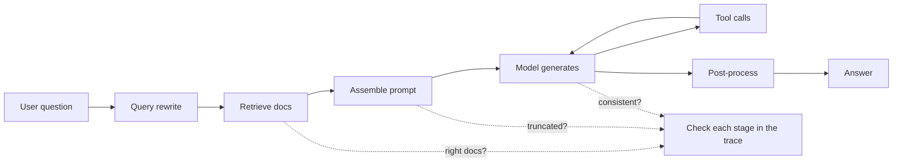

## In one minute
- LLM features fail in new ways: the same input can give different outputs, failures are often "wrong but fluent" rather than errors, and a change to a prompt, a model version or the retrieved documents can shift behaviour everywhere at once.
- The fundamentals still apply: reproduce, isolate, form hypotheses, test them. You just need different evidence: full traces of prompts, retrieved context, tool calls and outputs.
- Split the pipeline and find the failing stage: was the right context retrieved, was the prompt assembled correctly, did the model reason wrongly, did a tool fail, did post-processing break the output?
- Evals are your test suite: a set of real cases with checks, run on every prompt, model or retrieval change, compared against the previous version case by case.
- Treat prompts, model versions and retrieval settings as code: versioned, reviewed, rolled out gradually and rolled back when evals or production metrics drop.

## How it works

### What is different
Classic bugs are deterministic: the same input gives the same wrong output, so a failing test reproduces it. LLM systems add three complications. **Nondeterminism**: sampling, and even batching on the provider's side, can change outputs between runs. **Silent failure**: a wrong answer looks exactly like a right one, so there is no exception or 500 to alert on. **Global coupling**: one prompt or model change affects every request, so a fix for one case can quietly break twenty others.

### Trace everything
You cannot debug what you cannot see. For each request, record the model and version, sampling parameters, the full assembled prompt (system prompt, instructions, retrieved documents, conversation), every tool call with arguments and results, the raw output, the post-processed output, token counts and latency. Store traces with a request ID, so a user complaint ("it told me the wrong refund policy") becomes a trace you can open and read. Redact personal data before storage, as you would for any log.

### Find the failing stage
A typical retrieval-augmented pipeline has stages: query rewriting, retrieval, prompt assembly, generation, tool use and post-processing. Localise the failure like any other bug, stage by stage:

1. **Retrieval:** were the right documents in the context? If the correct refund policy was never retrieved, no prompt change will fix it. Check the query, the top results and their scores.
2. **Assembly:** was the context actually included, in the right order, without truncation? Token limits silently cut the end of long prompts.
3. **Generation:** given good context, did the model answer wrongly? Try the same prompt several times to see if it is consistent or flaky.
4. **Tools:** did a tool return an error the model ignored, or did the model call it with wrong arguments?
5. **Post-processing:** did a parser drop fields, or did a guardrail filter strip the answer?

This is bisection applied to a pipeline: test the midpoint, keep the half that is broken.

### Evals as regression tests
An eval set is a list of real inputs, each with a check: an exact expected value, a rule ("must cite a policy document", "must not mention competitor names"), or a grader (a human or a model judging against a rubric). Build it from production failures and from the cases that matter most. Run it on every change and compare case by case with the last version, not just the average: a pass rate that goes from 91 to 92 percent can hide five critical cases that started failing. Because outputs vary, run important cases several times and track their pass rates.

Two habits make evals useful. Start from real failures and keep looking at traces: Hamel Husain describes cheap unit-test assertions first, then human review of logged traces and a model judge calibrated against human labels ([Husain](https://hamel.dev/blog/posts/evals/)). For agents, run several trials per task. Anthropic's example: a 75% per-trial success rate gives only about 42% odds of passing three trials in a row, so measure consistency, not just best-of-k, when users need reliability, and read the transcripts to check that graders are not rejecting valid answers ([Anthropic](https://www.anthropic.com/engineering/demystifying-evals-for-ai-agents)).

### Change control
Version prompts in the repository. Pin model versions rather than floating aliases, so a provider update does not change behaviour under you unexpectedly. Roll changes out behind flags to a small share of traffic, compare production metrics (thumbs-down rate, escalations to humans, task completion), and keep the old version ready to restore. Pinning is not enough on its own: in 2025 Anthropic had three infrastructure bugs (misrouted requests, corrupted token output, a compiler bug in approximate top-k) that degraded answers for weeks while its standard evals stayed quiet, partly because the model often recovers from an isolated mistake. Its fixes were more sensitive evals and continuous quality evals on production traffic ([Anthropic postmortem](https://www.anthropic.com/engineering/a-postmortem-of-three-recent-issues)). Watch the provider's behaviour too, not just your own diffs.

## Down the stack

### Layer 1: The contract
An LLM feature's contract is statistical: for its eval set, at least X percent of cases pass, critical cases always pass, latency and cost stay within budgets, and production quality metrics stay above thresholds. A change ships only if it keeps that contract, judged by evals run before rollout and metrics watched during it.

### Layer 2: The mechanism
Tracing uses the same machinery as distributed tracing: each request gets a trace ID, and each stage (retrieval, model call, tool call) is a span with attributes such as model name, input and output token counts and finish reason. OpenTelemetry defines semantic conventions for generative AI spans, now maintained in their own repository ([OpenTelemetry GenAI conventions](https://github.com/open-telemetry/semantic-conventions-genai)), so traces can flow into standard backends; check which version of the conventions your instrumentation library emits. Evals are a harness that loads cases, runs the pipeline at a fixed configuration, applies checks, and writes results keyed by case ID, so two runs can be diffed. A model's finish reason is a useful field: `max_tokens` (or `length`) means the output was cut off, which explains many "the JSON is invalid" bugs.

### Layer 3: The machine
Nondeterminism has concrete causes. With temperature above zero, the model samples the next token from a probability distribution, so different runs pick different tokens and diverge. Even at temperature zero, outputs can differ, because floating-point addition is not associative and inference servers batch requests together: different batch sizes change the order of operations in matrix multiplications on the GPU, which changes the last bits of the logits, which occasionally flips which token is most likely. That is why "it worked when I tried it" is weak evidence, and why evals run each important case several times. The batching part is the real driver: Thinking Machines ran one prompt 1,000 times at temperature 0 on a 235B model and got 80 distinct outputs, first diverging at token 103. They traced it to kernels that are not batch-invariant, so an answer depends on how busy the server was; with batch-invariant kernels all 1,000 matched, at a speed cost ([Thinking Machines, 2025](https://thinkingmachines.ai/blog/defeating-nondeterminism-in-llm-inference/)). The popular "concurrent threads plus floating point" story is incomplete, since the forward pass is deterministic for a fixed batch.

### Why it's built this way
1. Outputs are sampled and can vary, so single runs are anecdotes, not evidence.
2. Failures are silent, so you need explicit checks rather than error rates.
3. Pipelines have many stages, so traces of each stage are needed to localise faults.
4. Changes are global, so per-case comparison against the previous version catches hidden regressions.
5. Therefore: trace, evaluate case by case, version and roll out gradually.

## Diagram


## Worked example
A support assistant answers 40,000 questions a day. After a release, thumbs-down feedback rises from 6 to 9 percent, mostly on refund questions. The release changed two things: a new prompt section about tone, and a switch to a cheaper embedding model for retrieval.

The engineer opens 30 thumbs-down traces. In 22 of them, the retrieved documents are about shipping, not refunds: the refund policy document is ranked 7th, and only the top 5 go into the prompt. In the other 8, the right document was retrieved but the answer was still wrong; rerunning those prompts 10 times gives the right answer 9 times out of 10, so those are mostly ordinary model variance that existed before the release.

Hypothesis: the new embedding model ranks the refund policy lower. Test: run the 400-case eval set with the old and new embedding models while keeping the new prompt. Pass rate on refund cases: 94 percent with the old embeddings, 71 percent with the new ones; other categories barely change. The team rolls back the embedding change, adds 50 refund questions from production to the eval set, and later reintroduces the cheaper model with a reranker, which recovers 95 percent on the refund cases. The tone change was innocent; without traces and per-category evals, it would likely have been blamed first, because it was the change people remembered.

## In the wild
- **Anthropic, 2025: three bugs quietly degraded Claude's answers.** A routing error sent some Sonnet 4 requests to servers built for a longer context (16% of requests at the worst hour, and about 30% of Claude Code users hit it at least once); a TPU misconfiguration produced stray tokens such as Thai text in English replies; a latent compiler bug could drop the most likely token. Evals missed them and privacy controls limited how much engineers could inspect, so detection was slow ([Anthropic](https://www.anthropic.com/engineering/a-postmortem-of-three-recent-issues)).
- **Air Canada, 2024: a chatbot invented a refund rule and the airline was held to it.** The website chatbot told a grieving customer he could claim a bereavement fare retroactively. Staff later said that was not allowed. A British Columbia tribunal rejected the airline's argument that it was not responsible for what its chatbot said and awarded $650.88 in damages ([summary of Moffatt v. Air Canada, 2024 BCCRT 149](https://ehlaw.ca/?p=22062)). A trace of the answer and its retrieved sources is how you would have caught the gap before a customer did.

## Trade-offs
| Technique | Strengths | Weaknesses | Choose when |
| --- | --- | --- | --- |
| Full prompt and output tracing | Debuggable, auditable | Storage cost, privacy handling | Always, with redaction and retention limits |
| Exact-match evals | Cheap, deterministic | Only fits structured outputs | Classification, extraction, JSON |
| Rule-based checks | Clear, fast | Miss subtle quality issues | Must-include and must-not-include rules |
| Model-graded evals | Scales to open-ended answers | Grader can be wrong or biased | Large sets, calibrated against humans |
| Human review | Highest judgment | Slow, expensive | Critical cases, calibrating graders |

## Pitfalls in production
- Debugging from a single run. Fix: repeat the case several times and look at the distribution.
- Fixing retrieval failures with prompt edits. Fix: check the trace first; if the right context is missing, fix retrieval.
- Floating model aliases that change under you. Fix: pin versions, and upgrade deliberately with evals.
- Comparing only average eval scores. Fix: per-case and per-category diffs, with critical cases that must always pass.
- Silent truncation from token limits. Fix: alert on finish reason `max_tokens` and on prompt sizes near the limit.

## Leadership lens
- Make tracing and an eval set a launch requirement for any LLM feature, the same as logs and tests for a service.
- Grow the eval set from production failures every week; it is the team's memory of what went wrong.
- Review prompt and model changes like code, and roll them out behind flags with a fast rollback.
- Watch quality metrics in production, not just latency and errors: feedback, escalations, task completion.

## Check yourself
1. Why might a prompt change not fix a wrong answer about refund policy?
   **Answer:** If retrieval never put the policy document into the context, the model cannot use it; the failure is in retrieval, not generation.
2. Why can outputs differ between runs even at temperature zero?
   **Answer:** Batching and floating-point non-associativity on the inference servers change computations slightly, which can flip the most likely token.
3. Your eval pass rate rose from 91 to 92 percent after a change. Why is that not enough to ship?
   **Answer:** Averages hide per-case regressions; some important cases may have started failing while others improved, so compare case by case.
4. What does a finish reason of `max_tokens` tell you?
   **Answer:** The output was cut off at the token limit, which explains truncated answers and invalid structured output.

## Practice
**Task:** Build the eval gate that runs before a prompt or model change ships. `compare(baseline, candidate, critical, max_drop)` takes two dicts mapping case IDs to pass (true) or fail (false), a list of critical case IDs, and the largest allowed drop in pass rate (for example 0.02). Only cases present in both runs count. Return a dict with `regressions` (sorted case IDs that passed in baseline and fail in candidate), `fixed` (sorted IDs that failed and now pass), `baseline_rate` and `candidate_rate` (pass rates over shared cases, rounded to 4 decimal places) and `ship` (true only if no critical case regressed and the pass rate fell by no more than `max_drop`).

```python starter
def compare(baseline, candidate, critical, max_drop):
    # TODO
    raise NotImplementedError
```

```python tests
def test_identical_runs_ship():
    b = {"c1": True, "c2": False}
    r = compare(b, dict(b), [], 0.0)
    assert r["regressions"] == [] and r["fixed"] == [] and r["ship"]
    assert r["baseline_rate"] == 0.5 and r["candidate_rate"] == 0.5

def test_regressions_and_fixes():
    b = {"a": True, "b": True, "c": False, "d": True}
    c = {"a": True, "b": False, "c": True, "d": True}
    r = compare(b, c, [], 0.0)
    assert r["regressions"] == ["b"] and r["fixed"] == ["c"]
    assert r["ship"]

def test_critical_regression_blocks():
    b = {"refund-1": True, "x": False}
    c = {"refund-1": False, "x": True}
    r = compare(b, c, ["refund-1"], 1.0)
    assert not r["ship"]

def test_rate_drop_threshold():
    b = {"a": True, "b": True, "c": True, "d": True}
    c = {"a": True, "b": True, "c": True, "d": False}
    assert not compare(b, c, [], 0.2)["ship"]
    assert compare(b, c, [], 0.25)["ship"]

def test_only_shared_cases_count():
    b = {"a": True, "old": False}
    c = {"a": True, "new": False}
    r = compare(b, c, [], 0.0)
    assert r["baseline_rate"] == 1.0 and r["candidate_rate"] == 1.0

def test_rounding():
    b = {"a": True, "b": True, "c": False}
    r = compare(b, dict(b), [], 0.0)
    assert r["baseline_rate"] == 0.6667
```

```python solution
def compare(baseline, candidate, critical, max_drop):
    shared = sorted(set(baseline) & set(candidate))
    regressions = [k for k in shared if baseline[k] and not candidate[k]]
    fixed = [k for k in shared if not baseline[k] and candidate[k]]
    n = len(shared)
    b_rate = sum(baseline[k] for k in shared) / n if n else 0.0
    c_rate = sum(candidate[k] for k in shared) / n if n else 0.0
    crit = set(critical)
    ship = not any(k in crit for k in regressions) and (b_rate - c_rate) <= max_drop + 1e-12
    return {"regressions": regressions, "fixed": fixed,
            "baseline_rate": round(b_rate, 4), "candidate_rate": round(c_rate, 4), "ship": ship}
```

```typescript starter
export interface EvalDiff {
  regressions: string[]; fixed: string[]; baseline_rate: number; candidate_rate: number; ship: boolean;
}

export function compare(baseline: Record<string, boolean>, candidate: Record<string, boolean>,
                        critical: string[], maxDrop: number): EvalDiff {
  throw new Error("TODO");
}
```

```typescript tests
test("identical runs ship", () => {
  const b = { c1: true, c2: false };
  const r = compare(b, { ...b }, [], 0);
  assertEqual(r, { regressions: [], fixed: [], baseline_rate: 0.5, candidate_rate: 0.5, ship: true });
});

test("regressions and fixes", () => {
  const r = compare({ a: true, b: true, c: false, d: true }, { a: true, b: false, c: true, d: true }, [], 0);
  assertEqual(r.regressions, ["b"]);
  assertEqual(r.fixed, ["c"]);
  assert(r.ship, "same rate should ship");
});

test("critical regression blocks", () => {
  assert(!compare({ "refund-1": true, x: false }, { "refund-1": false, x: true }, ["refund-1"], 1).ship, "blocked");
});

test("rate drop threshold", () => {
  const b = { a: true, b: true, c: true, d: true }, c = { a: true, b: true, c: true, d: false };
  assert(!compare(b, c, [], 0.2).ship, "drop 0.25 > 0.2");
  assert(compare(b, c, [], 0.25).ship, "drop 0.25 allowed");
});

test("only shared cases count", () => {
  const r = compare({ a: true, old: false }, { a: true, new: false }, [], 0);
  assertEqual([r.baseline_rate, r.candidate_rate], [1, 1]);
});

test("rounding", () => {
  const b = { a: true, b: true, c: false };
  assertEqual(compare(b, { ...b }, [], 0).baseline_rate, 0.6667);
});
```

```typescript solution
export interface EvalDiff {
  regressions: string[]; fixed: string[]; baseline_rate: number; candidate_rate: number; ship: boolean;
}

export function compare(baseline: Record<string, boolean>, candidate: Record<string, boolean>,
                        critical: string[], maxDrop: number): EvalDiff {
  const shared = Object.keys(baseline).filter(k => k in candidate).sort();
  const regressions = shared.filter(k => baseline[k] && !candidate[k]);
  const fixed = shared.filter(k => !baseline[k] && candidate[k]);
  const n = shared.length;
  const b = n ? shared.filter(k => baseline[k]).length / n : 0;
  const c = n ? shared.filter(k => candidate[k]).length / n : 0;
  const round = (x: number) => Math.round(x * 10000) / 10000;
  const ship = !regressions.some(k => critical.includes(k)) && b - c <= maxDrop + 1e-12;
  return { regressions, fixed, baseline_rate: round(b), candidate_rate: round(c), ship };
}
```

```go starter
package practice

type EvalDiff struct {
	Regressions, Fixed           []string
	BaselineRate, CandidateRate float64
	Ship                        bool
}

func Compare(baseline, candidate map[string]bool, critical []string, maxDrop float64) EvalDiff {
	panic("TODO")
}
```

```go tests
package practice

import (
	"reflect"
	"testing"
)

func strs(t *testing.T, got, want []string) {
	t.Helper()
	if len(got) == 0 && len(want) == 0 {
		return
	}
	if !reflect.DeepEqual(got, want) {
		t.Fatalf("got %v, want %v", got, want)
	}
}

func TestIdentical(t *testing.T) {
	b := map[string]bool{"c1": true, "c2": false}
	r := Compare(b, map[string]bool{"c1": true, "c2": false}, nil, 0)
	if !r.Ship || r.BaselineRate != 0.5 || r.CandidateRate != 0.5 || len(r.Regressions) != 0 {
		t.Fatalf("got %+v", r)
	}
}

func TestRegressionsAndFixes(t *testing.T) {
	r := Compare(map[string]bool{"a": true, "b": true, "c": false, "d": true}, map[string]bool{"a": true, "b": false, "c": true, "d": true}, nil, 0)
	strs(t, r.Regressions, []string{"b"})
	strs(t, r.Fixed, []string{"c"})
	if !r.Ship {
		t.Fatal("should ship")
	}
}

func TestCriticalBlocks(t *testing.T) {
	r := Compare(map[string]bool{"refund-1": true, "x": false}, map[string]bool{"refund-1": false, "x": true}, []string{"refund-1"}, 1)
	if r.Ship {
		t.Fatal("critical regression must block")
	}
}

func TestRateDrop(t *testing.T) {
	b := map[string]bool{"a": true, "b": true, "c": true, "d": true}
	c := map[string]bool{"a": true, "b": true, "c": true, "d": false}
	if Compare(b, c, nil, 0.2).Ship || !Compare(b, c, nil, 0.25).Ship {
		t.Fatal("threshold wrong")
	}
}

func TestSharedOnly(t *testing.T) {
	r := Compare(map[string]bool{"a": true, "old": false}, map[string]bool{"a": true, "new": false}, nil, 0)
	if r.BaselineRate != 1 || r.CandidateRate != 1 {
		t.Fatalf("got %+v", r)
	}
}

func TestRounding(t *testing.T) {
	b := map[string]bool{"a": true, "b": true, "c": false}
	if r := Compare(b, b, nil, 0); r.BaselineRate != 0.6667 {
		t.Fatalf("got %v", r.BaselineRate)
	}
}
```

```go solution
package practice

import (
	"math"
	"sort"
)

type EvalDiff struct {
	Regressions, Fixed           []string
	BaselineRate, CandidateRate float64
	Ship                        bool
}

func Compare(baseline, candidate map[string]bool, critical []string, maxDrop float64) EvalDiff {
	var shared []string
	for k := range baseline {
		if _, ok := candidate[k]; ok {
			shared = append(shared, k)
		}
	}
	sort.Strings(shared)
	crit := map[string]bool{}
	for _, c := range critical {
		crit[c] = true
	}
	var d EvalDiff
	bPass, cPass, critHit := 0, 0, false
	for _, k := range shared {
		if baseline[k] {
			bPass++
		}
		if candidate[k] {
			cPass++
		}
		if baseline[k] && !candidate[k] {
			d.Regressions = append(d.Regressions, k)
			if crit[k] {
				critHit = true
			}
		}
		if !baseline[k] && candidate[k] {
			d.Fixed = append(d.Fixed, k)
		}
	}
	var b, c float64
	if n := float64(len(shared)); n > 0 {
		b, c = float64(bPass)/n, float64(cPass)/n
	}
	round := func(x float64) float64 { return math.Round(x*10000) / 10000 }
	d.BaselineRate, d.CandidateRate = round(b), round(c)
	d.Ship = !critHit && b-c <= maxDrop+1e-12
	return d
}
```

## Mock interview
**Prompt:** You own an LLM assistant inside a banking app, answering 200,000 questions a day using retrieval over 3,000 policy documents. Customers complain that it sometimes gives outdated fee information. There are no errors in the logs. How do you investigate, fix it and stop it from happening again?

- Follow-up: The model provider releases a new version that is cheaper and faster. How do you decide whether to switch?
- Follow-up: Your eval set has 300 cases. How do you know it covers what matters?
- Follow-up: Legal wants every answer about fees to be traceable to a source document. How does that change the design?

**A strong answer covers:**
- Tracing to make silent failures visible: the prompt, retrieved documents, model version and output per request.
- Localising by stage: are outdated documents being retrieved (index freshness, duplicates), or is the model ignoring current ones?
- Fixes at the right layer: removing or demoting stale documents, metadata filters on effective dates, citations required in answers.
- Evals built from real complaints, with critical fee cases that must always pass, compared case by case across versions.
- Model upgrades treated as changes: pinned versions, evals, gradual rollout, metrics and rollback.
- Production quality signals beyond errors: feedback rates, escalations and audit sampling.

## Sources and further study
**Primary**
- [Thinking Machines, Defeating Nondeterminism in LLM Inference (2025)](https://thinkingmachines.ai/blog/defeating-nondeterminism-in-llm-inference/): why temperature-0 outputs still vary, with measurements and a fix.
- [Anthropic, A postmortem of three recent issues](https://www.anthropic.com/engineering/a-postmortem-of-three-recent-issues): a provider's own account of silent quality regressions and why evals missed them.

**Systems docs**
- [OpenTelemetry GenAI semantic conventions](https://github.com/open-telemetry/semantic-conventions-genai): span, metric and event names for model and tool calls.
- [Summary of Moffatt v. Air Canada](https://ehlaw.ca/?p=22062): the tribunal's reasoning on a chatbot's wrong answer.

**Books**
- *Site Reliability Engineering*, Google, chapter 12 "Effective Troubleshooting": hypothesis-driven debugging that maps onto stage-by-stage localisation.
- *Observability Engineering*, Majors, Fong-Jones and Miranda, chapter 8 "Analyzing Events to Achieve Observability": debugging from first principles using rich per-request events.
- *Observability Engineering*, chapter 5 "Structured Events Are the Building Blocks of Observability": why wide, per-request records beat aggregate metrics for finding odd failures.

## Free resources
- [Your AI Product Needs Evals (Hamel Husain)](https://hamel.dev/blog/posts/evals/): building evals from real failures, levels of testing.
- [A Field Guide to Rapidly Improving AI Products (Hamel Husain)](https://hamel.dev/blog/posts/field-guide/): error analysis and looking at your data.
- [Demystifying evals for AI agents (Anthropic)](https://www.anthropic.com/engineering/demystifying-evals-for-ai-agents): how to evaluate multi-step agent behaviour.
- [Patterns for Building LLM-based Systems (Eugene Yan)](https://eugeneyan.com/writing/llm-patterns/): evals, retrieval, guardrails and caching.
- [Define success criteria and build evaluations (Anthropic docs)](https://docs.anthropic.com/en/docs/test-and-evaluate/develop-tests): writing measurable criteria and test cases.
