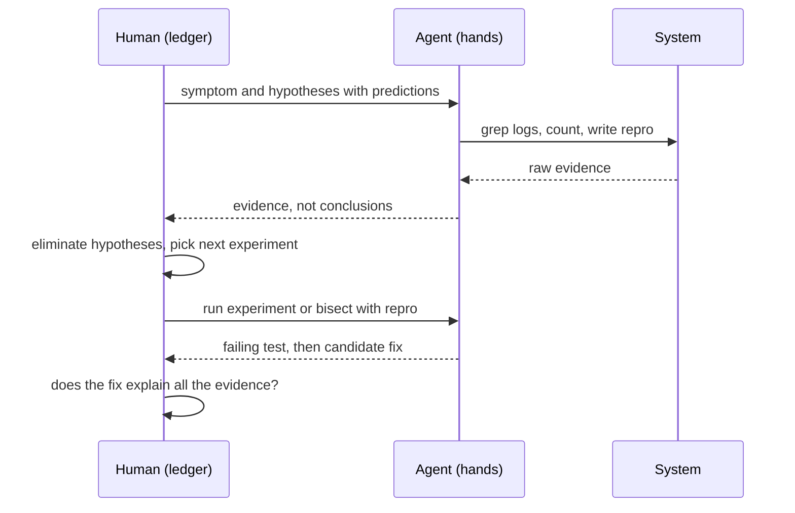

## In one minute
- Agents are excellent debugging hands: they read logs, grep code, write reproduction scripts, run bisects and try experiments faster than you can type. They are unreliable debugging heads: they jump to the most common cause and "fix" symptoms.
- Keep the hypothesis ledger yourself. Write down the symptom, the hypotheses, what each predicts and what evidence would rule it out, and use the agent to gather that evidence.
- Ask for a failing test or a reproduction before any fix. A fix without a reproduction is a guess with a commit message.
- Reject symptom fixes: added retries, broader `try`/`except`, longer timeouts, or deleted assertions are often the agent making the error go away, not making the bug go away.
- Use parallelism on purpose: several sub-agents can test competing hypotheses at once, as long as each reports evidence rather than conclusions.

## How it works

### Hands, not head
Debugging is a loop of observing, hypothesising, predicting and testing. Agents speed up the mechanical parts dramatically: "find every place we call `datetime.now()` in the checkout package", "write a script that sends 500 concurrent requests and counts duplicate orders", "run `git bisect` between v2.3 and v2.4 using this test". They are weaker at the parts that need judgment: noticing which observation is surprising, keeping several explanations alive at once, and refusing a plausible fix that does not explain all the evidence. Models are trained on huge amounts of code and bug reports, so they reach for the statistically common cause; your bug may be the rare one.

### The ledger
Keep a short written ledger, in a file the agent can read too:

- **Symptom**, precisely: "about 0.3 percent of orders are created twice, only for mobile clients, since Tuesday".
- **Hypotheses**, each with a prediction: "H1, client retries after timeout: duplicates share a client request ID and arrive 10 to 30 s apart." "H2, a queue redelivers: duplicates share a message ID and have no client retry in the logs." "H3, a race in the order handler: duplicates arrive within 50 ms."
- **Evidence** gathered, and which hypotheses it eliminates.
- **Next experiment**: the one that best separates the remaining hypotheses.

The agent gathers evidence; you update the ledger. This keeps the reasoning visible and stops the session from drifting into a fix for whichever hypothesis the agent liked first. Early wrong guesses stick even for experts: in Cloudflare's November 2025 outage the team first believed a huge DDoS attack was under way, because errors came and went as a database cluster was updated node by node and the status page happened to fail too ([Cloudflare](https://blog.cloudflare.com/18-november-2025-outage/)).

### Reproduce first
Ask the agent to turn the symptom into a failing test or a reproduction script before it changes any code. Anthropic's own guidance for Claude Code says the same: give the agent a check it can run, and describe the symptom, the likely location and what fixed looks like ([Claude Code best practices](https://code.claude.com/docs/en/best-practices)). If it cannot reproduce the bug, that is information: your hypotheses about the trigger are wrong or incomplete. If it can, you have an oracle for the fix and for bisecting, and a regression test for free.

### Recognise symptom fixes
Some changes make failures disappear without fixing anything. Agents propose them often, because they make tests pass:

- Adding a retry around the failing call (now the duplicate order is retried too).
- Catching and ignoring the exception.
- Increasing a timeout until the flaky test passes.
- Loosening an assertion or marking a test as skipped.
- Adding a `sleep` to avoid a race.

Each can be right in some situations, but each needs an explanation of the root cause first. The same guidance suggests asking explicitly to "address the root cause, don't suppress the error" ([Claude Code best practices](https://code.claude.com/docs/en/best-practices)). Ask: "What is the root cause, what evidence shows it, and why does this change address the cause rather than the symptom?"

### Parallel hypotheses
With sub-agents, you can test hypotheses side by side: one checks client logs for retries, one checks queue delivery counts, one writes a concurrency test. Ask each for evidence in a fixed form, such as counts, log lines and file locations, not "I believe the cause is". You merge the evidence into the ledger.

## Down the stack

### Layer 1: The contract
Agent-assisted debugging promises the same outcome as any debugging: a root cause supported by evidence, a reproduction that fails before the fix and passes after, and a fix that addresses the cause. The agent's role is to gather evidence and run experiments; the human is accountable for the conclusion.

### Layer 2: The mechanism
Agents debug through tools: shell commands (`grep`, `rg`, `jq` over logs, `git log -S` to find when a string appeared, `git bisect run` with a test script), test runners, database read queries, and increasingly browser and runtime tools such as Chrome DevTools over MCP (public preview since September 2025), which let an agent read console errors, network requests and performance traces. `git bisect run ./repro.sh` is a good example of a perfect agent task: the script's exit code (0 good, 1 to 127 except 125 bad, 125 skip, anything above 127 aborts, per the [git documentation](https://git-scm.com/docs/git-bisect)) drives a binary search over commits, about log2(N) steps, so 1,000 commits take about 10 test runs.

### Layer 3: The machine
Much debugging evidence comes from the operating system, and agents can collect it quickly if allowed: `strace -f -e trace=network` shows every `connect` and `sendto` a process makes; `ss -tanp` lists sockets and their states, revealing connection-pool exhaustion as hundreds of sockets in `CLOSE_WAIT`; `perf top` shows which functions consume CPU; core dumps capture memory at a crash. The machine's view is ground truth in a way the agent's interpretation is not, so ask for raw output alongside any summary, and read the raw output yourself for the key experiments.

### Why it's built this way
1. Debugging needs many cheap experiments, which agents run quickly.
2. Agents pattern-match to common causes and optimise for green tests.
3. So the reasoning (hypotheses, predictions, eliminations) must stay explicit and human-owned.
4. Reproductions turn hypotheses into checkable oracles for both the fix and the agent.
5. Raw evidence from the machine keeps everyone honest, human and agent alike.

## Diagram


## Worked example
Duplicate orders: 0.3 percent of mobile orders since Tuesday, about 400 a day. The engineer opens a session and writes the ledger with three hypotheses: client retries (H1), queue redelivery (H2) and a race in the handler (H3).

First, the agent proposes a fix immediately: "add a unique constraint on (user_id, cart_id)". The engineer declines: that might stop the symptom, but it does not explain Tuesday, and it would also block legitimate re-orders from the same cart. Instead, they ask for evidence. The agent queries one day of duplicates: in 97 percent of pairs the client request IDs differ, which argues against simple client retries with the same ID (H1 as stated), and the gaps cluster between 9 and 11 seconds. Queue logs show each message delivered once (H2 unlikely). The 10-second gap does not fit a 50 ms race (H3 unlikely).

New hypothesis H4: something on the client creates a new request after about 10 seconds. The agent searches the mobile app's changes since Tuesday and finds a release that added a 10-second "still working?" timeout, after which the app re-submits the checkout with a new request ID. The agent writes a reproduction against staging using a slowed backend: two orders, 10 seconds apart. The real fix is in the client (reuse the request ID on re-submit) plus server-side idempotency keyed on a checkout session ID. The reproduction fails before and passes after. The quick unique-constraint fix would have hidden the problem and blocked real customers.

## In the wild
- **Cloudflare, 2025-11: the wrong first hypothesis cost hours.** A database permissions change made a query return duplicate rows, so a bot-management feature file doubled in size and passed a hard limit of 200 features (about 60 were in use). The proxy crashed. Because the file was regenerated every five minutes by a cluster being updated gradually, failures flickered, and the team first suspected a DDoS. The file was identified as the trigger about two hours after onset and total impact lasted about 5 hours 46 minutes ([Cloudflare](https://blog.cloudflare.com/18-november-2025-outage/)).
- **Replit, 2025-07: an agent with write access to production deleted a live database.** Replit's AI coding tool reportedly deleted a production database despite an instruction to freeze code, and the vendor responded by working on automatic separation of development and production databases ([The Register](https://www.theregister.com/2025/07/22/replit_saastr_response/)). Treat the founder's account as unverified, but the control it points to is real: investigation agents get read-only access.

## Trade-offs
| Approach | Strengths | Weaknesses | Choose when |
| --- | --- | --- | --- |
| Agent fixes directly | Fastest when the cause is common | Symptom fixes, wrong root cause | Trivial, well-understood errors |
| Human ledger, agent gathers evidence | Fast and rigorous | Requires discipline | Most real bugs |
| Parallel sub-agents per hypothesis | Tests many ideas at once | More cost, merging effort | Several plausible causes, urgent bugs |
| Human only | Full understanding | Slow on mechanical work | Sensitive systems where agents lack access |

## Pitfalls in production
- Accepting the first plausible fix. Fix: require the root cause and evidence that rules out the alternatives.
- No reproduction, so nobody can tell whether the fix works. Fix: failing test or script before changing code.
- Retries, catches, sleeps and timeouts used as fixes. Fix: treat them as suspicious until the cause is explained.
- Summaries instead of evidence. Fix: ask for raw counts, log lines and command output.
- Giving a debugging agent write access to production to "check something". Fix: read-only access and replicas; changes go through normal deploys. In July 2025 a Replit agent reportedly deleted a live database despite a code freeze ([The Register](https://www.theregister.com/2025/07/22/replit_saastr_response/)).

## Leadership lens
- Teach the ledger habit: symptom, hypotheses with predictions, evidence, next experiment. It works with or without agents.
- Make "reproduction first" a team norm for bug fixes, enforced in review: every bug-fix pull request includes a test that failed before.
- Give agents good read-only debugging tools (log queries, trace search, replicas), and keep production writes out of reach.
- In postmortems, note when an early symptom fix delayed finding the root cause; it is a common, teachable pattern.

## Check yourself
1. An agent proposes wrapping a failing HTTP call in three retries. What do you ask before accepting it?
   **Answer:** What is the root cause of the failures, what evidence supports it, and is the call idempotent? Retries may hide the cause and can duplicate side effects.
2. Why should the agent report evidence rather than conclusions?
   **Answer:** Conclusions hide the reasoning and the agent's bias toward common causes; raw evidence lets you check it and eliminate hypotheses yourself.
3. Why is a reproduction so valuable when working with an agent?
   **Answer:** It is an objective oracle: it proves the bug exists, drives bisection, shows whether a fix works and becomes a regression test.
4. How does `git bisect run` decide which half to keep?
   **Answer:** It runs the script at the midpoint commit and uses the exit code: 0 marks it good, 1 to 127 except 125 marks it bad, and 125 skips it.

## Practice
**Task:** Build the hypothesis ledger as code. Each hypothesis has an `id`, a `prior` (0 to 1) and `predicts`, a dict mapping signal names to the expected boolean. `rank(hypotheses, observations)` takes observed signals (a dict of signal to boolean) and returns the IDs of hypotheses that no observation contradicts, sorted by score (prior times one plus the number of confirmed predictions) from highest to lowest, ties broken by ID. `next_experiment(hypotheses, observations)` returns the unobserved signal that best splits the surviving hypotheses: for each signal, count surviving hypotheses that predict true and that predict false, and pick the signal with the largest minimum of the two (ties broken alphabetically). Return `None` if no signal splits them.

```python starter
def rank(hypotheses, observations):
    # TODO
    raise NotImplementedError

def next_experiment(hypotheses, observations):
    # TODO
    raise NotImplementedError
```

```python tests
H = [
    {"id": "client-retry", "prior": 0.5, "predicts": {"same_request_id": True, "gap_10s": True}},
    {"id": "queue-redelivery", "prior": 0.3, "predicts": {"same_request_id": True, "same_message_id": True}},
    {"id": "handler-race", "prior": 0.2, "predicts": {"gap_10s": False, "same_request_id": False}},
    {"id": "client-resubmit", "prior": 0.1, "predicts": {"same_request_id": False, "gap_10s": True}},
]

def test_no_evidence_ranks_by_prior():
    assert rank(H, {}) == ["client-retry", "queue-redelivery", "handler-race", "client-resubmit"]

def test_contradicted_hypotheses_are_eliminated():
    assert rank(H, {"same_request_id": False}) == ["handler-race", "client-resubmit"]

def test_confirmations_raise_score():
    assert rank(H, {"same_request_id": False, "gap_10s": True}) == ["client-resubmit"]

def test_next_experiment_splits_survivors():
    assert next_experiment(H, {}) == "same_request_id"
    assert next_experiment(H, {"same_request_id": False}) == "gap_10s"

def test_no_split_returns_none():
    assert next_experiment(H, {"same_request_id": False, "gap_10s": True}) is None

def test_ties_broken_by_id():
    hs = [{"id": "b", "prior": 0.5, "predicts": {}}, {"id": "a", "prior": 0.5, "predicts": {}}]
    assert rank(hs, {}) == ["a", "b"]
```

```python solution
def _alive(h, observations):
    return all(observations[s] == v for s, v in h["predicts"].items() if s in observations)

def rank(hypotheses, observations):
    scored = []
    for h in hypotheses:
        if not _alive(h, observations):
            continue
        confirmed = sum(1 for s, v in h["predicts"].items() if s in observations and observations[s] == v)
        scored.append((-h["prior"] * (1 + confirmed), h["id"]))
    return [i for _, i in sorted(scored)]

def next_experiment(hypotheses, observations):
    alive = [h for h in hypotheses if _alive(h, observations)]
    signals = sorted({s for h in alive for s in h["predicts"] if s not in observations})
    best, best_split = None, 0
    for s in signals:
        t = sum(1 for h in alive if h["predicts"].get(s) is True)
        f = sum(1 for h in alive if h["predicts"].get(s) is False)
        if min(t, f) > best_split:
            best, best_split = s, min(t, f)
    return best
```

```typescript starter
export interface Hypothesis { id: string; prior: number; predicts: Record<string, boolean>; }

export function rank(hypotheses: Hypothesis[], observations: Record<string, boolean>): string[] {
  throw new Error("TODO");
}

export function nextExperiment(hypotheses: Hypothesis[], observations: Record<string, boolean>): string | null {
  throw new Error("TODO");
}
```

```typescript tests
const H: Hypothesis[] = [
  { id: "client-retry", prior: 0.5, predicts: { same_request_id: true, gap_10s: true } },
  { id: "queue-redelivery", prior: 0.3, predicts: { same_request_id: true, same_message_id: true } },
  { id: "handler-race", prior: 0.2, predicts: { gap_10s: false, same_request_id: false } },
  { id: "client-resubmit", prior: 0.1, predicts: { same_request_id: false, gap_10s: true } },
];

test("no evidence ranks by prior", () => {
  assertEqual(rank(H, {}), ["client-retry", "queue-redelivery", "handler-race", "client-resubmit"]);
});

test("contradicted hypotheses are eliminated", () => {
  assertEqual(rank(H, { same_request_id: false }), ["handler-race", "client-resubmit"]);
});

test("confirmations raise score", () => {
  assertEqual(rank(H, { same_request_id: false, gap_10s: true }), ["client-resubmit"]);
});

test("next experiment splits survivors", () => {
  assertEqual(nextExperiment(H, {}), "same_request_id");
  assertEqual(nextExperiment(H, { same_request_id: false }), "gap_10s");
});

test("no split returns null", () => {
  assertEqual(nextExperiment(H, { same_request_id: false, gap_10s: true }), null);
});

test("ties broken by id", () => {
  assertEqual(rank([{ id: "b", prior: 0.5, predicts: {} }, { id: "a", prior: 0.5, predicts: {} }], {}), ["a", "b"]);
});
```

```typescript solution
export interface Hypothesis { id: string; prior: number; predicts: Record<string, boolean>; }

const alive = (h: Hypothesis, obs: Record<string, boolean>) =>
  Object.keys(h.predicts).every(s => !(s in obs) || obs[s] === h.predicts[s]);

export function rank(hypotheses: Hypothesis[], observations: Record<string, boolean>): string[] {
  return hypotheses.filter(h => alive(h, observations))
    .map(h => {
      const confirmed = Object.keys(h.predicts).filter(s => s in observations && observations[s] === h.predicts[s]).length;
      return { id: h.id, score: h.prior * (1 + confirmed) };
    })
    .sort((a, b) => b.score - a.score || (a.id < b.id ? -1 : a.id > b.id ? 1 : 0))
    .map(x => x.id);
}

export function nextExperiment(hypotheses: Hypothesis[], observations: Record<string, boolean>): string | null {
  const live = hypotheses.filter(h => alive(h, observations));
  const signals = Array.from(new Set(live.flatMap(h => Object.keys(h.predicts)))).filter(s => !(s in observations)).sort();
  let best: string | null = null, bestSplit = 0;
  for (const s of signals) {
    const t = live.filter(h => h.predicts[s] === true).length;
    const f = live.filter(h => h.predicts[s] === false).length;
    if (Math.min(t, f) > bestSplit) { best = s; bestSplit = Math.min(t, f); }
  }
  return best;
}
```

```go starter
package practice

type Hypothesis struct {
	ID       string
	Prior    float64
	Predicts map[string]bool
}

func Rank(hs []Hypothesis, obs map[string]bool) []string {
	panic("TODO")
}

// NextExperiment returns the best signal, or "" if none splits the survivors.
func NextExperiment(hs []Hypothesis, obs map[string]bool) string {
	panic("TODO")
}
```

```go tests
package practice

import (
	"reflect"
	"testing"
)

var hs = []Hypothesis{
	{"client-retry", 0.5, map[string]bool{"same_request_id": true, "gap_10s": true}},
	{"queue-redelivery", 0.3, map[string]bool{"same_request_id": true, "same_message_id": true}},
	{"handler-race", 0.2, map[string]bool{"gap_10s": false, "same_request_id": false}},
	{"client-resubmit", 0.1, map[string]bool{"same_request_id": false, "gap_10s": true}},
}

func TestNoEvidence(t *testing.T) {
	got := Rank(hs, map[string]bool{})
	if !reflect.DeepEqual(got, []string{"client-retry", "queue-redelivery", "handler-race", "client-resubmit"}) {
		t.Fatalf("got %v", got)
	}
}

func TestEliminated(t *testing.T) {
	got := Rank(hs, map[string]bool{"same_request_id": false})
	if !reflect.DeepEqual(got, []string{"handler-race", "client-resubmit"}) {
		t.Fatalf("got %v", got)
	}
}

func TestConfirmations(t *testing.T) {
	got := Rank(hs, map[string]bool{"same_request_id": false, "gap_10s": true})
	if !reflect.DeepEqual(got, []string{"client-resubmit"}) {
		t.Fatalf("got %v", got)
	}
}

func TestNextExperiment(t *testing.T) {
	if NextExperiment(hs, map[string]bool{}) != "same_request_id" {
		t.Fatal("first split")
	}
	if NextExperiment(hs, map[string]bool{"same_request_id": false}) != "gap_10s" {
		t.Fatal("second split")
	}
}

func TestNoSplit(t *testing.T) {
	if NextExperiment(hs, map[string]bool{"same_request_id": false, "gap_10s": true}) != "" {
		t.Fatal("expected no split")
	}
}

func TestTies(t *testing.T) {
	got := Rank([]Hypothesis{{"b", 0.5, nil}, {"a", 0.5, nil}}, map[string]bool{})
	if !reflect.DeepEqual(got, []string{"a", "b"}) {
		t.Fatalf("got %v", got)
	}
}
```

```go solution
package practice

import "sort"

type Hypothesis struct {
	ID       string
	Prior    float64
	Predicts map[string]bool
}

func alive(h Hypothesis, obs map[string]bool) bool {
	for s, v := range h.Predicts {
		if o, ok := obs[s]; ok && o != v {
			return false
		}
	}
	return true
}

func Rank(hs []Hypothesis, obs map[string]bool) []string {
	type scored struct {
		id    string
		score float64
	}
	var list []scored
	for _, h := range hs {
		if !alive(h, obs) {
			continue
		}
		confirmed := 0
		for s, v := range h.Predicts {
			if o, ok := obs[s]; ok && o == v {
				confirmed++
			}
		}
		list = append(list, scored{h.ID, h.Prior * float64(1+confirmed)})
	}
	sort.Slice(list, func(i, j int) bool {
		if list[i].score != list[j].score {
			return list[i].score > list[j].score
		}
		return list[i].id < list[j].id
	})
	out := []string{}
	for _, s := range list {
		out = append(out, s.id)
	}
	return out
}

func NextExperiment(hs []Hypothesis, obs map[string]bool) string {
	var live []Hypothesis
	set := map[string]bool{}
	for _, h := range hs {
		if alive(h, obs) {
			live = append(live, h)
			for s := range h.Predicts {
				if _, seen := obs[s]; !seen {
					set[s] = true
				}
			}
		}
	}
	var signals []string
	for s := range set {
		signals = append(signals, s)
	}
	sort.Strings(signals)
	best, bestSplit := "", 0
	for _, s := range signals {
		t, f := 0, 0
		for _, h := range live {
			if v, ok := h.Predicts[s]; ok {
				if v {
					t++
				} else {
					f++
				}
			}
		}
		m := t
		if f < m {
			m = f
		}
		if m > bestSplit {
			best, bestSplit = s, m
		}
	}
	return best
}
```

## Mock interview
**Prompt:** A payment webhook handler intermittently fails with "deadlock detected" about 50 times a day out of 2 million webhooks. Your coding agent suggests wrapping the transaction in a retry loop with backoff. Walk me through how you would use the agent to find and fix the real cause.

- Follow-up: The agent says it cannot reproduce the deadlock locally. What now?
- Follow-up: Is a retry ever the right answer for deadlocks?
- Follow-up: How do you make sure the fix holds a month from now?

**A strong answer covers:**
- Not accepting the retry first: asking for the root cause and the evidence.
- A ledger of hypotheses with predictions: inconsistent lock ordering across two code paths, concurrent webhooks for the same payment, a new index or foreign key.
- Using the agent for evidence: Postgres deadlock logs listing the two statements and locks, webhook arrival patterns per payment ID, recent schema or code changes.
- A reproduction with concurrent requests against a local database, guided by the evidence.
- The fix at the cause, such as consistent lock ordering or serialising per payment, with retries as a safety net for a known-transient error, not the fix itself.
- A regression test and a metric or alert on deadlock counts.

## Sources and further study
**Primary**
- [Cloudflare, Outage on November 18, 2025](https://blog.cloudflare.com/18-november-2025-outage/): a full timeline showing how a plausible but wrong hypothesis (DDoS) slowed diagnosis.
- [DORA, 2024 Accelerate State of DevOps report](https://dora.dev/research/2024/dora-report/): finds AI adoption raises individual productivity but hurts delivery stability, and that small batches and testing still matter.

**Systems docs**
- [Claude Code best practices](https://code.claude.com/docs/en/best-practices): verification checks, plan mode and fixing root causes rather than suppressing errors.
- [Chrome DevTools MCP announcement](https://developer.chrome.com/blog/chrome-devtools-mcp): which browser evidence an agent can read (console, network, traces).

**Books**
- *Site Reliability Engineering*, Google, chapter 12 "Effective Troubleshooting": theory, hypothesis testing and why negative results are useful.
- *Observability Engineering*, Majors, Fong-Jones and Miranda, chapter 8 "Analyzing Events to Achieve Observability": debugging from first principles.
- *Building Secure and Reliable Systems*, Google, chapter 15 "Investigating Systems": useful logs and robust, secure debugging access.

## Free resources
- [A debugging manifesto (Julia Evans)](https://jvns.ca/blog/2022/12/08/a-debugging-manifesto/): habits for debugging well, all of which apply with agents.
- [The Debugging Book (Andreas Zeller)](https://www.debuggingbook.org/): systematic, scientific debugging with runnable examples.
- [git-bisect documentation](https://git-scm.com/docs/git-bisect): automated bisection with `git bisect run`.
- [Chrome DevTools MCP (Chrome for Developers)](https://developer.chrome.com/blog/chrome-devtools-mcp): giving agents the browser's console, network and performance data.
- [Best practices for Claude Code (Anthropic)](https://code.claude.com/docs/en/best-practices): explore, plan, test-first workflows with an agent.
