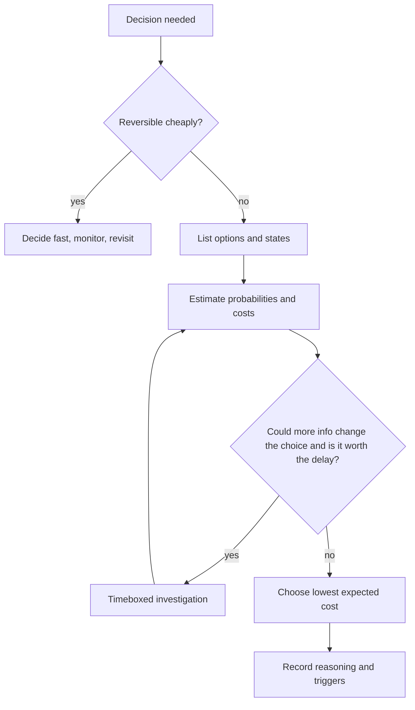

## In one minute
- Engineering decisions are almost always made with incomplete information: during incidents, in design reviews, when choosing what to build. Waiting for certainty is itself a decision, usually an expensive one.
- First ask whether the decision is reversible. Two-way doors (a flag, a rollback, a config) should be made fast; one-way doors (deleting data, a public API, a vendor contract) deserve more care.
- Compare options by expected cost: probability times impact, summed over the ways things could turn out. It turns arguments about opinions into arguments about numbers you can check.
- Information has a price and a value. Investigate further only when what you could learn might change the decision and is worth more than the delay.
- Separate decision quality from outcome. A good decision can turn out badly, and a bad one can get lucky; judge decisions by the information and reasoning available at the time.

## How it works

### Reversible and irreversible
Jeff Bezos's shareholder letters distinguish one-way doors (hard or impossible to undo) from two-way doors (cheap to reverse). Many decisions are two-way doors, but organisations tend to treat them all with one-way caution, which makes them slow. His 2016 letter says that many decisions are reversible and can use a lightweight process, that most should be made with around 70 percent of the information you wish you had, and that "disagree and commit" helps when there is conviction but no consensus ([Amazon 2016 letter](https://www.aboutamazon.com/news/company-news/2016-letter-to-shareholders)). In engineering, reversibility is something you can design: feature flags, expand-and-contract migrations, backups and canaries all turn one-way doors into two-way doors, which is why they make teams faster as well as safer.

### Expected cost
For each option, list the possible states of the world, estimate their probabilities and the cost of the option in each state, and sum the products. In an incident: you see errors that started 4 minutes after a deploy. Option A, roll back: costs 6 minutes of deploy time whether or not the deploy is the cause. Option B, investigate first: if the deploy is the cause (say 70 percent likely), you lose perhaps 30 minutes of outage before rolling back anyway; if not, you saved a pointless rollback. With 2,000 dollars of impact per minute of outage, rolling back costs about 12,000 dollars in expectation; investigating first costs about 0.7 × 60,000 = 42,000. Even rough numbers make the right move obvious, and they make disagreements specific ("I think the probability is 30 percent, not 70, because..."). Check that the cheap option really is reversible, though. Knight Capital's responders uninstalled the new code from the seven healthy servers, and the SEC found this worsened the problem by making those servers run the old Power Peg code too ([SEC order](https://www.sec.gov/litigation/admin/2013/34-70694.pdf)). A rollback is only a two-way door if you know what state it returns you to.

### The value of information
Every investigation step costs time. It is worth taking only if its result could change your choice. A simple test: would any answer to this question make me do something different? If not, skip it. Decision theory formalises this as the expected value of perfect information: the difference between the expected cost of deciding now and the expected cost if you could learn the true state first. It is never negative and caps what any real study can be worth, because imperfect information is worth less ([EVPI](https://en.wikipedia.org/wiki/Expected_value_of_perfect_information)). If even perfect information is worth less than the time it takes to get it, decide now.

### Pre-mortems
Before committing to a significant decision, imagine it is six months later and the decision failed badly, then ask everyone to write down why. Psychologist Gary Klein's pre-mortem technique ([HBR, 2007](https://hbr.org/2007/09/performing-a-project-premortem)) surfaces risks that people hesitate to raise in a normal review, because it makes finding failure modes the task rather than a criticism. Feed the results into the Risk and Change boxes of the decision's SDRC.

### Deciding as a group
Under time pressure, consensus is slow. Name the decision owner, gather input briefly, decide, and record the reasoning and the triggers to revisit. "Disagree and commit" means people who argued for another option still support the decision fully once it is made, and the recorded triggers give everyone a legitimate way to reopen it if evidence changes.

## Down the stack

### Layer 1: The contract
A well-made decision has a named owner, a recorded set of options, the key uncertainties with rough probabilities, the chosen option with reasoning, and explicit triggers for revisiting. Reviewers can later judge it against what was known at the time rather than against the outcome.

### Layer 2: The mechanism
The tools are simple: a decision record (an ADR or an SDRC), a small expected-cost table, and a timebox. Incident processes encode the same logic as rules of thumb: "if a deploy happened in the last hour and errors are user-facing, roll back first" is an expected-cost calculation done in advance, because the probability that the most recent change is responsible is high and the cost of a rollback is low. Error budgets do the same for release decisions: when the budget is spent, the expected cost of more risk is judged too high, and releases pause. Google's guidance lists the typical responses as prioritising recent reliability bugs, working only on reliability until the service is back within its SLO, and a production freeze, with named owners and an escalation path for disagreements ([SRE Workbook, Implementing SLOs](https://sre.google/workbook/implementing-slos/)).

### Layer 3: The machine
Many engineering uncertainties come from measurement limits on the machine itself. Sampled metrics (a 10-second scrape interval) cannot show sub-second spikes; histogram buckets blur latency between bucket edges (a quantile estimate is only as precise as the bucket it falls in, per the [Prometheus docs](https://prometheus.io/docs/practices/histograms/)); log sampling at 1 percent can miss rare errors entirely. Knowing these limits tells you how much to trust a signal: an error that appears in 1 percent sampled logs 5 times in an hour probably happened about 500 times, with wide uncertainty. Good decisions account for how the evidence was produced, not just what it says.

### Why it's built this way
1. Certainty is rarely available in time, and delay has a cost.
2. So decisions must weigh options under uncertainty, explicitly.
3. Reversibility changes how much certainty you need, and can be engineered.
4. Information is worth gathering only if it could change the choice.
5. Recording reasoning lets teams learn from decisions rather than from luck.

## Diagram


## Worked example
A team must choose a queue for a new event pipeline: managed Kafka at about 9,000 dollars a month, or a cloud queue service at about 2,500. The uncertainty is volume: product forecasts 20,000 events a second within a year, but such forecasts are often wrong. Engineers estimate a 30 percent chance of reaching that volume and a 70 percent chance of staying under 5,000 events a second.

If volume stays low, the cloud queue is fine; Kafka wastes 6,500 dollars a month, about 78,000 a year. If volume is high, the cloud queue would need a migration, estimated at 3 engineer-months, about 75,000 dollars plus risk. Expected first-year cost of choosing Kafka now: 0.7 × 78,000 = 54,600 in wasted spend. Expected cost of the cloud queue: 0.3 × 75,000 = 22,500 in likely migration. Cloud queue wins.

Is more information worth it? If they knew volume would be high, they would pick Kafka and avoid the migration, saving 75,000 in that 30 percent case: perfect information is worth at most 0.3 × 75,000 = 22,500. A two-week load study would cost about 15,000 in engineering time and not give perfect information. They decide now, make the choice more reversible by putting a thin publishing interface in front of the queue, and record a trigger: revisit if sustained volume passes 8,000 events a second.

## In the wild
- **Knight Capital, 2012: the rollback that made it worse.** On 1 August 2012 new order-routing code reached only seven of eight servers, and the eighth ran retired Power Peg logic. In about 45 minutes Knight made 4 million executions in 154 stocks and lost over $460M. The SEC found Knight had no incident-response procedures, relied on its technology team in a live market, and made things worse by uninstalling the new code from the seven good servers. It fined Knight $12M ([SEC order](https://www.sec.gov/litigation/admin/2013/34-70694.pdf)). Under pressure the cheap-looking reversible action was not reversible.
- **Meta, 2021: a deliberate trade-off meets a rare failure.** A maintenance command meant to assess backbone capacity took down every backbone connection. A bug in the audit tool let it through, and DNS servers withdrew their BGP routes when they judged the backbone unhealthy. Normal and out-of-band access both failed, so engineers went on site, where physical security slowed recovery. Meta called the hardening an accepted trade-off worth its day-to-day security ([Meta Engineering](https://engineering.fb.com/2021/10/05/networking-traffic/outage-details/)). Decisions about rare failures need explicit costs, written down before the incident.

## Trade-offs
| Approach | Strengths | Weaknesses | Choose when |
| --- | --- | --- | --- |
| Decide fast on gut | Very quick | Biased, hard to review | Trivial and reversible choices |
| Expected cost table | Explicit, debatable numbers | Estimates can be poor | Moderate to high stakes |
| Gather more data first | Reduces uncertainty | Delay has a cost | When info could flip the choice cheaply |
| Make it reversible, then decide | Lowers the stakes | Engineering effort | One-way doors you can redesign |
| Pre-mortem | Surfaces hidden risks | Takes a meeting | Significant, hard-to-reverse decisions |

## Pitfalls in production
- Treating every decision as a one-way door, so the team waits for certainty. Fix: ask "how would we undo this?" first.
- Analysis that could not change the outcome. Fix: ask what answer would change your choice before investigating.
- Judging decisions by outcomes, which punishes good bets that lost. Fix: review the reasoning against what was known.
- Hidden probabilities ("this probably won't happen"). Fix: write a number; disagreement about it is useful.
- No triggers to revisit. Fix: every significant decision records the signals that would reopen it.

## Leadership lens
- Push for reversibility in designs; it is the cheapest way to make the team faster.
- In design reviews, ask for the options, the main uncertainty and the expected-cost reasoning, even roughly.
- Timebox investigations and name the decision owner, especially in incidents.
- Run occasional decision reviews separate from outcomes, to build the team's calibration.

## Check yourself
1. Why should rollback usually come before diagnosis when errors start right after a deploy?
   **Answer:** The deploy is the most likely cause and rolling back is cheap and reversible, so its expected cost is far lower than the expected cost of extended outage while investigating.
2. What question tells you whether an investigation is worth doing?
   **Answer:** Could any result change the decision, and is the value of that change greater than the cost of the delay?
3. Why is "it turned out badly" not proof of a bad decision?
   **Answer:** Outcomes include luck; a decision is good if it was the best choice given the information and reasoning available at the time.
4. How can you turn a one-way door into a two-way door in a migration?
   **Answer:** Use expand-and-contract steps, dual writes, flags and backups so each step can be undone, instead of a single irreversible cutover.

## Practice
**Task:** Build a small decision calculator. `costs` maps each option to a dict of state to cost; `probs` maps each state to its probability. `expected(costs, probs)` returns a dict of option to expected cost. `best(costs, probs)` returns the option with the lowest expected cost (ties broken alphabetically). `evpi(costs, probs)` returns the expected value of perfect information: the best expected cost minus the expected cost if you could pick the cheapest option separately in each state. Round all returned numbers to 2 decimal places. `worth_investigating(costs, probs, investigation_cost)` returns true if `evpi` is greater than the investigation cost.

```python starter
def expected(costs, probs):
    # TODO
    raise NotImplementedError

def best(costs, probs):
    # TODO
    raise NotImplementedError

def evpi(costs, probs):
    # TODO
    raise NotImplementedError

def worth_investigating(costs, probs, investigation_cost):
    # TODO
    raise NotImplementedError
```

```python tests
INCIDENT = {
    "rollback": {"deploy_caused": 12000, "not_deploy": 12000},
    "investigate": {"deploy_caused": 60000, "not_deploy": 0},
}
P = {"deploy_caused": 0.7, "not_deploy": 0.3}

def test_expected_costs():
    assert expected(INCIDENT, P) == {"rollback": 12000.0, "investigate": 42000.0}

def test_best_option():
    assert best(INCIDENT, P) == "rollback"

def test_best_changes_with_probability():
    assert best(INCIDENT, {"deploy_caused": 0.1, "not_deploy": 0.9}) == "investigate"

def test_evpi():
    assert evpi(INCIDENT, P) == 3600.0

def test_worth_investigating():
    assert worth_investigating(INCIDENT, P, 1000)
    assert not worth_investigating(INCIDENT, P, 5000)

def test_ties_alphabetical_and_zero_evpi():
    costs = {"b": {"s": 10}, "a": {"s": 10}}
    assert best(costs, {"s": 1.0}) == "a"
    assert evpi(costs, {"s": 1.0}) == 0.0
```

```python solution
def expected(costs, probs):
    return {o: round(sum(probs[s] * c for s, c in table.items()), 2) for o, table in costs.items()}

def best(costs, probs):
    e = expected(costs, probs)
    return min(sorted(e), key=lambda o: e[o])

def evpi(costs, probs):
    e = expected(costs, probs)
    best_now = min(e.values())
    with_info = sum(p * min(costs[o][s] for o in costs) for s, p in probs.items())
    return round(best_now - with_info, 2)

def worth_investigating(costs, probs, investigation_cost):
    return evpi(costs, probs) > investigation_cost
```

```typescript starter
export type Costs = Record<string, Record<string, number>>;

export function expected(costs: Costs, probs: Record<string, number>): Record<string, number> {
  throw new Error("TODO");
}

export function best(costs: Costs, probs: Record<string, number>): string {
  throw new Error("TODO");
}

export function evpi(costs: Costs, probs: Record<string, number>): number {
  throw new Error("TODO");
}

export function worthInvestigating(costs: Costs, probs: Record<string, number>, investigationCost: number): boolean {
  throw new Error("TODO");
}
```

```typescript tests
const INCIDENT: Costs = {
  rollback: { deploy_caused: 12000, not_deploy: 12000 },
  investigate: { deploy_caused: 60000, not_deploy: 0 },
};
const P = { deploy_caused: 0.7, not_deploy: 0.3 };

test("expected costs", () => {
  assertEqual(expected(INCIDENT, P), { rollback: 12000, investigate: 42000 });
});

test("best option", () => {
  assertEqual(best(INCIDENT, P), "rollback");
});

test("best changes with probability", () => {
  assertEqual(best(INCIDENT, { deploy_caused: 0.1, not_deploy: 0.9 }), "investigate");
});

test("evpi", () => {
  assertEqual(evpi(INCIDENT, P), 3600);
});

test("worth investigating", () => {
  assert(worthInvestigating(INCIDENT, P, 1000), "1000 < 3600");
  assert(!worthInvestigating(INCIDENT, P, 5000), "5000 > 3600");
});

test("ties alphabetical and zero evpi", () => {
  const costs: Costs = { b: { s: 10 }, a: { s: 10 } };
  assertEqual(best(costs, { s: 1 }), "a");
  assertEqual(evpi(costs, { s: 1 }), 0);
});
```

```typescript solution
export type Costs = Record<string, Record<string, number>>;

const round2 = (x: number) => Math.round(x * 100) / 100;

export function expected(costs: Costs, probs: Record<string, number>): Record<string, number> {
  const out: Record<string, number> = {};
  for (const o of Object.keys(costs)) {
    out[o] = round2(Object.keys(costs[o]).reduce((acc, s) => acc + probs[s] * costs[o][s], 0));
  }
  return out;
}

export function best(costs: Costs, probs: Record<string, number>): string {
  const e = expected(costs, probs);
  return Object.keys(e).sort().reduce((a, b) => (e[b] < e[a] ? b : a));
}

export function evpi(costs: Costs, probs: Record<string, number>): number {
  const e = expected(costs, probs);
  const bestNow = Math.min(...Object.values(e));
  const withInfo = Object.keys(probs).reduce((acc, s) => acc + probs[s] * Math.min(...Object.keys(costs).map(o => costs[o][s])), 0);
  return round2(bestNow - withInfo);
}

export function worthInvestigating(costs: Costs, probs: Record<string, number>, investigationCost: number): boolean {
  return evpi(costs, probs) > investigationCost;
}
```

```go starter
package practice

type Costs map[string]map[string]float64

func Expected(costs Costs, probs map[string]float64) map[string]float64 {
	panic("TODO")
}

func Best(costs Costs, probs map[string]float64) string {
	panic("TODO")
}

func EVPI(costs Costs, probs map[string]float64) float64 {
	panic("TODO")
}

func WorthInvestigating(costs Costs, probs map[string]float64, investigationCost float64) bool {
	panic("TODO")
}
```

```go tests
package practice

import "testing"

var incident = Costs{
	"rollback":    {"deploy_caused": 12000, "not_deploy": 12000},
	"investigate": {"deploy_caused": 60000, "not_deploy": 0},
}
var p = map[string]float64{"deploy_caused": 0.7, "not_deploy": 0.3}

func TestExpected(t *testing.T) {
	e := Expected(incident, p)
	if e["rollback"] != 12000 || e["investigate"] != 42000 {
		t.Fatalf("got %v", e)
	}
}

func TestBest(t *testing.T) {
	if Best(incident, p) != "rollback" {
		t.Fatal("expected rollback")
	}
}

func TestBestChanges(t *testing.T) {
	if Best(incident, map[string]float64{"deploy_caused": 0.1, "not_deploy": 0.9}) != "investigate" {
		t.Fatal("expected investigate")
	}
}

func TestEVPI(t *testing.T) {
	if v := EVPI(incident, p); v != 3600 {
		t.Fatalf("got %v", v)
	}
}

func TestWorth(t *testing.T) {
	if !WorthInvestigating(incident, p, 1000) || WorthInvestigating(incident, p, 5000) {
		t.Fatal("threshold wrong")
	}
}

func TestTies(t *testing.T) {
	c := Costs{"b": {"s": 10}, "a": {"s": 10}}
	if Best(c, map[string]float64{"s": 1}) != "a" || EVPI(c, map[string]float64{"s": 1}) != 0 {
		t.Fatal("ties or zero evpi wrong")
	}
}
```

```go solution
package practice

import (
	"math"
	"sort"
)

type Costs map[string]map[string]float64

func round2(x float64) float64 { return math.Round(x*100) / 100 }

func Expected(costs Costs, probs map[string]float64) map[string]float64 {
	out := map[string]float64{}
	for o, table := range costs {
		sum := 0.0
		for s, c := range table {
			sum += probs[s] * c
		}
		out[o] = round2(sum)
	}
	return out
}

func Best(costs Costs, probs map[string]float64) string {
	e := Expected(costs, probs)
	var opts []string
	for o := range e {
		opts = append(opts, o)
	}
	sort.Strings(opts)
	best := opts[0]
	for _, o := range opts[1:] {
		if e[o] < e[best] {
			best = o
		}
	}
	return best
}

func EVPI(costs Costs, probs map[string]float64) float64 {
	e := Expected(costs, probs)
	bestNow := math.Inf(1)
	for _, v := range e {
		bestNow = math.Min(bestNow, v)
	}
	withInfo := 0.0
	for s, pr := range probs {
		m := math.Inf(1)
		for _, table := range costs {
			m = math.Min(m, table[s])
		}
		withInfo += pr * m
	}
	return round2(bestNow - withInfo)
}

func WorthInvestigating(costs Costs, probs map[string]float64, investigationCost float64) bool {
	return EVPI(costs, probs) > investigationCost
}
```

## Mock interview
**Prompt:** It is 30 minutes into an incident. Checkout errors are at 8 percent. There are two candidate causes: yesterday's database index change (you estimate 40 percent likely) and a payment provider degradation (60 percent, based on their status page). Reverting the index takes 20 minutes and carries some risk of lock contention; failing over to the backup payment provider takes 5 minutes and raises fees by 0.4 percent. What do you do, and how do you explain it?

- Follow-up: The engineer who made the index change is certain it is not the cause. How do you weigh that?
- Follow-up: What information would change your decision, and how quickly can you get it?
- Follow-up: After the incident, how do you review whether the decision was good?

**A strong answer covers:**
- Framing options, states, rough probabilities and costs, including the cost of waiting.
- Reversibility: the provider failover is fast and reversible; the index revert is slower and riskier.
- Acting on the cheap reversible option first while gathering discriminating evidence, such as errors by provider or query latency.
- The value of information: which quick checks could flip the choice.
- Treating confident opinions as evidence to weigh, not as proof.
- Recording reasoning and reviewing the decision against what was known, separately from the outcome.

## Sources and further study
**Primary**
- [Amazon 2016 letter to shareholders](https://www.aboutamazon.com/news/company-news/2016-letter-to-shareholders): two-way doors, the 70 percent rule and "disagree and commit".
- [Klein, Performing a Project Premortem (HBR, 2007)](https://hbr.org/2007/09/performing-a-project-premortem): the original premortem technique.
- [SEC order against Knight Capital (2013)](https://www.sec.gov/litigation/admin/2013/34-70694.pdf): a regulator's account of decisions made without incident procedures.

**Systems docs**
- [Google SRE Workbook: Implementing SLOs](https://sre.google/workbook/implementing-slos/): error budget policies as pre-agreed decisions.
- [Meta Engineering: more details about the October 2021 outage](https://engineering.fb.com/2021/10/05/networking-traffic/outage-details/): trade-offs in recovery access.

**Books**
- *Site Reliability Engineering*, Beyer et al., chapter 3 "Embracing Risk": risk tolerance and error budgets as a way to decide how much reliability to buy.
- *Site Reliability Engineering*, chapter 14 "Managing Incidents" and chapter 15 "Postmortem Culture": clear roles and blameless reviews, the basis for judging a decision by what was known.
- *The Staff Engineer's Path*, Tanya Reilly, chapter 4 "Finite Time": choosing what to do when time and attention are limited.

**Other curricula**
- [Azure Well-Architected: architecture decision records](https://learn.microsoft.com/en-us/azure/well-architected/architect-role/architecture-decision-record): an append-only log of options, outcome, trade-offs and confidence level, the same recording habit this lesson asks for.

## Free resources
- [Reversible and irreversible decisions (Farnam Street)](https://fs.blog/reversible-irreversible-decisions/): one-way and two-way doors explained.
- [Jeff Bezos' 2016 letter to shareholders](https://www.aboutamazon.com/news/company-news/2016-letter-to-shareholders): deciding with about 70 percent of the information, and disagree and commit.
- [Performing a Project Premortem (Gary Klein, HBR)](https://hbr.org/2007/09/performing-a-project-premortem): the original pre-mortem technique.
- [Expected value of perfect information (Wikipedia)](https://en.wikipedia.org/wiki/Expected_value_of_perfect_information): the maths behind "is this investigation worth it?".
- [OODA loop (Wikipedia)](https://en.wikipedia.org/wiki/OODA_loop): observe, orient, decide, act under time pressure.
