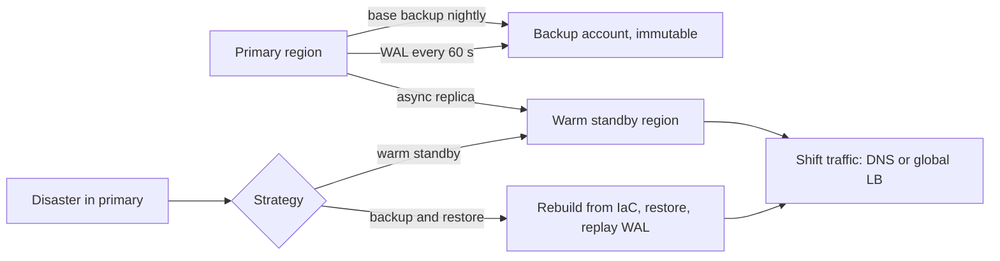

## In one minute
- Disaster recovery (DR) is what you do when the normal redundancy is not enough: a region is down, a database is corrupted, ransomware encrypted your storage, or someone deleted the production account.
- Two numbers define it. **RPO** (recovery point objective): how much data you can afford to lose, measured in time. **RTO** (recovery time objective): how long you can afford to be down.
- Strategies trade cost for those numbers: backup and restore (hours, cheap), pilot light, warm standby, and multi-site active-active (seconds, expensive). Pick per system, by business impact.
- Backups you have not restored are hopes, not backups. Run restore drills on a schedule, measure the real RTO and RPO, and fix what the drill reveals.
- Keep at least one copy out of reach: separate account, immutable storage, different region. The same credentials that can break production must not be able to delete the backups.

## How it works

### RPO and RTO
RPO is set by how often you capture data and ship it somewhere safe. Nightly backups give an RPO of up to 24 hours; continuous log shipping gives seconds to minutes. RTO is set by how long it takes to get a working system: provision infrastructure, restore data, replay logs, verify, switch traffic. Both should come from the business: what does an hour of downtime cost, and what does losing an hour of orders cost? Different systems get different targets; the payments ledger and the internal wiki should not share a DR plan.

### Strategies
AWS's Well-Architected guidance lists four strategies in increasing order of cost and complexity and decreasing RTO and RPO; they apply on any platform ([AWS Well-Architected REL13-BP02](https://docs.aws.amazon.com/wellarchitected/latest/reliability-pillar/rel_planning_for_recovery_disaster_recovery.html)):

- **Backup and restore:** data backed up to another region or account; infrastructure rebuilt from code when needed. RPO in hours, RTO of 24 hours or less. Cheapest. Continuous backups with point-in-time recovery can bring RPO down to about 5 minutes.
- **Pilot light:** data replicated continuously to the recovery region, core infrastructure such as databases running but application servers off. RPO minutes, RTO tens of minutes. The recovery site cannot take traffic until you start servers and scale up.
- **Warm standby:** a scaled-down but fully working copy running in the recovery region, scaled up on failover. RPO seconds, RTO minutes. Unlike pilot light it can serve traffic at reduced capacity straight away; at full size it is called hot standby.
- **Multi-site active-active:** full capacity in two or more regions serving traffic. RPO near zero (depending on replication), RTO near zero. Most expensive and complex, especially for writes: conflicting writes to the same record in two regions must be avoided or resolved.

One trap applies to all four: replication copies mistakes as faithfully as data. A replica will happily replicate a `DROP TABLE` or a corrupted write, so you also need versioning or point-in-time recovery, and backups of the replicated data in the recovery site (same AWS page). Google's SRE book argues for the same layering: soft deletion first, then backups, then archives, and it says to deliver a recovery system, not a backup system, because what users need is the restore ([SRE book, ch. 26](https://sre.google/sre-book/data-integrity/)).

### What a disaster takes with it
A DR plan fails most often on what it forgot. If your identity provider, DNS, secrets manager, container registry, CI system or monitoring live in the failed region or account, you may not be able to log in, deploy or see anything. List every dependency of the recovery procedure itself, and make sure each is available in the disaster scenario. AWS lists "dependency on control plane operations during recovery" as an anti-pattern: during a regional event the control plane is the part most likely to be struggling, so failover should use data plane operations and be scripted so that manual initiation is a push of a button. Automatic failover on health checks is risky for the opposite reason, since a false alarm costs availability and data ([AWS REL13-BP02](https://docs.aws.amazon.com/wellarchitected/latest/reliability-pillar/rel_planning_for_recovery_disaster_recovery.html)). Plan failback as well: re-synchronising the old primary is the hard part, and some teams simply promote the recovery region and rotate roles on a schedule.

### The 3-2-1 rule and immutability
Keep at least three copies of important data, on two different kinds of storage, with one off-site. Today "off-site" means another region and, more importantly, another security boundary: a separate cloud account with its own credentials, and immutable storage that cannot be deleted before its retention period. With S3 Object Lock that guarantee holds only in compliance mode, where no user, including the account's root user, can overwrite or delete a locked version; the only way to remove it early is to delete the whole AWS account. Governance mode can be bypassed by principals with special permissions ([S3 Object Lock docs](https://docs.aws.amazon.com/AmazonS3/latest/userguide/object-lock.html)). Ransomware and destructive mistakes, by humans or agents, target the same credentials that manage production.

### Restore drills
A restore drill is a scheduled, realistic recovery: restore last night's backup into a clean environment, bring the application up, run checks, and time every step. Drills find the problems that make real recoveries fail: backups that were never completing, missing encryption keys, runbooks that reference retired tools, restores that take 14 hours instead of 2. Record measured RTO and RPO and compare them with targets.

### The same shape everywhere
DR is the partial-failure shape at the largest scale: you lose a whole failure domain and must continue from what survived elsewhere. Businesses plan the same way for losing an office, a supplier or a key person: decide acceptable loss and downtime, keep copies elsewhere, and rehearse.

## Down the stack

### Layer 1: The contract
Each system has documented RPO and RTO targets agreed with the business, a recovery runbook, backups stored in a separate security boundary, and a drill record showing measured RPO and RTO within targets at least once a year (quarterly for critical systems).

### Layer 2: The mechanism
Database backups combine base backups with continuous change capture. In Postgres, a base backup (for example from `pg_basebackup` or a managed snapshot) plus archived WAL segments allows point-in-time recovery to any moment since the base backup ([Postgres docs](https://www.postgresql.org/docs/current/continuous-archiving.html)); RPO is bounded by how often WAL is archived (`archive_timeout` forces a segment switch after that many seconds of activity, because the archive command only runs on completed segments ([Postgres docs](https://www.postgresql.org/docs/current/runtime-config-wal.html)); for example every 60 seconds). Cross-region replicas ship WAL continuously and are usually seconds behind. Object storage can replicate across regions asynchronously. Infrastructure as code (Terraform, CloudFormation) lets you rebuild networks, clusters and services in a new region from versioned definitions. Traffic moves by DNS changes or global load balancers.

### Layer 3: The machine
Restore time is mostly bytes over bandwidth and log replay. Copying a 2 TB backup across regions at a sustained 500 MB/s takes about 70 minutes; at 100 MB/s, nearly 6 hours. Replaying a day of WAL depends on write volume and disk speed: a database that writes 50 GB of WAL a day may replay at 100 to 200 MB/s on fast SSDs, so about 5 to 10 minutes, but replay applies records in order and can be slower with many random page reads; recent Postgres versions can prefetch referenced blocks during recovery (`recovery_prefetch`, on by default where the OS supports it), which helps with that I/O wait ([Postgres docs](https://www.postgresql.org/docs/current/runtime-config-wal.html)). DNS failover is bounded by record TTLs: clients and resolvers may keep the old address until the TTL expires, so a 300-second TTL means up to 5 minutes of traffic going to the dead region.

### Why it's built this way
1. Redundancy within a region does not cover regional, account-level or logical disasters.
2. Copies elsewhere bound data loss (RPO), and rebuild speed bounds downtime (RTO).
3. Faster recovery costs more, so targets come from business impact per system.
4. Recovery procedures rot as systems change, so only drills prove they work.
5. Attackers and mistakes reach whatever production credentials reach, so backups must live beyond them.

## Diagram


## Worked example
An e-commerce company sets targets with the business: checkout and orders RPO 5 minutes, RTO 1 hour; product catalogue RPO 24 hours, RTO 4 hours; internal analytics RPO 24 hours, RTO 3 days. Current state: one region, nightly snapshots in the same account.

For orders, they add continuous WAL archiving every 60 seconds to an immutable bucket in a separate account and region, plus a cross-region read replica that can be promoted (warm standby for the database, pilot light for the application). For the catalogue, nightly backups copied to the backup account. Analytics stays as is.

The first drill simulates losing the primary region. Results: database promotion in the recovery region took 4 minutes; but deploying the application took 48 minutes because the container images were only in the primary region's registry, and the team could not log in to the cloud console for 15 minutes because single sign-on depended on a service in the failed region. Measured RTO: 1 hour 25 minutes, over target. Fixes: replicate images to the recovery region, a break-glass login path independent of the primary region, and pre-provisioned application capacity at 10 percent. The second drill measures 22 minutes.

## In the wild
- **GitLab, 2017: the backups that did not work.** After a replication problem, an engineer removed the data directory on the primary instead of the secondary, deleting about 300 GB. The daily `pg_dump` had been failing because the tool was version 9.2 against a 9.6 database, so the S3 bucket was empty. The team restored from an LVM snapshot taken about 6 hours earlier, so data from that window was lost. Lesson: a backup that has never been restored is a hope, and failure notices must reach someone ([GitLab](https://about.gitlab.com/blog/postmortem-of-database-outage-of-january-31/)).
- **Atlassian, 2022: DR built for the wrong disaster.** On 5 April a deletion script was given the IDs of whole customer sites and deleted 883 sites (775 customers) in 23 minutes. No customer lost more than five minutes of data, yet some waited up to 14 days, because Atlassian could recover a single site but had not built tooling to restore a large batch. Teams had to parallelise and automate restoration during the incident. Atlassian committed to soft deletes everywhere and to regular DR exercises that restore many sites at once ([Atlassian](https://www.atlassian.com/blog/atlassian-engineering/post-incident-review-april-2022-outage)).
- **Meta, 2021: recovery tools behind the outage.** A backbone maintenance command cut every backbone link, and Meta's DNS servers withdrew their BGP routes when they could no longer reach the data centres. Remote access and internal tools also depended on the same network, so engineers had to go on site, and services returned gradually so that the returning load would not overwhelm power and caches ([Meta engineering](https://engineering.fb.com/2021/10/05/networking-traffic/outage-details/)).

## Trade-offs
| Strategy | RPO | RTO | Cost | Choose when |
| --- | --- | --- | --- | --- |
| Backup and restore | Hours | Hours to a day | Low | Internal or non-urgent systems |
| Pilot light | Minutes | Tens of minutes | Medium | Important systems with tolerance for some downtime |
| Warm standby | Seconds to minutes | Minutes | Higher | Revenue-critical systems |
| Multi-site active-active | Near zero | Near zero | Highest, complex | Systems where any downtime is unacceptable |

## Pitfalls in production
- Backups never restored. Fix: scheduled drills with measured RTO and RPO.
- Backups deletable by production credentials. Fix: separate account, immutable storage, retention locks.
- Recovery depends on the failed region (SSO, DNS, registry, secrets). Fix: list and replicate recovery dependencies, break-glass access.
- One DR target for everything. Fix: tier systems by business impact.
- Runbooks that drift from reality. Fix: update after each drill; drills are the test suite for runbooks.

## Leadership lens
- Get RPO and RTO targets from the business in money terms, then price each strategy against them.
- Own the drill calendar: critical systems quarterly, others yearly, with results reported to leadership.
- Treat backup deletion protection as a security control, reviewed like IAM.
- Include agents and automation in the threat model: anything with production write access should not reach the backups.

## Check yourself
1. Nightly backups at 02:00, no log shipping. A disaster happens at 23:00. What is the data loss?
   **Answer:** About 21 hours: everything written since the 02:00 backup, which far exceeds most RPO targets for transactional data.
2. Why can DNS failover take longer than the DNS change itself?
   **Answer:** Resolvers and clients cache records until the TTL expires, so some traffic keeps going to the old address for up to the TTL.
3. Why keep backups in a separate account with immutability?
   **Answer:** So that compromised or mistaken production credentials, including those used by agents, cannot delete or encrypt them.
4. What does a restore drill measure that a backup job's success status does not?
   **Answer:** Whether the backup can actually be restored into a working system, and how long it takes end to end, including dependencies and human steps.

## Practice
**Task:** Build an RPO and RTO calculator for a backup schedule. `backups` is a list of `(start, end, kind)` in minutes, where kind is `"full"` or `"incr"`; each backup captures data as of its start time and is usable only after its end time. `recovery_point(backups, failure)` returns the capture time of the newest usable restore chain: the latest full backup that ended at or before `failure`, extended by any incrementals that started after that full's start and ended at or before `failure`; it returns the newest start time in that chain, or `None` if no full backup was usable. `rpo(backups, failure)` returns `failure - recovery_point` (or `None`). `rto(backups, failure, full_minutes, incr_minutes, verify_minutes)` returns the restore time: `full_minutes` plus `incr_minutes` for each incremental in the chain plus `verify_minutes` (or `None`).

```python starter
def recovery_point(backups, failure):
    # TODO
    raise NotImplementedError

def rpo(backups, failure):
    # TODO
    raise NotImplementedError

def rto(backups, failure, full_minutes, incr_minutes, verify_minutes):
    # TODO
    raise NotImplementedError
```

```python tests
SCHEDULE = [
    (0, 90, "full"),
    (360, 370, "incr"),
    (720, 730, "incr"),
    (1080, 1090, "incr"),
    (1440, 1530, "full"),
    (1800, 1810, "incr"),
]

def test_chain_with_incrementals():
    assert recovery_point(SCHEDULE, 1000) == 720
    assert rpo(SCHEDULE, 1000) == 280

def test_backup_in_progress_is_not_usable():
    assert recovery_point(SCHEDULE, 1500) == 1080

def test_new_full_resets_chain():
    assert recovery_point(SCHEDULE, 1820) == 1800
    assert rto(SCHEDULE, 1820, 120, 15, 30) == 165

def test_rto_counts_incrementals():
    assert rto(SCHEDULE, 1100, 120, 15, 30) == 120 + 3 * 15 + 30

def test_no_usable_full():
    assert recovery_point(SCHEDULE, 60) is None
    assert rpo(SCHEDULE, 60) is None
    assert rto(SCHEDULE, 60, 120, 15, 30) is None

def test_order_of_input_does_not_matter():
    assert recovery_point(list(reversed(SCHEDULE)), 1000) == 720
```

```python solution
def _chain(backups, failure):
    fulls = [b for b in backups if b[2] == "full" and b[1] <= failure]
    if not fulls:
        return None
    full = max(fulls, key=lambda b: b[0])
    incrs = [b for b in backups if b[2] == "incr" and b[0] > full[0] and b[1] <= failure]
    return full, incrs

def recovery_point(backups, failure):
    c = _chain(backups, failure)
    if c is None:
        return None
    full, incrs = c
    return max([full[0]] + [b[0] for b in incrs])

def rpo(backups, failure):
    p = recovery_point(backups, failure)
    return None if p is None else failure - p

def rto(backups, failure, full_minutes, incr_minutes, verify_minutes):
    c = _chain(backups, failure)
    if c is None:
        return None
    return full_minutes + incr_minutes * len(c[1]) + verify_minutes
```

```typescript starter
export type Backup = [number, number, string];

export function recoveryPoint(backups: Backup[], failure: number): number | null {
  throw new Error("TODO");
}

export function rpo(backups: Backup[], failure: number): number | null {
  throw new Error("TODO");
}

export function rto(backups: Backup[], failure: number, fullMinutes: number, incrMinutes: number, verifyMinutes: number): number | null {
  throw new Error("TODO");
}
```

```typescript tests
const SCHEDULE: Backup[] = [
  [0, 90, "full"], [360, 370, "incr"], [720, 730, "incr"], [1080, 1090, "incr"], [1440, 1530, "full"], [1800, 1810, "incr"],
];

test("chain with incrementals", () => {
  assertEqual(recoveryPoint(SCHEDULE, 1000), 720);
  assertEqual(rpo(SCHEDULE, 1000), 280);
});

test("backup in progress is not usable", () => {
  assertEqual(recoveryPoint(SCHEDULE, 1500), 1080);
});

test("new full resets chain", () => {
  assertEqual(recoveryPoint(SCHEDULE, 1820), 1800);
  assertEqual(rto(SCHEDULE, 1820, 120, 15, 30), 165);
});

test("rto counts incrementals", () => {
  assertEqual(rto(SCHEDULE, 1100, 120, 15, 30), 120 + 3 * 15 + 30);
});

test("no usable full", () => {
  assertEqual(recoveryPoint(SCHEDULE, 60), null);
  assertEqual(rpo(SCHEDULE, 60), null);
  assertEqual(rto(SCHEDULE, 60, 120, 15, 30), null);
});

test("order of input does not matter", () => {
  assertEqual(recoveryPoint(SCHEDULE.slice().reverse(), 1000), 720);
});
```

```typescript solution
export type Backup = [number, number, string];

function chain(backups: Backup[], failure: number): [Backup, Backup[]] | null {
  const fulls = backups.filter(b => b[2] === "full" && b[1] <= failure);
  if (!fulls.length) return null;
  const full = fulls.reduce((a, b) => (b[0] > a[0] ? b : a));
  const incrs = backups.filter(b => b[2] === "incr" && b[0] > full[0] && b[1] <= failure);
  return [full, incrs];
}

export function recoveryPoint(backups: Backup[], failure: number): number | null {
  const c = chain(backups, failure);
  return c ? Math.max(c[0][0], ...c[1].map(b => b[0])) : null;
}

export function rpo(backups: Backup[], failure: number): number | null {
  const p = recoveryPoint(backups, failure);
  return p === null ? null : failure - p;
}

export function rto(backups: Backup[], failure: number, fullMinutes: number, incrMinutes: number, verifyMinutes: number): number | null {
  const c = chain(backups, failure);
  return c ? fullMinutes + incrMinutes * c[1].length + verifyMinutes : null;
}
```

```go starter
package practice

type Backup struct {
	Start, End int
	Kind       string
}

// Each function returns the value and true, or 0 and false if no full backup is usable.
func RecoveryPoint(backups []Backup, failure int) (int, bool) {
	panic("TODO")
}

func RPO(backups []Backup, failure int) (int, bool) {
	panic("TODO")
}

func RTO(backups []Backup, failure, fullMinutes, incrMinutes, verifyMinutes int) (int, bool) {
	panic("TODO")
}
```

```go tests
package practice

import "testing"

var schedule = []Backup{
	{0, 90, "full"}, {360, 370, "incr"}, {720, 730, "incr"}, {1080, 1090, "incr"}, {1440, 1530, "full"}, {1800, 1810, "incr"},
}

func TestChain(t *testing.T) {
	if p, ok := RecoveryPoint(schedule, 1000); !ok || p != 720 {
		t.Fatalf("got %d", p)
	}
	if r, ok := RPO(schedule, 1000); !ok || r != 280 {
		t.Fatalf("got %d", r)
	}
}

func TestInProgress(t *testing.T) {
	if p, _ := RecoveryPoint(schedule, 1500); p != 1080 {
		t.Fatalf("got %d", p)
	}
}

func TestNewFull(t *testing.T) {
	if p, _ := RecoveryPoint(schedule, 1820); p != 1800 {
		t.Fatalf("got %d", p)
	}
	if r, _ := RTO(schedule, 1820, 120, 15, 30); r != 165 {
		t.Fatalf("got %d", r)
	}
}

func TestRTOIncrementals(t *testing.T) {
	if r, _ := RTO(schedule, 1100, 120, 15, 30); r != 195 {
		t.Fatalf("got %d", r)
	}
}

func TestNoFull(t *testing.T) {
	_, a := RecoveryPoint(schedule, 60)
	_, b := RPO(schedule, 60)
	_, c := RTO(schedule, 60, 120, 15, 30)
	if a || b || c {
		t.Fatal("expected no usable backup")
	}
}

func TestOrder(t *testing.T) {
	rev := make([]Backup, len(schedule))
	for i := range schedule {
		rev[len(schedule)-1-i] = schedule[i]
	}
	if p, _ := RecoveryPoint(rev, 1000); p != 720 {
		t.Fatalf("got %d", p)
	}
}
```

```go solution
package practice

type Backup struct {
	Start, End int
	Kind       string
}

func chain(backups []Backup, failure int) (Backup, []Backup, bool) {
	var full Backup
	found := false
	for _, b := range backups {
		if b.Kind == "full" && b.End <= failure && (!found || b.Start > full.Start) {
			full, found = b, true
		}
	}
	if !found {
		return Backup{}, nil, false
	}
	var incrs []Backup
	for _, b := range backups {
		if b.Kind == "incr" && b.Start > full.Start && b.End <= failure {
			incrs = append(incrs, b)
		}
	}
	return full, incrs, true
}

func RecoveryPoint(backups []Backup, failure int) (int, bool) {
	full, incrs, ok := chain(backups, failure)
	if !ok {
		return 0, false
	}
	p := full.Start
	for _, b := range incrs {
		if b.Start > p {
			p = b.Start
		}
	}
	return p, true
}

func RPO(backups []Backup, failure int) (int, bool) {
	p, ok := RecoveryPoint(backups, failure)
	if !ok {
		return 0, false
	}
	return failure - p, true
}

func RTO(backups []Backup, failure, fullMinutes, incrMinutes, verifyMinutes int) (int, bool) {
	_, incrs, ok := chain(backups, failure)
	if !ok {
		return 0, false
	}
	return fullMinutes + incrMinutes*len(incrs) + verifyMinutes, true
}
```

## Mock interview
**Prompt:** You are the tech lead for a SaaS platform running in one cloud region, with a 3 TB Postgres database, Redis, object storage and 40 services on Kubernetes. The board asks: "If our region disappeared tomorrow, how long until we are back, and what would we lose?" Today you have nightly snapshots in the same account. Answer them, and propose a plan.

- Follow-up: The budget allows a 20 percent increase in infrastructure cost. What do you prioritise?
- Follow-up: How do you protect against an attacker or an agent with admin credentials deleting everything, including backups?
- Follow-up: How will you prove the plan works?

**A strong answer covers:**
- An honest current answer: RPO up to 24 hours, RTO unknown and probably days, plus same-account backups at risk.
- Targets per system tier, agreed with the business in cost terms.
- Strategy per tier: continuous WAL archiving and a cross-region replica for the database, replicated object storage, infrastructure as code, replicated images and secrets.
- Recovery dependencies: identity, DNS, registry, CI and monitoring available in the disaster scenario.
- Separate backup account with immutable storage and restricted credentials.
- Drills with measured RTO and RPO, repeated after fixes, reported to the board.

## Sources and further study
**Primary**
- [GitLab: postmortem of the 31 January 2017 database outage](https://about.gitlab.com/blog/postmortem-of-database-outage-of-january-31/): a first-hand account of backups that did not work.
- [Atlassian: April 2022 outage post-incident review](https://www.atlassian.com/blog/atlassian-engineering/post-incident-review-april-2022-outage): why single-site restore tooling did not scale to 775 customers.

**Systems docs**
- [AWS Well-Architected REL13-BP02: use defined recovery strategies](https://docs.aws.amazon.com/wellarchitected/latest/reliability-pillar/rel_planning_for_recovery_disaster_recovery.html): the four strategies, their RTO and RPO ranges, failover and failback.
- [PostgreSQL: WAL configuration](https://www.postgresql.org/docs/current/runtime-config-wal.html): `archive_timeout` and `recovery_prefetch`.

**Books**
- *Site Reliability Engineering*, Beyer et al.: chapter 26 (Data Integrity: What You Read Is What You Wrote), including recovery systems and defense in depth, and chapter 33 (Lessons Learned from Other Industries) on disaster testing.
- *Building Secure and Reliable Systems*, Adkins et al.: chapter 16 (Disaster Planning) and chapter 18 (Recovery and Aftermath).
- *Designing Data-Intensive Applications* (1st ed.), Kleppmann: chapter 5 (Replication), for why replicas do not replace backups.

**Other curricula**
- [Google SRE book: Lessons Learned from Other Industries](https://sre.google/sre-book/lessons-learned/): frames disaster testing (DiRT) as running real drills, because thought exercises alone are not enough.

## Free resources
- [Disaster recovery options in the cloud (AWS whitepaper)](https://docs.aws.amazon.com/whitepapers/latest/disaster-recovery-workloads-on-aws/disaster-recovery-options-in-the-cloud.html): backup and restore, pilot light, warm standby and multi-site.
- [Disaster recovery planning guide (Google Cloud)](https://cloud.google.com/architecture/dr-scenarios-planning-guide): RTO, RPO and patterns.
- [Disaster recovery (Azure Well-Architected)](https://learn.microsoft.com/en-us/azure/well-architected/reliability/disaster-recovery): planning and testing guidance.
- [Continuous archiving and point-in-time recovery (PostgreSQL)](https://www.postgresql.org/docs/current/continuous-archiving.html): the mechanism behind low database RPO.
- [S3 Object Lock (AWS)](https://docs.aws.amazon.com/AmazonS3/latest/userguide/object-lock.html): immutable backups that even administrators cannot delete early.
- [The 3-2-1 backup strategy (Backblaze)](https://www.backblaze.com/blog/the-3-2-1-backup-strategy/): the classic rule and its modern variants.
