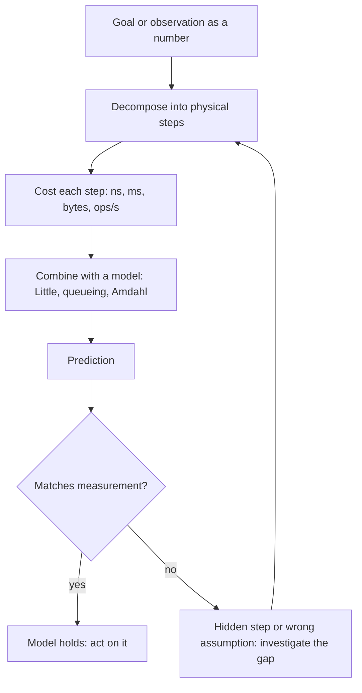

## In one minute
- First-principles thinking means reducing a problem to facts you can check (physics, arithmetic, measured costs) and reasoning up from them, instead of reasoning by analogy to what other teams did.
- Mental models are reusable shortcuts that encode those facts: Little's law, queueing delay versus utilisation, Amdahl's law, latency numbers, conservation of work, feedback loops.
- Their job is to give you a prediction before you measure. If the prediction and the measurement disagree, one of them is wrong, and finding out which is where understanding comes from.
- Order-of-magnitude accuracy is usually enough. Knowing whether something costs 100 ns or 100 ms decides most designs and most debugging directions.
- Agents can produce code and plausible explanations; a few models in your head let you spot when an explanation is physically impossible.

## How it works

### Analogy versus first principles
Reasoning by analogy says "Company X uses Kafka for this, so should we" or "last time latency spiked it was the database". It is fast and often right, but imports assumptions you never checked. First-principles reasoning asks what must be true given the constraints: bytes, round trips, operations per second per component, and their costs. It is slower, so use it when stakes are high, analogies conflict, or the usual answer has failed.

A practical recipe:

1. State the goal as a number (requests per second, latency, cost per month).
2. List the physical steps the work requires (network round trips, disk reads, CPU work, serialisation).
3. Put a cost on each from known numbers or a quick benchmark.
4. Add them up and compare with the goal or the observed behaviour.
5. Investigate the largest gap first.

### Models worth carrying
- **Little's law.** Items in a system equal arrival rate times time in system: `L = λW`. It holds for any stationary system regardless of the arrival or service distribution; the only requirement is ergodicity, and over finite windows you must account for items already in the system at the start and end ([Little's law](https://en.wikipedia.org/wiki/Little%27s_law), proved by John Little in 1961). 2,000 requests per second at 50 ms means 100 requests in flight, so a pool of 20 connections will queue.
- **Utilisation and queueing.** For a single server with random arrivals, waiting grows like `ρ / (1 - ρ)`. Going from 50% to 90% busy multiplies time in system by 5. This is why "CPU is only at 85%" can still mean bad latency.
- **Amdahl's law.** If 10% of the work is serial, no amount of parallelism gives more than a 10x speed-up. Find the serial part before adding machines.
- **Latency numbers.** Rough orders: L1 cache hit around 1 ns (Norvig's table says 0.5 ns), main memory around 100 ns ([Norvig](https://norvig.com/21-days.html)), a datacenter round trip around 0.5 ms, an SSD random read in the tens to low hundreds of microseconds, a cross-continent round trip 70 to 150 ms. Exact values vary by hardware; the ratios are what matter.
- **Conservation.** Work and bytes don't vanish. If a queue's input rate exceeds its output rate, it grows until something breaks, and no tuning of the consumer's code changes that if the consumer is already at capacity.
- **Feedback loops.** Retries, autoscaling and caches all feed system output back into its input. Positive loops (retries under overload) can push a system into a metastable failure state that persists after the trigger is gone. A study of 22 such failures at 11 organisations found that at least 4 of 15 major AWS outages in a decade were metastable ([Huang et al., OSDI 2022](https://www.usenix.org/conference/osdi22/presentation/huang-lexiang)).

### Using models while debugging
A model gives you a falsifiable expectation. "The service handles 3,000 requests per second on 12 cores at 2 ms of CPU each, so CPU should be 50% busy." If CPU shows 95%, either requests cost more than you think (profile them) or something else is consuming CPU (GC, a noisy neighbour, a hot loop). Without the model, 95% is just a number.

## Down the stack

### Layer 1: The contract
A good mental model promises a prediction within a stated error, under stated assumptions, that you can test. Little's law promises exactness for long-run averages of any stable system. An M/M/1 queue formula promises a good approximation only when arrivals are roughly random and service times roughly exponential; real services with heavy-tailed service times queue worse. The discipline is to state the model's assumptions alongside its answer, so the person reading your estimate knows when to stop trusting it.

### Layer 2: The mechanism
Queueing models are the workhorses. For `c` identical servers, arrival rate `λ` and mean service time `S`, the offered load is `A = λS` (in Erlangs) and utilisation is `ρ = A / c`. The **Erlang C** formula (see [Erlang (unit)](https://en.wikipedia.org/wiki/Erlang_(unit))) gives the probability that an arriving request has to wait, and from it the mean wait `Wq = C × S / (c − A)`. It is computed stably with the Erlang B recurrence `B(k) = A·B(k−1) / (k + A·B(k−1))`, then `C = c·B / (c − A(1 − B))`. Call centres have used this for a century; it applies equally to thread pools, database connection pools and Kubernetes replica counts. Amdahl's law (`speedup = 1 / (s + (1 − s)/n)`) and the Universal Scalability Law, `C(N) = N / (1 + α(N−1) + βN(N−1))`, cover parallel scaling. α is contention and β is coherency cost; with β = 0 it reduces to Amdahl's law, and with β > 0 throughput peaks near `√((1−α)/β)` and then falls ([Gunther, USL](https://www.perfdynamics.com/Manifesto/USLscalability.html)). Gunther's own caution applies: when data diverge from the model, check the measurements before blaming the model.

### Layer 3: The machine
The numbers in the models come from hardware. Memory moves in 64-byte cache lines, so two threads writing different variables on the same line (false sharing) bounce it between cores at roughly 50 to 100 ns a time. A DRAM access that misses every cache costs about 80 to 120 ns, so pointer-chasing through 10 million nodes takes on the order of a second while a sequential scan of the same bytes takes milliseconds, thanks to the prefetcher. A 4 KiB random read on NVMe takes tens of microseconds; an `fsync` takes from tens of microseconds to several milliseconds depending on whether the drive has power-loss protection. A 10 Gbit/s NIC moves at most about 1.25 GB/s, and an in-region TCP round trip is around 0.1 to 0.5 ms. When a measurement breaks these orders of magnitude, suspect the measurement or a hidden step: a DNS lookup, a new connection per request, a retry.

### Why it's built this way
1. Systems are made of physical resources with fixed speeds, so cost can be estimated before code is written.
2. Shared resources form queues, and queueing delay grows sharply near saturation, so utilisation targets sit well below 100%.
3. Estimates are cheap and measurements are expensive, so a model tells you what to measure and what number to expect.
4. Analogies carry hidden assumptions, so when the stakes are high, reasoning from constraints is the safer default.

## Diagram


## Worked example
A checkout service calls a payment provider with a mean latency of 120 ms. Traffic peaks at 400 requests per second. The team's HTTP client pool is sized at 40 connections, and during peak, p99 checkout latency jumps from 300 ms to 4 s. An agent suggests raising timeouts.

Little's law first: 400 × 0.12 s = 48 connections busy on average. A pool of 40 cannot serve that at all; utilisation would be 120%, so the queue grows without bound until timeouts shed load. That fully explains the 4 s. Raising timeouts would make it worse by holding requests longer.

How big should the pool be? Erlang C with `A = 48`: at 50 connections (96% busy) about 69% of requests wait, 42 ms on average; at 56 (86%) about 19% wait, 3 ms on average; at 64 (75%) about 2% wait. The team picks 64, then checks the provider's concurrency limit (say 100 per account) so they don't trade one queue for rejected calls. Peak p99 returns to around 320 ms. The analysis took 15 minutes and needed no profiler. Note the model assumes exponential service times; the provider's real tail is heavier, which is one more reason to stay at 75% rather than 86%.

## In the wild
- **AWS, 2015: DynamoDB metadata overload.** On 20 September 2015 a brief network disruption made many storage servers ask the metadata service for their partition membership at once. Global secondary indexes had grown the membership lists, so responses outran the servers' timeout. Servers then removed themselves from service and retried, adding load. Error rates peaked around 55%, and most recovery took about 4 hours 50 minutes. A retry feedback loop on a shared queue is the conservation and feedback models in action ([AWS post-event summary](https://aws.amazon.com/message/5467D2/)).
- **Slack, 2022: a cache miss turned into a scatter query.** A Consul agent rollout briefly removed memcached nodes, and empty replacements dropped the hit rate. One boot query was sharded by user but looked up by channel, so each miss hit every Vitess shard. Database load grew faster than the miss rate, and timeouts plus client retries locked in overload. Slack throttled client boots, re-sharded the table by channel and changed how nodes are replaced ([Slack Engineering](https://slack.engineering/slacks-incident-on-2-22-22/)).

## Trade-offs
| Approach | Strengths | Weaknesses | Choose when |
|---|---|---|---|
| Reason by analogy | Fast, uses team experience | Imports unchecked assumptions | Familiar problems with low stakes |
| First principles with napkin math | Catches impossible designs early, cheap | Can miss second-order effects | Capacity, cost and latency questions |
| Formal model (queueing, simulation) | Quantifies tails and saturation | Assumptions may not hold; takes time | Expensive capacity decisions, SLO commitments |
| Measure first | Ground truth | Without a model, numbers lack meaning | Always, but with a prediction written down beforehand |

## Pitfalls in production
- **Averages in queueing formulas.** Mean service time hides heavy tails; real queues behave worse than M/M/c. Use p99 service time as a sanity check and keep utilisation lower.
- **Forgetting hidden round trips.** DNS, TLS handshakes, connection pool misses and N+1 queries add steps your model omitted. Trace one request end to end.
- **Utilisation measured over long windows.** 60% average CPU over a minute can be 100% for 10-second bursts. Look at short windows or saturation metrics such as run queue length.
- **Scaling the wrong tier.** Adding application replicas raises load on a saturated database. Find the bottleneck with Little's law at each tier before scaling.

## Leadership lens
- In design reviews, ask for the napkin math: requests per second, bytes per request, round trips, and utilisation at peak, with the assumptions written next to the numbers.
- Teach the team five models (Little, queueing knee, Amdahl, latency orders, conservation) and use them out loud in incidents.
- Set utilisation targets per resource type (for example 60 to 70% for latency-sensitive pools) and explain the queueing reason.
- When an agent proposes a fix, ask what physical bottleneck it relieves. If there isn't one, it probably treats a symptom.

## Check yourself
1. A service receives 1,200 requests per second and each holds a database connection for 25 ms. What is the minimum pool size, and why go higher?
   **Answer:** Little's law gives 30 connections busy on average. Running at 100% utilisation means unbounded queueing, so size well above 30 (for example 40 to 45) using a queueing model or load test.
2. CPU sits at 85% and latency is bad, but a teammate says there's 15% headroom. What do you say?
   **Answer:** Queueing delay grows like ρ/(1−ρ), so at 85% waiting is already several times the service time, and bursts push it higher. Utilisation headroom isn't latency headroom.
3. Why can a pointer-chasing loop be 100 times slower than a sequential scan over the same data?
   **Answer:** Each dependent pointer load can miss cache and wait about 100 ns for DRAM, while sequential access lets the prefetcher stream cache lines at full memory bandwidth.
4. When should you prefer reasoning by analogy?
   **Answer:** When the problem is familiar, the decision is cheap to reverse and the analogy's assumptions plainly hold; first principles cost more time and are best spent on high-stakes or novel decisions.

## Practice
**Task:** Build a capacity calculator for a pool of identical servers (threads, connections, replicas) using the M/M/c model. `utilization(rate, service_s, servers)` returns `rate × service_s / servers`. `wait_probability(rate, service_s, servers)` returns the Erlang C probability that a request waits, computed with the Erlang B recurrence. `mean_wait(rate, service_s, servers)` returns the mean queueing delay in seconds, `C × service_s / (servers − rate × service_s)`. `min_servers(rate, service_s, max_wait_s)` returns the smallest server count with utilisation below 1 and mean wait at most `max_wait_s`. `wait_probability` and `mean_wait` raise an error when `servers < 1` or utilisation is 1 or more.

```python starter
def utilization(rate, service_s, servers):
    # TODO
    raise NotImplementedError

def wait_probability(rate, service_s, servers):
    # TODO
    raise NotImplementedError

def mean_wait(rate, service_s, servers):
    # TODO
    raise NotImplementedError

def min_servers(rate, service_s, max_wait_s):
    # TODO
    raise NotImplementedError
```

```python tests
def close(a, b):
    return abs(a - b) < 1e-9

def test_utilization():
    assert close(utilization(80, 0.01, 1), 0.8)
    assert close(utilization(900, 0.01, 12), 0.75)

def test_single_server_matches_mm1():
    assert close(wait_probability(80, 0.01, 1), 0.8)
    assert close(mean_wait(80, 0.01, 1), 0.04)

def test_two_servers():
    assert close(wait_probability(100, 0.01, 2), 1 / 3)
    assert close(mean_wait(100, 0.01, 2), 0.01 / 3)

def test_larger_pool():
    assert abs(wait_probability(900, 0.01, 12) - 0.2660346844686624) < 1e-9
    assert abs(mean_wait(900, 0.01, 12) - 0.000886782281562208) < 1e-12

def test_unstable_raises():
    for args in ((100, 0.01, 1), (150, 0.01, 1), (10, 0.01, 0)):
        try:
            mean_wait(*args)
            assert False, "expected ValueError"
        except ValueError:
            pass

def test_min_servers():
    assert min_servers(100, 0.01, 0.005) == 2
    assert min_servers(900, 0.01, 0.001) == 12
    assert min_servers(900, 0.01, 0.0002) == 14

def test_min_servers_light_load():
    assert min_servers(1, 0.01, 1.0) == 1
```

```python solution
def utilization(rate, service_s, servers):
    return rate * service_s / servers

def wait_probability(rate, service_s, servers):
    if servers < 1:
        raise ValueError("need at least one server")
    a = rate * service_s
    if a >= servers:
        raise ValueError("unstable: utilisation >= 1")
    b = 1.0
    for k in range(1, servers + 1):
        b = a * b / (k + a * b)
    return servers * b / (servers - a * (1 - b))

def mean_wait(rate, service_s, servers):
    c = wait_probability(rate, service_s, servers)
    return c * service_s / (servers - rate * service_s)

def min_servers(rate, service_s, max_wait_s):
    c = 1
    while True:
        if rate * service_s < c and mean_wait(rate, service_s, c) <= max_wait_s:
            return c
        c += 1
```

```typescript starter
export function utilization(rate: number, serviceS: number, servers: number): number {
  throw new Error("TODO");
}
export function waitProbability(rate: number, serviceS: number, servers: number): number {
  throw new Error("TODO");
}
export function meanWait(rate: number, serviceS: number, servers: number): number {
  throw new Error("TODO");
}
export function minServers(rate: number, serviceS: number, maxWaitS: number): number {
  throw new Error("TODO");
}
```

```typescript tests
const close = (a: number, b: number, eps = 1e-9) => Math.abs(a - b) < eps;

test("utilization", () => {
  assert(close(utilization(80, 0.01, 1), 0.8), "mm1");
  assert(close(utilization(900, 0.01, 12), 0.75), "pool");
});
test("single server matches M/M/1", () => {
  assert(close(waitProbability(80, 0.01, 1), 0.8), "C");
  assert(close(meanWait(80, 0.01, 1), 0.04), "Wq");
});
test("two servers", () => {
  assert(close(waitProbability(100, 0.01, 2), 1 / 3), "C");
  assert(close(meanWait(100, 0.01, 2), 0.01 / 3), "Wq");
});
test("larger pool", () => {
  assert(close(waitProbability(900, 0.01, 12), 0.2660346844686624), "C");
  assert(close(meanWait(900, 0.01, 12), 0.000886782281562208, 1e-12), "Wq");
});
test("unstable throws", () => {
  for (const [r, s, c] of [[100, 0.01, 1], [150, 0.01, 1], [10, 0.01, 0]]) {
    let threw = false;
    try { meanWait(r, s, c); } catch (e) { threw = true; }
    assert(threw, `expected error for ${r},${s},${c}`);
  }
});
test("min servers", () => {
  assertEqual(minServers(100, 0.01, 0.005), 2);
  assertEqual(minServers(900, 0.01, 0.001), 12);
  assertEqual(minServers(900, 0.01, 0.0002), 14);
});
test("light load", () => {
  assertEqual(minServers(1, 0.01, 1.0), 1);
});
```

```typescript solution
export function utilization(rate: number, serviceS: number, servers: number): number {
  return (rate * serviceS) / servers;
}
export function waitProbability(rate: number, serviceS: number, servers: number): number {
  if (servers < 1) throw new Error("need at least one server");
  const a = rate * serviceS;
  if (a >= servers) throw new Error("unstable: utilisation >= 1");
  let b = 1;
  for (let k = 1; k <= servers; k++) b = (a * b) / (k + a * b);
  return (servers * b) / (servers - a * (1 - b));
}
export function meanWait(rate: number, serviceS: number, servers: number): number {
  const c = waitProbability(rate, serviceS, servers);
  return (c * serviceS) / (servers - rate * serviceS);
}
export function minServers(rate: number, serviceS: number, maxWaitS: number): number {
  for (let c = 1; ; c++) {
    if (rate * serviceS < c && meanWait(rate, serviceS, c) <= maxWaitS) return c;
  }
}
```

```go starter
package practice

func Utilization(rate, serviceS float64, servers int) float64 { panic("TODO") }

func WaitProbability(rate, serviceS float64, servers int) (float64, error) { panic("TODO") }

func MeanWait(rate, serviceS float64, servers int) (float64, error) { panic("TODO") }

func MinServers(rate, serviceS, maxWaitS float64) int { panic("TODO") }
```

```go tests
package practice

import (
	"math"
	"testing"
)

func close(a, b, eps float64) bool { return math.Abs(a-b) < eps }

func TestUtilization(t *testing.T) {
	if !close(Utilization(80, 0.01, 1), 0.8, 1e-9) || !close(Utilization(900, 0.01, 12), 0.75, 1e-9) {
		t.Fatal("bad utilisation")
	}
}

func TestSingleServer(t *testing.T) {
	c, err := WaitProbability(80, 0.01, 1)
	w, _ := MeanWait(80, 0.01, 1)
	if err != nil || !close(c, 0.8, 1e-9) || !close(w, 0.04, 1e-9) {
		t.Fatalf("got %v %v %v", c, w, err)
	}
}

func TestTwoServers(t *testing.T) {
	c, _ := WaitProbability(100, 0.01, 2)
	w, _ := MeanWait(100, 0.01, 2)
	if !close(c, 1.0/3, 1e-9) || !close(w, 0.01/3, 1e-9) {
		t.Fatalf("got %v %v", c, w)
	}
}

func TestLargerPool(t *testing.T) {
	c, _ := WaitProbability(900, 0.01, 12)
	w, _ := MeanWait(900, 0.01, 12)
	if !close(c, 0.2660346844686624, 1e-9) || !close(w, 0.000886782281562208, 1e-12) {
		t.Fatalf("got %v %v", c, w)
	}
}

func TestUnstable(t *testing.T) {
	cases := [][3]float64{{100, 0.01, 1}, {150, 0.01, 1}, {10, 0.01, 0}}
	for _, k := range cases {
		if _, err := MeanWait(k[0], k[1], int(k[2])); err == nil {
			t.Fatalf("expected error for %v", k)
		}
	}
}

func TestMinServers(t *testing.T) {
	if MinServers(100, 0.01, 0.005) != 2 || MinServers(900, 0.01, 0.001) != 12 || MinServers(900, 0.01, 0.0002) != 14 {
		t.Fatal("wrong server counts")
	}
	if MinServers(1, 0.01, 1.0) != 1 {
		t.Fatal("light load needs one server")
	}
}
```

```go solution
package practice

import "errors"

func Utilization(rate, serviceS float64, servers int) float64 {
	return rate * serviceS / float64(servers)
}

func WaitProbability(rate, serviceS float64, servers int) (float64, error) {
	if servers < 1 {
		return 0, errors.New("need at least one server")
	}
	a, c := rate*serviceS, float64(servers)
	if a >= c {
		return 0, errors.New("unstable: utilisation >= 1")
	}
	b := 1.0
	for k := 1; k <= servers; k++ {
		b = a * b / (float64(k) + a*b)
	}
	return c * b / (c - a*(1-b)), nil
}

func MeanWait(rate, serviceS float64, servers int) (float64, error) {
	p, err := WaitProbability(rate, serviceS, servers)
	if err != nil {
		return 0, err
	}
	return p * serviceS / (float64(servers) - rate*serviceS), nil
}

func MinServers(rate, serviceS, maxWaitS float64) int {
	for c := 1; ; c++ {
		if rate*serviceS < float64(c) {
			if w, _ := MeanWait(rate, serviceS, c); w <= maxWaitS {
				return c
			}
		}
	}
}
```

## Mock interview
**Prompt:** Your API tier runs 20 instances, each with a 50-thread worker pool, serving 6,000 requests per second at a mean of 120 ms per request. Product wants to launch a feature expected to add 40% more traffic next month. Without running a load test yet, tell me whether we need more instances and how many.

- Follow-up: Service time has a heavy tail: p99 is 900 ms. How does that change your estimate?
- Follow-up: Each request also holds a database connection for 30 ms, and the database allows 400 connections in total. What breaks first?
- Follow-up: Which numbers would you measure to check your model, and what would make you throw it away?

**A strong answer covers:**
- Little's law: 6,000 × 0.12 = 720 busy threads out of 1,000 (72%); at 8,400 requests per second, 1,008 needed, so the tier saturates.
- Queueing reasoning for headroom: target 60 to 70% utilisation, so roughly 1,400 to 1,700 threads, about 28 to 34 instances, adjusted for tail latency.
- Checking downstream: 8,400 × 0.03 = 252 concurrent DB connections on average, inside 400 but with thin margin for bursts and a pool per instance that must sum below the limit.
- Stating assumptions (random arrivals, independent instances, no retries) and how heavy tails make real queueing worse than the model.
- A plan to validate with a load test and production saturation metrics (queue depth, pool wait time) before launch.

## Sources and further study
**Primary**
- [Huang et al., Metastable Failures in the Wild (OSDI 2022)](https://www.usenix.org/conference/osdi22/presentation/huang-lexiang): 22 real incidents and the retry-driven feedback loops behind them.
- [Gunther, Universal Scalability Law](https://www.perfdynamics.com/Manifesto/USLscalability.html): contention and coherency terms beyond Amdahl.
- [Little, A Proof for the Queuing Formula: L = λW (1961)](https://en.wikipedia.org/wiki/Little%27s_law): the original result, summarised with its conditions.

**Systems docs**
- [Prometheus: histograms and summaries](https://prometheus.io/docs/practices/histograms/): how percentile estimates are derived, relevant when you check a model against a measurement.
- [Peter Norvig, Teach Yourself Programming in Ten Years](https://norvig.com/21-days.html): the table of timings (L1, memory, disk, network) behind napkin math.

**Books**
- *Systems Performance*, Brendan Gregg, 2nd edition, chapter 2 "Methodologies": utilisation, saturation, queueing and the USE method.
- *Site Reliability Engineering*, Beyer et al., chapter 6 "Monitoring Distributed Systems": the four golden signals, with saturation as a leading indicator.
- *Designing Data-Intensive Applications*, Kleppmann, 1st edition, chapter 1 "Reliable, Scalable, and Maintainable Applications": describing load and latency percentiles, with queueing at the head of the line.

**Other curricula**
- [donnemartin/system-design-primer: back-of-the-envelope](https://github.com/donnemartin/system-design-primer#appendix): its appendix carries the latency numbers and a powers-of-two table for estimation.

## Watch
- [Feynman on Scientific Method (seabala)](https://www.youtube.com/watch?v=EYPapE-3FRw): guess, compute the consequences, compare with experiment; the core loop of using a model.
- [Linux Performance Tools, Brendan Gregg, part 1 (Brendan Gregg)](https://www.youtube.com/watch?v=FJW8nGV4jxY): how to connect resource-level numbers to the models you use for diagnosis.

## Free resources
- [First Principles: The Building Blocks of True Knowledge (Farnam Street)](https://fs.blog/first-principles/): a readable introduction to reasoning from fundamentals instead of analogy.
- [Latency numbers every programmer should know (gist)](https://gist.github.com/jboner/2841832): the classic table of orders of magnitude; treat the exact figures as dated.
- [Little's law (Wikipedia)](https://en.wikipedia.org/wiki/Little%27s_law): statement, assumptions and examples of the most useful law in capacity work.
- [Erlang (unit) (Wikipedia)](https://en.wikipedia.org/wiki/Erlang_(unit)): Erlang B and Erlang C formulas used in the practice problem.
- [Fermi problem (Wikipedia)](https://en.wikipedia.org/wiki/Fermi_problem): estimating with orders of magnitude, the basis of napkin math.
- [The USE Method (Brendan Gregg)](https://www.brendangregg.com/usemethod.html): utilisation, saturation and errors per resource, which turns queueing intuition into a checklist.
