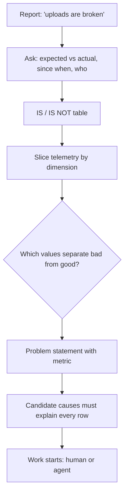

## In one minute
- Most wasted engineering effort goes into solving the wrong problem well. Framing is the step that turns a vague complaint or request into a precise, testable statement.
- A good frame names the symptom, who and what is affected, since when, how much it matters, what "fixed" looks like as a number, and what is out of scope.
- Contrast is the most powerful framing tool: describe where the problem **is** and where it plausibly could be but **is not**. The differences point at the cause.
- Requests usually arrive as a solution ("add a cache", "increase the timeout"). Ask what problem the solution is for before building it; this is the XY problem.
- With agents, the frame is the prompt. A precise frame produces a precise result; a vague one produces confident work on the wrong target.

## How it works

### Symptom, problem, request
Three things often get mixed up. A **symptom** is what someone observed: "checkout feels slow". A **problem** is the gap between expected and actual behaviour, with numbers: "p95 checkout latency for EU mobile users is 3.1 s against a 1 s objective since 14:00 Tuesday". A **request** is someone's proposed fix: "please add more pods". Your first job, and Polya's first step in *How to Solve It* ("understand the problem", [Wikipedia summary](https://en.wikipedia.org/wiki/How_to_Solve_It)), is to turn the symptom into a problem and to hold the request at arm's length until the problem is clear. The request may be right. Often it treats a symptom.

The XY problem is the common failure: someone wants X, believes Y will get it, and asks for help with Y. The cure is one question: "What are you ultimately trying to achieve?" ([xyproblem.info](https://xyproblem.info/)). Monitoring guidance draws the same line: a good signal says what is broken (the symptom) and, separately, why (a possibly intermediate cause), and one team's symptom is another team's cause ([Google SRE book, ch. 6](https://sre.google/sre-book/monitoring-distributed-systems/)).

### The problem statement template
Write this before opening an editor or a prompt. Five minutes is enough for most work.

- **Symptom:** what was observed, by whom, with a link to evidence.
- **Expected vs actual:** both as numbers or concrete behaviour.
- **Scope:** which users, regions, versions, endpoints, tenants.
- **Since when:** first known occurrence, and what changed around then.
- **Impact:** users affected, money, error budget burned, risk.
- **Done when:** a measurable condition, checked how and by whom.
- **Constraints and non-goals:** what you may not change and what you won't attempt.

### IS and IS NOT
Borrowed from classic troubleshooting methods (Kepner and Tregoe made it famous in the 1960s), the contrast table asks four questions twice. **What** fails, and what similar thing doesn't? **Where** does it fail, and where doesn't it? **When** did it start, and when is it absent (time of day, after restarts)? **How much**: how many, how big, is it growing?

Every pair where the problem IS somewhere but IS NOT somewhere comparable is a clue. If the problem hits Android but not iOS, the cause lives in something that differs between them. If it began at 14:00 Tuesday and not before, look at what changed at 14:00 Tuesday. A cause must explain every IS and every IS NOT; any candidate that fails one entry is out.

### Questions that reframe
- What would we see if this were fixed? Can we measure it today?
- Who is not complaining, and why not?
- Is this new, or newly noticed?
- If we did nothing for a week, what happens?
- What would make the requested solution the wrong one?

### Framing for an agent
An agent can't ask the product owner what they meant unless you build that into the loop. Give it the problem statement, the success condition as an executable check where possible, the constraints ("do not change the public API", "no new dependencies"), and the non-goals. Ask it to restate the problem and list its assumptions before writing code. Mismatches in that restatement are cheap to fix; mismatches in a 600-line diff are not.

## Down the stack

### Layer 1: The contract
A framed problem promises a shared, falsifiable target. Two engineers reading it should agree on whether a proposed change meets it. Concretely: the "done when" condition can be evaluated by a query, test or dashboard; the scope says which population the metric is computed over; and the non-goals say what reviewers should not ask for. If two people would argue about whether the fix worked, the frame isn't finished.

### Layer 2: The mechanism
In production, the IS and IS NOT table is built by slicing telemetry along dimensions. Metrics systems store time series keyed by labels (`region`, `app_version`, `endpoint`, `status`); traces carry attributes on each span; logs carry structured fields. Framing a latency problem means querying something like `histogram_quantile(0.95, sum by (le, region, app_version) (rate(http_request_duration_seconds_bucket[5m])))` and seeing which label values separate the bad series from the good ones. Tools such as Honeycomb's BubbleUp automate exactly this comparison: you select the anomalous region, and each field is charted for the selection against everything else, so fields whose distributions differ are the leads ([Honeycomb docs](https://docs.honeycomb.io/investigate/analyze/identify-outliers/)). The limit is cardinality: each label value combination is a new series, so metrics usually lack high-cardinality fields like user ID, and traces or wide events are where the finest slicing happens.

### Layer 3: The machine
Numbers in a frame are only as good as where they were measured. A server-side latency histogram typically starts its timer when the application reads the request, which is after the kernel completed the TCP handshake and queued the connection in the listen backlog. On Linux the `backlog` argument to `listen` bounds fully established connections waiting for `accept`, is silently capped at `net.core.somaxconn` (128 before kernel 5.4, 4096 since), and when the queue is full the connection attempt may be refused or simply ignored so that a retry succeeds ([listen(2)](https://man7.org/linux/man-pages/man2/listen.2.html)). The client then retransmits, and with no RTT sample yet the standard initial timeout is 1 second ([RFC 6298](https://www.rfc-editor.org/rfc/rfc6298)); the server's histogram never sees that second. So "p95 is fine on the server, users say it's slow" is a framing clue pointing below the application: `nstat` counters such as `TcpExtListenOverflows` and `TcpExtListenDrops`, or `ss -lnt` showing a full `Recv-Q` on the listening socket. Similarly, Prometheus-style histograms estimate percentiles by interpolating inside a bucket, so with buckets at 0.5 s and 1 s a reported "p95 of 0.8 s" could be anywhere in that bucket; the docs state that the error is limited by the width of the bucket holding the quantile, and native histograms bound it by resolution instead ([Prometheus docs](https://prometheus.io/docs/practices/histograms/)). Check bucket edges before writing a precise target into a frame.

### Why it's built this way
1. People report symptoms through their own lens, so a frame has to translate a report into something measurable.
2. Measurement is sliced by dimensions, so contrasts (IS versus IS NOT) are cheap to compute and narrow the search fast.
3. Every measurement point sees only part of the path, so the frame must say where the number came from.
4. Effort is expensive and agents amplify direction, so a few minutes of framing pays for itself many times.

## Diagram


## Worked example
Support reports "file uploads are broken". The request from a product manager is "increase the upload size limit, users are hitting it."

The engineer pulls the last 24 hours of upload attempts: 412,000 attempts, 9,100 failures (2.2%). Slicing:

| Dimension | IS (failure rate) | IS NOT |
|---|---|---|
| App version | iOS 5.2: 11% | iOS 5.1: 0.3%, Android: 0.4%, web: 0.2% |
| Network | cellular: 14% on 5.2 | Wi-Fi: 1.1% on 5.2 |
| File size | over 8 MB: 38% on 5.2 cellular | under 8 MB: 0.5% |
| Time | since 5.2 rollout reached 50% on Monday | before Monday |
| Server errors | none; requests end with client disconnect | not 413 Payload Too Large |

The size-limit theory fails the table: no 413s, and Android uploads the same sizes fine. The candidate that explains every row: 5.2 changed the upload client and the request timeout is now 30 seconds. An 8 MB file over a 2 Mbit/s cellular uplink needs at least 32 seconds, so larger files on slow links time out on the client.

Problem statement: "Since iOS 5.2, uploads over about 8 MB on cellular fail at 38% (baseline under 1%) because the client aborts after 30 s. Done when the 5.2.1 failure rate for that slice is under 1% over 48 hours. Non-goal: changing the server size limit." The fix is a timeout based on progress rather than total time, plus resumable uploads later. Raising the size limit would have done nothing.

## In the wild
- **NASA, 1999: Mars Climate Orbiter.** The spacecraft was lost on 23 September 1999 because a ground software file reported thruster impulse in pound-force seconds where the interface specification required newton-seconds, so the trajectory effect was underestimated by a factor of 4.45. The review board named the unit mismatch as the root cause, with eight contributing causes including undetected mismodelling ([NASA Mishap Investigation Board, Phase I report](https://llis.nasa.gov/llis_lib/pdf/1009464main1_0641-mr.pdf)). A shared, testable definition of a quantity is part of the frame.
- **Slack, 2021: the symptoms pointed the wrong way.** On 4 January 2021 responders first rolled back same-day changes, which were not the cause. Web-tier saturation and failed autoscaling turned out to be symptoms of packet loss, caused by an AWS Transit Gateway that did not scale fast enough for the post-holiday traffic jump. Message success fell to about 99% against a normal level above 99.999% until AWS raised capacity at 10:40am PST ([Slack Engineering](https://slack.engineering/slacks-outage-on-january-4th-2021/)).

## Trade-offs
| Approach | Strengths | Weaknesses | Choose when |
|---|---|---|---|
| Act on the request as given | Fast, keeps stakeholders happy short term | Often treats a symptom; wasted work | The request is cheap and reversible |
| Full written frame | Shared target, prevents rework | Takes time; can feel bureaucratic | Anything costing more than a day or touching users |
| IS / IS NOT table | Rapidly eliminates wrong causes | Needs telemetry with the right dimensions | Partial failures, "only some users" problems |

## Pitfalls in production
- **Framing around the loudest customer.** One big account's complaint becomes "the system is slow". Check the population before generalising.
- **Metric without a measurement point.** "Latency is 200 ms" measured at the server hides client-side and network time. State where every number comes from.
- **Frame drift.** The problem silently changes mid-investigation and the "done" check no longer matches. Re-read the statement at each checkpoint.
- **Averages hiding a slice.** A 2% overall error rate can be 40% for one segment. Always slice before concluding.
- **Accepting "it's always been like that".** Ask whether it's new or newly noticed; dashboards and alerts change too.

## Leadership lens
- Make a short problem statement a requirement for any ticket over a day of work, and for every agent task that will produce a PR.
- In design reviews, ask "what problem does this solve, and how will we know?" before discussing the design.
- Push back on solution-shaped requests politely: "Help me understand what's happening for the user, then we'll pick the fix."
- Invest in telemetry dimensions (version, region, tenant tier, network type) that make IS / IS NOT tables a one-query job.

## Check yourself
1. Why must a candidate cause explain the IS NOT entries, not just the IS entries?
   **Answer:** Many causes would produce the observed failure; only the true cause also explains why comparable places are unaffected, so IS NOT entries eliminate most wrong candidates.
2. A server dashboard shows healthy p99 latency but users report timeouts. What framing question comes first?
   **Answer:** Where is the latency measured? Time spent before the application sees the request, such as SYN retransmits after accept queue overflow or network delays, never appears in server histograms.
3. What turns "checkout is slow" into a usable problem statement?
   **Answer:** A metric with a baseline and a target, a scope (who and where), a start time, an impact estimate and a measurable "done" condition.
4. Why ask an agent to restate the problem before it writes code?
   **Answer:** The restatement exposes misread requirements and hidden assumptions while they are cheap to correct, before they're spread across a large diff.

## Practice
**Task:** Build an IS / IS NOT analyser. Each record is `(attrs, failed)` where `attrs` maps attribute names to values (records may lack some attributes). `factor_counts(records)` returns `(attr, value, fail_count, pass_count)` for every attribute value seen in at least one failing record, sorted by fail count descending, then pass count ascending, then attribute name, then value. `explains_all(records)` returns `(attr, value)` pairs, in the same order, that appear in every failing record and in no passing record. Both raise an error if there are no failing records.

```python starter
def factor_counts(records):
    # TODO
    raise NotImplementedError

def explains_all(records):
    # TODO
    raise NotImplementedError
```

```python tests
R = [
    ({"region": "eu", "version": "5.2", "net": "cell"}, True),
    ({"region": "us", "version": "5.2", "net": "wifi"}, True),
    ({"region": "eu", "version": "5.2", "net": "wifi"}, True),
    ({"region": "eu", "version": "5.1", "net": "cell"}, False),
    ({"region": "us", "version": "5.1", "net": "wifi"}, False),
]

def test_counts_sorted():
    assert factor_counts(R) == [
        ("version", "5.2", 3, 0),
        ("net", "wifi", 2, 1),
        ("region", "eu", 2, 1),
        ("net", "cell", 1, 1),
        ("region", "us", 1, 1),
    ]

def test_values_only_in_passes_excluded():
    assert all(v != "5.1" for _, v, _, _ in factor_counts(R))

def test_explains_all():
    assert explains_all(R) == [("version", "5.2")]

def test_none_explains_all():
    r = [({"a": "x"}, True), ({"a": "y"}, True), ({"a": "x"}, False)]
    assert explains_all(r) == []

def test_missing_attributes():
    r = [({"os": "ios", "big": "yes"}, True), ({"os": "ios"}, True), ({"os": "android", "big": "yes"}, False)]
    assert factor_counts(r) == [("os", "ios", 2, 0), ("big", "yes", 1, 1)]
    assert explains_all(r) == [("os", "ios")]

def test_two_explanations_ordered():
    r = [({"b": "1", "a": "1"}, True), ({"b": "2", "a": "2"}, False)]
    assert explains_all(r) == [("a", "1"), ("b", "1")]

def test_no_failures_raises():
    try:
        factor_counts([({"a": "x"}, False)])
        assert False, "expected ValueError"
    except ValueError:
        pass
```

```python solution
def factor_counts(records):
    if not any(failed for _, failed in records):
        raise ValueError("no failing records")
    counts = {}
    for attrs, failed in records:
        for k, v in attrs.items():
            c = counts.setdefault((k, v), [0, 0])
            c[0 if failed else 1] += 1
    out = [(k, v, f, p) for (k, v), (f, p) in counts.items() if f > 0]
    out.sort(key=lambda r: (-r[2], r[3], r[0], r[1]))
    return out

def explains_all(records):
    rows = factor_counts(records)
    total = sum(1 for _, failed in records if failed)
    return [(k, v) for k, v, f, p in rows if f == total and p == 0]
```

```typescript starter
export type Rec = { attrs: Record<string, string>; failed: boolean };
export type Factor = [string, string, number, number];

export function factorCounts(records: Rec[]): Factor[] {
  throw new Error("TODO");
}

export function explainsAll(records: Rec[]): [string, string][] {
  throw new Error("TODO");
}
```

```typescript tests
const R: Rec[] = [
  { attrs: { region: "eu", version: "5.2", net: "cell" }, failed: true },
  { attrs: { region: "us", version: "5.2", net: "wifi" }, failed: true },
  { attrs: { region: "eu", version: "5.2", net: "wifi" }, failed: true },
  { attrs: { region: "eu", version: "5.1", net: "cell" }, failed: false },
  { attrs: { region: "us", version: "5.1", net: "wifi" }, failed: false },
];

test("counts sorted", () => {
  assertEqual(factorCounts(R), [
    ["version", "5.2", 3, 0],
    ["net", "wifi", 2, 1],
    ["region", "eu", 2, 1],
    ["net", "cell", 1, 1],
    ["region", "us", 1, 1],
  ]);
});
test("values only in passes excluded", () => {
  assert(factorCounts(R).every((f) => f[1] !== "5.1"), "5.1 should be excluded");
});
test("explains all", () => {
  assertEqual(explainsAll(R), [["version", "5.2"]]);
});
test("none explains all", () => {
  const r: Rec[] = [{ attrs: { a: "x" }, failed: true }, { attrs: { a: "y" }, failed: true }, { attrs: { a: "x" }, failed: false }];
  assertEqual(explainsAll(r), []);
});
test("missing attributes", () => {
  const r: Rec[] = [{ attrs: { os: "ios", big: "yes" }, failed: true }, { attrs: { os: "ios" }, failed: true }, { attrs: { os: "android", big: "yes" }, failed: false }];
  assertEqual(factorCounts(r), [["os", "ios", 2, 0], ["big", "yes", 1, 1]]);
  assertEqual(explainsAll(r), [["os", "ios"]]);
});
test("two explanations ordered", () => {
  const r: Rec[] = [{ attrs: { b: "1", a: "1" }, failed: true }, { attrs: { b: "2", a: "2" }, failed: false }];
  assertEqual(explainsAll(r), [["a", "1"], ["b", "1"]]);
});
test("no failures throws", () => {
  let threw = false;
  try { factorCounts([{ attrs: { a: "x" }, failed: false }]); } catch (e) { threw = true; }
  assert(threw, "expected error");
});
```

```typescript solution
export type Rec = { attrs: Record<string, string>; failed: boolean };
export type Factor = [string, string, number, number];

const cmp = (a: string, b: string) => (a < b ? -1 : a > b ? 1 : 0);

export function factorCounts(records: Rec[]): Factor[] {
  if (!records.some((r) => r.failed)) throw new Error("no failing records");
  const counts = new Map<string, Factor>();
  for (const r of records) {
    for (const [k, v] of Object.entries(r.attrs)) {
      const key = JSON.stringify([k, v]);
      const f = counts.get(key) ?? [k, v, 0, 0];
      if (r.failed) f[2]++; else f[3]++;
      counts.set(key, f);
    }
  }
  return [...counts.values()]
    .filter((f) => f[2] > 0)
    .sort((a, b) => b[2] - a[2] || a[3] - b[3] || cmp(a[0], b[0]) || cmp(a[1], b[1]));
}

export function explainsAll(records: Rec[]): [string, string][] {
  const rows = factorCounts(records);
  const total = records.filter((r) => r.failed).length;
  return rows.filter((f) => f[2] === total && f[3] === 0).map((f): [string, string] => [f[0], f[1]]);
}
```

```go starter
package practice

// Record is one observation with its outcome.
type Record struct {
	Attrs  map[string]string
	Failed bool
}

// Factor counts how often Attr=Value appears in failing and passing records.
type Factor struct {
	Attr, Value string
	Fail, Pass  int
}

func FactorCounts(records []Record) ([]Factor, error) { panic("TODO") }

// ExplainsAll returns factors present in every failure and no pass (counts included).
func ExplainsAll(records []Record) ([]Factor, error) { panic("TODO") }
```

```go tests
package practice

import (
	"reflect"
	"testing"
)

var recs = []Record{
	{map[string]string{"region": "eu", "version": "5.2", "net": "cell"}, true},
	{map[string]string{"region": "us", "version": "5.2", "net": "wifi"}, true},
	{map[string]string{"region": "eu", "version": "5.2", "net": "wifi"}, true},
	{map[string]string{"region": "eu", "version": "5.1", "net": "cell"}, false},
	{map[string]string{"region": "us", "version": "5.1", "net": "wifi"}, false},
}

func TestCountsSorted(t *testing.T) {
	got, err := FactorCounts(recs)
	want := []Factor{{"version", "5.2", 3, 0}, {"net", "wifi", 2, 1}, {"region", "eu", 2, 1}, {"net", "cell", 1, 1}, {"region", "us", 1, 1}}
	if err != nil || !reflect.DeepEqual(got, want) {
		t.Fatalf("got %v %v", got, err)
	}
}

func TestExplainsAll(t *testing.T) {
	got, _ := ExplainsAll(recs)
	if !reflect.DeepEqual(got, []Factor{{"version", "5.2", 3, 0}}) {
		t.Fatalf("got %v", got)
	}
}

func TestNoneExplainsAll(t *testing.T) {
	r := []Record{{map[string]string{"a": "x"}, true}, {map[string]string{"a": "y"}, true}, {map[string]string{"a": "x"}, false}}
	got, _ := ExplainsAll(r)
	if len(got) != 0 {
		t.Fatalf("got %v", got)
	}
}

func TestMissingAttributes(t *testing.T) {
	r := []Record{{map[string]string{"os": "ios", "big": "yes"}, true}, {map[string]string{"os": "ios"}, true}, {map[string]string{"os": "android", "big": "yes"}, false}}
	got, _ := FactorCounts(r)
	if !reflect.DeepEqual(got, []Factor{{"os", "ios", 2, 0}, {"big", "yes", 1, 1}}) {
		t.Fatalf("got %v", got)
	}
}

func TestTwoExplanationsOrdered(t *testing.T) {
	r := []Record{{map[string]string{"b": "1", "a": "1"}, true}, {map[string]string{"b": "2", "a": "2"}, false}}
	got, _ := ExplainsAll(r)
	if len(got) != 2 || got[0].Attr != "a" || got[1].Attr != "b" {
		t.Fatalf("got %v", got)
	}
}

func TestNoFailures(t *testing.T) {
	if _, err := FactorCounts([]Record{{map[string]string{"a": "x"}, false}}); err == nil {
		t.Fatal("expected error")
	}
}
```

```go solution
package practice

import (
	"errors"
	"sort"
)

// Record is one observation with its outcome.
type Record struct {
	Attrs  map[string]string
	Failed bool
}

// Factor counts how often Attr=Value appears in failing and passing records.
type Factor struct {
	Attr, Value string
	Fail, Pass  int
}

func FactorCounts(records []Record) ([]Factor, error) {
	any := false
	counts := map[[2]string]*Factor{}
	for _, r := range records {
		any = any || r.Failed
		for k, v := range r.Attrs {
			f, ok := counts[[2]string{k, v}]
			if !ok {
				f = &Factor{Attr: k, Value: v}
				counts[[2]string{k, v}] = f
			}
			if r.Failed {
				f.Fail++
			} else {
				f.Pass++
			}
		}
	}
	if !any {
		return nil, errors.New("no failing records")
	}
	out := []Factor{}
	for _, f := range counts {
		if f.Fail > 0 {
			out = append(out, *f)
		}
	}
	sort.Slice(out, func(i, j int) bool {
		a, b := out[i], out[j]
		if a.Fail != b.Fail {
			return a.Fail > b.Fail
		}
		if a.Pass != b.Pass {
			return a.Pass < b.Pass
		}
		if a.Attr != b.Attr {
			return a.Attr < b.Attr
		}
		return a.Value < b.Value
	})
	return out, nil
}

// ExplainsAll returns factors present in every failure and no pass (counts included).
func ExplainsAll(records []Record) ([]Factor, error) {
	rows, err := FactorCounts(records)
	if err != nil {
		return nil, err
	}
	total := 0
	for _, r := range records {
		if r.Failed {
			total++
		}
	}
	out := []Factor{}
	for _, f := range rows {
		if f.Fail == total && f.Pass == 0 {
			out = append(out, f)
		}
	}
	return out, nil
}
```

## Mock interview
**Prompt:** A VP messages you: "Customers say the app is slow. Add more servers today." You have dashboards, logs and traces for a service handling 8,000 requests per second across three regions. Walk me through what you do in the first hour.

- Follow-up: Your server-side p99 looks normal. What does that tell you, and where do you look next?
- Follow-up: The slowness turns out to affect only one enterprise tenant. How does that change the frame and the fix?
- Follow-up: How do you respond to the VP if adding servers is the wrong fix?

**A strong answer covers:**
- Separating the symptom ("slow"), the problem (which metric, which users, since when) and the request (more servers), and not acting on the request blindly.
- Building an IS / IS NOT view by slicing latency and errors by region, version, endpoint, tenant and time, and checking recent changes.
- Knowing where each number is measured, and checking client-side or edge metrics when server metrics look healthy.
- Writing a problem statement with a measurable "done" condition and sharing it with the VP within the hour.
- Offering a cheap, reversible mitigation if it is justified while the real cause is confirmed, and explaining the reasoning in business terms.

## Sources and further study
**Primary**
- [RFC 6298: Computing TCP's Retransmission Timer](https://www.rfc-editor.org/rfc/rfc6298): the initial 1 second timeout that makes a dropped handshake visible to users and invisible to server histograms.
- [NASA Mars Climate Orbiter Phase I report](https://llis.nasa.gov/llis_lib/pdf/1009464main1_0641-mr.pdf): a frame failure at an interface, with root and contributing causes.

**Systems docs**
- [Prometheus: histograms and summaries](https://prometheus.io/docs/practices/histograms/): how quantile estimates are computed and where their error comes from.
- [listen(2) man page](https://man7.org/linux/man-pages/man2/listen.2.html): backlog semantics and the `somaxconn` default change.
- [Honeycomb: BubbleUp](https://docs.honeycomb.io/investigate/analyze/identify-outliers/): comparing a selected anomaly with its baseline across every field.

**Books**
- *How to Solve It*, George Polya (1945): the four phases, starting with understanding the problem.
- *Site Reliability Engineering*, Beyer et al., chapter 6 "Monitoring Distributed Systems": symptoms versus causes and why percentiles beat averages.
- *Systems Performance*, Brendan Gregg, 2nd edition, chapter 2 "Methodologies": asking questions first (the USE method) instead of reading whatever tools show.

**Other curricula**
- [donnemartin/system-design-primer](https://github.com/donnemartin/system-design-primer): its interview approach starts with step 1, "outline use cases, constraints, and assumptions", the same instinct as a problem statement.

## Watch
- [Hammock Driven Development, Rich Hickey (ClojureTV)](https://www.youtube.com/watch?v=f84n5oFoZBc): a talk about spending time understanding the problem before writing code.
- [Debugging Under Fire, Bryan Cantrill (GOTO 2017)](https://www.youtube.com/watch?v=30jNsCVLpAE): how to frame and narrow a live production problem without fooling yourself.

## Free resources
- [The XY Problem](https://xyproblem.info/): a short explanation of solution-shaped requests and how to respond to them.
- [Effective Troubleshooting (Google SRE book)](https://sre.google/sre-book/effective-troubleshooting/): problem reports, triage and examining the system, as practised at Google.
- [Service Level Objectives (Google SRE book)](https://sre.google/sre-book/service-level-objectives/): how to pick metrics and targets so "done" has a number.
- [The USE Method (Brendan Gregg)](https://www.brendangregg.com/usemethod.html): a checklist that frames performance problems by resource, so you don't miss whole areas.
- [How to Solve It (Wikipedia)](https://en.wikipedia.org/wiki/How_to_Solve_It): Polya's four-step method, whose first step is understanding the problem.
