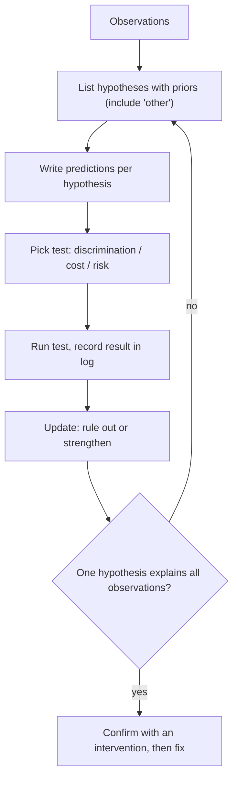

## In one minute
- Investigating well means holding several explicit hypotheses at once, writing down what each predicts, and running the cheapest test that best separates them.
- A good test is one whose result you can't predict in advance. If every hypothesis predicts the same outcome, the test teaches you nothing, however busy it keeps you.
- Weigh hypotheses by rough probability and update as evidence arrives. Base rates matter: recent changes cause most production incidents.
- Keep a written log of hypotheses, tests and results. It stops loops, makes handovers work, and becomes the postmortem timeline.
- Agents are good at generating hypotheses and running checks; you supply priors from context and judge which test discriminates.

## How it works

### Multiple working hypotheses
The most common investigative failure is falling in love with the first explanation. Once you believe "it's the database", every slow query looks like proof, and evidence that doesn't fit gets explained away. The counter is old: geologist T. C. Chamberlin argued in 1890 for keeping several working hypotheses alive at once ([Wikipedia](https://en.wikipedia.org/wiki/Thomas_Chrowder_Chamberlin)), and John Platt's 1964 essay "Strong Inference" turned it into a loop ([summary](https://en.wikipedia.org/wiki/Strong_inference)): list alternative hypotheses, devise an experiment whose possible outcomes exclude one or more of them, run it cleanly, and repeat.

In engineering terms, write the list before you start digging:

- **H1:** the 14:05 deploy introduced a slow code path.
- **H2:** the primary database is saturated by a batch job.
- **H3:** packet loss between two availability zones.
- **H4:** something else (always keep this one).

For each, write what you would expect to see if it were true and if it were false.

### Choosing the next test
Rate each candidate test on three things: how differently the hypotheses predict its outcome (discrimination), how long it takes (cost), and whether it can make things worse (risk). Rolling back the deploy discriminates H1 from the rest strongly but takes 10 minutes and has risk. Looking at per-AZ error rates takes 30 seconds and splits H3 from H1 and H2. Do the cheap, safe, discriminating tests first, and use mitigations like rollback when the cost of waiting is high, accepting that they also act as tests.

A test that every hypothesis predicts the same way ("CPU is high") feels productive and changes nothing. Before running a query, say out loud what result would make you drop a hypothesis.

### Priors and base rates
Not all hypotheses start equal. In most organisations, a large share of incidents follow a change: a deploy, a config push, a feature flag, a dependency upgrade, a certificate expiry. Google's analysis of thousands of postmortems from 2010 to 2017 attributes 37% of outage triggers to binary pushes and 31% to configuration pushes, 68% together ([SRE Workbook, appendix C](https://sre.google/workbook/postmortem-analysis/)). "What changed?" is the highest-yield first question because its prior is high and it's cheap to answer. Hardware faults and compiler bugs exist, but their prior is low; they deserve attention only once common causes are excluded or the evidence points there specifically.

### The investigation log
Keep a running log in the incident channel or a document: timestamp, hypothesis, test, result, conclusion. Google's troubleshooting model asks for the same: design tests that rule hypotheses in or out, run the likeliest and least risky first, and document every step and result ([SRE book, ch. 12](https://sre.google/sre-book/effective-troubleshooting/)). "14:22 H3 network: per-AZ 5xx rates equal across AZs, H3 unlikely." This prevents the team from re-testing ruled-out ideas, lets a new responder catch up in a minute, and turns into the postmortem timeline with no extra work.

### Working with an agent
An agent with log and metrics access can list hypotheses, run queries and summarise evidence quickly. It will also anchor on the first plausible story, and it can't know that the batch job was rescheduled yesterday unless someone tells it. Give it the hypothesis list, ask it to report evidence for and against each, and check that its "confirmed" claims rest on a discriminating test, not a coincidence in time.

## Down the stack

### Layer 1: The contract
The process promises that every conclusion is backed by a test that could have come out the other way, and that the reasoning is visible to others. Testable form: for each claim in the log there is a recorded prediction, an observation and a timestamp; every hypothesis is in one of three states (open, ruled out, supported); and "root cause found" requires the cause to explain all observations, including the ones where the problem is absent.

### Layer 2: The mechanism
Underneath, this is Bayesian updating. Each hypothesis `H` has a prior `P(H)`. A test result `E` has likelihood `P(E | H)` under each hypothesis. The posterior is `P(H | E) ∝ P(H) × P(E | H)`, normalised over the list. A test's value is its expected information gain: the entropy of the current distribution minus the expected entropy after seeing the result. Dividing by cost (minutes, risk) gives a ranking of what to do next. The same chapter warns about the failure mode this ranking avoids: chasing irrelevant symptoms, proposing improbable theories, and mistaking coincidence or a shared cause for causation. Nobody computes this to three decimal places at 2 a.m., but the shape guides intuition: tests where likelihoods differ a lot across likely hypotheses are worth more than tests where they don't, and one strong, cheap test beats three weak ones.

In production the discriminating tests are concrete: compare canary and baseline instances, toggle a feature flag for 1% of traffic, shift traffic away from one zone, replay a captured request against old and new builds, or diff configuration between a good and a bad host.

### Layer 3: The machine
Observation tools have costs that can change the system you are testing. `strace` uses `ptrace`: the kernel stops the traced process at every syscall entry and exit and switches to the tracer. Brendan Gregg measured a syscall-heavy `dd` at 442x slower under `strace` and warns of 100x slowdowns more generally, which is enough to hide a race or cause timeouts; `perf trace` avoids the per-syscall stops ([Gregg](https://www.brendangregg.com/blog/2014-05-11/strace-wow-much-syscall.html)). `perf record` instead samples: the CPU's performance monitoring unit raises an interrupt at a set frequency (for example `-F 99`, 99 times per second per CPU), and the kernel records the instruction pointer and stack, costing a few percent. eBPF tools such as `bpftrace` or BCC's `biolatency` attach small verified programs to kprobes, tracepoints or uprobes; they aggregate in kernel maps and copy only summaries to user space, so overhead is usually low, though very hot probes (millions of events per second) still add measurable cost. `tcpdump` copies packets through a ring buffer and can drop them under load; check the "packets dropped by kernel" line before concluding a packet was never sent. Choose the cheapest tool that answers the discriminating question, and record its overhead in the log.

### Why it's built this way
1. People see patterns that confirm what they already believe, so hypotheses must be explicit and plural.
2. Time during an incident is expensive, so tests are ranked by how much they discriminate per minute.
3. Observation perturbs systems, so tool choice is part of test design.
4. Investigations get handed over and later reviewed, so the reasoning is written down as it happens.

## Diagram


## Worked example
At 14:20, checkout error rate rises from 0.2% to 4%. The on-call lists three hypotheses with rough priors: H1 the 14:05 deploy (0.5, since recent changes dominate), H2 database saturation (0.3), H3 inter-AZ network trouble (0.2).

Candidate tests and the probability each hypothesis predicts a "positive" result:

| Test | H1 deploy | H2 database | H3 network | Cost |
|---|---|---|---|---|
| Roll back, errors drop | 0.95 | 0.10 | 0.10 | 10 min, some risk |
| DB metrics show saturation | 0.10 | 0.90 | 0.20 | 2 min |
| Packet capture shows loss | 0.05 | 0.05 | 0.95 | 5 min |
| CPU is high on app hosts | 0.5 | 0.5 | 0.5 | 1 min |

The CPU check predicts the same result under every hypothesis, so its information gain is zero, even though it's the first thing many people look at. Rollback has the highest information gain (about 0.62 bits of the starting 1.49), but per minute the DB metrics check wins (0.42 bits in 2 minutes). The on-call checks DB metrics first: connection count normal, no lock waits. Negative result: H2 drops to about 0.05. With H1 now dominant and customer impact rising, rollback is both the best test and the best mitigation. Errors fall to 0.3% within 4 minutes of the rollback finishing.

That supports H1 but doesn't prove the mechanism. The follow-up is to reproduce: replay a sample of failed requests against the new build in staging, which fails on orders with more than 50 items because of a new validation query with no index.

## In the wild
- **Cloudflare, 2019: a WAF regex, not an attack.** On 2 July 2019 a Web Application Firewall rule deployed at 13:42 UTC drove CPU on the edge to nearly 100% and produced widespread 502s. Some responders suspected a new kind of attack; the team ruled it out by 14:00, attributed the load to the WAF, and killed it globally at 14:07, with recovery at 14:09 (27 minutes). The rule contained a regular expression that backtracked catastrophically, and the test suite had not measured CPU. Cloudflare restored CPU protection, audited all 3,868 managed rules and planned a regex engine with runtime guarantees ([Cloudflare](https://blog.cloudflare.com/details-of-the-cloudflare-outage-on-july-2-2019/)).
- **GitLab, 2023: a hidden lock limit.** After GitLab cut client-facing Postgres replicas from 8 to 6, severe slowdowns saturated PgBouncer pools. The investigation found that nearly 70% of heavyweight locks missed the fast path and queued on 16 `lock_manager` LWLocks, because hot queries touched more than 16 relations (the projects table had 57 indexes). Actions included treating lock-manager contention as a saturation metric ([GitLab issue](https://gitlab.com/gitlab-com/gl-infra/observability/team/-/work_items/2301)). A cause nobody had on the list is why you keep an "other" hypothesis.

## Trade-offs
| Approach | Strengths | Weaknesses | Choose when |
|---|---|---|---|
| Single hunch, dig deep | Fast when the hunch is right | Confirmation bias; slow when wrong | Very familiar systems, obvious signals |
| Explicit hypotheses and discriminating tests | Systematic, explainable, handover-friendly | Needs discipline under pressure | Any incident lasting more than a few minutes |
| Mitigate first, investigate later | Limits customer impact | May destroy evidence | Impact is high and a safe mitigation exists |
| Broad data collection | Captures evidence before it is lost | Costly; drowning in data | Rare or intermittent issues |

## Pitfalls in production
- **Confirmation by coincidence.** Something changed at the same time, so it must be the cause. Require an intervention or a reproduction, not just correlation.
- **Non-discriminating dashboards.** Staring at CPU, memory and request rates that all hypotheses predict. Ask what each panel could rule out.
- **Heisenbugs from tracing.** `strace` on a latency-sensitive process changes timing. Prefer sampling or eBPF and note overhead.
- **Lost evidence.** Restarting pods wipes in-memory state and local logs. Capture a heap dump, `jstack`, or `/proc/<pid>` details before mitigation when you can afford the seconds.
- **No "other" hypothesis.** The true cause wasn't on the list, so every test seemed inconclusive. Keep a catch-all and revisit the list when results surprise you.

## Leadership lens
- Make the hypothesis log a standard part of incident response; review it in postmortems as a learning artefact.
- Coach people to state predictions before running queries; it is the single habit that most improves investigation speed.
- Invest in tooling that makes discriminating tests cheap: per-instance canary comparisons, flag toggles, traffic shifting, request replay.
- When an agent or teammate reports "root cause found", ask: what test could have disproved it, and what did it show?

## Check yourself
1. Why is "CPU is high" often a useless first test?
   **Answer:** If every candidate cause predicts high CPU, observing it doesn't change their relative probabilities, so it carries no information for choosing between them.
2. Rollback fixed the errors. Is the root cause proven?
   **Answer:** No. It strongly supports "something in the change", but the mechanism is unknown until a reproduction or a targeted test explains why the change caused the failure.
3. Why might `perf` be a better choice than `strace` for a latency problem?
   **Answer:** `strace` stops the process on every syscall via `ptrace`, adding large overhead that can mask or create timing problems, while `perf` samples at a fixed rate with low overhead.
4. How does the base rate of change-induced incidents affect your first move?
   **Answer:** It gives "recent change" a high prior, so checking deploys, configs and flags is both cheap and likely to be informative, making it the natural first test.

## Practice
**Task:** Build a hypothesis ranker. `update(priors, likelihoods, positive)` returns the normalised posterior, where `likelihoods[h]` is the probability that the test is positive if `h` is true (priors need not sum to 1). Raise an error if the observed result has zero probability under every hypothesis. `entropy(dist)` returns the Shannon entropy in bits of a distribution. `expected_gain(priors, likelihoods)` returns the expected information gain of a test: entropy before minus the probability-weighted entropy of the two possible posteriors. `best_test(priors, tests, costs)` returns the name of the test with the highest gain divided by cost (a missing cost counts as 1), breaking ties by name.

```python starter
def update(priors, likelihoods, positive):
    # TODO
    raise NotImplementedError

def entropy(dist):
    # TODO
    raise NotImplementedError

def expected_gain(priors, likelihoods):
    # TODO
    raise NotImplementedError

def best_test(priors, tests, costs):
    # TODO
    raise NotImplementedError
```

```python tests
P = {"deploy": 0.5, "db": 0.3, "network": 0.2}
T = {
    "rollback": {"deploy": 0.95, "db": 0.1, "network": 0.1},
    "db_metrics": {"deploy": 0.1, "db": 0.9, "network": 0.2},
    "pcap": {"deploy": 0.05, "db": 0.05, "network": 0.95},
    "cpu": {"deploy": 0.5, "db": 0.5, "network": 0.5},
}

def close(a, b):
    return abs(a - b) < 1e-9

def test_update_positive():
    post = update(P, T["rollback"], True)
    assert close(post["deploy"], 0.9047619047619047)
    assert close(post["db"], 0.05714285714285714)
    assert close(sum(post.values()), 1.0)

def test_update_negative():
    post = update(P, T["rollback"], False)
    assert close(post["db"], 0.5684210526315788)

def test_update_impossible_raises():
    try:
        update({"a": 1.0}, {"a": 1.0}, False)
        assert False, "expected ValueError"
    except ValueError:
        pass

def test_entropy():
    assert close(entropy({"a": 0.5, "b": 0.5}), 1.0)
    assert close(entropy({"a": 1.0, "b": 0.0}), 0.0)
    assert close(entropy(P), 1.4854752972273344)

def test_gain():
    assert close(expected_gain(P, T["rollback"]), 0.6204996036901913)
    assert close(expected_gain(P, T["cpu"]), 0.0)

def test_best_test_without_costs():
    assert best_test(P, T, {}) == "rollback"

def test_best_test_with_costs():
    assert best_test(P, T, {"rollback": 10, "db_metrics": 2, "pcap": 5, "cpu": 1}) == "db_metrics"

def test_tie_breaks_by_name():
    same = {"zeta": T["pcap"], "alpha": T["pcap"]}
    assert best_test(P, same, {}) == "alpha"
```

```python solution
import math

def _norm(d):
    total = sum(d.values())
    if total <= 0:
        raise ValueError("observation impossible under every hypothesis")
    return {k: v / total for k, v in d.items()}

def update(priors, likelihoods, positive):
    return _norm({h: p * (likelihoods[h] if positive else 1 - likelihoods[h]) for h, p in priors.items()})

def entropy(dist):
    return -sum(p * math.log2(p) for p in dist.values() if p > 0)

def expected_gain(priors, likelihoods):
    p = _norm(priors)
    p_pos = sum(p[h] * likelihoods[h] for h in p)
    gain = entropy(p)
    if p_pos > 0:
        gain -= p_pos * entropy(update(p, likelihoods, True))
    if p_pos < 1:
        gain -= (1 - p_pos) * entropy(update(p, likelihoods, False))
    return gain

def best_test(priors, tests, costs):
    scored = [(-expected_gain(priors, tests[n]) / costs.get(n, 1), n) for n in tests]
    return min(scored)[1]
```

```typescript starter
export type Dist = Record<string, number>;

export function update(priors: Dist, likelihoods: Dist, positive: boolean): Dist {
  throw new Error("TODO");
}
export function entropy(dist: Dist): number {
  throw new Error("TODO");
}
export function expectedGain(priors: Dist, likelihoods: Dist): number {
  throw new Error("TODO");
}
export function bestTest(priors: Dist, tests: Record<string, Dist>, costs: Dist): string {
  throw new Error("TODO");
}
```

```typescript tests
const P: Dist = { deploy: 0.5, db: 0.3, network: 0.2 };
const T: Record<string, Dist> = {
  rollback: { deploy: 0.95, db: 0.1, network: 0.1 },
  db_metrics: { deploy: 0.1, db: 0.9, network: 0.2 },
  pcap: { deploy: 0.05, db: 0.05, network: 0.95 },
  cpu: { deploy: 0.5, db: 0.5, network: 0.5 },
};
const close = (a: number, b: number) => Math.abs(a - b) < 1e-9;

test("update positive", () => {
  const post = update(P, T.rollback, true);
  assert(close(post.deploy, 0.9047619047619047), "deploy");
  assert(close(post.db, 0.05714285714285714), "db");
});
test("update negative", () => {
  assert(close(update(P, T.rollback, false).db, 0.5684210526315788), "db");
});
test("impossible throws", () => {
  let threw = false;
  try { update({ a: 1 }, { a: 1 }, false); } catch (e) { threw = true; }
  assert(threw, "expected error");
});
test("entropy", () => {
  assert(close(entropy({ a: 0.5, b: 0.5 }), 1), "fair coin");
  assert(close(entropy({ a: 1, b: 0 }), 0), "certain");
  assert(close(entropy(P), 1.4854752972273344), "P");
});
test("gain", () => {
  assert(close(expectedGain(P, T.rollback), 0.6204996036901913), "rollback");
  assert(close(expectedGain(P, T.cpu), 0), "cpu");
});
test("best without costs", () => {
  assertEqual(bestTest(P, T, {}), "rollback");
});
test("best with costs", () => {
  assertEqual(bestTest(P, T, { rollback: 10, db_metrics: 2, pcap: 5, cpu: 1 }), "db_metrics");
});
test("tie by name", () => {
  assertEqual(bestTest(P, { zeta: T.pcap, alpha: T.pcap }, {}), "alpha");
});
```

```typescript solution
export type Dist = Record<string, number>;

function norm(d: Dist): Dist {
  const total = Object.values(d).reduce((a, b) => a + b, 0);
  if (total <= 0) throw new Error("observation impossible under every hypothesis");
  const out: Dist = {};
  for (const k of Object.keys(d)) out[k] = d[k] / total;
  return out;
}
export function update(priors: Dist, likelihoods: Dist, positive: boolean): Dist {
  const raw: Dist = {};
  for (const h of Object.keys(priors)) raw[h] = priors[h] * (positive ? likelihoods[h] : 1 - likelihoods[h]);
  return norm(raw);
}
export function entropy(dist: Dist): number {
  return -Object.values(dist).filter((p) => p > 0).reduce((s, p) => s + p * Math.log2(p), 0);
}
export function expectedGain(priors: Dist, likelihoods: Dist): number {
  const p = norm(priors);
  const pPos = Object.keys(p).reduce((s, h) => s + p[h] * likelihoods[h], 0);
  let gain = entropy(p);
  if (pPos > 0) gain -= pPos * entropy(update(p, likelihoods, true));
  if (pPos < 1) gain -= (1 - pPos) * entropy(update(p, likelihoods, false));
  return gain;
}
export function bestTest(priors: Dist, tests: Record<string, Dist>, costs: Dist): string {
  let best = "";
  let bestScore = -Infinity;
  for (const name of Object.keys(tests).sort()) {
    const score = expectedGain(priors, tests[name]) / (costs[name] ?? 1);
    if (score > bestScore) {
      best = name;
      bestScore = score;
    }
  }
  return best;
}
```

```go starter
package practice

func Update(priors, likelihoods map[string]float64, positive bool) (map[string]float64, error) {
	panic("TODO")
}

func Entropy(dist map[string]float64) float64 { panic("TODO") }

func ExpectedGain(priors, likelihoods map[string]float64) float64 { panic("TODO") }

func BestTest(priors map[string]float64, tests map[string]map[string]float64, costs map[string]float64) string {
	panic("TODO")
}
```

```go tests
package practice

import (
	"math"
	"testing"
)

var P = map[string]float64{"deploy": 0.5, "db": 0.3, "network": 0.2}
var T = map[string]map[string]float64{
	"rollback":   {"deploy": 0.95, "db": 0.1, "network": 0.1},
	"db_metrics": {"deploy": 0.1, "db": 0.9, "network": 0.2},
	"pcap":       {"deploy": 0.05, "db": 0.05, "network": 0.95},
	"cpu":        {"deploy": 0.5, "db": 0.5, "network": 0.5},
}

func near(a, b float64) bool { return math.Abs(a-b) < 1e-9 }

func TestUpdate(t *testing.T) {
	post, err := Update(P, T["rollback"], true)
	if err != nil || !near(post["deploy"], 0.9047619047619047) || !near(post["db"], 0.05714285714285714) {
		t.Fatalf("got %v %v", post, err)
	}
	neg, _ := Update(P, T["rollback"], false)
	if !near(neg["db"], 0.5684210526315788) {
		t.Fatalf("got %v", neg)
	}
}

func TestImpossible(t *testing.T) {
	if _, err := Update(map[string]float64{"a": 1}, map[string]float64{"a": 1}, false); err == nil {
		t.Fatal("expected error")
	}
}

func TestEntropy(t *testing.T) {
	if !near(Entropy(map[string]float64{"a": 0.5, "b": 0.5}), 1) || !near(Entropy(map[string]float64{"a": 1, "b": 0}), 0) || !near(Entropy(P), 1.4854752972273344) {
		t.Fatal("bad entropy")
	}
}

func TestGain(t *testing.T) {
	if !near(ExpectedGain(P, T["rollback"]), 0.6204996036901913) || !near(ExpectedGain(P, T["cpu"]), 0) {
		t.Fatal("bad gain")
	}
}

func TestBest(t *testing.T) {
	if b := BestTest(P, T, map[string]float64{}); b != "rollback" {
		t.Fatalf("got %q", b)
	}
	costs := map[string]float64{"rollback": 10, "db_metrics": 2, "pcap": 5, "cpu": 1}
	if b := BestTest(P, T, costs); b != "db_metrics" {
		t.Fatalf("got %q", b)
	}
}

func TestTie(t *testing.T) {
	same := map[string]map[string]float64{"zeta": T["pcap"], "alpha": T["pcap"]}
	if b := BestTest(P, same, nil); b != "alpha" {
		t.Fatalf("got %q", b)
	}
}
```

```go solution
package practice

import (
	"errors"
	"math"
	"sort"
)

func keys(m map[string]float64) []string {
	ks := make([]string, 0, len(m))
	for k := range m {
		ks = append(ks, k)
	}
	sort.Strings(ks)
	return ks
}

func norm(d map[string]float64) (map[string]float64, error) {
	total := 0.0
	for _, k := range keys(d) {
		total += d[k]
	}
	if total <= 0 {
		return nil, errors.New("observation impossible under every hypothesis")
	}
	out := map[string]float64{}
	for k, v := range d {
		out[k] = v / total
	}
	return out, nil
}

func Update(priors, likelihoods map[string]float64, positive bool) (map[string]float64, error) {
	raw := map[string]float64{}
	for h, p := range priors {
		l := likelihoods[h]
		if !positive {
			l = 1 - l
		}
		raw[h] = p * l
	}
	return norm(raw)
}

func Entropy(dist map[string]float64) float64 {
	h := 0.0
	for _, k := range keys(dist) {
		if p := dist[k]; p > 0 {
			h -= p * math.Log2(p)
		}
	}
	return h
}

func ExpectedGain(priors, likelihoods map[string]float64) float64 {
	p, err := norm(priors)
	if err != nil {
		return 0
	}
	pPos := 0.0
	for _, h := range keys(p) {
		pPos += p[h] * likelihoods[h]
	}
	gain := Entropy(p)
	if pPos > 0 {
		post, _ := Update(p, likelihoods, true)
		gain -= pPos * Entropy(post)
	}
	if pPos < 1 {
		post, _ := Update(p, likelihoods, false)
		gain -= (1 - pPos) * Entropy(post)
	}
	return gain
}

func BestTest(priors map[string]float64, tests map[string]map[string]float64, costs map[string]float64) string {
	names := make([]string, 0, len(tests))
	for n := range tests {
		names = append(names, n)
	}
	sort.Strings(names)
	best, bestScore := "", math.Inf(-1)
	for _, n := range names {
		cost, ok := costs[n]
		if !ok {
			cost = 1
		}
		if s := ExpectedGain(priors, tests[n]) / cost; s > bestScore {
			best, bestScore = n, s
		}
	}
	return best
}
```

## Mock interview
**Prompt:** It's 2 a.m. You're paged: p99 latency on the search API is 10x normal (from 80 ms to 800 ms) and error rate is climbing from 0.1% to 2%. Nothing was deployed today. Walk me through your investigation.

- Follow-up: Your first two theories were both ruled out. What do you do now?
- Follow-up: You want to `strace` a production process. What are the risks and alternatives?
- Follow-up: A teammate says "it's definitely the new index, latency went up right when it finished building." How do you respond?

**A strong answer covers:**
- Stabilising first if impact is severe (shed load, fail over, roll back config), while preserving evidence where cheap.
- Asking "what changed?" broadly: config, flags, data volume, dependencies, traffic mix, certificates, scheduled jobs, not only deploys.
- Listing several hypotheses with predictions and choosing cheap discriminating checks (per-host, per-AZ, per-endpoint breakdowns; dependency latency).
- Keeping a written log and revisiting the hypothesis list, including "other", when results surprise.
- Treating timing coincidence as a lead, not proof, and confirming with an intervention or reproduction.
- Knowing tool overhead: sampling profilers and eBPF over `ptrace`-based tracing on hot processes.

## Sources and further study
**Primary**
- [Chamberlin, The Method of Multiple Working Hypotheses (Science, 1890)](https://en.wikipedia.org/wiki/Thomas_Chrowder_Chamberlin): the original argument against a single ruling theory.
- [Platt, Strong Inference (Science, 1964)](https://en.wikipedia.org/wiki/Strong_inference): rival hypotheses, a crucial experiment, repeat.
- [Google SRE Workbook, appendix C: results of postmortem analysis](https://sre.google/workbook/postmortem-analysis/): the distribution of outage triggers behind the "what changed?" prior.

**Systems docs**
- [Brendan Gregg: strace wow much syscall](https://www.brendangregg.com/blog/2014-05-11/strace-wow-much-syscall.html): measured `ptrace` overhead and lower-cost alternatives.
- [Cloudflare: Details of the July 2, 2019 outage](https://blog.cloudflare.com/details-of-the-cloudflare-outage-on-july-2-2019/): a clear public timeline from page to cause.

**Books**
- *Site Reliability Engineering*, Beyer et al., chapter 12 "Effective Troubleshooting" and chapter 15 "Postmortem Culture".
- *Observability Engineering*, Majors, Fong-Jones and Miranda, chapter 8 "Analyzing Events to Achieve Observability": debugging from first principles versus known conditions.
- *Systems Performance*, Brendan Gregg, 2nd edition, chapter 2 "Methodologies": the scientific method and USE method as investigation checklists.

**Other curricula**
- [roadmap.sh: DevOps](https://roadmap.sh/devops): treats monitoring, alerting and observability tooling as a core skill, a reminder that investigation depends on instrumented systems.

## Watch
- [Feynman on Scientific Method (seabala)](https://www.youtube.com/watch?v=EYPapE-3FRw): the guess, predict, compare loop in under ten minutes.
- [Debugging Under Fire, Bryan Cantrill (GOTO 2017)](https://www.youtube.com/watch?v=30jNsCVLpAE): hypothesis discipline and keeping your head during a live production failure.
- [Linux Performance Tools, Brendan Gregg, part 1 (Brendan Gregg)](https://www.youtube.com/watch?v=FJW8nGV4jxY): the observability tools you use to run discriminating tests on Linux.

## Free resources
- [Strong inference (Wikipedia)](https://en.wikipedia.org/wiki/Strong_inference): summary of Platt's method of alternative hypotheses and crucial experiments.
- [Effective Troubleshooting (Google SRE book)](https://sre.google/sre-book/effective-troubleshooting/): hypothesise, test and log, with common pitfalls like confusing correlation and causation.
- [Performance Analysis Methodology (Brendan Gregg)](https://www.brendangregg.com/methodology.html): a catalogue of methods and anti-methods, including the "streetlight" anti-method.
- [Linux eBPF Tracing Tools (Brendan Gregg)](https://www.brendangregg.com/ebpf.html): what eBPF can observe and the tools built on it.
- [ptrace(2) man page](https://man7.org/linux/man-pages/man2/ptrace.2.html): the mechanism behind `strace` and debuggers, and why it is expensive.
- [Bayes' theorem (Wikipedia)](https://en.wikipedia.org/wiki/Bayes%27_theorem): the maths behind updating hypotheses on evidence.
