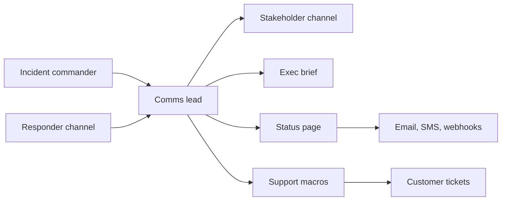

## In one minute
- Communication is part of the fix. Silence makes customers, support and executives assume the worst and start interrupting responders.
- Every update answers four things: what is affected, what we know, what we are doing, and when the next update comes.
- Keep a fixed cadence tied to severity and keep it even when nothing has changed. "No change, still working on X, next update at 15:30" is a valid update.
- Write for each audience: responders need facts and tasks, executives need impact and risk, customers need impact and workarounds.
- Your status page and alert email must not depend on the system that is down.

## How it works

### Audiences
An incident has several audiences with different needs. Responders in the incident channel need the current hypothesis, who is doing what, and decisions. Internal stakeholders (support, sales, account managers, other engineering teams) need to know what customers see and what to tell them. Executives need business impact, risk of escalation, and whether they must act, for example calling a major customer or a regulator. Customers need to know whether it is them or you, what is affected, and whether there is a workaround. Mixing these in one channel serves nobody.

### The update template
A good update is short and structured:
- **Impact:** who and what is affected, in user terms, with numbers if known.
- **Status:** investigating, identified, mitigating, monitoring, or resolved.
- **Actions:** what the team is doing now.
- **Next update:** an exact time.

Leave out speculation about cause, internal system names that mean nothing to the reader, and blame. "Some customers in Europe cannot complete payments. We have identified a faulty configuration change and are reverting it. Next update at 14:30 UTC." is enough.

### Cadence
Severity sets the rhythm. A common scheme: SEV1 every 30 minutes internally and on the status page, SEV2 every hour, SEV3 at start and end. The cadence is a promise. Missing it signals chaos, and people start pinging responders directly. Putting the next update time in every message turns "is there news?" into "the next update is at 14:30".

### Honesty and precision
Say what you know and how sure you are. "We believe" and "we have confirmed" are different statements; use them carefully. Do not promise an ETA you do not have; give the next checkpoint instead. When you get something wrong in an update, correct it explicitly in the next one. Apologise once, plainly, without hedging.

### The status page
Post early. Customers are usually already seeing the failure; a status page that stays green while social media fills with reports destroys trust faster than the outage. Cloudflare's 2019 postmortem lists "We didn't update our status page quickly enough" among what went wrong ([Cloudflare](https://blog.cloudflare.com/details-of-the-cloudflare-outage-on-july-2-2019/)), and AWS's 2017 S3 summary explains that it could not update the individual service statuses on its Service Health Dashboard until 11:37 PST, two hours after the 9:37 trigger, because the dashboard's admin console depended on S3. AWS fell back on its Twitter feed and a dashboard banner, and afterwards made the console run across multiple regions ([AWS](https://aws.amazon.com/message/41926/)).

### Closing the loop
When the incident is resolved, send a final update with the duration, the impact, a one-line cause if known, and a promise of a postmortem by a date. For significant customer impact, publish the postmortem publicly.

## Down the stack

### Layer 1: The contract
The comms process promises that each audience gets an update at least every cadence interval for the incident's severity, that the first external acknowledgement appears within a set time of declaration (often 15 to 30 minutes for customer-visible impact), that every update names a next-update time, and that statements of cause are marked as confirmed or suspected. This is measurable from timestamps: gaps between consecutive updates, time from declaration to first public post, and corrections issued.

### Layer 2: The mechanism
Status pages model the service as components (API, dashboard, payments, each region) with states such as operational, degraded performance, partial outage and major outage ([Atlassian Statuspage](https://support.atlassian.com/statuspage/docs/show-service-status-with-components/)), and an incident object that moves through investigating, identified, monitoring and resolved. Each state change can notify subscribers by email, SMS, webhook or RSS. Incident bots post templates into chat and remind the comms lead when an update is due. Internally, many teams use a separate stakeholder channel that only comms posts in, so executives can follow without joining the responder channel. Customer support links the status incident to tickets so agents can reply with a link instead of guesses.

### Layer 3: The machine
A status page sees sudden load: when a large service fails, traffic to its status page can jump by two or three orders of magnitude within minutes, so it is served as static content from a CDN with short cache TTLs rather than rendered from a database per request. It must run on separate infrastructure, in a separate provider or region, with separate DNS and authentication, so it shares no fate with the product. Email notifications pass through SMTP relays and the receiver's checks: SPF verifies the sending IP, DKIM verifies a signature over the headers and body, and DMARC tells receivers what to do when both fail. GitLab's 2017 postmortem describes the failure emails from its daily database backup job being rejected because DMARC was not enabled for them, so nobody noticed in time that the backups were failing ([GitLab](https://about.gitlab.com/blog/2017/02/10/postmortem-of-database-outage-of-january-31/)). SMS has per-sender throughput limits that vary by number type and carrier, so a large subscriber list can take many minutes to drain; webhooks retry with backoff when the receiver is slow.

### Why it's built this way
People fill an information vacuum with guesses and direct messages, which interrupt responders, so a scheduled update is cheaper than ad-hoc answers. Different audiences need different detail, so separate channels and templates avoid both leaks of internal noise and executive confusion. Status infrastructure is needed most exactly when production is broken, so it is deliberately built on different foundations. Trust depends on candour over time, so precise, corrected and timely updates matter more than polished prose.

## Diagram


## Worked example
An outage starts at 10:00 when 18 percent of API calls to the eu-west region fail. The incident is declared at 10:06 as SEV1 with a 30-minute update cadence.

- 10:12 status page: "Investigating: elevated API errors for some customers in Europe. Next update 10:40 UTC."
- 10:12 stakeholder channel: impact numbers, which large customers are on eu-west, ops lead's current hypothesis (a network change at 09:55), and a request to support to use the status page link.
- 10:40 update: "Identified: a network configuration change is causing failed connections in one European region. We are reverting it. Next update 11:10."
- 10:58 errors fall to baseline. 11:05 update: "Monitoring: error rates have returned to normal since 10:58. We will keep monitoring and post a final update by 11:30."
- 11:30 resolved, with a postmortem promised within five business days.

The comms lead's tool computes compliance: with a 30-minute cadence from 10:00, updates were due by 10:30, but the first came at 10:12, so the next was due 10:42, then 11:10 after the 10:40 update, then 11:35 after 11:05, met by the 11:30 resolution. All deadlines met. A team that posted at 10:12 and then went quiet until 11:20 would have missed deadlines at 10:42 and 11:12, and support would have spent that hour answering tickets with "we're looking into it".

## In the wild
- **AWS, 2017: the dashboard that depended on S3.** On 28 February a mistyped input to a capacity-removal command took far more S3 servers offline in US-EAST-1 than intended. Index and placement subsystems needed full restarts, and S3 was normal again at 1:54 PM PST. The Service Health Dashboard's admin console depended on S3, so individual service statuses could not be updated until 11:37 AM, and AWS used Twitter and a banner meanwhile. The console now runs across several regions ([AWS](https://aws.amazon.com/message/41926/)).
- **Atlassian, 2022: slow and hard-to-reach communication.** 883 sites for 775 customers were deleted on 5 April and restoration ran to 18 April. The first Statuspage update came at 09:03 UTC, the first broad external post on 7 April, and affected customers could not file support tickets because their sites were gone. Atlassian added a large-incident communications playbook with quarterly readiness audits and backed up customer contacts outside the instance ([Atlassian](https://www.atlassian.com/engineering/post-incident-review-april-2022-outage)).
- **Google Cloud, 2025: communication as a remediation item.** After the 12 June Service Control outage, Google listed better automated and human external communication, and keeping monitoring and communication infrastructure up when Cloud itself is down, alongside the code fixes ([Google Cloud incident report](https://status.cloud.google.com/incidents/ow5i3PPK96RduMcb1SsW)).

## Trade-offs
| Option | Strengths | Weaknesses | Choose when |
| --- | --- | --- | --- |
| Post publicly early, before cause is known | Trust, fewer tickets | May turn out to be minor or wrong scope | Customer-visible symptoms |
| Wait for confirmation | Fewer false alarms | Customers learn from social media first | Impact is uncertain and internal |
| Single channel for all | Simple | Noise for responders, leaks to execs | Very small incidents |
| Separate responder and stakeholder channels | Focus and clarity | Comms lead must bridge them | Any SEV1 or SEV2 |
| Automated status from monitoring | Instant | False positives, no context | Component-level health on large platforms |

## Pitfalls in production
- The status page is hosted on the platform that is down. Fix: separate provider, DNS and login, tested in game days. After its June 2025 outage Google committed to keeping its monitoring and communication infrastructure running even when Google Cloud is down ([Google Cloud](https://status.cloud.google.com/incidents/ow5i3PPK96RduMcb1SsW)).
- Updates promise an ETA that slips three times. Fix: give the next update time, not a fix time, unless the fix is truly bounded.
- Executives DM responders for news. Fix: a stakeholder channel with a fixed cadence, and the IC redirecting requests there.
- Internal jargon on the public page ("the Kafka consumer group for ledger-v2 lagged"). Fix: write in customer terms and have a second person read it.
- Speculative cause stated as fact, then retracted. Fix: say "we suspect" until confirmed.
- No final update, so customers never know it is over. Fix: a "resolved" message with duration and a postmortem promise.
- Your own customers cannot reach you to report the problem. Atlassian's 2022 review notes that deleted sites blocked tickets and outreach, and that it had no large-scale incident communications playbook ([Atlassian](https://www.atlassian.com/engineering/post-incident-review-april-2022-outage)). Fix: keep key customer contacts outside the product instance and have a second support channel.

## Leadership lens
- Pre-write templates and approval rules: who may post to the public status page without asking legal or PR first.
- Treat missed update cadence as an incident-process failure in the postmortem, just like slow mitigation.
- Rehearse the comms role; strong engineers are often poor at writing for customers under pressure.
- Check that alerting email is authenticated (SPF, DKIM, DMARC) and that failures of the alert path itself are monitored.

## Check yourself
1. Why include the next update time in every message?
   **Answer:** It sets expectations and stops people from interrupting responders to ask for news, because they know when news will arrive.
2. Why should the status page not share infrastructure with the product?
   **Answer:** It is needed precisely when the product is failing; shared hosting, DNS or authentication would take it down at the same moment, as happened to AWS's dashboard admin console in 2017.
3. What is wrong with "Root cause: database failure, fixed by 3pm" in a first update?
   **Answer:** It states an unconfirmed cause as fact and promises an ETA that probably is not known; both are likely to need retraction and damage trust.
4. What does an executive update need that the responder channel does not?
   **Answer:** Business impact in money, customers or contracts, the risk of escalation, and any decision the executive must make, without the debugging detail.

## Practice
**Task:** Build the cadence checker your incident bot uses to nag the comms lead. `cadence_for(sev)` returns the update interval in minutes: 30 for `"SEV1"`, 60 for `"SEV2"`, 240 for `"SEV3"`, and 0 (no cadence) for anything else. `missed_updates(start, end, updates, cadence)` returns the list of deadlines that were missed between `start` and `end` inclusive. The first update is due `cadence` minutes after `start`. An update at or before a deadline meets it, and the next deadline becomes `cadence` after the latest such update. If no update arrives by a deadline, record the deadline and set the next one to `cadence` after the missed deadline. `updates` may be unsorted. A cadence of 0 or less means nothing is ever missed.

```python starter
def cadence_for(sev):
    raise NotImplementedError

def missed_updates(start, end, updates, cadence):
    # TODO
    raise NotImplementedError
```

```python tests
def test_cadence_for():
    assert cadence_for("SEV1") == 30
    assert cadence_for("SEV2") == 60
    assert cadence_for("SEV3") == 240
    assert cadence_for("SEV4") == 0

def test_no_updates_misses_every_deadline():
    assert missed_updates(0, 100, [], 30) == [30, 60, 90]

def test_on_time_updates():
    assert missed_updates(0, 100, [25, 50, 80], 30) == []

def test_late_update_resets_from_update_time():
    assert missed_updates(0, 100, [40], 30) == [30, 70, 100]

def test_update_exactly_at_deadline_counts_and_unsorted_input():
    assert missed_updates(0, 95, [60, 30, 90], 30) == []

def test_zero_cadence():
    assert missed_updates(0, 1000, [], 0) == []
```

```python solution
def cadence_for(sev):
    return {"SEV1": 30, "SEV2": 60, "SEV3": 240}.get(sev, 0)

def missed_updates(start, end, updates, cadence):
    if cadence <= 0:
        return []
    ups = sorted(updates)
    missed = []
    anchor = start
    i = 0
    while anchor + cadence <= end:
        due = anchor + cadence
        latest = None
        while i < len(ups) and ups[i] <= due:
            if ups[i] > anchor:
                latest = ups[i]
            i += 1
        if latest is None:
            missed.append(due)
            anchor = due
        else:
            anchor = latest
    return missed
```

```typescript starter
export function cadenceFor(sev: string): number {
  throw new Error("TODO");
}

export function missedUpdates(start: number, end: number, updates: number[], cadence: number): number[] {
  throw new Error("TODO");
}
```

```typescript tests
test("cadence for", () => {
  assertEqual(cadenceFor("SEV1"), 30);
  assertEqual(cadenceFor("SEV2"), 60);
  assertEqual(cadenceFor("SEV3"), 240);
  assertEqual(cadenceFor("SEV4"), 0);
});

test("no updates misses every deadline", () => {
  assertEqual(missedUpdates(0, 100, [], 30), [30, 60, 90]);
});

test("on time updates", () => {
  assertEqual(missedUpdates(0, 100, [25, 50, 80], 30), []);
});

test("late update resets from update time", () => {
  assertEqual(missedUpdates(0, 100, [40], 30), [30, 70, 100]);
});

test("update exactly at deadline counts, unsorted input", () => {
  assertEqual(missedUpdates(0, 95, [60, 30, 90], 30), []);
});

test("zero cadence", () => {
  assertEqual(missedUpdates(0, 1000, [], 0), []);
});
```

```typescript solution
export function cadenceFor(sev: string): number {
  const m: Record<string, number> = { SEV1: 30, SEV2: 60, SEV3: 240 };
  return m[sev] ?? 0;
}

export function missedUpdates(start: number, end: number, updates: number[], cadence: number): number[] {
  if (cadence <= 0) return [];
  const ups = [...updates].sort((a, b) => a - b);
  const missed: number[] = [];
  let anchor = start;
  let i = 0;
  while (anchor + cadence <= end) {
    const due = anchor + cadence;
    let latest: number | null = null;
    while (i < ups.length && ups[i] <= due) {
      if (ups[i] > anchor) latest = ups[i];
      i++;
    }
    if (latest === null) {
      missed.push(due);
      anchor = due;
    } else {
      anchor = latest;
    }
  }
  return missed;
}
```

```go starter
package practice

func CadenceFor(sev string) int {
	panic("TODO")
}

func MissedUpdates(start, end int, updates []int, cadence int) []int {
	panic("TODO")
}
```

```go tests
package practice

import (
	"reflect"
	"testing"
)

func TestCadenceFor(t *testing.T) {
	if CadenceFor("SEV1") != 30 || CadenceFor("SEV2") != 60 || CadenceFor("SEV3") != 240 || CadenceFor("SEV4") != 0 {
		t.Fatal("wrong cadence")
	}
}

func TestNoUpdates(t *testing.T) {
	if got := MissedUpdates(0, 100, nil, 30); !reflect.DeepEqual(got, []int{30, 60, 90}) {
		t.Fatalf("got %v", got)
	}
}

func TestOnTime(t *testing.T) {
	if got := MissedUpdates(0, 100, []int{25, 50, 80}, 30); len(got) != 0 {
		t.Fatalf("got %v", got)
	}
}

func TestLateUpdate(t *testing.T) {
	if got := MissedUpdates(0, 100, []int{40}, 30); !reflect.DeepEqual(got, []int{30, 70, 100}) {
		t.Fatalf("got %v", got)
	}
}

func TestExactAndUnsorted(t *testing.T) {
	if got := MissedUpdates(0, 95, []int{60, 30, 90}, 30); len(got) != 0 {
		t.Fatalf("got %v", got)
	}
}

func TestZeroCadence(t *testing.T) {
	if got := MissedUpdates(0, 1000, nil, 0); len(got) != 0 {
		t.Fatalf("got %v", got)
	}
}
```

```go solution
package practice

import "sort"

func CadenceFor(sev string) int {
	switch sev {
	case "SEV1":
		return 30
	case "SEV2":
		return 60
	case "SEV3":
		return 240
	}
	return 0
}

func MissedUpdates(start, end int, updates []int, cadence int) []int {
	missed := []int{}
	if cadence <= 0 {
		return missed
	}
	ups := append([]int{}, updates...)
	sort.Ints(ups)
	anchor, i := start, 0
	for anchor+cadence <= end {
		due := anchor + cadence
		latest, found := 0, false
		for i < len(ups) && ups[i] <= due {
			if ups[i] > anchor {
				latest, found = ups[i], true
			}
			i++
		}
		if !found {
			missed = append(missed, due)
			anchor = due
		} else {
			anchor = latest
		}
	}
	return missed
}
```

## Mock interview
**Prompt:** You are comms lead for a SEV1: a payments provider integration is failing and 25 percent of card payments decline. Two enterprise customers have already posted on social media, the CEO is asking for an ETA, and engineering does not yet know the cause. Draft your first three messages and explain your choices.

- Follow-up: Thirty minutes later the team finds the cause was your own certificate rotation, not the provider. How do you correct earlier statements that pointed at the provider?
- Follow-up: Legal wants to approve every public update. How do you keep cadence?
- Follow-up: How would you decide whether to publish a public postmortem?

**A strong answer covers:**
- Separate messages for the status page, the stakeholder channel and the executive, each fitted to its audience.
- Impact in user terms, current status, actions, and a fixed next-update time; no unconfirmed cause.
- Explicit, prompt correction of wrong statements without defensiveness.
- Pre-approved templates and agreed rules with legal so routine updates do not wait for review.
- Criteria for public postmortems (customer-visible impact, data exposure, contractual obligations) and a promised date.

## Sources and further study
**Primary**
- [AWS: Summary of the Amazon S3 service disruption, 2017](https://aws.amazon.com/message/41926/): the dashboard that depended on the failing service.
- [Atlassian: April 2022 outage post-incident review](https://www.atlassian.com/engineering/post-incident-review-april-2022-outage): a vendor's candid account of communication failures in a very long outage.
- [Google Cloud incident report, 12 June 2025](https://status.cloud.google.com/incidents/ow5i3PPK96RduMcb1SsW): communication and monitoring independence as formal remediation items.
- [GitLab: postmortem of the 31 January 2017 database outage](https://about.gitlab.com/blog/2017/02/10/postmortem-of-database-outage-of-january-31/): alert emails lost to DMARC rejection.

**Systems docs**
- [Atlassian Statuspage: show service status with components](https://support.atlassian.com/statuspage/docs/show-service-status-with-components/): the component status vocabulary most public status pages copy.

**Books**
- *Site Reliability Engineering* (Beyer et al.), chapter 14 "Managing Incidents": the communication role and the live incident document.
- *The Site Reliability Workbook*, chapter 9 "Incident Response": communication practice in real incidents.

**Other curricula**
- [PagerDuty Incident Response: different roles](https://response.pagerduty.com/before/different_roles/): separates a customer liaison, who drafts external messages for IC approval, from an internal liaison who answers stakeholders.
- [Azure Well-Architected: incident management process](https://learn.microsoft.com/en-us/azure/well-architected/operational-excellence/incident-response): a role-specific shared incident dashboard and a defined communication and escalation structure.

## Watch
- [SREcon21 - Evolution of Incident Management at Slack (USENIX)](https://www.youtube.com/watch?v=FYYTglQoS3w): how a large chat company structures incident channels and updates.
- [SREcon17 EMEA - Incident Management and Chatops at Shopify (USENIX)](https://www.youtube.com/watch?v=gkmNrpZetGE): chat tooling that keeps responders and stakeholders informed.

## Free resources
- [Incident communication (Atlassian)](https://www.atlassian.com/incident-management/incident-communication): templates and timing for internal and external updates.
- [PagerDuty Incident Response: during an incident](https://response.pagerduty.com/): communication roles and the stakeholder update pattern.
- [Summary of the Amazon S3 Service Disruption (AWS)](https://aws.amazon.com/message/41926/): a primary source on a status dashboard that depended on the failing service.
- [Details of the Cloudflare outage on July 2, 2019](https://blog.cloudflare.com/details-of-the-cloudflare-outage-on-july-2-2019/): candid list of process failures including slow status updates.
- [Managing Incidents (Google SRE book)](https://sre.google/sre-book/managing-incidents/): the communication role inside incident command.
