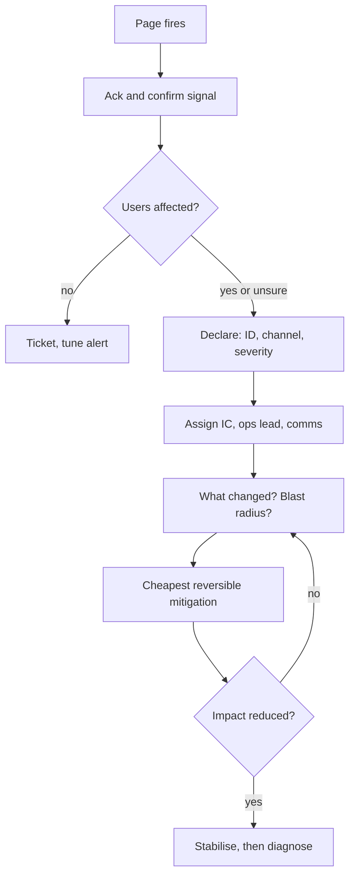

## In one minute
- The first 15 minutes decide most of an incident's cost: whether the right people arrive, whether someone is in charge, and whether the team mitigates or wanders.
- Declare early and cheaply. A declared incident that turns out to be minor costs ten minutes; an undeclared real one costs hours.
- Assign an incident commander before anyone starts debugging, open one channel, and set a severity from impact signals, not from how scary the stack trace looks.
- Ask "what changed, what is the blast radius, and what can we turn off?" before "why?".
- Write things down from minute one. Timestamps taken live are worth ten times the ones reconstructed tomorrow.

## How it works

### Minute 0 to 2: acknowledge and look
A page arrives. The on-call engineer acknowledges it so the escalation policy stops paging the next person, then spends two minutes confirming the signal is real. Check the alert's own graph, one user-facing indicator (the status of the login page, the checkout success rate, a synthetic probe) and the deploy log. The only question is: incident or noisy alert?

### Minute 2 to 5: declare
If users are affected or likely to be, declare. Declaring means three things: a named incident with an ID, a dedicated channel or bridge, and a severity. Make declaring cheap, with a chat command that creates the channel, posts the template and pages the incident commander rotation, so nobody needs permission. Google's SRE book gives concrete triggers: declare if a second team must get involved, if customers can see the problem, or if it is still unsolved after an hour of focused analysis ([Google SRE book](https://sre.google/sre-book/managing-incidents/)).

### Minute 5 to 8: take command
Someone becomes incident commander (IC). On a small team the on-call engineer often holds the role at first, then hands off when a dedicated IC joins. The IC does not debug. The IC states the current understanding in one sentence, assigns an operations lead to drive the fix, assigns someone to communications, and sets the next checkpoint time. "We are seeing 30 percent checkout failures since 14:02, started after the 13:58 payments deploy. Priya is ops lead. Sam owns updates. Next sync at 14:15."

### Minute 8 to 15: stabilise
The ops lead looks for the cheapest reversible action that reduces impact: roll back the last deploy, flip the feature flag off, drain the bad zone, shed a class of traffic, scale out. Diagnosis continues in parallel only if it does not slow the mitigation. Comms posts the first internal update and, for customer-facing impact, the first status page entry, even if it only says "we are investigating elevated errors in checkout".

### Severity from signals
Severity is a routing decision. It decides who gets paged, how often updates go out, and whether executives are told. Tie it to observable impact: fraction of requests failing, fraction of users affected, data loss, security exposure, revenue paths. Upgrades are free; downgrades are a deliberate IC decision.

### The four questions
In the first quarter hour, every useful action answers one of four questions. What is broken, from the user's point of view? Since when? What changed near that time (deploys, config pushes, flag flips, traffic shifts, certificate expiry, a dependency's incident)? What can we turn off or roll back right now? Everything else waits.

## Down the stack

### Layer 1: The contract
The human process promises: an acknowledged page within a target time (often 5 minutes), a declared incident with a named IC within 10, a first internal update within 15, and a severity that maps to a written paging and update policy. It also promises that anyone may declare and that nobody is punished for declaring an incident that turns out to be small. These promises are testable: measure time to acknowledge, time to declare and time to first update from your incident tool's event log.

### Layer 2: The mechanism
Most pages come from an alerting pipeline. In Prometheus, an alert rule has an `expr`, a `for` duration that the condition must hold before the alert fires, and labels such as `severity`. Alertmanager receives firing alerts, groups them by labels (`group_by`), waits `group_wait` (default 30 s) to batch related alerts, then sends a notification, and repeats it every `repeat_interval` (default 4 hours) while the alert keeps firing; `group_interval` (default 5 minutes) spaces notifications about new alerts joining the group ([Alertmanager configuration](https://prometheus.io/docs/alerting/latest/configuration/)). Inhibition rules suppress child alerts when a parent fires, for example silencing per-host alerts while a whole zone is down. The paging service then walks an escalation policy: page the primary, wait N minutes for an acknowledgement, page the secondary, then a manager. Multi-window burn-rate alerts from the Google SRE workbook page when the error budget burns 14.4 times faster than sustainable over both a 1-hour and a 5-minute window (for a 99.9 percent SLO, that is 2 percent of the budget gone), which catches fast burns quickly without paging on brief blips. A 6x burn over 6 hours and 30 minutes also pages, and a 1x burn over 3 days and 6 hours only opens a ticket ([SRE workbook](https://sre.google/workbook/alerting-on-slos/)).

### Layer 3: The machine
Detection latency is physical. With a 30 s scrape interval, a `rate()` over 2 minutes and `for: 2m`, a hard failure needs roughly 3 to 5 minutes before the page goes out, plus `group_wait`. That is a third of your first 15 minutes before a human knows. Once on a host, the first minute of looking is a known sequence: `uptime` for 1, 5 and 15 minute load averages (is load rising or falling?), `dmesg -T | tail` for the OOM killer and disk errors, `vmstat 1` for run queue length, swapping and CPU steal, `ss -s` for socket counts and `TIME_WAIT` buildup, `df -h` for full disks, and `top` for the hungry process. These read `/proc` or the kernel ring buffer and are safe on a struggling machine, unlike a heavy profiler.

### Why it's built this way
Human attention is the scarcest resource in an outage, so the process spends it on coordination first. Many people debugging in parallel without a coordinator duplicate work and step on each other, so one person holds command. Alerting has inherent delay from sampling and windows, so the human side must be fast to compensate. Impact grows linearly with time while root cause can take hours, so the first goal is stopping the bleeding, not understanding it.

## Diagram


## Worked example
At 14:02 a burn-rate alert fires for the checkout service. The on-call acknowledges at 14:04, sees checkout success at 76 percent (normally 99.5), and notices a payments-service deploy finished at 13:58. At 14:05 she runs the `/incident declare` command: SEV2 at first, because about 24 percent of checkout attempts fail, just under the 25 percent line the team uses for SEV1. Two minutes later the dashboard shows 34 percent failures and she upgrades to SEV1.

At 14:07 the IC rotation's primary joins and takes command. She names the on-call as ops lead and a support engineer as comms. The ops lead proposes rolling back the 13:58 deploy, which takes 6 minutes through the pipeline, or disabling the new payment-routing flag, which takes 30 seconds. The IC picks the flag. At 14:09 the flag is off; by 14:11 success rate is back to 99.3 percent.

Cost arithmetic: at 400 checkouts a minute and an average basket of 60 dollars, a 30 percent failure rate loses about 7,200 dollars a minute of attempted revenue. Nine minutes from page to mitigation cost roughly 65,000 dollars. Had the team debugged the stack trace first and rolled back at 14:40, the bill would have been near 280,000.

## In the wild
- **Cloudflare, 2019: a fast page, a slower way in.** A WAF rule deploy began at 13:42 UTC and the first page fired at 13:45. The WAF was identified as the cause at 14:00, a global kill was proposed at 14:02 and run at 14:07, and CPU and traffic were normal by 14:09, 27 minutes after the deploy. Access to internal tools needed a rarely used bypass, and the postmortem lists "We didn't update our status page quickly enough" ([Cloudflare](https://blog.cloudflare.com/details-of-the-cloudflare-outage-on-july-2-2019/)).
- **Google Cloud, 2025: the red button.** A policy change with blank fields crash-looped Service Control in every region from about 10:49 PDT on 12 June. SRE began triage within 2 minutes, had the root cause within 10, and had the "red button" kill switch ready after about 25 minutes and fully rolled out within 40. Most regions recovered quickly; us-central1 took up to about 2 hours 40 minutes to recover because restarting tasks overloaded Spanner. Google froze changes to Service Control and committed to feature-flagging critical binaries ([Google Cloud incident report](https://status.cloud.google.com/incidents/ow5i3PPK96RduMcb1SsW)).
- **Facebook, 2021: the tools were down too.** A backbone maintenance command, which a bug in the audit tool failed to stop, disconnected the data centers, and DNS servers withdrew their BGP routes. Remote and out-of-band access were unavailable and many internal tools depended on DNS, so engineers had to go on site, and physical hardening slowed them ([Engineering at Meta](https://engineering.fb.com/2021/10/05/networking-traffic/outage-details/)).

## Trade-offs
| Option | Strengths | Weaknesses | Choose when |
| --- | --- | --- | --- |
| Declare on any user impact | Fast mobilisation, good data on incident rates | More small incidents, some noise | Default for customer-facing systems |
| Declare only above a threshold | Fewer interruptions | Slow start on incidents that grow | Internal tools with tolerant users |
| On-call is IC until handoff | No waiting for another person | IC and debugger in one head | Small teams, first minutes of any incident |
| Dedicated IC rotation | Clear command, debuggers stay focused | Needs trained people and a rota | More than a few incidents a month |

## Pitfalls in production
- Everyone joins the channel and starts guessing. Fix: the IC states the current hypothesis and gives each person one task; others stay quiet or leave.
- The first responder debugs for 40 minutes before declaring. Fix: a rule of thumb, "if you have not found it in 10 minutes and users hurt, declare".
- The status page waits for a root cause. Fix: post "investigating" within 15 minutes; the cause can come later. In Atlassian's April 2022 outage the first Statuspage update came at 09:03 UTC, 85 minutes after the deletions began at 07:38, and the first broad external post only on 7 April ([Atlassian post-incident review](https://www.atlassian.com/engineering/post-incident-review-april-2022-outage)).
- Responders cannot reach the tooling because it shares fate with production (SSO, VPN, chat). Fix: a tested break-glass path and an out-of-band channel. In Cloudflare's 2019 incident, Cloudflare Access was itself down and engineers needed a rarely used bypass to reach internal tools ([Cloudflare postmortem](https://blog.cloudflare.com/details-of-the-cloudflare-outage-on-july-2-2019/)).
- Nobody records times. Fix: a scribe or a bot that timestamps every message, flag flip and deploy into the incident log.

## Leadership lens
- Measure time to acknowledge, time to declare and time to mitigate. Those three numbers improve faster than anything else you can change.
- Make declaring free: one command, no approval, and praise for early declarations that turned out small.
- Insist every service has a documented "big red button": a flag, a rollback, or a drain that the on-call can use without a code change.
- Run the first 15 minutes as a quarterly drill with a new engineer in the IC seat.

## Check yourself
1. Why should the incident commander avoid debugging?
   **Answer:** Debugging consumes attention and narrows focus to one hypothesis, while the IC's job is to see the whole response, assign work and make decisions such as when to roll back.
2. Your alert has `for: 5m` on a 1-minute rate window with a 60 s scrape. What does that cost you in an outage?
   **Answer:** At least 6 to 7 minutes from failure to page, so nearly half of the first 15 minutes passes before anyone is involved. Shorter windows or burn-rate alerts trade a little noise for faster detection.
3. Why are severity upgrades free but downgrades deliberate?
   **Answer:** Early signals tend to understate impact, and a premature downgrade drops paging and update cadence just when the incident might be growing.
4. A deploy finished 4 minutes before errors began, but a teammate is sure the cause is a database issue. What do you do first?
   **Answer:** Revert or disable the recent change anyway if it is cheap and safe, because it is the most likely cause and the cost of being wrong is small; investigate the database in parallel.

## Practice
**Task:** Build the severity classifier your incident bot uses at declaration time. `classify(error_rate, users_pct, data_loss, security, revenue)` takes the failing fraction of requests (0 to 1), the percentage of users affected (0 to 100), and three booleans, and returns `"SEV1"` to `"SEV4"`. SEV1 if there is data loss, a security exposure, an error rate of at least 0.25 or at least 50 percent of users affected. SEV2 if a revenue path is affected, the error rate is at least 0.05 or at least 10 percent of users are affected. SEV3 if the error rate is at least 0.01 or at least 1 percent of users are affected. Otherwise SEV4. Also write `escalate(current, proposed)`, which returns the more severe of two severities, so automation can upgrade but never silently downgrade.

```python starter
def classify(error_rate, users_pct, data_loss, security, revenue):
    # TODO: return "SEV1".."SEV4"
    raise NotImplementedError

def escalate(current, proposed):
    # TODO: return the more severe of the two
    raise NotImplementedError
```

```python tests
def test_data_loss_is_sev1():
    assert classify(0.0, 0.1, True, False, False) == "SEV1"

def test_high_error_rate_is_sev1():
    assert classify(0.25, 5, False, False, False) == "SEV1"

def test_revenue_path_is_sev2():
    assert classify(0.002, 0.5, False, False, True) == "SEV2"

def test_users_threshold_sev2_and_sev3():
    assert classify(0.0, 10, False, False, False) == "SEV2"
    assert classify(0.0, 9.9, False, False, False) == "SEV3"

def test_minor_is_sev4():
    assert classify(0.005, 0.5, False, False, False) == "SEV4"

def test_escalate_never_downgrades():
    assert escalate("SEV2", "SEV3") == "SEV2"
    assert escalate("SEV3", "SEV1") == "SEV1"
    assert escalate("SEV4", "SEV4") == "SEV4"
```

```python solution
def classify(error_rate, users_pct, data_loss, security, revenue):
    if data_loss or security or error_rate >= 0.25 or users_pct >= 50:
        return "SEV1"
    if revenue or error_rate >= 0.05 or users_pct >= 10:
        return "SEV2"
    if error_rate >= 0.01 or users_pct >= 1:
        return "SEV3"
    return "SEV4"

def escalate(current, proposed):
    return current if int(current[3:]) <= int(proposed[3:]) else proposed
```

```typescript starter
export function classify(errorRate: number, usersPct: number, dataLoss: boolean,
                         security: boolean, revenue: boolean): string {
  throw new Error("TODO");
}

export function escalate(current: string, proposed: string): string {
  throw new Error("TODO");
}
```

```typescript tests
test("data loss is SEV1", () => {
  assertEqual(classify(0, 0.1, true, false, false), "SEV1");
});

test("high error rate is SEV1", () => {
  assertEqual(classify(0.25, 5, false, false, false), "SEV1");
});

test("revenue path is SEV2", () => {
  assertEqual(classify(0.002, 0.5, false, false, true), "SEV2");
});

test("users threshold SEV2 and SEV3", () => {
  assertEqual(classify(0, 10, false, false, false), "SEV2");
  assertEqual(classify(0, 9.9, false, false, false), "SEV3");
});

test("minor is SEV4", () => {
  assertEqual(classify(0.005, 0.5, false, false, false), "SEV4");
});

test("escalate never downgrades", () => {
  assertEqual(escalate("SEV2", "SEV3"), "SEV2");
  assertEqual(escalate("SEV3", "SEV1"), "SEV1");
  assertEqual(escalate("SEV4", "SEV4"), "SEV4");
});
```

```typescript solution
export function classify(errorRate: number, usersPct: number, dataLoss: boolean,
                         security: boolean, revenue: boolean): string {
  if (dataLoss || security || errorRate >= 0.25 || usersPct >= 50) return "SEV1";
  if (revenue || errorRate >= 0.05 || usersPct >= 10) return "SEV2";
  if (errorRate >= 0.01 || usersPct >= 1) return "SEV3";
  return "SEV4";
}

export function escalate(current: string, proposed: string): string {
  return Number(current.slice(3)) <= Number(proposed.slice(3)) ? current : proposed;
}
```

```go starter
package practice

func Classify(errorRate, usersPct float64, dataLoss, security, revenue bool) string {
	panic("TODO")
}

func Escalate(current, proposed string) string {
	panic("TODO")
}
```

```go tests
package practice

import "testing"

func TestDataLossIsSev1(t *testing.T) {
	if got := Classify(0, 0.1, true, false, false); got != "SEV1" {
		t.Fatalf("got %s", got)
	}
}

func TestHighErrorRateIsSev1(t *testing.T) {
	if got := Classify(0.25, 5, false, false, false); got != "SEV1" {
		t.Fatalf("got %s", got)
	}
}

func TestRevenueIsSev2(t *testing.T) {
	if got := Classify(0.002, 0.5, false, false, true); got != "SEV2" {
		t.Fatalf("got %s", got)
	}
}

func TestUsersThresholds(t *testing.T) {
	if Classify(0, 10, false, false, false) != "SEV2" || Classify(0, 9.9, false, false, false) != "SEV3" {
		t.Fatal("user thresholds wrong")
	}
}

func TestMinorIsSev4(t *testing.T) {
	if got := Classify(0.005, 0.5, false, false, false); got != "SEV4" {
		t.Fatalf("got %s", got)
	}
}

func TestEscalate(t *testing.T) {
	if Escalate("SEV2", "SEV3") != "SEV2" || Escalate("SEV3", "SEV1") != "SEV1" || Escalate("SEV4", "SEV4") != "SEV4" {
		t.Fatal("escalate wrong")
	}
}
```

```go solution
package practice

func Classify(errorRate, usersPct float64, dataLoss, security, revenue bool) string {
	if dataLoss || security || errorRate >= 0.25 || usersPct >= 50 {
		return "SEV1"
	}
	if revenue || errorRate >= 0.05 || usersPct >= 10 {
		return "SEV2"
	}
	if errorRate >= 0.01 || usersPct >= 1 {
		return "SEV3"
	}
	return "SEV4"
}

func Escalate(current, proposed string) string {
	if current[3:] <= proposed[3:] {
		return current
	}
	return proposed
}
```

## Mock interview
**Prompt:** It is 2 a.m. You are on call for an API that serves 20,000 requests per second. You are paged: p99 latency is 10 times normal and the 5xx rate has gone from 0.1 to 4 percent in the last 6 minutes. Walk me through your first 15 minutes.

- Follow-up: The deploy log shows nothing in the last 24 hours. Where do you look for "what changed"?
- Follow-up: Your SSO is down, so you cannot reach the dashboards. What now?
- Follow-up: A senior engineer joins and starts restarting pods without telling anyone. How do you handle it?

**A strong answer covers:**
- Acknowledge, confirm with a user-facing signal, and declare within a few minutes rather than investigate alone.
- Take or hand off command explicitly; assign ops and comms; set a checkpoint time.
- A "what changed" list beyond deploys: config and flag pushes, traffic shifts, dependency incidents, certificate or quota expiry, cron jobs, cloud provider status.
- Mitigation options ranked by speed and reversibility: shed load, fail over, scale out, disable features.
- A break-glass access path and an out-of-band channel prepared before the night it is needed.
- Calm, direct coordination of freelancers: acknowledge, ask them to report actions in the channel, give them a task.

## Sources and further study
**Primary**
- [Cloudflare: details of the 2 July 2019 outage](https://blog.cloudflare.com/details-of-the-cloudflare-outage-on-july-2-2019/): minute-by-minute timeline from deploy to global kill, with a candid list of what went wrong in the response.
- [Google Cloud incident report, 12 June 2025](https://status.cloud.google.com/incidents/ow5i3PPK96RduMcb1SsW): triage, red-button and recovery times for a global outage.
- [Engineering at Meta: more details about the October 2021 outage](https://engineering.fb.com/2021/10/05/networking-traffic/outage-details/): what happens to the first 15 minutes when your own tools fail.

**Systems docs**
- [Alertmanager configuration](https://prometheus.io/docs/alerting/latest/configuration/): `group_wait`, `group_interval` and `repeat_interval` defaults that set how fast a page leaves the building.

**Books**
- *Site Reliability Engineering* (Beyer et al.), chapter 14 "Managing Incidents" and chapter 13 "Emergency Response".
- *The Site Reliability Workbook*, chapter 5 "Alerting on SLOs" (the multi-window burn-rate table) and chapter 9 "Incident Response".

**Other curricula**
- [Azure Well-Architected: incident management process](https://learn.microsoft.com/en-us/azure/well-architected/operational-excellence/incident-response): names incident manager, technical lead and communications lead, and asks for runtime toggles that can disable a faulty component without redeploying.
- [PagerDuty Incident Response: different roles](https://response.pagerduty.com/before/different_roles/): treats the IC as a coordinator, not a resolver, with a trained deputy as a hot standby.

## Watch
- [Don't Panic! Effective Incident Response (Conf42)](https://www.youtube.com/watch?v=s0Cs1PkJ-UA): practical habits for the opening phase of an incident.
- [Simulated Incident Call Recording (PagerDuty)](https://www.youtube.com/watch?v=yoY_pDxc0TA): hear what a coordinated incident call sounds like, including IC phrasing.

## Free resources
- [Managing Incidents (Google SRE book)](https://sre.google/sre-book/managing-incidents/): the case for clear roles and early declaration, with a worked bad and good incident.
- [Incident Response (Google SRE workbook)](https://sre.google/workbook/incident-response/): incident command applied at Google and at other companies.
- [PagerDuty Incident Response documentation](https://response.pagerduty.com/): an open, detailed playbook from declaration to postmortem.
- [Incident severity levels (Atlassian)](https://www.atlassian.com/incident-management/kpis/severity-levels): an example severity scale and how to use it.
- [Being On-Call (Google SRE book)](https://sre.google/sre-book/being-on-call/): response time targets and how on-call load affects judgement.
