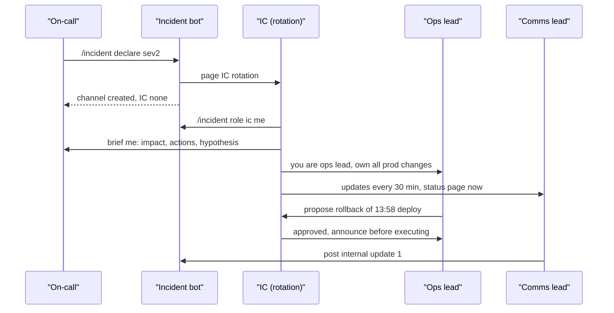

## In one minute
- Big incidents fail on coordination before they fail on technology. Roles turn a crowd into a team.
- The incident commander (IC) owns decisions and the overall picture, and does not touch production.
- The operations lead owns changes to production; everyone else proposes, ops executes or delegates.
- The communications lead owns every message leaving the incident: internal updates, status page, executives, support.
- Roles belong to people only until they hand them off, explicitly and on the record.

## How it works

### Where the model comes from
Software borrowed incident roles from the Incident Command System (ICS), which Southern California fire agencies developed in the 1970s (through FIRESCOPE, formed in 1972) after catastrophic wildfires showed that crews from many agencies could not coordinate. ICS separates command from operations, keeps a manageable span of control (three to seven people reporting to one person, five ideal), and uses common terminology so a role title means the same thing to every agency ([Wikipedia](https://en.wikipedia.org/wiki/Incident_Command_System)). Google's SRE practice, PagerDuty's public response guide and most large tech companies use a slimmed-down version of it.

### Incident commander
The IC holds the whole incident in their head so nobody else has to. They set priorities ("mitigate first; root cause later"), assign roles, run regular checkpoints, approve risky actions, decide when to escalate, and decide when the incident is over. The IC asks more than they tell: "What is our current hypothesis? What are you doing now? How long until we know?" The single most important rule: the IC does not debug or type commands into production. The moment they do, nobody is watching the whole board. PagerDuty's guide says it flatly: the Incident Commander is not a resolver, and all repair work is delegated ([PagerDuty](https://response.pagerduty.com/before/different_roles/)).

### Operations lead
The ops lead drives the technical response. They choose who investigates what, decide which mitigation to try, and make or delegate every production change. On a big incident they may have several workstreams reporting to them (database, network, the application team). Having a single owner of changes prevents the classic failure where two engineers fix the same problem in opposite directions at the same time. Google's book states the rule directly: Ops should be the only group modifying the system during an incident ([Google SRE book](https://sre.google/sre-book/managing-incidents/)).

### Communications lead
Comms writes the internal updates on a fixed cadence, keeps the status page current, briefs support so they can answer customers, and shields responders from executives asking for updates in direct messages. Comms translates: "replication lag on the primary cluster" becomes "some users may see stale data for a few minutes".

### Scribe and subject matter experts
A scribe records the timeline: what was seen, what was tried, decisions and their reasons, with timestamps. Subject matter experts join for a specific question and leave when done. A liaison may represent a partner, a cloud provider or legal. Google's book also names a planning role that files bugs, arranges handoffs and tracks how the system has drifted from normal so it can be put back afterwards ([Google SRE book](https://sre.google/sre-book/managing-incidents/)). On a small team one person may hold two of these roles (PagerDuty says outright that not every role needs a different person for every incident), but the IC role should stay separate from ops whenever a second person is available ([PagerDuty](https://response.pagerduty.com/before/different_roles/)).

### Handoffs
Roles change hands because people get tired, go off shift, or because a more experienced IC arrives. A handoff is explicit: the outgoing holder briefs the incoming one on the current state, open workstreams and pending decisions, then announces "Alex is now IC" in the channel. The SRE book's version is to ask "you're now the incident commander, okay?" and wait for a firm acknowledgment before leaving the call ([Google SRE book](https://sre.google/sre-book/managing-incidents/)). Until the announcement, the old holder is still in charge. Implicit handoffs ("I thought you had it") leave incidents leaderless for long stretches.

## Down the stack

### Layer 1: The contract
Each role is a promise. The IC promises that at any moment there is one person who can answer "who decides?" and "what are we doing next?", and that checkpoints happen at the announced time. Ops promises that every production change during the incident is made or approved by one owner and is announced before it happens. Comms promises updates at the cadence the severity requires, even when there is nothing new. All three promise to hand off explicitly. These are testable after the fact: the incident log should show one IC at every timestamp, every change announced, and no update gap longer than the cadence.

### Layer 2: The mechanism
The mechanism is a small state machine plus tooling. Most teams run an incident bot in chat: `/incident declare` creates a channel, sets its topic to "IC: none", and pages the IC rotation; `/incident role ic @alex` updates the topic and writes an event to the incident record. The record is a document or database row with the current state, the role holders, and an append-only event log. Paging uses separate schedules for each role: an IC rotation of trained commanders, the service on-call for ops, and a support or comms rotation. Handoffs follow a fixed brief, often summarised as "situation, actions in progress, decisions pending, next checkpoint". PagerDuty's public guide adds a deputy IC who tracks timers, follows up on missed roll-call items and manages the call, and who is a trained "hot standby" IC rather than an observer ([PagerDuty](https://response.pagerduty.com/before/different_roles/)).

### Layer 3: The machine
Coordination runs over real channels with real limits. Conversational audio becomes awkward once one-way delay goes above roughly 150 ms (the ITU-T G.114 guidance), so a bridge with forty people on poor connections produces talk-over and repeated questions; the IC's habit of naming who speaks next compensates for latency. Chat platforms rate-limit bots (Slack documents that apps may post no more than about one message per second per channel; [Slack docs](https://docs.slack.dev/apis/web-api/rate-limits/)), so a noisy alert integration piped into the incident channel can delay the bot's role and timeline messages. Timeline accuracy depends on clocks: server-side message timestamps are consistent, but a responder's hand-typed "~14:05" is not, and log timestamps from hosts with drifting clocks can be off by seconds without NTP. Human working memory holds around four chunks, which is why the IC keeps the state written in the channel topic and the incident document instead of in their head.

### Why it's built this way
One person must decide, because parallel decision-makers make conflicting changes. That person cannot also debug, because deep technical work narrows attention to a single hypothesis. Production changes need a single owner, because two people changing the same system without coordination can turn a partial outage into a full one. Communication needs its own owner, because pressure from stakeholders lands on whoever is visible and steals time from the fix. Handoffs must be explicit, because fatigue is inevitable on long incidents and ambiguity about who is in charge is worse than any single bad decision.

## Diagram


## Worked example
A storage outage runs for six hours. The first IC took command at 01:10 after the on-call declared. At 04:00 she has been awake for 21 hours. The roster tool flags that the IC has held the role for 170 minutes, past the team's 120-minute limit. The deputy IC from the next time zone joins at 04:05; the outgoing IC gives a five-minute brief: "Impact is 12 percent of reads failing in eu-west. Ops lead is Marco, working on rebuilding two replicas, ETA 05:00. Pending decision: whether to fail over to eu-central if the rebuild misses 05:00. Next checkpoint 04:30." At 04:11 she types "Handing off: Dana is IC." Dana confirms in the channel, the bot updates the topic, and the timeline shows the IC change at 04:11:32.

Span of control: by 03:00 ten engineers were in the channel. The IC split them into two workstreams with leads (replica rebuild under Marco, client-side retries under Lee), so she talked to three people instead of ten. Updates went out every 30 minutes for SEV1, twelve updates in total, with the comms lead writing all of them. No engineer received a direct message from an executive, because the comms lead's updates answered the questions before they were asked.

## In the wild
- **Atlassian, 2022: no playbook for a many-customer incident.** On 5 April a script given site IDs instead of app IDs deleted 883 sites belonging to 775 customers between 07:38 and 08:01 UTC. Restoration finished on 18 April and the recovery time objective was missed. The review says there was no large-scale incident communications playbook, that deleted sites blocked customers from filing tickets, and that the first Statuspage update came at 09:03 UTC. Atlassian built a playbook and tooling for large incidents, a unified escalation system and 24/7 escalation coverage ([Atlassian post-incident review](https://www.atlassian.com/engineering/post-incident-review-april-2022-outage)).
- **GitHub, 2018: roles at work.** After a 43-second network partition on 21 October, the site went yellow at 23:09 and that automatically became an active incident. An incident coordinator joined and moved it to red by 23:13, database engineers were paged at 23:13, and webhooks and Pages builds were paused at 23:19 to protect data. The team chose data integrity over speed, and degraded service lasted 24 hours 11 minutes ([GitHub](https://github.blog/news-insights/company-news/oct21-post-incident-analysis/)).

## Trade-offs
| Option | Strengths | Weaknesses | Choose when |
| --- | --- | --- | --- |
| On-call acts as IC | Zero delay, knows the system | Debugging and command in one head | Small teams, low severity, first minutes |
| Dedicated IC rotation | Trained commanders, focus | Rota cost, IC may not know the system | Frequent or high-severity incidents |
| Separate comms lead | Responders protected, steady updates | One more person engaged | Customer-visible impact |
| Deputy IC or scribe | Accurate timeline, IC not overloaded | Extra headcount | Long or multi-team incidents |

## Pitfalls in production
- The most senior engineer becomes de facto IC while debugging. Fix: name the IC explicitly, and let the senior engineer be ops or an expert.
- Freelancers make changes without announcing them. Fix: one ops owner, and a rule that every change is posted before it is made.
- Implicit handoffs at shift change. Fix: a handoff brief and an announcement in the channel; the roster records who holds each role.
- The IC stays in the role for twelve hours and starts making poor decisions. Fix: a maximum shift length and a planned relief.
- Executives join the bridge and start directing. Fix: a separate stakeholder channel run by comms, and the IC politely keeping command.
- Too many people in one channel. Fix: split into workstreams with leads to keep each span of control under seven.

## Leadership lens
- Train ICs on purpose: shadowing, then reverse-shadowing, then solo on lower severities.
- Make the IC rotation separate from the service on-call when incident volume justifies it.
- Agree in advance who can override the IC (usually nobody during the incident) and how disagreements get resolved later.
- Review role adherence in postmortems: was there always an IC, were changes announced, were updates on time?

## Check yourself
1. Why should the incident commander not run commands in production, even if they are the best engineer present?
   **Answer:** Hands-on work narrows attention and removes the only person watching the whole response, so priorities, coordination and time checks drift while they type.
2. What problem does a single ops owner solve?
   **Answer:** It prevents conflicting concurrent changes to production, such as one engineer scaling up while another rolls back, which can worsen the outage and confuse diagnosis.
3. When does a role handoff take effect?
   **Answer:** When it is announced in the incident channel and acknowledged by the new holder; until then, the previous holder is still responsible.
4. Why separate the comms role from the IC on large incidents?
   **Answer:** Stakeholder demand for updates is constant and grows with severity; giving it to a dedicated person keeps the IC's attention on decisions and gives updates a reliable owner.

## Practice
**Task:** Build the role roster behind an incident bot. Roles are `IC`, `OPS`, `COMMS` and `SCRIBE`. `assign(role, person, t)` records that `person` holds `role` from minute `t`; it rejects an unknown role, and it rejects any assignment that would make the IC hold a second role at the same time (assigning IC to someone who holds another role, or another role to the current IC). `who(role)` returns the current holder or none. `history(role)` returns the list of `(t, person)` assignments in order. `overdue(now, max_minutes)` returns the roles, in the order IC, OPS, COMMS, SCRIBE, whose current holder has held them for more than `max_minutes`.

```python starter
class Roster:
    def __init__(self):
        pass

    def assign(self, role, person, t):
        # TODO: raise ValueError on unknown role or IC conflict
        raise NotImplementedError

    def who(self, role):
        raise NotImplementedError

    def history(self, role):
        raise NotImplementedError

    def overdue(self, now, max_minutes):
        raise NotImplementedError
```

```python tests
def test_assign_and_who():
    r = Roster()
    r.assign("IC", "ana", 0)
    r.assign("OPS", "ben", 2)
    assert r.who("IC") == "ana"
    assert r.who("OPS") == "ben"
    assert r.who("COMMS") is None

def test_unknown_role_rejected():
    r = Roster()
    try:
        r.assign("CEO", "zoe", 0)
        assert False, "should raise"
    except ValueError:
        pass

def test_ic_cannot_hold_other_role():
    r = Roster()
    r.assign("IC", "ana", 0)
    try:
        r.assign("OPS", "ana", 1)
        assert False, "IC cannot also be ops"
    except ValueError:
        pass

def test_person_with_role_cannot_become_ic():
    r = Roster()
    r.assign("OPS", "ben", 0)
    try:
        r.assign("IC", "ben", 5)
        assert False, "ops lead must hand off first"
    except ValueError:
        pass

def test_handoff_history():
    r = Roster()
    r.assign("IC", "ana", 0)
    r.assign("IC", "dana", 130)
    assert r.who("IC") == "dana"
    assert r.history("IC") == [(0, "ana"), (130, "dana")]
    assert r.history("SCRIBE") == []

def test_overdue():
    r = Roster()
    r.assign("IC", "ana", 0)
    r.assign("OPS", "ben", 10)
    r.assign("COMMS", "cy", 100)
    assert r.overdue(130, 120) == ["IC"]
    assert r.overdue(131, 120) == ["IC", "OPS"]
```

```python solution
ROLES = ("IC", "OPS", "COMMS", "SCRIBE")

class Roster:
    def __init__(self):
        self.holder = {}
        self.since = {}
        self.hist = {r: [] for r in ROLES}

    def assign(self, role, person, t):
        if role not in ROLES:
            raise ValueError("unknown role " + role)
        if role == "IC":
            for other in ROLES[1:]:
                if self.holder.get(other) == person:
                    raise ValueError(person + " holds " + other)
        elif self.holder.get("IC") == person:
            raise ValueError(person + " is IC")
        self.holder[role] = person
        self.since[role] = t
        self.hist[role].append((t, person))

    def who(self, role):
        return self.holder.get(role)

    def history(self, role):
        return list(self.hist.get(role, []))

    def overdue(self, now, max_minutes):
        return [r for r in ROLES if r in self.holder and now - self.since[r] > max_minutes]
```

```typescript starter
export class Roster {
  assign(role: string, person: string, t: number): void {
    throw new Error("TODO");
  }
  who(role: string): string | null {
    throw new Error("TODO");
  }
  history(role: string): [number, string][] {
    throw new Error("TODO");
  }
  overdue(now: number, maxMinutes: number): string[] {
    throw new Error("TODO");
  }
}
```

```typescript tests
function throws(fn: () => void): boolean {
  try { fn(); return false; } catch (e) { return true; }
}

test("assign and who", () => {
  const r = new Roster();
  r.assign("IC", "ana", 0);
  r.assign("OPS", "ben", 2);
  assertEqual(r.who("IC"), "ana");
  assertEqual(r.who("OPS"), "ben");
  assertEqual(r.who("COMMS"), null);
});

test("unknown role rejected", () => {
  const r = new Roster();
  assert(throws(() => r.assign("CEO", "zoe", 0)), "should throw");
});

test("IC cannot hold other role", () => {
  const r = new Roster();
  r.assign("IC", "ana", 0);
  assert(throws(() => r.assign("OPS", "ana", 1)), "IC cannot also be ops");
});

test("person with role cannot become IC", () => {
  const r = new Roster();
  r.assign("OPS", "ben", 0);
  assert(throws(() => r.assign("IC", "ben", 5)), "ops lead must hand off first");
});

test("handoff history", () => {
  const r = new Roster();
  r.assign("IC", "ana", 0);
  r.assign("IC", "dana", 130);
  assertEqual(r.who("IC"), "dana");
  assertEqual(r.history("IC"), [[0, "ana"], [130, "dana"]]);
  assertEqual(r.history("SCRIBE"), []);
});

test("overdue", () => {
  const r = new Roster();
  r.assign("IC", "ana", 0);
  r.assign("OPS", "ben", 10);
  r.assign("COMMS", "cy", 100);
  assertEqual(r.overdue(130, 120), ["IC"]);
  assertEqual(r.overdue(131, 120), ["IC", "OPS"]);
});
```

```typescript solution
const ROLES = ["IC", "OPS", "COMMS", "SCRIBE"];

export class Roster {
  private holder = new Map<string, string>();
  private since = new Map<string, number>();
  private hist = new Map<string, [number, string][]>();

  assign(role: string, person: string, t: number): void {
    if (!ROLES.includes(role)) throw new Error("unknown role " + role);
    if (role === "IC") {
      for (const other of ROLES.slice(1)) {
        if (this.holder.get(other) === person) throw new Error(person + " holds " + other);
      }
    } else if (this.holder.get("IC") === person) {
      throw new Error(person + " is IC");
    }
    this.holder.set(role, person);
    this.since.set(role, t);
    const h = this.hist.get(role) ?? [];
    h.push([t, person]);
    this.hist.set(role, h);
  }

  who(role: string): string | null {
    return this.holder.get(role) ?? null;
  }

  history(role: string): [number, string][] {
    return [...(this.hist.get(role) ?? [])];
  }

  overdue(now: number, maxMinutes: number): string[] {
    return ROLES.filter(r => this.holder.has(r) && now - (this.since.get(r) as number) > maxMinutes);
  }
}
```

```go starter
package practice

type Assignment struct {
	T      int
	Person string
}

type Roster struct{}

func NewRoster() *Roster {
	return &Roster{}
}

func (r *Roster) Assign(role, person string, t int) error {
	panic("TODO")
}

// Who returns "" when nobody holds the role.
func (r *Roster) Who(role string) string {
	panic("TODO")
}

func (r *Roster) History(role string) []Assignment {
	panic("TODO")
}

func (r *Roster) Overdue(now, maxMinutes int) []string {
	panic("TODO")
}
```

```go tests
package practice

import (
	"reflect"
	"testing"
)

func TestAssignAndWho(t *testing.T) {
	r := NewRoster()
	if err := r.Assign("IC", "ana", 0); err != nil {
		t.Fatal(err)
	}
	if err := r.Assign("OPS", "ben", 2); err != nil {
		t.Fatal(err)
	}
	if r.Who("IC") != "ana" || r.Who("OPS") != "ben" || r.Who("COMMS") != "" {
		t.Fatal("wrong holders")
	}
}

func TestUnknownRole(t *testing.T) {
	if NewRoster().Assign("CEO", "zoe", 0) == nil {
		t.Fatal("expected error")
	}
}

func TestICCannotHoldOther(t *testing.T) {
	r := NewRoster()
	_ = r.Assign("IC", "ana", 0)
	if r.Assign("OPS", "ana", 1) == nil {
		t.Fatal("IC cannot also be ops")
	}
}

func TestRoleHolderCannotBecomeIC(t *testing.T) {
	r := NewRoster()
	_ = r.Assign("OPS", "ben", 0)
	if r.Assign("IC", "ben", 5) == nil {
		t.Fatal("ops lead must hand off first")
	}
}

func TestHandoffHistory(t *testing.T) {
	r := NewRoster()
	_ = r.Assign("IC", "ana", 0)
	_ = r.Assign("IC", "dana", 130)
	want := []Assignment{{0, "ana"}, {130, "dana"}}
	if r.Who("IC") != "dana" || !reflect.DeepEqual(r.History("IC"), want) {
		t.Fatalf("got %v", r.History("IC"))
	}
	if len(r.History("SCRIBE")) != 0 {
		t.Fatal("scribe history should be empty")
	}
}

func TestOverdue(t *testing.T) {
	r := NewRoster()
	_ = r.Assign("IC", "ana", 0)
	_ = r.Assign("OPS", "ben", 10)
	_ = r.Assign("COMMS", "cy", 100)
	if got := r.Overdue(130, 120); !reflect.DeepEqual(got, []string{"IC"}) {
		t.Fatalf("got %v", got)
	}
	if got := r.Overdue(131, 120); !reflect.DeepEqual(got, []string{"IC", "OPS"}) {
		t.Fatalf("got %v", got)
	}
}
```

```go solution
package practice

import "fmt"

var roles = []string{"IC", "OPS", "COMMS", "SCRIBE"}

type Assignment struct {
	T      int
	Person string
}

type Roster struct {
	holder map[string]string
	since  map[string]int
	hist   map[string][]Assignment
}

func NewRoster() *Roster {
	return &Roster{holder: map[string]string{}, since: map[string]int{}, hist: map[string][]Assignment{}}
}

func known(role string) bool {
	for _, r := range roles {
		if r == role {
			return true
		}
	}
	return false
}

func (r *Roster) Assign(role, person string, t int) error {
	if !known(role) {
		return fmt.Errorf("unknown role %s", role)
	}
	if role == "IC" {
		for _, other := range roles[1:] {
			if h, ok := r.holder[other]; ok && h == person {
				return fmt.Errorf("%s holds %s", person, other)
			}
		}
	} else if h, ok := r.holder["IC"]; ok && h == person {
		return fmt.Errorf("%s is IC", person)
	}
	r.holder[role] = person
	r.since[role] = t
	r.hist[role] = append(r.hist[role], Assignment{t, person})
	return nil
}

func (r *Roster) Who(role string) string {
	return r.holder[role]
}

func (r *Roster) History(role string) []Assignment {
	return append([]Assignment{}, r.hist[role]...)
}

func (r *Roster) Overdue(now, maxMinutes int) []string {
	out := []string{}
	for _, role := range roles {
		if _, ok := r.holder[role]; ok && now-r.since[role] > maxMinutes {
			out = append(out, role)
		}
	}
	return out
}
```

## Mock interview
**Prompt:** You are the incident commander for a SEV1: the mobile app cannot log in for 40 percent of users. Twenty-five people are in the channel, two directors are asking for ETAs in direct messages, and two senior engineers are pushing different fixes. Walk me through how you run the response.

- Follow-up: One of the senior engineers applies their fix without telling anyone. What do you do in the moment and afterwards?
- Follow-up: The incident is in its fifth hour and you are exhausted. How do you hand off?
- Follow-up: How would you structure roles for an incident spanning three teams in different time zones?

**A strong answer covers:**
- Explicitly holding command, naming an ops lead and comms lead, and stating priorities and the checkpoint cadence.
- Reducing span of control: workstreams with leads, non-essential people asked to leave or go quiet.
- Routing executives to comms and a stakeholder channel, with regular updates that preempt questions.
- Resolving the competing fixes with evidence and reversibility, and having ops own the single change.
- Handling the freelancer calmly in the moment and through a blameless review of why the process allowed it.
- A structured handoff brief, an announcement, and a planned relief schedule.

## Sources and further study
**Primary**
- [Atlassian: April 2022 outage post-incident review](https://www.atlassian.com/engineering/post-incident-review-april-2022-outage): what missing large-incident roles and playbooks cost.
- [GitHub: October 21 post-incident analysis](https://github.blog/news-insights/company-news/oct21-post-incident-analysis/): a timeline showing declaration, an incident coordinator and a deliberate priority call.

**Systems docs**
- [Slack Web API rate limits](https://docs.slack.dev/apis/web-api/rate-limits/): the per-channel posting limit that an incident bot has to live with.

**Books**
- *Site Reliability Engineering* (Beyer et al.), chapter 14 "Managing Incidents": recursive separation of responsibilities and the live incident document.
- *The Site Reliability Workbook*, chapter 9 "Incident Response": incident command applied at Google and elsewhere.

**Other curricula**
- [Azure Well-Architected: incident management process](https://learn.microsoft.com/en-us/azure/well-architected/operational-excellence/incident-response): asks for defined roles (incident manager, technical lead, communications lead) and a single-pane incident dashboard as the shared source of truth.

## Watch
- [SREcon16 - The Incident Commander Role (USENIX)](https://www.youtube.com/watch?v=xtevUgopIms): what the IC does and does not do, from practitioners.
- [SREcon17 EMEA - Incident Command at the Edge (USENIX)](https://www.youtube.com/watch?v=nso7EMhCMT4): applying incident command at a global edge network.

## Free resources
- [Different Roles (PagerDuty Incident Response)](https://response.pagerduty.com/before/different_roles/): role definitions including deputy, scribe and liaison.
- [Managing Incidents (Google SRE book)](https://sre.google/sre-book/managing-incidents/): the separation of command, operations and communication in Google's practice.
- [Incident Management Guide (Google SRE)](https://sre.google/resources/practices-and-processes/incident-management-guide/): a concise guide to roles and the incident lifecycle.
- [Incident Command System (Wikipedia)](https://en.wikipedia.org/wiki/Incident_Command_System): the emergency-services origin, span of control and unity of command.
- [Atlassian Incident Management Handbook](https://www.atlassian.com/incident-management/handbook): a company's full role and process definitions.
