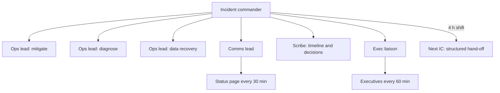

## In one minute
- In a long or severe incident, technical skill is necessary but not enough. Someone has to keep people focused, informed, rested and making decisions; that is leadership, whatever your title.
- Calm is a technique, not a personality trait: slow, short sentences, a stated plan, explicit next checkpoints. Teams copy the leader's state.
- Structure beats heroics: clear roles, one channel, regular updates on a fixed cadence, written decisions, and hand-offs before people are exhausted.
- Protect the responders: rotate people every few hours in long incidents, make them eat and sleep, shield them from executives asking for updates every five minutes.
- Afterwards, recovery is part of the job: thank people specifically, give time off, run a blameless review, and watch for burnout in the weeks after.

## How it works

### What changes in a crisis
A 15-minute incident is mostly technical. A 10-hour outage, a data breach or a cascading failure across teams is something else: dozens of people, executives, customers, uncertainty that lasts for hours, and fatigue that degrades judgment. Many of the worst decisions in major incidents are made in hour six by tired people working without a shared picture. The incident command system, which firefighters created for wildfires (the SRE workbook dates it to 1968) and which companies such as Google and PagerDuty adapted, exists because large responses fail without structure ([SRE workbook, ch. 9](https://sre.google/workbook/incident-response/)). Google's SRE book describes what happens without it: engineers fixate on the technical problem, nobody knows what others are doing, and well-meaning people freelance changes that make things worse ([SRE book, ch. 14](https://sre.google/sre-book/managing-incidents/)).

### Be the calm
People under stress narrow their attention and copy the emotional state around them. A leader who speaks quickly, jumps between theories and snaps at people spreads panic. A leader who says "Here is what we know. Here is what we are doing. Next update at 14:30" creates focus. Concrete habits: speak slowly and briefly; summarise the current state every 30 minutes; say what you do not know; never criticise someone during the incident; give each person one clear task.

### When to declare
Declare early. Google's rule of thumb is to declare if a second team is needed, if the outage is customer-visible, or if the problem is still unsolved after an hour of focused analysis ([SRE book, ch. 14](https://sre.google/sre-book/managing-incidents/)). A late declaration is a common failure: in a GKE case in the workbook, formal structure arrived about two hours after the first page of a roughly 6 hours 40 minute incident ([SRE workbook, ch. 9](https://sre.google/workbook/incident-response/)). Mitigate first, then look for the root cause; customers care most about the errors stopping.

### Structure
- **Roles:** incident commander (decides and coordinates, does not debug), operations leads per workstream, a communications lead, a scribe. In Google's model the commander holds every role not yet delegated, and only the operations lead changes the system ([SRE book, ch. 14](https://sre.google/sre-book/managing-incidents/)). PagerDuty adds that the commander is the highest-ranking voice on the call whatever their job title, and that a senior person joining does not take command unless there is an explicit handover ([PagerDuty](https://response.pagerduty.com/training/incident_commander/)). For big incidents, a liaison for executives and one for customer support.
- **Workstreams:** split large incidents into parallel tracks (mitigate, diagnose, communicate, recover data), each with a lead and a channel or thread, reporting to the incident commander on a schedule.
- **Cadence:** internal updates every 30 minutes and external updates every 30 to 60 minutes, even if the update is "no change, still working on X". Silence breeds rumours and interruptions.
- **Decisions in writing:** "14:20, decided to fail over to the secondary region; owner Priya; revisit at 15:00 if error rate is above 2 percent". Written decisions survive hand-offs. When you delegate, name one person and a time box ("Priya, check the replica lag by 14:40"), because "can someone..." invites everyone to assume someone else will ([PagerDuty](https://response.pagerduty.com/training/incident_commander/)).

### Protect the responders
Judgment falls with fatigue. Plan shifts for anything longer than about four hours: name the next incident commander early, do a structured hand-off (state, hypotheses, decisions, open actions, next checkpoints), and send people home. Four hours is a conservative practice, not a law: PagerDuty's case in the workbook rotated the commander and on-call roles every four hours through a 10-hour incident, while Google's security guidance caps continuous shifts at about 12 hours ([SRE workbook, ch. 9](https://sre.google/workbook/incident-response/); [Building Secure and Reliable Systems, ch. 17](https://google.github.io/building-secure-and-reliable-systems/raw/ch17.html)). Whatever the interval, the outgoing commander makes an explicit statement ("You're now the incident commander, okay?") and stays on until the new one acknowledges ([SRE book, ch. 14](https://sre.google/sre-book/managing-incidents/)). Shield the responders from executives: the liaison gives leadership a predictable update cadence in exchange for not joining the technical channel. Order food. Make sure someone checks on people who have been in the incident since the start.

### Communicating up and out
Executives need three things: impact in business terms, what is being done, and when they will next hear. Customers need honesty without blame or speculation: what is affected, what they should do, when the next update comes. Avoid promising a fix time you do not know; promise an update time instead.

### After the crisis
The incident ends, but the team's recovery does not. Thank people specifically and publicly ("Wei found the bad config by bisecting 40 deploys in 20 minutes"). Give time off to those who worked through the night. Run the blameless review within a week. Watch for signs of burnout in the following weeks, and do not schedule a big launch for the same team the next day.

### The same shape everywhere
Hospital emergency teams, firefighters and airline crews use the same elements: a single leader, clear roles, closed-loop communication ("I will restart the database." "Confirmed, you are restarting the database."), fixed briefing cadence and planned rest. Crisis leadership is a transferable skill, not a software skill.

## Down the stack

### Layer 1: The contract
For major incidents, the organisation promises: a named incident commander within minutes, defined roles, internal and external updates on a published cadence, written decisions, planned hand-offs for long incidents, and a review within a set time afterwards that includes how people were supported.

### Layer 2: The mechanism
Incident tooling supports the structure: a command that creates the incident channel and pages roles, templates for status updates, a bot that reminds the communications lead when the next update is due, timeline capture from chat and deploy tools, and a hand-off template. Status pages publish external updates; a separate executive channel or email list receives business-level summaries. On-call schedules include a secondary incident commander rotation so a fresh leader is available for hand-offs.

### Layer 3: The machine
Human performance has its own physical limits. Research on sleep deprivation, such as Williamson and Feyer's 2000 study of 39 subjects, found that after 17 to 19 hours awake, performance on some tests was equivalent to or worse than at a blood alcohol concentration of 0.05 percent, with response speeds up to 50 percent slower, and it reached the level of 0.1 percent after longer periods without sleep ([Occupational and Environmental Medicine](https://pmc.ncbi.nlm.nih.gov/articles/PMC1739867/)). An engineer paged at 2 a.m. after a full working day is in exactly that range by morning. Structured hand-offs, written state and short shifts are the controls that keep those limits from turning into a second incident.

### Why it's built this way
1. Large incidents fail more from confusion and fatigue than from lack of skill.
2. Clear roles and one decision maker prevent conflicting actions.
3. Fixed update cadence reduces interruptions and rumours.
4. Written state and hand-offs keep decisions intact across shifts.
5. Human limits are real, so rest and recovery are part of the response, not an afterthought.

## Diagram


## Worked example
A regional outage of a cloud provider takes down a company's primary region at 09:10. Failover to the secondary region is partial: stateless services move, but the order database's promotion fails, and engineers must rebuild a replica from backups.

The on-call incident commander declares at 09:14 and opens three workstreams with leads: customer impact mitigation (read-only mode for the storefront), database recovery, and dependency checks in the secondary region. The communications lead posts external updates every 30 minutes, the first at 09:25. The CTO asks for updates every 10 minutes in the technical channel; the incident commander assigns an engineering manager as liaison, who sends executive summaries every hour, and asks the CTO to use that channel.

At 12:30, the incident commander, awake since 06:00, hands off to the secondary incident commander using the template: current state, two active hypotheses about the promotion failure, four decisions made with times, open actions with owners, next checkpoints. The database recovery workstream rotates at 14:00. The restore completes at 17:40; full service at 18:05.

The next day, the director thanks the database team in the all-hands with specific details, gives the overnight responders a day off, and schedules the review for day four. The review notes that the hand-offs worked well and that the CTO's early interruptions cost about 20 minutes; the liaison role becomes standard for SEV1 incidents.

## In the wild
- **Knight Capital, 2012: the response that made it worse.** A deploy reached only 7 of 8 servers, and on the eighth a reused flag woke old trading code. In about 45 minutes it made roughly 4 million executions in 154 stocks and lost about $460 million. During the response staff removed the new code from the seven good servers, which made all eight run the old logic. The SEC order cited missing deployment review and missing incident procedures, which is the case for rehearsed roles and a rollback plan that the commander has checked ([SEC order](https://www.sec.gov/litigation/admin/2013/34-70694.pdf)).
- **Google, GKE CreateCluster incident.** The workbook describes an incident of about 6 hours 40 minutes in which formal structure arrived roughly two hours after the first page and the team lacked early generic mitigations such as rollback. Command was later handed to a more experienced responder on purpose ([SRE workbook, ch. 9](https://sre.google/workbook/incident-response/)).
- **Google, Belgium power outage.** The same chapter holds this up as well managed: the commander delegated power restoration, reboots and VM migration, and the communications lead kept different audiences informed ([SRE workbook, ch. 9](https://sre.google/workbook/incident-response/)).

## Trade-offs
| Practice | Strengths | Weaknesses | Choose when |
| --- | --- | --- | --- |
| Single IC for the whole incident | Continuity | Fatigue degrades decisions | Incidents under about 4 hours |
| Planned IC hand-offs | Fresh judgment | Hand-off cost and risk | Long incidents |
| Parallel workstreams | Speed on several fronts | Coordination overhead | Large, multi-faceted incidents |
| Executive liaison | Protects responders | Needs another senior person | SEV1 and high-visibility incidents |
| Fixed update cadence | Fewer interruptions, trust | Updates with little news | Always for major incidents |

## Pitfalls in production
- The most senior engineer becomes the incident commander and also debugs. Fix: separate the roles; the expert debugs, someone else commands.
- Executives joining the technical channel. Fix: a liaison and an executive channel with a fixed cadence.
- Nobody owns hand-offs, so the first team works 14 hours. Fix: name the next shift early and use a template.
- Silence when there is no news. Fix: post "no change" updates on schedule.
- No recovery after the incident. Fix: thanks, time off, and a check-in on the team a week later.

## Leadership lens
- Train incident commanders explicitly, including people who are not the most senior engineers; it is a learnable skill.
- Write the hand-off template and liaison role into the incident process before you need them.
- After major incidents, review how people were supported, not only how the system failed.
- Model calm in small incidents; the team's habits in big ones are built there.

## Check yourself
1. Why should the incident commander avoid debugging in a large incident?
   **Answer:** Debugging consumes attention and narrows focus, while the commander must keep the whole picture, coordinate workstreams and make decisions.
2. Why post an update when nothing has changed?
   **Answer:** A predictable cadence reduces interruptions and rumours, and tells stakeholders the incident is being actively worked.
3. What belongs in an incident commander hand-off?
   **Answer:** Current state and impact, active hypotheses, decisions made and why, open actions with owners, next checkpoints and any commitments made to customers or executives.
4. Why does fatigue management matter for incident outcomes?
   **Answer:** After many hours awake, judgment and attention decline sharply, which increases the chance of mistakes that prolong or worsen the incident.

## Practice
**Task:** Build two tools an incident commander uses. `merge(sources)` takes a dict mapping a source name (such as `"chat"`, `"deploys"`, `"status"`) to a list of `(t, text)` entries and returns one timeline: a list of `(t, source, text)` sorted by time, then source, then text. `update_gaps(timeline, start, end, every)` looks at entries whose source is `"status"` and returns the list of `(from, to)` intervals, between `start`, each status update time and `end`, that are longer than `every` minutes, in order.

```python starter
def merge(sources):
    # TODO
    raise NotImplementedError

def update_gaps(timeline, start, end, every):
    # TODO
    raise NotImplementedError
```

```python tests
SOURCES = {
    "chat": [(4, "IC: declaring SEV1"), (20, "failover started")],
    "deploys": [(2, "deploy 812 finished")],
    "status": [(15, "Investigating"), (45, "Identified"), (110, "Monitoring")],
}

def test_merge_sorted():
    assert merge(SOURCES) == [
        (2, "deploys", "deploy 812 finished"),
        (4, "chat", "IC: declaring SEV1"),
        (15, "status", "Investigating"),
        (20, "chat", "failover started"),
        (45, "status", "Identified"),
        (110, "status", "Monitoring"),
    ]

def test_ties_broken_by_source_then_text():
    assert merge({"b": [(1, "x")], "a": [(1, "z"), (1, "y")]}) == [(1, "a", "y"), (1, "a", "z"), (1, "b", "x")]

def test_update_gaps():
    tl = merge(SOURCES)
    assert update_gaps(tl, 0, 150, 30) == [(45, 110), (110, 150)]

def test_first_update_late():
    tl = merge(SOURCES)
    assert update_gaps(tl, 0, 120, 10) == [(0, 15), (15, 45), (45, 110)]

def test_no_status_updates():
    assert update_gaps(merge({"chat": [(5, "hi")]}), 0, 60, 30) == [(0, 60)]

def test_no_gaps():
    assert update_gaps(merge(SOURCES), 10, 120, 70) == []
```

```python solution
def merge(sources):
    out = []
    for name, entries in sources.items():
        for t, text in entries:
            out.append((t, name, text))
    return sorted(out)

def update_gaps(timeline, start, end, every):
    times = [start] + [t for t, src, _ in timeline if src == "status" and start <= t <= end] + [end]
    return [(a, b) for a, b in zip(times, times[1:]) if b - a > every]
```

```typescript starter
export type Entry = [number, string, string];

export function merge(sources: Record<string, [number, string][]>): Entry[] {
  throw new Error("TODO");
}

export function updateGaps(timeline: Entry[], start: number, end: number, every: number): [number, number][] {
  throw new Error("TODO");
}
```

```typescript tests
const SOURCES: Record<string, [number, string][]> = {
  chat: [[4, "IC: declaring SEV1"], [20, "failover started"]],
  deploys: [[2, "deploy 812 finished"]],
  status: [[15, "Investigating"], [45, "Identified"], [110, "Monitoring"]],
};

test("merge sorted", () => {
  assertEqual(merge(SOURCES), [
    [2, "deploys", "deploy 812 finished"], [4, "chat", "IC: declaring SEV1"], [15, "status", "Investigating"],
    [20, "chat", "failover started"], [45, "status", "Identified"], [110, "status", "Monitoring"],
  ]);
});

test("ties broken by source then text", () => {
  assertEqual(merge({ b: [[1, "x"]], a: [[1, "z"], [1, "y"]] }), [[1, "a", "y"], [1, "a", "z"], [1, "b", "x"]]);
});

test("update gaps", () => {
  assertEqual(updateGaps(merge(SOURCES), 0, 150, 30), [[45, 110], [110, 150]]);
});

test("first update late", () => {
  assertEqual(updateGaps(merge(SOURCES), 0, 120, 10), [[0, 15], [15, 45], [45, 110]]);
});

test("no status updates", () => {
  assertEqual(updateGaps(merge({ chat: [[5, "hi"]] }), 0, 60, 30), [[0, 60]]);
});

test("no gaps", () => {
  assertEqual(updateGaps(merge(SOURCES), 10, 120, 70), []);
});
```

```typescript solution
export type Entry = [number, string, string];

export function merge(sources: Record<string, [number, string][]>): Entry[] {
  const out: Entry[] = [];
  for (const name of Object.keys(sources)) for (const [t, text] of sources[name]) out.push([t, name, text]);
  const cmp = (a: string, b: string) => (a < b ? -1 : a > b ? 1 : 0);
  return out.sort((x, y) => x[0] - y[0] || cmp(x[1], y[1]) || cmp(x[2], y[2]));
}

export function updateGaps(timeline: Entry[], start: number, end: number, every: number): [number, number][] {
  const times = [start, ...timeline.filter(([t, s]) => s === "status" && t >= start && t <= end).map(([t]) => t), end];
  const out: [number, number][] = [];
  for (let i = 0; i + 1 < times.length; i++) if (times[i + 1] - times[i] > every) out.push([times[i], times[i + 1]]);
  return out;
}
```

```go starter
package practice

type Item struct {
	T    int
	Text string
}

type Entry struct {
	T            int
	Source, Text string
}

type Gap struct{ From, To int }

func Merge(sources map[string][]Item) []Entry {
	panic("TODO")
}

func UpdateGaps(timeline []Entry, start, end, every int) []Gap {
	panic("TODO")
}
```

```go tests
package practice

import (
	"reflect"
	"testing"
)

var sources = map[string][]Item{
	"chat":    {{4, "IC: declaring SEV1"}, {20, "failover started"}},
	"deploys": {{2, "deploy 812 finished"}},
	"status":  {{15, "Investigating"}, {45, "Identified"}, {110, "Monitoring"}},
}

func TestMerge(t *testing.T) {
	want := []Entry{{2, "deploys", "deploy 812 finished"}, {4, "chat", "IC: declaring SEV1"}, {15, "status", "Investigating"},
		{20, "chat", "failover started"}, {45, "status", "Identified"}, {110, "status", "Monitoring"}}
	if got := Merge(sources); !reflect.DeepEqual(got, want) {
		t.Fatalf("got %v", got)
	}
}

func TestTies(t *testing.T) {
	got := Merge(map[string][]Item{"b": {{1, "x"}}, "a": {{1, "z"}, {1, "y"}}})
	if !reflect.DeepEqual(got, []Entry{{1, "a", "y"}, {1, "a", "z"}, {1, "b", "x"}}) {
		t.Fatalf("got %v", got)
	}
}

func TestGaps(t *testing.T) {
	if got := UpdateGaps(Merge(sources), 0, 150, 30); !reflect.DeepEqual(got, []Gap{{45, 110}, {110, 150}}) {
		t.Fatalf("got %v", got)
	}
}

func TestFirstLate(t *testing.T) {
	if got := UpdateGaps(Merge(sources), 0, 120, 10); !reflect.DeepEqual(got, []Gap{{0, 15}, {15, 45}, {45, 110}}) {
		t.Fatalf("got %v", got)
	}
}

func TestNoStatus(t *testing.T) {
	if got := UpdateGaps(Merge(map[string][]Item{"chat": {{5, "hi"}}}), 0, 60, 30); !reflect.DeepEqual(got, []Gap{{0, 60}}) {
		t.Fatalf("got %v", got)
	}
}

func TestNoGaps(t *testing.T) {
	if got := UpdateGaps(Merge(sources), 10, 120, 70); len(got) != 0 {
		t.Fatalf("got %v", got)
	}
}
```

```go solution
package practice

import "sort"

type Item struct {
	T    int
	Text string
}

type Entry struct {
	T            int
	Source, Text string
}

type Gap struct{ From, To int }

func Merge(sources map[string][]Item) []Entry {
	var out []Entry
	for name, items := range sources {
		for _, it := range items {
			out = append(out, Entry{it.T, name, it.Text})
		}
	}
	sort.Slice(out, func(i, j int) bool {
		if out[i].T != out[j].T {
			return out[i].T < out[j].T
		}
		if out[i].Source != out[j].Source {
			return out[i].Source < out[j].Source
		}
		return out[i].Text < out[j].Text
	})
	return out
}

func UpdateGaps(timeline []Entry, start, end, every int) []Gap {
	times := []int{start}
	for _, e := range timeline {
		if e.Source == "status" && e.T >= start && e.T <= end {
			times = append(times, e.T)
		}
	}
	times = append(times, end)
	var out []Gap
	for i := 0; i+1 < len(times); i++ {
		if times[i+1]-times[i] > every {
			out = append(out, Gap{times[i], times[i+1]})
		}
	}
	return out
}
```

## Mock interview
**Prompt:** Tell me about a time you led a team through a serious incident, or walk me through how you would lead one: a 12-hour outage affecting all customers, with 30 engineers involved, the CEO asking for updates, and the root cause still unknown after 4 hours.

- Follow-up: Two senior engineers strongly disagree about whether to fail over to the other region. How do you decide?
- Follow-up: How do you know when someone needs to be sent home, and how do you do it?
- Follow-up: What do you do in the week after the incident?

**A strong answer covers:**
- Structure first: incident commander, workstreams with leads, communications lead, scribe, executive liaison.
- Calm, explicit communication: regular summaries of state, plan and next checkpoint; written decisions.
- A decision process for disagreements: hear both briefly, weigh reversibility and expected cost, decide, record, set a revisit trigger.
- Fatigue management: shift plans, structured hand-offs, sending people home, food and check-ins.
- Managing executives through a liaison and fixed cadence rather than the technical channel.
- Aftercare: specific thanks, time off, blameless review, watching for burnout, following through on action items.

## Sources and further study
**Primary**
- [SEC order against Knight Capital Group (2013)](https://www.sec.gov/litigation/admin/2013/34-70694.pdf): the regulator's account of the August 2012 incident, including the response.
- [Williamson and Feyer, Occupational and Environmental Medicine (2000)](https://pmc.ncbi.nlm.nih.gov/articles/PMC1739867/): sleep deprivation compared with alcohol on performance tests.

**Systems docs**
- [Google SRE book: Managing Incidents](https://sre.google/sre-book/managing-incidents/): roles, the anatomy of an unmanaged incident, and when to declare.

**Books**
- *Site Reliability Engineering*, Beyer et al.: chapter 13 (Emergency Response) and chapter 14 (Managing Incidents).
- *Building Secure and Reliable Systems*, Adkins et al.: chapter 17 (Crisis Management), on command, communications, shift length and handoffs.
- *The Site Reliability Workbook*: chapter 9 (Incident Response).

## Free resources
- [Incident Commander training (PagerDuty)](https://response.pagerduty.com/training/incident_commander/): the role, behaviours and phrases of an effective incident commander.
- [Incident Response (Google SRE workbook)](https://sre.google/workbook/incident-response/): incident command at Google and other companies, with case studies.
- [Incident Command System (Wikipedia)](https://en.wikipedia.org/wiki/Incident_Command_System): the emergency-services origin of incident roles.
- [The incident commander (Atlassian)](https://www.atlassian.com/incident-management/incident-response/incident-commander): responsibilities and practical advice.
- [Real Leaders Are Forged in Crisis (Harvard Business Review)](https://hbr.org/2020/04/real-leaders-are-forged-in-crisis): leadership behaviours under sustained pressure.
- [Understanding team effectiveness (Google re:Work)](https://rework.withgoogle.com/en/guides/understanding-team-effectiveness): psychological safety as the foundation of high-performing teams.
