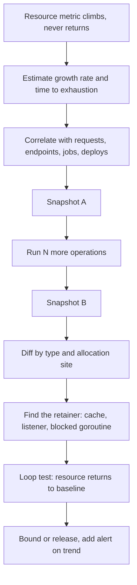

## In one minute
- A leak is anything acquired and not released: memory, file descriptors, database connections, threads, goroutines, disk space, locks. The symptom is a slow climb, then a cliff: an out-of-memory kill, "too many open files", a pool timeout.
- Leaks are a hot-spot shape in time: the resource is fine on average but grows without bound. Look for monotonic growth that does not return to baseline after load drops.
- Diagnose by comparison: two heap snapshots or two resource counts taken some time apart, diffed by type or by allocation site. What grew is the suspect.
- Most real leaks are references kept by accident (caches without limits, listeners never removed, maps keyed by request ID), or resources not closed on error paths.
- Restarts hide leaks; they do not fix them. Track resources as metrics with limits, alert on the trend, and find the owner of the growing thing.

## How it works

### What leaks
Memory is the famous one, but anything with a finite pool can leak:

- **Memory:** objects kept reachable longer than needed. In garbage-collected languages, the collector cannot free anything still referenced, so a forgotten reference is a leak.
- **File descriptors:** sockets, files and pipes not closed, often on error paths. Each process has a limit (`ulimit -n`, commonly 1,024 by default for interactive shells, often raised to 65,536 or more for services).
- **Connections:** database connections borrowed from a pool and never returned; the pool runs dry and requests wait until timeout.
- **Threads and goroutines:** workers blocked forever on a channel or a lock, each holding a stack (goroutines start at a few kilobytes; OS threads often reserve megabytes of virtual memory).
- **Disk:** logs or temp files never rotated, deleted files still held open by a process (the space is not freed until the descriptor closes).

### Signatures
A leak looks like a sawtooth that never comes back down, or a straight line up. Normal memory use rises with load and falls after; a leak rises with the number of operations performed and stays. Plot the resource against cumulative requests rather than time: a leak of 2 KB per request is a straight line whose slope is the size of the leak.

### The diagnosis loop
1. **Confirm and measure.** Graph the resource over several days; estimate the growth rate and the time to exhaustion.
2. **Correlate.** Does growth follow request count, a specific endpoint, a cron job, a deploy?
3. **Compare snapshots.** Take a heap profile or resource listing now and again after N more operations. Diff by type and allocation site: Go's `pprof` with `-base` on the heap profile, plus its goroutine and `threadcreate` profiles for stuck goroutines and thread growth ([Go diagnostics](https://go.dev/doc/diagnostics)), Python's `tracemalloc` `compare_to` between two snapshots ([Python docs](https://docs.python.org/3/library/tracemalloc.html)), Chrome DevTools heap snapshots for Node, `lsof -p PID` for file descriptors.
4. **Find the retainer.** For memory, ask what keeps the objects alive: the retainer path in a heap snapshot shows the chain of references from a root (a global, a cache, an event emitter) to the leaked objects.
5. **Reproduce in a test.** Run the suspect operation 10,000 times in a loop and assert the resource count returns to baseline.

### Common culprits
- Unbounded caches and memoization (a dictionary keyed by user ID or query text that only ever grows).
- Event listeners or callbacks registered per request and never removed.
- Goroutines or threads waiting on a channel nobody will write to, often after a timeout path returns early.
- Resources opened without `with`, `defer` or `try/finally`, so the error path skips the close.
- Buffers retained by slicing: in Go, a small slice of a large array keeps the whole array alive.

### The same shape elsewhere
Resource limits can be hit by growth that is not a leak at all. The same curve appears when a fleet grows and every server holds one resource per peer (see In the wild), so alert on the margin to every hard limit, not only on slope.

Resource exhaustion appears outside programs too: a queue whose consumers fell behind, a ticket backlog, an on-call rotation that keeps adding alerts but never removes them. The pattern and the fix are the same: measure the growth, find what keeps adding without removing, and bound it.

## Down the stack

### Layer 1: The contract
A service promises bounded resource use under steady load: memory, descriptors, connections and threads plateau rather than grow with the number of operations. Operationally that means each resource is exported as a metric, has a configured limit, and has an alert on both level and trend, such as "will exhaust within 24 hours at the current rate".

### Layer 2: The mechanism
Garbage collectors free objects that are unreachable from roots (globals, stacks, registers). Go uses a concurrent mark-and-sweep collector; the JVM and V8 use generational collectors that promote long-lived objects to an old generation, where leaked objects pile up and make each major collection slower. Heap profilers sample allocations: Go's runtime records a stack trace for roughly one allocation per 512 KB allocated by default (`MemProfileRate`, [runtime docs](https://pkg.go.dev/runtime#pkg-variables)), which is cheap enough to leave on in production; the Go team suggests profiling one randomly chosen replica at a time ([Go diagnostics](https://go.dev/doc/diagnostics)). Python's `tracemalloc` records every allocation, and storing more frames per trace costs more memory and CPU ([Python docs](https://docs.python.org/3/library/tracemalloc.html)), so it is used for targeted debugging. For descriptors, the kernel keeps a per-process table; `/proc/PID/fd` lists every open descriptor and what it points to.

### Layer 3: The machine
When memory grows, the process's resident set size (RSS) grows as the kernel maps physical pages on first touch, in 4 KB pages on most systems. In a container, the cgroup's `memory.max` caps it: when usage reaches the limit the kernel first tries to reclaim memory, and if it cannot, the OOM killer runs inside that cgroup ([kernel cgroup v2 docs](https://www.kernel.org/doc/html/latest/admin-guide/cgroup-v2.html)). Kubernetes then reports the container as `OOMKilled` with exit code 137 (128 plus signal 9, SIGKILL) and restarts it ([Kubernetes docs](https://kubernetes.io/docs/tasks/configure-pod-container/assign-memory-resource/)). The softer `memory.high` throttles the cgroup under heavy reclaim instead of killing it, which shows up as latency before it shows up as a restart; the `oom_kill` counter in `memory.events` records kills. Before that point, the process may already slow down: garbage collectors run more often as the heap fills, and if swap is enabled, page faults to disk turn microsecond memory accesses into millisecond ones. Descriptor exhaustion is immediate: `open()` or `accept()` fails with `EMFILE`, and a server can stop accepting connections while its CPU looks idle.

### Why it's built this way
1. Every resource is finite, and programs acquire it in many places.
2. Releasing it depends on every path, including error paths, doing the right thing.
3. Garbage collection frees only unreachable memory, so forgotten references still leak.
4. Leaks grow slowly, so they hide behind restarts and deploys until load changes.
5. Hence: measure each resource, bound it, alert on trends and diff snapshots to find what grew.

## Diagram


## Worked example
An API service on Kubernetes is OOM-killed about every 30 hours. Each pod has a 2 GiB limit. Memory graphs show RSS climbing from 400 MiB after start by about 55 MiB an hour, regardless of the time of day. Restarts have been "fixing" it for weeks.

Plotted against requests, the growth is a straight line: about 1.1 KB per request at 50,000 requests an hour, which is 55 MiB an hour. Two heap profiles taken an hour apart and diffed with `go tool pprof -base` show 52 MiB of new memory in `map[string]*tenantConfig` allocated in `loadTenantConfig`. The code memoizes tenant configuration in a global map keyed by the request's `X-Tenant` header. A recent change made the header include a request-scoped suffix for tracing, so every request created a new key.

A loop test calling the handler 100,000 times with distinct headers shows the map growing to 100,000 entries. The fix strips the suffix before caching and replaces the map with a bounded LRU of 10,000 entries. The team also adds an alert: "memory projected to reach the limit within 12 hours". After the fix, memory plateaus at 450 MiB.

## In the wild
- **AWS Kinesis, 2020: thread limit, not memory.** Adding capacity to the front-end fleet pushed every server past an operating-system limit on threads, because each server keeps a thread per peer. Servers could not build their shard-map caches and routed nothing, and recovery needed a full fleet restart, adding servers only a few hundred per hour. Kinesis took roughly 17 hours from first alarms to full recovery, with Cognito, CloudWatch and Lambda affected. AWS added thread-consumption alarms, moved to larger servers with fewer peers, and began splitting the fleet into cells ([AWS summary](https://aws.amazon.com/message/11201/)).
- **Healthchecks.io, 2025: connection slots as the scarce resource.** One misconfigured client pinged at about 300 requests a second. HAProxy's tarpit held each rejected connection for a second, so the load balancers ran out of connection slots and rejected real traffic; one balancer was automatically dropped from DNS rotation, pushing its load onto the others. The outage lasted about 1 hour 40 minutes. The fix replaced the tarpit with immediate 429 responses, added a 5-second request timeout, raised `maxconn` and alerted on active sessions ([post-mortem](https://blog.healthchecks.io/2025/11/post-mortem-outage-on-november-1/)).

## Trade-offs
| Technique | Strengths | Weaknesses | Choose when |
| --- | --- | --- | --- |
| Periodic restarts | Instant relief | Hides the bug, causes churn | Short-term mitigation only |
| Continuous profiling in production | Real data, history | Small overhead, tooling cost | Long-running services |
| Heap snapshot diff | Pinpoints the growing type | Large snapshots, pauses | Confirmed leak, reproducible |
| Loop test in CI | Catches regressions | Needs a representative operation | Handlers and libraries with known leak risk |
| Bounded caches and pools | Prevents unbounded growth | Evictions and timeouts to handle | Any cache, pool or queue |

## Pitfalls in production
- Treating restarts as the fix. Fix: keep the restart as mitigation, open a ticket with the growth rate, find the cause.
- Caches with no size limit or TTL. Fix: bounded LRU or TTL caches by default, with metrics on size and evictions.
- Close only on the success path. Fix: `with`, `defer` or `try/finally` for every acquired resource, and tests for error paths.
- Watching only memory. Fix: export descriptors, connections, threads or goroutines, and disk usage too.
- Profiling once at startup. Fix: compare snapshots over time; a leak is a difference, not a state.

## Leadership lens
- Require resource metrics and trend alerts for every long-running service, not just CPU and memory levels.
- Make bounded caches and pools the default in shared libraries.
- Treat "we restart it nightly" as technical debt with an owner and a date.
- When agents write caching code, review for bounds and keys explicitly; unbounded memoization is a common generated pattern.

## Check yourself
1. Why plot memory against cumulative requests rather than time?
   **Answer:** A per-operation leak becomes a straight line whose slope is the leak size, independent of traffic patterns that make time-based graphs noisy.
2. A Go service's memory grows, and a goroutine profile shows 200,000 goroutines blocked on a channel receive. What is likely happening?
   **Answer:** Goroutines are started per request and wait for a result that never comes, often because the sender returned early on a timeout; each blocked goroutine and what it references is leaked.
3. Why does a deleted log file sometimes not free disk space?
   **Answer:** A process still has it open; the kernel frees the blocks only when the last descriptor is closed.
4. What does exit code 137 in Kubernetes usually mean?
   **Answer:** The container was killed with SIGKILL (128 plus 9), typically by the OOM killer when it exceeded its memory limit.

## Practice
**Task:** Build the trend check behind a leak alert. `slope(samples)` takes a list of `(t, value)` pairs (t in hours) and returns the least-squares slope, rounded to 3 decimal places (0 if fewer than two distinct times). `hours_to_limit(samples, limit)` projects when the fitted line reaches `limit`, measured from the last sample's time, rounded to 1 decimal place; return `None` if the slope is zero or negative, and 0 if the latest fitted value is already at or above the limit. `is_leak(samples, min_slope)` returns true if the slope is at least `min_slope` and the last value is above the first.

```python starter
def slope(samples):
    # TODO
    raise NotImplementedError

def hours_to_limit(samples, limit):
    # TODO
    raise NotImplementedError

def is_leak(samples, min_slope):
    # TODO
    raise NotImplementedError
```

```python tests
STEADY_LEAK = [(0, 400), (1, 455), (2, 510), (3, 565), (4, 620)]

def test_slope_of_linear_growth():
    assert slope(STEADY_LEAK) == 55.0

def test_hours_to_limit():
    assert hours_to_limit(STEADY_LEAK, 2048) == 26.0

def test_flat_memory_is_not_a_leak():
    flat = [(0, 500), (1, 520), (2, 480), (3, 480), (4, 520)]
    assert slope(flat) == 0.0
    assert hours_to_limit(flat, 2048) is None
    assert not is_leak(flat, 5)

def test_sawtooth_with_upward_trend_is_a_leak():
    saw = [(0, 400), (1, 600), (2, 450), (3, 650), (4, 500), (5, 700)]
    assert is_leak(saw, 10)

def test_already_over_limit():
    assert hours_to_limit([(0, 1900), (1, 2100)], 2048) == 0

def test_too_few_points():
    assert slope([(0, 100)]) == 0
    assert hours_to_limit([(0, 100)], 200) is None
```

```python solution
def slope(samples):
    n = len(samples)
    if n < 2:
        return 0
    mt = sum(t for t, _ in samples) / n
    mv = sum(v for _, v in samples) / n
    den = sum((t - mt) ** 2 for t, _ in samples)
    if den == 0:
        return 0
    num = sum((t - mt) * (v - mv) for t, v in samples)
    return round(num / den, 3)

def _fit(samples):
    n = len(samples)
    mt = sum(t for t, _ in samples) / n
    mv = sum(v for _, v in samples) / n
    den = sum((t - mt) ** 2 for t, _ in samples)
    if den == 0:
        return 0.0, mv
    s = sum((t - mt) * (v - mv) for t, v in samples) / den
    return s, mv - s * mt

def hours_to_limit(samples, limit):
    if len(samples) < 2:
        return None
    s, b = _fit(samples)
    if s <= 0:
        return None
    last_t = samples[-1][0]
    now = s * last_t + b
    if now >= limit:
        return 0
    return round((limit - now) / s, 1)

def is_leak(samples, min_slope):
    return len(samples) >= 2 and slope(samples) >= min_slope and samples[-1][1] > samples[0][1]
```

```typescript starter
export function slope(samples: [number, number][]): number {
  throw new Error("TODO");
}

export function hoursToLimit(samples: [number, number][], limit: number): number | null {
  throw new Error("TODO");
}

export function isLeak(samples: [number, number][], minSlope: number): boolean {
  throw new Error("TODO");
}
```

```typescript tests
const STEADY: [number, number][] = [[0, 400], [1, 455], [2, 510], [3, 565], [4, 620]];

test("slope of linear growth", () => {
  assertEqual(slope(STEADY), 55);
});

test("hours to limit", () => {
  assertEqual(hoursToLimit(STEADY, 2048), 26);
});

test("flat memory is not a leak", () => {
  const flat: [number, number][] = [[0, 500], [1, 520], [2, 480], [3, 480], [4, 520]];
  assertEqual(slope(flat), 0);
  assertEqual(hoursToLimit(flat, 2048), null);
  assert(!isLeak(flat, 5), "flat is not a leak");
});

test("sawtooth with upward trend is a leak", () => {
  assert(isLeak([[0, 400], [1, 600], [2, 450], [3, 650], [4, 500], [5, 700]], 10), "trend up");
});

test("already over limit", () => {
  assertEqual(hoursToLimit([[0, 1900], [1, 2100]], 2048), 0);
});

test("too few points", () => {
  assertEqual(slope([[0, 100]]), 0);
  assertEqual(hoursToLimit([[0, 100]], 200), null);
});
```

```typescript solution
function fit(samples: [number, number][]): [number, number] {
  const n = samples.length;
  const mt = samples.reduce((a, [t]) => a + t, 0) / n;
  const mv = samples.reduce((a, [, v]) => a + v, 0) / n;
  const den = samples.reduce((a, [t]) => a + (t - mt) ** 2, 0);
  if (den === 0) return [0, mv];
  const s = samples.reduce((a, [t, v]) => a + (t - mt) * (v - mv), 0) / den;
  return [s, mv - s * mt];
}

export function slope(samples: [number, number][]): number {
  if (samples.length < 2) return 0;
  return Math.round(fit(samples)[0] * 1000) / 1000;
}

export function hoursToLimit(samples: [number, number][], limit: number): number | null {
  if (samples.length < 2) return null;
  const [s, b] = fit(samples);
  if (s <= 0) return null;
  const now = s * samples[samples.length - 1][0] + b;
  if (now >= limit) return 0;
  return Math.round(((limit - now) / s) * 10) / 10;
}

export function isLeak(samples: [number, number][], minSlope: number): boolean {
  return samples.length >= 2 && slope(samples) >= minSlope && samples[samples.length - 1][1] > samples[0][1];
}
```

```go starter
package practice

type Sample struct{ T, V float64 }

func Slope(samples []Sample) float64 {
	panic("TODO")
}

// HoursToLimit returns hours and true, or 0 and false if the trend never reaches the limit.
func HoursToLimit(samples []Sample, limit float64) (float64, bool) {
	panic("TODO")
}

func IsLeak(samples []Sample, minSlope float64) bool {
	panic("TODO")
}
```

```go tests
package practice

import "testing"

var steady = []Sample{{0, 400}, {1, 455}, {2, 510}, {3, 565}, {4, 620}}

func TestSlope(t *testing.T) {
	if s := Slope(steady); s != 55 {
		t.Fatalf("got %v", s)
	}
}

func TestHoursToLimit(t *testing.T) {
	if h, ok := HoursToLimit(steady, 2048); !ok || h != 26 {
		t.Fatalf("got %v %v", h, ok)
	}
}

func TestFlat(t *testing.T) {
	flat := []Sample{{0, 500}, {1, 520}, {2, 480}, {3, 480}, {4, 520}}
	if Slope(flat) != 0 {
		t.Fatal("slope should be 0")
	}
	if _, ok := HoursToLimit(flat, 2048); ok {
		t.Fatal("flat never reaches limit")
	}
	if IsLeak(flat, 5) {
		t.Fatal("flat is not a leak")
	}
}

func TestSawtooth(t *testing.T) {
	if !IsLeak([]Sample{{0, 400}, {1, 600}, {2, 450}, {3, 650}, {4, 500}, {5, 700}}, 10) {
		t.Fatal("upward sawtooth is a leak")
	}
}

func TestOverLimit(t *testing.T) {
	if h, ok := HoursToLimit([]Sample{{0, 1900}, {1, 2100}}, 2048); !ok || h != 0 {
		t.Fatalf("got %v %v", h, ok)
	}
}

func TestTooFew(t *testing.T) {
	if Slope([]Sample{{0, 100}}) != 0 {
		t.Fatal("one point slope is 0")
	}
	if _, ok := HoursToLimit([]Sample{{0, 100}}, 200); ok {
		t.Fatal("one point has no projection")
	}
}
```

```go solution
package practice

import "math"

type Sample struct{ T, V float64 }

func fit(samples []Sample) (float64, float64) {
	n := float64(len(samples))
	var mt, mv float64
	for _, s := range samples {
		mt += s.T
		mv += s.V
	}
	mt /= n
	mv /= n
	var num, den float64
	for _, s := range samples {
		num += (s.T - mt) * (s.V - mv)
		den += (s.T - mt) * (s.T - mt)
	}
	if den == 0 {
		return 0, mv
	}
	sl := num / den
	return sl, mv - sl*mt
}

func Slope(samples []Sample) float64 {
	if len(samples) < 2 {
		return 0
	}
	s, _ := fit(samples)
	return math.Round(s*1000) / 1000
}

func HoursToLimit(samples []Sample, limit float64) (float64, bool) {
	if len(samples) < 2 {
		return 0, false
	}
	s, b := fit(samples)
	if s <= 0 {
		return 0, false
	}
	now := s*samples[len(samples)-1].T + b
	if now >= limit {
		return 0, true
	}
	return math.Round((limit-now)/s*10) / 10, true
}

func IsLeak(samples []Sample, minSlope float64) bool {
	return len(samples) >= 2 && Slope(samples) >= minSlope && samples[len(samples)-1].V > samples[0].V
}
```

## Mock interview
**Prompt:** A Node.js API serving 3,000 requests a second runs on 20 pods with 1 GiB memory limits. Since a release last week, pods are OOM-killed every 8 to 12 hours, and p99 latency degrades for an hour before each kill. Walk me through finding and fixing the cause.

- Follow-up: Heap snapshots are 800 MB and pausing the process to take one causes timeouts. How do you get the data safely?
- Follow-up: Memory is stable, but the service starts failing with "EMFILE" after a few days. What changed in your investigation?
- Follow-up: How do you stop this class of bug from coming back?

**A strong answer covers:**
- Immediate mitigation: restarts on a schedule or before the limit, possibly a rollback of the release.
- Measuring growth per request and correlating with the release diff and specific endpoints.
- Snapshot comparison: one pod taken out of rotation for profiling, or a staging reproduction with production-like traffic, diffing by constructor and retainer path.
- Explaining the latency degradation: garbage collection works harder as the old generation fills.
- For EMFILE: listing descriptors with `lsof` or `/proc/PID/fd`, finding unclosed sockets or files on error paths.
- Prevention: bounded caches by default, resource metrics with trend alerts, loop tests for leak-prone code.

## Sources and further study
**Primary**
- [Go runtime documentation: MemProfileRate](https://pkg.go.dev/runtime#pkg-variables): the default sampling rate of 512 KiB per recorded allocation.

**Systems docs**
- [Assign Memory Resources to Containers (Kubernetes)](https://kubernetes.io/docs/tasks/configure-pod-container/assign-memory-resource/): `OOMKilled` and exit code 137 in a worked example.

**Books**
- *Systems Performance*, 2nd ed. (Brendan Gregg), Ch 7: Memory, for working-set growth, paging and the tools that observe them.
- *Release It!*, 2nd ed. (Michael Nygard), Ch 4: Stability Antipatterns (Blocked Threads, Cascading Failures), for how exhausted threads and pools spread failure.
- *Site Reliability Engineering* (Google), Ch 12: Effective Troubleshooting, for the hypothesis-and-test loop used in the diagnosis section.

**Other curricula**
- Google's SRE book treats resource exhaustion as a cause to find by hypothesis and recent change, not by restarting; see the Effective Troubleshooting chapter above.

## Free resources
- [Diagnostics (Go documentation)](https://go.dev/doc/diagnostics): profiling, tracing and debugging Go programs, including heap and goroutine profiles.
- [tracemalloc (Python documentation)](https://docs.python.org/3/library/tracemalloc.html): snapshot comparison by allocation site.
- [Fix memory problems (Chrome DevTools)](https://developer.chrome.com/docs/devtools/memory-problems/): heap snapshots, comparison and retainers for JavaScript.
- [Memory (Node.js Learn)](https://nodejs.org/en/learn/diagnostics/memory): diagnosing memory issues in Node.js services.
- [Memory Flame Graphs (Brendan Gregg)](https://www.brendangregg.com/FlameGraphs/memoryflamegraphs.html): visualising allocations and growth by code path.
- [Control Group v2 (Linux kernel docs)](https://www.kernel.org/doc/html/latest/admin-guide/cgroup-v2.html): how memory limits and OOM behave in containers.
