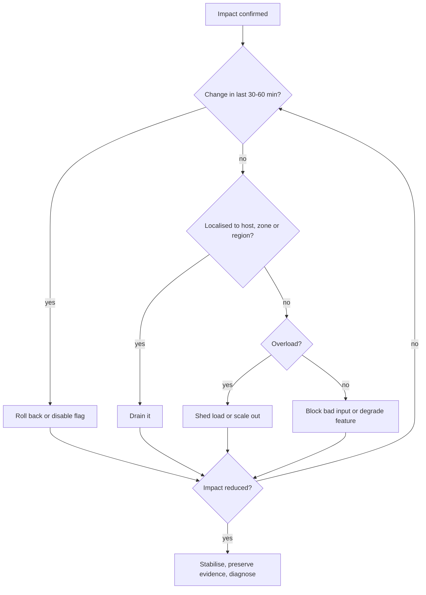

## In one minute
- During an incident the goal is to end user impact, not to understand it. Understanding can wait for the postmortem; users cannot.
- Most mitigations are generic: roll back, turn the feature off, move traffic away, shed load, add capacity. None needs a root cause.
- Prefer actions that are fast, reversible and well rehearsed, even if they might not be the true fix.
- Keep evidence while you mitigate: snapshot a bad host, save logs, record what you changed and when.
- "We rolled back and it recovered" is a strong clue for diagnosis later, not a substitute for it.

## How it works

### Why diagnosis is the slow path
Diagnosis is open-ended. You do not know how many hypotheses you will test or how long each takes. Mitigation is a short list of known actions with known costs. If a rollback takes 6 minutes and diagnosis takes somewhere between 10 minutes and 4 hours, the expected impact is far lower if you roll back first and diagnose a healthy system later.

### Generic mitigations
A small set of actions fixes most incidents without knowing why they happened:
- **Roll back** the most recent deploy or config change.
- **Disable** a feature through its flag or kill switch.
- **Drain** a bad host, zone or region and send traffic elsewhere.
- **Shed load**: reject low-priority traffic, turn off expensive features, rate-limit abusive clients.
- **Scale out** when the cause is capacity.
- **Block** a specific bad input, client or query pattern.
- **Restart** as a last resort, because it destroys evidence and often only resets the clock.

### Choosing among them
Rank options by three things: how long until it takes effect, how likely it is to help, and what happens if it is wrong. A reversible action that takes 30 seconds and has a 40 percent chance of working is often better than a one-way action that takes 20 minutes and has a 90 percent chance. Try the cheap reversible guess first, check impact, then move on. Correlate with change: if a deploy landed in the 30 minutes before onset, rolling it back is the first candidate even when "it can't be that".

### Preserve evidence
Mitigation and evidence can conflict. Before you restart a leaking process, take a heap dump or at least record its memory graph. Before you terminate a misbehaving host, take it out of the load balancer instead and leave it running for later inspection. Save the logs that rotate quickly. Write every action into the incident timeline with a timestamp so the later analysis can tell cause from effect. Azure's guidance makes the same trade: keep failed resources in a quarantined state for forensic analysis rather than discarding them, and build toggles that disable or isolate a faulty component without a redeploy ([Azure Well-Architected](https://learn.microsoft.com/en-us/azure/well-architected/operational-excellence/incident-response)).

### When mitigation is not enough
Some incidents have no generic fix: data corruption that is already written, a dependency that is fully down with no alternative, a security breach. Then the question becomes "how do we limit the damage?": stop writes, put the system into read-only mode, fail closed rather than open, or communicate a workaround. Even here, damage limitation comes before full diagnosis.

## Down the stack

### Layer 1: The contract
The process promises that the incident team will pursue the fastest available action that reduces user impact, that every mitigation is announced before it runs, that each has a stated rollback, and that evidence needed for diagnosis is preserved when doing so costs less than a few minutes. It also promises that the team re-checks impact after each action, rather than assuming success, and keeps going until user-facing indicators are back within SLO.

### Layer 2: The mechanism
Each generic mitigation has a concrete mechanism. In Kubernetes, `kubectl rollout undo deployment/api` restores the previous pod template from the Deployment's revision history (old ReplicaSets kept up to `revisionHistoryLimit`, 10 by default; [Kubernetes docs](https://kubernetes.io/docs/concepts/workloads/controllers/deployment/)) and performs a rolling update governed by `maxSurge` and `maxUnavailable`. A feature-flag kill switch is a value in a flag service; SDKs keep a local cache and receive changes over a streaming connection (server-sent events in several commercial products) or by polling every N seconds. A traffic drain changes load-balancer weights, sets a target to draining so in-flight connections finish within a deregistration delay (300 seconds by default on AWS Application Load Balancer target groups; [AWS docs](https://docs.aws.amazon.com/elasticloadbalancing/latest/application/edit-target-group-attributes.html)), or removes a DNS record. Load shedding is a check at the front door: if the in-flight request count or queue time exceeds a limit, return 503 with `Retry-After` immediately, before doing work. The rejection has to be far cheaper than the work, and the aim is to keep latency low for the requests you accept, not to be fair to all of them ([AWS Builders' Library](https://aws.amazon.com/builders-library/using-load-shedding-to-avoid-overload/)).

### Layer 3: The machine
These actions differ by orders of magnitude in time on real machines. A flag change over a streaming connection reaches SDKs in about a second; a polling SDK at a 30 s interval averages 15 s. A rollback has to schedule pods, pull images (seconds if the old image is still on the node's disk, a minute or more for a large image from a registry), start the process, warm the JIT and caches, and pass readiness probes; for a JVM service with 200 pods and `maxSurge: 25%` that is often 5 to 15 minutes. A DNS-based drain is bounded by TTL, and some resolvers and client libraries hold records longer than the TTL. Scaling out on fresh VMs takes 1 to 3 minutes to boot plus warmup, and cold caches can push extra load to the database just as you add capacity. Restarting a process discards its heap, open file descriptors and in-memory queues: exactly the state you would want for a memory-leak or deadlock diagnosis, which is why `jmap`, `gcore` or a goroutine dump comes first if you can afford a minute.

### Why it's built this way
User impact accrues every minute, so time to mitigate dominates incident cost. Root-cause search has unbounded duration, so it should not block the bounded actions. Recent change is the most common trigger of incidents (Google's SRE book estimates roughly 70 percent of outages are due to changes in a live system; [Google SRE book](https://sre.google/sre-book/introduction/)), so undoing change is the highest-yield generic fix. Reversible actions let a team try several guesses quickly, so systems are built with flags, rollbacks and drains in advance, before anyone needs them at 3 a.m.

## Diagram


## Worked example
At 09:12 search latency p99 jumps from 180 ms to 2.4 s and 8 percent of requests time out. The change log shows three entries in the hour before: a search-ranking deploy at 08:51, a config change raising the cache TTL at 09:05, and a new index build that finished at 09:09.

The ops lead lists options:

| Option | Minutes to effect | Chance it helps | Reversible |
| --- | --- | --- | --- |
| Revert cache TTL config | 1 | 0.3 | yes |
| Roll back ranking deploy | 9 | 0.3 | yes |
| Switch to previous index | 3 | 0.5 | yes |
| Add 50 percent more search nodes | 12 | 0.2 | yes |

Dividing time by chance of success gives an expected cost per attempt: TTL revert about 3.3, index switch 6, rollback 30, scale-out 60. The IC approves the TTL revert at 09:16; no change by 09:18. The index switch goes at 09:19 and p99 drops to 210 ms by 09:22. Total impact is 10 minutes.

Before switching, the ops lead saved the slow-query log and kept one node on the new index out of rotation. The postmortem later finds the new index had a field mapping that disabled a filter cache, which the preserved node made easy to confirm. Had the team started by profiling queries, the investigation would have taken around 90 minutes of continued timeouts.

## In the wild
- **Google Cloud, 2025: a kill switch built in advance.** A policy change with blank fields crash-looped Service Control in every region on 12 June. The new check had no error handling and no feature flag. SRE had a "red button" for the serving path ready after about 25 minutes and rolled it out within 40. Restarting tasks then overloaded Spanner in us-central1 because Service Control lacked randomized exponential backoff, so that region took up to about 2 hours 40 minutes to recover. Google committed to feature-flagging critical binaries, disabled by default ([Google Cloud incident report](https://status.cloud.google.com/incidents/ow5i3PPK96RduMcb1SsW)).
- **Cloudflare, 2019: kill the component, fix later.** A WAF rule with a regex that backtracked pinned CPUs worldwide. Engineers did not wait to fix the regex: a "global terminate" of the WAF ran at 14:07 UTC and traffic and CPU were normal by 14:09. The rule was rolled back, tested in one city, and re-enabled globally at 14:52 ([Cloudflare](https://blog.cloudflare.com/details-of-the-cloudflare-outage-on-july-2-2019/)).
- **Facebook, 2021: when the generic mitigations are out of reach.** A backbone command took the data centers offline and the DNS servers withdrew their routes. Out-of-band access and internal tools were down, so engineers went to the data centers in person, and hardware and security hardening slowed them. Bringing load back gradually, using drills for major failures, avoided a power surge from restarting everything at once ([Engineering at Meta](https://engineering.fb.com/2021/10/05/networking-traffic/outage-details/)).

## Trade-offs
| Option | Strengths | Weaknesses | Choose when |
| --- | --- | --- | --- |
| Roll back | Undoes the likeliest cause | Slow for large fleets; not possible after one-way migrations | A deploy preceded onset |
| Feature flag off | Seconds, precise | Only covers flagged code | The new feature is suspected |
| Drain host or zone | Removes a sick part quickly | Remaining capacity must absorb load | Impact is localised |
| Shed load | Protects the core path | Some users get errors on purpose | Overload or a retry storm |
| Restart | Clears bad state | Destroys evidence, often recurs | Nothing else is available |

## Pitfalls in production
- Rolling back is impossible because the release included a destructive schema migration. Fix: expand-and-contract migrations so the previous version always works with the current schema. AWS describes the same idea for any format or protocol change: first ship a version that can read the new format but still writes the old one, wait through a bake period, and only then ship the version that writes it ([AWS Builders' Library](https://aws.amazon.com/builders-library/ensuring-rollback-safety-during-deployments/)).
- The team debugs a "can't be the deploy" theory for an hour. Fix: if a change landed near onset, undo it first; it is cheap to be wrong.
- Restarts hide a leak that returns every six hours. Fix: capture a heap or goroutine dump before restarting and file the diagnosis as a postmortem action.
- Scale-out makes things worse because new instances stampede a cold cache or the database. Fix: know which dependencies cap your capacity before adding instances.
- Two mitigations run at once, so nobody knows which worked. Fix: one change at a time, announced, with impact checked after each.
- A drain shifts load to a region that then falls over. Fix: check headroom before draining; shed load if headroom is short.

## Leadership lens
- In design reviews, ask "how do we turn this off?" for every new feature. No kill switch means no generic mitigation. Google's 2025 Cloud report singles out the crashing code path as not protected by a feature flag ([Google Cloud](https://status.cloud.google.com/incidents/ow5i3PPK96RduMcb1SsW)).
- Track time to mitigate separately from time to resolve; reward the first.
- Rehearse rollbacks and drains in game days so they are routine at 3 a.m.
- Make destructive migrations a separate, later release from the code that stops using the old schema.

## Check yourself
1. Why is a reversible 30-second action with a low chance of success often tried before a slow, likely fix?
   **Answer:** Its expected cost (time divided by chance of success) is small, and if it fails you lose little and still learn something before trying the slower option.
2. What evidence would you capture before restarting a process suspected of leaking memory?
   **Answer:** A heap dump or core (`jmap`, `gcore`), memory and file descriptor counts over time, and recent logs; or take the instance out of rotation and leave it running.
3. Why can a rollback fail to mitigate even when the deploy was the cause?
   **Answer:** The bad version may have written data or run a migration that persists, caches may hold bad entries, or the old version may be incompatible with the new schema.
4. When is restarting a reasonable mitigation?
   **Answer:** When state is corrupted or exhausted and no cheaper action exists, ideally after evidence is captured and with the expectation that the problem may return.

## Practice
**Task:** Build the two helpers an ops lead uses in the first minutes. `suspect_changes(changes, onset, window)` takes `(time, id)` change events and returns the ids of changes that happened in `[onset - window, onset]`, most recent first (ties broken by id ascending). `rank_mitigations(options, max_risk)` takes options as `(name, minutes, success_prob, risk, reversible)` and returns the names to try in order: drop options with `risk > max_risk` or `success_prob <= 0`; put reversible options before irreversible ones; within each group sort by `minutes / success_prob` ascending, then by name.

```python starter
def suspect_changes(changes, onset, window):
    # TODO
    raise NotImplementedError

def rank_mitigations(options, max_risk):
    # TODO
    raise NotImplementedError
```

```python tests
def test_suspects_in_window_most_recent_first():
    ch = [(851, "deploy-ranking"), (905, "cfg-ttl"), (909, "index-build"), (700, "old")]
    assert suspect_changes(ch, 912, 30) == ["index-build", "cfg-ttl"]

def test_suspects_window_edges_inclusive():
    ch = [(882, "a"), (912, "b"), (913, "after")]
    assert suspect_changes(ch, 912, 30) == ["b", "a"]

def test_suspects_tie_by_id():
    assert suspect_changes([(10, "z"), (10, "a")], 10, 5) == ["a", "z"]

def test_rank_by_expected_cost():
    opts = [("rollback", 9, 0.3, 0.1, True), ("ttl", 1, 0.3, 0.1, True),
            ("index", 3, 0.5, 0.1, True), ("scale", 12, 0.2, 0.2, True)]
    assert rank_mitigations(opts, 0.5) == ["ttl", "index", "rollback", "scale"]

def test_reversible_first_and_risk_filter():
    opts = [("failover", 2, 0.9, 0.3, False), ("flag", 5, 0.5, 0.1, True),
            ("drop-table", 1, 0.9, 0.9, False)]
    assert rank_mitigations(opts, 0.5) == ["flag", "failover"]

def test_zero_success_dropped_and_empty():
    assert rank_mitigations([("pray", 1, 0.0, 0.0, True)], 1.0) == []
    assert rank_mitigations([], 1.0) == []
```

```python solution
def suspect_changes(changes, onset, window):
    hits = [(t, cid) for t, cid in changes if onset - window <= t <= onset]
    hits.sort(key=lambda x: (-x[0], x[1]))
    return [cid for _, cid in hits]

def rank_mitigations(options, max_risk):
    ok = [o for o in options if o[3] <= max_risk and o[2] > 0]
    ok.sort(key=lambda o: (0 if o[4] else 1, o[1] / o[2], o[0]))
    return [o[0] for o in ok]
```

```typescript starter
export type Change = [number, string];
export type Option = [string, number, number, number, boolean];

export function suspectChanges(changes: Change[], onset: number, window: number): string[] {
  throw new Error("TODO");
}

export function rankMitigations(options: Option[], maxRisk: number): string[] {
  throw new Error("TODO");
}
```

```typescript tests
test("suspects in window, most recent first", () => {
  const ch: Change[] = [[851, "deploy-ranking"], [905, "cfg-ttl"], [909, "index-build"], [700, "old"]];
  assertEqual(suspectChanges(ch, 912, 30), ["index-build", "cfg-ttl"]);
});

test("suspect window edges inclusive", () => {
  assertEqual(suspectChanges([[882, "a"], [912, "b"], [913, "after"]], 912, 30), ["b", "a"]);
});

test("suspect tie by id", () => {
  assertEqual(suspectChanges([[10, "z"], [10, "a"]], 10, 5), ["a", "z"]);
});

test("rank by expected cost", () => {
  const opts: Option[] = [["rollback", 9, 0.3, 0.1, true], ["ttl", 1, 0.3, 0.1, true],
    ["index", 3, 0.5, 0.1, true], ["scale", 12, 0.2, 0.2, true]];
  assertEqual(rankMitigations(opts, 0.5), ["ttl", "index", "rollback", "scale"]);
});

test("reversible first and risk filter", () => {
  const opts: Option[] = [["failover", 2, 0.9, 0.3, false], ["flag", 5, 0.5, 0.1, true],
    ["drop-table", 1, 0.9, 0.9, false]];
  assertEqual(rankMitigations(opts, 0.5), ["flag", "failover"]);
});

test("zero success dropped and empty", () => {
  assertEqual(rankMitigations([["pray", 1, 0, 0, true]], 1), []);
  assertEqual(rankMitigations([], 1), []);
});
```

```typescript solution
export type Change = [number, string];
export type Option = [string, number, number, number, boolean];

export function suspectChanges(changes: Change[], onset: number, window: number): string[] {
  return changes
    .filter(([t]) => onset - window <= t && t <= onset)
    .sort((a, b) => b[0] - a[0] || (a[1] < b[1] ? -1 : a[1] > b[1] ? 1 : 0))
    .map(([, id]) => id);
}

export function rankMitigations(options: Option[], maxRisk: number): string[] {
  return options
    .filter(o => o[3] <= maxRisk && o[2] > 0)
    .sort((a, b) => {
      const ra = a[4] ? 0 : 1, rb = b[4] ? 0 : 1;
      if (ra !== rb) return ra - rb;
      const ca = a[1] / a[2], cb = b[1] / b[2];
      if (ca !== cb) return ca - cb;
      return a[0] < b[0] ? -1 : a[0] > b[0] ? 1 : 0;
    })
    .map(o => o[0]);
}
```

```go starter
package practice

type Change struct {
	T  int
	ID string
}

type Option struct {
	Name        string
	Minutes     float64
	SuccessProb float64
	Risk        float64
	Reversible  bool
}

func SuspectChanges(changes []Change, onset, window int) []string {
	panic("TODO")
}

func RankMitigations(options []Option, maxRisk float64) []string {
	panic("TODO")
}
```

```go tests
package practice

import (
	"reflect"
	"testing"
)

func TestSuspectsInWindow(t *testing.T) {
	ch := []Change{{851, "deploy-ranking"}, {905, "cfg-ttl"}, {909, "index-build"}, {700, "old"}}
	if got := SuspectChanges(ch, 912, 30); !reflect.DeepEqual(got, []string{"index-build", "cfg-ttl"}) {
		t.Fatalf("got %v", got)
	}
}

func TestSuspectEdges(t *testing.T) {
	ch := []Change{{882, "a"}, {912, "b"}, {913, "after"}}
	if got := SuspectChanges(ch, 912, 30); !reflect.DeepEqual(got, []string{"b", "a"}) {
		t.Fatalf("got %v", got)
	}
}

func TestSuspectTie(t *testing.T) {
	if got := SuspectChanges([]Change{{10, "z"}, {10, "a"}}, 10, 5); !reflect.DeepEqual(got, []string{"a", "z"}) {
		t.Fatalf("got %v", got)
	}
}

func TestRankByCost(t *testing.T) {
	opts := []Option{{"rollback", 9, 0.3, 0.1, true}, {"ttl", 1, 0.3, 0.1, true},
		{"index", 3, 0.5, 0.1, true}, {"scale", 12, 0.2, 0.2, true}}
	if got := RankMitigations(opts, 0.5); !reflect.DeepEqual(got, []string{"ttl", "index", "rollback", "scale"}) {
		t.Fatalf("got %v", got)
	}
}

func TestReversibleFirst(t *testing.T) {
	opts := []Option{{"failover", 2, 0.9, 0.3, false}, {"flag", 5, 0.5, 0.1, true}, {"drop-table", 1, 0.9, 0.9, false}}
	if got := RankMitigations(opts, 0.5); !reflect.DeepEqual(got, []string{"flag", "failover"}) {
		t.Fatalf("got %v", got)
	}
}

func TestZeroSuccessAndEmpty(t *testing.T) {
	if got := RankMitigations([]Option{{"pray", 1, 0, 0, true}}, 1); len(got) != 0 {
		t.Fatalf("got %v", got)
	}
	if got := RankMitigations(nil, 1); len(got) != 0 {
		t.Fatalf("got %v", got)
	}
}
```

```go solution
package practice

import "sort"

type Change struct {
	T  int
	ID string
}

type Option struct {
	Name        string
	Minutes     float64
	SuccessProb float64
	Risk        float64
	Reversible  bool
}

func SuspectChanges(changes []Change, onset, window int) []string {
	hits := []Change{}
	for _, c := range changes {
		if onset-window <= c.T && c.T <= onset {
			hits = append(hits, c)
		}
	}
	sort.Slice(hits, func(i, j int) bool {
		if hits[i].T != hits[j].T {
			return hits[i].T > hits[j].T
		}
		return hits[i].ID < hits[j].ID
	})
	out := make([]string, len(hits))
	for i, c := range hits {
		out[i] = c.ID
	}
	return out
}

func RankMitigations(options []Option, maxRisk float64) []string {
	ok := []Option{}
	for _, o := range options {
		if o.Risk <= maxRisk && o.SuccessProb > 0 {
			ok = append(ok, o)
		}
	}
	sort.Slice(ok, func(i, j int) bool {
		a, b := ok[i], ok[j]
		if a.Reversible != b.Reversible {
			return a.Reversible
		}
		ca, cb := a.Minutes/a.SuccessProb, b.Minutes/b.SuccessProb
		if ca != cb {
			return ca < cb
		}
		return a.Name < b.Name
	})
	out := make([]string, len(ok))
	for i, o := range ok {
		out[i] = o.Name
	}
	return out
}
```

## Mock interview
**Prompt:** Checkout error rate jumped from 0.2 to 6 percent at 16:40. A payments deploy went out at 16:20, a CDN config change at 16:35, and a downstream fraud service reports elevated latency. You have 15 people on the call. How do you get to mitigation?

- Follow-up: You roll back the payments deploy and nothing changes. What next?
- Follow-up: A teammate wants to attach a profiler to production to "find the real cause" before anything else. How do you respond?
- Follow-up: The payments deploy included a schema migration that dropped a column. How does that change your options?

**A strong answer covers:**
- Listing candidate changes near onset and ordering mitigations by time, likelihood and reversibility.
- One change at a time, announced, with impact checked against a user-facing metric after each.
- Generic mitigations for the dependency: timeouts, fallback, disabling the fraud check for low-risk transactions, shedding.
- Preserving evidence cheaply (a host out of rotation, saved logs) while not letting investigation block mitigation.
- Recognising one-way changes and the value of expand-and-contract migrations.
- Clear criteria for when to stop mitigating and start diagnosing.

## Sources and further study
**Primary**
- [Google Cloud incident report, 12 June 2025](https://status.cloud.google.com/incidents/ow5i3PPK96RduMcb1SsW): triage to red-button in 40 minutes, then the herd effect on recovery.
- [Cloudflare: 2 July 2019 outage](https://blog.cloudflare.com/details-of-the-cloudflare-outage-on-july-2-2019/): the global terminate as the mitigation, and the access problems on the way to it.
- [Engineering at Meta: October 2021 outage](https://engineering.fb.com/2021/10/05/networking-traffic/outage-details/): why recovery tools must not share fate with what they recover.

**Systems docs**
- [Kubernetes: Deployments](https://kubernetes.io/docs/concepts/workloads/controllers/deployment/): `kubectl rollout undo`, revision history and rolling-update limits.
- [AWS: target group attributes](https://docs.aws.amazon.com/elasticloadbalancing/latest/application/edit-target-group-attributes.html): the 300-second default deregistration delay for draining.

**Books**
- *Site Reliability Engineering* (Beyer et al.), chapter 12 "Effective Troubleshooting" and chapter 13 "Emergency Response".
- *Site Reliability Engineering*, chapter 1 "Introduction", section "Change Management": the figure that roughly 70 percent of outages come from changes.

**Other curricula**
- [AWS Builders' Library: using load shedding to avoid overload](https://aws.amazon.com/builders-library/using-load-shedding-to-avoid-overload/): goodput, cheap rejection and testing past the breaking point.
- [Azure Well-Architected: incident management process](https://learn.microsoft.com/en-us/azure/well-architected/operational-excellence/incident-response): containment by design, runtime toggles and quarantined evidence.

## Watch
- [Shrinking Production Incidents - Dan Adams, Google SRE (DevOps Perth)](https://www.youtube.com/watch?v=tivcV-LbJ2g): reducing incident duration with mitigation-first habits.
- [SREcon17 Americas - Root Cause, You're Probably Doing It Wrong (USENIX)](https://www.youtube.com/watch?v=kIi__Owtp8o): why hunting a single root cause during an outage misleads teams.

## Free resources
- [Generic Mitigations (O'Reilly)](https://www.oreilly.com/content/generic-mitigations/): a Google SRE's catalogue of mitigations that work without a diagnosis.
- [Effective Troubleshooting (Google SRE book)](https://sre.google/sre-book/effective-troubleshooting/): "make the system work under the circumstances" before finding the cause.
- [Emergency Response (Google SRE book)](https://sre.google/sre-book/emergency-response/): real Google incidents and the role of change in outages.
- [Ensuring rollback safety during deployments (AWS Builders' Library)](https://aws.amazon.com/builders-library/ensuring-rollback-safety-during-deployments/): two-phase deployments that keep rollback possible.
- [Feature Toggles (Martin Fowler)](https://martinfowler.com/articles/feature-toggles.html): the kinds of flags, including ops toggles used as kill switches.
