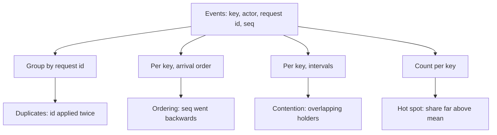

## In one minute
- A problem shape is the domain-free core of a problem: who acts, on what, in what order, and what can fail. Naming it is a skill you can practise like any other.
- Use signatures: each shape leaves a recognisable trace in symptoms and data. Two actions with the same request ID means duplicates; one key's sequence numbers going backwards means ordering; one key taking a third of all traffic means a hot spot.
- Ask the same five questions every time: what is scarce, what can repeat, what must happen in order, who must hear about it, and what can fail halfway?
- Most real problems are two or three shapes stacked. Name all of them, then solve the most dangerous first.
- A named shape is also a better prompt: agents and colleagues can act on "this is an ordering problem per trip ID" far better than on "statuses are sometimes wrong".

## How it works

### Shapes leave signatures
Problems are easier to name from evidence than from descriptions, because descriptions carry the domain's nouns and the reporter's guess. Evidence carries the shape.

- **Contention:** two actors acquire the same key in overlapping time windows; symptoms include oversells, double assignment, lock timeouts and deadlocks.
- **Duplicates:** the same request or message ID applied more than once; symptoms are double charges, double emails, counters that run high.
- **Ordering:** for one key, a lower sequence number or older timestamp is applied after a higher one; symptoms are states that go backwards ("completed" then "pending").
- **Fan-out:** one write leads to many deliveries; symptoms are latency that grows with audience size and queues that spike after popular events.
- **Hot spots:** one key or partition takes a large share of traffic; symptoms are one shard at 100 percent CPU while others idle.
- **Overload:** total demand above capacity; symptoms are rising queues, latency, then timeouts everywhere at once.
- **Partial failure:** timeouts with unknown outcomes; symptoms are "stuck pending" records and mismatches found by reconciliation.
- **Multi-step consistency:** some but not all of a set of changes happened; symptoms are orphans, like a payment without an order.
- **Finding things fast:** latency grows with data size; symptoms are full scans, slow queries and timeouts on search.
- **Trust but verify:** results that look right but are not; symptoms show up in audits, user reports and failed invariants rather than in errors.

### The five questions
When you meet a new feature or bug, ask these in order:

1. **What is scarce?** Seats, drivers, stock, money, a lock, a GPU. If anything is scarce, you have contention.
2. **What can repeat?** Any network call can be retried, any message redelivered, any button pressed twice (retried steps that are not idempotent leave wrong counts and duplicate messages, per the [Azure Architecture Center](https://learn.microsoft.com/en-us/azure/architecture/best-practices/transient-faults)). If repeating it is harmful, you have duplicates.
3. **What must happen in order?** If later events must not be overwritten by earlier ones, you have ordering.
4. **Who must hear about it, and how many?** One receiver is a call; thousands is fan-out.
5. **What can fail halfway?** If an operation spans two systems, you have partial failure and multi-step consistency.

Then two scale questions: is any key much hotter than the rest, and can total demand exceed capacity?

### Stacked shapes
Real problems are rarely one shape. A webhook from a payment provider is duplicates (providers retry), ordering (events can arrive out of order) and partial failure (your handler may crash after updating the database but before replying). Stripe documents the first two outright: the same event can arrive more than once, and delivery order is not guaranteed ([Stripe webhooks](https://docs.stripe.com/webhooks)). It also retries live-mode deliveries for up to three days, so a slow or failing handler sees duplicates long after the original. Naming only one leads to a fix that holds for a week. Write all of them down and rank them by damage: a duplicate refund costs money, an out-of-order status costs a support ticket.

### Shapes as prompts
In the AI era, a named shape is a compact, precise prompt. "Make the webhook handler idempotent on `event.id`, re-fetch the object from the provider's API instead of trusting arrival order, and write the outbox row in the same transaction" gets a correct implementation from a coding agent in one pass. Note the changed ordering rule: Stripe's `created` field has one-second resolution, so distinct events can share a timestamp, and its docs say not to use it for ordering or de-duplication; track event IDs and fetch current state instead ([Stripe webhooks](https://docs.stripe.com/webhooks)). A shape names the problem, but the mechanism still has to be checked against the provider's real guarantees. "Fix the webhook bugs" gets a plausible patch for whichever symptom the agent saw first.

## Down the stack

### Layer 1: The contract
The practice promises a written problem statement that names every shape present, with the evidence for each and a ranking by impact. A reviewer can check it: every shape must point to a symptom or a log query, and every shape must have a mechanism in the design.

### Layer 2: The mechanism
Shape detection is mostly grouping and comparing. Duplicates: group applied events by idempotency key and count; a service that implements keys properly stores the first response and rejects the same key with different parameters, which gives you a second signature to look for ([Stripe error handling](https://docs.stripe.com/error-low-level)). Ordering: for each key, walk events in arrival order and flag any sequence number lower than the highest already seen (a log such as Kafka's only orders within one partition, so "arrival order" means per partition; [Kafka docs](https://kafka.apache.org/42/design/design/)). Contention: for each key, sort acquire and release intervals by start time and flag overlaps between different actors. Hot spots: count events per key and compare each key's share to the mean, for example flag any key above 5 times the average or above a fixed share such as 20 percent. These are the same algorithms a database uses: unique indexes find duplicates, version columns find ordering violations, lock managers find overlaps.

### Layer 3: The machine
The evidence lives in logs, traces and tables, and the cost of finding it depends on how it is stored. Grouping 50 million log lines by request ID in a columnar store reads only the ID column, a small fraction of the data (the exact size depends on the ID type and compression), so it can finish in seconds. The same query on raw JSON logs in object storage reads every byte of every line. That is why structured logs with a stable request ID, entity key and sequence number on every line pay off: they turn shape detection from an archaeology project into a one-line query.

### Why it's built this way
1. Descriptions of problems carry domain words and guesses, which hide the shape.
2. Data carries the shape directly, because shapes are about keys, actors, order and counts.
3. So the reliable way to name a shape is to look at grouped, ordered evidence.
4. Grouping and ordering need stable identifiers on every event.
5. Hence the habit: log request IDs, entity keys and sequence numbers everywhere, and ask the five questions before designing.

## Diagram


## Worked example
A food delivery company sees "random" issues: some couriers get two orders at the same restaurant at once, some customers see "delivered" flip back to "on the way", and the Friday-night dispatcher runs slowly. Each team has its own theory.

An engineer exports one evening's dispatch events, 1.2 million rows with `courier_id`, `order_id`, `request_id`, `seq` and timestamps, and runs four grouped queries. 0.3 percent of assignment request IDs appear twice: duplicates from mobile retries. 0.8 percent of orders have a status with a lower `seq` applied after a higher one: ordering, from status updates sent through two different queues. Overlapping assignments on the same courier: contention, 140 cases, all within 50 ms, consistent with a check-then-write race. And one key, the "city:central" geo cell, takes 31 percent of dispatch lookups: a hot spot that explains the slow Friday nights.

Four shapes, four known fixes: idempotency keys on assignment, a per-order version check, compare-and-set on courier status, and splitting the hot cell into smaller cells. Ranking by impact puts contention first (two orders on one bike means late food), then ordering, then the hot spot, then duplicates.

## In the wild
- **Twilio, 2013: duplicates and partial failure in billing.** When a Redis master turned read-only with zero balances, auto-recharges were triggered but could not update the balance, so recharges were attempted multiple times for 1.4% of customers. The post-mortem names the fix as a fail-safe that blocks charges when balances are missing, plus validation against a double-entry ledger, which is the trust-but-verify shape ([Twilio post-mortem](https://www.twilio.com/en-us/blog/company/communications/billing-incident-post-mortem-breakdown-analysis-and-root-cause-html)).
- **Nasdaq, 2012: ordering under overload.** A cancel that arrived during a 20 ms opening-cross calculation (normally 1 to 2 ms) failed a validation check and forced a recalculation, and more cancels kept it looping. Stacked shapes again: overload made the window wide enough for the ordering bug ([SEC order](https://www.sec.gov/litigation/admin/2013/34-69655.pdf)).
- **Ticketmaster, 2022: overload plus contention.** Over 3.5 million fans pre-registered, about 1.5 million received codes, and bots and uninvited traffic drove 3.5 billion system requests, four times the previous peak. Ticketmaster estimated about 15% of interactions had issues ([Ticketmaster write-up, archived](https://web.archive.org/web/20230101022610/https://business.ticketmaster.com/business-solutions/taylor-swift-the-eras-tour-onsale-explained/)).

## Trade-offs
| Method | Strengths | Weaknesses | Choose when |
| --- | --- | --- | --- |
| Five questions on the design | Cheap, catches shapes before code exists | Depends on imagination | New features and design reviews |
| Evidence queries on logs | Objective, finds shapes you did not imagine | Needs structured logs with IDs | Bugs and incidents already happening |
| Invariant checks in production | Continuous detection | Must know the invariant in advance | Money, inventory, anything audited |
| Asking an agent to classify | Fast first pass over long reports | Confident and sometimes wrong | Triage, always followed by evidence |

## Pitfalls in production
- Logs without request IDs or sequence numbers make duplicates and ordering invisible. Fix: add them to the logging middleware once, for every service.
- Stopping at the first shape found. Fix: run the full list, since stacked shapes are the norm.
- Calling everything "a race condition". Fix: be precise; contention, ordering and duplicates have different fixes.
- Treating a hot spot as overload and scaling the whole fleet. Fix: check the per-key distribution before buying capacity.
- Letting the domain name the problem ("a dispatch bug"). Fix: write the shape name in the ticket title.

## Leadership lens
- Add a "shapes" line to your design doc template: each shape present, its mechanism and its test.
- Make request ID, entity key and sequence number mandatory log fields; it is the cheapest investment in debuggability you can make.
- In incident reviews, classify each root cause by shape and track the counts. The top shape tells you which shared component to build next.
- Teach the five questions to every new hire in their first week, with examples from your own domain.

## Check yourself
1. Customers report that their profile photo sometimes reverts to an older one a minute after uploading a new one. Which shape, and what evidence would confirm it?
   **Answer:** Ordering. Confirm by finding, for one user, an older upload's write applied after a newer one, for example via timestamps or version numbers in the storage logs.
2. Why do stacked shapes matter for how you rank work?
   **Answer:** Each shape has a different impact and fix; ranking by damage lets you fix the costly one first instead of whichever was noticed first.
3. What is the difference between a hot spot and overload, and why does it matter?
   **Answer:** Overload is total demand above total capacity; a hot spot is one key above its share while others idle. Adding machines fixes overload but not a hot spot, which needs repartitioning or caching.
4. Why is "make the handler idempotent on event.id" a better prompt for an agent than "fix the duplicate bug"?
   **Answer:** It names the shape and the mechanism, so the agent implements a known, testable solution instead of patching the one symptom it can see.

## Practice
**Task:** Build a shape detector. `detect(events, hot_share)` takes a list of events, each a dict (or object) with `key`, `actor`, `request_id`, `seq`, `start` and `end` (times in seconds, start inclusive, end exclusive), in arrival order. Return a sorted list of findings, each a string `"<shape>:<key or id>"`. Report `duplicate:<request_id>` when a request ID appears more than once; `ordering:<key>` when, for one key, an event arrives with a `seq` lower than one already seen; `contention:<key>` when two events on one key from different actors have overlapping `[start, end)` intervals; and `hotspot:<key>` when one key's share of all events is at least `hot_share`. Report each finding once.

```python starter
def detect(events, hot_share):
    # TODO: return sorted list of "shape:key" findings
    raise NotImplementedError
```

```python tests
def ev(key, actor, rid, seq, start, end):
    return {"key": key, "actor": actor, "request_id": rid, "seq": seq, "start": start, "end": end}

def test_clean_log_has_no_findings():
    events = [ev("a", "u1", "r1", 1, 0, 1), ev("b", "u2", "r2", 1, 0, 1), ev("c", "u3", "r3", 1, 0, 1)]
    assert detect(events, 0.9) == []

def test_duplicate_request():
    events = [ev("a", "u1", "r1", 1, 0, 1), ev("a", "u1", "r1", 2, 2, 3), ev("b", "u2", "r2", 1, 0, 1)]
    assert detect(events, 0.9) == ["duplicate:r1"]

def test_ordering_goes_backwards():
    events = [ev("trip", "s", "r1", 3, 0, 1), ev("trip", "s", "r2", 2, 1, 2), ev("x", "s", "r3", 1, 0, 1)]
    assert detect(events, 0.9) == ["ordering:trip"]

def test_contention_overlapping_actors():
    events = [ev("seat", "alice", "r1", 1, 0, 10), ev("seat", "bob", "r2", 2, 5, 12), ev("y", "c", "r3", 1, 0, 1)]
    assert detect(events, 0.9) == ["contention:seat"]

def test_same_actor_or_touching_intervals_are_not_contention():
    events = [ev("seat", "alice", "r1", 1, 0, 10), ev("seat", "alice", "r2", 2, 5, 12),
              ev("seat", "bob", "r3", 3, 12, 15), ev("z", "c", "r4", 1, 0, 1)]
    assert detect(events, 0.9) == []

def test_hotspot_and_stacked_shapes():
    events = [ev("cell", "a", "r1", 1, 0, 1), ev("cell", "b", "r1", 2, 0, 2), ev("cell", "c", "r3", 1, 3, 4), ev("other", "d", "r4", 1, 0, 1)]
    assert detect(events, 0.75) == ["contention:cell", "duplicate:r1", "hotspot:cell", "ordering:cell"]
```

```python solution
from collections import Counter, defaultdict

def detect(events, hot_share):
    found = set()
    ids = Counter(e["request_id"] for e in events)
    for rid, n in ids.items():
        if n > 1:
            found.add("duplicate:" + rid)
    highest = {}
    by_key = defaultdict(list)
    for e in events:
        k = e["key"]
        if k in highest and e["seq"] < highest[k]:
            found.add("ordering:" + k)
        highest[k] = max(highest.get(k, e["seq"]), e["seq"])
        by_key[k].append(e)
    for k, evs in by_key.items():
        for i in range(len(evs)):
            for j in range(i + 1, len(evs)):
                a, b = evs[i], evs[j]
                if a["actor"] != b["actor"] and a["start"] < b["end"] and b["start"] < a["end"]:
                    found.add("contention:" + k)
    total = len(events)
    for k, evs in by_key.items():
        if total and len(evs) / total >= hot_share:
            found.add("hotspot:" + k)
    return sorted(found)
```

```typescript starter
export interface Event {
  key: string; actor: string; request_id: string; seq: number; start: number; end: number;
}

export function detect(events: Event[], hotShare: number): string[] {
  throw new Error("TODO");
}
```

```typescript tests
const ev = (key: string, actor: string, rid: string, seq: number, start: number, end: number) =>
  ({ key, actor, request_id: rid, seq, start, end });

test("clean log has no findings", () => {
  assertEqual(detect([ev("a", "u1", "r1", 1, 0, 1), ev("b", "u2", "r2", 1, 0, 1), ev("c", "u3", "r3", 1, 0, 1)], 0.9), []);
});

test("duplicate request", () => {
  assertEqual(detect([ev("a", "u1", "r1", 1, 0, 1), ev("a", "u1", "r1", 2, 2, 3), ev("b", "u2", "r2", 1, 0, 1)], 0.9), ["duplicate:r1"]);
});

test("ordering goes backwards", () => {
  assertEqual(detect([ev("trip", "s", "r1", 3, 0, 1), ev("trip", "s", "r2", 2, 1, 2), ev("x", "s", "r3", 1, 0, 1)], 0.9), ["ordering:trip"]);
});

test("contention between overlapping actors", () => {
  assertEqual(detect([ev("seat", "alice", "r1", 1, 0, 10), ev("seat", "bob", "r2", 2, 5, 12), ev("y", "c", "r3", 1, 0, 1)], 0.9), ["contention:seat"]);
});

test("same actor or touching intervals are not contention", () => {
  const events = [ev("seat", "alice", "r1", 1, 0, 10), ev("seat", "alice", "r2", 2, 5, 12),
    ev("seat", "bob", "r3", 3, 12, 15), ev("z", "c", "r4", 1, 0, 1)];
  assertEqual(detect(events, 0.9), []);
});

test("hotspot and stacked shapes", () => {
  const events = [ev("cell", "a", "r1", 1, 0, 1), ev("cell", "b", "r1", 2, 0, 2), ev("cell", "c", "r3", 1, 3, 4), ev("other", "d", "r4", 1, 0, 1)];
  assertEqual(detect(events, 0.75), ["contention:cell", "duplicate:r1", "hotspot:cell", "ordering:cell"]);
});
```

```typescript solution
export interface Event {
  key: string; actor: string; request_id: string; seq: number; start: number; end: number;
}

export function detect(events: Event[], hotShare: number): string[] {
  const found = new Set<string>();
  const ids = new Map<string, number>();
  for (const e of events) ids.set(e.request_id, (ids.get(e.request_id) || 0) + 1);
  ids.forEach((n, rid) => { if (n > 1) found.add("duplicate:" + rid); });
  const highest = new Map<string, number>();
  const byKey = new Map<string, Event[]>();
  for (const e of events) {
    const h = highest.get(e.key);
    if (h !== undefined && e.seq < h) found.add("ordering:" + e.key);
    highest.set(e.key, h === undefined ? e.seq : Math.max(h, e.seq));
    if (!byKey.has(e.key)) byKey.set(e.key, []);
    byKey.get(e.key)!.push(e);
  }
  byKey.forEach((evs, k) => {
    for (let i = 0; i < evs.length; i++)
      for (let j = i + 1; j < evs.length; j++) {
        const a = evs[i], b = evs[j];
        if (a.actor !== b.actor && a.start < b.end && b.start < a.end) found.add("contention:" + k);
      }
    if (events.length && evs.length / events.length >= hotShare) found.add("hotspot:" + k);
  });
  return Array.from(found).sort();
}
```

```go starter
package practice

type Event struct {
	Key, Actor, RequestID string
	Seq                   int
	Start, End            float64
}

func Detect(events []Event, hotShare float64) []string {
	panic("TODO")
}
```

```go tests
package practice

import (
	"reflect"
	"testing"
)

func ev(key, actor, rid string, seq int, start, end float64) Event {
	return Event{Key: key, Actor: actor, RequestID: rid, Seq: seq, Start: start, End: end}
}

func check(t *testing.T, got, want []string) {
	t.Helper()
	if len(got) == 0 && len(want) == 0 {
		return
	}
	if !reflect.DeepEqual(got, want) {
		t.Fatalf("got %v, want %v", got, want)
	}
}

func TestCleanLog(t *testing.T) {
	check(t, Detect([]Event{ev("a", "u1", "r1", 1, 0, 1), ev("b", "u2", "r2", 1, 0, 1), ev("c", "u3", "r3", 1, 0, 1)}, 0.9), nil)
}

func TestDuplicate(t *testing.T) {
	check(t, Detect([]Event{ev("a", "u1", "r1", 1, 0, 1), ev("a", "u1", "r1", 2, 2, 3), ev("b", "u2", "r2", 1, 0, 1)}, 0.9), []string{"duplicate:r1"})
}

func TestOrdering(t *testing.T) {
	check(t, Detect([]Event{ev("trip", "s", "r1", 3, 0, 1), ev("trip", "s", "r2", 2, 1, 2), ev("x", "s", "r3", 1, 0, 1)}, 0.9), []string{"ordering:trip"})
}

func TestContention(t *testing.T) {
	check(t, Detect([]Event{ev("seat", "alice", "r1", 1, 0, 10), ev("seat", "bob", "r2", 2, 5, 12), ev("y", "c", "r3", 1, 0, 1)}, 0.9), []string{"contention:seat"})
}

func TestNotContention(t *testing.T) {
	events := []Event{ev("seat", "alice", "r1", 1, 0, 10), ev("seat", "alice", "r2", 2, 5, 12), ev("seat", "bob", "r3", 3, 12, 15), ev("z", "c", "r4", 1, 0, 1)}
	check(t, Detect(events, 0.9), nil)
}

func TestStacked(t *testing.T) {
	events := []Event{ev("cell", "a", "r1", 1, 0, 1), ev("cell", "b", "r1", 2, 0, 2), ev("cell", "c", "r3", 1, 3, 4), ev("other", "d", "r4", 1, 0, 1)}
	check(t, Detect(events, 0.75), []string{"contention:cell", "duplicate:r1", "hotspot:cell", "ordering:cell"})
}
```

```go solution
package practice

import "sort"

type Event struct {
	Key, Actor, RequestID string
	Seq                   int
	Start, End            float64
}

func Detect(events []Event, hotShare float64) []string {
	found := map[string]bool{}
	ids := map[string]int{}
	for _, e := range events {
		ids[e.RequestID]++
	}
	for rid, n := range ids {
		if n > 1 {
			found["duplicate:"+rid] = true
		}
	}
	highest := map[string]int{}
	byKey := map[string][]Event{}
	for _, e := range events {
		if h, ok := highest[e.Key]; ok && e.Seq < h {
			found["ordering:"+e.Key] = true
		}
		if h, ok := highest[e.Key]; !ok || e.Seq > h {
			highest[e.Key] = e.Seq
		}
		byKey[e.Key] = append(byKey[e.Key], e)
	}
	for k, evs := range byKey {
		for i := range evs {
			for j := i + 1; j < len(evs); j++ {
				a, b := evs[i], evs[j]
				if a.Actor != b.Actor && a.Start < b.End && b.Start < a.End {
					found["contention:"+k] = true
				}
			}
		}
		if len(events) > 0 && float64(len(evs))/float64(len(events)) >= hotShare {
			found["hotspot:"+k] = true
		}
	}
	out := make([]string, 0, len(found))
	for f := range found {
		out = append(out, f)
	}
	sort.Strings(out)
	return out
}
```

## Mock interview
**Prompt:** A marketplace's support team forwards three complaints: sellers sometimes get paid twice, buyers occasionally see an order go from "shipped" back to "paid", and the search page slows to 4 seconds every Monday at 9 a.m. You have read access to logs for 30 million events a day. How do you work out what is going on?

- Follow-up: The logs have no request IDs. What can you still detect, and what would you change?
- Follow-up: You find all three shapes. Which do you fix first, and why?
- Follow-up: How would you stop the same shapes from coming back in new features?

**A strong answer covers:**
- Naming candidate shapes from the symptoms (duplicates, ordering, a hot spot or overload) without trusting the description.
- Specific evidence queries: group payouts by idempotency or provider ID, per-order sequence or timestamp regressions, per-key and per-time traffic distribution.
- What is possible without request IDs (fingerprints from amount, account and time window) and the cost of not having them.
- Ranking by damage: double payouts lose money and are hard to claw back, so they come first.
- Known mechanisms for each, and tests that reproduce each shape.
- Prevention: mandatory log fields, a shapes section in design docs, and invariant checks in production.

## Sources and further study

**Primary**
- Pat Helland, "Life beyond Distributed Transactions: An Apostate's Opinion" ([ACM Queue](https://queue.acm.org/detail.cfm?id=3025012)): why per-entity scope is the natural unit for reasoning about contention and ordering.

**Systems docs**
- [Stripe webhooks](https://docs.stripe.com/webhooks): duplicates, no ordering guarantee, and the `created` caveat.
- [Stripe: advanced error handling](https://docs.stripe.com/error-low-level): idempotency keys and the 409 conflict.
- [Apache Kafka design documentation](https://kafka.apache.org/42/design/design/): ordering within a partition only.
- [Azure: transient fault handling](https://learn.microsoft.com/en-us/azure/architecture/best-practices/transient-faults): why a retried non-idempotent step corrupts state.

**Books**
- *Designing Data-Intensive Applications* (1st ed.), Ch 8, "The Trouble with Distributed Systems", and Ch 6, "Partitioning" (skew and hot spots), by Martin Kleppmann.
- *Release It!* (2nd ed.), Ch 4, "Stability Antipatterns", by Michael Nygard.

**Other curricula**
- [System Design Primer](https://github.com/donnemartin/system-design-primer): notes that popular items skew cache distribution and that power users can overload one shard, which is the hot-spot signature in this lesson.

## Free resources
- [Fallacies of distributed computing (Wikipedia)](https://en.wikipedia.org/wiki/Fallacies_of_distributed_computing): the root causes behind most shapes.
- [Patterns of Distributed Systems (Unmesh Joshi)](https://martinfowler.com/articles/patterns-of-distributed-systems/): named solutions such as versioned values and idempotent receivers.
- [Avoiding fallback in distributed systems (AWS Builders' Library)](https://aws.amazon.com/builders-library/avoiding-fallback-in-distributed-systems/): how partial failure shows up in practice.
- [Notes on Distributed Systems for Young Bloods](https://www.somethingsimilar.com/2013/01/14/notes-on-distributed-systems-for-young-bloods/): short rules of thumb that map onto these shapes.
