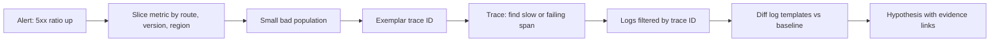

## In one minute
- Metrics tell you that something is wrong and how much. Traces tell you where the time or the error is in a request's path. Logs tell you what exactly happened inside one event.
- Debug as a funnel: start from a metric, slice it by dimensions until the bad population is small, pivot to a trace from that population, then to the logs for that trace.
- The most powerful question is a comparison: what is different about the failing requests compared to the succeeding ones, or about now compared to before?
- Correlation IDs are the glue. Without a trace ID in every log line and exemplars on metrics, you are matching timestamps by eye.
- Observability has a machine cost: every log line is a formatted string and a `write`, every metric is an atomic increment and a time series. Design for the questions you will ask under pressure.

## How it works

### What each signal is good for
A metric is a number aggregated over time and labels: requests per second by route, error ratio by version, p99 latency by region. It is cheap to store and fast to query, which makes it the right place to detect problems and measure impact. It cannot tell you about an individual request.

A trace records one request's path through services as a tree of spans, each with a start, a duration, a status and attributes. It answers "where did these 2 seconds go?" and "which downstream call failed?". Because tracing everything is expensive, most systems sample, so a trace for the exact failing request may not exist.

A log is an event with context, ideally structured (JSON or key-value) rather than free text. It answers "what did the code see and decide?". Logs are the most expensive signal per byte and the hardest to aggregate unless they have a consistent shape.

### The debugging funnel
Start with the metric that defines the symptom, such as the 5xx ratio. Slice it by each dimension you have: route, version, region, host, customer tier, upstream. A slice where the ratio is 20x the baseline is a lead; a slice where it is the same as everywhere is a ruled-out hypothesis. Once the population is small ("POST /cart, version 4.12, all regions"), jump to example traces for it. Many metrics systems support exemplars: a trace ID attached to a histogram bucket, so a click on the slow bucket opens a slow trace. In the trace, find the span where time or errors concentrate. Then open the logs filtered by that trace ID and span.

### Compare against a baseline
"There are 4,000 timeout errors in the logs" means nothing without a baseline; there might be 4,000 every hour. The useful queries are differences: error templates that are new since the deploy, attributes that are over-represented in failing requests compared to successful ones, and latency distributions before and after. Tools that do this automatically (sometimes called BubbleUp or correlation analysis) are doing simple statistics you can also do by hand: count each value in the failing set and in the baseline set, and rank by the ratio.

### Make logs queryable
Free-text logs become queryable by templating: replace the variable parts of a message (IDs, numbers, durations) with a placeholder so that "user 42 timed out after 3000ms" and "user 97 timed out after 2950ms" become one template. Counting templates over time turns millions of lines into dozens of rows, and a template that is new or suddenly 30x more frequent is usually where to look.

## Down the stack

### Layer 1: The contract
The human process promises that every step narrows the population and leaves a link: "5xx ratio 1.2% overall, 14% on POST /cart v4.12 (query link), 0.1% elsewhere". A claim without a query behind it is a hunch. Testable: someone else can follow the links and reach the same population. The signals themselves have contracts too. A Prometheus counter only goes up and resets on restart, so `rate()` handles resets. A sampled trace set is representative only if sampling is independent of the outcome; tail sampling that keeps all errors is deliberately biased, which is good for finding errors and bad for estimating rates.

### Layer 2: The mechanism
Prometheus stores each time series as a sequence of (int64 millisecond timestamp, float64 value) samples in two-hour blocks, with the newest block in memory behind a write-ahead log ([Prometheus docs](https://prometheus.io/docs/prometheus/latest/storage/)). The compression follows Facebook's Gorilla paper, which uses delta-of-delta timestamps and XOR-encoded values and reports 1.37 bytes per point on average ([Pelkonen et al., VLDB 2015](https://www.vldb.org/pvldb/vol8/p1816-teller.pdf)); the Prometheus docs quote roughly 1 to 2 bytes per sample. Each unique label combination is a separate series, so a `user_id` label on a busy service can create millions of series and take down the monitoring system. Latency is usually stored as histogram buckets, so a p99 is interpolated within a bucket: with buckets at 100 ms and 250 ms, a "p99 of 180 ms" means somewhere between 100 and 250. Newer native histograms bound the error by a configured resolution instead of by hand-picked bucket edges, and the docs call averaging per-instance quantiles statistically nonsensical while summing histogram buckets first is valid ([Prometheus docs](https://prometheus.io/docs/practices/histograms/)).

Traces depend on context propagation. The W3C `traceparent` header carries `00-<32 hex trace-id>-<16 hex parent span-id>-<2 hex flags>`, where the sampled bit is the least significant bit of the flags, so test it with a mask rather than comparing the whole byte. Trace Context has been a W3C Recommendation since November 2021 ([W3C](https://www.w3.org/TR/trace-context/)). Each service reads it, creates a child span with a new span ID, and writes a new header on outbound calls. Any hop that drops the header (a queue, a proxy, a thread pool that loses the context) breaks the tree into separate traces.

Log templating at scale uses algorithms such as Drain, which groups lines by token count and leading tokens in a fixed-depth parse tree, then merges lines whose tokens are mostly equal, turning differing positions into wildcards.

### Layer 3: The machine
A log line costs formatting (string building and allocation), then a `write(2)` to a file descriptor. In containers, stdout is usually a pipe to the runtime, which writes JSON-wrapped lines to a file on the node. If the reader falls behind and the pipe buffer (65,536 bytes by default on Linux) fills, the application's `write` blocks unless the descriptor is non-blocking ([pipe(7)](https://man7.org/linux/man-pages/man7/pipe.7.html)), and a logging burst becomes request latency. A metric increment is an atomic add on a shared counter: a few nanoseconds uncontended, but many cores incrementing the same cache line force it to bounce between cores, which is why high-performance libraries shard counters per CPU and sum on scrape.

Where the code has no instrumentation, the kernel does. eBPF programs on tracepoints like `syscalls:sys_enter_connect` or uprobes on a TLS library can count, time and sample events without redeploying, and `/proc/<pid>/` exposes file descriptors, memory maps and per-thread CPU time. These are the signals of last resort when application telemetry is missing.

### Why it's built this way
1. You cannot predict the questions an incident will ask, so you keep events with rich dimensions rather than only pre-aggregated numbers.
2. Raw events are expensive to keep, so you aggregate into metrics for detection and sample traces for depth.
3. Signals are only useful together, so IDs (trace ID, request ID, exemplars) link them.
4. Telemetry competes with the workload for CPU, memory and I/O, so formats, sampling and per-CPU counters exist to keep its cost bounded.

## Diagram


## Worked example
At 09:40 the 5xx ratio of a shop API rises from 0.1% to 1.2% of 50,000 requests per minute, about 600 errors per minute. Slicing by route: `POST /cart` is at 14%, every other route is normal. By version: both the old and the new version fail equally, which rules out the morning deploy of the API itself. By region: all regions. So the cause is probably shared and downstream.

A histogram exemplar from the slow bucket opens a trace: the `inventory.reserve` span takes 2,000 ms and ends in a timeout, while normally it takes 15 ms. The inventory service's own trace spans show 1,990 ms spent before the database query even starts.

Logs filtered to inventory for the last 30 minutes, templated and compared with the same window yesterday:

| Template | Yesterday | Now | Ratio |
| --- | --- | --- | --- |
| `pool exhausted waiting for connection after <*>` | 0 | 4,100 | new |
| `reserve sku <*> qty <*>` | 92,000 | 95,000 | 1.0 |
| `slow query <*>` | 40 | 160 | 4.0 |

The new template points to the connection pool. The inventory config history shows the pool size went from 50 to 5 at 09:38 in a change meant for a staging environment. Reverting it brings the error ratio back to 0.1% within two minutes. Total time from alert to mitigation: 14 minutes, and every step has a query link for the postmortem.

## In the wild
- **Meta, 2021: the tools were down with the network.** A backbone maintenance command disconnected every data centre, and DNS servers withdrew their routes. The post says the loss of DNS broke many of the internal tools engineers normally use to investigate and resolve outages, and with remote access gone people had to travel on site, where physical security slowed access further ([Meta Engineering](https://engineering.fb.com/2021/10/05/networking-traffic/outage-details/)).
- **Slack, 2021: dashboards behind the failing gateway.** On 4 January an overloaded AWS Transit Gateway dropped packets and message success fell to 99% from over 99.999%. Dashboards and alerting also failed because they sat in a different VPC from their databases, so engineers queried metrics backends directly, which was much less efficient. The fix was to run the monitoring instances in the same VPC as their databases ([Slack Engineering](https://slack.engineering/slacks-outage-on-january-4th-2021/)).

## Trade-offs
| Signal | Strengths | Weaknesses | Choose when |
| --- | --- | --- | --- |
| Metrics | Cheap, fast, good for alerts and impact | Low cardinality, no per-request detail | Detecting and slicing |
| Traces | Shows causality and timing across services | Sampled, needs propagation everywhere | Latency and cross-service failures |
| Structured logs | Full context per event | Expensive, noisy without templating | Explaining one decision or error |
| Wide events (one rich event per request) | Arbitrary slicing at high cardinality | Needs a columnar store, cost grows with traffic | Teams that debug unknown unknowns often |
| eBPF and `/proc` | No code change, kernel truth | Low-level, needs expertise and privileges | Missing instrumentation, system-level issues |

## Pitfalls in production
- Searching logs before scoping with metrics, and drowning in noise. Fix: narrow the population with metrics first, then filter logs to it.
- Counting errors without a baseline. Fix: always compare to a previous window or to successful requests.
- Broken trace propagation through queues or thread pools, so traces stop at the first async hop. Fix: propagate context in message headers and wrap executors to carry context.
- High-cardinality labels on metrics exploding series count. Fix: put IDs in traces and logs, keep metric labels bounded.
- Logging that blocks the request path when the log pipeline backs up. Fix: asynchronous, bounded log buffers that drop with a counter rather than block.
- p99 from averaged per-host percentiles. Fix: aggregate histograms, then compute the quantile.

## Leadership lens
- Set conventions: every log line carries trace ID, request ID, version and tenant; every service propagates `traceparent`.
- Review dashboards for the questions you will ask in an incident: error ratio by version and by dependency, not just totals.
- Budget telemetry cost explicitly and make sampling policy a deliberate decision (for example, keep 100% of errors, 1% of successes).
- Ask agents to produce the query, not just the conclusion, so humans can verify each narrowing step.

## Check yourself
1. Why is "4,000 timeout logs in the last hour" not evidence by itself?
   **Answer:** Without a baseline you do not know whether that is normal. The useful evidence is the change relative to a previous window or to successful requests.
2. A trace shows the API span but no child spans for a call you know happened through a queue. What is the likely cause?
   **Answer:** Context was not propagated across the queue, so the consumer started a new trace. The message needs to carry `traceparent` in its headers.
3. Why can a tail-sampled trace store mislead you about error rates?
   **Answer:** Tail sampling keeps errors preferentially, so the stored set is biased toward failures. Use metrics for rates and traces for examples.
4. Why can heavy logging increase request latency in a container?
   **Answer:** Writes go to a pipe read by the runtime. If the reader falls behind and the pipe fills, `write` blocks the request thread.

## Practice
**Task:** Build a log anomaly detector. `template(line)` splits on whitespace and replaces every token that contains a digit with `<*>`, joining with single spaces. `anomalies(baseline, current, min_ratio, min_count)` templates both lists and returns templates from `current` that occur at least `min_count` times and are either new (absent from the baseline) or whose rate (count divided by number of lines in that list) is at least `min_ratio` times the baseline rate. Order: new templates first, by count descending then template ascending; then the others by ratio descending then template ascending. An empty baseline makes every qualifying template new.

```python starter
def template(line):
    # TODO
    raise NotImplementedError

def anomalies(baseline, current, min_ratio, min_count):
    # TODO
    raise NotImplementedError
```

```python tests
def test_template_replaces_tokens_with_digits():
    assert template("user 42 timed out after 3000ms") == "user <*> timed out after <*>"
    assert template("  ok   done ") == "ok done"
    assert template("req-7f3a done") == "<*> done"

def test_new_template_detected():
    base = ["reserve sku 1 qty 2"] * 10
    cur = ["reserve sku 3 qty 1"] * 10 + ["pool exhausted after 2000ms"] * 3
    assert anomalies(base, cur, 3.0, 2) == ["pool exhausted after <*>"]

def test_ratio_uses_rates_not_counts():
    base = ["slow query 5"] * 2 + ["ok"] * 98
    cur = ["slow query 9"] * 4 + ["ok"] * 16
    assert anomalies(base, cur, 3.0, 2) == ["slow query <*>"]
    cur2 = ["slow query 9"] * 4 + ["ok"] * 196
    assert anomalies(base, cur2, 3.0, 2) == []

def test_min_count_filters_noise():
    assert anomalies(["a"], ["a", "b"], 2.0, 2) == []

def test_ordering():
    base = ["x 1"] * 10 + ["y 1"] * 10 + ["z"] * 80
    cur = ["x 1"] * 40 + ["y 1"] * 60 + ["new b"] * 5 + ["new a"] * 5 + ["new c"] * 7
    assert anomalies(base, cur, 2.0, 2) == ["new c", "new a", "new b", "y <*>", "x <*>"]

def test_empty_inputs():
    assert anomalies([], ["e 1", "e 2"], 2.0, 2) == ["e <*>"]
    assert anomalies(["a"], [], 2.0, 1) == []
```

```python solution
from collections import Counter

def template(line):
    out = []
    for tok in line.split():
        out.append("<*>" if any(c.isdigit() for c in tok) else tok)
    return " ".join(out)

def anomalies(baseline, current, min_ratio, min_count):
    if not current:
        return []
    b = Counter(template(l) for l in baseline)
    c = Counter(template(l) for l in current)
    new, grown = [], []
    for t, n in c.items():
        if n < min_count:
            continue
        if b[t] == 0:
            new.append((-n, t))
        else:
            ratio = (n / len(current)) / (b[t] / len(baseline))
            if ratio >= min_ratio:
                grown.append((-ratio, t))
    return [t for _, t in sorted(new)] + [t for _, t in sorted(grown)]
```

```typescript starter
export function template(line: string): string {
  throw new Error("TODO");
}

export function anomalies(baseline: string[], current: string[], minRatio: number, minCount: number): string[] {
  throw new Error("TODO");
}
```

```typescript tests
function rep(s: string, n: number): string[] { return Array.from({ length: n }, () => s); }

test("template replaces tokens with digits", () => {
  assertEqual(template("user 42 timed out after 3000ms"), "user <*> timed out after <*>");
  assertEqual(template("  ok   done "), "ok done");
  assertEqual(template("req-7f3a done"), "<*> done");
});
test("new template detected", () => {
  const base = rep("reserve sku 1 qty 2", 10);
  const cur = rep("reserve sku 3 qty 1", 10).concat(rep("pool exhausted after 2000ms", 3));
  assertEqual(anomalies(base, cur, 3, 2), ["pool exhausted after <*>"]);
});
test("ratio uses rates not counts", () => {
  const base = rep("slow query 5", 2).concat(rep("ok", 98));
  assertEqual(anomalies(base, rep("slow query 9", 4).concat(rep("ok", 16)), 3, 2), ["slow query <*>"]);
  assertEqual(anomalies(base, rep("slow query 9", 4).concat(rep("ok", 196)), 3, 2), []);
});
test("min count filters noise", () => {
  assertEqual(anomalies(["a"], ["a", "b"], 2, 2), []);
});
test("ordering", () => {
  const base = rep("x 1", 10).concat(rep("y 1", 10), rep("z", 80));
  const cur = rep("x 1", 40).concat(rep("y 1", 60), rep("new b", 5), rep("new a", 5), rep("new c", 7));
  assertEqual(anomalies(base, cur, 2, 2), ["new c", "new a", "new b", "y <*>", "x <*>"]);
});
test("empty inputs", () => {
  assertEqual(anomalies([], ["e 1", "e 2"], 2, 2), ["e <*>"]);
  assertEqual(anomalies(["a"], [], 2, 1), []);
});
```

```typescript solution
export function template(line: string): string {
  return line.split(/\s+/).filter((t) => t.length > 0)
    .map((t) => (/[0-9]/.test(t) ? "<*>" : t)).join(" ");
}

function count(lines: string[]): Map<string, number> {
  const m = new Map<string, number>();
  for (const l of lines) { const t = template(l); m.set(t, (m.get(t) || 0) + 1); }
  return m;
}

export function anomalies(baseline: string[], current: string[], minRatio: number, minCount: number): string[] {
  if (current.length === 0) return [];
  const b = count(baseline), c = count(current);
  const fresh: [number, string][] = [], grown: [number, string][] = [];
  for (const [t, n] of c) {
    if (n < minCount) continue;
    const bn = b.get(t) || 0;
    if (bn === 0) fresh.push([n, t]);
    else {
      const ratio = (n / current.length) / (bn / baseline.length);
      if (ratio >= minRatio) grown.push([ratio, t]);
    }
  }
  const cmp = (x: [number, string], y: [number, string]) => y[0] - x[0] || (x[1] < y[1] ? -1 : x[1] > y[1] ? 1 : 0);
  return fresh.sort(cmp).map((x) => x[1]).concat(grown.sort(cmp).map((x) => x[1]));
}
```

```go starter
package practice

func Template(line string) string {
	panic("TODO")
}

func Anomalies(baseline, current []string, minRatio float64, minCount int) []string {
	panic("TODO")
}
```

```go tests
package practice

import (
	"reflect"
	"testing"
)

func rep(s string, n int) []string {
	out := make([]string, n)
	for i := range out {
		out[i] = s
	}
	return out
}

func cat(parts ...[]string) []string {
	out := []string{}
	for _, p := range parts {
		out = append(out, p...)
	}
	return out
}

func TestTemplate(t *testing.T) {
	cases := map[string]string{
		"user 42 timed out after 3000ms": "user <*> timed out after <*>",
		"  ok   done ":                   "ok done",
		"req-7f3a done":                  "<*> done",
	}
	for in, want := range cases {
		if got := Template(in); got != want {
			t.Fatalf("Template(%q) = %q, want %q", in, got, want)
		}
	}
}

func TestNewTemplateDetected(t *testing.T) {
	got := Anomalies(rep("reserve sku 1 qty 2", 10), cat(rep("reserve sku 3 qty 1", 10), rep("pool exhausted after 2000ms", 3)), 3, 2)
	if !reflect.DeepEqual(got, []string{"pool exhausted after <*>"}) {
		t.Fatalf("got %v", got)
	}
}

func TestRatioUsesRates(t *testing.T) {
	base := cat(rep("slow query 5", 2), rep("ok", 98))
	if got := Anomalies(base, cat(rep("slow query 9", 4), rep("ok", 16)), 3, 2); !reflect.DeepEqual(got, []string{"slow query <*>"}) {
		t.Fatalf("got %v", got)
	}
	if got := Anomalies(base, cat(rep("slow query 9", 4), rep("ok", 196)), 3, 2); len(got) != 0 {
		t.Fatalf("got %v", got)
	}
}

func TestMinCountFiltersNoise(t *testing.T) {
	if got := Anomalies([]string{"a"}, []string{"a", "b"}, 2, 2); len(got) != 0 {
		t.Fatalf("got %v", got)
	}
}

func TestOrdering(t *testing.T) {
	base := cat(rep("x 1", 10), rep("y 1", 10), rep("z", 80))
	cur := cat(rep("x 1", 40), rep("y 1", 60), rep("new b", 5), rep("new a", 5), rep("new c", 7))
	want := []string{"new c", "new a", "new b", "y <*>", "x <*>"}
	if got := Anomalies(base, cur, 2, 2); !reflect.DeepEqual(got, want) {
		t.Fatalf("got %v", got)
	}
}

func TestEmptyInputs(t *testing.T) {
	if got := Anomalies(nil, []string{"e 1", "e 2"}, 2, 2); !reflect.DeepEqual(got, []string{"e <*>"}) {
		t.Fatalf("got %v", got)
	}
	if got := Anomalies([]string{"a"}, nil, 2, 1); len(got) != 0 {
		t.Fatalf("got %v", got)
	}
}
```

```go solution
package practice

import (
	"sort"
	"strings"
)

func Template(line string) string {
	toks := strings.Fields(line)
	for i, t := range toks {
		if strings.ContainsAny(t, "0123456789") {
			toks[i] = "<*>"
		}
	}
	return strings.Join(toks, " ")
}

type scored struct {
	score float64
	t     string
}

func sortScored(xs []scored) []string {
	sort.Slice(xs, func(i, j int) bool {
		if xs[i].score != xs[j].score {
			return xs[i].score > xs[j].score
		}
		return xs[i].t < xs[j].t
	})
	out := []string{}
	for _, x := range xs {
		out = append(out, x.t)
	}
	return out
}

func Anomalies(baseline, current []string, minRatio float64, minCount int) []string {
	if len(current) == 0 {
		return []string{}
	}
	b, c := map[string]int{}, map[string]int{}
	for _, l := range baseline {
		b[Template(l)]++
	}
	for _, l := range current {
		c[Template(l)]++
	}
	var fresh, grown []scored
	for t, n := range c {
		if n < minCount {
			continue
		}
		if b[t] == 0 {
			fresh = append(fresh, scored{float64(n), t})
			continue
		}
		ratio := (float64(n) / float64(len(current))) / (float64(b[t]) / float64(len(baseline)))
		if ratio >= minRatio {
			grown = append(grown, scored{ratio, t})
		}
	}
	return append(sortScored(fresh), sortScored(grown)...)
}
```

## Mock interview
**Prompt:** It's 2 a.m. The checkout SLO alert fires: p99 latency is 10x normal and the error ratio is climbing from 0.2% to 3%. You have Prometheus metrics, sampled traces at 1% plus all errors, and structured logs in a search tool. Walk me through the first 20 minutes.

- Follow-up: The traces for failing requests stop at the API gateway. What does that tell you and what do you do?
- Follow-up: Logs show 200,000 errors per minute across 40 different messages. How do you find the one that matters?
- Follow-up: What would you change in the telemetry after this incident?

**A strong answer covers:**
- Starting from the SLO metric, establishing impact, and slicing by route, version, region and dependency to shrink the population.
- Using exemplars or error-sampled traces to find the span where time and errors concentrate.
- Templating logs and comparing against a baseline window rather than reading raw lines.
- Recognising broken context propagation as both a telemetry bug and a clue.
- Mitigation as soon as the population points at a change, and evidence links for each step.

## Sources and further study
**Primary**
- [W3C Trace Context](https://www.w3.org/TR/trace-context/): the `traceparent` header format and the sampled flag.
- [Pelkonen et al., Gorilla: A Fast, Scalable, In-Memory Time Series Database (VLDB 2015)](https://www.vldb.org/pvldb/vol8/p1816-teller.pdf): the compression behind modern metric stores.

**Systems docs**
- [Prometheus: storage](https://prometheus.io/docs/prometheus/latest/storage/): two-hour blocks, the WAL and the bytes-per-sample budget.
- [Prometheus: histograms and summaries](https://prometheus.io/docs/practices/histograms/): how quantiles are estimated and why you cannot average them.
- [Linux pipe(7)](https://man7.org/linux/man-pages/man7/pipe.7.html): the default 64 KiB capacity behind the blocking log write.

**Books**
- *Observability Engineering*, Majors, Fong-Jones and Miranda, chapter 5 "Structured Events Are the Building Blocks of Observability" and chapter 8 "Analyzing Events to Achieve Observability": the wide-event argument and debugging from first principles.
- *Site Reliability Engineering*, Beyer et al., chapter 6 "Monitoring Distributed Systems": symptoms versus causes and white-box versus black-box monitoring.

**Other curricula**
- [Azure Architecture Center: monitoring and diagnostics guidance](https://learn.microsoft.com/en-us/azure/architecture/best-practices/monitoring): guidance on tracking usage, tracing resource utilisation and monitoring health and performance of distributed applications.
- [donnemartin/system-design-primer](https://github.com/donnemartin/system-design-primer): lists Dapper among its tracing references but does not teach a debugging workflow.

## Watch
- [Is It Time To Version Observability? (Charity Majors, GOTO 2024)](https://www.youtube.com/watch?v=ag2ykPO805M): wide events versus the three pillars and why it matters for debugging.
- [Turnkey Distributed Tracing (Ben Sigelman, PyBay 2016)](https://www.youtube.com/watch?v=-iOKrfTix68): how traces are built and propagated, from a Dapper co-author.

## Free resources
- [Monitoring Distributed Systems (Google SRE book)](https://sre.google/sre-book/monitoring-distributed-systems/): the four golden signals and symptom-based alerting.
- [W3C Trace Context](https://www.w3.org/TR/trace-context/): the `traceparent` and `tracestate` header formats.
- [OpenTelemetry signals](https://opentelemetry.io/docs/concepts/signals/): traces, metrics, logs and how they correlate.
- [Instrumenting distributed systems for operational visibility (AWS Builders' Library)](https://aws.amazon.com/builders-library/instrumenting-distributed-systems-for-operational-visibility/): what to log per request and why.
- [Dapper (Google Research)](https://research.google/pubs/dapper-a-large-scale-distributed-systems-tracing-infrastructure/): the paper that defined modern distributed tracing.
