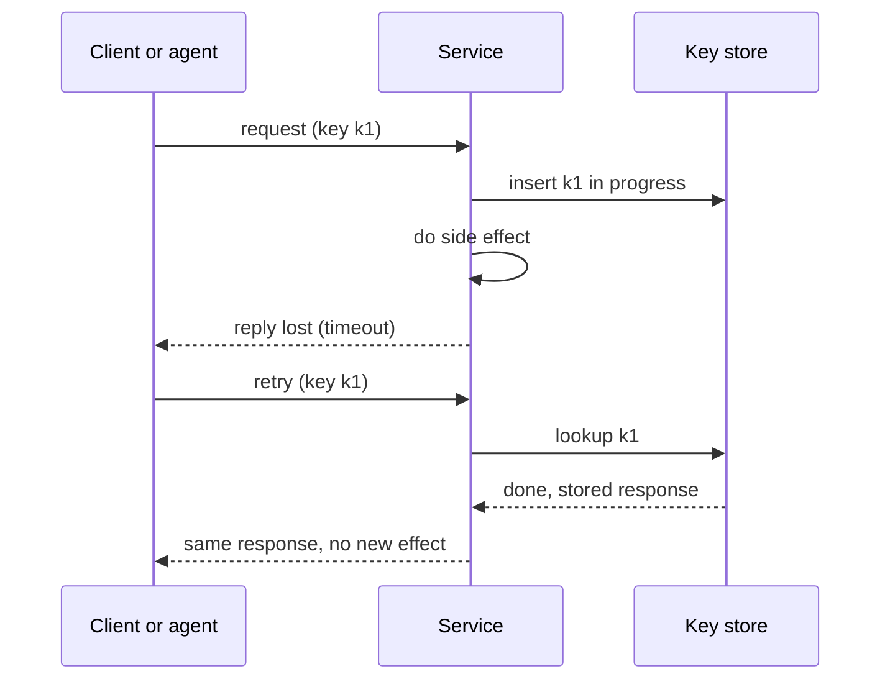

## In one minute
- The duplicate request appears wherever a sender retries after not hearing back: a card charged twice, two cars for one rider, a chat message posted twice, an order placed twice, an agent sending the same email twice.
- The cause is always the same: the sender cannot tell "the request was lost" from "the reply was lost", so the safe-looking move (retry) repeats a side effect.
- The fix is always the same too: the sender attaches an idempotency key, and the receiver records the key with the result, so a repeat returns the stored result instead of acting again.
- The details carry the risk: a repeat that arrives while the first is still running, a reused key with different parameters, and how long keys are remembered.
- Domains change only the parameters: who generates the key, how long to keep it, and what a duplicate costs.

## How it works

### The same failure, five costumes
**Payments.** A checkout service calls the card processor, which charges the card and replies, but the reply times out at the load balancer. The service retries. Without protection the customer pays twice.

**Ride-hailing.** A rider taps "Request" on a flaky mobile connection. The app shows a spinner, times out and resends. Two trip requests reach dispatch, and two drivers are sent.

**Chat.** A phone sends a message, loses connectivity before the server's acknowledgement arrives, reconnects and resends from its outbox. The group sees the message twice.

**E-commerce.** A customer double-clicks "Place order", or refreshes the confirmation page, which re-submits the form. Two orders, two shipments.

**AI agents.** An agent calls a `send_email` tool, the tool call takes 40 seconds and the agent runtime's 30-second timeout fires. The agent, reasonably, tries again. The customer gets two emails, or worse, two refunds if the tool issues refunds.

Strip the nouns and every story is: a side-effecting request, an ambiguous failure, and a retry. The retry is also the receiver's problem when it is the sender, as with webhooks: Stripe says the same event may be delivered more than once and advises logging processed event IDs ([Stripe webhooks](https://docs.stripe.com/webhooks)).

### The mechanism
The sender creates a unique key for the *intent*, not for the attempt: one key per checkout, per trip request, per message, per order, per tool call. It sends the key with every retry. The receiver, before acting, looks the key up:

- **Unknown key:** record it as in progress, do the work, store the result against the key, return it.
- **Known key with a stored result:** return the stored result without acting. AWS asks for a response with the same meaning as the first success, not necessarily identical bytes: a retried `RunInstances` reports the instance's current state, and returning "already exists" is rejected because the caller cannot tell whether its own earlier call created it ([AWS Builders' Library](https://aws.amazon.com/builders-library/making-retries-safe-with-idempotent-APIs/)).
- **Known key still in progress:** a concurrent duplicate. Return "conflict, try again shortly" (Stripe returns HTTP 409, and tells clients to wait and retry with the same key and parameters; [Stripe error handling](https://docs.stripe.com/error-low-level)) rather than doing the work twice.
- **Known key with different parameters:** a client bug. Reject it, because silently returning the old result for a different request hides errors. Both Stripe and AWS do this.

### What the domain decides
**Who makes the key.** Payment APIs ask the client to send an `Idempotency-Key` header (Stripe accepts keys up to 255 characters and suggests random V4 UUIDs, or a key derived from something like a cart ID; for v1 it saves the first response after execution begins, including 500 errors). Chat apps generate a client message ID when the message is composed. E-commerce forms embed a token when the checkout page renders. Agent runtimes should derive the key from the task ID and the tool call's position in the plan, so a replayed plan reuses it.

**How long to remember.** Long enough to cover every retry: Stripe's v1 API keeps keys for at least 24 hours and may prune them after that, then treats a reused key as a new request, so its guidance is to stop retrying after 24 hours and reconcile instead; its v2 API uses a 30-day window ([Stripe API docs](https://docs.stripe.com/api/idempotent_requests), [Stripe error handling](https://docs.stripe.com/error-low-level)); a chat server needs keys only for the outbox's retry window, perhaps minutes; a payments ledger may keep business keys forever.

**What a duplicate costs.** A repeated chat message is embarrassing; a repeated refund is a direct loss. Cost decides whether the key store can be a cache that might forget (chat) or must be durable and transactional with the effect (money).

## Down the stack

### Layer 1: The contract
The receiver promises that for a given key and identical parameters, the side effect happens at most once and every attempt gets the same response. It promises that a concurrent duplicate never runs in parallel with the original, and that a key reused with different parameters is rejected. It states how long keys are retained, after which a repeat is treated as new.

### Layer 2: The mechanism
A durable implementation keeps a table such as `idempotency_keys(key PRIMARY KEY, fingerprint, state, response, created_at)`. The first attempt runs `INSERT ... ON CONFLICT (key) DO NOTHING` in the same transaction as the business write; if the insert affected zero rows, it reads the existing row and acts on its state. The fingerprint is a hash of the normalised request parameters, for example SHA-256 over sorted JSON, so a reused key with a different amount is detected. When the effect is in another system, such as a card network, the key is passed downstream too, and the in-progress state is recovered by asking the downstream system what happened (a status query) rather than guessing.

### Layer 3: The machine
The guarantee rests on the database's unique index. Two concurrent inserts of the same key both descend the B-tree to the same leaf page; the first takes the page lock and inserts, the second finds the uncommitted entry and blocks until the first transaction commits or aborts, then sees a conflict or proceeds. On the wire, the retry is just another HTTP request: TCP's own sequence numbers already deduplicate retransmitted segments within one connection, but a retry after a timeout opens a new connection, so the application must do the same job one level up. The cost is one indexed lookup, typically under a millisecond, which is why there is rarely a reason to skip it. Kafka applies the same idea inside the broker: an idempotent producer carries a producer ID and sequence numbers so a resent batch is not appended twice ([Kafka design docs](https://kafka.apache.org/42/design/design/)).

### Why it's built this way
1. Networks can lose replies, so a sender cannot distinguish "not done" from "done but unheard".
2. Not retrying loses work, so senders retry.
3. Retrying repeats side effects unless the receiver can recognise the repeat.
4. Recognition needs an identity for the intent that survives across attempts: the key.
5. The key must be recorded atomically with the effect, so the store lives next to the effect, in the same transaction where possible.

## Diagram


## Worked example
A company runs a support agent that can issue refunds through a `refund(order_id, amount)` tool. It handles 30,000 conversations a day, and the tool backend's p99 latency is 25 seconds because it calls a slow payment provider. The agent runtime's tool timeout is 30 seconds and it retries once. Logs show about 1.5 percent of refund calls exceed 30 seconds. Without idempotency, about 450 of 30,000 daily refunds are attempted twice; at an average of 40 dollars, that is up to 18,000 dollars a day issued in error.

The fix has three parts. The runtime derives the key as `task_id:step_number`, so a retry of the same step reuses it. The refund service stores the key and a fingerprint of `(order_id, amount)` in the same transaction as the refund record, and passes the key to the payment provider as its idempotency key. A retry that arrives while the first is still in progress gets "in progress, retry later" and the agent waits. The double-refund rate drops to zero, and the remaining risk, a key reused with different parameters, raises an alert instead of a silent refund.

Exactly the same three parts would fix a checkout page, a ride request or a chat outbox, which is the lesson.

## In the wild
- **Twilio, 2013: repeated card recharges.** A read-only Redis master left balances at zero, so auto-recharges could not update the balance and were attempted multiple times for 1.4% of customers. Billing was shut down, charges were refunded with a 10% credit, and the fixes blocked charges when balances are missing or unwritable ([Twilio post-mortem](https://www.twilio.com/en-us/blog/company/communications/billing-incident-post-mortem-breakdown-analysis-and-root-cause-html)).
- **Stripe, 2017: designing for safe retries.** Stripe describes a charge that must happen exactly once even when a failure leaves unclear whether it arrived, half-completed or succeeded with the reply lost. The answer is a client-sent idempotency key, a stored result, and client retries with exponential backoff plus jitter ([Stripe engineering](https://stripe.com/blog/idempotency)).
- **Knight Capital, 2012: orders repeated with no stop.** The code on one server kept sending child orders because it no longer tracked what had filled, giving over 4 million executions in about 45 minutes and a $460 million loss. It is the duplicate shape without any key, receiver check or kill switch ([SEC order](https://www.sec.gov/litigation/admin/2013/34-70694.pdf)).

## Trade-offs
| Key store | Strengths | Weaknesses | Choose when |
| --- | --- | --- | --- |
| Same database transaction as the effect | Exact; no gap between record and effect | Ties key storage to the business database | Money, inventory, anything costly |
| Separate cache (e.g. Redis with TTL) | Fast, simple, cheap | Effect and record can diverge; cache can evict | Low-cost duplicates such as chat messages |
| Natural business key (order number) | No extra infrastructure | Needs a natural unique identifier | Entities that already have one |
| Downstream provider's idempotency | Covers the external effect | You still need your own record | Any call to a payment or messaging provider |

## Pitfalls in production
- Generating a new key per attempt, which defeats the purpose. Fix: key per intent, created before the first attempt and stored with the client's outbox.
- Recording the key after the effect, outside the transaction, so a crash in between causes a duplicate. Fix: record and act atomically, or use the downstream provider's key.
- Running a concurrent duplicate in parallel with the original. Fix: an in-progress state and a conflict response.
- Returning a cached success for a key reused with different parameters. Fix: store and compare a fingerprint.
- Keys expiring before the last retry. Fix: retention longer than the maximum retry window plus clock skew.
- Agents generating fresh keys each turn. Fix: derive keys deterministically from task and step.

## Leadership lens
- Make idempotency keys mandatory on every side-effecting API and tool, including internal ones and those called by agents.
- Provide one shared library or middleware, so each team configures retention and storage rather than re-implementing the logic.
- Monitor duplicate rates and fingerprint mismatches; a rise usually means a client or agent bug.
- In design reviews, ask: "What happens if this exact request arrives twice, one second apart? Thirty seconds apart, while the first is still running?"

## Check yourself
1. Why must the key identify the intent rather than the attempt?
   **Answer:** The receiver uses it to recognise repeats; if each attempt has a new key, every retry looks like a new request and the side effect repeats.
2. What should happen when a duplicate arrives while the original is still being processed?
   **Answer:** It should not run in parallel; the receiver returns an in-progress or conflict response and the client retries later to get the final stored result.
3. Why store a fingerprint of the parameters with the key?
   **Answer:** To detect a client reusing a key for a different request, which should be rejected rather than answered with an unrelated stored result.
4. When is a cache with a TTL an acceptable key store?
   **Answer:** When a rare duplicate is cheap, as with a chat message, because a cache can evict keys or diverge from the effect.

## Practice
**Task:** Build the idempotency store that every one of the five domains can share. `IdempotencyStore(ttl)` has `begin(key, fingerprint, now)`, which returns `"new"` if the key is unknown or expired (and marks it in progress), `"in_progress"` if the key is still being processed, `"mismatch"` if the key exists with a different fingerprint, or `"replay"` if it finished with the same fingerprint. `finish(key, response, now)` stores the response and marks the key done; keys expire `ttl` seconds after they finish. `response(key)` returns the stored response for a finished key, or `None`. In-progress keys never expire in this exercise.

```python starter
class IdempotencyStore:
    def __init__(self, ttl):
        # TODO
        pass

    def begin(self, key, fingerprint, now):
        # TODO: "new", "in_progress", "mismatch" or "replay"
        raise NotImplementedError

    def finish(self, key, response, now):
        # TODO
        raise NotImplementedError

    def response(self, key):
        # TODO
        raise NotImplementedError
```

```python tests
def test_first_request_is_new():
    s = IdempotencyStore(ttl=86400)
    assert s.begin("checkout-1", "amt=50", 0) == "new"

def test_concurrent_duplicate_is_in_progress():
    s = IdempotencyStore(ttl=86400)
    s.begin("trip-9", "rider=7", 0)
    assert s.begin("trip-9", "rider=7", 1) == "in_progress"

def test_retry_after_finish_replays_stored_response():
    s = IdempotencyStore(ttl=86400)
    s.begin("msg-3", "text=hi", 0)
    s.finish("msg-3", "posted:991", 2)
    assert s.begin("msg-3", "text=hi", 5) == "replay"
    assert s.response("msg-3") == "posted:991"

def test_key_reused_with_different_params_is_mismatch():
    s = IdempotencyStore(ttl=86400)
    s.begin("refund-1", "order=5,amt=40", 0)
    s.finish("refund-1", "ok", 1)
    assert s.begin("refund-1", "order=5,amt=400", 2) == "mismatch"

def test_key_expires_after_ttl():
    s = IdempotencyStore(ttl=60)
    s.begin("order-1", "cart=2", 0)
    s.finish("order-1", "order:77", 10)
    assert s.begin("order-1", "cart=2", 69) == "replay"
    assert s.begin("order-1", "cart=2", 70) == "new"
    assert s.response("order-1") is None

def test_unknown_key_has_no_response():
    s = IdempotencyStore(ttl=60)
    assert s.response("nope") is None
```

```python solution
class IdempotencyStore:
    def __init__(self, ttl):
        self.ttl = ttl
        self.entries = {}  # key -> [fingerprint, done, response, expires]

    def begin(self, key, fingerprint, now):
        e = self.entries.get(key)
        if e is not None and e[1] and now >= e[3]:
            del self.entries[key]
            e = None
        if e is None:
            self.entries[key] = [fingerprint, False, None, None]
            return "new"
        if e[0] != fingerprint:
            return "mismatch"
        return "replay" if e[1] else "in_progress"

    def finish(self, key, response, now):
        e = self.entries[key]
        e[1], e[2], e[3] = True, response, now + self.ttl

    def response(self, key):
        e = self.entries.get(key)
        return e[2] if e is not None and e[1] else None
```

```typescript starter
export class IdempotencyStore {
  constructor(ttl: number) {}

  begin(key: string, fingerprint: string, now: number): string {
    throw new Error("TODO");
  }

  finish(key: string, response: string, now: number): void {
    throw new Error("TODO");
  }

  response(key: string): string | null {
    throw new Error("TODO");
  }
}
```

```typescript tests
test("first request is new", () => {
  const s = new IdempotencyStore(86400);
  assertEqual(s.begin("checkout-1", "amt=50", 0), "new");
});

test("concurrent duplicate is in progress", () => {
  const s = new IdempotencyStore(86400);
  s.begin("trip-9", "rider=7", 0);
  assertEqual(s.begin("trip-9", "rider=7", 1), "in_progress");
});

test("retry after finish replays stored response", () => {
  const s = new IdempotencyStore(86400);
  s.begin("msg-3", "text=hi", 0);
  s.finish("msg-3", "posted:991", 2);
  assertEqual(s.begin("msg-3", "text=hi", 5), "replay");
  assertEqual(s.response("msg-3"), "posted:991");
});

test("key reused with different params is mismatch", () => {
  const s = new IdempotencyStore(86400);
  s.begin("refund-1", "order=5,amt=40", 0);
  s.finish("refund-1", "ok", 1);
  assertEqual(s.begin("refund-1", "order=5,amt=400", 2), "mismatch");
});

test("key expires after ttl", () => {
  const s = new IdempotencyStore(60);
  s.begin("order-1", "cart=2", 0);
  s.finish("order-1", "order:77", 10);
  assertEqual(s.begin("order-1", "cart=2", 69), "replay");
  assertEqual(s.begin("order-1", "cart=2", 70), "new");
  assertEqual(s.response("order-1"), null);
});

test("unknown key has no response", () => {
  const s = new IdempotencyStore(60);
  assertEqual(s.response("nope"), null);
});
```

```typescript solution
interface Entry { fingerprint: string; done: boolean; response: string | null; expires: number; }

export class IdempotencyStore {
  private entries = new Map<string, Entry>();
  constructor(private ttl: number) {}

  begin(key: string, fingerprint: string, now: number): string {
    let e = this.entries.get(key);
    if (e && e.done && now >= e.expires) {
      this.entries.delete(key);
      e = undefined;
    }
    if (!e) {
      this.entries.set(key, { fingerprint, done: false, response: null, expires: Infinity });
      return "new";
    }
    if (e.fingerprint !== fingerprint) return "mismatch";
    return e.done ? "replay" : "in_progress";
  }

  finish(key: string, response: string, now: number): void {
    const e = this.entries.get(key)!;
    e.done = true;
    e.response = response;
    e.expires = now + this.ttl;
  }

  response(key: string): string | null {
    const e = this.entries.get(key);
    return e && e.done ? e.response : null;
  }
}
```

```go starter
package practice

type IdempotencyStore struct{}

func NewIdempotencyStore(ttl int64) *IdempotencyStore {
	return &IdempotencyStore{}
}

func (s *IdempotencyStore) Begin(key, fingerprint string, now int64) string {
	panic("TODO")
}

func (s *IdempotencyStore) Finish(key, response string, now int64) {
	panic("TODO")
}

// Response returns the stored response and true, or "" and false.
func (s *IdempotencyStore) Response(key string) (string, bool) {
	panic("TODO")
}
```

```go tests
package practice

import "testing"

func TestFirstIsNew(t *testing.T) {
	s := NewIdempotencyStore(86400)
	if got := s.Begin("checkout-1", "amt=50", 0); got != "new" {
		t.Fatalf("got %s", got)
	}
}

func TestConcurrentDuplicate(t *testing.T) {
	s := NewIdempotencyStore(86400)
	s.Begin("trip-9", "rider=7", 0)
	if got := s.Begin("trip-9", "rider=7", 1); got != "in_progress" {
		t.Fatalf("got %s", got)
	}
}

func TestReplay(t *testing.T) {
	s := NewIdempotencyStore(86400)
	s.Begin("msg-3", "text=hi", 0)
	s.Finish("msg-3", "posted:991", 2)
	if got := s.Begin("msg-3", "text=hi", 5); got != "replay" {
		t.Fatalf("got %s", got)
	}
	if r, ok := s.Response("msg-3"); !ok || r != "posted:991" {
		t.Fatalf("response %q", r)
	}
}

func TestMismatch(t *testing.T) {
	s := NewIdempotencyStore(86400)
	s.Begin("refund-1", "order=5,amt=40", 0)
	s.Finish("refund-1", "ok", 1)
	if got := s.Begin("refund-1", "order=5,amt=400", 2); got != "mismatch" {
		t.Fatalf("got %s", got)
	}
}

func TestExpiry(t *testing.T) {
	s := NewIdempotencyStore(60)
	s.Begin("order-1", "cart=2", 0)
	s.Finish("order-1", "order:77", 10)
	if s.Begin("order-1", "cart=2", 69) != "replay" {
		t.Fatal("should replay before expiry")
	}
	if s.Begin("order-1", "cart=2", 70) != "new" {
		t.Fatal("should be new after expiry")
	}
	if _, ok := s.Response("order-1"); ok {
		t.Fatal("new in-progress key has no response")
	}
}

func TestUnknown(t *testing.T) {
	s := NewIdempotencyStore(60)
	if _, ok := s.Response("nope"); ok {
		t.Fatal("unknown key has no response")
	}
}
```

```go solution
package practice

type entry struct {
	fingerprint string
	done        bool
	response    string
	expires     int64
}

type IdempotencyStore struct {
	ttl     int64
	entries map[string]*entry
}

func NewIdempotencyStore(ttl int64) *IdempotencyStore {
	return &IdempotencyStore{ttl: ttl, entries: map[string]*entry{}}
}

func (s *IdempotencyStore) Begin(key, fingerprint string, now int64) string {
	e, ok := s.entries[key]
	if ok && e.done && now >= e.expires {
		delete(s.entries, key)
		ok = false
	}
	if !ok {
		s.entries[key] = &entry{fingerprint: fingerprint}
		return "new"
	}
	if e.fingerprint != fingerprint {
		return "mismatch"
	}
	if e.done {
		return "replay"
	}
	return "in_progress"
}

func (s *IdempotencyStore) Finish(key, response string, now int64) {
	e := s.entries[key]
	e.done, e.response, e.expires = true, response, now+s.ttl
}

func (s *IdempotencyStore) Response(key string) (string, bool) {
	e, ok := s.entries[key]
	if !ok || !e.done {
		return "", false
	}
	return e.response, true
}
```

## Mock interview
**Prompt:** You run the platform team. Five product teams (payments, rides, chat, shop, and the AI assistant) each report "duplicate" bugs, and each has started its own fix. Design one shared approach to duplicate requests, and explain what each team still decides for itself. Assume 50,000 side-effecting requests per second across the company.

- Follow-up: The chat team says a database write per message is too expensive. What do you offer them?
- Follow-up: The AI assistant's tool calls go to third-party APIs that do not support idempotency keys. What now?
- Follow-up: A duplicate arrives 26 hours later, after your 24-hour retention. What happens, and is that acceptable?

**A strong answer covers:**
- One explanation of the shape: ambiguous failure plus retry, fixed by keys per intent recorded with the effect.
- A shared library or middleware with in-progress, replay and mismatch states, with retention and storage as per-team configuration.
- Domain parameters per team: who generates keys, retention, durable versus cache-backed storage, by cost of a duplicate.
- For non-idempotent third parties: a local record before the call, a status check or reconciliation afterwards, and human review for costly actions.
- Capacity: 50,000 writes per second of key records, sharded by key, with TTL cleanup.
- Retention longer than any retry policy, plus business-key uniqueness (order number) as a second line of defence.

## Sources and further study

**Primary**
- Pat Helland, "Life beyond Distributed Transactions: An Apostate's Opinion" ([ACM Queue](https://queue.acm.org/detail.cfm?id=3025012)): messaging between entities is at-least-once, so activities must tolerate repeats.
- [IETF draft: The Idempotency-Key HTTP Header Field](https://datatracker.ietf.org/doc/draft-ietf-httpapi-idempotency-key-header/): expired at draft 07, not an RFC.

**Systems docs**
- [Stripe API: idempotent requests](https://docs.stripe.com/api/idempotent_requests) and [advanced error handling](https://docs.stripe.com/error-low-level): retention, 409 conflicts, cached 500s, parameter mismatch.
- [Stripe webhooks](https://docs.stripe.com/webhooks): duplicate events and event-ID logging.
- [Apache Kafka design documentation](https://kafka.apache.org/42/design/design/): the idempotent producer.
- [Azure: transient fault handling](https://learn.microsoft.com/en-us/azure/architecture/best-practices/transient-faults): retry guidance, with idempotent steps as the safeguard.

**Books**
- *Designing Data-Intensive Applications* (1st ed.), Ch 8, "The Trouble with Distributed Systems" (unreliable networks), and Ch 11, "Stream Processing", by Martin Kleppmann.
- *Release It!* (2nd ed.), Ch 4, "Stability Antipatterns", and Ch 5, "Stability Patterns", by Michael Nygard.

**Other curricula**
- [System Design Primer](https://github.com/donnemartin/system-design-primer): marks POST and PATCH as non-idempotent and notes queues can deliver twice.

## Watch
- [The Two Generals' Problem (Tom Scott)](https://www.youtube.com/watch?v=IP-rGJKSZ3s): why a sender can never be sure its message arrived, the root of every duplicate request.

## Free resources
- [Designing robust and predictable APIs with idempotency (Stripe)](https://stripe.com/blog/idempotency): the key-per-intent pattern from a payments company.
- [Implementing Stripe-like idempotency keys in Postgres (Brandur Leach)](https://brandur.org/idempotency-keys): a detailed, transaction-safe design with recovery points.
- [Making retries safe with idempotent APIs (AWS Builders' Library)](https://aws.amazon.com/builders-library/making-retries-safe-with-idempotent-APIs/): client request tokens across AWS services.
- [Idempotency-Key HTTP header (IETF draft)](https://datatracker.ietf.org/doc/draft-ietf-httpapi-idempotency-key-header/): the standardisation attempt for the header. It reached draft 07 but has expired and is not an RFC, so treat the header as a convention that each API defines for itself.
