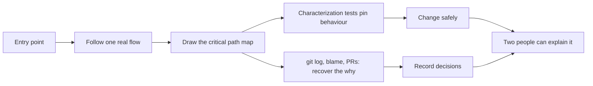

## In one minute
- More and more of the code you are responsible for was written by someone else: a colleague who left, a vendor, an acquired company, or an agent that wrote it in ten minutes last month. Ownership means you can explain it, change it safely and debug it at 3 a.m.
- Read with a goal. Start from entry points and one real request, not from file one; build a map of the critical path before reading details.
- Pin current behaviour with characterization tests before changing anything. They record what the code does today, right or wrong, so you notice when that changes.
- Use history as evidence: `git log`, `git blame`, pull request discussions and decision records explain why code looks the way it does. Agent-written code often has no "why", so write it down when you learn it.
- Track knowledge risk: files no current human understands are an incident waiting to happen. Make sure at least two people can explain every critical path.

## How it works

### The new legacy code
Michael Feathers defined legacy code as code without tests. A useful update for the AI era: legacy code is code nobody on the team understands, however new it is. Agents can produce a working service in an afternoon; if no human read it carefully, it becomes legacy the moment it merges. Inherited code, acquired code and agent code are the same problem: behaviour you depend on, with intent you cannot see.

### Read with a goal
Reading a codebase file by file is like reading a dictionary to learn a language. Instead:

1. **Pick one real flow**, such as "a user places an order", and follow it from the entry point (an HTTP handler, a queue consumer, a cron job) to the database and back.
2. **Run it** locally or in staging with logging or a debugger, and watch the path rather than imagining it.
3. **Draw the map**: components, data stores and calls on the critical path, in a C4-style context or container diagram. A page of boxes beats a hundred pages of notes.
4. **Find the edges**: what external services it calls, what it writes, what it assumes about time, retries and failure.
5. **Then read details** where the map shows risk: money, permissions, concurrency, data deletion.

Agents are useful readers here. Ask one to trace a flow and cite file paths and line numbers, then check the citations. An explanation without references is a guess.

### Characterization tests
Before changing code you do not understand, write tests that capture what it does now. Call the function with realistic inputs, record the outputs, and assert them, even outputs that look wrong. Feathers' recipe: break dependencies so the code runs in a harness, write a test with a placeholder expected value, run it, read the real output from the failure, paste it into the assertion, rename the test to describe the behaviour, and repeat with new inputs. If a result surprises you, keep the test and investigate before calling it a bug ([Feathers](https://michaelfeathers.silvrback.com/characterization-testing)). These tests do not say the behaviour is correct; they say it has not changed. When you later fix a "bug", one test will fail, and you will decide on purpose whether that change is intended. Golden-file or snapshot tests (record a whole response or report and compare future runs against it) do the same job at the level of a service.

### History as evidence
Code shows what; history shows why. `git log -p --follow path` shows how a file evolved; `git blame -w -C` attributes each line while ignoring whitespace and code moved between files (one `-C` looks at other files changed in the same commit, `-C -C` also at the commit that created the file, and three look at any commit) ([git docs](https://git-scm.com/docs/git-blame)); the linked pull request often has the discussion that explains an odd `if`. A bulk reformatting commit hides real history, so list it in a `.git-blame-ignore-revs` file and set `blame.ignoreRevsFile` ([git docs](https://git-scm.com/docs/git-blame)). Architecture decision records, where they exist, are the best source of all. Nygard's format is deliberately short, one or two pages with title, context, decision, status and consequences, because large documents are never kept up to date ([Nygard](https://cognitect.com/blog/2011/11/15/documenting-architecture-decisions)). Agent-written code is often missing this layer: the reasoning lived in a chat session that is gone. When you work out why something is the way it is, record it in a comment, a decision record or the spec.

### Knowledge risk
The bus factor is the number of people who would have to leave before nobody understands a part of the system. For critical paths it should be at least two. A simple proxy from version control: for each file, which current team members have committed to it? Files touched only by former members or only by agents have a bus factor of zero for practical purposes.

## Down the stack

### Layer 1: The contract
Owning a component promises that a named team can explain its critical paths (at Google, ownership is a stewardship duty and owners are expected to understand the code they own, [Software Engineering at Google, Ch 9](https://abseil.io/resources/swe-book/html/ch09.html)), has tests that pin its current behaviour, can deploy and roll it back, and knows its dependencies and failure modes. A good test of ownership: could the on-call engineer debug it at night without the original author, human or agent?

### Layer 2: The mechanism
Version control stores what you need to measure ownership. Every commit records an author, a timestamp and the files changed; `git log --format='%an' -- path | sort | uniq -c` counts commits per author for a file. `git blame` walks history backwards to find the last commit that touched each line, and with `-C` detects lines moved or copied from other files. Agent commits can be marked by a trailer such as `Co-Authored-By:` or by a bot author name, so tooling can separate them. `CODEOWNERS` maps paths to owning teams for review; ownership dashboards join that map with commit history to show where owners have never touched the code they own.

### Layer 3: The machine
Git's history is a chain of immutable snapshots. Each commit object points to a tree object (a directory listing of file names and content hashes) and to its parent commits, and every object is named by the hash of its content (SHA-1 or SHA-256). Diffs are not stored; they are computed by comparing trees, which is why `git blame` on a large file with long history can take seconds: it repeatedly diffs a file's versions back through time. Because the hashes chain, history cannot be silently edited without changing every later commit ID, which is what makes it trustworthy evidence about who changed what and when.

### Why it's built this way
1. Teams depend on code whose authors are gone, whether people or agent sessions.
2. Behaviour can be observed and pinned, even when intent is lost, through characterization tests.
3. Intent can often be recovered from history and discussion, if it was recorded.
4. Understanding concentrated in one head, or in no head, is fragile.
5. So: read by flows, pin behaviour, mine history, record the why, and measure knowledge risk.

## Diagram


## Worked example
A platform team inherits a billing reconciliation service after its author leaves. It is 14,000 lines; git shows 80 percent of lines were last touched by agent commits during a three-week sprint, and none of the five current team members has ever committed to it. It runs nightly and compares 2 million ledger rows with the payment provider's report.

The team follows one flow: the nightly job's entry point, the provider download, the matching step and the mismatch report. Running it against a copy of last night's data takes 11 minutes and finds 37 mismatches, which matches production. They draw the map: downloader, parser, matcher, report writer, and a little-known retry loop that re-fetches the provider file if it is under 1 MB.

They write characterization tests: a golden test over a 10,000-row sample that records the exact mismatch report, plus tests around the retry loop. `git blame` on the retry loop leads to a pull request where the agent's summary says "handle partial downloads", which explains the 1 MB rule: the provider once served truncated files. They write that into a decision record.

Two weeks later, a change to the parser breaks the golden test: amounts with three decimal places, used for one currency, were now rounded. Without the characterization test this would have shown up as a month-end discrepancy in finance.

## In the wild
- **Knight Capital, 2012: dead code nobody owned.** The "Power Peg" function had been discontinued around 2003 but remained present and callable in the order router. New code repurposed the flag that used to activate it, and one of eight servers missed the deployment. Orders sent with the flag to that server triggered the old code, producing over 4 million executions and a $460 million loss in about 45 minutes. Knight had no written deployment procedures requiring a second review ([SEC order](https://www.sec.gov/files/litigation/admin/2013/34-70694.pdf)).
- **Air Canada, 2024: owning what an agent said.** The airline argued its chatbot was a separate legal entity responsible for its own statements. The tribunal rejected this because the chatbot was part of the airline's website, and held the airline liable for negligent misrepresentation ([Wikipedia summary](https://en.wikipedia.org/wiki/Moffatt_v._Air_Canada)). Whoever deploys the system owns its output, whoever wrote it.

## Trade-offs
| Approach | Strengths | Weaknesses | Choose when |
| --- | --- | --- | --- |
| Follow one flow end to end | Fast understanding of what matters | Misses rarely used paths | First days with any codebase |
| Read everything | Complete | Slow, low retention | Small codebases only |
| Characterization tests first | Safe changes even without understanding | Pins bugs as well as features | Before any change to unknown code |
| Ask an agent to explain | Fast orientation | Can be confidently wrong | Always with file and line citations, checked |
| Rewrite from scratch | Clean result | Loses undocumented behaviour, high risk | Rarely; prefer gradual replacement |

## Pitfalls in production
- Rewriting code you do not understand because it looks messy, and losing hidden behaviour. Fix: characterization tests, then gradual replacement (strangler fig). Fowler notes that existing behaviour is hard to pin down, so big-bang replacements "go down in flames" most of the time, and that each step teaches the team about the legacy system ([Fowler](https://martinfowler.com/bliki/StranglerFigApplication.html)).
- Accepting an agent's explanation without checking references. Fix: require file and line citations and verify a sample.
- Ownership by `CODEOWNERS` file only, with owners who never read the code, or reviewers who skip comprehension questions. Google treats "I don't understand this" as a valid review comment that deserves a clearer explanation ([SWE at Google, Ch 9](https://abseil.io/resources/swe-book/html/ch09.html)). Fix: pair the ownership map with commit and review history.
- The "why" disappearing with the chat session that produced the code. Fix: record decisions in the repository as you rediscover them.
- One person who understands everything. Fix: rotate on-call and reviews deliberately across critical components.

## Leadership lens
- Run a knowledge-risk report each quarter: critical files with no current human committer or reviewer.
- When a team inherits a system, budget time for the map and characterization tests before any feature work.
- Require agent pull requests to include a short "why" in the description, and keep it with the code.
- Use the on-call test: if the owning team could not debug it at night, the ownership is not real yet.

## Check yourself
1. Why are characterization tests useful even when they pin behaviour that may be wrong?
   **Answer:** They make any change in behaviour visible, so fixes are deliberate decisions rather than accidents, and unknown dependencies on current behaviour surface before production.
2. Why start reading from one real flow rather than from the top of the repository?
   **Answer:** A flow shows the code that actually runs and matters, in the order it runs, and gives you a map to hang details on; reading files in order shows lots of code with no context.
3. What makes agent-written code a particular knowledge risk?
   **Answer:** It can be produced quickly and in large amounts with no human ever reading it closely, and the reasoning behind it often lived only in a chat session that is gone.
4. What does `git blame -C` add?
   **Answer:** It detects lines moved or copied from other files, so attribution points to where the code was really written rather than to the commit that moved it.

## Practice
**Task:** Build a knowledge-risk report from version control history. `commits` is a list of commits, each with `author` and `files`; authors whose names start with `agent:` are agents. `orphaned(commits, team)` returns a sorted list of files that no current human team member has ever committed to (only former members or agents have). `bus_factor(commits, prefix, team)` returns how many distinct current team members have committed to at least one file whose path starts with `prefix`.

```python starter
def orphaned(commits, team):
    # TODO
    raise NotImplementedError

def bus_factor(commits, prefix, team):
    # TODO
    raise NotImplementedError
```

```python tests
COMMITS = [
    {"author": "ana", "files": ["billing/match.py", "billing/report.py"]},
    {"author": "agent:claude", "files": ["billing/retry.py", "billing/match.py"]},
    {"author": "ravi", "files": ["auth/session.py"]},
    {"author": "old-dev", "files": ["billing/parser.py"]},
    {"author": "li", "files": ["auth/session.py", "auth/tokens.py"]},
]

def test_orphaned_files():
    assert orphaned(COMMITS, ["ana", "li"]) == ["billing/parser.py", "billing/retry.py"]

def test_everything_orphaned_when_team_is_new():
    assert orphaned(COMMITS, ["newbie"]) == sorted({f for c in COMMITS for f in c["files"]})

def test_agents_never_count_as_team():
    assert orphaned([{"author": "agent:x", "files": ["a.py"]}], ["agent:x"]) == ["a.py"]

def test_bus_factor_counts_current_humans():
    assert bus_factor(COMMITS, "auth/", ["ravi", "li", "ana"]) == 2
    assert bus_factor(COMMITS, "billing/", ["ravi", "li", "ana"]) == 1

def test_bus_factor_zero_after_departures():
    assert bus_factor(COMMITS, "billing/", ["li"]) == 0

def test_empty_history():
    assert orphaned([], ["ana"]) == []
    assert bus_factor([], "x/", ["ana"]) == 0
```

```python solution
def _is_member(author, team):
    return not author.startswith("agent:") and author in team

def orphaned(commits, team):
    files, owned = set(), set()
    for c in commits:
        files.update(c["files"])
        if _is_member(c["author"], team):
            owned.update(c["files"])
    return sorted(files - owned)

def bus_factor(commits, prefix, team):
    people = set()
    for c in commits:
        if _is_member(c["author"], team) and any(f.startswith(prefix) for f in c["files"]):
            people.add(c["author"])
    return len(people)
```

```typescript starter
export interface Commit { author: string; files: string[]; }

export function orphaned(commits: Commit[], team: string[]): string[] {
  throw new Error("TODO");
}

export function busFactor(commits: Commit[], prefix: string, team: string[]): number {
  throw new Error("TODO");
}
```

```typescript tests
const COMMITS: Commit[] = [
  { author: "ana", files: ["billing/match.py", "billing/report.py"] },
  { author: "agent:claude", files: ["billing/retry.py", "billing/match.py"] },
  { author: "ravi", files: ["auth/session.py"] },
  { author: "old-dev", files: ["billing/parser.py"] },
  { author: "li", files: ["auth/session.py", "auth/tokens.py"] },
];

test("orphaned files", () => {
  assertEqual(orphaned(COMMITS, ["ana", "li"]), ["billing/parser.py", "billing/retry.py"]);
});

test("everything orphaned when team is new", () => {
  const all = Array.from(new Set(COMMITS.flatMap(c => c.files))).sort();
  assertEqual(orphaned(COMMITS, ["newbie"]), all);
});

test("agents never count as team", () => {
  assertEqual(orphaned([{ author: "agent:x", files: ["a.py"] }], ["agent:x"]), ["a.py"]);
});

test("bus factor counts current humans", () => {
  assertEqual(busFactor(COMMITS, "auth/", ["ravi", "li", "ana"]), 2);
  assertEqual(busFactor(COMMITS, "billing/", ["ravi", "li", "ana"]), 1);
});

test("bus factor zero after departures", () => {
  assertEqual(busFactor(COMMITS, "billing/", ["li"]), 0);
});

test("empty history", () => {
  assertEqual(orphaned([], ["ana"]), []);
  assertEqual(busFactor([], "x/", ["ana"]), 0);
});
```

```typescript solution
export interface Commit { author: string; files: string[]; }

const isMember = (author: string, team: string[]) => !author.startsWith("agent:") && team.includes(author);

export function orphaned(commits: Commit[], team: string[]): string[] {
  const files = new Set<string>(), owned = new Set<string>();
  for (const c of commits) {
    c.files.forEach(f => files.add(f));
    if (isMember(c.author, team)) c.files.forEach(f => owned.add(f));
  }
  return Array.from(files).filter(f => !owned.has(f)).sort();
}

export function busFactor(commits: Commit[], prefix: string, team: string[]): number {
  const people = new Set<string>();
  for (const c of commits) {
    if (isMember(c.author, team) && c.files.some(f => f.startsWith(prefix))) people.add(c.author);
  }
  return people.size;
}
```

```go starter
package practice

type Commit struct {
	Author string
	Files  []string
}

func Orphaned(commits []Commit, team []string) []string {
	panic("TODO")
}

func BusFactor(commits []Commit, prefix string, team []string) int {
	panic("TODO")
}
```

```go tests
package practice

import (
	"reflect"
	"testing"
)

var commits = []Commit{
	{"ana", []string{"billing/match.py", "billing/report.py"}},
	{"agent:claude", []string{"billing/retry.py", "billing/match.py"}},
	{"ravi", []string{"auth/session.py"}},
	{"old-dev", []string{"billing/parser.py"}},
	{"li", []string{"auth/session.py", "auth/tokens.py"}},
}

func TestOrphaned(t *testing.T) {
	got := Orphaned(commits, []string{"ana", "li"})
	if !reflect.DeepEqual(got, []string{"billing/parser.py", "billing/retry.py"}) {
		t.Fatalf("got %v", got)
	}
}

func TestAllOrphaned(t *testing.T) {
	if got := Orphaned(commits, []string{"newbie"}); len(got) != 6 {
		t.Fatalf("got %v", got)
	}
}

func TestAgentsNeverTeam(t *testing.T) {
	got := Orphaned([]Commit{{"agent:x", []string{"a.py"}}}, []string{"agent:x"})
	if !reflect.DeepEqual(got, []string{"a.py"}) {
		t.Fatalf("got %v", got)
	}
}

func TestBusFactor(t *testing.T) {
	team := []string{"ravi", "li", "ana"}
	if BusFactor(commits, "auth/", team) != 2 || BusFactor(commits, "billing/", team) != 1 {
		t.Fatal("bus factor wrong")
	}
}

func TestBusFactorZero(t *testing.T) {
	if BusFactor(commits, "billing/", []string{"li"}) != 0 {
		t.Fatal("expected 0")
	}
}

func TestEmpty(t *testing.T) {
	if len(Orphaned(nil, []string{"ana"})) != 0 || BusFactor(nil, "x/", []string{"ana"}) != 0 {
		t.Fatal("empty history")
	}
}
```

```go solution
package practice

import (
	"sort"
	"strings"
)

type Commit struct {
	Author string
	Files  []string
}

func isMember(author string, team []string) bool {
	if strings.HasPrefix(author, "agent:") {
		return false
	}
	for _, m := range team {
		if m == author {
			return true
		}
	}
	return false
}

func Orphaned(commits []Commit, team []string) []string {
	files, owned := map[string]bool{}, map[string]bool{}
	for _, c := range commits {
		member := isMember(c.Author, team)
		for _, f := range c.Files {
			files[f] = true
			if member {
				owned[f] = true
			}
		}
	}
	out := []string{}
	for f := range files {
		if !owned[f] {
			out = append(out, f)
		}
	}
	sort.Strings(out)
	return out
}

func BusFactor(commits []Commit, prefix string, team []string) int {
	people := map[string]bool{}
	for _, c := range commits {
		if !isMember(c.Author, team) {
			continue
		}
		for _, f := range c.Files {
			if strings.HasPrefix(f, prefix) {
				people[c.Author] = true
				break
			}
		}
	}
	return len(people)
}
```

## Mock interview
**Prompt:** Your team takes over a 60,000-line order management service from a team that was disbanded. Much of it was written by agents over the last six months, there is little documentation, and you are on call for it starting in three weeks. It handles 4 million orders a month. What do you do in those three weeks?

- Follow-up: A manager wants you to rewrite it in your team's preferred framework. How do you respond?
- Follow-up: You find code that looks like a bug but might be deliberate. How do you decide?
- Follow-up: How do you know when the team really owns it?

**A strong answer covers:**
- Prioritising by risk: map the critical flows (place, pay, fulfil, refund) end to end and their external dependencies first.
- Running the service and tracing real requests rather than only reading.
- Characterization and golden tests around critical paths before any change.
- Mining history (commits, pull requests, agent summaries) for intent, and recording decisions as they are rediscovered.
- Operational readiness: dashboards, alerts, runbooks, deploy and rollback rehearsed by the team.
- Resisting a rewrite until behaviour is pinned; gradual replacement if needed.
- Ownership measured: on-call drills passed, bus factor of at least two on critical paths.

## Sources and further study
**Primary**
- [SEC order against Knight Capital Americas (2013)](https://www.sec.gov/files/litigation/admin/2013/34-70694.pdf): how retired code and a repurposed flag became a $460 million loss.
- [Nygard, Documenting Architecture Decisions](https://cognitect.com/blog/2011/11/15/documenting-architecture-decisions): the original short-ADR format.


**Books**
- *Software Engineering at Google* (2020), Ch 9: Code Review ([read free](https://abseil.io/resources/swe-book/html/ch09.html)): ownership, comprehension and OWNERS files.
- *Building Secure and Reliable Systems* (2020), Ch 6: Design for Understandability: why understandable systems are easier to keep secure and reliable.
- *Working Effectively with Legacy Code* (Michael Feathers, 2004): the source of the characterization-test technique (no chapter verified here).

**Other curricula**
- [Moffatt v. Air Canada (Wikipedia)](https://en.wikipedia.org/wiki/Moffatt_v._Air_Canada): a legal view of who owns what an automated system says.

## Free resources
- [Characterization Testing (Michael Feathers)](https://michaelfeathers.silvrback.com/characterization-testing): the author of Working Effectively with Legacy Code on pinning behaviour.
- [Strangler Fig (Martin Fowler)](https://martinfowler.com/bliki/StranglerFigApplication.html): replacing a system gradually instead of rewriting.
- [git-blame documentation](https://git-scm.com/docs/git-blame): options such as `-w` and `-C` for accurate attribution.
- [Architectural Decision Records](https://adr.github.io/): recording the why so it outlives its authors.
- [Bus factor (Wikipedia)](https://en.wikipedia.org/wiki/Bus_factor): the knowledge-concentration risk and how it is measured.
- [C4 model](https://c4model.com/): drawing maps of a system at useful zoom levels.
