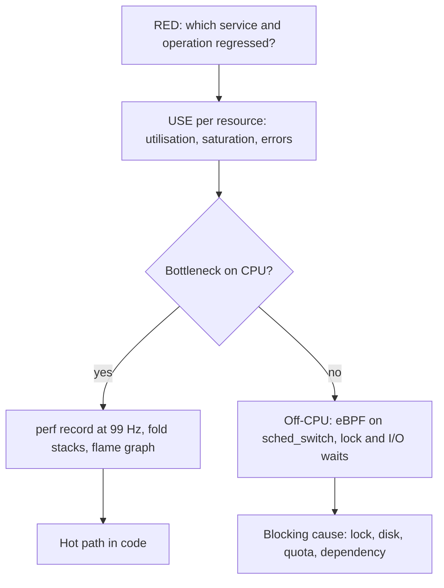

## In one minute
- Performance debugging fails most often from lack of method, not lack of tools. Two checklists cover most ground: RED for services and USE for resources.
- RED asks, per service: Rate of requests, Errors, and Duration (latency distribution). It tells you which service is slow and since when.
- USE asks, per resource (CPU, memory, disk, network, locks, pools): Utilisation, Saturation (queued work), and Errors. It tells you which resource is the bottleneck.
- A CPU flame graph, built from stack samples, shows where on-CPU time goes. Width is the share of samples; the x-axis is not time.
- Latency is on-CPU time plus waiting. When the CPU profile looks innocent, measure off-CPU time: locks, I/O, scheduler queues and throttling.

## How it works

### Start with RED to find the slow thing
Tom Wilkie devised RED in 2015 because USE fits hardware better than request-driven services, and he recommends using both as two views of one system ([Grafana Labs](https://grafana.com/blog/the-red-method-how-to-instrument-your-services/)). Before profiling anything, establish which service and which operation regressed, and how. A p99 that rose while p50 stayed flat suggests contention, queueing or a slow subset of requests. A shift of the whole distribution suggests more work per request. Rising Rate with rising Duration suggests saturation from load; flat Rate with rising Duration suggests something changed in the code, the data or a dependency. RED on each hop of the call graph locates the slow service; the slowest hop's own breakdown says whether it is slow itself or waiting on its own dependency.

### Then USE on that service's resources
For each resource the service uses, check three things ([Gregg, USE method](https://www.brendangregg.com/USEmethod/use-linux.html)). Utilisation: how busy it is over an interval. Saturation: how much work is waiting, such as run-queue length for CPU, I/O queue depth for disks, pending acquires for a connection pool, or swap activity for memory. Errors: failed operations, like disk errors, dropped packets or rejected connections. Saturation is the most important column. A resource at 60% average utilisation can still be saturated in bursts, and saturation is what adds latency.

USE applies to software resources too: thread pools, connection pools, mutexes and file descriptors all have utilisation, a queue and failure modes.

### Profile where the time goes
If the bottleneck is CPU, sample stacks. A sampling profiler interrupts each CPU at a fixed rate, records the current stack, and counts identical stacks. A flame graph draws those counts: each box is a function, its width is the fraction of samples in which it appears, and children sit above their callers. Look for wide plateaus at the top (functions burning CPU themselves) and for wide towers under unexpected callers (a logging call that takes 20% of CPU). Box order along the x-axis is alphabetical, so adjacent boxes are not related in time ([Gregg](https://www.brendangregg.com/flamegraphs.html)).

### Off-CPU time
A thread waiting on a lock, a disk read, a network response or a CPU quota is not on a CPU, so the CPU profile cannot see it. Off-CPU analysis records the stack when a thread blocks and the duration until it runs again. Together, on-CPU and off-CPU profiles account for all of a request's wall time.

## Down the stack

### Layer 1: The contract
The human process promises coverage: every resource on the request path is checked for utilisation, saturation and errors before anyone declares "it's not the infrastructure". Testable: the investigation notes contain a USE row per resource with a number or "not measurable". The profiling tools have contracts too. A sampling profiler at 99 Hz for 30 seconds on 8 CPUs collects about 23,800 samples, so a function at 1% of CPU appears in roughly 240 of them, which is enough to trust its width to a few tenths of a percent. Anything that runs for less than one sample period per call is only visible statistically.

### Layer 2: The mechanism
On Linux, `perf record -F 99 -a -g` opens one perf event per CPU with the `perf_event_open` syscall, configured to overflow at 99 Hz on a clock or cycle counter. On overflow, the kernel captures the instruction pointer and walks the call chain, usually by following frame pointers (each frame saves the caller's frame pointer, forming a linked list on the stack). Records go into a ring buffer that `perf` reads through `mmap`. `perf script` prints one stack per sample, leaf first, and a fold step (Brendan Gregg's `stackcollapse` scripts) reverses each stack to root first, joins frames with semicolons and counts duplicates: `main;handle;validate;regexp.match 812`. The flame graph renderer draws those lines.

Stacks break when code is compiled without frame pointers, which many distributions did for years to free a register. That default has been reversing: Fedora was the first distribution to re-enable them and Ubuntu 24.04 LTS ships with them on, and Gregg's overhead tests found the cost usually under 1%, with one deep-stack Java application at about 10% ([Gregg, 2024](https://www.brendangregg.com/blog/2024-03-17/the-return-of-the-frame-pointers.html)). The fix is to rebuild with `-fno-omit-frame-pointer`, use DWARF unwinding (`--call-graph dwarf`, which copies stack bytes and is much heavier), or hardware branch records. JIT runtimes need a symbol map, such as `/tmp/perf-<pid>.map`, written by the JVM agent or Node's `--perf-basic-prof`.

Off-CPU profiling usually uses eBPF: a program on the `sched:sched_switch` tracepoint records the time and stack ID when a thread leaves the CPU, and the time it returns, summing blocked time per stack in a BPF map. bcc's `offcputime` tool does this.

### Layer 3: The machine
99 Hz rather than 100 Hz is deliberate: it avoids sampling in lockstep with activity driven by 100 Hz timers. At this rate overhead is usually well under 1% of CPU. CPU saturation shows up as the run-queue length (`r` in `vmstat 1`, which counts both waiting and running threads on current Linux) above the CPU count ([Gregg, USE for Linux](https://www.brendangregg.com/USEmethod/use-linux.html)), and on modern kernels as pressure stall information in `/proc/pressure/cpu` and each cgroup's `cpu.pressure` ([kernel cgroup v2 docs](https://docs.kernel.org/admin-guide/cgroup-v2.html)). In containers, the CFS bandwidth controller enforces CPU limits per period, by default 100 ms ([kernel scheduler docs](https://docs.kernel.org/scheduler/sched-bwc.html)); on cgroup v2 the knob is `cpu.max`, written as `quota period` in microseconds with default `max 100000`. A container limited to 2 CPUs that runs 8 threads can use its 200 ms of quota in the first 25 ms of a period and then sit throttled for 75 ms. Average utilisation looks fine while p99 latency jumps by the throttled time; `nr_throttled` and `throttled_usec` in the cgroup's `cpu.stat` reveal it (cgroup v1 reports `throttled_time` in nanoseconds instead; [cgroup v2 docs](https://docs.kernel.org/admin-guide/cgroup-v2.html)). Throttling can also appear with usage far below the limit: Linux 4.18 to 5.3 era kernels expired each CPU's leftover quota every period, which was fixed in 5.4 and backported (see the Indeed write-up below).

Below the scheduler, hardware counters explain why code is slow even when it is on-CPU. Instructions per cycle (IPC) under about 1 usually means stalls on memory: a last-level cache miss costs on the order of 100 ns, during which a modern core could have retired hundreds of instructions. `perf stat -e cycles,instructions,cache-misses` reads these counters.

### Why it's built this way
1. The space of possible performance causes is huge, so methods like RED and USE give a finite checklist that guarantees coverage.
2. Tracing every function call is too expensive in production, so profilers sample at a low fixed rate and rely on statistics.
3. Thousands of unique stacks are unreadable as text, so flame graphs merge them visually by frequency.
4. CPU sampling cannot see waiting, so off-CPU analysis hooks the scheduler to account for the rest of wall time.

## Diagram


## Worked example
A profile service's p99 rose from 80 ms to 400 ms after a release; p50 went from 20 ms to 35 ms. RED: Rate flat at 1,200 requests per second, Errors flat, Duration up. So more work per request, not more requests.

USE on CPU: the pods show 55% average utilisation of their 2-CPU limit, which looks fine. But `cpu.stat` shows `nr_throttled` rising in 40% of periods, and `throttled_usec` grows by about 300 ms per second. The average hides bursts that exhaust the quota early in each 100 ms period.

A 30-second CPU profile across one pod (99 Hz, 2 CPUs, about 5,900 samples) folded into a flame graph shows 36% of samples under `validateEmail`, almost all in regex compilation. The release moved `regexp.MustCompile` inside the request handler, so every request compiles the same pattern, costing about 0.6 ms of CPU each. At 600 requests per second per pod that is 360 ms of CPU per second, close to a fifth of the pod's quota, spent on repeated work. Moving the compile to package initialisation drops CPU per request back to normal, throttling stops, and p99 returns to 85 ms.

The CPU profile found the hot code; USE explained why a modest CPU increase produced a five-fold tail latency increase.

## In the wild
- **Cloudflare, 2019: one regex pegs every CPU.** A new WAF rule contained a regular expression that backtracked catastrophically and shipped to the whole network in seconds. About 80% of traffic was lost for 27 minutes with 502s everywhere. A CPU safeguard had been removed in an earlier refactor; afterwards Cloudflare restored it, added CPU profiling to its tests, and moved toward RE2 or Rust's regex engine ([Cloudflare](https://blog.cloudflare.com/details-of-the-cloudflare-outage-on-july-2-2019/)).
- **Indeed, 2019: throttled while idle.** Indeed saw worst-case response latency above two seconds in an application that was throttled even though it used far less CPU than its limit (one mostly idle app was allocated 4.1 CPUs and stayed under 0.5). The cause was a 4.18 kernel commit that expired each CPU's leftover quota every period, so on many-core hosts the stranded milliseconds added up. After the fix, worst-case latency in one application fell to 30 ms, and the fix is in mainline 5.4 and stable backports such as 4.14.154 and 4.19.84 ([Indeed Engineering](https://engineering.indeedblog.com/blog/2019/12/unthrottled-fixing-cpu-limits-in-the-cloud/), [part 2](https://engineering.indeedblog.com/blog/2019/12/cpu-throttling-regression-fix/)).

## Trade-offs
| Tool | Strengths | Weaknesses | Choose when |
| --- | --- | --- | --- |
| RED dashboards | Fast localisation across services | Says where, not why | First minutes of any latency problem |
| USE checklist | Systematic, catches saturation | Needs metrics for every resource | Suspected infrastructure bottleneck |
| CPU flame graph (`perf`, pprof) | Precise hot code, low overhead | Blind to waiting, needs symbols and stacks | CPU-bound regressions |
| Off-CPU profile (eBPF) | Shows locks, I/O and throttling | Higher overhead at high switch rates, needs privileges | High latency with low CPU |
| Distributed tracing | Per-request breakdown across services | Sampled, coarse inside a process | Cross-service latency |

## Pitfalls in production
- Trusting average utilisation. Fix: look at saturation (run queue, PSI, throttling, pool waits) and short-interval data.
- Broken stacks from missing frame pointers or JIT symbols, giving a flame graph of `[unknown]`. Fix: build with frame pointers and enable perf maps for JITs.
- Profiling only on-CPU when the problem is lock contention or I/O. Fix: pair every CPU profile with an off-CPU or mutex profile.
- Comparing p99 across hosts by averaging percentiles. Fix: aggregate histograms, then compute quantiles.
- Benchmarking on a laptop with a different CPU, core count and no cgroup limits. Fix: profile in production or in an environment with the same limits.

## Leadership lens
- Make continuous profiling (low-rate always-on sampling) standard; regressions are found by diffing profiles between versions.
- Require RED dashboards per service and USE metrics for every pool and queue you own, not just hosts.
- Review container CPU limits with throttling data. Many tail-latency problems are a quota set too tight.
- When an agent suggests a performance fix, ask for the before and after profile and the latency distribution, not only the mean.

## Check yourself
1. p99 latency is up 5x while average CPU is 50%. What do you check first, and why?
   **Answer:** Saturation, especially CFS throttling and run-queue length. Averages hide bursts, and queueing during bursts drives tail latency.
2. Why does the x-axis of a flame graph not represent time?
   **Answer:** Stacks are merged by identity and sorted alphabetically at each level, so width shows frequency and position carries no temporal meaning.
3. A handler takes 300 ms but its CPU flame graph shows only 20 ms of work. Where is the rest?
   **Answer:** Off-CPU: waiting on locks, I/O, downstream calls or CPU quota. An off-CPU or tracing view is needed.
4. Why sample at 99 Hz rather than 100 Hz?
   **Answer:** To avoid aliasing with periodic activity at 100 Hz, which would bias samples toward or away from that work.

## Practice
**Task:** Build the fold step of a flame graph. Each sample is a list of frame names, leaf first, as `perf script` prints them. `fold(samples)` returns lines `"root;...;leaf count"` for each distinct stack, sorted by the stack string. `hot_functions(samples, n)` returns the top `n` functions as `[name, inclusive, self]`: inclusive counts samples where the function appears anywhere (once per sample, even if recursive), self counts samples where it is the leaf. Sort by inclusive descending, then self descending, then name ascending. Skip empty samples in both functions.

```python starter
def fold(samples):
    # TODO
    raise NotImplementedError

def hot_functions(samples, n):
    # TODO
    raise NotImplementedError
```

```python tests
S = [
    ["match", "validate", "handle", "main"],
    ["match", "validate", "handle", "main"],
    ["write", "log", "handle", "main"],
    ["handle", "main"],
    [],
]

def test_fold_reverses_and_counts():
    assert fold(S) == ["main;handle 1", "main;handle;log;write 1", "main;handle;validate;match 2"]

def test_fold_empty():
    assert fold([]) == []
    assert fold([[]]) == []

def test_hot_inclusive_and_self():
    assert hot_functions(S, 3) == [["handle", 4, 1], ["main", 4, 0], ["match", 2, 2]]

def test_recursion_counted_once():
    s = [["fib", "fib", "fib", "main"], ["fib", "main"]]
    assert hot_functions(s, 5) == [["fib", 2, 2], ["main", 2, 0]]

def test_n_larger_than_functions():
    assert hot_functions([["a"]], 10) == [["a", 1, 1]]

def test_tie_break_by_name():
    s = [["b", "root"], ["a", "root"]]
    assert hot_functions(s, 3) == [["root", 2, 0], ["a", 1, 1], ["b", 1, 1]]
```

```python solution
from collections import Counter

def fold(samples):
    c = Counter(";".join(reversed(s)) for s in samples if s)
    return ["%s %d" % (k, c[k]) for k in sorted(c)]

def hot_functions(samples, n):
    inc, slf = Counter(), Counter()
    for s in samples:
        if not s:
            continue
        slf[s[0]] += 1
        for f in set(s):
            inc[f] += 1
    rows = [[f, inc[f], slf[f]] for f in inc]
    rows.sort(key=lambda r: (-r[1], -r[2], r[0]))
    return rows[:n]
```

```typescript starter
export function fold(samples: string[][]): string[] {
  throw new Error("TODO");
}

export function hotFunctions(samples: string[][], n: number): [string, number, number][] {
  throw new Error("TODO");
}
```

```typescript tests
const S: string[][] = [
  ["match", "validate", "handle", "main"],
  ["match", "validate", "handle", "main"],
  ["write", "log", "handle", "main"],
  ["handle", "main"],
  [],
];

test("fold reverses and counts", () => {
  assertEqual(fold(S), ["main;handle 1", "main;handle;log;write 1", "main;handle;validate;match 2"]);
});
test("fold empty", () => {
  assertEqual(fold([]), []);
  assertEqual(fold([[]]), []);
});
test("hot inclusive and self", () => {
  assertEqual(hotFunctions(S, 3), [["handle", 4, 1], ["main", 4, 0], ["match", 2, 2]]);
});
test("recursion counted once", () => {
  assertEqual(hotFunctions([["fib", "fib", "fib", "main"], ["fib", "main"]], 5), [["fib", 2, 2], ["main", 2, 0]]);
});
test("n larger than functions", () => {
  assertEqual(hotFunctions([["a"]], 10), [["a", 1, 1]]);
});
test("tie break by name", () => {
  assertEqual(hotFunctions([["b", "root"], ["a", "root"]], 3), [["root", 2, 0], ["a", 1, 1], ["b", 1, 1]]);
});
```

```typescript solution
export function fold(samples: string[][]): string[] {
  const c = new Map<string, number>();
  for (const s of samples) {
    if (s.length === 0) continue;
    const k = s.slice().reverse().join(";");
    c.set(k, (c.get(k) || 0) + 1);
  }
  return Array.from(c.keys()).sort().map((k) => k + " " + c.get(k));
}

export function hotFunctions(samples: string[][], n: number): [string, number, number][] {
  const inc = new Map<string, number>(), slf = new Map<string, number>();
  for (const s of samples) {
    if (s.length === 0) continue;
    slf.set(s[0], (slf.get(s[0]) || 0) + 1);
    for (const f of new Set(s)) inc.set(f, (inc.get(f) || 0) + 1);
  }
  const rows: [string, number, number][] = [];
  for (const [f, i] of inc) rows.push([f, i, slf.get(f) || 0]);
  rows.sort((a, b) => b[1] - a[1] || b[2] - a[2] || (a[0] < b[0] ? -1 : a[0] > b[0] ? 1 : 0));
  return rows.slice(0, n);
}
```

```go starter
package practice

type Hot struct {
	Name      string
	Inclusive int
	Self      int
}

func Fold(samples [][]string) []string {
	panic("TODO")
}

func HotFunctions(samples [][]string, n int) []Hot {
	panic("TODO")
}
```

```go tests
package practice

import (
	"reflect"
	"testing"
)

var S = [][]string{
	{"match", "validate", "handle", "main"},
	{"match", "validate", "handle", "main"},
	{"write", "log", "handle", "main"},
	{"handle", "main"},
	{},
}

func TestFoldReversesAndCounts(t *testing.T) {
	want := []string{"main;handle 1", "main;handle;log;write 1", "main;handle;validate;match 2"}
	if got := Fold(S); !reflect.DeepEqual(got, want) {
		t.Fatalf("got %v", got)
	}
}

func TestFoldEmpty(t *testing.T) {
	if len(Fold(nil)) != 0 || len(Fold([][]string{{}})) != 0 {
		t.Fatal("expected empty")
	}
}

func TestHotInclusiveAndSelf(t *testing.T) {
	want := []Hot{{"handle", 4, 1}, {"main", 4, 0}, {"match", 2, 2}}
	if got := HotFunctions(S, 3); !reflect.DeepEqual(got, want) {
		t.Fatalf("got %v", got)
	}
}

func TestRecursionCountedOnce(t *testing.T) {
	got := HotFunctions([][]string{{"fib", "fib", "fib", "main"}, {"fib", "main"}}, 5)
	if !reflect.DeepEqual(got, []Hot{{"fib", 2, 2}, {"main", 2, 0}}) {
		t.Fatalf("got %v", got)
	}
}

func TestNLargerThanFunctions(t *testing.T) {
	if got := HotFunctions([][]string{{"a"}}, 10); !reflect.DeepEqual(got, []Hot{{"a", 1, 1}}) {
		t.Fatalf("got %v", got)
	}
}

func TestTieBreakByName(t *testing.T) {
	got := HotFunctions([][]string{{"b", "root"}, {"a", "root"}}, 3)
	if !reflect.DeepEqual(got, []Hot{{"root", 2, 0}, {"a", 1, 1}, {"b", 1, 1}}) {
		t.Fatalf("got %v", got)
	}
}
```

```go solution
package practice

import (
	"fmt"
	"sort"
	"strings"
)

type Hot struct {
	Name      string
	Inclusive int
	Self      int
}

func Fold(samples [][]string) []string {
	c := map[string]int{}
	for _, s := range samples {
		if len(s) == 0 {
			continue
		}
		r := make([]string, len(s))
		for i, f := range s {
			r[len(s)-1-i] = f
		}
		c[strings.Join(r, ";")]++
	}
	keys := make([]string, 0, len(c))
	for k := range c {
		keys = append(keys, k)
	}
	sort.Strings(keys)
	out := []string{}
	for _, k := range keys {
		out = append(out, fmt.Sprintf("%s %d", k, c[k]))
	}
	return out
}

func HotFunctions(samples [][]string, n int) []Hot {
	inc, slf := map[string]int{}, map[string]int{}
	for _, s := range samples {
		if len(s) == 0 {
			continue
		}
		slf[s[0]]++
		seen := map[string]bool{}
		for _, f := range s {
			if !seen[f] {
				seen[f] = true
				inc[f]++
			}
		}
	}
	rows := []Hot{}
	for f, i := range inc {
		rows = append(rows, Hot{f, i, slf[f]})
	}
	sort.Slice(rows, func(a, b int) bool {
		if rows[a].Inclusive != rows[b].Inclusive {
			return rows[a].Inclusive > rows[b].Inclusive
		}
		if rows[a].Self != rows[b].Self {
			return rows[a].Self > rows[b].Self
		}
		return rows[a].Name < rows[b].Name
	})
	if n < len(rows) {
		rows = rows[:n]
	}
	return rows
}
```

## Mock interview
**Prompt:** It's 2 a.m. The search API's p99 latency is 10x normal (from 120 ms to 1.2 s), p50 is only 2x, and error rates are starting to climb as clients time out. CPU dashboards show 50% average. Walk me through it.

- Follow-up: How do you decide whether the bottleneck is CPU, a lock, I/O or a dependency?
- Follow-up: Your flame graph shows 40% of samples in `[unknown]`. What happened and how do you fix it?
- Follow-up: You find the hot function. How do you confirm the fix before rolling it out to all 200 pods?

**A strong answer covers:**
- RED per hop to localise the service, and noting that a tail-heavy change suggests queueing or contention.
- USE per resource with emphasis on saturation: run queue, PSI, CFS throttling, pool wait counts, disk queue depth.
- On-CPU sampling with `perf` or pprof plus off-CPU or mutex profiling, and why both are needed.
- Practical knowledge of profiling pitfalls: frame pointers, JIT symbol maps, sample counts.
- Mitigation first if impact is severe (scale out, raise limits, roll back), then verification with before and after profiles on a canary.

## Sources and further study
**Primary**
- [Gregg, The Return of the Frame Pointers (2024)](https://www.brendangregg.com/blog/2024-03-17/the-return-of-the-frame-pointers.html): which distributions re-enabled frame pointers and what it costs.
- [Indeed Engineering, Unthrottled: Fixing CPU Limits in the Cloud](https://engineering.indeedblog.com/blog/2019/12/unthrottled-fixing-cpu-limits-in-the-cloud/): a worked case of throttling at low usage, found with a reproducer and `git bisect`.

**Systems docs**
- [Linux kernel: CFS bandwidth control](https://docs.kernel.org/scheduler/sched-bwc.html): period, quota, slice and the throttling counters.
- [Linux kernel: cgroup v2](https://docs.kernel.org/admin-guide/cgroup-v2.html): `cpu.max`, `cpu.stat` and `cpu.pressure`.
- [Gregg, USE Method: Linux checklist](https://www.brendangregg.com/USEmethod/use-linux.html): the concrete saturation metrics per resource.
- [Grafana Labs: The RED Method](https://grafana.com/blog/the-red-method-how-to-instrument-your-services/): Wilkie's definition and how it pairs with USE.

**Books**
- *Systems Performance*, Brendan Gregg (2nd ed.), chapter 2 "Methodologies" and chapter 6 "CPUs": USE, workload characterisation and CPU analysis.
- *Site Reliability Engineering*, Beyer et al., chapter 6 "Monitoring Distributed Systems": the four golden signals that overlap with RED.

**Other curricula**
- [donnemartin/system-design-primer](https://github.com/donnemartin/system-design-primer): its "benchmark and profile" paragraph points at load tests and the slow query log, with no CPU or off-CPU method.

## Watch
- [Blazing Performance with Flame Graphs (Brendan Gregg, USENIX LISA13)](https://www.youtube.com/watch?v=nZfNehCzGdw): how flame graphs work and how to read them.
- [Linux Systems Performance (Brendan Gregg, USENIX LISA19)](https://www.youtube.com/watch?v=fhBHvsi0Ql0): methodologies and tools including USE, perf and eBPF.
- [Linux Performance Tools, part 1 (Brendan Gregg)](https://www.youtube.com/watch?v=FJW8nGV4jxY): a tour of observability tools by layer of the stack.

## Free resources
- [The USE Method (Brendan Gregg)](https://www.brendangregg.com/usemethod.html): the method and a Linux checklist per resource.
- [Flame Graphs (Brendan Gregg)](https://www.brendangregg.com/flamegraphs.html): types of flame graphs and how to generate them.
- [Off-CPU Analysis (Brendan Gregg)](https://www.brendangregg.com/offcpuanalysis.html): measuring blocked time with scheduler tracing.
- [perf wiki](https://perf.wiki.kernel.org/index.php/Main_Page): the Linux perf tool's documentation and tutorial.
- [Profiling Go Programs (Go blog)](https://go.dev/blog/pprof): pprof CPU and memory profiles applied to a real program.
