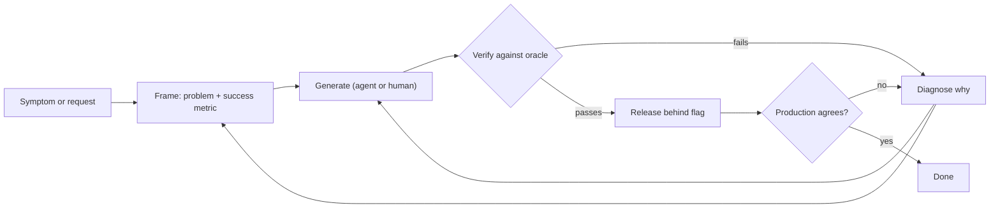

## In one minute
- Coding agents have made producing code cheap. Knowing which code to produce, proving it is right, and fixing it when production disagrees are still expensive, and that is where an engineer's value now sits.
- The work splits into four loops: frame the problem, generate candidate solutions, verify them, and diagnose failures. Agents are strong at the second loop and weak at judging their own output in the third.
- When generation gets faster, verification and diagnosis become the bottleneck. Teams that don't adjust ship more code and spend the saved time on review, rework and incidents.
- A Tech Lead's leverage is in the parts agents can't own: deciding what "done" means, designing checks that catch wrong answers, and leading the team when something breaks.
- Measure where the time goes. If most of a task's hours are spent in verify and diagnose, invest there, not in faster generation.

## How it works

### The shift in cost
Typing the code used to be a large share of the effort. An agent such as Claude Code, Cursor or Copilot's agent mode can now draft a feature, a migration or a test suite in minutes. What remains is the work around the code: understanding a vague request, choosing between designs, checking the result in every case that matters, and finding out why it fails in production.

That is problem solving. It was always the hard part; it used to hide inside "writing code", and now it is most of what is left.

### Four loops
Think of any piece of engineering work as four loops that feed each other.

1. **Frame.** Turn a symptom or request into a problem statement with a measurable success condition. "Checkout is slow" becomes "p99 of `POST /checkout` rose from 400 ms to 2.1 s for EU users since Tuesday's deploy; target is under 600 ms."
2. **Generate.** Produce candidate solutions. An agent can produce three in the time a person writes one.
3. **Verify.** Decide whether a candidate is correct, safe and maintainable. This needs an oracle: tests, invariants, a reference implementation, a metric, or a human who knows the domain.
4. **Diagnose.** When verification or production says "wrong", find out why, and feed that back into framing.

Agents compress loop 2. Loops 1, 3 and 4 depend on context the agent often lacks: business intent, production behaviour, past incidents, unwritten rules. An agent will confidently solve the problem it was given, even the wrong one.

### Where the time goes
Timestamp phase changes on real work, the way an incident timeline does, and look at the totals. You will often find generation is a small fraction of elapsed time, and that loops from verify back to generate ("not quite right, try again") are where the hours go.

One data point, with caveats: a 2025 randomised study by METR gave 16 experienced open-source developers 246 real issues in their own large repositories. With early-2025 AI tools allowed they took 19% longer, although they had forecast a 24% speedup and afterwards believed they had been about 20% faster ([METR, July 2025](https://metr.org/blog/2025-07-10-early-2025-ai-experienced-os-dev-study/)). METR later marked those results out of date. Its February 2026 update, with 57 developers and over 800 tasks, estimated smaller slowdowns or modest speedups, but METR calls the data only very weak evidence, because many developers refused to work without AI and withheld tasks they did not want to do without it ([METR, February 2026](https://metr.org/blog/2026-02-24-uplift-update/)). The lesson is not "AI makes you slower" and not "AI makes you faster"; it is that perceived and measured speed can diverge, and that measuring productivity is hard, so keep your own phase data.

### Checklist for any agent-assisted task
- Problem statement written, with a number that defines "done".
- Oracle identified before generation starts.
- Blast radius known: which users, data and services the change touches.
- Rollback path exists and has been exercised at least once.
- Phase timestamps recorded, so the retrospective is about data.

## Down the stack

### Layer 1: The contract
The human process promises a decision with known confidence, not just a diff, stated so it is testable: "this change makes X true for inputs Y, does not change Z, and can be reverted within N minutes." If you cannot state the contract, neither you nor an agent can verify it. The Tech Lead makes sure each piece of work has one, and that someone is accountable for checking it. The same shape appears in Google's troubleshooting model: a problem report that states expected behaviour, actual behaviour and how to reproduce it ([Google SRE book, ch. 12](https://sre.google/sre-book/effective-troubleshooting/)).

### Layer 2: The mechanism
An agent is a loop: a language model receives a prompt with the task, tool definitions and context, emits a tool call (read file, run command, edit file), the harness executes it, appends the result to the context, and repeats until the model emits a final answer. Correctness comes only from what the harness feeds back: compiler errors, test results, linter output. Anthropic's agent guide says an agent should get "ground truth" from the environment at each step, such as tool results or code execution ([Anthropic, Building effective agents](https://www.anthropic.com/engineering/building-effective-agents)). With weak feedback (no tests, flaky tests, a test the agent wrote to pass), the loop converges on something that only looks finished. What makes agent output trustworthy is what made human output trustworthy: fast, independent, deterministic checks. The Claude Code docs make the same point: without a check the agent can run, "looks done" is the only signal, and you become the verification loop ([Claude Code best practices](https://code.claude.com/docs/en/best-practices)).

### Layer 3: The machine
Under the agent, each tool call is an ordinary process: the harness calls `fork` and `execve` for `pytest` or `go test`, reads stdout and stderr through pipes, and waits with `wait4`. The model itself runs on accelerators where producing each output token requires reading the model weights from high-bandwidth memory; at tens of gigabytes of weights and a few terabytes per second of bandwidth, each decode step costs milliseconds, so a 2,000-token edit takes seconds to tens of seconds. A full test suite might take minutes. When the check costs far more than the generation, verification dominates wall-clock time, and faster tests (parallel runs, test selection, warm build caches) speed up the agent more than a faster model does.

### Why it's built this way
1. Generating plausible text is cheap for a model, but plausibility is not correctness, so every output needs an external check.
2. External checks need a definition of correct, so someone has to frame the problem precisely before work starts.
3. Checks cost real CPU time and human attention, so the cheapest effective check wins, and choosing it is a skill.
4. Production differs from any test environment, so some failures are only found by diagnosis after release, and that loop has to be fast and well practised.

## Diagram


## Worked example
A team is asked to "add rate limiting to the public API". Engineer A gives the request straight to an agent. In 10 minutes it produces an in-memory token bucket with passing unit tests. Review takes 40 minutes. In staging, behind 6 instances, clients get 6 times their limit because each instance keeps its own counters. The Redis rework costs an hour of agent time plus 90 minutes of review, and a clock-skew edge case found in production a week later costs a 2-hour investigation. Totals: about 1.5 hours generating, 2.5 verifying, 2 diagnosing, zero framing.

Engineer B spends 20 minutes framing: "Limit each API key to 100 requests per second across all instances; over-limit returns 429 with `Retry-After`; p99 overhead under 2 ms; fail open if the limiter store is down." That includes a question to the product owner about fail-open. The statement already rules out per-instance counters. B writes a load test firing 1,000 requests per second for one key through 6 instances, asserting about 100 succeed per second, then asks the agent to build against it. Generation 30 minutes, verification 45 minutes, no production diagnosis.

Same agent, same model. Twenty minutes of framing saved about four hours.

## In the wild
- **Anthropic, 2025: three bugs quietly degraded Claude's answers.** Between August and September 2025 a context-window routing error (0.8% of Sonnet 4 requests at first, 16% in the worst hour, and about 30% of Claude Code users hit at least once), a TPU misconfiguration and an approximate top-k compiler bug overlapped. Evals did not catch it, because each bug showed different symptoms at different rates and the evals were noisy. The fix was exact top-k, continuous quality evals on production and better debugging tools ([Anthropic postmortem](https://www.anthropic.com/engineering/a-postmortem-of-three-recent-issues)). Verification and diagnosis, not generation, were the hard part.
- **Knight Capital, 2012: a deploy nobody double-checked.** New code reached 7 of 8 servers; the eighth ran retired "Power Peg" logic, sending over 4 million executions in about 45 minutes and losing more than $460M. The SEC found no second-person review of the deployment and no written procedure ([SEC order](https://www.sec.gov/litigation/admin/2013/34-70694.pdf)). Cheap changes need a strong check at the release step.
- **GitLab, 2017: backups that had never been verified.** An engineer deleted about 300 GB on the wrong host. The `pg_dump` backups had been failing silently, so recovery used a six-hour-old snapshot, with about 18 hours of downtime ([GitLab postmortem](https://about.gitlab.com/blog/2017/02/10/postmortem-of-database-outage-of-january-31/)). An unexercised safety net is an unverified claim.

## Trade-offs
| Approach | Strengths | Weaknesses | Choose when |
|---|---|---|---|
| Prompt and review | Fastest start, low ceremony | Review catches only what the reviewer thinks to look for | Small, reversible, well-tested areas |
| Frame, oracle, then generate | Clear target, agent converges faster, cheap review | Up-front time, needs domain knowledge | Anything user-facing, stateful or hard to revert |
| Human writes, agent assists | Deep understanding retained | Slower generation | Novel core logic the team must own deeply |
| Agent writes, independent agent reviews | Cheap second opinion | Correlated blind spots if both share a model and context | As an extra layer, never the only check |

## Pitfalls in production
- **Tests written by the same agent that wrote the code.** They encode the same misunderstanding. Write or approve the key tests yourself, before generation, and review in a fresh context: Anthropic suggests a separate reviewer session because the writer is biased toward code it just produced ([Claude Code best practices](https://code.claude.com/docs/en/best-practices)).
- **Review fatigue.** Large generated diffs get skimmed. Cap diff size per review and ask for changes in reviewable slices.
- **Faster output, same release process.** More changes per day through an unchanged pipeline raises incident rate. Strengthen canaries and automated rollback first. DORA's 2025 report frames AI as an amplifier of an organisation's existing strengths and weaknesses, not a fix for them ([DORA 2025](https://dora.dev/research/2025/dora-report/)).
- **Skill atrophy.** Engineers who never debug below the abstraction lose the ability to. Rotate people through incident analysis and keep some hands-on deep work.
- **Measuring lines or PRs.** Output metrics rise while outcomes don't. Track change failure rate, time to restore, and rework.

## Leadership lens
- Ask in planning: what is the success metric, what is the oracle, and what is the rollback? Don't start generation until all three have answers.
- Budget review and verification capacity explicitly. If agents double output, reviewer time is the new constraint.
- Invest in fast, deterministic test infrastructure; it speeds up agents and people equally.
- In interviews and hiring, probe for framing and diagnosis, not syntax recall. Those are the skills that now separate candidates.

## Check yourself
1. Why can faster code generation make a team slower overall?
   **Answer:** If verification and diagnosis capacity stays the same, more generated changes queue for review and more defects reach production, so time saved in generation is spent on rework and incidents.
2. What is an oracle, and why decide on it before generating code?
   **Answer:** An oracle is the independent way you judge correctness, such as a test, property or reference system. Choosing it first stops you from accepting whatever the generator produced as the definition of correct.
3. Why is an agent's own test suite weak evidence that its code is right?
   **Answer:** The tests come from the same understanding of the task as the code, so a misread requirement shows up in both and they agree with each other.
4. The METR study found developers felt faster but measured slower. What should a Tech Lead take from that?
   **Answer:** Self-reported productivity is unreliable, so measure phase durations and outcome metrics before changing process or headcount based on perceived gains.

## Practice
**Task:** Build the "where did the time go" tool for a task or incident. You get a list of `(timestamp_seconds, phase)` events, possibly unsorted; each event marks the start of a phase that lasts until the next event, and the last one lasts until `end_ts`. Implement `phase_totals(events, end_ts)` returning `(phase, seconds)` pairs sorted by phase name, `bottleneck(events, end_ts)` returning the phase with the most total time (ties broken by alphabetical order), and `reentries(events)` returning `(phase, count)` pairs sorted by name, counting how many times a phase was entered again after a different phase had started (consecutive duplicate events are not re-entries). Sort events by timestamp, keeping input order for equal timestamps. Raise an error if `events` is empty or `end_ts` is earlier than the last event.

```python starter
def phase_totals(events, end_ts):
    # TODO
    raise NotImplementedError

def bottleneck(events, end_ts):
    # TODO
    raise NotImplementedError

def reentries(events):
    # TODO
    raise NotImplementedError
```

```python tests
EV = [(0, "frame"), (600, "generate"), (900, "verify"), (2700, "generate"), (3000, "verify"), (4800, "diagnose")]

def test_totals():
    assert phase_totals(EV, 6000) == [("diagnose", 1200), ("frame", 600), ("generate", 600), ("verify", 3600)]

def test_bottleneck():
    assert bottleneck(EV, 6000) == "verify"

def test_unsorted_input():
    shuffled = [EV[3], EV[0], EV[5], EV[1], EV[4], EV[2]]
    assert phase_totals(shuffled, 6000) == phase_totals(EV, 6000)

def test_reentries():
    assert reentries(EV) == [("diagnose", 0), ("frame", 0), ("generate", 1), ("verify", 1)]

def test_consecutive_duplicates_are_not_reentries():
    ev = [(0, "verify"), (10, "verify"), (20, "generate"), (30, "verify")]
    assert reentries(ev) == [("generate", 0), ("verify", 1)]
    assert phase_totals(ev, 40) == [("generate", 10), ("verify", 30)]

def test_tie_breaks_alphabetically():
    assert bottleneck([(0, "verify"), (5, "frame")], 10) == "frame"

def test_errors():
    for args in (([], 10), ([(5, "frame")], 4)):
        try:
            phase_totals(*args)
            assert False, "expected ValueError"
        except ValueError:
            pass
```

```python solution
def _sorted(events, end_ts):
    if not events:
        raise ValueError("no events")
    ev = sorted(events, key=lambda e: e[0])
    if end_ts < ev[-1][0]:
        raise ValueError("end before last event")
    return ev

def phase_totals(events, end_ts):
    ev = _sorted(events, end_ts)
    totals = {}
    for i, (ts, phase) in enumerate(ev):
        nxt = ev[i + 1][0] if i + 1 < len(ev) else end_ts
        totals[phase] = totals.get(phase, 0) + (nxt - ts)
    return sorted(totals.items())

def bottleneck(events, end_ts):
    totals = phase_totals(events, end_ts)
    return sorted(totals, key=lambda p: (-p[1], p[0]))[0][0]

def reentries(events):
    ev = _sorted(events, float("inf"))
    seen, counts, prev = set(), {}, None
    for _, phase in ev:
        counts.setdefault(phase, 0)
        if phase != prev:
            if phase in seen:
                counts[phase] += 1
            seen.add(phase)
        prev = phase
    return sorted(counts.items())
```

```typescript starter
export type Event = [number, string];

export function phaseTotals(events: Event[], endTs: number): [string, number][] {
  throw new Error("TODO");
}

export function bottleneck(events: Event[], endTs: number): string {
  throw new Error("TODO");
}

export function reentries(events: Event[]): [string, number][] {
  throw new Error("TODO");
}
```

```typescript tests
const EV: Event[] = [[0, "frame"], [600, "generate"], [900, "verify"], [2700, "generate"], [3000, "verify"], [4800, "diagnose"]];

test("totals", () => {
  assertEqual(phaseTotals(EV, 6000), [["diagnose", 1200], ["frame", 600], ["generate", 600], ["verify", 3600]]);
});
test("bottleneck", () => {
  assertEqual(bottleneck(EV, 6000), "verify");
});
test("unsorted input", () => {
  const shuffled: Event[] = [EV[3], EV[0], EV[5], EV[1], EV[4], EV[2]];
  assertEqual(phaseTotals(shuffled, 6000), phaseTotals(EV, 6000));
});
test("reentries", () => {
  assertEqual(reentries(EV), [["diagnose", 0], ["frame", 0], ["generate", 1], ["verify", 1]]);
});
test("consecutive duplicates", () => {
  const ev: Event[] = [[0, "verify"], [10, "verify"], [20, "generate"], [30, "verify"]];
  assertEqual(reentries(ev), [["generate", 0], ["verify", 1]]);
  assertEqual(phaseTotals(ev, 40), [["generate", 10], ["verify", 30]]);
});
test("tie breaks alphabetically", () => {
  assertEqual(bottleneck([[0, "verify"], [5, "frame"]], 10), "frame");
});
test("errors", () => {
  let a = false, b = false;
  try { phaseTotals([], 10); } catch (e) { a = true; }
  try { phaseTotals([[5, "frame"]], 4); } catch (e) { b = true; }
  assert(a && b, "expected errors");
});
```

```typescript solution
export type Event = [number, string];

function sortedEvents(events: Event[], endTs: number): Event[] {
  if (events.length === 0) throw new Error("no events");
  const ev = events.map((e, i) => ({ e, i })).sort((x, y) => x.e[0] - y.e[0] || x.i - y.i).map((x) => x.e);
  if (endTs < ev[ev.length - 1][0]) throw new Error("end before last event");
  return ev;
}

function sortedPairs(m: Map<string, number>): [string, number][] {
  return [...m.entries()].sort((a, b) => (a[0] < b[0] ? -1 : a[0] > b[0] ? 1 : 0));
}

export function phaseTotals(events: Event[], endTs: number): [string, number][] {
  const ev = sortedEvents(events, endTs);
  const totals = new Map<string, number>();
  ev.forEach(([ts, phase], i) => {
    const next = i + 1 < ev.length ? ev[i + 1][0] : endTs;
    totals.set(phase, (totals.get(phase) ?? 0) + (next - ts));
  });
  return sortedPairs(totals);
}

export function bottleneck(events: Event[], endTs: number): string {
  const totals = phaseTotals(events, endTs);
  totals.sort((a, b) => b[1] - a[1] || (a[0] < b[0] ? -1 : 1));
  return totals[0][0];
}

export function reentries(events: Event[]): [string, number][] {
  const ev = sortedEvents(events, Infinity);
  const seen = new Set<string>();
  const counts = new Map<string, number>();
  let prev: string | null = null;
  for (const [, phase] of ev) {
    if (!counts.has(phase)) counts.set(phase, 0);
    if (phase !== prev) {
      if (seen.has(phase)) counts.set(phase, (counts.get(phase) ?? 0) + 1);
      seen.add(phase);
    }
    prev = phase;
  }
  return sortedPairs(counts);
}
```

```go starter
package practice

// Event marks the start of a phase at TS seconds.
type Event struct {
	TS    int
	Phase string
}

// PhaseTotal is the total seconds spent in a phase.
type PhaseTotal struct {
	Phase   string
	Seconds int
}

func PhaseTotals(events []Event, endTS int) ([]PhaseTotal, error) { panic("TODO") }

func Bottleneck(events []Event, endTS int) (string, error) { panic("TODO") }

// Reentries returns counts in PhaseTotal.Seconds, sorted by phase.
func Reentries(events []Event) ([]PhaseTotal, error) { panic("TODO") }
```

```go tests
package practice

import (
	"reflect"
	"testing"
)

var ev = []Event{{0, "frame"}, {600, "generate"}, {900, "verify"}, {2700, "generate"}, {3000, "verify"}, {4800, "diagnose"}}

func TestTotals(t *testing.T) {
	got, err := PhaseTotals(ev, 6000)
	want := []PhaseTotal{{"diagnose", 1200}, {"frame", 600}, {"generate", 600}, {"verify", 3600}}
	if err != nil || !reflect.DeepEqual(got, want) {
		t.Fatalf("got %v %v", got, err)
	}
}

func TestBottleneck(t *testing.T) {
	if b, _ := Bottleneck(ev, 6000); b != "verify" {
		t.Fatalf("got %q", b)
	}
}

func TestUnsorted(t *testing.T) {
	shuffled := []Event{ev[3], ev[0], ev[5], ev[1], ev[4], ev[2]}
	a, _ := PhaseTotals(shuffled, 6000)
	b, _ := PhaseTotals(ev, 6000)
	if !reflect.DeepEqual(a, b) {
		t.Fatalf("got %v want %v", a, b)
	}
}

func TestReentries(t *testing.T) {
	got, _ := Reentries(ev)
	want := []PhaseTotal{{"diagnose", 0}, {"frame", 0}, {"generate", 1}, {"verify", 1}}
	if !reflect.DeepEqual(got, want) {
		t.Fatalf("got %v", got)
	}
}

func TestConsecutiveDuplicates(t *testing.T) {
	e := []Event{{0, "verify"}, {10, "verify"}, {20, "generate"}, {30, "verify"}}
	got, _ := Reentries(e)
	if !reflect.DeepEqual(got, []PhaseTotal{{"generate", 0}, {"verify", 1}}) {
		t.Fatalf("got %v", got)
	}
	tot, _ := PhaseTotals(e, 40)
	if !reflect.DeepEqual(tot, []PhaseTotal{{"generate", 10}, {"verify", 30}}) {
		t.Fatalf("got %v", tot)
	}
}

func TestTieBreak(t *testing.T) {
	if b, _ := Bottleneck([]Event{{0, "verify"}, {5, "frame"}}, 10); b != "frame" {
		t.Fatalf("got %q", b)
	}
}

func TestErrors(t *testing.T) {
	if _, err := PhaseTotals(nil, 10); err == nil {
		t.Fatal("expected error for empty")
	}
	if _, err := PhaseTotals([]Event{{5, "frame"}}, 4); err == nil {
		t.Fatal("expected error for end before last")
	}
}
```

```go solution
package practice

import (
	"errors"
	"sort"
)

// Event marks the start of a phase at TS seconds.
type Event struct {
	TS    int
	Phase string
}

// PhaseTotal is the total seconds spent in a phase.
type PhaseTotal struct {
	Phase   string
	Seconds int
}

func sortedEvents(events []Event) ([]Event, error) {
	if len(events) == 0 {
		return nil, errors.New("no events")
	}
	ev := append([]Event(nil), events...)
	sort.SliceStable(ev, func(i, j int) bool { return ev[i].TS < ev[j].TS })
	return ev, nil
}

func toSorted(m map[string]int) []PhaseTotal {
	out := make([]PhaseTotal, 0, len(m))
	for k, v := range m {
		out = append(out, PhaseTotal{k, v})
	}
	sort.Slice(out, func(i, j int) bool { return out[i].Phase < out[j].Phase })
	return out
}

func PhaseTotals(events []Event, endTS int) ([]PhaseTotal, error) {
	ev, err := sortedEvents(events)
	if err != nil {
		return nil, err
	}
	if endTS < ev[len(ev)-1].TS {
		return nil, errors.New("end before last event")
	}
	totals := map[string]int{}
	for i, e := range ev {
		next := endTS
		if i+1 < len(ev) {
			next = ev[i+1].TS
		}
		totals[e.Phase] += next - e.TS
	}
	return toSorted(totals), nil
}

func Bottleneck(events []Event, endTS int) (string, error) {
	totals, err := PhaseTotals(events, endTS)
	if err != nil {
		return "", err
	}
	best := totals[0]
	for _, p := range totals[1:] {
		if p.Seconds > best.Seconds {
			best = p
		}
	}
	return best.Phase, nil
}

// Reentries returns counts in PhaseTotal.Seconds, sorted by phase.
func Reentries(events []Event) ([]PhaseTotal, error) {
	ev, err := sortedEvents(events)
	if err != nil {
		return nil, err
	}
	seen := map[string]bool{}
	counts := map[string]int{}
	prev := ""
	for i, e := range ev {
		if _, ok := counts[e.Phase]; !ok {
			counts[e.Phase] = 0
		}
		if i == 0 || e.Phase != prev {
			if seen[e.Phase] {
				counts[e.Phase]++
			}
			seen[e.Phase] = true
		}
		prev = e.Phase
	}
	return toSorted(counts), nil
}
```

## Mock interview
**Prompt:** Your team adopted coding agents three months ago. Merged PRs per week went from 40 to 95, but change failure rate rose from 8% to 19% and two incidents last month came from generated code nobody fully understood. As the new Tech Lead, what do you do in your first month?

- Follow-up: How would you find out where the extra time and defects are actually coming from, rather than guessing?
- Follow-up: One senior engineer says "just ban agents for anything touching payments". How do you respond?
- Follow-up: What would you change in code review, given reviewers now see twice the volume?

**A strong answer covers:**
- Measure before acting: change failure rate by area, rework rate, review time per PR, and a phase breakdown on a sample of recent changes.
- Require a written problem statement, success metric and oracle for non-trivial changes, with key tests approved by a human before generation.
- Limit diff size per PR, and strengthen release safety (canary, automated rollback, feature flags) to match the higher change rate.
- Treat the two incidents with blameless postmortems focused on missing checks, not on "the AI did it".
- Prefer targeted controls (risk tiers, stricter review and test requirements for payments) over blanket bans, and revisit with data after a month.
- Protect deep skills: pair people on incident analysis and keep ownership of critical modules with named engineers.

## Sources and further study
**Primary**
- [METR: Measuring the impact of early-2025 AI on experienced open-source developers](https://metr.org/blog/2025-07-10-early-2025-ai-experienced-os-dev-study/): the randomised trial, with its design and limits.
- [METR: developer productivity update, February 2026](https://metr.org/blog/2026-02-24-uplift-update/): why the follow-up data is weak evidence and how the design is changing.
- [DORA 2025 report](https://dora.dev/research/2025/dora-report/): AI as an amplifier of organisational strengths and weaknesses.

**Systems docs**
- [Anthropic: Building effective agents](https://www.anthropic.com/engineering/building-effective-agents): environment feedback, workflows versus agents, and when to keep it simple.
- [Claude Code best practices](https://code.claude.com/docs/en/best-practices): verification criteria, plan-before-code, and the trust-then-verify gap.

**Books**
- *Site Reliability Engineering*, Beyer et al., chapter 12 "Effective Troubleshooting" and chapter 15 "Postmortem Culture" (both free on sre.google).
- *Accelerate*, Forsgren, Humble and Kim, chapter 2 "Measuring Performance": the delivery metrics (change failure rate, time to restore) used here.
- *AI Engineering*, Chip Huyen, chapter 4 "Evaluate AI Systems": why evaluation is the bottleneck of AI applications.

**Other curricula**
- [roadmap.sh: AI Engineer](https://roadmap.sh/ai-engineer): frames the role around building and evaluating systems around models rather than training them.

## Watch
- [Andrej Karpathy: Software Is Changing (Again) (Y Combinator)](https://www.youtube.com/watch?v=LCEmiRjPEtQ): how LLMs change what programming is, and why keeping a human verifying in a fast loop matters.
- [What's next for AI agentic workflows ft. Andrew Ng (Sequoia Capital)](https://www.youtube.com/watch?v=sal78ACtGTc): agent design patterns such as reflection, tool use and planning, and where they help.
- [Debugging Under Fire, Bryan Cantrill (GOTO 2017)](https://www.youtube.com/watch?v=30jNsCVLpAE): the mindset of diagnosing production systems, which is the part no agent takes off your plate.

## Free resources
- [Measuring the Impact of Early-2025 AI on Experienced Open-Source Developer Productivity (METR)](https://metr.org/blog/2025-07-10-early-2025-ai-experienced-os-dev-study/): the randomised study discussed above, with its caveats stated by the authors.
- [Building effective agents (Anthropic)](https://www.anthropic.com/engineering/building-effective-agents): how agent loops are structured and when a simpler workflow is better.
- [Claude Code best practices (Anthropic)](https://code.claude.com/docs/en/best-practices): practical habits such as writing tests first and giving the agent a way to check its work.
- [Effective Troubleshooting (Google SRE book)](https://sre.google/sre-book/effective-troubleshooting/): a clear description of the diagnose loop that agents don't replace.
- [Exploring Generative AI (martinfowler.com)](https://martinfowler.com/articles/exploring-gen-ai.html): a series of field notes from engineers using AI assistants on real code.
- [Stack Overflow Developer Survey 2025: AI](https://survey.stackoverflow.co/2025/ai): what developers report about AI tool use and trust in AI output.
