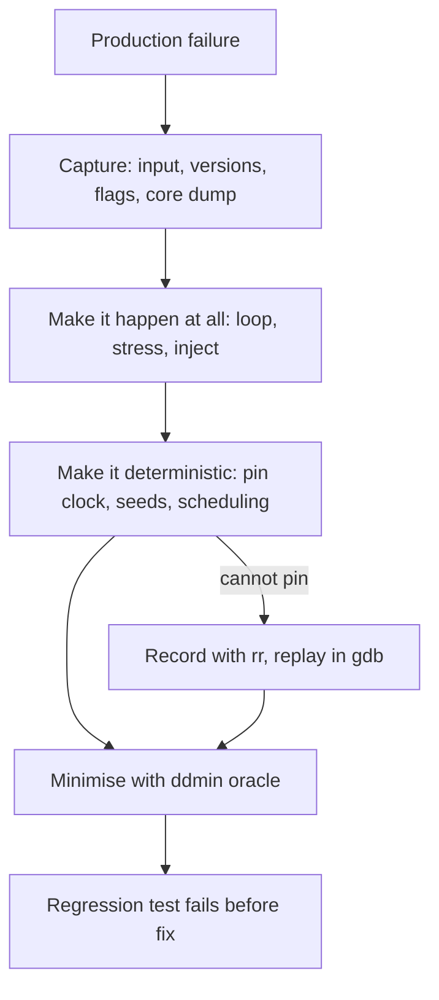

## In one minute
- A bug you cannot reproduce is a bug you cannot confirm you fixed. Reproduction is the step that turns a story into an experiment you can run as often as you like.
- Work in three stages: make it happen at all, make it happen every time, then make it small.
- Most "random" bugs are deterministic functions of inputs you did not capture: time, seeds, thread scheduling, configuration, data, versions and environment.
- Delta debugging automates "make it small": it shrinks a failing input to a minimal one using only a pass or fail oracle.
- When the nondeterminism lives in scheduling or the kernel, record and replay tools such as `rr` and deterministic simulation can capture what you cannot control.

## How it works

### Capture the conditions
Before touching code, collect everything that made the failing run different from the thousands that passed. That means the exact request or input file, the build and dependency versions, configuration and feature-flag state at the time, the data the request touched, the host and its resource limits, and the time. Production systems that log a request ID next to the build SHA and flag snapshot make this a query instead of an archaeology project. If the process crashed, a core dump is the single most valuable artefact: it holds every thread's stack and the heap at the moment of death.

### Make it happen at all
Rare bugs need volume. Run the suspect path in a loop thousands of times, raise concurrency above production levels, shrink timeouts, and inject latency or failures at the boundaries you suspect. A failure rate of 1 in 5,000 becomes one every few seconds in a tight loop. The goal at this stage is any failure, however ugly the harness.

### Make it happen every time
Then remove nondeterminism one source at a time. Inject the clock instead of reading wall time. Fix random seeds. Pin hash seeds (`PYTHONHASHSEED`) and remember that Go deliberately randomises map iteration order. Sort directory listings. Reduce CPU count or `GOMAXPROCS` to change scheduling pressure. Disable ASLR with `setarch -R` if the bug depends on addresses. Each source you pin is also a clue: if pinning the clock makes the bug vanish, time is part of the mechanism.

### Make it small
A 48,000-row CSV that crashes the importer is a reproduction, but nobody can reason about it. Shrink the input until every remaining part is necessary. Do it by hand by halving, or let a tool do it: delta debugging (ddmin) tries chunks and their complements, keeps any smaller input that still fails, and refines the granularity when nothing smaller fails. Property-based testing frameworks such as Hypothesis do the same automatically when they "shrink" a counterexample.

### Turn it into a test
The final reproduction belongs in the test suite. It should fail on the broken build, pass on the fixed build, and run in seconds. If it needs the full stack, mark it as an integration test but keep it.

## Down the stack

### Layer 1: The contract
A reproduction is a script plus an environment description that, when run, shows the failure with a stated probability, ideally 1, and stops showing it when the fix is applied. Testable: someone else can run it on a clean machine, the failure signature matches production (same exception, same corrupted field), and the reproduction fails on the commit before the fix and passes on the commit with it. A repro with an unknown failure rate cannot prove a fix; if it fails 1 time in 20, you need roughly 60 clean runs before "fixed" is believable at 95% confidence.

### Layer 2: The mechanism
Delta debugging, from Andreas Zeller's work, needs only an oracle `fails(input)`. Split the input into n chunks. If one chunk alone fails, recurse on it. Otherwise, if removing one chunk still fails, drop that chunk. Otherwise double n and retry, up to single elements. The result is 1-minimal: removing any single element makes it pass. It does not guarantee the globally smallest input, and the worst case needs n squared plus 3n oracle calls for n elements ([Zeller and Hildebrandt, 2002](https://www.cs.purdue.edu/homes/xyzhang/fall07/Papers/delta-debugging.pdf)), but on real inputs it is usually far cheaper. The oracle should return three outcomes, not two: pass, fail, and unresolved for a candidate that fails differently or cannot run. The Debugging Book's implementation counts a run as a failure only if it raises the same exception type with the same message; a different exception is reported as unresolved, and a run that raises nothing is a pass, so in neither case is the reduction step accepted ([Debugging Book](https://www.debuggingbook.org/html/DeltaDebugger.html)).

When the trigger is scheduling, not data, record and replay helps. `rr`, from Mozilla, records a Linux process tree by capturing every source of nondeterminism: syscall results, signal delivery points and the exact point of each context switch. It runs all threads on one core at a time and uses the CPU's retired-conditional-branch performance counter, paired with the register state, to find the same instruction again on replay: it is the only Intel counter the authors found to be deterministic ([Pillai et al., rr paper](https://arxiv.org/abs/1705.05937)). A recorded failure replays identically under `gdb`, including reverse execution. The paper reports slowdowns under 2x on its important low-parallelism workloads, while workloads that are consistently highly parallel slow down a lot more ([Pillai et al., rr paper](https://arxiv.org/abs/1705.05937)). It needs hardware performance counters: the project lists Intel Nehalem or later, some AMD Zen parts and some AArch64 cores, and virtual machines only if they virtualise the counters ([rr README](https://github.com/rr-debugger/rr)).

For crashes, the core dump is an ELF file. `PT_LOAD` segments hold the process's memory regions; `PT_NOTE` segments carry `NT_PRSTATUS` entries (one per thread, with registers), `NT_FILE` (which files were mapped where) and more. `gdb binary core` reconstructs every thread's stack from those registers, as long as you kept the exact binary and its debug symbols.

### Layer 3: The machine
Nondeterminism enters at a small number of machine-level doors. `clock_gettime` usually does not even enter the kernel: it reads the vDSO, a page the kernel maps into every process. `getrandom` and `/dev/urandom` supply entropy. The `rdtsc` instruction reads the cycle counter directly. ASLR randomises the base of the stack, heap and shared libraries on every `execve`. The scheduler picks which runnable thread gets a CPU at each tick or wake-up, and on a 16-core host two threads may interleave in ways a 2-core laptop never shows. Readdir order depends on the filesystem's on-disk layout, not on file names.

Core dumps depend on kernel settings: `ulimit -c` must allow them, `/proc/sys/kernel/core_pattern` decides whether the dump goes to a file or is piped to a handler like `systemd-coredump` when it starts with `|`, and `/proc/<pid>/coredump_filter` selects which mappings are written. `RLIMIT_CORE` is not enforced for piped dumps, so the handler has to enforce its own size cap ([core(5)](https://man7.org/linux/man-pages/man5/core.5.html)). A process with a 20 GB heap produces a 20 GB core, which matters in containers with small disks.

### Why it's built this way
1. You cannot verify a fix without a failing case, so reproduction comes before repair.
2. Production carries hidden inputs (time, entropy, scheduling, config), so you capture or pin them until the failure is a function of what you control.
3. Large reproductions are slow and hard to reason about, so you minimise automatically with an oracle.
4. Some nondeterminism cannot be pinned from user space, so tools like `rr` record it at the kernel boundary and replay it exactly.

## Diagram


## Worked example
An import job crashes on about 1 in 5,000 uploaded files. The logs give a request ID; the request ID leads to the uploaded CSV in object storage and the build SHA. Run locally against that SHA, the file crashes the importer every time, so the bug is deterministic in the data, not timing.

The file has 48,000 rows and one run takes 0.3 seconds. The oracle is "the importer raises `IndexError` in `parse_row`" (matching the signature matters: a different exception from a malformed half-file does not count). ddmin first tries halves, keeps whichever half still fails, and continues. Around 17 halvings would isolate a single culprit row; this bug needs two rows, a header-like row with a byte-order mark in the middle of the file and a row after it with an empty last column. Interacting causes cost extra rounds of complements, and the run ends at about 150 oracle calls, roughly 45 seconds. A human halving by hand would likely have stopped at "rows 30,000 to 31,000" and missed that two separate rows were required.

The two-row file becomes a unit test, and its shape explains the mechanism: the BOM resets the column count used for the next row.

## In the wild
- **NASA JPL, 1997: Mars Pathfinder resets.** Engineers ran the software on an exact replica with VxWorks tracing enabled, and after hours one run reproduced a reset. The trace showed a high-priority bus task blocked on a mutex held by a low-priority task that a medium-priority task kept off the CPU. The mutex had priority inheritance off, and a short C program uploaded to the spacecraft set the flag, ending the resets ([Mike Jones's account of David Wilner's keynote](https://www.cs.cmu.edu/~rajkumar/mars.html)).
- **Cloudflare, 2025: arm64 crashes from a split ADD.** Sporadic fatal errors (up to about 30 per day at peak, roughly one machine a day in under 10% of data centers) were traced through core dumps: each crash was a preemption landing between the two `ADD` instructions the assembler emitted for a large stack-frame adjustment. A standard-library-only program with a 64 KB buffer and a goroutine calling `runtime.GC()` in a loop reproduced it in minutes on Go 1.23.4. The fix shipped in Go 1.23.12, 1.24.6 and 1.25.0 ([Cloudflare](https://blog.cloudflare.com/how-we-found-a-bug-in-gos-arm64-compiler/)).

## Trade-offs
| Approach | Strengths | Weaknesses | Choose when |
| --- | --- | --- | --- |
| Replay captured input | Fast, exact, cheap | Needs the input to have been captured | Data-dependent bugs |
| Stress loop with injection | Finds rare timing bugs | Slow, may change the bug | Races, timeouts, retries |
| Record and replay (`rr`) | Exact replay, reverse debugging | Linux only, needs hardware performance counters (Intel, some AMD and AArch64 cores), one thread at a time during recording | Native code, rare crashes |
| Deterministic simulation | Explores schedules and faults reproducibly | Large up-front investment in architecture | Distributed systems you own end to end |
| Core dump analysis | No reproduction needed for the crash state | Shows the end, not the path | Crashes you cannot trigger again |

## Pitfalls in production
- Reproducing a different bug: the minimised input fails, but with a different error. Fix: make the oracle check the exact failure signature, not just "non-zero exit".
- Missing debug symbols for core dumps. Fix: archive symbol files per build SHA, or ship separate debuginfo, so a crash from three months ago is still readable.
- Production config drift: the bug only happens with a flag combination nobody recorded. Fix: log flag and config versions with every request or job.
- Flaky reproduction treated as solid. Fix: measure the failure rate and run enough iterations after the fix to make "fixed" statistically meaningful.
- Core dumps disabled or filling disks. Fix: set `core_pattern` to a handler with size limits and retention, and test that it works before you need it.

## Leadership lens
- Make reproducibility an engineering requirement: request IDs linked to build SHA and flag state, injectable clocks, seeded randomness.
- Ask "do we have a failing test?" before reviewing any bug fix PR. No repro, no merge, unless the risk is documented.
- Budget time for "can't reproduce" bugs explicitly. Closing them as "works for me" teaches the team to ignore rare failures that become incidents.
- Agents are good at writing stress harnesses and minimisers; let them, but you own the oracle definition.

## Check yourself
1. Your repro fails 1 time in 10. After the fix it passes 10 runs in a row. Is it fixed?
   **Answer:** Not convincingly. A 1-in-10 bug passes 10 runs about 35% of the time by chance; you need roughly 30 or more clean runs for 95% confidence.
2. Why does ddmin also try complements, not just chunks?
   **Answer:** When the failure needs elements from two different chunks, no single chunk fails, but removing an unrelated chunk still fails, so complements make progress.
3. Why can `rr` replay a race faithfully even though it runs threads on one core?
   **Answer:** It records exactly where each context switch happened, measured in retired branches, and reproduces that same interleaving on replay.
4. A crash happened once and never again. What do you need to have set up in advance to debug it?
   **Answer:** Core dumps enabled with a working `core_pattern`, the exact binary, and its debug symbols archived by build ID.

## Practice
**Task:** Implement delta debugging. `ddmin(items, fails)` takes a list and an oracle that returns true when a candidate list still triggers the bug. It returns a 1-minimal sublist (order preserved) that still fails: removing any single element must make the oracle pass. Raise `ValueError` if the full input does not fail. Use the classic loop: split into n chunks, try each chunk, then each complement, otherwise increase granularity; stop when n reaches the list length and nothing smaller fails. Do not mutate the input.

```python starter
def ddmin(items, fails):
    # TODO
    raise NotImplementedError
```

```python tests
def _one_minimal(res, fails):
    if not fails(res):
        return False
    for i in range(len(res)):
        if fails(res[:i] + res[i + 1:]):
            return False
    return True

def test_two_interacting_elements():
    fails = lambda xs: 3 in xs and 7 in xs
    assert ddmin(list(range(10)), fails) == [3, 7]

def test_single_culprit_few_calls():
    calls = []
    def fails(xs):
        calls.append(1)
        return 41 in xs
    assert ddmin(list(range(64)), fails) == [41]
    assert len(calls) <= 20, len(calls)

def test_order_preserved_and_minimal():
    fails = lambda xs: "".join(xs).find("ab") >= 0 or ("x" in xs and "z" in xs)
    data = list("qxwzeabr")
    res = ddmin(data, fails)
    assert _one_minimal(res, fails)
    it = iter(data)
    assert all(c in it for c in res), "must be a subsequence"

def test_raises_when_input_passes():
    try:
        ddmin([1, 2, 3], lambda xs: False)
        assert False, "expected ValueError"
    except ValueError:
        pass

def test_does_not_mutate_input():
    data = [5, 1, 4]
    ddmin(data, lambda xs: 1 in xs)
    assert data == [5, 1, 4]

def test_single_element_input():
    assert ddmin([9], lambda xs: 9 in xs) == [9]

def test_needs_count():
    fails = lambda xs: xs.count(0) >= 3
    res = ddmin([0, 1, 0, 2, 0, 3, 0], fails)
    assert res == [0, 0, 0]
```

```python solution
def ddmin(items, fails):
    items = list(items)
    if not fails(items):
        raise ValueError("input does not fail")
    n = 2
    while len(items) >= 2:
        L = len(items)
        bounds = [i * L // n for i in range(n + 1)]
        reduced = False
        for i in range(n):
            chunk = items[bounds[i]:bounds[i + 1]]
            if chunk and fails(chunk):
                items, n, reduced = chunk, 2, True
                break
        if not reduced:
            for i in range(n):
                comp = items[:bounds[i]] + items[bounds[i + 1]:]
                if len(comp) < L and fails(comp):
                    items, n, reduced = comp, max(n - 1, 2), True
                    break
        if not reduced:
            if n >= L:
                break
            n = min(n * 2, L)
    return items
```

```typescript starter
export function ddmin<T>(items: T[], fails: (xs: T[]) => boolean): T[] {
  throw new Error("TODO");
}
```

```typescript tests
function oneMinimal<T>(res: T[], fails: (xs: T[]) => boolean): boolean {
  if (!fails(res)) return false;
  for (let i = 0; i < res.length; i++) {
    if (fails(res.slice(0, i).concat(res.slice(i + 1)))) return false;
  }
  return true;
}

test("two interacting elements", () => {
  const fails = (xs: number[]) => xs.includes(3) && xs.includes(7);
  assertEqual(ddmin([0, 1, 2, 3, 4, 5, 6, 7, 8, 9], fails), [3, 7]);
});
test("single culprit few calls", () => {
  let calls = 0;
  const fails = (xs: number[]) => { calls++; return xs.includes(41); };
  const data = Array.from({ length: 64 }, (_, i) => i);
  assertEqual(ddmin(data, fails), [41]);
  assert(calls <= 20, "too many oracle calls: " + calls);
});
test("order preserved and minimal", () => {
  const fails = (xs: string[]) => xs.join("").indexOf("ab") >= 0 || (xs.includes("x") && xs.includes("z"));
  const data = "qxwzeabr".split("");
  const res = ddmin(data, fails);
  assert(oneMinimal(res, fails), "not 1-minimal");
  let j = 0;
  for (const c of data) if (j < res.length && res[j] === c) j++;
  assert(j === res.length, "must be a subsequence");
});
test("throws when input passes", () => {
  let threw = false;
  try { ddmin([1, 2, 3], () => false); } catch (e) { threw = true; }
  assert(threw, "expected error");
});
test("does not mutate input", () => {
  const data = [5, 1, 4];
  ddmin(data, (xs) => xs.includes(1));
  assertEqual(data, [5, 1, 4]);
});
test("single element input", () => {
  assertEqual(ddmin([9], (xs) => xs.includes(9)), [9]);
});
test("needs count", () => {
  const fails = (xs: number[]) => xs.filter((x) => x === 0).length >= 3;
  assertEqual(ddmin([0, 1, 0, 2, 0, 3, 0], fails), [0, 0, 0]);
});
```

```typescript solution
export function ddmin<T>(items: T[], fails: (xs: T[]) => boolean): T[] {
  let cur = items.slice();
  if (!fails(cur)) throw new Error("input does not fail");
  let n = 2;
  while (cur.length >= 2) {
    const L = cur.length;
    const b: number[] = [];
    for (let i = 0; i <= n; i++) b.push(Math.floor((i * L) / n));
    let reduced = false;
    for (let i = 0; i < n && !reduced; i++) {
      const chunk = cur.slice(b[i], b[i + 1]);
      if (chunk.length > 0 && fails(chunk)) { cur = chunk; n = 2; reduced = true; }
    }
    for (let i = 0; i < n && !reduced; i++) {
      const comp = cur.slice(0, b[i]).concat(cur.slice(b[i + 1]));
      if (comp.length < L && fails(comp)) { cur = comp; n = Math.max(n - 1, 2); reduced = true; }
    }
    if (!reduced) {
      if (n >= L) break;
      n = Math.min(n * 2, L);
    }
  }
  return cur;
}
```

```go starter
package practice

import "errors"

var ErrPasses = errors.New("input does not fail")

func DDMin(items []int, fails func([]int) bool) ([]int, error) {
	panic("TODO")
}
```

```go tests
package practice

import (
	"reflect"
	"testing"
)

func contains(xs []int, v int) bool {
	for _, x := range xs {
		if x == v {
			return true
		}
	}
	return false
}

func TestTwoInteractingElements(t *testing.T) {
	fails := func(xs []int) bool { return contains(xs, 3) && contains(xs, 7) }
	got, err := DDMin([]int{0, 1, 2, 3, 4, 5, 6, 7, 8, 9}, fails)
	if err != nil || !reflect.DeepEqual(got, []int{3, 7}) {
		t.Fatalf("got %v %v", got, err)
	}
}

func TestSingleCulpritFewCalls(t *testing.T) {
	calls := 0
	fails := func(xs []int) bool { calls++; return contains(xs, 41) }
	data := make([]int, 64)
	for i := range data {
		data[i] = i
	}
	got, _ := DDMin(data, fails)
	if !reflect.DeepEqual(got, []int{41}) || calls > 20 {
		t.Fatalf("got %v after %d calls", got, calls)
	}
}

func TestOneMinimal(t *testing.T) {
	fails := func(xs []int) bool { return (contains(xs, 1) && contains(xs, 2)) || contains(xs, 9) && contains(xs, 8) }
	got, err := DDMin([]int{5, 9, 6, 1, 7, 2, 8}, fails)
	if err != nil || !fails(got) {
		t.Fatalf("result must fail: %v %v", got, err)
	}
	for i := range got {
		rest := append(append([]int{}, got[:i]...), got[i+1:]...)
		if fails(rest) {
			t.Fatalf("not 1-minimal: %v", got)
		}
	}
}

func TestErrorWhenInputPasses(t *testing.T) {
	if _, err := DDMin([]int{1, 2, 3}, func([]int) bool { return false }); err != ErrPasses {
		t.Fatalf("expected ErrPasses, got %v", err)
	}
}

func TestDoesNotMutateInput(t *testing.T) {
	data := []int{5, 1, 4}
	DDMin(data, func(xs []int) bool { return contains(xs, 1) })
	if !reflect.DeepEqual(data, []int{5, 1, 4}) {
		t.Fatalf("input mutated: %v", data)
	}
}

func TestSingleElementInput(t *testing.T) {
	got, err := DDMin([]int{9}, func(xs []int) bool { return contains(xs, 9) })
	if err != nil || !reflect.DeepEqual(got, []int{9}) {
		t.Fatalf("got %v %v", got, err)
	}
}

func TestNeedsCount(t *testing.T) {
	fails := func(xs []int) bool {
		c := 0
		for _, x := range xs {
			if x == 0 {
				c++
			}
		}
		return c >= 3
	}
	got, _ := DDMin([]int{0, 1, 0, 2, 0, 3, 0}, fails)
	if !reflect.DeepEqual(got, []int{0, 0, 0}) {
		t.Fatalf("got %v", got)
	}
}
```

```go solution
package practice

import "errors"

var ErrPasses = errors.New("input does not fail")

func DDMin(items []int, fails func([]int) bool) ([]int, error) {
	cur := append([]int{}, items...)
	if !fails(cur) {
		return nil, ErrPasses
	}
	n := 2
	for len(cur) >= 2 {
		L := len(cur)
		b := make([]int, n+1)
		for i := 0; i <= n; i++ {
			b[i] = i * L / n
		}
		reduced := false
		for i := 0; i < n && !reduced; i++ {
			chunk := append([]int{}, cur[b[i]:b[i+1]]...)
			if len(chunk) > 0 && fails(chunk) {
				cur, n, reduced = chunk, 2, true
			}
		}
		for i := 0; i < n && !reduced; i++ {
			comp := append(append([]int{}, cur[:b[i]]...), cur[b[i+1]:]...)
			if len(comp) < L && fails(comp) {
				m := n - 1
				if m < 2 {
					m = 2
				}
				cur, n, reduced = comp, m, true
			}
		}
		if !reduced {
			if n >= L {
				break
			}
			n *= 2
			if n > L {
				n = L
			}
		}
	}
	return cur, nil
}
```

## Mock interview
**Prompt:** Customers report that about 1 in 3,000 PDF exports comes back blank. Nobody on the team has seen it locally, and the export service runs on 60 pods behind a queue. How do you get to a reproduction?

- Follow-up: You found one failing input, but it only fails 1 time in 8 locally. What next?
- Follow-up: The failure disappears when you add logging around the render call. What does that suggest?
- Follow-up: How would you change the system so the next rare bug is easier to reproduce?

**A strong answer covers:**
- Capturing the exact failing inputs, build SHA, flag state and host for blank exports via request IDs, before guessing.
- Separating data-dependent from timing-dependent causes by replaying the captured input many times.
- Pinning sources of nondeterminism one at a time and treating each one that changes the rate as a clue.
- Minimising the input with an oracle that matches the exact failure signature.
- Statistical confidence for flaky repros, and record and replay or stress harnesses for timing bugs.

## Sources and further study
**Primary**
- [Zeller and Hildebrandt, Simplifying and Isolating Failure-Inducing Input (2002)](https://www.cs.purdue.edu/homes/xyzhang/fall07/Papers/delta-debugging.pdf): the ddmin algorithm, 1-minimality and the n squared plus 3n worst case.
- [Pillai et al., Engineering Record And Replay For Deployability](https://arxiv.org/abs/1705.05937): how rr records at the syscall boundary and why it needs a deterministic branch counter.

**Systems docs**
- [rr README](https://github.com/rr-debugger/rr): supported CPUs and the VM caveat for performance counters.
- [The Debugging Book: Reducing Failure-Inducing Inputs](https://www.debuggingbook.org/html/DeltaDebugger.html): a runnable ddmin with pass, fail and unresolved outcomes.

**Books**
- *Site Reliability Engineering*, Beyer et al., chapter 12 "Effective Troubleshooting": the loop of testing a theory against the live system, with side effects of the test itself called out.
- *Systems Performance*, Brendan Gregg (2nd ed.), chapter 13 "perf": using `perf` to capture what a failing workload does when you cannot change it.

**Other curricula**
- [donnemartin/system-design-primer](https://github.com/donnemartin/system-design-primer): says RPC can be difficult to debug, but gives no reproduction technique.

## Watch
- [Record and replay debugging with rr (linux.conf.au 2016)](https://www.youtube.com/watch?v=ytNlefY8PIE): how rr captures nondeterminism and what reverse execution buys you.
- [Testing Distributed Systems with Deterministic Simulation (Will Wilson, Strange Loop)](https://www.youtube.com/watch?v=4fFDFbi3toc): FoundationDB's approach to making every failure reproducible.

## Free resources
- [Reducing Failure-Inducing Inputs (The Debugging Book)](https://www.debuggingbook.org/html/DeltaDebugger.html): delta debugging explained with runnable code.
- [rr project](https://rr-project.org/): what rr records, its limits and overhead.
- [core(5) man page](https://man7.org/linux/man-pages/man5/core.5.html): core dump settings, `core_pattern` and `coredump_filter`.
- [FoundationDB simulation and testing](https://apple.github.io/foundationdb/testing.html): deterministic simulation in production software.
- [Reproducible Builds](https://reproducible-builds.org/): why identical inputs should produce identical binaries, which you need for trustworthy repros.
