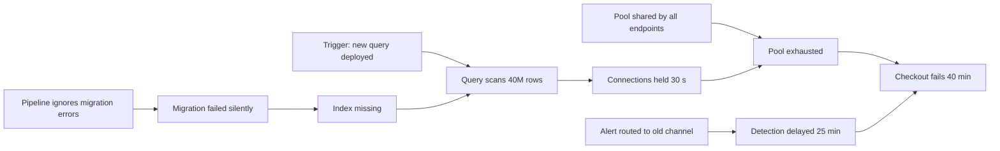

## In one minute
- Root cause analysis asks why an incident happened deeply enough that the fix prevents a whole class of incidents, not just this one.
- In complex systems there is rarely a single root cause. Incidents come from a trigger meeting several contributing factors: a latent bug, a missing alert, a risky default, a rushed process. Model them as a causal graph, not a chain.
- The 5 whys is a useful habit but a weak method on its own: it follows one chain and tends to stop at a person ("the engineer ran the wrong command"). Ask "how" and "what made this possible" as well.
- A fishbone (Ishikawa) diagram helps you look across categories (code, config, process, people and tools, environment, dependencies) so you do not miss branches.
- Good action items attack the graph at several levels: remove the trigger, add detection, limit blast radius and fix the conditions that made the error likely.

## How it works

### Trigger, causes, contributing factors
Separate three things. The **trigger** is the event that started it: a deploy, a traffic spike, a certificate expiring. **Causes** are the mechanisms that turned the trigger into impact: a missing timeout, a retry storm, a shared database. **Contributing factors** are conditions that made it worse or more likely: no canary, an alert that went to an unmonitored channel, a runbook that was out of date, an on-call engineer on their first shift. Removing the trigger stops a repeat of this exact incident; fixing causes and contributing factors prevents its relatives.

### 5 whys, used well
Start from the impact and ask why until you reach something you can change systemically. "Checkout failed for 40 minutes. Why? The payment service ran out of database connections. Why? A new query held connections for 30 seconds. Why? It scanned a large table without an index. Why? The migration adding the index failed silently. Why? Migration failures are not checked by the deploy pipeline." The last answer leads to a fix that prevents many future incidents. Two common mistakes: stopping at a person ("why? because Sam forgot") and following only one branch. When an answer is "someone made a mistake", ask what made the mistake easy and the consequences large. John Allspaw makes the same point about the question itself: "why" invites answers about individuals, while "how" draws out the conditions and how decisions made sense at the time ([The Infinite Hows](https://www.oreilly.com/radar/the-infinite-hows/)).

### Fishbone
Draw the impact at the head of a fish and categories along the spine: code, configuration, data, infrastructure, dependencies, process, people and tools, monitoring. For each category ask what contributed. It forces breadth, which is exactly what 5 whys lacks, and it works well as a group exercise in a postmortem meeting.

### Causal graphs
Combine both into a directed graph: nodes are facts, edges mean "contributed to". Several roots can lead to the impact, and some nodes have several parents. Reading the graph shows where one fix removes many paths. Safety science has gone further in this direction: Richard Cook's "How Complex Systems Fail" argues that catastrophe requires multiple failures (point 3), that post-accident attribution to a single root cause is fundamentally wrong (point 7), and that hindsight bias makes after-the-fact analysis of human performance inaccurate (point 8) ([Cook](https://how.complexsystems.fail/)); Nancy Leveson's CAST method analyses accidents as failures of control structures rather than chains of events. You do not need the full methods to borrow the core lesson: look for the conditions, not the culprit.

### Counterfactuals and hindsight
After an incident, everything looks obvious. "They should have noticed the error rate" assumes the signal was as clear then as it is now. Good analysis asks what people knew and saw at the time, why their actions made sense to them, and what would have made the right action easier. This is what blameless means: not ignoring mistakes, but treating them as symptoms of the system. Google's SRE book states the aim as finding contributing causes without indicting any individual or team, because blame teaches people to hide problems ([Postmortem Culture](https://sre.google/sre-book/postmortem-culture/)).

### The same shape everywhere
Root cause analysis is the same skill in a manufacturing defect, a missed sales target or a failed project: separate the trigger from the conditions, look across categories, and fix the system rather than blaming the last person to touch it.

## Down the stack

### Layer 1: The contract
A root cause analysis promises a factual timeline, a causal graph (or at least multiple contributing factors) that explains the impact, action items mapped to graph nodes with owners and dates, and language that describes systems and decisions rather than blaming individuals. A reviewer should be able to trace every action item back to the part of the graph it removes.

### Layer 2: The mechanism
The evidence comes from the same sources as debugging: deploy and config change logs, metrics, traces, logs, chat transcripts and the incident timeline. Change events are especially valuable: a system that records every deploy, flag flip and config push with timestamps turns "what changed?" into a query, and Google's troubleshooting chapter names recent changes as a productive place to start ([SRE book, ch. 12](https://sre.google/sre-book/effective-troubleshooting/)). The analysis itself is graph work: collect candidate facts, link them with "contributed to" edges, and test each edge with a counterfactual: if this node had not been present, would the impact have happened, or been smaller? Edges that fail the test are removed.

### Layer 3: The machine
Many root causes live in low-level behaviour that the timeline only hints at: a kernel's TCP retransmission behaviour turning packet loss into seconds of latency, a garbage collector pause exceeding a lease timeout so a node is wrongly declared dead, a file system filling up so `write()` returns `ENOSPC` and a service fails in an untested path. Reaching that level means reading kernel logs (`dmesg` for OOM kills and disk errors), garbage collector logs, and system-call failures, and it is often where the systemic fix is: a timeout tuned against real GC pauses, disk alerts at 80 percent, error paths tested.

### Why it's built this way
1. Complex systems fail through combinations of conditions, not single faults.
2. A single chain finds one combination and misses the rest.
3. Graphs show every path to impact, and where a fix removes many paths.
4. Blaming individuals hides the conditions that made errors likely, and discourages honest reporting.
5. So: separate trigger from conditions, map them as a graph, and fix at several levels.

## Diagram


## Worked example
Checkout fails for 40 minutes. The timeline: at 10:02 a release adds an order-history query; at 10:05 database connections hit the pool limit of 200; errors start; at 10:30 someone notices the alert in an old channel; at 10:38 the release is rolled back; at 10:42 checkout recovers.

A 5 whys chain finds the missing index and the pipeline that ignored migration failures. The fishbone adds other branches. Configuration: the connection pool is shared across all endpoints, so a slow history page could starve checkout. Monitoring: the alert went to a channel the team stopped using in a reorganisation. Process: there was no canary, so the release went to 100 percent at once. Data: the table had grown from 2 million to 40 million rows since the query was tested.

The causal graph has four roots: the silent migration failure, the shared pool, the misrouted alert and the lack of a canary. Action items, one per root: fail the pipeline on migration errors; separate pools per endpoint class so checkout keeps its connections; route alerts by service ownership from a single source of truth, with a weekly test page; canary releases with automatic rollback on error rate. Any one of them would have reduced this incident: the pipeline fix would have prevented it, the pool split would have kept checkout working, and the alert and canary fixes would have cut 40 minutes to about 5.

## In the wild
- **AWS Kinesis, 2020: trigger versus cause.** Adding servers to the front-end fleet pushed each past an OS thread limit, because every server keeps a thread per peer. AWS explicitly called the capacity addition the trigger, not the root cause, and listed fixes at several levels: thread-consumption alarms, larger servers, a dedicated shard-map cache fleet, and cellularisation. Recovery took about 17 hours from first alarms ([AWS summary](https://aws.amazon.com/message/11201/)).
- **AWS S3, 2017: one mistyped input.** During a playbook step to remove a few billing servers, one input was entered wrong and a much larger set was removed, forcing restarts of the index and placement subsystems; S3 was down about 4 hours 17 minutes. The report's fixes target the system: the tool removes capacity more slowly, refuses removals below a minimum, and other tools are audited for similar checks ([AWS summary](https://aws.amazon.com/message/41926/)).
- **Google Cloud, 2021: a race that validation could not see.** The bug existed for about six months and was found internally on 12 November; the team chose a gradual patch rollout, and the race struck an unpatched cluster on 16 November. The write-up lists the fix, input validation, alerting and architectural isolation, not a person ([incident report](https://status.cloud.google.com/incidents/6PM5mNd43NbMqjCZ5REh)).

## Trade-offs
| Method | Strengths | Weaknesses | Choose when |
| --- | --- | --- | --- |
| 5 whys | Fast, easy to teach | One chain, stops at people | Small incidents, as a starting point |
| Fishbone | Breadth across categories | Can produce long lists without links | Group postmortems |
| Causal graph | Shows multiple paths and shared fixes | Takes more time | Significant incidents |
| Formal methods (CAST) | Deep systemic insight | Expertise and time | Major or repeated incidents |

## Pitfalls in production
- Stopping at human error. Fix: ask what made the error easy and its consequences large.
- One root cause in the report because the template has one field. Fix: list contributing factors and draw the graph.
- Action items that only remove the trigger. Fix: add items for detection, blast radius and the conditions; AWS's Kinesis review treated the capacity addition as the trigger and fixed the thread-limit design behind it ([AWS](https://aws.amazon.com/message/11201/)).
- Hindsight bias in the timeline ("they should have seen it"). Fix: describe what people saw and knew at the time.
- Action items without owners or dates. Fix: track them like any other work, and review completion.

## Leadership lens
- Change the postmortem template: contributing factors and a graph instead of a single root cause field.
- Record every change (deploys, flags, config, migrations) as events with timestamps; it makes analysis much faster.
- Review action items across incidents for repeated themes; the most common contributing factor is your next investment.
- Model blameless language yourself, especially when the mistake was made by someone senior or by you.

## Check yourself
1. What is the difference between a trigger and a contributing factor?
   **Answer:** The trigger starts the incident; contributing factors are conditions that allowed it to cause impact or made it worse, and fixing them prevents related incidents too.
2. Why is "the engineer ran the wrong command" a poor place to stop a 5 whys?
   **Answer:** It blames a person and leads to "be more careful", while the real question is why the system made the wrong command easy and so damaging.
3. How does a counterfactual test help build a causal graph?
   **Answer:** For each candidate cause, ask whether the impact would have happened or been smaller without it; if removing it changes nothing, it is not a contributing factor.
4. Why might four action items be better than one strong fix?
   **Answer:** Each addresses a different path or layer (prevention, detection, blast radius, recovery), so the system stays safe even if one defence fails.

## Practice
**Task:** Build a causal graph walker for postmortems. `edges` is a list of `(cause, effect)` pairs. `roots(edges, impact)` returns the sorted list of nodes that can reach `impact` through edges and have no causes of their own (an impact with no causes is not its own root; return an empty list). `why_chain(edges, impact)` returns the longest path from `impact` back to a root, as a list starting with `impact`; when several causes lead to equally long paths, follow the alphabetically first. `single_points(edges, impact)` returns the sorted list of nodes (other than `impact` itself) that lie on every path from every root to the impact: fixing one of these alone would break all paths.

```python starter
def roots(edges, impact):
    # TODO
    raise NotImplementedError

def why_chain(edges, impact):
    # TODO
    raise NotImplementedError

def single_points(edges, impact):
    # TODO
    raise NotImplementedError
```

```python tests
EDGES = [
    ("pipeline ignores errors", "migration failed"),
    ("migration failed", "index missing"),
    ("index missing", "slow query"),
    ("new query deployed", "slow query"),
    ("slow query", "pool exhausted"),
    ("shared pool", "pool exhausted"),
    ("pool exhausted", "checkout down"),
    ("alert misrouted", "late detection"),
    ("late detection", "checkout down"),
]

def test_roots():
    assert roots(EDGES, "checkout down") == ["alert misrouted", "new query deployed", "pipeline ignores errors", "shared pool"]

def test_why_chain_follows_longest_path():
    assert why_chain(EDGES, "checkout down") == [
        "checkout down", "pool exhausted", "slow query", "index missing", "migration failed", "pipeline ignores errors"]

def test_roots_of_intermediate_node():
    assert roots(EDGES, "slow query") == ["new query deployed", "pipeline ignores errors"]

def test_single_point_when_paths_converge():
    edges = [("a", "x"), ("b", "x"), ("x", "y"), ("y", "impact")]
    assert single_points(edges, "impact") == ["x", "y"]

def test_no_single_point_with_independent_paths():
    assert single_points(EDGES, "checkout down") == []

def test_node_without_causes():
    assert roots(EDGES, "shared pool") == []
    assert why_chain(EDGES, "shared pool") == ["shared pool"]
```

```python solution
from collections import defaultdict

def _parents(edges):
    p = defaultdict(list)
    for c, e in edges:
        p[e].append(c)
    return p

def _ancestors(parents, node):
    seen, stack = set(), [node]
    while stack:
        n = stack.pop()
        for c in parents[n]:
            if c not in seen:
                seen.add(c)
                stack.append(c)
    return seen

def roots(edges, impact):
    parents = _parents(edges)
    return sorted(a for a in _ancestors(parents, impact) if not parents[a])

def why_chain(edges, impact):
    parents = _parents(edges)
    memo = {}

    def longest(n):
        if n not in memo:
            best = [n]
            for c in sorted(parents[n]):
                cand = [n] + longest(c)
                if len(cand) > len(best):
                    best = cand
            memo[n] = best
        return memo[n]
    return longest(impact)

def single_points(edges, impact):
    parents = _parents(edges)
    rs = roots(edges, impact)
    if not rs:
        return []
    candidates = _ancestors(parents, impact) - set(rs)
    out = []
    for node in candidates:
        cut = [(c, e) for c, e in edges if node not in (c, e)]
        if not any(r in _ancestors(_parents(cut), impact) for r in rs):
            out.append(node)
    return sorted(out)
```

```typescript starter
export type Edge = [string, string];

export function roots(edges: Edge[], impact: string): string[] {
  throw new Error("TODO");
}

export function whyChain(edges: Edge[], impact: string): string[] {
  throw new Error("TODO");
}

export function singlePoints(edges: Edge[], impact: string): string[] {
  throw new Error("TODO");
}
```

```typescript tests
const EDGES: Edge[] = [
  ["pipeline ignores errors", "migration failed"], ["migration failed", "index missing"],
  ["index missing", "slow query"], ["new query deployed", "slow query"], ["slow query", "pool exhausted"],
  ["shared pool", "pool exhausted"], ["pool exhausted", "checkout down"],
  ["alert misrouted", "late detection"], ["late detection", "checkout down"],
];

test("roots", () => {
  assertEqual(roots(EDGES, "checkout down"), ["alert misrouted", "new query deployed", "pipeline ignores errors", "shared pool"]);
});

test("why chain follows longest path", () => {
  assertEqual(whyChain(EDGES, "checkout down"),
    ["checkout down", "pool exhausted", "slow query", "index missing", "migration failed", "pipeline ignores errors"]);
});

test("roots of intermediate node", () => {
  assertEqual(roots(EDGES, "slow query"), ["new query deployed", "pipeline ignores errors"]);
});

test("single point when paths converge", () => {
  assertEqual(singlePoints([["a", "x"], ["b", "x"], ["x", "y"], ["y", "impact"]], "impact"), ["x", "y"]);
});

test("no single point with independent paths", () => {
  assertEqual(singlePoints(EDGES, "checkout down"), []);
});

test("node without causes", () => {
  assertEqual(roots(EDGES, "shared pool"), []);
  assertEqual(whyChain(EDGES, "shared pool"), ["shared pool"]);
});
```

```typescript solution
export type Edge = [string, string];

function parentsOf(edges: Edge[]): Record<string, string[]> {
  const p: Record<string, string[]> = {};
  for (const [c, e] of edges) (p[e] = p[e] || []).push(c);
  return p;
}

function ancestors(parents: Record<string, string[]>, node: string): Set<string> {
  const seen = new Set<string>(), stack = [node];
  while (stack.length) {
    const n = stack.pop()!;
    for (const c of parents[n] || []) if (!seen.has(c)) { seen.add(c); stack.push(c); }
  }
  return seen;
}

export function roots(edges: Edge[], impact: string): string[] {
  const parents = parentsOf(edges);
  return Array.from(ancestors(parents, impact)).filter(a => !(parents[a] || []).length).sort();
}

export function whyChain(edges: Edge[], impact: string): string[] {
  const parents = parentsOf(edges);
  const memo: Record<string, string[]> = {};
  const longest = (n: string): string[] => {
    if (!memo[n]) {
      let best = [n];
      for (const c of (parents[n] || []).slice().sort()) {
        const cand = [n].concat(longest(c));
        if (cand.length > best.length) best = cand;
      }
      memo[n] = best;
    }
    return memo[n];
  };
  return longest(impact);
}

export function singlePoints(edges: Edge[], impact: string): string[] {
  const rs = roots(edges, impact);
  if (!rs.length) return [];
  const candidates = Array.from(ancestors(parentsOf(edges), impact)).filter(n => !rs.includes(n));
  return candidates.filter(node => {
    const cut = edges.filter(([c, e]) => c !== node && e !== node);
    const anc = ancestors(parentsOf(cut), impact);
    return !rs.some(r => anc.has(r));
  }).sort();
}
```

```go starter
package practice

type Edge struct{ Cause, Effect string }

func Roots(edges []Edge, impact string) []string {
	panic("TODO")
}

func WhyChain(edges []Edge, impact string) []string {
	panic("TODO")
}

func SinglePoints(edges []Edge, impact string) []string {
	panic("TODO")
}
```

```go tests
package practice

import (
	"reflect"
	"testing"
)

var edges = []Edge{
	{"pipeline ignores errors", "migration failed"}, {"migration failed", "index missing"},
	{"index missing", "slow query"}, {"new query deployed", "slow query"}, {"slow query", "pool exhausted"},
	{"shared pool", "pool exhausted"}, {"pool exhausted", "checkout down"},
	{"alert misrouted", "late detection"}, {"late detection", "checkout down"},
}

func same(t *testing.T, got, want []string) {
	t.Helper()
	if len(got) == 0 && len(want) == 0 {
		return
	}
	if !reflect.DeepEqual(got, want) {
		t.Fatalf("got %v, want %v", got, want)
	}
}

func TestRoots(t *testing.T) {
	same(t, Roots(edges, "checkout down"), []string{"alert misrouted", "new query deployed", "pipeline ignores errors", "shared pool"})
}

func TestWhyChain(t *testing.T) {
	same(t, WhyChain(edges, "checkout down"), []string{"checkout down", "pool exhausted", "slow query", "index missing", "migration failed", "pipeline ignores errors"})
}

func TestIntermediate(t *testing.T) {
	same(t, Roots(edges, "slow query"), []string{"new query deployed", "pipeline ignores errors"})
}

func TestConverge(t *testing.T) {
	same(t, SinglePoints([]Edge{{"a", "x"}, {"b", "x"}, {"x", "y"}, {"y", "impact"}}, "impact"), []string{"x", "y"})
}

func TestIndependent(t *testing.T) {
	same(t, SinglePoints(edges, "checkout down"), nil)
}

func TestNoCauses(t *testing.T) {
	same(t, Roots(edges, "shared pool"), nil)
	same(t, WhyChain(edges, "shared pool"), []string{"shared pool"})
}
```

```go solution
package practice

import "sort"

type Edge struct{ Cause, Effect string }

func parentsOf(edges []Edge) map[string][]string {
	p := map[string][]string{}
	for _, e := range edges {
		p[e.Effect] = append(p[e.Effect], e.Cause)
	}
	return p
}

func ancestors(parents map[string][]string, node string) map[string]bool {
	seen := map[string]bool{}
	stack := []string{node}
	for len(stack) > 0 {
		n := stack[len(stack)-1]
		stack = stack[:len(stack)-1]
		for _, c := range parents[n] {
			if !seen[c] {
				seen[c] = true
				stack = append(stack, c)
			}
		}
	}
	return seen
}

func Roots(edges []Edge, impact string) []string {
	parents := parentsOf(edges)
	out := []string{}
	for a := range ancestors(parents, impact) {
		if len(parents[a]) == 0 {
			out = append(out, a)
		}
	}
	sort.Strings(out)
	return out
}

func WhyChain(edges []Edge, impact string) []string {
	parents := parentsOf(edges)
	memo := map[string][]string{}
	var longest func(n string) []string
	longest = func(n string) []string {
		if v, ok := memo[n]; ok {
			return v
		}
		best := []string{n}
		cs := append([]string(nil), parents[n]...)
		sort.Strings(cs)
		for _, c := range cs {
			cand := append([]string{n}, longest(c)...)
			if len(cand) > len(best) {
				best = cand
			}
		}
		memo[n] = best
		return best
	}
	return longest(impact)
}

func SinglePoints(edges []Edge, impact string) []string {
	rs := Roots(edges, impact)
	if len(rs) == 0 {
		return nil
	}
	isRoot := map[string]bool{}
	for _, r := range rs {
		isRoot[r] = true
	}
	out := []string{}
	for node := range ancestors(parentsOf(edges), impact) {
		if isRoot[node] {
			continue
		}
		var cut []Edge
		for _, e := range edges {
			if e.Cause != node && e.Effect != node {
				cut = append(cut, e)
			}
		}
		anc := ancestors(parentsOf(cut), impact)
		reached := false
		for _, r := range rs {
			if anc[r] {
				reached = true
			}
		}
		if !reached {
			out = append(out, node)
		}
	}
	sort.Strings(out)
	return out
}
```

## Mock interview
**Prompt:** A storage service lost writes for 2 hours for 3 percent of customers. The initial report says: "Root cause: an engineer applied a config change to the wrong cluster." Leadership wants the engineer to get extra approvals for all future changes. You are asked to lead the root cause analysis. What do you do?

- Follow-up: How do you get honest accounts from people involved, including the engineer?
- Follow-up: The analysis finds seven contributing factors. How do you prioritise action items?
- Follow-up: Six months later a similar incident happens. What does that tell you?

**A strong answer covers:**
- Separating trigger (the config change) from causes and contributing factors: why the wrong cluster was easy to target, why validation did not catch it, why writes were lost rather than rejected, why detection took two hours.
- A factual timeline from logs and change events, written without blame, from the viewpoint of what people knew then.
- Fishbone breadth across tooling, configuration, process, monitoring and design, and a causal graph showing paths.
- Action items at several levels: safer tooling (explicit cluster targeting, diff previews), validation, data-loss prevention (reject instead of drop), detection and alerting.
- Explaining why extra approvals for one person treat a symptom and discourage reporting.
- Tracking action items to completion and treating a repeat as evidence the systemic fixes were missing or not done.

## Sources and further study
**Systems docs**
- [Effective Troubleshooting (Google SRE book)](https://sre.google/sre-book/effective-troubleshooting/): hypothesis testing, bisection and recent changes.
- [Summary of the Amazon S3 Service Disruption, 2017](https://aws.amazon.com/message/41926/): a postmortem whose fixes are tooling limits.

**Books**
- *Site Reliability Engineering* (Google), Ch 15: Postmortem Culture: Learning from Failure.
- *The Site Reliability Workbook* (Google), Ch 10: Postmortem Culture: Learning from Failure, with good and bad postmortem examples.
- *Release It!*, 2nd ed. (Nygard), Ch 2: Case Study: The Exception That Grounded an Airline, a worked postmortem that traces a chain of failures.

**Other curricula**
- Cook and Allspaw above both reject the single-chain model; the 5 whys on Wikipedia notes the same criticism of the technique.

## Free resources
- [How Complex Systems Fail (Richard Cook)](https://how.complexsystems.fail/): short, influential essay on why there is rarely a single root cause.
- [The Infinite Hows (John Allspaw)](https://www.oreilly.com/radar/the-infinite-hows/): why asking "how" works better than "why" in incident analysis.
- [Postmortem Culture (Google SRE book)](https://sre.google/sre-book/postmortem-culture/): blameless postmortems at scale.
- [CAST Handbook (Nancy Leveson, PDF)](http://psas.scripts.mit.edu/home/get_file4.php?name=CAST_handbook.pdf): analysing accidents as failures of control, not chains of events.
- [Ishikawa diagram (Wikipedia)](https://en.wikipedia.org/wiki/Ishikawa_diagram): the fishbone method and its categories.
- [Five whys (Wikipedia)](https://en.wikipedia.org/wiki/Five_whys): the technique, its origins at Toyota and its criticisms.
