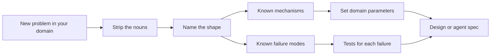

## In one minute
- Every team believes its domain is special, and it is: the vocabulary, the regulations and the cost of a mistake differ. Underneath, the same few problems repeat: contention, duplicates, ordering, fan-out, hot spots, overload, partial failure, multi-step consistency, finding things fast, and trust.
- The paradox: the more domains you see, the fewer distinct problems there seem to be. A seat at a concert, a driver at an airport and the last pair of shoes in stock are one problem with three costumes.
- Naming the shape is the move that turns a scary new problem into a familiar one, with decades of known solutions, failure modes and trade-offs attached.
- The domain still matters, but it decides the parameters (how long a hold lasts, what a duplicate costs, who gets told), not the mechanism.
- In the AI era this matters more: an agent can write the mechanism in minutes once you name it correctly, and it will confidently write the wrong one if you don't.

## How it works

### Why domains look different
A payments engineer talks about authorisations, captures and chargebacks. A ride-hailing engineer talks about dispatch, ETAs and surge. A chat engineer talks about presence, read receipts and fan-out. Each group has its own conferences, its own jargon and its own war stories, so it is natural to assume each needs its own way of thinking.

Strip the nouns off the war stories and they rhyme. "A customer was charged twice" and "a rider got two cars" and "the group got the message twice" are the same sentence: a request was retried, and the side effect was not idempotent. Payment providers say the same thing in their own docs: a connection error leaves you not knowing whether the request ran, so the API accepts a client-chosen key to make a retry safe ([Stripe API docs](https://docs.stripe.com/api/idempotent_requests)), and Stripe's webhook guide tells receivers to expect the same event more than once ([Stripe webhooks](https://docs.stripe.com/webhooks)). "We sold 103 tickets for 100 seats" and "two riders were matched to one driver" are the same sentence: two writers raced on one scarce thing and the check and the write were not atomic.

### The ten shapes
This course uses ten shapes, listed in `curriculum/problem-shapes.md` and on the home page:

1. **Contention**: many writers want one thing.
2. **Duplicates**: the same request arrives more than once.
3. **Ordering**: events arrive in a different order than they happened.
4. **Fan-out**: one event must reach many receivers.
5. **Hot spots**: skew, where one key gets far more than its share.
6. **Overload**: demand exceeds capacity.
7. **Partial failure**: you cannot tell whether something happened.
8. **Multi-step consistency**: several changes must all happen or none.
9. **Finding things fast**: search, lookup and nearest-neighbour.
10. **Trust but verify**: checking that what happened is what should have happened.

The list is not sacred. What matters is having a short list in your head and reaching for it every time.

### What the domain decides
Once the shape is named, the domain supplies the numbers and the policy. For contention, the mechanism is a hold with an expiry plus an atomic check-and-set. The domain decides how long the hold lasts (a concert seat: ten minutes while you pay; a driver: fifteen seconds while they accept; a stock unit: thirty minutes in a cart), what happens when the hold expires, and whether overbooking is allowed on purpose (airlines do it, cinemas do not). Mistaking a parameter difference for a mechanism difference is how teams end up building three reservation systems that each have a different bug.

### Why this is the skill of the AI era
Coding agents are very good at producing a mechanism once it is named: "add an idempotency key with a unique constraint and return the stored response on conflict" is a ten-minute task. They are much worse at noticing that a feature request about "group gift cards" is secretly a multi-step consistency problem. The engineer who names the shape writes the right spec, asks the agent for the right mechanism, and knows which tests prove it. The engineer who doesn't gets fast, plausible code for the wrong problem.

## Down the stack

### Layer 1: The contract
The human practice promises one thing: before designing or debugging, you can state the problem as "this is a *shape* problem in the *domain* domain, with these parameters". For example: "Booking a driver is contention on a scarce resource; hold 15 s; on expiry offer the next driver; never two confirmed riders per driver". The statement is testable: a reviewer can check that the design contains the known mechanism for that shape and a test for its known failure modes.

### Layer 2: The mechanism
Each shape maps to a small set of mechanisms with well-understood behaviour. Contention maps to locks, compare-and-set on a version column (`UPDATE seats SET holder=$1, version=version+1 WHERE id=$2 AND version=$3`), or a single-writer queue per resource. Duplicates map to idempotency keys stored under a unique index; the same idea lives inside Kafka, where an idempotent producer (since 0.11.0.0) gets a producer ID and sequence numbers so a resent batch does not duplicate log entries ([Kafka design docs](https://kafka.apache.org/42/design/design/)). Ordering maps to sequence numbers per key and partitioning by key so one consumer sees a key's events in order (Kafka orders messages only within a partition, and a key hashes to one partition, per the same page). Partial failure maps to timeouts, retries with idempotency, and reconciliation; the Azure Architecture Center warns that retrying a non-idempotent step, such as incrementing a value, gives a wrong result, and tells you to make each step idempotent ([Azure: transient fault handling](https://learn.microsoft.com/en-us/azure/architecture/best-practices/transient-faults)). Recognising the shape gives you this menu, and each item comes with known failure modes: locks deadlock, compare-and-set livelocks under heavy contention, unique indexes become hot.

### Layer 3: The machine
The same shapes appear at every level of the stack, which is the strongest evidence that they are real. Two CPU cores incrementing one counter are contention, solved by an atomic instruction (`LOCK CMPXCHG` on x86) that holds the cache line in exclusive state for a few nanoseconds. A TCP segment retransmitted after a lost ACK is a duplicate, solved by sequence numbers that let the receiver drop bytes it already has. Out-of-order packets are reassembled by the same sequence numbers. A NIC with more packets than ring-buffer slots drops them: overload, with the same answer as an API gateway (shed or queue). Hardware engineers solved these shapes in silicon decades ago; distributed systems engineers solve them again with network round trips that cost a million times more.

### Why it's built this way
1. Physics gives every system the same constraints: information takes time to travel, machines fail independently, and capacity is finite.
2. Time to travel means two parties can act on stale views, which produces contention, ordering and duplicate problems.
3. Independent failure means a sender cannot know whether a receiver acted, which produces partial failure and multi-step consistency problems.
4. Finite capacity produces overload and hot spots, and the need to find things among many produces indexing problems.
5. Because the constraints are universal, so are the problems, and so are the solutions. Only the parameters are local.

## Diagram


## Worked example
A product manager asks for "group gift cards": several friends each chip in, and the card is issued when the target is reached. It sounds new. Strip the nouns: many payers each make a payment (several steps), the card must be issued exactly once (duplicates), contributions can race at the threshold (contention), and if one contribution fails after others succeed, someone must refund (multi-step consistency).

So the design is three known mechanisms. Each contribution carries an idempotency key, so a payer who taps twice pays once. The running total lives in one row updated with compare-and-set, so the contribution that crosses the target is the only one that triggers issuance. Issuance and refunds run as a saga with compensations, driven by an outbox so that the "target reached" event is never lost. Compensations can fail and be retried, so each one must itself be idempotent, and some steps (an email already sent) have no undo and should come last ([Azure: compensating transaction pattern](https://learn.microsoft.com/en-us/azure/architecture/patterns/compensating-transaction)).

With 50,000 gift cards a day and five contributors each, that is 250,000 payments a day, about 3 a second on average and maybe 30 at peak: trivial load. The difficulty was never scale; it was naming the shapes. A team that skipped that step would likely ship a check-then-insert race and a missing refund path, then rediscover both in production.

## In the wild
- **Twilio, 2013: duplicate recharges from a read-only billing store.** After a network blip, a Redis master used for balances came back read-only with balances at zero. Auto-recharge logic then kept trying to top up accounts it could not update, so 1.4% of customers were charged repeatedly. Twilio refunded them with a 10% credit and added fail-safes that block charges when balances are missing or unwritable ([Twilio post-mortem](https://www.twilio.com/en-us/blog/company/communications/billing-incident-post-mortem-breakdown-analysis-and-root-cause-html)). A payments duplicate, in a telecom costume.
- **Knight Capital, 2012: one server missing a deploy.** New code reached 7 of 8 servers; the eighth ran retired order-routing logic that kept sending orders, producing over 4 million executions in 154 stocks in about 45 minutes and a loss near $460 million. The SEC found no second-person review of the deploy ([SEC order](https://www.sec.gov/litigation/admin/2013/34-70694.pdf)). The same family: an operation that repeats without the sender noticing, plus no check that the rollout matched the intent.
- **Nasdaq, 2012: the Facebook IPO cross.** Orders entered into the opening cross hit 496,000 against a tested 40,000; a late cancel arrived during a 20 ms calculation and forced a recalculation that kept looping. This is overload meeting ordering, in an exchange instead of an app ([SEC order](https://www.sec.gov/litigation/admin/2013/34-69655.pdf)).

## Trade-offs
| Approach | Strengths | Weaknesses | Choose when |
| --- | --- | --- | --- |
| Name the shape first | Reuses proven mechanisms and tests; faster reviews | Can force-fit a genuinely novel problem | Almost always; most problems are not novel |
| Domain-first design | Captures domain rules and language precisely | Re-invents mechanisms, often with old bugs | Domain modelling, alongside shape naming |
| Copy a big company's architecture | Fast start, battle-tested ideas | Their parameters (scale, latency, team) are not yours | You genuinely share their constraints |
| Let the agent decide the mechanism | Very fast | Plausible code for the wrong shape | Prototypes and throwaway spikes |

## Pitfalls in production
- Treating a parameter difference as a new problem, leading to three in-house reservation systems with three bugs. Fix: one shared component with domain parameters.
- Naming one shape and missing a second. Gift cards are duplicates and contention and multi-step consistency. Fix: run the whole list of ten for every new feature.
- Over-generalising: building a "universal workflow engine" because everything looks like a saga. Fix: share mechanisms, not giant frameworks; keep domain code in the domain.
- Assuming the agent knows the shape. Fix: put the shape and its failure modes in the spec, and ask for the tests first.
- Losing the domain's real constraints, such as legal rules on refunds, in the abstraction. Fix: parameters and policies stay explicit and reviewed by domain experts.

## Leadership lens
- In design review, ask "which of the ten shapes is this?" before "which database?". It turns opinions into a checklist.
- Keep a team page that maps your domain's nouns to shapes: "booking = contention, webhook = duplicates + ordering". New hires and agents learn faster from it.
- Hire and promote for transfer: people who solved contention in logistics will solve it in fintech.
- When an incident review says "unique edge case", check whether it was a known shape with a missing mechanism. It usually was.

## Check yourself
1. A rider app occasionally shows a trip as "cancelled" after it was "completed". Which shape is this, and what is the usual fix?
   **Answer:** Ordering: a late "cancelled" event overwrote a newer state. Attach a version or sequence number per trip and ignore events older than the stored version.
2. Why is "how long should a hold last?" a domain question, but "how do we stop two people holding the same seat?" is not?
   **Answer:** The atomic check-and-set mechanism is the same everywhere; the hold duration depends on how long the human or system on the other side needs, which only the domain knows.
3. A teammate says, "Our problem is unique, nobody has a real-time leaderboard for this game". How do you respond?
   **Answer:** Name the shapes: fan-out of score updates, hot spots on top players, finding things fast (top-k). Each has known solutions (sorted sets, sharded counters, periodic merge), so start there and focus effort on what is truly unique.
4. Why do these shapes also appear inside a CPU and in TCP?
   **Answer:** Because they come from universal constraints: delay, independent failure and finite capacity. Any system with those constraints, at any scale, meets the same problems.

## Practice
**Task:** Prove the paradox in code. Build one reservation engine and reuse it, unchanged, for concert seats, drivers and inventory. `Reserver(ttl)` holds scarce resources. `reserve(resource, holder, request_id, now)` returns `"held"` if the resource is free (or its previous hold expired), `"duplicate"` if this exact `request_id` already succeeded (retries must not create a second hold), and `"taken"` if someone else holds or owns it. `confirm(resource, holder, now)` turns a live hold into a permanent booking and returns `True`; it returns `False` if the hold expired or belongs to someone else. `owner(resource, now)` returns the current holder or booker, or `None`. Time is passed in as seconds, so tests are deterministic.

```python starter
class Reserver:
    def __init__(self, ttl):
        # TODO
        pass

    def reserve(self, resource, holder, request_id, now):
        # TODO: return "held", "duplicate" or "taken"
        raise NotImplementedError

    def confirm(self, resource, holder, now):
        # TODO
        raise NotImplementedError

    def owner(self, resource, now):
        # TODO
        raise NotImplementedError
```

```python tests
def test_concert_seat_contention():
    r = Reserver(ttl=600)
    assert r.reserve("seat-A12", "alice", "req-1", 0) == "held"
    assert r.reserve("seat-A12", "bob", "req-2", 5) == "taken"

def test_retry_is_duplicate_not_double_hold():
    r = Reserver(ttl=600)
    assert r.reserve("seat-A12", "alice", "req-1", 0) == "held"
    assert r.reserve("seat-A12", "alice", "req-1", 1) == "duplicate"
    assert r.owner("seat-A12", 2) == "alice"

def test_driver_hold_expires():
    r = Reserver(ttl=15)
    assert r.reserve("driver-7", "rider-1", "m-1", 100) == "held"
    assert r.owner("driver-7", 114) == "rider-1"
    assert r.owner("driver-7", 115) is None
    assert r.reserve("driver-7", "rider-2", "m-2", 116) == "held"

def test_confirm_makes_booking_permanent():
    r = Reserver(ttl=30)
    r.reserve("sku-9:unit-1", "cart-5", "c-1", 0)
    assert r.confirm("sku-9:unit-1", "cart-5", 10) is True
    assert r.owner("sku-9:unit-1", 10000) == "cart-5"
    assert r.reserve("sku-9:unit-1", "cart-6", "c-2", 10001) == "taken"

def test_confirm_fails_after_expiry_or_for_other_holder():
    r = Reserver(ttl=30)
    r.reserve("seat-B1", "alice", "a-1", 0)
    assert r.confirm("seat-B1", "bob", 5) is False
    assert r.confirm("seat-B1", "alice", 30) is False
    assert r.owner("seat-B1", 30) is None

def test_unknown_resource_has_no_owner():
    r = Reserver(ttl=10)
    assert r.owner("nothing", 0) is None
```

```python solution
class Reserver:
    def __init__(self, ttl):
        self.ttl = ttl
        self.holds = {}       # resource -> (holder, expires_at or None if booked)
        self.requests = {}    # request_id -> resource

    def _live(self, resource, now):
        entry = self.holds.get(resource)
        if entry is None:
            return None
        holder, expires = entry
        if expires is not None and now >= expires:
            del self.holds[resource]
            return None
        return entry

    def reserve(self, resource, holder, request_id, now):
        if self.requests.get(request_id) == resource:
            entry = self._live(resource, now)
            if entry is not None and entry[0] == holder:
                return "duplicate"
        if self._live(resource, now) is not None:
            return "taken"
        self.holds[resource] = (holder, now + self.ttl)
        self.requests[request_id] = resource
        return "held"

    def confirm(self, resource, holder, now):
        entry = self._live(resource, now)
        if entry is None or entry[0] != holder:
            return False
        self.holds[resource] = (holder, None)
        return True

    def owner(self, resource, now):
        entry = self._live(resource, now)
        return None if entry is None else entry[0]
```

```typescript starter
export class Reserver {
  constructor(ttl: number) {}

  reserve(resource: string, holder: string, requestId: string, now: number): string {
    throw new Error("TODO");
  }

  confirm(resource: string, holder: string, now: number): boolean {
    throw new Error("TODO");
  }

  owner(resource: string, now: number): string | null {
    throw new Error("TODO");
  }
}
```

```typescript tests
test("concert seat contention", () => {
  const r = new Reserver(600);
  assertEqual(r.reserve("seat-A12", "alice", "req-1", 0), "held");
  assertEqual(r.reserve("seat-A12", "bob", "req-2", 5), "taken");
});

test("retry is duplicate, not a double hold", () => {
  const r = new Reserver(600);
  assertEqual(r.reserve("seat-A12", "alice", "req-1", 0), "held");
  assertEqual(r.reserve("seat-A12", "alice", "req-1", 1), "duplicate");
  assertEqual(r.owner("seat-A12", 2), "alice");
});

test("driver hold expires", () => {
  const r = new Reserver(15);
  assertEqual(r.reserve("driver-7", "rider-1", "m-1", 100), "held");
  assertEqual(r.owner("driver-7", 114), "rider-1");
  assertEqual(r.owner("driver-7", 115), null);
  assertEqual(r.reserve("driver-7", "rider-2", "m-2", 116), "held");
});

test("confirm makes booking permanent", () => {
  const r = new Reserver(30);
  r.reserve("sku-9:unit-1", "cart-5", "c-1", 0);
  assertEqual(r.confirm("sku-9:unit-1", "cart-5", 10), true);
  assertEqual(r.owner("sku-9:unit-1", 10000), "cart-5");
  assertEqual(r.reserve("sku-9:unit-1", "cart-6", "c-2", 10001), "taken");
});

test("confirm fails after expiry or for another holder", () => {
  const r = new Reserver(30);
  r.reserve("seat-B1", "alice", "a-1", 0);
  assertEqual(r.confirm("seat-B1", "bob", 5), false);
  assertEqual(r.confirm("seat-B1", "alice", 30), false);
  assertEqual(r.owner("seat-B1", 30), null);
});

test("unknown resource has no owner", () => {
  const r = new Reserver(10);
  assertEqual(r.owner("nothing", 0), null);
});
```

```typescript solution
export class Reserver {
  private holds = new Map<string, { holder: string; expires: number | null }>();
  private requests = new Map<string, string>();
  constructor(private ttl: number) {}

  private live(resource: string, now: number) {
    const e = this.holds.get(resource);
    if (!e) return null;
    if (e.expires !== null && now >= e.expires) {
      this.holds.delete(resource);
      return null;
    }
    return e;
  }

  reserve(resource: string, holder: string, requestId: string, now: number): string {
    if (this.requests.get(requestId) === resource) {
      const e = this.live(resource, now);
      if (e && e.holder === holder) return "duplicate";
    }
    if (this.live(resource, now)) return "taken";
    this.holds.set(resource, { holder, expires: now + this.ttl });
    this.requests.set(requestId, resource);
    return "held";
  }

  confirm(resource: string, holder: string, now: number): boolean {
    const e = this.live(resource, now);
    if (!e || e.holder !== holder) return false;
    e.expires = null;
    return true;
  }

  owner(resource: string, now: number): string | null {
    const e = this.live(resource, now);
    return e ? e.holder : null;
  }
}
```

```go starter
package practice

type Reserver struct{}

func NewReserver(ttl int64) *Reserver {
	return &Reserver{}
}

func (r *Reserver) Reserve(resource, holder, requestID string, now int64) string {
	panic("TODO")
}

func (r *Reserver) Confirm(resource, holder string, now int64) bool {
	panic("TODO")
}

// Owner returns the holder and true, or "" and false if the resource is free.
func (r *Reserver) Owner(resource string, now int64) (string, bool) {
	panic("TODO")
}
```

```go tests
package practice

import "testing"

func TestConcertSeatContention(t *testing.T) {
	r := NewReserver(600)
	if r.Reserve("seat-A12", "alice", "req-1", 0) != "held" || r.Reserve("seat-A12", "bob", "req-2", 5) != "taken" {
		t.Fatal("contention not handled")
	}
}

func TestRetryIsDuplicate(t *testing.T) {
	r := NewReserver(600)
	r.Reserve("seat-A12", "alice", "req-1", 0)
	if got := r.Reserve("seat-A12", "alice", "req-1", 1); got != "duplicate" {
		t.Fatalf("got %s", got)
	}
	if o, _ := r.Owner("seat-A12", 2); o != "alice" {
		t.Fatalf("owner %s", o)
	}
}

func TestDriverHoldExpires(t *testing.T) {
	r := NewReserver(15)
	r.Reserve("driver-7", "rider-1", "m-1", 100)
	if o, ok := r.Owner("driver-7", 114); !ok || o != "rider-1" {
		t.Fatal("hold should be live at 114")
	}
	if _, ok := r.Owner("driver-7", 115); ok {
		t.Fatal("hold should expire at 115")
	}
	if r.Reserve("driver-7", "rider-2", "m-2", 116) != "held" {
		t.Fatal("expired hold should be reusable")
	}
}

func TestConfirmIsPermanent(t *testing.T) {
	r := NewReserver(30)
	r.Reserve("sku-9:unit-1", "cart-5", "c-1", 0)
	if !r.Confirm("sku-9:unit-1", "cart-5", 10) {
		t.Fatal("confirm failed")
	}
	if o, ok := r.Owner("sku-9:unit-1", 10000); !ok || o != "cart-5" {
		t.Fatal("booking should not expire")
	}
	if r.Reserve("sku-9:unit-1", "cart-6", "c-2", 10001) != "taken" {
		t.Fatal("booked unit must stay taken")
	}
}

func TestConfirmFails(t *testing.T) {
	r := NewReserver(30)
	r.Reserve("seat-B1", "alice", "a-1", 0)
	if r.Confirm("seat-B1", "bob", 5) || r.Confirm("seat-B1", "alice", 30) {
		t.Fatal("confirm should fail")
	}
	if _, ok := r.Owner("seat-B1", 30); ok {
		t.Fatal("expired hold should be free")
	}
}

func TestUnknownResource(t *testing.T) {
	r := NewReserver(10)
	if _, ok := r.Owner("nothing", 0); ok {
		t.Fatal("unknown resource has no owner")
	}
}
```

```go solution
package practice

type hold struct {
	holder  string
	expires int64
	booked  bool
}

type Reserver struct {
	ttl      int64
	holds    map[string]*hold
	requests map[string]string
}

func NewReserver(ttl int64) *Reserver {
	return &Reserver{ttl: ttl, holds: map[string]*hold{}, requests: map[string]string{}}
}

func (r *Reserver) live(resource string, now int64) *hold {
	h, ok := r.holds[resource]
	if !ok {
		return nil
	}
	if !h.booked && now >= h.expires {
		delete(r.holds, resource)
		return nil
	}
	return h
}

func (r *Reserver) Reserve(resource, holder, requestID string, now int64) string {
	if r.requests[requestID] == resource {
		if h := r.live(resource, now); h != nil && h.holder == holder {
			return "duplicate"
		}
	}
	if r.live(resource, now) != nil {
		return "taken"
	}
	r.holds[resource] = &hold{holder: holder, expires: now + r.ttl}
	r.requests[requestID] = resource
	return "held"
}

func (r *Reserver) Confirm(resource, holder string, now int64) bool {
	h := r.live(resource, now)
	if h == nil || h.holder != holder {
		return false
	}
	h.booked = true
	return true
}

func (r *Reserver) Owner(resource string, now int64) (string, bool) {
	h := r.live(resource, now)
	if h == nil {
		return "", false
	}
	return h.holder, true
}
```

## Mock interview
**Prompt:** You have just joined a team building a hospital appointment system. Your manager says it is "nothing like" the e-commerce checkout you built before. Walk me through how you would decide whether that is true, and design the booking path for 2,000 clinics and about 40,000 bookings a day.

- Follow-up: Doctors can double-book on purpose for short follow-ups. Does that change the mechanism or only a parameter?
- Follow-up: The SMS reminder sometimes arrives twice, and sometimes after the appointment was cancelled. Which shapes are those?
- Follow-up: What would you put in the spec so a coding agent builds this correctly the first time?

**A strong answer covers:**
- Stripping the nouns: a slot is a scarce resource (contention), patients retry (duplicates), reminders are fan-out with ordering issues, and booking plus payment plus notification is multi-step.
- The same mechanisms as checkout: holds with expiry, compare-and-set or a unique constraint per slot, idempotency keys, an outbox for notifications.
- Domain parameters made explicit: hold duration, deliberate overbooking as a capacity of 2 per slot rather than a different mechanism, and regulatory rules on data.
- Ordering protection for reminders: check the appointment's current version before sending.
- A spec listing the shapes, their failure modes and the tests to write first.
- Honesty about what is genuinely different (clinical safety rules, privacy law) and where expert review is needed.

## Sources and further study

**Primary**
- Pat Helland, "Life beyond Distributed Transactions: An Apostate's Opinion" (CIDR 2007; [ACM Queue version](https://queue.acm.org/detail.cfm?id=3025012)): entities as the unit of atomicity, and messaging between them.

**Systems docs**
- [Stripe API: idempotent requests](https://docs.stripe.com/api/idempotent_requests) and [Stripe webhooks](https://docs.stripe.com/webhooks).
- [Apache Kafka design documentation](https://kafka.apache.org/42/design/design/): per-partition ordering and the idempotent producer.
- [Azure: transient fault handling](https://learn.microsoft.com/en-us/azure/architecture/best-practices/transient-faults) and [compensating transaction](https://learn.microsoft.com/en-us/azure/architecture/patterns/compensating-transaction).

**Books**
- *Designing Data-Intensive Applications* (1st ed.), Ch 8, "The Trouble with Distributed Systems", and Ch 9, "Consistency and Consensus" (ordering guarantees), by Martin Kleppmann.
- *Release It!* (2nd ed.), Ch 4, "Stability Antipatterns", and Ch 5, "Stability Patterns", by Michael Nygard.
- *Design Patterns* (1st ed.), Ch 1, "Introduction", by Gamma, Helm, Johnson and Vlissides: the idea of naming recurring solutions.

**Other curricula**
- [System Design Primer](https://github.com/donnemartin/system-design-primer): marks which HTTP methods are idempotent and notes that a queue such as SQS can deliver a message twice.

## Watch
- [You and Your Research (Richard Hamming)](https://www.youtube.com/watch?v=a1zDuOPkMSw): the 1995 talk on choosing important problems and carrying ideas between fields.

## Free resources
- [Making retries safe with idempotent APIs (AWS Builders' Library)](https://aws.amazon.com/builders-library/making-retries-safe-with-idempotent-APIs/): the duplicates shape, solved the same way across many AWS services; a retry with the same client token returns an equivalent response, and a changed payload under that token is rejected.
- [Designing robust and predictable APIs with idempotency (Stripe)](https://stripe.com/blog/idempotency): how a payments company applies the same idea.
- [Fallacies of distributed computing (Wikipedia)](https://en.wikipedia.org/wiki/Fallacies_of_distributed_computing): the universal constraints that produce the universal problems.
- [Life beyond Distributed Transactions (Pat Helland)](https://queue.acm.org/detail.cfm?id=3025012): entities, activities and idempotence as domain-independent tools.
- [How to Solve It (Wikipedia)](https://en.wikipedia.org/wiki/How_to_Solve_It): Pólya's heuristic "have you seen this problem before in another form?".
