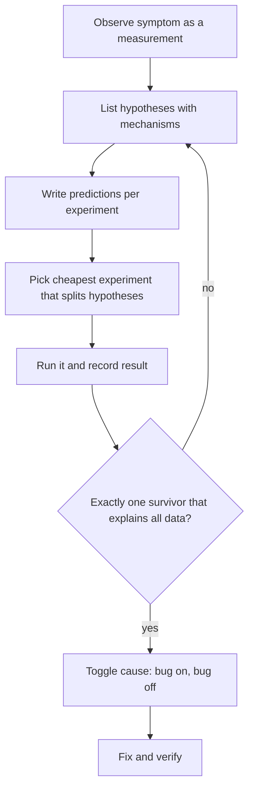

## In one minute
- Debugging is an experiment loop: observe, write down a falsifiable hypothesis, predict what an experiment will show, run it, and keep or kill the hypothesis based on the result.
- The skill that separates fast debuggers from slow ones is not generating ideas. It is picking the cheapest experiment that splits the remaining hypotheses roughly in half.
- Write the prediction down before you look. Without it, every result looks like confirmation and you drift.
- Every probe perturbs the system. Know what your instrument costs (a breakpoint, `strace`, a log line, an eBPF probe) and whether that cost can hide the bug.
- In the AI era, agents produce plausible hypotheses for free. Your leverage is ranking them, designing discriminating tests, and refusing to accept a fix that has no confirmed mechanism.

## How it works

### Observe before you theorise
Start with the symptom stated as a measurement, not a story. "Checkout returns 502 for 0.4% of requests since 14:10 UTC, only on POST, across all regions" is a symptom. "The load balancer is flaky" is a hypothesis wearing a symptom's clothes. Collect the boring facts first: when it started, what changed near then (systems tend to keep behaving the same until a deploy or config push changes them, so recent changes are the first place to look; [Google SRE book, ch. 12](https://sre.google/sre-book/effective-troubleshooting/)), and which dimensions (host, version, region, customer) the failures concentrate on. A failure spread evenly across hosts already rules out every single-host cause.

### Hypotheses must be falsifiable
A useful hypothesis names a mechanism and predicts something you have not yet looked at. "The new release has a bug" predicts nothing specific. "The new release lowered the HTTP client idle timeout below the upstream's keep-alive timeout, so we reuse connections the upstream has already closed" predicts that failures cluster on connections idle for longer than the new timeout, that they appear only on pods running the new version, and that they vanish if you set the timeout back. Each of those predictions can fail, which is what makes the hypothesis worth testing.

### Choose the experiment by information, not by comfort
With five live hypotheses, an experiment that only one of them predicts a positive result for is weak: most outcomes leave four standing. An experiment where the hypotheses disagree half and half removes about half of them whatever the outcome. This is binary search applied to explanations. Cost matters too. Grouping existing logs by host is free; deploying a debug build to production costs an hour and some risk. Prefer cheap and discriminating, then expensive and discriminating, and only last expensive and confirming. Google's SRE book makes the same two points: run the most likely and least risky tests first, and design each test so it rules one group of hypotheses in and another out, while watching for side effects such as extra load or verbose logging that change the behaviour you are measuring ([Google SRE book, ch. 12](https://sre.google/sre-book/effective-troubleshooting/)).

### Keep a debugging log
Write each step as a line: time, hypothesis, experiment, predicted result, observed result, verdict. A result that kills your favourite hypothesis is not wasted: the same chapter calls negative results conclusive and worth publishing so nobody repeats the experiment. The SRE book asks for clear notes of the ideas you had, the tests you ran and the results you saw (a shared document or chat adds timestamps for free), and for changes made during testing to be recorded so the system can be put back ([Google SRE book, ch. 12](https://sre.google/sre-book/effective-troubleshooting/)). It stops you rerunning forgotten experiments, forces the prediction to exist before the result, and becomes raw material for the postmortem and for whoever takes over at 4 a.m.

### Know when you are done
You are done when you can explain the mechanism end to end, you can make the bug appear and disappear on demand by toggling the cause, and the explanation accounts for every observation, including the odd ones. A fix that makes symptoms go away without a confirmed mechanism is a hypothesis that has not been tested yet.

## Down the stack

### Layer 1: The contract
The human process promises that each step of the investigation leaves a written record of a falsifiable claim, a predicted outcome, and the observed outcome. Testable consequences: two engineers reading the log should agree which hypotheses are dead, nobody should be able to say "we tried that" without a log line, and the final explanation must predict every recorded observation. When an observation does not fit, the investigation is not finished, however good the fix looks.

### Layer 2: The mechanism
Experiments are made of instruments, and the most basic instrument is the debugger. A software breakpoint in `gdb` on x86 works by overwriting the first byte of the target instruction with `0xCC` (`int3`) through `ptrace(PTRACE_POKETEXT)` ([ptrace(2)](https://man7.org/linux/man-pages/man2/ptrace.2.html)). When the CPU executes it, the kernel delivers `SIGTRAP`, the tracee stops, and the debugger is woken from `waitpid`. To continue, the debugger restores the original byte, rewinds the instruction pointer by one, single-steps with `PTRACE_SINGLESTEP` (one instruction, then a `SIGTRAP`), and writes `0xCC` back. Hardware watchpoints use the CPU debug registers instead (x86 has four address registers, DR0 to DR3, plus a control register), so you can watch only a handful of addresses at once, but you watch them at full speed. When gdb cannot get a hardware slot (too many watchpoints, or a region wider than the hardware allows), it falls back to a software watchpoint that single-steps the program and can be hundreds of times slower ([GDB manual](https://sourceware.org/gdb/current/onlinedocs/gdb.html/Set-Watchpoints.html)). Conditional breakpoints are evaluated by the debugger after each trap, which is why a conditional breakpoint on a hot loop can slow a program by orders of magnitude even when the condition is almost never true.

### Layer 3: The machine
`strace` is built on the same `ptrace` interface. With `PTRACE_SYSCALL`, the tracee stops at every syscall entry and exit (`PTRACE_O_TRACESYSGOOD` only tags those stops so the tracer can tell them from ordinary signals; a seccomp filter with `PTRACE_O_TRACESECCOMP` can narrow the stops to chosen syscalls), and each stop costs at least two context switches into and out of the tracer ([ptrace(2)](https://man7.org/linux/man-pages/man2/ptrace.2.html)). On a syscall-heavy process that can slow things down by an order of magnitude or more. Brendan Gregg measured a worst-case `dd` running about 442x slower under strace, so the figure depends entirely on the syscall rate ([Gregg](https://www.brendangregg.com/blog/2014-05-11/strace-wow-much-syscall.html)). That overhead changes timing, which is precisely how a race condition stops reproducing while you watch it.

Lower-overhead instruments move the observation into the kernel. `perf` samples the instruction pointer and stack on a timer interrupt (for example 99 Hz per CPU), so its cost is roughly fixed per sample rather than per event. eBPF programs attached to kprobes, uprobes or tracepoints run in kernel context after the verifier has checked them, aggregate into BPF maps, and only copy summaries to user space. A probe hit typically costs well under a few microseconds, cheap at moderate event rates but noticeable at millions per second.

### Why it's built this way
1. Production systems are larger than anyone's mental model, so you cannot reason your way to the cause; you have to ask the system questions.
2. Humans read ambiguous evidence as confirmation, so the method forces a written prediction before the result is seen.
3. Each question costs time and risk, so you rank experiments by how many hypotheses they can kill per unit of cost.
4. Every instrument perturbs timing and resources, so tools evolved from stop-the-world `ptrace` towards sampling and in-kernel aggregation, letting you observe without destroying the evidence.

## Diagram


## Worked example
Checkout returns 502 on 0.4% of POSTs (about 120 per minute at 30,000 requests per minute) since 14:10. A deploy of the checkout service went out at 14:02. The team has four hypotheses:

| Hypothesis | By host | By version | By idle time of reused connection | Revert client config |
| --- | --- | --- | --- | --- |
| H1: idle timeout mismatch with upstream | spread | new only | only idle > 60 s | fixes |
| H2: application bug in new release | spread | new only | no pattern | no effect |
| H3: one bad node | one host | both | no pattern | no effect |
| H4: upstream overload | spread | both | no pattern | no effect |

Grouping existing logs by host is free and kills H3 if failures are spread. They are: 38 of 40 hosts show errors. Grouping by version is also free. All 502s come from new-version pods, killing H4. Two survive. The idle-time split is the discriminating experiment between H1 and H2, and it needs only a log field the HTTP client already records. Prediction for H1: failures only on connections idle longer than the upstream's 60 second keep-alive. Result: 100% of failures are on connections idle between 60 and 90 seconds, and the release changed the client's idle timeout from 30 to 90 seconds. Final check: set it to 45 seconds on one canary pod and watch its 502 rate drop to zero while its neighbours keep failing. Four cheap experiments and a mechanism that explains everything.

## In the wild
- **Cloudflare, 2017: leap second panic in RRDNS.** At 00:00 UTC on 1 January 2017 the clock stepped backwards, a round-trip-time subtraction using Go's `time.Now()` went negative, the smoothed value fed a weighted pick that called `rand.Int63n()` and panicked, and about 0.2% of DNS queries failed at peak. Impact was confirmed at 00:34, a canary fix at 00:55, and the fix went everywhere by 01:48, then a restart cleared the bad state ([Cloudflare](https://blog.cloudflare.com/how-and-why-the-leap-second-affected-cloudflare-dns/)).
- **NASA JPL, 1997: Mars Pathfinder resets.** Engineers reproduced the resets on a spacecraft replica with VxWorks tracing on, and the trace showed a priority inversion: a low-priority task held a mutex created without priority inheritance. A short C program uploaded to the lander flipped the flag to true and the resets stopped ([account by Mike Jones relaying David Wilner](https://www.cs.cmu.edu/~rajkumar/mars.html)).
- **Slack, 2022: cache churn overload.** The Consul restarts were not suspected at first, and pausing them did not help because the system had already tipped into a self-sustaining overload. Slack attributed the overload to complex interactions across several system boundaries, some of which had recently changed ([Slack Engineering](https://slack.engineering/slacks-incident-on-2-22-22/)).

## Trade-offs
| Approach | Strengths | Weaknesses | Choose when |
| --- | --- | --- | --- |
| Hypothesis-driven experiments | Converges fast, leaves a record, resists bias | Needs discipline, feels slow at first | Any bug that survived a first quick look |
| Bisecting changes | Mechanical, needs no theory | Needs a reliable oracle and a known-good point | Regression with a clear before and after |
| Asking an agent for hypotheses | Wide coverage of possible causes | Plausible but untested, can anchor the team | Generating the list, never closing it |

## Pitfalls in production
- Fixing before understanding: a retry hides the 502s, the mechanism stays, and it returns as a latency problem. Fix: require a toggle test (cause on, bug on; cause off, bug off) before closing.
- Confirmation by anecdote: one trace that "looks like" the hypothesis is not evidence. Fix: state the prediction as a rate or distribution and measure it across many requests.
- Changing several variables at once during an incident. Fix: one change per step, logged with a timestamp so you can correlate it with metrics.
- Heisenbugs vanishing under `strace` or a debugger. Fix: switch to sampling (`perf`) or in-kernel aggregation (eBPF), or record and replay with a tool like `rr`.
- Ignoring the observation that does not fit. Fix: treat it as a second bug or as evidence your mechanism is wrong; never discard it silently.

## Leadership lens
- Ask "what did you predict before you ran that?" in debugging reviews. It teaches the habit faster than any document.
- Make the debugging log a standard artefact in the incident channel so handovers lose nothing.
- When an agent proposes a fix, ask for the experiment that would prove it wrong, and run that experiment.
- Budget for observability that makes experiments cheap: high-cardinality fields like version, host and connection age turn hour-long experiments into one query.
- Reward the engineer who killed three hypotheses as much as the one who found the fix.

## Check yourself
1. Why is an experiment that only one of five hypotheses predicts often a poor choice?
   **Answer:** Most outcomes leave four hypotheses alive, so the expected information gained is low. An experiment that splits them roughly evenly removes about half whatever the result.
2. A race condition disappears when you run the service under `strace`. Why, and what would you try next?
   **Answer:** `ptrace` stops the process at every syscall and adds context switches, which changes thread interleavings. Use a sampling or in-kernel tool such as `perf` or bpftrace, or record the execution with a replay debugger.
3. Why must the prediction be written down before running the experiment?
   **Answer:** After seeing a result, people reinterpret their hypothesis to fit it. A written prediction makes falsification possible.
4. What is the minimum evidence you want before declaring the root cause?
   **Answer:** A mechanism that explains every observation, plus the ability to make the bug appear and disappear by toggling that cause alone.

## Practice
**Task:** Build a hypothesis eliminator. Each hypothesis maps experiment names to a predicted boolean outcome (it may have no prediction for some experiments). `surviving(hypotheses, observations)` returns the sorted names of hypotheses whose predictions match every observed result; a missing prediction never eliminates. `best_experiment(hypotheses, observations, experiments)` returns the unobserved experiment that best splits the survivors: for each, count survivors predicting true, false, or nothing (nothing counts on both sides), and minimise the larger side. Break ties by experiment name. Return `None` if there are no survivors or no experiment eliminates at least one survivor in both outcomes.

```python starter
def surviving(hypotheses, observations):
    # TODO
    raise NotImplementedError

def best_experiment(hypotheses, observations, experiments):
    # TODO
    raise NotImplementedError
```

```python tests
H = {
    "timeout": {"by_host": False, "by_version": True, "idle": True},
    "app_bug": {"by_host": False, "by_version": True, "idle": False},
    "bad_node": {"by_host": True, "by_version": False, "idle": False},
    "overload": {"by_host": False, "by_version": False, "idle": False},
}
EXPS = ["by_host", "by_version", "idle"]

def test_no_observations_keeps_all():
    assert surviving(H, {}) == ["app_bug", "bad_node", "overload", "timeout"]

def test_observations_eliminate():
    assert surviving(H, {"by_host": False, "by_version": True}) == ["app_bug", "timeout"]

def test_missing_prediction_does_not_eliminate():
    hs = {"a": {}, "b": {"x": True}}
    assert surviving(hs, {"x": False}) == ["a"]

def test_best_splits_evenly():
    assert best_experiment(H, {}, EXPS) == "by_version"

def test_best_after_some_observations():
    assert best_experiment(H, {"by_host": False, "by_version": True}, EXPS) == "idle"

def test_none_when_no_split():
    assert best_experiment(H, {"by_host": False, "by_version": True, "idle": True}, EXPS) is None
    hs = {"a": {"x": True}, "b": {"x": True}}
    assert best_experiment(hs, {}, ["x"]) is None

def test_unknown_counts_on_both_sides():
    hs = {"a": {"x": True}, "b": {}, "c": {"x": False, "y": True}, "d": {"y": False}}
    assert best_experiment(hs, {}, ["y", "x"]) == "x"
```

```python solution
def surviving(hypotheses, observations):
    out = []
    for name, preds in hypotheses.items():
        ok = True
        for exp, seen in observations.items():
            if exp in preds and preds[exp] != seen:
                ok = False
                break
        if ok:
            out.append(name)
    return sorted(out)

def best_experiment(hypotheses, observations, experiments):
    alive = surviving(hypotheses, observations)
    if not alive:
        return None
    best, best_score = None, None
    for exp in sorted(experiments):
        if exp in observations:
            continue
        t = f = 0
        for name in alive:
            p = hypotheses[name].get(exp)
            if p is None or p:
                t += 1
            if p is None or not p:
                f += 1
        if t == len(alive) or f == len(alive):
            continue
        score = max(t, f)
        if best_score is None or score < best_score:
            best, best_score = exp, score
    return best
```

```typescript starter
export type Hyps = Record<string, Record<string, boolean>>;

export function surviving(hypotheses: Hyps, observations: Record<string, boolean>): string[] {
  throw new Error("TODO");
}

export function bestExperiment(hypotheses: Hyps, observations: Record<string, boolean>, experiments: string[]): string | null {
  throw new Error("TODO");
}
```

```typescript tests
const H: Hyps = {
  timeout: { by_host: false, by_version: true, idle: true },
  app_bug: { by_host: false, by_version: true, idle: false },
  bad_node: { by_host: true, by_version: false, idle: false },
  overload: { by_host: false, by_version: false, idle: false },
};
const EXPS = ["by_host", "by_version", "idle"];

test("no observations keeps all", () => {
  assertEqual(surviving(H, {}), ["app_bug", "bad_node", "overload", "timeout"]);
});
test("observations eliminate", () => {
  assertEqual(surviving(H, { by_host: false, by_version: true }), ["app_bug", "timeout"]);
});
test("missing prediction does not eliminate", () => {
  assertEqual(surviving({ a: {}, b: { x: true } }, { x: false }), ["a"]);
});
test("best splits evenly", () => {
  assertEqual(bestExperiment(H, {}, EXPS), "by_version");
});
test("best after some observations", () => {
  assertEqual(bestExperiment(H, { by_host: false, by_version: true }, EXPS), "idle");
});
test("null when no split", () => {
  assertEqual(bestExperiment(H, { by_host: false, by_version: true, idle: true }, EXPS), null);
  assertEqual(bestExperiment({ a: { x: true }, b: { x: true } }, {}, ["x"]), null);
});
test("unknown counts on both sides", () => {
  const hs: Hyps = { a: { x: true }, b: {}, c: { x: false, y: true }, d: { y: false } };
  assertEqual(bestExperiment(hs, {}, ["y", "x"]), "x");
});
```

```typescript solution
export type Hyps = Record<string, Record<string, boolean>>;

export function surviving(hypotheses: Hyps, observations: Record<string, boolean>): string[] {
  const out: string[] = [];
  for (const name of Object.keys(hypotheses)) {
    const preds = hypotheses[name];
    let ok = true;
    for (const exp of Object.keys(observations)) {
      if (exp in preds && preds[exp] !== observations[exp]) { ok = false; break; }
    }
    if (ok) out.push(name);
  }
  return out.sort();
}

export function bestExperiment(hypotheses: Hyps, observations: Record<string, boolean>, experiments: string[]): string | null {
  const alive = surviving(hypotheses, observations);
  if (alive.length === 0) return null;
  let best: string | null = null;
  let bestScore = Infinity;
  for (const exp of [...experiments].sort()) {
    if (exp in observations) continue;
    let t = 0, f = 0;
    for (const name of alive) {
      const p = hypotheses[name][exp];
      if (p === undefined || p) t++;
      if (p === undefined || !p) f++;
    }
    if (t === alive.length || f === alive.length) continue;
    const score = Math.max(t, f);
    if (score < bestScore) { best = exp; bestScore = score; }
  }
  return best;
}
```

```go starter
package practice

// Hyps maps hypothesis name -> experiment name -> predicted outcome.
type Hyps map[string]map[string]bool

func Surviving(h Hyps, obs map[string]bool) []string {
	panic("TODO")
}

// BestExperiment returns the chosen experiment and true, or "" and false.
func BestExperiment(h Hyps, obs map[string]bool, experiments []string) (string, bool) {
	panic("TODO")
}
```

```go tests
package practice

import (
	"reflect"
	"testing"
)

var H = Hyps{
	"timeout":  {"by_host": false, "by_version": true, "idle": true},
	"app_bug":  {"by_host": false, "by_version": true, "idle": false},
	"bad_node": {"by_host": true, "by_version": false, "idle": false},
	"overload": {"by_host": false, "by_version": false, "idle": false},
}
var EXPS = []string{"by_host", "by_version", "idle"}

func TestNoObservationsKeepsAll(t *testing.T) {
	got := Surviving(H, map[string]bool{})
	if !reflect.DeepEqual(got, []string{"app_bug", "bad_node", "overload", "timeout"}) {
		t.Fatalf("got %v", got)
	}
}

func TestObservationsEliminate(t *testing.T) {
	got := Surviving(H, map[string]bool{"by_host": false, "by_version": true})
	if !reflect.DeepEqual(got, []string{"app_bug", "timeout"}) {
		t.Fatalf("got %v", got)
	}
}

func TestMissingPredictionDoesNotEliminate(t *testing.T) {
	got := Surviving(Hyps{"a": {}, "b": {"x": true}}, map[string]bool{"x": false})
	if !reflect.DeepEqual(got, []string{"a"}) {
		t.Fatalf("got %v", got)
	}
}

func TestBestSplitsEvenly(t *testing.T) {
	if e, ok := BestExperiment(H, map[string]bool{}, EXPS); !ok || e != "by_version" {
		t.Fatalf("got %q %v", e, ok)
	}
}

func TestBestAfterSomeObservations(t *testing.T) {
	if e, ok := BestExperiment(H, map[string]bool{"by_host": false, "by_version": true}, EXPS); !ok || e != "idle" {
		t.Fatalf("got %q %v", e, ok)
	}
}

func TestNoneWhenNoSplit(t *testing.T) {
	if _, ok := BestExperiment(H, map[string]bool{"by_host": false, "by_version": true, "idle": true}, EXPS); ok {
		t.Fatal("expected no experiment")
	}
	if _, ok := BestExperiment(Hyps{"a": {"x": true}, "b": {"x": true}}, map[string]bool{}, []string{"x"}); ok {
		t.Fatal("expected no experiment")
	}
}

func TestUnknownCountsOnBothSides(t *testing.T) {
	hs := Hyps{"a": {"x": true}, "b": {}, "c": {"x": false, "y": true}, "d": {"y": false}}
	if e, ok := BestExperiment(hs, map[string]bool{}, []string{"y", "x"}); !ok || e != "x" {
		t.Fatalf("got %q %v", e, ok)
	}
}
```

```go solution
package practice

import "sort"

type Hyps map[string]map[string]bool

func Surviving(h Hyps, obs map[string]bool) []string {
	out := []string{}
	for name, preds := range h {
		ok := true
		for exp, seen := range obs {
			if p, has := preds[exp]; has && p != seen {
				ok = false
				break
			}
		}
		if ok {
			out = append(out, name)
		}
	}
	sort.Strings(out)
	return out
}

func BestExperiment(h Hyps, obs map[string]bool, experiments []string) (string, bool) {
	alive := Surviving(h, obs)
	if len(alive) == 0 {
		return "", false
	}
	exps := append([]string(nil), experiments...)
	sort.Strings(exps)
	best, bestScore := "", -1
	for _, exp := range exps {
		if _, seen := obs[exp]; seen {
			continue
		}
		t, f := 0, 0
		for _, name := range alive {
			p, has := h[name][exp]
			if !has || p {
				t++
			}
			if !has || !p {
				f++
			}
		}
		if t == len(alive) || f == len(alive) {
			continue
		}
		score := t
		if f > score {
			score = f
		}
		if bestScore == -1 || score < bestScore {
			best, bestScore = exp, score
		}
	}
	return best, bestScore != -1
}
```

## Mock interview
**Prompt:** It's 2 a.m. and checkout's 502 rate went from 0.01% to 0.4% about ten minutes after a deploy. Rolling back is possible but takes 20 minutes and the release also contains a compliance fix. Walk me through how you find the cause.

- Follow-up: You have four hypotheses. Which experiment do you run first and why that one?
- Follow-up: The errors stop when you attach `strace` to a pod. What does that tell you?
- Follow-up: An engineer proposes adding a retry on 502 to stop the bleeding. How do you respond?

**A strong answer covers:**
- Turning the symptom into measurements across dimensions (host, version, region, method, connection age) before theorising.
- Explicit hypotheses with mechanisms and predictions, ranked by how cheaply an experiment can split them.
- Separating mitigation (roll back or flag off if impact justifies it) from diagnosis, and saying who decides.
- Awareness that instruments perturb timing, and lower-overhead choices like `perf` sampling or eBPF.
- A toggle test to confirm the cause, and a written debugging log for handover and the postmortem.

## Sources and further study
**Primary**
- [Zeller and Hildebrandt, Simplifying and Isolating Failure-Inducing Input (2002)](https://www.cs.purdue.edu/homes/xyzhang/fall07/Papers/delta-debugging.pdf): the paper behind ddmin, which automates the cheapest discriminating experiment when you can only observe pass or fail.
- [Gregg, strace Wow Much Syscall](https://www.brendangregg.com/blog/2014-05-11/strace-wow-much-syscall.html): measures what stop-the-world tracing costs and why it perturbs timing.

**Systems docs**
- [GDB manual: Setting Watchpoints](https://sourceware.org/gdb/current/onlinedocs/gdb.html/Set-Watchpoints.html): hardware versus software watchpoints and their limits.
- [Linux kernel: cgroup v2](https://docs.kernel.org/admin-guide/cgroup-v2.html): `cpu.stat` and PSI, the kind of counters that make an experiment cheap.

**Books**
- *Site Reliability Engineering*, Beyer et al., chapter 12 "Effective Troubleshooting": the hypothetico-deductive loop, negative results, and ruling out changes.
- *Observability Engineering*, Majors, Fong-Jones and Miranda, chapter 8 "Analyzing Events to Achieve Observability": debugging from first principles instead of from known conditions.
- *Systems Performance*, Brendan Gregg (2nd ed.), chapter 2 "Methodologies": a catalogue of investigation methodologies to choose from when no hypothesis comes to mind.

**Other curricula**
- [donnemartin/system-design-primer](https://github.com/donnemartin/system-design-primer): has a short benchmark-and-profile section but no debugging method, so this lesson goes well beyond it.

## Watch
- [Debugging with the Scientific Method (Stuart Halloway, ClojureTV)](https://www.youtube.com/watch?v=FihU5JxmnBg): a practical walk through hypotheses, experiments and a debugging log.
- [Debugging Under Fire (Bryan Cantrill, GOTO 2017)](https://www.youtube.com/watch?v=30jNsCVLpAE): staying methodical when production is down.

## Free resources
- [Effective Troubleshooting (Google SRE book)](https://sre.google/sre-book/effective-troubleshooting/): the hypothesis loop applied to production systems, with common traps.
- [The Debugging Book (Andreas Zeller)](https://www.debuggingbook.org/): free interactive textbook on scientific debugging and automated techniques.
- [ptrace(2) man page](https://man7.org/linux/man-pages/man2/ptrace.2.html): the interface under `gdb` and `strace`, including breakpoint and syscall-stop semantics.
- [The Nine Indispensable Rules (David Agans)](https://debuggingrules.com/): a short, durable checklist for disciplined debugging.
- [Linux Performance (Brendan Gregg)](https://www.brendangregg.com/linuxperf.html): map of observability tools and what each one costs.
