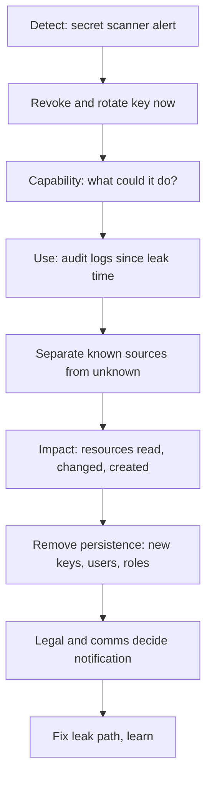

## In one minute
- Security incidents follow the same incident command structure as outages, with three differences: there is an adversary who adapts, evidence must be preserved, and legal and disclosure obligations start a clock.
- The classic lifecycle (NIST SP 800-61 Rev. 2): prepare; detect and analyse; contain, eradicate and recover; learn. Rev. 3 (2025) re-maps these onto the six Cybersecurity Framework 2.0 functions. Containment comes before full understanding, but not at the cost of destroying evidence.
- For leaked credentials, the most common modern incident: revoke and rotate first, then work out what the credential could do and what it actually did, from audit logs.
- Assume the attacker may still be inside and watching your channels. Coordinate on a separate channel, and be careful about tipping them off before containment is ready.
- Agents add new paths: prompt injection that exfiltrates data, leaked agent tokens, and agents that commit secrets. The same playbook applies, with agent identities and tool-call logs as evidence.

## How it works

### What makes security incidents different
In an outage, the system is your adversary only by accident. In a security incident, a person is actively trying to keep access, hide their tracks and expand their reach. That changes three things. **Evidence**: logs, disk images and memory may be needed to understand scope and for legal reasons, so you capture them before rebuilding machines. **Secrecy**: until containment is ready, alerting the attacker can make them destroy evidence or dig in deeper. **Obligations**: data protection laws and contracts often require notifying regulators or customers within fixed deadlines (GDPR's is 72 hours after the controller becomes aware of a personal data breach, where feasible; a processor must tell the controller without undue delay and has no separate 72-hour clock, per [GDPR Article 33](https://gdpr-info.eu/art-33-gdpr/)), so legal and communications join early.

### The lifecycle
**Prepare.** Logging that would let you answer "who did what, when" (cloud audit logs, authentication logs, database access logs), retained for months. A response plan with roles and contacts, including legal. Break-glass accounts. Practised drills.

**Detect and analyse.** Alerts from secret scanning, anomaly detection (logins from new countries, unusual API calls), customer or researcher reports. Confirm it is real, assess severity, declare. Most alerts are not crises: triage weighs the data at risk, the trust relationships the attacker could use, which controls still hold, and whether the activity looks commodity or targeted ([Building Secure and Reliable Systems, ch. 17](https://google.github.io/building-secure-and-reliable-systems/raw/ch17.html)). Name an incident commander who accepts the role, as in any other incident.

**Contain.** Short-term: revoke credentials, isolate hosts (network quarantine rather than shutdown, to keep memory evidence), block attacker IPs, disable compromised accounts. Long-term: patch the hole, harden. The pull towards fixing at once is strong, but locking accounts or wiping machines before you know the scope tells the attacker you are there, and they may hide footholds or destroy data. Google's security responders therefore finish enough investigation first, unless an imminent, clearly identified risk justifies shutting things down and revealing the response ([Building Secure and Reliable Systems, ch. 17](https://google.github.io/building-secure-and-reliable-systems/raw/ch17.html)).

**Eradicate and recover.** Remove persistence (new accounts, keys, scheduled tasks, backdoors the attacker created), rebuild from known-good images, restore data, monitor closely for return.

**Learn.** Blameless review, as for any incident, plus the specific question: how did they get in, and how would we have detected it sooner?

NIST published SP 800-61 Rev. 3 in April 2025, superseding the 2012 revision. It drops the four-phase loop as the organising model and uses the six CSF 2.0 functions instead (Govern, Identify, Protect, Detect, Respond, Recover). Detect, Respond and Recover are the incident response itself; Govern, Identify and Protect are the wider risk management that supports it, and lessons learned are meant to flow into improvement continuously instead of waiting for the end ([NIST SP 800-61r3](https://csrc.nist.gov/pubs/sp/800/61/r3/final)). The activities in this lesson are the same; only the packaging changed.

### The leaked credential playbook
A secret in a public repository, a log file, a screenshot, or an agent's context sent to the wrong place. Steps:

1. **Revoke or rotate immediately.** Assume it was used. Automated scanners find public secrets within minutes.
2. **Determine capability:** what could this credential do? Its IAM policy, scopes and network restrictions.
3. **Determine use:** what did it do? Query audit logs for every action by this credential since the earliest time it could have leaked, separating known legitimate sources (your servers' IPs, CI) from unknown ones.
4. **Scope impact:** which resources were read, changed or created; was data copied out; were new credentials or accounts created (persistence)?
5. **Remove persistence** and fix the leak path (secret scanning in pre-commit and CI, secrets in a manager, short-lived credentials).

### The same shape everywhere
A security incident is the trust-but-verify and partial-failure shapes under adversarial pressure: you cannot trust the system's own view of itself, so you rely on independent records, and you assume the worst until evidence narrows it down. Fraud teams, auditors and physical security follow the same pattern: contain, preserve evidence, scope, remediate, report.

## Down the stack

### Layer 1: The contract
A security response capability promises: any credential can be revoked within minutes; audit logs answer "what did this identity do" for at least the retention period; responders can isolate a host or account without destroying evidence; and legal and communication decisions are made by named people within the required deadlines.

### Layer 2: The mechanism
Cloud audit logs record every API call with the identity, source IP, user agent, time, action and resource; AWS CloudTrail, Google Cloud Audit Logs and Azure Activity Log all follow this pattern. Investigation is a query: filter by access key ID, sort by time, group by action and resource, mark source IPs that are not yours. Revocation depends on the credential type: long-lived keys can be deactivated immediately; issued session tokens may remain valid until expiry unless you also revoke active sessions. AWS temporary credentials last 15 minutes to 36 hours (12 hours by default), and to cut off a stolen session you change the permissions of the user or role, or deny the session by condition, since permissions are evaluated on every request ([AWS IAM docs](https://docs.aws.amazon.com/IAM/latest/UserGuide/id_credentials_temp_control-access_disable-perms.html)). That is why short-lived credentials limit exposure. Secret scanners match known token formats (prefixes such as `ghp_` for GitHub tokens or `AKIA` for AWS access keys, where `ASIA` marks temporary keys ([AWS IAM identifiers](https://docs.aws.amazon.com/IAM/latest/UserGuide/reference_identifiers.html))) plus entropy checks. GitHub scans public repositories automatically and notifies partner providers, who can then act, for example by revoking the credential ([GitHub docs](https://docs.github.com/en/code-security/secret-scanning/introduction/about-secret-scanning)).

### Layer 3: The machine
On a compromised host, evidence lives in volatile and durable layers. Memory holds running processes, network connections and decrypted secrets, lost on reboot, so responders capture it first or isolate the host's network while leaving it running. `ss -tanp` and `/proc/<pid>/` show live connections and process details; the kernel's audit subsystem (auditd) can log system calls such as `execve` for every command run. Disk images preserve files and timestamps, though attackers may alter modification times; file system journals and log shipping to a separate, append-only store make tampering harder. This is why logs should leave the host as soon as they are written.

### Why it's built this way
1. An adversary adapts and hides, so you need records they cannot alter and actions they do not see coming.
2. Credentials are the most common entry point, so revocation must be fast and detection of misuse must be possible from logs.
3. Evidence is fragile, so it is captured before systems are rebuilt.
4. Legal deadlines and customer trust require early, coordinated communication.
5. Learning focuses on entry and detection, because those determine the next incident's size.

## Diagram


## Worked example
At 14:05, GitHub secret scanning alerts that an AWS access key was pushed to a public repository at 13:52 in a demo project. The key belongs to a CI user with read access to two S3 buckets and permission to create IAM access keys (an over-broad permission left from an old migration).

14:08: the key is deactivated. 14:10: an incident is declared with a security lead as incident commander, a separate channel, and legal informed. 14:15 to 14:50: CloudTrail is queried for all events by the key ID since 13:52. Results: 214 events from the CI system's known NAT IPs (legitimate builds); 37 events from an unknown IP starting at 13:58, six minutes after the push. Those include `ListBuckets`, `GetObject` on 1,240 objects in the `exports` bucket, and one `CreateAccessKey` for a different IAM user at 14:01.

The created key is persistence: the attacker had a second key that survived the first revocation. It is deactivated at 14:52; queries on it show 12 more calls, all reads, ending at 14:40. The exported objects included a customer CSV with names and emails for about 30,000 users, so legal begins the notification assessment within the 72-hour window. Fixes: remove `iam:CreateAccessKey` from CI, replace long-lived keys with short-lived OIDC federation for CI, pre-commit secret scanning, and an alert on any `CreateAccessKey` call.

## In the wild
- **Cloudflare, 2023: credentials missed in a rotation.** After the October 2023 Okta breach, Cloudflare rotated credentials but skipped four (one service token and three service accounts) that it wrongly believed were unused. An attacker used them from 14 November, reached Jira, Confluence and Bitbucket, installed the Sliver C2 framework and downloaded 76 repositories before detection on 23 November. The "Code Red" response then rotated more than 5,000 production credentials and reimaged every machine in its global network. Lesson: a rotation is only as good as your inventory of what a credential touches ([Cloudflare](https://blog.cloudflare.com/thanksgiving-2023-security-incident/)).
- **Okta, 2023: session tokens inside support files.** Customers had uploaded HAR files to support cases, and those files contained live session tokens. An attacker who got into a support service account used them to hijack sessions at 5 customers; files from 134 customers were accessed. Detection took about 14 days, partly because viewing a file through a case writes a different log event than opening it from the Files tab. Lesson: audit logs have to record every access path to the evidence you care about ([Okta](https://sec.okta.com/articles/2023/11/unauthorized-access-oktas-support-case-management-system-root-cause)).
- **CircleCI, 2022-23: a stolen session beats 2FA.** Malware stole an engineer's already 2FA-authenticated SSO session cookie on 16 December 2022; data was taken on 22 December and discovery came on 29 December through a customer report of odd GitHub OAuth activity. On 4 January 2023 CircleCI told every customer to rotate all secrets, cut production access to a small group and added step-up authentication. Lesson: revoke sessions as well as passwords, and tell customers early what to rotate ([CircleCI](https://circleci.com/blog/jan-4-2023-incident-report/)).

## Trade-offs
| Choice | Strengths | Weaknesses | Choose when |
| --- | --- | --- | --- |
| Revoke immediately | Stops further use fast | May alert attacker, may break legitimate jobs | Leaked credentials, almost always |
| Observe before containing | Learn attacker's scope and tools | Risk of more damage | Rare, with expert responders and low data risk |
| Isolate host, keep running | Preserves memory evidence | Attacker may still act locally | Suspected host compromise |
| Rebuild from known-good image | Removes hidden persistence | Loses evidence if not captured first | After evidence capture |
| Short-lived credentials | Limits exposure window | Setup effort | Default for automation and agents |

## Pitfalls in production
- Rotating the leaked key but not checking what it created. Fix: always search for new credentials, users and roles created by the compromised identity.
- Discussing the incident in channels the attacker may read. Fix: separate, out-of-band channel for response, ideally clean infrastructure prepared in advance, and care with tools that auto-fetch links.
- Rebuilding machines before capturing evidence. Fix: snapshot disks and capture memory, or isolate first.
- Audit logs with short retention or none on data access. Fix: enable data-access logging for sensitive stores, retain for months.
- Late legal involvement. Fix: legal and communications in the response plan from declaration.

## Leadership lens
- Make credentials short-lived and scoped by default, especially for CI and agents; long-lived keys are the most common incident root.
- Turn on secret scanning in pre-commit, CI and the code host, with automatic revocation where providers support it.
- Rehearse the leaked credential playbook quarterly, including the audit log queries, so they are ready when needed.
- Include agent identities and tool-call logs in security monitoring; agents are new principals with new leak paths.

## Check yourself
1. Why search for actions like `CreateAccessKey` after a key leak?
   **Answer:** Attackers create new credentials to keep access after the original is revoked; finding and revoking them is part of containment.
2. Why might you isolate a compromised host rather than shut it down?
   **Answer:** Shutting down loses memory evidence such as running processes, connections and keys; isolation stops network activity while preserving it.
3. Why do short-lived credentials reduce incident impact?
   **Answer:** A leaked token expires quickly on its own, shrinking the window in which an attacker can use it.
4. Why coordinate on a separate channel during a security incident?
   **Answer:** The attacker may have access to normal systems, including chat or email, and could watch the response and adapt.

## Practice
**Task:** Build the investigation query for a leaked credential. Each audit event has `id`, `t`, `key`, `ip`, `action` and `resource`. `investigate(events, key, leaked_at, known_ips)` returns a dict with `suspicious` (sorted list of event IDs for this key at or after `leaked_at` from IPs not in `known_ips`), `resources` (sorted unique resources those events touched), `first` (time of the earliest suspicious event, or `None`) and `persistence` (sorted unique resources of suspicious events whose action starts with `Create` and contains `Key`, `User` or `Role`).

```python starter
def investigate(events, key, leaked_at, known_ips):
    # TODO
    raise NotImplementedError
```

```python tests
def ev(i, t, key, ip, action, resource):
    return {"id": i, "t": t, "key": key, "ip": ip, "action": action, "resource": resource}

EVENTS = [
    ev("e1", 100, "AKIA1", "10.0.0.5", "GetObject", "s3://builds/a"),
    ev("e2", 358, "AKIA1", "203.0.113.9", "ListBuckets", "*"),
    ev("e3", 360, "AKIA1", "203.0.113.9", "GetObject", "s3://exports/customers.csv"),
    ev("e4", 361, "AKIA1", "10.0.0.5", "GetObject", "s3://builds/b"),
    ev("e5", 365, "AKIA1", "203.0.113.9", "CreateAccessKey", "iam:user/deploy"),
    ev("e6", 370, "AKIA2", "203.0.113.9", "GetObject", "s3://exports/other.csv"),
    ev("e7", 300, "AKIA1", "198.51.100.7", "GetObject", "s3://exports/old.csv"),
]

def test_suspicious_events_after_leak_from_unknown_ips():
    r = investigate(EVENTS, "AKIA1", 352, ["10.0.0.5"])
    assert r["suspicious"] == ["e2", "e3", "e5"]

def test_resources_and_first():
    r = investigate(EVENTS, "AKIA1", 352, ["10.0.0.5"])
    assert r["resources"] == ["*", "iam:user/deploy", "s3://exports/customers.csv"]
    assert r["first"] == 358

def test_persistence_detected():
    assert investigate(EVENTS, "AKIA1", 352, ["10.0.0.5"])["persistence"] == ["iam:user/deploy"]

def test_earlier_leak_time_widens_scope():
    assert investigate(EVENTS, "AKIA1", 0, ["10.0.0.5"])["suspicious"] == ["e2", "e3", "e5", "e7"]

def test_other_keys_ignored():
    assert investigate(EVENTS, "AKIA2", 0, [])["suspicious"] == ["e6"]

def test_nothing_suspicious():
    r = investigate(EVENTS, "AKIA1", 352, ["10.0.0.5", "203.0.113.9"])
    assert r == {"suspicious": [], "resources": [], "first": None, "persistence": []}
```

```python solution
def investigate(events, key, leaked_at, known_ips):
    known = set(known_ips)
    hits = [e for e in events if e["key"] == key and e["t"] >= leaked_at and e["ip"] not in known]
    persistence = sorted({e["resource"] for e in hits
                          if e["action"].startswith("Create") and any(w in e["action"] for w in ("Key", "User", "Role"))})
    return {
        "suspicious": sorted(e["id"] for e in hits),
        "resources": sorted({e["resource"] for e in hits}),
        "first": min((e["t"] for e in hits), default=None),
        "persistence": persistence,
    }
```

```typescript starter
export interface AuditEvent { id: string; t: number; key: string; ip: string; action: string; resource: string; }
export interface Finding { suspicious: string[]; resources: string[]; first: number | null; persistence: string[]; }

export function investigate(events: AuditEvent[], key: string, leakedAt: number, knownIps: string[]): Finding {
  throw new Error("TODO");
}
```

```typescript tests
const ev = (id: string, t: number, key: string, ip: string, action: string, resource: string): AuditEvent => ({ id, t, key, ip, action, resource });
const EVENTS = [
  ev("e1", 100, "AKIA1", "10.0.0.5", "GetObject", "s3://builds/a"),
  ev("e2", 358, "AKIA1", "203.0.113.9", "ListBuckets", "*"),
  ev("e3", 360, "AKIA1", "203.0.113.9", "GetObject", "s3://exports/customers.csv"),
  ev("e4", 361, "AKIA1", "10.0.0.5", "GetObject", "s3://builds/b"),
  ev("e5", 365, "AKIA1", "203.0.113.9", "CreateAccessKey", "iam:user/deploy"),
  ev("e6", 370, "AKIA2", "203.0.113.9", "GetObject", "s3://exports/other.csv"),
  ev("e7", 300, "AKIA1", "198.51.100.7", "GetObject", "s3://exports/old.csv"),
];

test("suspicious events after leak from unknown ips", () => {
  assertEqual(investigate(EVENTS, "AKIA1", 352, ["10.0.0.5"]).suspicious, ["e2", "e3", "e5"]);
});

test("resources and first", () => {
  const r = investigate(EVENTS, "AKIA1", 352, ["10.0.0.5"]);
  assertEqual(r.resources, ["*", "iam:user/deploy", "s3://exports/customers.csv"]);
  assertEqual(r.first, 358);
});

test("persistence detected", () => {
  assertEqual(investigate(EVENTS, "AKIA1", 352, ["10.0.0.5"]).persistence, ["iam:user/deploy"]);
});

test("earlier leak time widens scope", () => {
  assertEqual(investigate(EVENTS, "AKIA1", 0, ["10.0.0.5"]).suspicious, ["e2", "e3", "e5", "e7"]);
});

test("other keys ignored", () => {
  assertEqual(investigate(EVENTS, "AKIA2", 0, []).suspicious, ["e6"]);
});

test("nothing suspicious", () => {
  assertEqual(investigate(EVENTS, "AKIA1", 352, ["10.0.0.5", "203.0.113.9"]), { suspicious: [], resources: [], first: null, persistence: [] });
});
```

```typescript solution
export interface AuditEvent { id: string; t: number; key: string; ip: string; action: string; resource: string; }
export interface Finding { suspicious: string[]; resources: string[]; first: number | null; persistence: string[]; }

export function investigate(events: AuditEvent[], key: string, leakedAt: number, knownIps: string[]): Finding {
  const hits = events.filter(e => e.key === key && e.t >= leakedAt && !knownIps.includes(e.ip));
  const uniq = (xs: string[]) => Array.from(new Set(xs)).sort();
  return {
    suspicious: hits.map(e => e.id).sort(),
    resources: uniq(hits.map(e => e.resource)),
    first: hits.length ? Math.min(...hits.map(e => e.t)) : null,
    persistence: uniq(hits.filter(e => e.action.startsWith("Create") && ["Key", "User", "Role"].some(w => e.action.includes(w))).map(e => e.resource)),
  };
}
```

```go starter
package practice

type AuditEvent struct {
	ID       string
	T        int
	Key, IP  string
	Action   string
	Resource string
}

type Finding struct {
	Suspicious, Resources, Persistence []string
	First                              int
	Found                              bool // false if nothing suspicious
}

func Investigate(events []AuditEvent, key string, leakedAt int, knownIPs []string) Finding {
	panic("TODO")
}
```

```go tests
package practice

import (
	"reflect"
	"testing"
)

var events = []AuditEvent{
	{"e1", 100, "AKIA1", "10.0.0.5", "GetObject", "s3://builds/a"},
	{"e2", 358, "AKIA1", "203.0.113.9", "ListBuckets", "*"},
	{"e3", 360, "AKIA1", "203.0.113.9", "GetObject", "s3://exports/customers.csv"},
	{"e4", 361, "AKIA1", "10.0.0.5", "GetObject", "s3://builds/b"},
	{"e5", 365, "AKIA1", "203.0.113.9", "CreateAccessKey", "iam:user/deploy"},
	{"e6", 370, "AKIA2", "203.0.113.9", "GetObject", "s3://exports/other.csv"},
	{"e7", 300, "AKIA1", "198.51.100.7", "GetObject", "s3://exports/old.csv"},
}

func eqList(t *testing.T, got, want []string) {
	t.Helper()
	if len(got) == 0 && len(want) == 0 {
		return
	}
	if !reflect.DeepEqual(got, want) {
		t.Fatalf("got %v, want %v", got, want)
	}
}

func TestSuspicious(t *testing.T) {
	eqList(t, Investigate(events, "AKIA1", 352, []string{"10.0.0.5"}).Suspicious, []string{"e2", "e3", "e5"})
}

func TestResourcesFirst(t *testing.T) {
	f := Investigate(events, "AKIA1", 352, []string{"10.0.0.5"})
	eqList(t, f.Resources, []string{"*", "iam:user/deploy", "s3://exports/customers.csv"})
	if !f.Found || f.First != 358 {
		t.Fatalf("first %d %v", f.First, f.Found)
	}
}

func TestPersistence(t *testing.T) {
	eqList(t, Investigate(events, "AKIA1", 352, []string{"10.0.0.5"}).Persistence, []string{"iam:user/deploy"})
}

func TestWider(t *testing.T) {
	eqList(t, Investigate(events, "AKIA1", 0, []string{"10.0.0.5"}).Suspicious, []string{"e2", "e3", "e5", "e7"})
}

func TestOtherKey(t *testing.T) {
	eqList(t, Investigate(events, "AKIA2", 0, nil).Suspicious, []string{"e6"})
}

func TestNothing(t *testing.T) {
	f := Investigate(events, "AKIA1", 352, []string{"10.0.0.5", "203.0.113.9"})
	if f.Found || len(f.Suspicious) != 0 || len(f.Resources) != 0 || len(f.Persistence) != 0 {
		t.Fatalf("got %+v", f)
	}
}
```

```go solution
package practice

import (
	"sort"
	"strings"
)

type AuditEvent struct {
	ID       string
	T        int
	Key, IP  string
	Action   string
	Resource string
}

type Finding struct {
	Suspicious, Resources, Persistence []string
	First                              int
	Found                              bool // false if nothing suspicious
}

func Investigate(events []AuditEvent, key string, leakedAt int, knownIPs []string) Finding {
	known := map[string]bool{}
	for _, ip := range knownIPs {
		known[ip] = true
	}
	var f Finding
	res, pers := map[string]bool{}, map[string]bool{}
	for _, e := range events {
		if e.Key != key || e.T < leakedAt || known[e.IP] {
			continue
		}
		f.Suspicious = append(f.Suspicious, e.ID)
		res[e.Resource] = true
		if !f.Found || e.T < f.First {
			f.First, f.Found = e.T, true
		}
		if strings.HasPrefix(e.Action, "Create") && (strings.Contains(e.Action, "Key") || strings.Contains(e.Action, "User") || strings.Contains(e.Action, "Role")) {
			pers[e.Resource] = true
		}
	}
	for r := range res {
		f.Resources = append(f.Resources, r)
	}
	for p := range pers {
		f.Persistence = append(f.Persistence, p)
	}
	sort.Strings(f.Suspicious)
	sort.Strings(f.Resources)
	sort.Strings(f.Persistence)
	return f
}
```

## Mock interview
**Prompt:** A customer emails your security address: they found what looks like your company's API token in a public GitHub repository belonging to one of your engineers, committed four days ago. The token has admin scope on your customer support platform, which holds 2 million customer conversations. You are the incident commander. Walk me through the response.

- Follow-up: The support platform keeps audit logs for only 7 days. What can you conclude, and what can you not?
- Follow-up: The engineer is very upset and worried about being fired. How do you handle that?
- Follow-up: What would you change so this class of incident is less likely and less severe?

**A strong answer covers:**
- Immediate revocation and rotation, declared incident, separate channel, legal and communications informed.
- Scoping capability (admin scope, what data and actions it allows) and use (audit logs since the commit time, unknown sources, bulk exports, new tokens or users created).
- Evidence preservation and a clear statement of what the logs can and cannot prove given retention limits.
- Notification decisions driven by evidence and legal deadlines, with honest customer communication.
- Blameless handling of the engineer, focusing on the system that allowed an admin token in a personal repository.
- Prevention: secret scanning with auto-revocation, short-lived scoped tokens, longer audit retention, alerts on bulk access.

## Sources and further study
**Primary**
- [Cloudflare: Thanksgiving 2023 security incident](https://blog.cloudflare.com/thanksgiving-2023-security-incident/): a detailed first-party account of detection, a credential rotation gap and a full rebuild.
- [GDPR Article 33](https://gdpr-info.eu/art-33-gdpr/): the 72-hour notification duty for controllers and the separate duty on processors.

**Systems docs**
- [AWS IAM: disabling permissions for temporary credentials](https://docs.aws.amazon.com/IAM/latest/UserGuide/id_credentials_temp_control-access_disable-perms.html): session lifetimes and how to cut off a stolen session.
- [AWS IAM identifiers](https://docs.aws.amazon.com/IAM/latest/UserGuide/reference_identifiers.html): what the `AKIA` and `ASIA` prefixes mean.

**Books**
- *Building Secure and Reliable Systems*, Adkins et al.: chapter 15 (Investigating Systems), chapter 16 (Disaster Planning), chapter 17 (Crisis Management, with the operational security advice used above) and chapter 18 (Recovery and Aftermath).
- *Site Reliability Engineering*, Beyer et al.: chapter 14 (Managing Incidents), the incident command structure that a security response reuses.
- *The Site Reliability Workbook*: chapter 9 (Incident Response), with worked cases of declaring early and handing off command.

**Other curricula**
- [Google SRE Workbook: Incident Response](https://sre.google/workbook/incident-response/): frames security response as the same command structure as an outage, which matches this lesson's starting point; it does not cover evidence handling.

## Free resources
- [NIST SP 800-61 Rev. 3: Incident Response Recommendations](https://csrc.nist.gov/pubs/sp/800/61/r3/final): the standard framework, updated in 2025.
- [AWS Security Incident Response Guide](https://docs.aws.amazon.com/security-ir/latest/userguide/security-incident-response-guide.html): cloud-specific preparation, investigation and containment.
- [About secret scanning (GitHub Docs)](https://docs.github.com/en/code-security/secret-scanning/introduction/about-secret-scanning): detecting leaked tokens and partner auto-revocation.
- [Secrets Management Cheat Sheet (OWASP)](https://cheatsheetseries.owasp.org/cheatsheets/Secrets_Management_Cheat_Sheet.html): storing, rotating and auditing secrets.
- [Incident Handler's Handbook (SANS)](https://www.sans.org/white-papers/33901/): a practical, step-by-step response guide.
- [PagerDuty Incident Response](https://response.pagerduty.com/): incident command practices, including security incidents.
