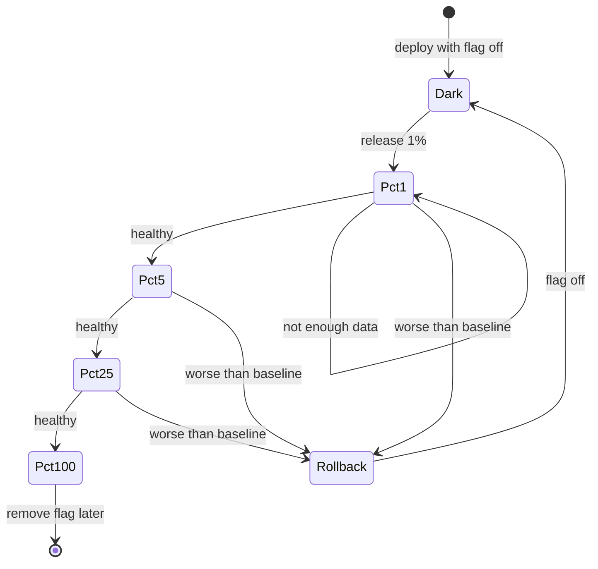

## In one minute
- Agents multiply the number of changes a team can produce. Delivery safety must scale with that volume, or faster coding just means faster incidents.
- Keep batches small: one concern per pull request, merged and deployed often. Small changes are easier to review, easier to bisect and cheaper to roll back.
- Separate deploying from releasing: ship code dark behind a feature flag, then release it to 1 percent, 5 percent, 25 percent and everyone, watching metrics at each step.
- Automate the decision to stop: compare the canary with the baseline and roll back automatically when error rates or latency get worse beyond a set tolerance.
- Measure the system, not the feeling: DORA's delivery metrics (change lead time, deployment frequency, change failure rate, recovery time) show whether agent speed is turning into safe delivery.

## How it works

### Why volume changes the game
If each change carries a small chance of causing a problem, more changes mean more problems in absolute terms, unless each change gets safer. A team that went from 20 to 80 merged pull requests a week with agents, at the same 5 percent change failure rate, now has 4 bad changes a week instead of 1. The answer is not to slow down. It is to make each change smaller, more observable and cheaper to undo. DORA's 2024 research found that AI adoption raised individual productivity but also hurt delivery stability and throughput, and concluded that small batches and robust testing remain crucial ([DORA 2024](https://dora.dev/research/2024/dora-report/)).

### Small batches
A 50-line change with one purpose can be reviewed properly, tested specifically and reverted cleanly. A 3,000-line agent change that refactors, adds a feature and bumps dependencies cannot. Ask agents for one concern per pull request; split their work into a sequence of small, independently safe steps (add the column, write to it, backfill, read from it, remove the old one). Trunk-based development, with short-lived branches merged at least daily, keeps changes small by default.

### Deploy is not release
A feature flag lets code reach production switched off. Deploying then becomes routine and low risk, and releasing becomes a separate, controlled act: turn it on for staff, then 1 percent of users, then more. If something goes wrong, turning the flag off takes seconds, much faster than building and deploying a revert. Flags have costs: each one is a branch in the code, and old flags become confusing dead code, so give every flag an owner and a removal date.

### Progressive delivery
Whether by flag percentage or by canary deployment (new version on a few servers), the pattern is the same:

1. Release to a small slice.
2. Wait long enough to collect enough requests to judge.
3. Compare the slice's error rate and latency with the baseline's over the same period.
4. Advance if healthy, hold if there is not enough data, roll back if worse beyond tolerance.

Automating step 4 matters most when changes are frequent: humans watching dashboards for 80 rollouts a week will miss things. Amazon's pipelines do this with waves: each starts with a "one-box" deployment serving at most about 10% of requests, then a bake time (at least an hour after one-box, 12 hours after the first regional wave), and an alarm the deployment system watches so it can roll back automatically ([AWS Builders' Library](https://aws.amazon.com/builders-library/automating-safe-hands-off-deployments/)). Google's SRE workbook adds that fleet-wide metrics hide canary problems: a 20% error rate on a 5% canary shows up as only about 1% overall, so break metrics out by canary and control ([SRE workbook](https://sre.google/workbook/canarying-releases/)).

### Rollback readiness
Every change should have an answer to "how do we undo this in five minutes?". Code changes: flag off or redeploy the previous version. Schema changes: expand-then-contract, so the old code still works against the new schema. Data changes: backups and a tested restore. Changes that cannot be undone quickly, such as sending emails or deleting data, belong in the gatekeeper zone with human approval.

## Down the stack

### Layer 1: The contract
The delivery system promises that every production change is small, traceable to a reviewed pull request, released progressively with automated health checks, and reversible within minutes. Its health is measured by change failure rate and time to restore service, reported per team and per author type (human or agent). DORA now describes five metrics: change lead time, deployment frequency, failed deployment recovery time (the successor to MTTR), change fail rate and deployment rework rate ([DORA](https://dora.dev/guides/dora-metrics/)).

### Layer 2: The mechanism
Flag systems evaluate rules per request: hash a stable identifier such as the user ID into a bucket from 0 to 99, and enable the feature if the bucket is below the rollout percentage, so each user sees consistent behaviour as the percentage grows. Canary analysis compares metrics between the canary and a baseline group running the old version at the same time, which controls for traffic changes during the day. Keep the metric window no longer than the canary, since an hourly metric muddies a 30-minute canary, and never compare against yesterday's numbers ([SRE workbook](https://sre.google/workbook/canarying-releases/)). A typical rule: roll back if the canary's error rate exceeds the baseline's by more than a relative tolerance (say 20 percent) and an absolute floor (say 0.1 percentage points), and only judge once each side has a minimum number of requests, such as 1,000, to avoid reacting to noise.

### Layer 3: The machine
Rolling back a deployment usually means the orchestrator shifts traffic back to processes running the old binary. In Kubernetes, the previous ReplicaSet is scaled up and the new one scaled down; with connection draining, load balancers stop sending new requests to old pods and wait for in-flight ones to finish, often for a configured grace period such as 30 seconds. Flags avoid even that: the flag service pushes a new rule set to clients over a streaming connection or polling, and each process re-evaluates on its next request, typically within seconds. That speed difference is why flags are the preferred first responder.

### Why it's built this way
1. More changes at the same failure rate means more failures.
2. Smaller changes fail less often and are easier to diagnose and undo.
3. Separating deploy from release turns most rollbacks into a configuration change.
4. Progressive exposure limits how many users a bad change can hurt before it is caught.
5. At high volume only automated comparison and rollback keep up.

## Diagram


## Worked example
A team of 10 engineers uses agents heavily and merges about 120 pull requests a week. Their change failure rate is 6 percent, so about 7 changes a week cause a problem, and their median time to restore is 50 minutes because most fixes need a revert, build and deploy.

They make three changes. First, a pull request size limit of 400 changed lines with an exception process, plus agent instructions to split work into steps. Median pull request size drops from 380 to 140 lines. Second, every user-facing change ships behind a flag, released 1, 5, 25, 100 percent with automated canary checks: at least 2,000 requests per stage, rollback if errors exceed baseline by 25 percent relative and 0.1 points absolute. Third, an expand-and-contract rule for schema changes.

After two months, the change failure rate, counting only failures that reached more than 5 percent of users, falls to 2 percent. The median time to restore falls to 4 minutes, because most rollbacks are automated flag flips at the 1 or 5 percent stage. Deployment frequency rises, because small, flagged changes no longer wait for a "safe" release window.

## In the wild
- **Knight Capital, 2012: a half-finished deploy woke dead code.** New code reused a flag that once switched on old "Power Peg" logic. A technician copied the code to only seven of eight servers, no second person reviewed it and no written procedure required one. The eighth server sent child orders in rapid sequence for about 45 minutes, and Knight lost over $460 million ([SEC order](https://www.sec.gov/files/litigation/admin/2013/34-70694.pdf)).
- **Google Cloud, 2025-06: a new code path with no feature flag crash-looped worldwide.** A policy row with blank fields replicated globally within seconds and hit a null pointer in Service Control code added on May 29 that had no flag and no error handling. APIs returned 503s from 10:51 to 18:18 PDT; a kill switch took about 40 minutes, and restarts without randomized backoff overloaded Spanner in us-central1. Google now requires flags, off by default, for critical binaries and incremental rollout of replicated data ([Google Cloud incident report](https://status.cloud.google.com/incidents/ow5i3PPK96RduMcb1SsW)).

## Trade-offs
| Practice | Strengths | Weaknesses | Choose when |
| --- | --- | --- | --- |
| Feature flags | Instant rollback, gradual release | Code complexity, stale flags | User-facing changes |
| Canary deployments | Catches infrastructure and performance issues | Needs traffic and good metrics | Services with steady traffic |
| Blue-green | Fast full switch and switch back | Double capacity during switch | Stateful or hard-to-canary systems |
| Big-bang release | Simple | Large blast radius, slow rollback | Rarely; internal tools with few users |
| PR size limits | Reviewable, bisectable changes | Friction on legitimately big changes | Teams with agent-generated volume |

## Pitfalls in production
- Huge agent pull requests merged because tests passed. Fix: size limits and one concern per pull request.
- Flags that never get removed. Fix: owner and expiry date per flag, with a report of stale flags.
- Canary judged on too little data, so noise triggers rollbacks or hides regressions. Fix: minimum request counts per stage.
- Schema changes that break the old version, making rollback impossible. Fix: expand and contract, old and new code compatible at every step.
- Watching only error rates. Fix: include latency and a business metric such as checkout success.

## Leadership lens
- Track DORA's metrics (now five, including rework rate) and break them down by agent-heavy and human-heavy changes; they show whether speed is safe.
- Make the default path safe: flags, progressive rollout and automated rollback should be the easy option, not extra work.
- Invest in rollback speed before deploy speed; recovery time limits damage.
- Write delivery rules into agent instructions: small pull requests, flags for user-facing changes, expand-and-contract migrations.

## Check yourself
1. Why does higher change volume require smaller changes rather than more review?
   **Answer:** Review time does not scale with volume, but smaller changes are each less likely to fail, easier to review and faster to undo, so total risk falls without slowing delivery.
2. Why hash a stable user ID to decide flag exposure instead of choosing randomly per request?
   **Answer:** So each user sees consistent behaviour, and users in the 1 percent stay included as the rollout grows to 5 and 25 percent.
3. Why compare the canary with a baseline running at the same time rather than with yesterday's metrics?
   **Answer:** Traffic mix and load vary over time; a concurrent baseline controls for those differences so the comparison isolates the change.
4. Why is a flag flip usually a faster rollback than redeploying?
   **Answer:** It changes configuration that running processes pick up within seconds, while a redeploy needs a build or image pull, pod scheduling and connection draining.

## Practice
**Task:** Build the decision step of an automated progressive rollout. `step(stage, stages, canary, baseline, cfg)` takes the current stage index, the list of percentages (for example `[1, 5, 25, 100]`), and canary and baseline metrics as `(requests, errors)` pairs, with `cfg` holding `min_requests`, `rel_tolerance` and `abs_tolerance`. Return `("rollback", 0)` if both sides have at least `min_requests` and the canary error rate exceeds the baseline rate by more than both `rel_tolerance` (relative to the baseline rate) and `abs_tolerance` (absolute difference). Otherwise return `("hold", current percentage)` if either side has fewer than `min_requests`. Otherwise return `("advance", next percentage)`, or `("done", 100)` if already at the last stage.

```python starter
def step(stage, stages, canary, baseline, cfg):
    # TODO: return (action, percent)
    raise NotImplementedError
```

```python tests
CFG = {"min_requests": 1000, "rel_tolerance": 0.25, "abs_tolerance": 0.001}
STAGES = [1, 5, 25, 100]

def test_hold_without_enough_data():
    assert step(0, STAGES, (400, 0), (50000, 50), CFG) == ("hold", 1)

def test_advance_when_healthy():
    assert step(0, STAGES, (2000, 2), (50000, 50), CFG) == ("advance", 5)

def test_rollback_when_clearly_worse():
    assert step(1, STAGES, (5000, 30), (50000, 50), CFG) == ("rollback", 0)

def test_small_absolute_difference_is_tolerated():
    cfg = {"min_requests": 1000, "rel_tolerance": 0.25, "abs_tolerance": 0.01}
    assert step(1, STAGES, (5000, 30), (50000, 50), cfg) == ("advance", 25)

def test_relative_tolerance_protects_noisy_baseline():
    assert step(2, STAGES, (10000, 110), (50000, 500), CFG) == ("advance", 100)

def test_done_at_last_stage():
    assert step(3, STAGES, (90000, 90), (90000, 90), CFG) == ("done", 100)
```

```python solution
def step(stage, stages, canary, baseline, cfg):
    (cr, ce), (br, be) = canary, baseline
    enough = cr >= cfg["min_requests"] and br >= cfg["min_requests"]
    if enough:
        c_rate, b_rate = ce / cr, be / br
        diff = c_rate - b_rate
        if diff > cfg["abs_tolerance"] and diff > b_rate * cfg["rel_tolerance"]:
            return ("rollback", 0)
    if not enough:
        return ("hold", stages[stage])
    if stage == len(stages) - 1:
        return ("done", stages[stage])
    return ("advance", stages[stage + 1])
```

```typescript starter
export interface RolloutConfig { min_requests: number; rel_tolerance: number; abs_tolerance: number; }

export function step(stage: number, stages: number[], canary: [number, number],
                     baseline: [number, number], cfg: RolloutConfig): [string, number] {
  throw new Error("TODO");
}
```

```typescript tests
const CFG: RolloutConfig = { min_requests: 1000, rel_tolerance: 0.25, abs_tolerance: 0.001 };
const STAGES = [1, 5, 25, 100];

test("hold without enough data", () => {
  assertEqual(step(0, STAGES, [400, 0], [50000, 50], CFG), ["hold", 1]);
});

test("advance when healthy", () => {
  assertEqual(step(0, STAGES, [2000, 2], [50000, 50], CFG), ["advance", 5]);
});

test("rollback when clearly worse", () => {
  assertEqual(step(1, STAGES, [5000, 30], [50000, 50], CFG), ["rollback", 0]);
});

test("small absolute difference is tolerated", () => {
  assertEqual(step(1, STAGES, [5000, 30], [50000, 50], { min_requests: 1000, rel_tolerance: 0.25, abs_tolerance: 0.01 }), ["advance", 25]);
});

test("relative tolerance protects noisy baseline", () => {
  assertEqual(step(2, STAGES, [10000, 110], [50000, 500], CFG), ["advance", 100]);
});

test("done at last stage", () => {
  assertEqual(step(3, STAGES, [90000, 90], [90000, 90], CFG), ["done", 100]);
});
```

```typescript solution
export interface RolloutConfig { min_requests: number; rel_tolerance: number; abs_tolerance: number; }

export function step(stage: number, stages: number[], canary: [number, number],
                     baseline: [number, number], cfg: RolloutConfig): [string, number] {
  const [cr, ce] = canary, [br, be] = baseline;
  const enough = cr >= cfg.min_requests && br >= cfg.min_requests;
  if (enough) {
    const cRate = ce / cr, bRate = be / br, diff = cRate - bRate;
    if (diff > cfg.abs_tolerance && diff > bRate * cfg.rel_tolerance) return ["rollback", 0];
  }
  if (!enough) return ["hold", stages[stage]];
  if (stage === stages.length - 1) return ["done", stages[stage]];
  return ["advance", stages[stage + 1]];
}
```

```go starter
package practice

type Metrics struct{ Requests, Errors int }

type RolloutConfig struct {
	MinRequests                int
	RelTolerance, AbsTolerance float64
}

func Step(stage int, stages []int, canary, baseline Metrics, cfg RolloutConfig) (string, int) {
	panic("TODO")
}
```

```go tests
package practice

import "testing"

var cfg = RolloutConfig{MinRequests: 1000, RelTolerance: 0.25, AbsTolerance: 0.001}
var stages = []int{1, 5, 25, 100}

func expectStep(t *testing.T, gotA string, gotP int, wantA string, wantP int) {
	t.Helper()
	if gotA != wantA || gotP != wantP {
		t.Fatalf("got (%s, %d), want (%s, %d)", gotA, gotP, wantA, wantP)
	}
}

func TestHold(t *testing.T) {
	a, p := Step(0, stages, Metrics{400, 0}, Metrics{50000, 50}, cfg)
	expectStep(t, a, p, "hold", 1)
}

func TestAdvance(t *testing.T) {
	a, p := Step(0, stages, Metrics{2000, 2}, Metrics{50000, 50}, cfg)
	expectStep(t, a, p, "advance", 5)
}

func TestRollback(t *testing.T) {
	a, p := Step(1, stages, Metrics{5000, 30}, Metrics{50000, 50}, cfg)
	expectStep(t, a, p, "rollback", 0)
}

func TestAbsTolerance(t *testing.T) {
	a, p := Step(1, stages, Metrics{5000, 30}, Metrics{50000, 50}, RolloutConfig{1000, 0.25, 0.01})
	expectStep(t, a, p, "advance", 25)
}

func TestRelTolerance(t *testing.T) {
	a, p := Step(2, stages, Metrics{10000, 110}, Metrics{50000, 500}, cfg)
	expectStep(t, a, p, "advance", 100)
}

func TestDone(t *testing.T) {
	a, p := Step(3, stages, Metrics{90000, 90}, Metrics{90000, 90}, cfg)
	expectStep(t, a, p, "done", 100)
}
```

```go solution
package practice

type Metrics struct{ Requests, Errors int }

type RolloutConfig struct {
	MinRequests                int
	RelTolerance, AbsTolerance float64
}

func Step(stage int, stages []int, canary, baseline Metrics, cfg RolloutConfig) (string, int) {
	enough := canary.Requests >= cfg.MinRequests && baseline.Requests >= cfg.MinRequests
	if !enough {
		return "hold", stages[stage]
	}
	c := float64(canary.Errors) / float64(canary.Requests)
	b := float64(baseline.Errors) / float64(baseline.Requests)
	diff := c - b
	if diff > cfg.AbsTolerance && diff > b*cfg.RelTolerance {
		return "rollback", 0
	}
	if stage == len(stages)-1 {
		return "done", stages[stage]
	}
	return "advance", stages[stage+1]
}
```

## Mock interview
**Prompt:** Your company's engineering output tripled after adopting coding agents: about 400 production changes a week across 30 services. Incidents also doubled. Leadership asks whether to restrict agent use. Design a delivery system that keeps the speed and brings incidents back down.

- Follow-up: A team says feature flags make their code unreadable. How do you respond?
- Follow-up: How do you roll back a change that included a database migration?
- Follow-up: Which metrics would convince leadership it is working?

**A strong answer covers:**
- The arithmetic: more changes at the same failure rate means more failures, so each change must get safer, not fewer changes made.
- Small batches enforced by tooling and agent instructions; trunk-based development.
- Deploy separate from release: flags, progressive rollout, automated canary analysis with minimum sample sizes and tolerances, automatic rollback.
- Rollback readiness: expand-and-contract migrations, backups for data changes, gatekeeper approval for irreversible actions.
- Flag hygiene: owners, expiry dates and cleanup to limit complexity.
- DORA metrics by service and by change type, plus incident counts and customer-impact minutes.

## Sources and further study
**Primary**
- [SEC order on Knight Capital (2013)](https://www.sec.gov/files/litigation/admin/2013/34-70694.pdf): the regulator's findings on the 2012 deployment failure.
- [Google Cloud incident report, 12 June 2025](https://status.cloud.google.com/incidents/ow5i3PPK96RduMcb1SsW): root cause, timeline and the flag and rollout changes that followed.
- [DORA, 2024 Accelerate State of DevOps report](https://dora.dev/research/2024/dora-report/): the research on AI adoption and delivery stability.

**Systems docs**
- [DORA metrics guide](https://dora.dev/guides/dora-metrics/): the current five-metric model and how it evolved from the four keys.

**Books**
- *The Site Reliability Workbook*, Google, chapter 16 "Canarying Releases": population size, duration and canary-versus-control evaluation.
- *Site Reliability Engineering*, Google, chapter 8 "Release Engineering": build and deploy as a controlled, repeatable process.
- *Release It!*, Michael Nygard, chapter 13 "Design for Deployment": automated deployments and phases of rollout.
- *Accelerate*, Forsgren, Humble and Kim, chapter 2 "Measuring Performance": the research behind the delivery metrics.
- *Building Secure and Reliable Systems*, Google, chapter 14 "Deploying Code": securing the path from change to production.

## Free resources
- [DORA's software delivery performance metrics](https://dora.dev/guides/dora-metrics-four-keys/): the metrics for lead time, deployment frequency, failure rate and recovery.
- [Canarying releases (Google SRE workbook)](https://sre.google/workbook/canarying-releases/): canary design, metric selection and evaluation.
- [Automating safe, hands-off deployments (AWS Builders' Library)](https://aws.amazon.com/builders-library/automating-safe-hands-off-deployments/): how Amazon rolls out changes in waves with automatic rollback.
- [Feature Toggles (Pete Hodgson on martinfowler.com)](https://martinfowler.com/articles/feature-toggles.html): types of flags and how to manage them.
- [Trunk Based Development](https://trunkbaseddevelopment.com/): short-lived branches and small, frequent merges.
