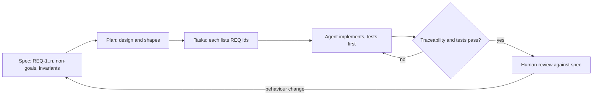

## In one minute
- With coding agents, the spec becomes the main artifact the agent works from. A good spec states what must be true, not how to type it. Treating the spec as the only source and regenerating code from it is the least mature end of the practice.
- The loop is: specify, plan, break into tasks, implement, verify. Humans own the first two and the last one; agents do most of the middle.
- Write requirements as numbered, testable statements (EARS-style "when X, the system shall Y", or Given/When/Then), each with an ID that tests and code can point back to.
- Traceability keeps the agent honest: every requirement has at least one test, every test names a requirement, and the agent's work is done when the mapped tests pass.
- Specs are a living record. When behaviour changes, change the spec first, then let code follow; otherwise the spec rots into fiction within weeks.

## How it works

### Why prompts are not enough
A prompt is a conversation; a spec is a contract. Prompts drift, get lost when the session ends, and mix what you want with how you said it. When five agents and three humans touch a feature over a month, the only thing that keeps them consistent is a document that says what the system must do, which everyone, human or agent, reads first. That is why tools such as GitHub's Spec Kit, OpenSpec and AWS Kiro all center on a spec file that lives in the repository next to the code. Spec Kit's phases are specify, plan, tasks, implement ([GitHub blog, 2025](https://github.blog/ai-and-ml/generative-ai/spec-driven-development-with-ai-get-started-with-a-new-open-source-toolkit/)); Kiro's feature specs produce `requirements.md`, `design.md` and `tasks.md` ([Kiro docs](https://kiro.dev/docs/specs/)).

The tools differ in how long the spec lives. Martin Fowler's comparison names three levels: spec-first (written before the code, then possibly discarded), spec-anchored (kept and evolved with the feature) and spec-as-source (humans edit only the spec). Most tools today are spec-first; spec-as-source showed non-deterministic output between runs, and he warns it could inherit both the rigidity of model-driven development and the randomness of LLMs ([Fowler](https://martinfowler.com/articles/exploring-gen-ai/sdd-3-tools.html)).

### The loop
1. **Specify.** Write the problem, users, requirements and non-goals. Requirements are numbered and testable.
2. **Plan.** Decide the design: components, data model, problem shapes and mechanisms. For high-stakes work this is the whiteboard step.
3. **Tasks.** Break the plan into small tasks, each naming the requirement IDs it satisfies and the tests that prove it.
4. **Implement.** The agent works task by task, writing tests first where possible.
5. **Verify.** Tests run, traceability is checked, a human reviews the diff against the spec.

### Writing testable requirements
Vague requirements produce plausible code. "The system should be fast and handle errors well" gives an agent nothing to verify. Two formats help:

- **EARS** (Easy Approach to Requirements Syntax) came from Rolls-Royce engineers analysing jet-engine control requirements and was published in 2009. It has five templates: always-true, "While" for states, "When" for events, "Where" for optional features, and "If ... then" for unwanted behaviour ([Mavin](https://alistairmavin.com/ears/)). Examples: "When `<trigger>`, the `<system>` shall `<response>`" and "While `<state>`, the `<system>` shall `<response>`". For example: "REQ-3: When a refund request repeats an idempotency key with the same amount, the refund service shall return the original result without issuing a second refund."
- **Given/When/Then** describes a scenario: given a starting state, when an action happens, then an outcome follows. It maps directly onto a test.

Use RFC 2119 words consistently: MUST for hard rules, SHOULD for strong defaults (valid reasons to deviate must be understood and weighed), MAY for options ([RFC 2119](https://www.rfc-editor.org/rfc/rfc2119)). Only the capitalised forms carry that meaning ([RFC 8174](https://www.rfc-editor.org/rfc/rfc8174)), so tell agents and authors to capitalise on purpose. Write numbers, not adjectives: "p99 under 200 ms at 500 requests per second", not "fast".

### Non-goals and invariants
The most useful lines in a spec are often what the system must *not* do and what must *always* hold. "Non-goal: multi-currency in v1" stops an eager agent from building it. "Invariant: an account balance never goes negative" becomes a property test that runs on every change. Agents expand scope by default, because adding features looks helpful; non-goals are how you stop that.

### Keeping specs alive
A spec written once and never updated becomes misleading, which is worse than no spec. Treat changes like code: propose a spec change, review it, apply it, then change the code. OpenSpec models exactly this cycle: a change folder is proposed, applied, then archived and merged into the live `specs/` folder ([OpenSpec](https://github.com/Fission-AI/OpenSpec)). The rule for agents is simple: if the code and the spec disagree, stop and ask which one is right.

## Down the stack

### Layer 1: The contract
A spec-driven workflow promises that every merged behaviour traces to a requirement, every requirement has at least one passing test, and a change in behaviour starts as a change in the spec. Reviewers can check it mechanically: a script lists requirements without tests and tests without requirements, and CI fails if either list is non-empty.

### Layer 2: The mechanism
In practice the spec is Markdown in the repository, for example `specs/refunds/spec.md` with requirements tagged `REQ-1` to `REQ-n`, plus `plan.md` and `tasks.md`. Tests reference IDs in their names or with markers, such as `test_req3_repeat_key_returns_original` or a pytest marker `@pytest.mark.req("REQ-3")`. A traceability script greps the spec for requirement IDs and the test suite for references, then reports gaps. Agent instructions in `CLAUDE.md` or `AGENTS.md` say: read the spec first, implement one task at a time, write the test named after the requirement before the code, and never edit the spec without asking.

### Layer 3: The machine
Specs help agents for a concrete reason: an agent's context window is finite and every token competes for attention ([Anthropic](https://www.anthropic.com/engineering/effective-context-engineering-for-ai-agents)). A 2,000-token spec with numbered requirements gives the model a dense, stable description of the goal that survives across sessions, while a long chat history is lossy: earlier turns get summarised or dropped as the context fills. Tests then provide the ground truth that text cannot: a test run is a process with an exit code, 0 or not, which the agent's runtime reads directly. The spec narrows what the model generates; the tests check what it generated.

### Why it's built this way
1. Agents generate code quickly but have no stable memory of intent across sessions.
2. Intent must therefore live in a durable document both humans and agents read.
3. Documents drift from reality unless each claim is checked.
4. Tests check claims, but only if each requirement is written precisely enough to test.
5. So: numbered, testable requirements, linked to tests, enforced in CI.

## Diagram


## Worked example
A team adds refunds to a support agent. The spec has six requirements. REQ-1: a refund MUST NOT exceed the captured amount of the order. REQ-2: refunds over 200 dollars MUST require human approval. REQ-3: repeating an idempotency key with the same parameters MUST return the original result. REQ-4: repeating a key with different parameters MUST be rejected. REQ-5: every refund MUST write an audit record with actor, amount and reason. REQ-6: p99 latency SHOULD be under 2 seconds excluding the payment provider. Non-goals: partial refunds of bundled items; refunds in a different currency.

The agent produces 14 tests and the implementation in about 40 minutes. The traceability script reports REQ-5 has no test: the agent wrote the audit record but never tested it. It also reports a test named `test_refund_currency_conversion`, which maps to no requirement: the agent started building a non-goal. Both are caught by a 30-line script before a human reads a single line of code. The reviewer then spends their time on the part machines cannot judge: whether 200 dollars is the right approval threshold.

## In the wild
- **Knight Capital, 2012: an undocumented flag meaning.** New code reused a flag that once activated the retired "Power Peg" function, and that old code was still callable on the one server that missed the deployment. Knight lost over $460 million in about 45 minutes. The SEC found Knight had no written procedures requiring a second technician to review deployments ([SEC order](https://www.sec.gov/files/litigation/admin/2013/34-70694.pdf)). A written, tested statement of what the flag may mean is the kind of requirement this lesson argues for.
- **Air Canada, 2024: two sources of truth.** The airline's website said bereavement fares could not be applied retroactively, while its chatbot said they could. The tribunal held the airline responsible for both and ordered it to pay the fare difference of CA$812 plus costs and interest ([Wikipedia summary](https://en.wikipedia.org/wiki/Moffatt_v._Air_Canada)). One owned, versioned policy that the chatbot is tested against would have exposed the conflict.

## Trade-offs
| Approach | Strengths | Weaknesses | Choose when |
| --- | --- | --- | --- |
| Full SDD (spec, plan, tasks) | Durable intent, traceable, reviewable | Process overhead | Features that last, teams of several people or agents |
| Light spec plus tests | Quick, still testable | Less design context | Small features, clear scope |
| Prompt only | Fastest start | Drift, scope creep, no record | Throwaway prototypes |
| Spec as source, code regenerated | Code stays aligned with intent | Immature tooling, nondeterministic output | Experiments, generated adapters |

## Pitfalls in production
- Requirements written as adjectives ("robust", "fast"). Fix: numbers and observable outcomes only.
- Specs that never change after the first merge. Fix: spec change first, reviewed like code, for every behaviour change.
- Agents silently editing the spec to match their code. Fix: protect spec files with code owners and tell agents to propose spec changes, not make them.
- Too much process for small changes. Fix: scale the spec to the zone; automate-zone tasks need a sentence, not a document. Fowler reports a tool turning a small bug into four user stories with 16 acceptance criteria ([Fowler](https://martinfowler.com/articles/exploring-gen-ai/sdd-3-tools.html)).
- Believing the spec controls the agent. Fix: agents still ignore instructions or regenerate existing classes as duplicates (same Fowler article), so keep tests and the traceability check as the enforcement.
- Tests that mention a requirement but do not test it. Fix: review a sample of tests against their requirements, and use property tests for invariants.

## Leadership lens
- Agree a spec template with numbered requirements, non-goals and invariants, and put it in the repository.
- Add the traceability check to CI; it is cheap and catches scope creep and missing tests automatically.
- Review specs more carefully than code. A wrong spec produces correct-looking wrong code at agent speed.
- Keep humans as the owners of specs and plans; agents may propose changes, but a person approves them.

## Check yourself
1. Why is "the system shall handle errors gracefully" a bad requirement for an agent?
   **Answer:** It is not testable, so the agent cannot verify it and will interpret it however is most convenient; a good requirement names a trigger and an observable response.
2. What do non-goals add to a spec when an agent implements it?
   **Answer:** They stop scope creep: agents tend to add plausible features, and an explicit non-goal lets both the agent and the traceability check flag work that was not asked for.
3. A test references no requirement. What could that mean?
   **Answer:** Either a missing requirement that should be added to the spec, or work outside the spec, such as a non-goal the agent built; both need a human decision.
4. Why should behaviour changes start in the spec rather than the code?
   **Answer:** Otherwise the spec drifts from reality, and the next agent or engineer who reads it builds on false information.

## Practice
**Task:** Build the traceability check that runs in CI. `trace(requirements, tests)` takes a list of requirement IDs (such as `"REQ-1"`) and a dict mapping each test name to the list of requirement IDs it covers. Return a dict with three sorted lists: `uncovered` (requirements no test covers), `orphans` (tests that cover no known requirement, either an empty list or only unknown IDs) and `unknown` (IDs referenced by tests but not in the spec, each once). Also write `ok(result)` returning true only when all three lists are empty.

```python starter
def trace(requirements, tests):
    # TODO: {"uncovered": [...], "orphans": [...], "unknown": [...]}
    raise NotImplementedError

def ok(result):
    # TODO
    raise NotImplementedError
```

```python tests
def test_fully_traced():
    r = trace(["REQ-1", "REQ-2"], {"t_a": ["REQ-1"], "t_b": ["REQ-2", "REQ-1"]})
    assert r == {"uncovered": [], "orphans": [], "unknown": []}
    assert ok(r)

def test_uncovered_requirement():
    r = trace(["REQ-1", "REQ-5"], {"t_a": ["REQ-1"]})
    assert r["uncovered"] == ["REQ-5"]
    assert not ok(r)

def test_orphan_with_no_ids():
    r = trace(["REQ-1"], {"t_a": ["REQ-1"], "t_currency": []})
    assert r["orphans"] == ["t_currency"]

def test_orphan_with_only_unknown_ids():
    r = trace(["REQ-1"], {"t_a": ["REQ-1"], "t_x": ["REQ-9"]})
    assert r["orphans"] == ["t_x"]
    assert r["unknown"] == ["REQ-9"]

def test_mixed_known_and_unknown_is_not_orphan():
    r = trace(["REQ-1"], {"t_a": ["REQ-1", "REQ-7"], "t_b": ["REQ-7"]})
    assert r["orphans"] == ["t_b"]
    assert r["unknown"] == ["REQ-7"]

def test_empty_spec_and_tests():
    assert ok(trace([], {}))
```

```python solution
def trace(requirements, tests):
    known = set(requirements)
    covered, orphans, unknown = set(), [], set()
    for name, ids in tests.items():
        hits = [i for i in ids if i in known]
        unknown.update(i for i in ids if i not in known)
        covered.update(hits)
        if not hits:
            orphans.append(name)
    return {"uncovered": sorted(known - covered), "orphans": sorted(orphans), "unknown": sorted(unknown)}

def ok(result):
    return not (result["uncovered"] or result["orphans"] or result["unknown"])
```

```typescript starter
export interface TraceResult { uncovered: string[]; orphans: string[]; unknown: string[]; }

export function trace(requirements: string[], tests: Record<string, string[]>): TraceResult {
  throw new Error("TODO");
}

export function ok(result: TraceResult): boolean {
  throw new Error("TODO");
}
```

```typescript tests
test("fully traced", () => {
  const r = trace(["REQ-1", "REQ-2"], { t_a: ["REQ-1"], t_b: ["REQ-2", "REQ-1"] });
  assertEqual(r, { uncovered: [], orphans: [], unknown: [] });
  assert(ok(r), "should be ok");
});

test("uncovered requirement", () => {
  const r = trace(["REQ-1", "REQ-5"], { t_a: ["REQ-1"] });
  assertEqual(r.uncovered, ["REQ-5"]);
  assert(!ok(r), "should fail");
});

test("orphan with no ids", () => {
  assertEqual(trace(["REQ-1"], { t_a: ["REQ-1"], t_currency: [] }).orphans, ["t_currency"]);
});

test("orphan with only unknown ids", () => {
  const r = trace(["REQ-1"], { t_a: ["REQ-1"], t_x: ["REQ-9"] });
  assertEqual(r.orphans, ["t_x"]);
  assertEqual(r.unknown, ["REQ-9"]);
});

test("mixed known and unknown is not an orphan", () => {
  const r = trace(["REQ-1"], { t_a: ["REQ-1", "REQ-7"], t_b: ["REQ-7"] });
  assertEqual(r.orphans, ["t_b"]);
  assertEqual(r.unknown, ["REQ-7"]);
});

test("empty spec and tests", () => {
  assert(ok(trace([], {})), "empty is ok");
});
```

```typescript solution
export interface TraceResult { uncovered: string[]; orphans: string[]; unknown: string[]; }

export function trace(requirements: string[], tests: Record<string, string[]>): TraceResult {
  const known = new Set(requirements);
  const covered = new Set<string>(), unknown = new Set<string>(), orphans: string[] = [];
  for (const name of Object.keys(tests)) {
    const ids = tests[name];
    const hits = ids.filter(i => known.has(i));
    ids.filter(i => !known.has(i)).forEach(i => unknown.add(i));
    hits.forEach(i => covered.add(i));
    if (!hits.length) orphans.push(name);
  }
  return {
    uncovered: requirements.filter(r => !covered.has(r)).filter((r, i, a) => a.indexOf(r) === i).sort(),
    orphans: orphans.sort(),
    unknown: Array.from(unknown).sort(),
  };
}

export function ok(result: TraceResult): boolean {
  return !result.uncovered.length && !result.orphans.length && !result.unknown.length;
}
```

```go starter
package practice

type TraceResult struct {
	Uncovered, Orphans, Unknown []string
}

func Trace(requirements []string, tests map[string][]string) TraceResult {
	panic("TODO")
}

func OK(r TraceResult) bool {
	panic("TODO")
}
```

```go tests
package practice

import (
	"reflect"
	"testing"
)

func eqs(t *testing.T, got, want []string) {
	t.Helper()
	if len(got) == 0 && len(want) == 0 {
		return
	}
	if !reflect.DeepEqual(got, want) {
		t.Fatalf("got %v, want %v", got, want)
	}
}

func TestFullyTraced(t *testing.T) {
	r := Trace([]string{"REQ-1", "REQ-2"}, map[string][]string{"t_a": {"REQ-1"}, "t_b": {"REQ-2", "REQ-1"}})
	if !OK(r) {
		t.Fatalf("expected ok, got %+v", r)
	}
}

func TestUncovered(t *testing.T) {
	r := Trace([]string{"REQ-1", "REQ-5"}, map[string][]string{"t_a": {"REQ-1"}})
	eqs(t, r.Uncovered, []string{"REQ-5"})
	if OK(r) {
		t.Fatal("should fail")
	}
}

func TestOrphanNoIDs(t *testing.T) {
	r := Trace([]string{"REQ-1"}, map[string][]string{"t_a": {"REQ-1"}, "t_currency": {}})
	eqs(t, r.Orphans, []string{"t_currency"})
}

func TestOrphanUnknownOnly(t *testing.T) {
	r := Trace([]string{"REQ-1"}, map[string][]string{"t_a": {"REQ-1"}, "t_x": {"REQ-9"}})
	eqs(t, r.Orphans, []string{"t_x"})
	eqs(t, r.Unknown, []string{"REQ-9"})
}

func TestMixed(t *testing.T) {
	r := Trace([]string{"REQ-1"}, map[string][]string{"t_a": {"REQ-1", "REQ-7"}, "t_b": {"REQ-7"}})
	eqs(t, r.Orphans, []string{"t_b"})
	eqs(t, r.Unknown, []string{"REQ-7"})
}

func TestEmpty(t *testing.T) {
	if !OK(Trace(nil, map[string][]string{})) {
		t.Fatal("empty should be ok")
	}
}
```

```go solution
package practice

import "sort"

type TraceResult struct {
	Uncovered, Orphans, Unknown []string
}

func Trace(requirements []string, tests map[string][]string) TraceResult {
	known := map[string]bool{}
	for _, r := range requirements {
		known[r] = true
	}
	covered, unknown := map[string]bool{}, map[string]bool{}
	var res TraceResult
	for name, ids := range tests {
		hits := 0
		for _, id := range ids {
			if known[id] {
				covered[id] = true
				hits++
			} else {
				unknown[id] = true
			}
		}
		if hits == 0 {
			res.Orphans = append(res.Orphans, name)
		}
	}
	for r := range known {
		if !covered[r] {
			res.Uncovered = append(res.Uncovered, r)
		}
	}
	for u := range unknown {
		res.Unknown = append(res.Unknown, u)
	}
	sort.Strings(res.Uncovered)
	sort.Strings(res.Orphans)
	sort.Strings(res.Unknown)
	return res
}

func OK(r TraceResult) bool {
	return len(r.Uncovered) == 0 && len(r.Orphans) == 0 && len(r.Unknown) == 0
}
```

## Mock interview
**Prompt:** Your team builds features almost entirely with coding agents. Last month an agent built a currency conversion feature nobody asked for, and another dropped an audit log during a refactor without any test failing. Design a spec-driven workflow that prevents both, for a team of 8 engineers shipping about 30 changes a week.

- Follow-up: How detailed should a spec be for a one-line config change?
- Follow-up: An agent says the spec is wrong and proposes changing it. What happens next?
- Follow-up: How do you stop specs from rotting after the feature ships?

**A strong answer covers:**
- A spec template with numbered testable requirements, non-goals and invariants, stored in the repository.
- The loop: specify and plan by humans, tasks and implementation by agents, verification by tests plus human review.
- A CI traceability check: uncovered requirements and orphan tests both fail the build, which catches the audit log and the currency feature.
- Scaling process to risk: one-line specs for automate-zone work, full specs for high-stakes features.
- Spec changes proposed by agents but approved by humans, with code owners on spec files.
- Spec-first change discipline and periodic audits so specs stay true.

## Sources and further study
**Primary**
- [RFC 8174: Ambiguity of uppercase vs lowercase in RFC 2119 key words](https://www.rfc-editor.org/rfc/rfc8174): why capitalisation matters in a spec.
- [Mavin, EARS: Easy Approach to Requirements Syntax](https://alistairmavin.com/ears/): origin and the five templates.
- [SEC order against Knight Capital Americas (2013)](https://www.sec.gov/files/litigation/admin/2013/34-70694.pdf): what missing written procedures cost.

**Systems docs**
- [OpenSpec](https://github.com/Fission-AI/OpenSpec): a propose, apply, archive workflow with live specs and in-flight changes.
- [Claude Code best practices: let Claude interview you](https://code.claude.com/docs/en/best-practices): write a self-contained spec, then execute in a fresh session.

**Books**
- *Software Engineering at Google* (2020), Ch 11: Testing Overview ([read free](https://abseil.io/resources/swe-book/html/ch11.html)): why tests are the executable form of expectations.
- *Building Secure and Reliable Systems* (2020), Ch 4: Design Tradeoffs, on turning design objectives and requirements into decisions.


## Free resources
- [Spec-driven development with AI (GitHub blog)](https://github.blog/ai-and-ml/generative-ai/spec-driven-development-with-ai-get-started-with-a-new-open-source-toolkit/): introduces Spec Kit's specify, plan, tasks loop.
- [Understanding spec-driven development: Kiro, spec-kit and Tessl (Martin Fowler's site)](https://martinfowler.com/articles/exploring-gen-ai/sdd-3-tools.html): a critical comparison of three SDD tools.
- [Kiro: specs](https://kiro.dev/docs/specs/): requirements, design and task files in practice.
- [RFC 2119](https://www.rfc-editor.org/rfc/rfc2119): what MUST, SHOULD and MAY mean.
- [Given When Then (Martin Fowler)](https://martinfowler.com/bliki/GivenWhenThen.html): scenarios that map directly to tests.
- [Hypothesis](https://hypothesis.readthedocs.io/en/latest/): property-based testing for invariants in Python.
