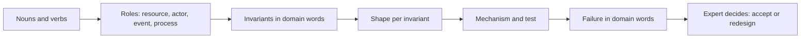

## In one minute
- Translation is a repeatable procedure: list the domain's nouns, give each a role (resource, actor, event, process), write the invariants in the domain's own words, then turn each invariant into a technical constraint.
- Invariants are the bridge. "A driver has at most one active trip" becomes a unique constraint on active trips per driver; "money in equals money out" becomes a double-entry ledger with a reconciliation job.
- Domain experts own the invariants and the parameters. Engineers own the mapping to mechanisms. Keep both visible in the same document.
- Translate back as well: every technical failure mode must be described in domain terms ("a rider waits forever") so experts can judge its cost.
- A translated spec is also the best input for a coding agent: invariants become tests, and mechanisms become explicit instructions.

## How it works

### Step 1: collect the nouns and verbs
Sit with the domain expert, read the support tickets and the existing code, and write down every noun and verb people use. This is the knowledge-crunching and shared-language work of domain-driven design ([Fowler on ubiquitous language](https://martinfowler.com/bliki/UbiquitousLanguage.html); *Domain-Driven Design* (Evans, 2003), Ch 1, "Crunching Knowledge", and Ch 2, "Communication and the Use of Language"). In a warehouse: SKU, bin, pick list, wave, picker, cart, replenishment. In an agent platform: task, tool call, plan, sub-agent, budget, approval. Do not translate yet; just collect.

### Step 2: give each noun a role
Most nouns fall into four roles. **Resources** are things that can be scarce or owned: bins, stock units, GPU slots, budgets. **Actors** act on resources: pickers, customers, agents. **Events** are facts that happened: "picked", "tool returned", "approved". **Processes** are multi-step activities: a wave, an order fulfilment, an agent's plan. Roles tell you which shapes can appear. Resources invite contention and hot spots. Events invite duplicates and ordering problems. Processes invite partial failure and multi-step consistency problems.

### Step 3: write the invariants in domain words
An invariant is something that must always be true. Write it in the expert's words and get them to sign it off. "A bin's count never goes negative." "A picker works on one wave at a time." "An agent never spends more than its task budget." "A tool that sends email runs at most once per approval." Experts can tell you which invariants matter and how much a violation costs, which is the information engineers usually lack.

### Step 4: turn invariants into constraints
Each invariant maps to a known mechanism, chosen by shape:

- "Never negative" or "never more than N": contention. Compare-and-set or a `CHECK` constraint with a conditional update.
- "At most one X per Y": contention. A unique (often partial) index, such as `UNIQUE (picker_id) WHERE state = 'active'`.
- "At most once per approval": duplicates. An idempotency key derived from the approval ID.
- "Status never goes backwards": ordering. A version or sequence check on update.
- "Either all of it or none of it": multi-step consistency. A local transaction if one database, otherwise a saga with compensations and an outbox.
- "Always adds up": trust but verify. A reconciliation job comparing two independent records.

### Step 5: translate failures back
For each mechanism, ask how it fails and describe that failure in domain words. A compare-and-set that loses under contention means "the picker is told the bin is busy and gets another one". A saga step that fails means "the customer is refunded within an hour". The compensation itself can fail, so it must be an idempotent command, and some steps (a sent email, a legally binding action) cannot be undone at all; the Azure pattern says to mark those points of no return and place them after the checks that can still fail ([Azure: compensating transaction](https://learn.microsoft.com/en-us/azure/architecture/patterns/compensating-transaction)). Experts can then say whether that is acceptable, which turns arguments about technology into decisions about the business.

## Down the stack

### Layer 1: The contract
Translation produces a document with four tables: glossary (noun, role), invariants (in domain words, owner, cost of violation), mechanisms (invariant, shape, mechanism, test), and failure translations (mechanism failure, domain effect, accepted or not). A reviewer can check that every invariant has a mechanism and a test, and every mechanism has a domain-language failure.

### Layer 2: The mechanism
The mappings are concrete. `UPDATE bins SET qty = qty - $1 WHERE id = $2 AND qty >= $1` enforces "never negative" in one statement; zero rows updated means the pick must go elsewhere. In Postgres, `CREATE UNIQUE INDEX one_active_wave ON assignments (picker_id) WHERE state = 'active'` enforces "one wave at a time"; a second insert fails with error code 23505 (`unique_violation`; [Postgres error codes](https://www.postgresql.org/docs/current/errcodes-appendix.html)). An idempotency table with `PRIMARY KEY (approval_id)` and `INSERT ... ON CONFLICT DO NOTHING` enforces "at most once per approval"; AWS also stores the original parameters with the token, so a retry with changed parameters is rejected instead of silently replayed ([AWS Builders' Library](https://aws.amazon.com/builders-library/making-retries-safe-with-idempotent-APIs/)). Each mechanism converts a sentence into something the database refuses to violate, which is stronger than application code that checks first and writes second.

### Layer 3: The machine
Pushing invariants into the database works because the database serialises the conflicting part on the machine. A conditional `UPDATE` takes a row lock. Postgres records row locks in the row itself rather than in a shared-memory table, so locking a row can cause a disk write but there is no limit on how many rows one transaction can lock ([Postgres explicit locking](https://www.postgresql.org/docs/current/explicit-locking.html)). Checking and writing therefore happen while no other writer can touch the row. A unique index check happens inside the B-tree insert: the inserting backend locks the leaf page, finds any equal key, and waits if another transaction inserted the same key and has not committed yet. These are microsecond operations on one machine, against millisecond round trips if your application tries to coordinate the same thing across services.

### Why it's built this way
1. Domain experts know which rules matter but not how systems fail; engineers know the reverse.
2. Invariants written in domain words are something both sides can read and agree on.
3. Each invariant falls into a known shape, and each shape has known mechanisms.
4. The strongest mechanisms put the invariant where conflicting writes are serialised anyway, usually the database.
5. Translating failures back into domain words lets the people who own the cost decide what is acceptable.

## Diagram


## Worked example
An AI platform team is asked to let agents call paid external tools: web search at 0.5 cents a call, a code sandbox at 2 cents a minute, and an email tool. Nouns: task, agent, sub-agent, tool call, budget, approval. Roles: budget is a resource, agents are actors, tool calls are events, the task is a process.

Invariants from the product owner: a task never spends more than its budget (default 5 dollars); an email is sent at most once per human approval; a task's final answer never reflects a tool result from a cancelled sub-agent.

Translation: the budget is contention, because 20 sub-agents may spend in parallel, so each spend is a conditional decrement on the task's budget row (`UPDATE budgets SET remaining = remaining - $1 WHERE task_id = $2 AND remaining >= $1`). The email rule is duplicates: the email tool takes the approval ID as its idempotency key. The cancelled sub-agent rule is ordering: each sub-agent result carries the plan version it was produced under, and results from an older version are dropped.

Failure translations: under heavy contention a sub-agent's spend can be refused, so "the agent reports it ran out of budget and asks the user". Accepted. A crash between sending the email and recording it would mean "the email may be sent but marked unsent", so the team sends via a provider that also honours idempotency keys. At 2 million tool calls a day, about 23 a second, the budget row for one task sees at most 20 concurrent writers: trivial for a row lock.

## In the wild
- **Knight Capital, 2012: an invariant nobody wrote down.** A repurposed flag meant the eighth of eight servers ran retired trading logic that no longer tracked filled quantity. In about 45 minutes it made over 4 million executions in 154 stocks and lost more than $460 million. The SEC cited the missing second-person review of the deploy and the absence of written procedures ([SEC order](https://www.sec.gov/litigation/admin/2013/34-70694.pdf)). "Total filled never exceeds the parent order" is exactly the kind of domain invariant this lesson says to state and enforce.
- **Twilio, 2013: money in versus money out.** A read-only Redis master left balances at zero, and auto-recharge ran repeatedly for 1.4% of customers. Twilio's fixes were fail-safes that block charges when balances cannot be written, and validation against a double-entry ledger ([Twilio post-mortem](https://www.twilio.com/en-us/blog/company/communications/billing-incident-post-mortem-breakdown-analysis-and-root-cause-html)). That is the reconciliation row in the invariants table above.
- **Stripe, 2017: online migration with side-by-side checks.** Stripe moved subscriptions out of customer records without downtime by dual-writing, backfilling, switching reads, then writes, then deleting the old path, running old and new read paths side by side with GitHub's Scientist library to flag differences ([Stripe engineering](https://stripe.com/blog/online-migrations)). Each step carried a checkable invariant.

## Trade-offs
| Where the invariant lives | Strengths | Weaknesses | Choose when |
| --- | --- | --- | --- |
| Database constraint | Cannot be bypassed; atomic | Limited to one database; harder to change | The rule is critical and data is in one place |
| Application check then write | Flexible, easy to express | Races between check and write | Low-stakes rules, or behind a lock |
| Single-writer service per entity | Serialises any logic, across stores | Throughput per entity is limited | Complex rules on one entity (an account, a task) |
| Reconciliation after the fact | Works across systems and vendors | Detects late, needs repair | Cross-company flows such as payments |

## Pitfalls in production
- Translating the nouns but not the invariants, which yields a nice data model that allows bad states. Fix: list invariants before tables.
- Invariants written only in technical words, so experts cannot review them. Fix: keep the domain sentence next to the constraint.
- Check-then-write in application code for a critical rule. Fix: a conditional write or a constraint.
- Forgetting that agents are actors too: they retry, run in parallel and act on stale plans. Fix: give agent actions the same idempotency and version checks as human ones.
- Parameters hard-coded by engineers (budget, hold time). Fix: make them configuration owned by the domain team.

## Leadership lens
- Make the four tables (glossary, invariants, mechanisms, failure translations) a required part of design docs for new domains.
- Invite the domain expert to review the invariants and failure translations, not the architecture diagram.
- Each invariant should have a test, and the critical ones a production check that alerts when violated.
- Use the translated spec as the agent prompt: invariants as tests to write first, mechanisms as instructions.

## Check yourself
1. Translate "a hotel room is never assigned to two guests on the same night" into a mechanism.
   **Answer:** Contention on a room-night resource: a unique constraint on (room_id, night) in the assignments table, or a conditional update on a room-night row, so a second assignment fails atomically.
2. Why translate failure modes back into domain language?
   **Answer:** Only domain owners know the cost of a failure, such as how bad it is for a rider to wait or a payment to be delayed, so they need it described in their terms to decide what is acceptable.
3. An agent platform must ensure a task never exceeds its budget while 20 sub-agents run in parallel. Which shape, and why is "read the remaining budget, then spend" wrong?
   **Answer:** Contention. Two sub-agents can both read 1 dollar remaining and both spend 80 cents; the check and the write must be one atomic conditional update.
4. When is reconciliation a better home for an invariant than a database constraint?
   **Answer:** When the data that must agree lives in different systems or companies, such as your ledger and a bank's, so no single transaction can enforce it.

## Practice
**Task:** Build a design-review linter that translates a feature description into the mechanisms it requires. `requirements(feature)` takes a dict (or object) with `scarce` (resource names), `retried` (operation names), `ordered` (entity names), `receivers` (how many receivers one event reaches), `systems` (systems one operation writes to) and `hottest_share` (the busiest key's share of traffic, 0 to 1). Return a sorted list of requirement strings: `"cas:<resource>"` for each scarce resource, `"idempotency:<operation>"` for each retried operation, `"version-check:<entity>"` for each ordered entity, `"fan-out-queue"` if receivers exceed 100, `"saga:<systems joined by +, sorted>"` if more than one system is written, and `"split-hot-key"` if the hottest share exceeds 0.1. Return no duplicates.

```python starter
def requirements(feature):
    # TODO: return sorted requirement strings
    raise NotImplementedError
```

```python tests
def base(**kw):
    f = {"scarce": [], "retried": [], "ordered": [], "receivers": 1, "systems": ["db"], "hottest_share": 0.01}
    f.update(kw)
    return f

def test_simple_feature_needs_nothing():
    assert requirements(base()) == []

def test_contention_and_duplicates():
    assert requirements(base(scarce=["budget"], retried=["send_email"])) == ["cas:budget", "idempotency:send_email"]

def test_ordering():
    assert requirements(base(ordered=["trip"])) == ["version-check:trip"]

def test_fan_out_threshold():
    assert requirements(base(receivers=100)) == []
    assert requirements(base(receivers=101)) == ["fan-out-queue"]

def test_multi_system_saga_sorted():
    assert requirements(base(systems=["payments", "orders"])) == ["saga:orders+payments"]

def test_hot_key_and_dedup():
    got = requirements(base(scarce=["seat", "seat"], hottest_share=0.3))
    assert got == ["cas:seat", "split-hot-key"]
```

```python solution
def requirements(feature):
    out = set()
    for r in feature["scarce"]:
        out.add("cas:" + r)
    for op in feature["retried"]:
        out.add("idempotency:" + op)
    for e in feature["ordered"]:
        out.add("version-check:" + e)
    if feature["receivers"] > 100:
        out.add("fan-out-queue")
    systems = sorted(set(feature["systems"]))
    if len(systems) > 1:
        out.add("saga:" + "+".join(systems))
    if feature["hottest_share"] > 0.1:
        out.add("split-hot-key")
    return sorted(out)
```

```typescript starter
export interface Feature {
  scarce: string[]; retried: string[]; ordered: string[];
  receivers: number; systems: string[]; hottest_share: number;
}

export function requirements(feature: Feature): string[] {
  throw new Error("TODO");
}
```

```typescript tests
const base = (kw: Partial<Feature>): Feature =>
  Object.assign({ scarce: [], retried: [], ordered: [], receivers: 1, systems: ["db"], hottest_share: 0.01 }, kw);

test("simple feature needs nothing", () => {
  assertEqual(requirements(base({})), []);
});

test("contention and duplicates", () => {
  assertEqual(requirements(base({ scarce: ["budget"], retried: ["send_email"] })), ["cas:budget", "idempotency:send_email"]);
});

test("ordering", () => {
  assertEqual(requirements(base({ ordered: ["trip"] })), ["version-check:trip"]);
});

test("fan-out threshold", () => {
  assertEqual(requirements(base({ receivers: 100 })), []);
  assertEqual(requirements(base({ receivers: 101 })), ["fan-out-queue"]);
});

test("multi-system saga sorted", () => {
  assertEqual(requirements(base({ systems: ["payments", "orders"] })), ["saga:orders+payments"]);
});

test("hot key and dedup", () => {
  assertEqual(requirements(base({ scarce: ["seat", "seat"], hottest_share: 0.3 })), ["cas:seat", "split-hot-key"]);
});
```

```typescript solution
export interface Feature {
  scarce: string[]; retried: string[]; ordered: string[];
  receivers: number; systems: string[]; hottest_share: number;
}

export function requirements(feature: Feature): string[] {
  const out = new Set<string>();
  feature.scarce.forEach(r => out.add("cas:" + r));
  feature.retried.forEach(op => out.add("idempotency:" + op));
  feature.ordered.forEach(e => out.add("version-check:" + e));
  if (feature.receivers > 100) out.add("fan-out-queue");
  const systems = Array.from(new Set(feature.systems)).sort();
  if (systems.length > 1) out.add("saga:" + systems.join("+"));
  if (feature.hottest_share > 0.1) out.add("split-hot-key");
  return Array.from(out).sort();
}
```

```go starter
package practice

type Feature struct {
	Scarce, Retried, Ordered []string
	Receivers               int
	Systems                 []string
	HottestShare            float64
}

func Requirements(f Feature) []string {
	panic("TODO")
}
```

```go tests
package practice

import (
	"reflect"
	"testing"
)

func base() Feature {
	return Feature{Receivers: 1, Systems: []string{"db"}, HottestShare: 0.01}
}

func eq(t *testing.T, got, want []string) {
	t.Helper()
	if len(got) == 0 && len(want) == 0 {
		return
	}
	if !reflect.DeepEqual(got, want) {
		t.Fatalf("got %v, want %v", got, want)
	}
}

func TestSimple(t *testing.T) {
	eq(t, Requirements(base()), nil)
}

func TestContentionAndDuplicates(t *testing.T) {
	f := base()
	f.Scarce = []string{"budget"}
	f.Retried = []string{"send_email"}
	eq(t, Requirements(f), []string{"cas:budget", "idempotency:send_email"})
}

func TestOrdering(t *testing.T) {
	f := base()
	f.Ordered = []string{"trip"}
	eq(t, Requirements(f), []string{"version-check:trip"})
}

func TestFanOut(t *testing.T) {
	f := base()
	f.Receivers = 100
	eq(t, Requirements(f), nil)
	f.Receivers = 101
	eq(t, Requirements(f), []string{"fan-out-queue"})
}

func TestSaga(t *testing.T) {
	f := base()
	f.Systems = []string{"payments", "orders"}
	eq(t, Requirements(f), []string{"saga:orders+payments"})
}

func TestHotKeyAndDedup(t *testing.T) {
	f := base()
	f.Scarce = []string{"seat", "seat"}
	f.HottestShare = 0.3
	eq(t, Requirements(f), []string{"cas:seat", "split-hot-key"})
}
```

```go solution
package practice

import (
	"sort"
	"strings"
)

type Feature struct {
	Scarce, Retried, Ordered []string
	Receivers               int
	Systems                 []string
	HottestShare            float64
}

func Requirements(f Feature) []string {
	out := map[string]bool{}
	for _, r := range f.Scarce {
		out["cas:"+r] = true
	}
	for _, op := range f.Retried {
		out["idempotency:"+op] = true
	}
	for _, e := range f.Ordered {
		out["version-check:"+e] = true
	}
	if f.Receivers > 100 {
		out["fan-out-queue"] = true
	}
	seen := map[string]bool{}
	var systems []string
	for _, s := range f.Systems {
		if !seen[s] {
			seen[s] = true
			systems = append(systems, s)
		}
	}
	sort.Strings(systems)
	if len(systems) > 1 {
		out["saga:"+strings.Join(systems, "+")] = true
	}
	if f.HottestShare > 0.1 {
		out["split-hot-key"] = true
	}
	res := make([]string, 0, len(out))
	for k := range out {
		res = append(res, k)
	}
	sort.Strings(res)
	return res
}
```

## Mock interview
**Prompt:** A logistics company wants a system for booking dock doors at 300 warehouses: trucks book a 30-minute slot, drivers check in on arrival, and late trucks lose their slot after 20 minutes. About 60,000 bookings a day. Translate the domain into known problems and design the core.

- Follow-up: Carriers' systems retry booking calls aggressively after timeouts. What breaks, and what is the fix?
- Follow-up: The operations manager wants to allow two small trucks per door slot. Mechanism or parameter?
- Follow-up: Check-in events from the gate scanner sometimes arrive after the "slot released" event. What happens?

**A strong answer covers:**
- A glossary with roles: door-slot as resource, carrier and driver as actors, booked, checked-in and released as events.
- Invariants in domain words, signed off by operations: at most N trucks per door slot, a released slot never accepts a check-in for the old booking.
- Mechanisms per shape: conditional update or unique constraint on (door, slot), idempotency keys from carrier booking references, version checks on the booking state.
- Capacity per slot as a parameter, not a new mechanism.
- Failures translated back: "a late truck is sent to the overflow queue", with operations deciding the policy.
- Load sanity: 60,000 bookings a day is under 1 per second on average, so correctness, not scale, is the hard part.

## Sources and further study

**Primary**
- Pat Helland, "Life beyond Distributed Transactions: An Apostate's Opinion" ([ACM Queue](https://queue.acm.org/detail.cfm?id=3025012)): when atomicity is limited to one entity, cross-entity rules must be handled with messages and tolerance for repeats.

**Systems docs**
- [PostgreSQL error codes](https://www.postgresql.org/docs/current/errcodes-appendix.html) and [explicit locking](https://www.postgresql.org/docs/current/explicit-locking.html): how constraints and row locks enforce invariants.
- [AWS Builders' Library: making retries safe with idempotent APIs](https://aws.amazon.com/builders-library/making-retries-safe-with-idempotent-APIs/).
- [Azure: compensating transaction pattern](https://learn.microsoft.com/en-us/azure/architecture/patterns/compensating-transaction).

**Books**
- *Domain-Driven Design* (Evans, 1st ed., 2003), Ch 1, "Crunching Knowledge", Ch 2, "Communication and the Use of Language", and Ch 5, "A Model Expressed in Software".
- *Designing Data-Intensive Applications* (1st ed.), Ch 7, "Transactions" (constraints, atomic compare-and-set), by Martin Kleppmann.

**Other curricula**
- [Martin Fowler: ubiquitous language](https://martinfowler.com/bliki/UbiquitousLanguage.html): why the invariants table should use the expert's own words.
- [System Design Primer](https://github.com/donnemartin/system-design-primer): the database and idempotency sections for the mechanisms this lesson maps invariants onto.

## Free resources
- [Domain-Driven Design reference (Eric Evans, PDF)](https://www.domainlanguage.com/wp-content/uploads/2016/05/DDD_Reference_2015-03.pdf): the canonical summary of ubiquitous language and bounded contexts.
- [Ubiquitous Language (Martin Fowler)](https://martinfowler.com/bliki/UbiquitousLanguage.html): why engineers and experts should share words.
- [PostgreSQL: constraints](https://www.postgresql.org/docs/current/ddl-constraints.html): how CHECK, UNIQUE and exclusion constraints enforce invariants.
- [Azure: compensating transaction pattern](https://learn.microsoft.com/en-us/azure/architecture/patterns/compensating-transaction): undoing multi-step work when no single transaction exists.
- [Making retries safe with idempotent APIs (AWS Builders' Library)](https://aws.amazon.com/builders-library/making-retries-safe-with-idempotent-APIs/): turning "at most once" rules into mechanisms.
