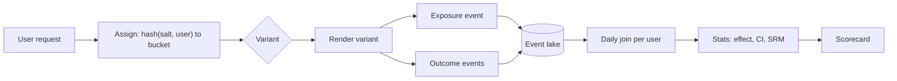

## In one minute
- An experimentation platform randomly assigns units (usually users) to variants, logs who saw what, joins that with outcome metrics, and runs statistical tests to estimate the effect of a change.
- Assignment must be deterministic, independent across experiments, and stable over time. Hash-based bucketing gives all three without storing assignments.
- The metric pipeline is the expensive part: billions of exposure and event rows joined daily, with guardrail metrics alongside the target metric.
- Most wrong conclusions come from process, not math: peeking, sample ratio mismatch, too many metrics, and novelty effects.
- At scale, experiment velocity (how many trustworthy tests per quarter) is the product metric of the platform.

## How it works

### Assignment
The unit id is hashed with an experiment-specific salt into, say, 10,000 buckets. Buckets map to variants by weight. The same user always lands in the same bucket, so assignment needs no database. To run many experiments at once, the platform uses layers: experiments in one layer split the traffic exclusively (a user is in at most one of them), while different layers use different salts so assignments are independent. Conflicting changes to the same page go in the same layer. In Google's design a layer owns a subset of system parameters, no parameter may belong to two layers, and domains (slices of traffic) can nest inside layers, so each request sits in at most one experiment per layer ([Tang et al., KDD 2010](https://research.google.com/pubs/archive/36500.pdf)).

### Exposure logging
A user assigned to a checkout test who never reaches checkout should not count. The SDK emits an exposure event at the point the variant is actually used. Analysis includes only exposed users, which keeps the signal from being diluted.

### Metric computation
A daily (or hourly) job joins exposure events with outcome events by unit id and computes per-user aggregates: conversions, revenue, sessions, latency. Per-variant means, variances, and confidence intervals follow. Precomputed per-user rows make each new analysis a cheap aggregation.

### Statistics
For a conversion metric, a two-proportion z-test compares rates. Variance reduction techniques such as CUPED use each user's pre-experiment behaviour as a covariate; on Bing it cut variance by about 50 percent, the same power with half the users or half the duration ([Deng et al., WSDM 2013](https://exp-platform.com/Documents/2013-02-CUPED-ImprovingSensitivityOfControlledExperiments.pdf)). Gains depend on how well the pre-period predicts the metric, and new users have no pre-period at all. Sequential testing methods allow monitoring results continuously without inflating false positives, which fixed-horizon tests do not. "Always valid" p-values were built for exactly this and run in a commercial platform on hundreds of thousands of experiments ([Johari et al.](https://arxiv.org/abs/1512.04922)); the price is wider intervals at any fixed sample size ([GrowthBook docs](https://docs.growthbook.io/statistics/sequential)).

Skewed metrics such as revenue need more users before the normal approximation holds. One rule of thumb from Bing is at least 355 times the squared skewness per variant when skewness exceeds 1 ([Kohavi et al., KDD 2014](https://exp-platform.com/Documents/2014%20experimentersRulesOfThumb.pdf)); capping extreme values is the usual fix.

### Health checks
Before reading results, check the sample ratio. If a 50/50 test shows 50.8/49.2 on a million users, something is broken: a redirect that drops users in one arm, a bot filter, or a crash. A chi-square test flags this. It is not rare: about 6 percent of Microsoft experiments in one study showed an SRM, with causes ranging from assignment bugs to telemetry loss to bot filters that removed the most engaged treatment users ([Fabijan et al., KDD 2019](https://exp-platform.com/Documents/2019_KDDFabijanGupchupFuptaOmhoverVermeerDmitriev.pdf)). Platforms add their own common causes, such as assigning on the server but logging exposure on the client, or hashing on a different id than the analysis joins on ([GrowthBook docs](https://docs.growthbook.io/kb/experiments/troubleshooting-experiments)). Guardrail metrics such as latency, errors, and unsubscribes stop a test that wins its target metric by hurting something else.

## Down the stack
### Layer 1: The contract
The platform promises that assignment is deterministic, that assignments in different layers are statistically independent, and that each exposed unit is counted once, in the variant it actually saw. The scorecard promises an effect estimate with a confidence interval at a stated significance level, valid only if units are independent, the sample ratio matches the design, and the analysis plan was fixed in advance.

### Layer 2: The mechanism
Assignment is `hash(salt + unit_id) mod buckets`, with salts per layer. Google's overlapping experiment design adds domains and layers so that thousands of experiments share traffic without collisions. The SDK emits exposure events of the form `(unit_id, experiment_id, variant, timestamp)`, deduplicated to the first exposure. A daily job builds a per-unit table of metric sums. From it each variant needs only sufficient statistics: count, sum, and sum of squares, from which mean and variance follow without rescanning raw events. Ratio metrics such as clicks per page view are not averages of independent rows, so their variance comes from the delta method ([Deng et al., 2018](https://arxiv.org/abs/1803.06336)). CUPED adjusts each unit's value by theta times its pre-period value, with theta equal to the covariance of the two divided by the pre-period variance.

### Layer 3: The machine
A billion events a day at about 200 bytes each is 200 GB of raw logs, which columnar Parquet with dictionary encoding typically shrinks to 20 to 40 GB. Joining exposures to events is a shuffle: both sides are hash-partitioned by unit id across the cluster, so the job is bound by network and disk spill, not CPU. Bots with millions of events land in one partition and create a straggler task that holds up the whole job, so bot filtering happens before the join. Computing variance as sum of squares minus square of sum in floating point can lose most significant digits when the mean is large relative to the spread; production code uses centred or Welford-style accumulation.

### Why it's built this way
Storing billions of assignments would add a lookup to every request, so assignment is a hash. Analyses are rerun many times, so the expensive join happens once and later work uses small aggregates. Page views from one user are correlated, so the unit of analysis is the user and ratio metrics need special variance handling. Shuffles are the dominant cost, so data is partitioned by unit id once and reused.

## Diagram


## Worked example
A signup page converts at 4.0 percent. The team wants to detect a 5 percent relative lift, to 4.2 percent, with 80 percent power at a 5 percent significance level.

The required sample per arm is roughly 16 x p(1-p) / delta squared, where delta is 0.002. The 16 comes from 80 percent power at 5 percent significance. For 90 percent power, Kohavi's guide uses a total of (4 r sigma / delta) squared for r variants and warns that the 4 can overestimate by about 25 percent ([Kohavi et al.](https://www.exp-platform.com/Documents/GuideControlledExperiments.pdf)). That is 16 x 0.04 x 0.96 / 0.000004, about 154,000 users per arm, 308,000 total. At 40,000 new visitors a day that is 8 days. Round up to 14 days to cover two weekly cycles.

With CUPED reducing variance by 30 percent, a conservative figure for a signup page with many new users, the requirement falls to about 108,000 per arm, under 6 days of traffic, which still rounds to a full week.

Peeking matters: if the team checks a fixed-horizon test every day and stops at the first p below 0.05, the real false-positive rate climbs well above 5 percent; checked after every observation it reaches 26.1 percent ([Evan Miller](https://www.evanmiller.org/how-not-to-run-an-ab-test.html)). Either commit to the horizon or use a sequential method.

Pipeline scale: 20 million daily users at 50 events each is a billion events a day, which collapses to 20 million per-user rows.

## In the wild
- **MSN, 2019: the bot filter flipped the result.** A test raised the homepage carousel from 12 to 16 cards and appeared to cut engagement, but the treatment arm had fewer users than configured. The most engaged treatment users clicked so much that the log pipeline classed them as bots and dropped them. Once that was corrected the result reversed and the feature shipped. The paper calls this an experiment log processing SRM and reports SRMs in about 6 percent of Microsoft experiments ([Fabijan et al.](https://exp-platform.com/Documents/2019_KDDFabijanGupchupFuptaOmhoverVermeerDmitriev.pdf)).
- **LinkedIn, 2014: an eligibility bug made a good feature look terrible.** A new contacts page showed "horrifying" results. It took days to find that the eligibility check put anyone who had seen the feature once on a whitelist that removed them from the experiment, so treatment users looked like they churned after one visit ([Kohavi et al., KDD 2014](https://exp-platform.com/Documents/2014%20experimentersRulesOfThumb.pdf)).
- **Bing, 2014: guardrails worth millions.** A slowdown experiment delayed 10 percent of users by 100 ms and another 10 percent by 250 ms for two weeks, and showed every 100 ms of speed was worth 0.6 percent of revenue. In another test, a new ad background colour cut revenue by 12 percent, over $150 million a year, without moving abandonment ([Kohavi et al., KDD 2014](https://exp-platform.com/Documents/2014%20experimentersRulesOfThumb.pdf)).

## Trade-offs
| Option | Strengths | Weaknesses | Choose when |
| --- | --- | --- | --- |
| Hash-based assignment | Stateless, fast, reproducible | Changing weights mid-test reshuffles users unless handled carefully | Default |
| Stored assignments | Can change allocation without reshuffle, easy audit | Lookup on hot path, storage | Long-running or regulated tests |
| Fixed-horizon tests | Simple, well understood | Peeking invalidates them | Disciplined teams, few tests |
| Sequential tests | Safe continuous monitoring, early stop | Slightly less power at the horizon | Many tests, pressure to ship early |
| Switchback or cluster randomisation | Handles network effects in marketplaces | Fewer units, more variance | Two-sided markets, shared resources |

## Pitfalls in production
- Sample ratio mismatch silently biases results. Run an SRM check automatically and block the scorecard if it fails.
- Counting assigned instead of exposed users dilutes effects. Log exposure where the variant is used.
- Checking dozens of metrics makes some look significant by chance. Pre-register a primary metric and correct for multiple comparisons.
- Novelty and learning effects make week-one results misleading. Run at least two weekly cycles and look at the trend.
- Interference between users, such as shared inventory or social feeds, breaks independence. Randomise by cluster or time.
- Filters applied after assignment, such as bot detection on post-treatment behaviour, remove users unevenly. Monitor how many units each filter drops per arm.

## Leadership lens
- Decide what the platform owns (assignment, logging, stats) and what product teams own (hypotheses, metric definitions).
- Make metric definitions code-reviewed and versioned; disputes about "what counts as active" kill trust.
- Ask before launch: primary metric, minimum detectable effect, duration, and guardrails.

## Check yourself
1. Why salt the hash with the experiment id?
   **Answer:** Without it, every experiment puts the same users in the same buckets, so treatment groups across experiments are correlated and effects can leak between tests.
2. A 50/50 test shows 502,000 versus 498,000 users. Is that a problem?
   **Answer:** The chi-square statistic is 16, p is about 0.00006, so yes. A difference that large is very unlikely by chance and points to a bug in assignment, redirects, or logging.
3. Why log exposure separately from assignment?
   **Answer:** Users assigned but never shown the change add noise with zero effect, diluting the measured lift and inflating the needed sample size.
4. What does CUPED change about an experiment?
   **Answer:** It subtracts the part of each user's metric predicted by their pre-experiment behaviour, lowering variance and so the sample needed for the same power.

## Practice
**Task:** Write `assign(experiment, user_id, weights)` that hashes `experiment + ":" + user_id` with 32-bit FNV-1a (start at 2166136261; per byte, XOR then multiply by 16777619 modulo 2^32) into 10,000 buckets and maps buckets to variant names in order of the `weights` list of `(name, weight)` pairs (weights sum to 100). Write `z_test(conv_a, n_a, conv_b, n_b)` returning `(z, p)` for a two-proportion z-test using the pooled rate and a two-sided p-value via `math.erfc`. Write `srm_p(count_a, count_b)` returning the chi-square p-value for an expected 50/50 split (1 degree of freedom: `erfc(sqrt(chi2 / 2))`). TypeScript has no `erfc`, so that version also exports `erfc(x)`; the Abramowitz and Stegun 7.1.26 approximation is accurate enough.

```python starter
import math

def assign(experiment, user_id, weights):
    raise NotImplementedError

def z_test(conv_a, n_a, conv_b, n_b):
    raise NotImplementedError

def srm_p(count_a, count_b):
    raise NotImplementedError
```

```python tests
W = [("control", 50), ("treatment", 50)]

def test_assign_is_stable():
    assert assign("exp1", "u1", W) == assign("exp1", "u1", W)

def test_assign_split_is_roughly_even():
    n = sum(1 for i in range(4000) if assign("exp1", "u" + str(i), W) == "control")
    assert 1800 < n < 2200

def test_zero_weight_never_assigned():
    w = [("a", 0), ("b", 100)]
    assert all(assign("e", str(i), w) == "b" for i in range(200))

def test_z_test_detects_lift():
    z, p = z_test(400, 10000, 500, 10000)
    assert z > 3 and p < 0.001

def test_z_test_no_difference():
    z, p = z_test(400, 10000, 400, 10000)
    assert z == 0 and abs(p - 1.0) < 1e-9

def test_srm():
    assert srm_p(502000, 498000) < 0.001
    assert srm_p(50010, 49990) > 0.5
```

```python solution
import math

def assign(experiment, user_id, weights):
    h = 2166136261
    for c in (experiment + ":" + user_id).encode():
        h = ((h ^ c) * 16777619) & 0xFFFFFFFF
    b = h % 10000
    edge = 0
    for name, w in weights:
        edge += w * 100
        if b < edge:
            return name
    return weights[-1][0]

def z_test(conv_a, n_a, conv_b, n_b):
    pa, pb = conv_a / n_a, conv_b / n_b
    pool = (conv_a + conv_b) / (n_a + n_b)
    se = math.sqrt(pool * (1 - pool) * (1 / n_a + 1 / n_b))
    z = (pb - pa) / se if se else 0.0
    return z, math.erfc(abs(z) / math.sqrt(2))

def srm_p(count_a, count_b):
    exp = (count_a + count_b) / 2
    chi2 = ((count_a - exp) ** 2 + (count_b - exp) ** 2) / exp
    return math.erfc(math.sqrt(chi2 / 2))
```

```typescript starter
export function erfc(x: number): number {
  throw new Error("TODO");
}

export function assign(experiment: string, userId: string, weights: [string, number][]): string {
  throw new Error("TODO");
}

export function zTest(convA: number, nA: number, convB: number, nB: number): [number, number] {
  throw new Error("TODO");
}

export function srmP(countA: number, countB: number): number {
  throw new Error("TODO");
}
```

```typescript tests
const W: [string, number][] = [["control", 50], ["treatment", 50]];

test("assign is stable", () => {
  assertEqual(assign("exp1", "u1", W), assign("exp1", "u1", W));
});

test("split is roughly even", () => {
  let n = 0;
  for (let i = 0; i < 4000; i++) if (assign("exp1", "u" + i, W) === "control") n++;
  assert(n > 1800 && n < 2200, "split " + n);
});

test("zero weight never assigned", () => {
  for (let i = 0; i < 200; i++) assertEqual(assign("e", String(i), [["a", 0], ["b", 100]]), "b");
});

test("z test detects lift", () => {
  const [z, p] = zTest(400, 10000, 500, 10000);
  assert(z > 3 && p < 0.001, "z=" + z + " p=" + p);
});

test("z test no difference", () => {
  const [z, p] = zTest(400, 10000, 400, 10000);
  assert(z === 0 && Math.abs(p - 1) < 1e-6, "p=" + p);
});

test("srm", () => {
  assert(srmP(502000, 498000) < 0.001, "should flag");
  assert(srmP(50010, 49990) > 0.5, "should not flag");
});
```

```typescript solution
export function erfc(x: number): number {
  const z = Math.abs(x);
  const t = 1 / (1 + 0.3275911 * z);
  const poly = t * (0.254829592 + t * (-0.284496736 + t * (1.421413741 + t * (-1.453152027 + t * 1.061405429))));
  const r = poly * Math.exp(-z * z);
  return x >= 0 ? r : 2 - r;
}

export function assign(experiment: string, userId: string, weights: [string, number][]): string {
  const s = experiment + ":" + userId;
  let h = 2166136261;
  for (let i = 0; i < s.length; i++) h = Math.imul(h ^ s.charCodeAt(i), 16777619) >>> 0;
  const b = h % 10000;
  let edge = 0;
  for (const [name, w] of weights) {
    edge += w * 100;
    if (b < edge) return name;
  }
  return weights[weights.length - 1][0];
}

export function zTest(convA: number, nA: number, convB: number, nB: number): [number, number] {
  const pool = (convA + convB) / (nA + nB);
  const se = Math.sqrt(pool * (1 - pool) * (1 / nA + 1 / nB));
  const z = se ? (convB / nB - convA / nA) / se : 0;
  return [z, erfc(Math.abs(z) / Math.SQRT2)];
}

export function srmP(countA: number, countB: number): number {
  const exp = (countA + countB) / 2;
  const chi2 = ((countA - exp) ** 2 + (countB - exp) ** 2) / exp;
  return erfc(Math.sqrt(chi2 / 2));
}
```

```go starter
package practice

type Weight struct {
	Name   string
	Weight int
}

func Assign(experiment, userID string, weights []Weight) string { panic("TODO") }

func ZTest(convA, nA, convB, nB int) (float64, float64) { panic("TODO") }

func SrmP(countA, countB int) float64 { panic("TODO") }
```

```go tests
package practice

import (
	"math"
	"strconv"
	"testing"
)

var w = []Weight{{"control", 50}, {"treatment", 50}}

func TestAssignStable(t *testing.T) {
	if Assign("exp1", "u1", w) != Assign("exp1", "u1", w) {
		t.Fatal("not stable")
	}
}

func TestSplitEven(t *testing.T) {
	n := 0
	for i := 0; i < 4000; i++ {
		if Assign("exp1", "u"+strconv.Itoa(i), w) == "control" {
			n++
		}
	}
	if n <= 1800 || n >= 2200 {
		t.Fatalf("split %d", n)
	}
}

func TestZeroWeight(t *testing.T) {
	for i := 0; i < 200; i++ {
		if Assign("e", strconv.Itoa(i), []Weight{{"a", 0}, {"b", 100}}) != "b" {
			t.Fatal("zero weight assigned")
		}
	}
}

func TestZDetectsLift(t *testing.T) {
	z, p := ZTest(400, 10000, 500, 10000)
	if z <= 3 || p >= 0.001 {
		t.Fatalf("z=%v p=%v", z, p)
	}
}

func TestZNoDifference(t *testing.T) {
	z, p := ZTest(400, 10000, 400, 10000)
	if z != 0 || math.Abs(p-1) > 1e-6 {
		t.Fatalf("z=%v p=%v", z, p)
	}
}

func TestSRM(t *testing.T) {
	if SrmP(502000, 498000) >= 0.001 || SrmP(50010, 49990) <= 0.5 {
		t.Fatal("srm wrong")
	}
}
```

```go solution
package practice

import "math"

type Weight struct {
	Name   string
	Weight int
}

func Assign(experiment, userID string, weights []Weight) string {
	h := uint32(2166136261)
	for _, c := range []byte(experiment + ":" + userID) {
		h ^= uint32(c)
		h *= 16777619
	}
	b := int(h % 10000)
	edge := 0
	for _, wt := range weights {
		edge += wt.Weight * 100
		if b < edge {
			return wt.Name
		}
	}
	return weights[len(weights)-1].Name
}

func ZTest(convA, nA, convB, nB int) (float64, float64) {
	pool := float64(convA+convB) / float64(nA+nB)
	se := math.Sqrt(pool * (1 - pool) * (1/float64(nA) + 1/float64(nB)))
	z := 0.0
	if se > 0 {
		z = (float64(convB)/float64(nB) - float64(convA)/float64(nA)) / se
	}
	return z, math.Erfc(math.Abs(z) / math.Sqrt2)
}

func SrmP(countA, countB int) float64 {
	exp := float64(countA+countB) / 2
	da, db := float64(countA)-exp, float64(countB)-exp
	chi2 := (da*da + db*db) / exp
	return math.Erfc(math.Sqrt(chi2 / 2))
}
```

## Mock interview
**Prompt:** Design an experimentation platform for a marketplace with 30 million daily users that wants to run 300 concurrent experiments. Results should be available daily and trusted by finance.

- Follow-up: How do you let 300 experiments run at once without them contaminating each other?
- Follow-up: A test wins on conversion but sellers complain. What went wrong in the design?
- Follow-up: Product managers want to stop tests as soon as they look good. How do you support that safely?

**A strong answer covers:**
- Hash-based assignment with per-experiment salts and exclusive layers for conflicting changes.
- Exposure logging at the point of use and a daily per-user aggregate table.
- Automated SRM checks, guardrail metrics, and versioned metric definitions.
- Marketplace interference and switchback or cluster randomisation.
- Sequential testing or a strict fixed horizon, plus multiple-comparison control.

## Sources and further study
**Primary**
- [Tang et al., Overlapping Experiment Infrastructure (KDD 2010)](https://research.google.com/pubs/archive/36500.pdf): Google's layers and domains for running many experiments on the same traffic.
- [Fabijan et al., Diagnosing Sample Ratio Mismatch (KDD 2019)](https://exp-platform.com/Documents/2019_KDDFabijanGupchupFuptaOmhoverVermeerDmitriev.pdf): a taxonomy of SRM causes with case studies from Microsoft.
- [Johari, Pekelis and Walsh, Always Valid Inference](https://arxiv.org/abs/1512.04922): the theory behind safe continuous monitoring.
- [Kohavi et al., Seven Rules of Thumb for Web Site Experimenters (KDD 2014)](https://exp-platform.com/Documents/2014%20experimentersRulesOfThumb.pdf): Bing and LinkedIn examples, including the skewness rule for sample size.
- [Deng, Knoblich and Lu, Applying the Delta Method in Metric Analytics](https://arxiv.org/abs/1803.06336): variance for ratio metrics when the analysis unit differs from the randomisation unit.

**Systems docs**
- [GrowthBook: sequential testing](https://docs.growthbook.io/statistics/sequential): confidence sequences in a production platform and their width trade-off.
- [GrowthBook: troubleshooting experiments](https://docs.growthbook.io/kb/experiments/troubleshooting-experiments): the SRM causes one platform sees most.

**Books**
- *Trustworthy Online Controlled Experiments*, Kohavi, Tang and Xu, chapter 21 "Sample Ratio Mismatch and Other Trust-Related Guardrail Metrics", and chapter 18 "Variance Estimation and Improved Sensitivity".
- *Trustworthy Online Controlled Experiments*, chapter 4 "Experimentation Platform and Culture": what a platform owns as it matures.

**Other curricula**
- [A/B Testing by Google (Udacity, free)](https://www.udacity.com/course/ab-testing--ud257): taught by Google engineers including Diane Tang, it frames experimentation as metric choice, design, and analysis, with a lesson on ethics.

## Watch
- [Online Controlled Experiments: Lessons from Running A/B/n Tests for 12 Years (Ron Kohavi, SF Bay ACM)](https://www.youtube.com/watch?v=qtboCGd_hTA): hard-won lessons on trustworthiness from Microsoft's platform.
- [Trustworthy Online Controlled Experiments at Large Scale (Ronny Kohavi, Split)](https://www.youtube.com/watch?v=kTAFOCynWIg): SRM, guardrails, and the pitfalls that mislead teams.

## Free resources
- [Practical Guide to Controlled Experiments on the Web (Kohavi et al.)](https://www.exp-platform.com/Documents/GuideControlledExperiments.pdf): the foundational paper on running web experiments correctly.
- [CUPED: Improving Sensitivity of Controlled Experiments (Deng et al.)](https://exp-platform.com/Documents/2013-02-CUPED-ImprovingSensitivityOfControlledExperiments.pdf): the original variance-reduction paper.
- [How Not To Run an A/B Test (Evan Miller)](https://www.evanmiller.org/how-not-to-run-an-ab-test.html): a clear demonstration of why peeking breaks significance.
- [Microsoft Experimentation Platform](https://www.microsoft.com/en-us/research/group/experimentation-platform-exp/): articles and papers from one of the largest experimentation teams.
