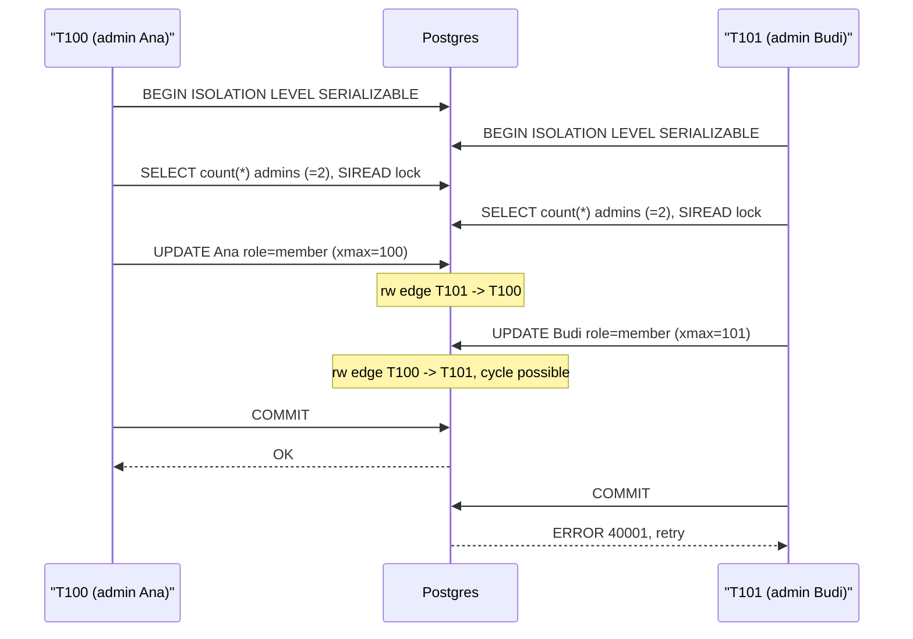

## In one minute
- A transaction groups reads and writes into one unit that takes effect completely or not at all, and that other sessions see as if it ran alone, to a degree you choose.
- Atomicity and durability come from the log. Isolation comes from locks, row versions, or both. Consistency is mostly your job: the database enforces only the constraints you declared.
- Isolation is a dial: each level permits different anomalies, and vendor names for levels do not match the standard's.
- Most databases use multi-version concurrency control (MVCC): writers create new row versions, and each reader picks the versions its snapshot allows.
- Stronger isolation costs aborts as well as speed: Serializable in Postgres rejects some transactions, so the application must retry them.

## How it works

### What each letter actually promises
**Atomicity** is about failure, not concurrency. If a transaction aborts, through `ROLLBACK`, a constraint violation, a deadlock or a crash, every change it made disappears. It says nothing about what others see while it runs.

**Consistency** is the odd one out. The database guarantees that declared constraints (`PRIMARY KEY`, `UNIQUE`, `FOREIGN KEY`, `CHECK`, `NOT NULL`) hold at commit. Undeclared invariants, such as "every shift has a doctor on call", hold only if every transaction is written correctly *and* the isolation level stops concurrent transactions interleaving badly. Read the C as "A and I let your code keep invariants".

**Isolation** is about concurrency. The ideal is *serializability*: the outcome equals some one-at-a-time ordering of the committed transactions. **Durability** (a commit survives a crash) is covered in How Databases Guarantee Durability.

### The anomalies, named
Isolation levels are defined by which of these they allow:

- **Dirty read:** T2 sees T1's uncommitted write, and T1 later aborts.
- **Non-repeatable read:** T1 reads a row twice and sees T2's commit in between.
- **Phantom:** T1 runs the same `WHERE` twice and T2's insert adds a row.
- **Lost update:** T1 and T2 both read a counter of 10, both write 11; one increment vanishes.
- **Write skew:** T1 and T2 read overlapping data, each checks an invariant, then each writes a *different* row. Each is fine alone; together they break the invariant.

The SQL standard defines its four levels using only the first three. The 1995 paper ["A Critique of ANSI SQL Isolation Levels"](https://arxiv.org/abs/cs/0701157) showed this misses the last two and named Snapshot Isolation. Products then diverged:

| Database | Default | "Repeatable Read" means | "Serializable" means |
|---|---|---|---|
| PostgreSQL | Read Committed | Snapshot Isolation | SSI, truly serializable |
| MySQL InnoDB | Repeatable Read | Snapshot reads, locking writes | Locking reads (2PL style) |
| Oracle | Read Committed | Not offered | Snapshot Isolation |
| SQL Server | Read Committed (locking) | Shared locks held | Range locks, 2PL |

So Serializable on Oracle does not stop write skew: it fails only when two transactions write the same row, with `ORA-08177` ([Oracle docs](https://docs.oracle.com/en/database/oracle/oracle-database/19/cncpt/data-concurrency-and-consistency.html)). Repeatable Read on MySQL is not Repeatable Read on Postgres. SQL Server also offers a `SNAPSHOT` level and a `READ_COMMITTED_SNAPSHOT` option that makes Read Committed use row versions; that option is off by default on SQL Server but on by default in Azure SQL Database ([Microsoft docs](https://learn.microsoft.com/en-us/sql/t-sql/statements/set-transaction-isolation-level-transact-sql)), so the same code can behave differently after a cloud migration. Postgres accepts `READ UNCOMMITTED` but runs it as Read Committed. Kleppmann's Hermitage project tests these differences.

### Two ways to isolate
**Locking (two-phase locking, 2PL)**: a transaction takes shared locks to read and exclusive locks to write, and releases nothing until it commits. Range locks stop phantoms. It is serializable, but readers and writers block each other and deadlocks are routine, so a detector kills a victim.

A third option, covered in Kleppmann's *Designing Data-Intensive Applications* (chapter 7), is **actual serial execution**: run every transaction on one thread, one at a time. VoltDB and Redis scripts work this way. It is trivially serializable, but only works when each transaction is short and the data fits one core's throughput.

**Multi-version concurrency control (MVCC)**: a write creates a new version of the row instead of overwriting it. A reader sees only versions committed before its *snapshot*, so readers and writers never block each other. Two writers to the same row still conflict: the second waits, then either proceeds on the new version (Read Committed) or aborts (Snapshot Isolation's "first committer wins").

Snapshot isolation still allows write skew, because the transactions write different rows and never collide. Postgres closes the gap with **Serializable Snapshot Isolation (SSI)**: it tracks what serializable transactions read and aborts one with SQLSTATE `40001` when a non-serializable outcome becomes possible ([Postgres docs](https://www.postgresql.org/docs/current/transaction-iso.html)).

### The same shape elsewhere
This is the multi-step consistency and contention shape. A deploy tool that checks "is anyone else rolling out?" and then writes "I am" has write skew; a Kubernetes controller that writes back without checking `resourceVersion` loses updates.

## Down the stack

### Layer 1: The contract
At Read Committed, each *statement* sees data committed before it began. At Snapshot Isolation (Postgres `REPEATABLE READ`), every statement sees the snapshot taken at the first one, and updating a row that someone else changed after that snapshot fails with `could not serialize access due to concurrent update`. At `SERIALIZABLE`, committed serializable transactions have the effect of some serial order, and any statement or commit may fail with `40001`, so the client retries the whole transaction. Atomicity holds at every level. Durability holds when `COMMIT` returns, unless `synchronous_commit = off`, which risks losing up to three times `wal_writer_delay` (200 ms by default) of commits ([Postgres docs](https://www.postgresql.org/docs/current/wal-async-commit.html)).

### Layer 2: The mechanism
In Postgres every heap tuple header ([23 bytes](https://www.postgresql.org/docs/current/storage-page-layout.html)) carries `t_xmin`, the transaction that created it, `t_xmax`, the one that deleted or replaced it (0 if none), and `t_ctid`, a pointer to the newer version. An `UPDATE` sets `xmax` on the old tuple and inserts a new one.

Commit status lives in `pg_xact`, 2 bits per transaction ID. A snapshot, shown by `SELECT pg_current_snapshot()`, is `xmin` (oldest running ID), `xmax` (next unassigned ID) and `xip` (IDs in progress). An ID is visible if it is below `xmax`, not in `xip`, and committed. A tuple is visible if its `xmin` is visible and its `xmax` is unset or not visible. The practice implements this rule.

The first reader to confirm a commit sets the `HEAP_XMIN_COMMITTED` hint bit in `t_infomask`, so later readers skip `pg_xact`. `VACUUM` removes versions no snapshot can see and, because IDs are 32 bits, *freezes* old tuples before wraparound (forced at `autovacuum_freeze_max_age`, 200 million by default; see the [Postgres vacuuming docs](https://www.postgresql.org/docs/current/routine-vacuuming.html)).

For SSI, Postgres takes `SIREAD` locks on what serializable transactions read. A write that overlaps another transaction's `SIREAD` lock records a read-write dependency; two consecutive edges, `T1 -rw-> T2 -rw-> T3`, form a "dangerous structure" and one transaction aborts. Some aborts are false positives.

InnoDB keeps the newest version in place, with `DB_ROLL_PTR` pointing to older versions in the undo log, and its *read view* is the same three-part snapshot.

### Layer 3: The machine
Atomicity and durability cost one log flush per commit. That `fsync` takes tens of microseconds on NVMe with power-loss protection and roughly 0.5 to 2 ms on network block storage; group commit shares one flush among many commits.

Isolation costs memory and I/O, not flushes. A `pg_xact` lookup hits a cached 8 KB page holding 32,768 transaction statuses, and setting the hint bit dirties the heap page, so the first `SELECT` after a bulk load can cause heavy writes. Each MVCC update writes a whole new tuple and, unless it is a heap-only tuple (HOT) on the same page, new index entries too. A long-running transaction pins its `xmin`, so `VACUUM` cannot remove newer dead versions anywhere in the database, and tables and indexes bloat. Predicate locks live in fixed shared memory (`max_pred_locks_per_transaction`), so SSI coarsens row locks into page and relation locks under load, raising false-positive aborts. A sequential scan always takes a relation-level predicate lock ([Postgres docs](https://www.postgresql.org/docs/current/transaction-iso.html)), so a missing index on a serializable path turns every concurrent writer to that table into a possible conflict.

### Why it's built this way
1. Disks tear and reorder writes, so changes go to an append-only log first; replay or discard gives atomicity and durability for one sequential flush.
2. Most workloads read far more than they write, and locks make readers wait, so databases keep old versions and let readers use a snapshot.
3. A snapshot is taken on every statement, so it is two numbers and a short list, and commit status is a dense 2-bit array that stays in cache.
4. Snapshot isolation alone lets write skew through, and full predicate locking is too slow, so SSI tracks reads cheaply and aborts on suspicion, pushing the last step (retry) to the application.

## Diagram


## Worked example
A workspace must always keep at least one admin. The app removes an admin with:

```sql
BEGIN ISOLATION LEVEL REPEATABLE READ;
SELECT count(*) FROM members WHERE workspace_id = 42 AND role = 'admin';  -- 2
-- application checks count > 1
UPDATE members SET role = 'member' WHERE workspace_id = 42 AND user_id = :me;
COMMIT;
```

Ana and Budi click "leave admin role" within 50 ms of each other. Both see a count of 2 and update different rows, so "first committer wins" never fires. Both commit; the workspace has zero admins. That is write skew.

Three fixes, at 300 such transactions per second across 50,000 workspaces:

- **Serializable.** Postgres detects the two rw edges and aborts Budi with `40001`; the retry sees a count of 1 and refuses. True conflicts need two admins of one workspace within milliseconds, so retries are rare, but every serializable transaction pays for `SIREAD` tracking and every caller needs a retry loop.
- **Materialize the conflict.** Run `SELECT ... FROM workspaces WHERE id = 42 FOR UPDATE` first. Budi waits for Ana's transaction (about 2 ms) and then sees a count of 1. Cheap, but every code path that changes admins must remember the lock.
- **Make it a constraint.** Keep `admin_count` on the workspace with `CHECK (admin_count >= 1)` and decrement it in the same transaction. The two decrements serialize on one row and the second fails the check. The invariant now lives in the database.

Under snapshot isolation, a cross-row invariant is safe only if the transactions that could break it write a common row.

## In the wild
- **Sentry, 2015: transaction ID wraparound takes the service down.** On 20 July the hosted service was down for most of a US working day after Postgres stopped accepting writes to avoid wraparound. Autovacuum had been tuned too lax for a write-heavy workload, and one huge table never finished freezing. They recovered by truncating that table, then raised autovacuum workers from 3 to 6, removed the vacuum cost delay and moved to bigger hardware ([Sentry](https://blog.sentry.io/transaction-id-wraparound-in-postgres)).
- **Mailchimp Mandrill, 2019: the same failure on one hot shard.** Uneven key hashing sent more writes to shard4, its autovacuum fell behind, and the shard hit the XID limit at 05:35 UTC on 4 February. A standalone `VACUUM` was estimated at up to 40 days, so the team truncated two terabyte-scale tables; the outage lasted about 40 hours and only 80% of queued email went out. Afterwards they added XID-age alerting and moved queue tables off the hot shard ([Mailchimp](https://mailchimp.com/what-we-learned-from-the-recent-mandrill-outage/)).
- **Stanford, 2017: ACIDRain.** Warszawski and Bailis tested 12 popular self-hosted e-commerce platforms and found 22 exploitable races, such as spending one voucher many times or changing the cart between pricing and payment. Five came from weak default isolation and 17 from transactions scoped too narrowly. The paper ties the same class of bug to the 2014 Flexcoin attack that forced that bitcoin bank to shut down ([paper](http://www.bailis.org/papers/acidrain-sigmod2017.pdf), [summary](https://blog.acolyer.org/2017/08/07/acidrain-concurrency-related-attacks-on-database-backed-web-applications/)).

## Trade-offs
| Option | Strengths | Weaknesses | Choose when |
|---|---|---|---|
| Read Committed | Few aborts, the common default | Lost updates and write skew unless you lock | Single-statement writes, explicit locks |
| Snapshot Isolation | Stable reads, readers never block | Write skew; long snapshots bloat storage | Reports; writes to the rows they check |
| Serializable (SSI) | No anomalies | Retries required, false-positive aborts | Money, quotas, cross-row invariants |
| Explicit `FOR UPDATE` | Targeted, predictable | Easy to forget; deadlocks if order varies | One known hot invariant |

## Pitfalls in production
- **Read-modify-write in application code.** `SELECT balance`, compute, `UPDATE balance = :new` loses updates at Read Committed. Use `UPDATE ... SET balance = balance - :x WHERE balance >= :x` and check the row count.
- **Serializable without retries.** Without a retry loop, rare races become user-visible 500s. Retry the whole transaction, reads included, and keep side effects outside it.
- **Idle in transaction.** A session that ran `BEGIN` and then waits on a slow API call holds its snapshot and locks; `VACUUM` stalls and lock queues grow. Set `idle_in_transaction_session_timeout`.
- **Assuming the level by name.** On MySQL Repeatable Read a plain `SELECT` reads the snapshot but an `UPDATE` sees the latest committed row, unlike Postgres ([MySQL docs](https://dev.mysql.com/doc/refman/8.0/en/innodb-consistent-read.html)). Test the anomaly you care about.
- **Transaction ID wraparound.** If freezing falls behind, Postgres warns when 40 million IDs remain and refuses to assign new ones below 3 million, so only read-only transactions run ([Postgres docs](https://www.postgresql.org/docs/current/routine-vacuuming.html)). Alert on `age(datfrozenxid)` well before 1 billion.

## Leadership lens
- Ask teams that own money, quota or permissions which invariants span rows and what stops two concurrent requests breaking each one. "The database handles it" is not an answer at Read Committed.
- Standardize a transaction helper with bounded retries on `40001` and deadlocks, plus metrics, so Serializable becomes a safe default for sensitive paths.
- Alert on transaction age; one forgotten analytics session can degrade a whole primary.
- Ask vendors for isolation in Jepsen or Hermitage terms. "ACID" on a product page often means single-document atomicity only. Even mature engines have bugs here: Jepsen found Postgres Serializable allowing a non-serializable anomaly in a code path untouched since 2011 ([Jepsen](https://jepsen.io/analyses/postgresql-12.3)).

## Check yourself
1. Why does snapshot isolation stop lost updates on one counter row but not write skew?
   **Answer:** Two updates of the same row conflict and the second fails. Write skew writes different rows, so no conflict arises.
2. A tuple has `xmin = 90` (committed) and `xmax = 95`. A snapshot has `xmax = 100` and `xip = [95]`. Is the tuple visible?
   **Answer:** Yes. The creator committed before the snapshot and the deleter was still running, so the deletion stays invisible even if 95 commits later.
3. Why can a single `SELECT` on a freshly loaded table cause a burst of disk writes in Postgres?
   **Answer:** The first reader of each tuple sets hint bits after checking `pg_xact`, dirtying pages that must be written back.
4. Why is "retry on 40001" not enough if the transaction sent an email before committing?
   **Answer:** The retry re-runs everything, so the email goes out twice. Send side effects after commit, ideally through an outbox.

## Practice
**Task:** Implement Postgres-style MVCC visibility. `take_snapshot(running, next_xid)` returns a snapshot with `xmin` (the smallest running ID, or `next_xid` if none), `xmax = next_xid`, and `xip` (the running IDs, sorted). `xid_visible(xid, snap, clog, my_xid)` is true if `xid == my_xid` (a transaction sees its own writes), and otherwise only if `xid < snap.xmax`, `xid` is not in `xip`, and `clog[xid] == "committed"` (a missing entry means not committed). `tuple_visible(version, snap, clog, my_xid)` takes a version `(xmin, xmax, value)` where `xmax == 0` means never deleted: it is visible if its creator is visible and its deleter is either 0 or not visible. `read(versions, snap, clog, my_xid)` returns the values of visible versions in input order.

```python starter
def take_snapshot(running, next_xid):
    # TODO: return {"xmin": ..., "xmax": ..., "xip": [...]}
    raise NotImplementedError

def xid_visible(xid, snap, clog, my_xid):
    # TODO
    raise NotImplementedError

def tuple_visible(version, snap, clog, my_xid):
    # TODO: version is (xmin, xmax, value)
    raise NotImplementedError

def read(versions, snap, clog, my_xid):
    # TODO
    raise NotImplementedError
```

```python tests
def test_take_snapshot():
    assert take_snapshot([7, 5], 10) == {"xmin": 5, "xmax": 10, "xip": [5, 7]}
    assert take_snapshot([], 12) == {"xmin": 12, "xmax": 12, "xip": []}

def test_committed_before_snapshot_is_visible():
    snap = take_snapshot([], 10)
    assert tuple_visible((3, 0, "a"), snap, {3: "committed"}, 10)

def test_in_progress_at_snapshot_stays_invisible_after_commit():
    snap = take_snapshot([8], 10)
    clog = {8: "committed"}  # committed after the snapshot was taken
    assert not xid_visible(8, snap, clog, 10)
    assert not tuple_visible((8, 0, "b"), snap, clog, 10)

def test_future_and_aborted_xids_invisible():
    snap = take_snapshot([], 10)
    clog = {11: "committed", 4: "aborted"}
    assert not xid_visible(11, snap, clog, 99)
    assert not xid_visible(4, snap, clog, 99)
    assert not xid_visible(6, snap, clog, 99), "missing clog entry is not committed"

def test_own_writes_visible():
    snap = take_snapshot([9], 10)
    assert tuple_visible((9, 0, "mine"), snap, {}, 9)
    assert not tuple_visible((3, 9, "deleted by me"), snap, {3: "committed"}, 9)

def test_delete_by_aborted_or_concurrent_xact_keeps_row():
    snap = take_snapshot([7], 10)
    clog = {3: "committed", 6: "aborted", 7: "committed"}
    assert tuple_visible((3, 6, "x"), snap, clog, 10)
    assert tuple_visible((3, 7, "y"), snap, clog, 10)

def test_update_chain_shows_one_version():
    versions = [(3, 8, "old"), (8, 0, "new")]
    clog = {3: "committed", 8: "committed"}
    before = take_snapshot([8], 9)
    after = take_snapshot([], 9)
    assert read(versions, before, clog, 20) == ["old"]
    assert read(versions, after, clog, 20) == ["new"]
```

```python solution
def take_snapshot(running, next_xid):
    xip = sorted(running)
    return {"xmin": xip[0] if xip else next_xid, "xmax": next_xid, "xip": xip}

def xid_visible(xid, snap, clog, my_xid):
    if xid == my_xid:
        return True
    if xid >= snap["xmax"]:
        return False
    if xid in snap["xip"]:
        return False
    return clog.get(xid) == "committed"

def tuple_visible(version, snap, clog, my_xid):
    xmin, xmax, _ = version
    if not xid_visible(xmin, snap, clog, my_xid):
        return False
    if xmax == 0:
        return True
    return not xid_visible(xmax, snap, clog, my_xid)

def read(versions, snap, clog, my_xid):
    return [v[2] for v in versions if tuple_visible(v, snap, clog, my_xid)]
```

```typescript starter
export interface Snapshot { xmin: number; xmax: number; xip: number[]; }
export type Clog = Record<number, string>;
export type Version = [number, number, string];

export function takeSnapshot(running: number[], nextXid: number): Snapshot {
  throw new Error("TODO");
}

export function xidVisible(xid: number, snap: Snapshot, clog: Clog, myXid: number): boolean {
  throw new Error("TODO");
}

export function tupleVisible(v: Version, snap: Snapshot, clog: Clog, myXid: number): boolean {
  throw new Error("TODO");
}

export function read(versions: Version[], snap: Snapshot, clog: Clog, myXid: number): string[] {
  throw new Error("TODO");
}
```

```typescript tests
test("take snapshot", () => {
  assertEqual(takeSnapshot([7, 5], 10), { xmin: 5, xmax: 10, xip: [5, 7] });
  assertEqual(takeSnapshot([], 12), { xmin: 12, xmax: 12, xip: [] });
});

test("committed before snapshot is visible", () => {
  const snap = takeSnapshot([], 10);
  assert(tupleVisible([3, 0, "a"], snap, { 3: "committed" }, 10), "visible");
});

test("in progress at snapshot stays invisible after commit", () => {
  const snap = takeSnapshot([8], 10);
  const clog = { 8: "committed" };
  assert(!xidVisible(8, snap, clog, 10), "xid 8 invisible");
  assert(!tupleVisible([8, 0, "b"], snap, clog, 10), "tuple invisible");
});

test("future and aborted xids invisible", () => {
  const snap = takeSnapshot([], 10);
  const clog = { 11: "committed", 4: "aborted" };
  assert(!xidVisible(11, snap, clog, 99), "future");
  assert(!xidVisible(4, snap, clog, 99), "aborted");
  assert(!xidVisible(6, snap, clog, 99), "missing clog entry is not committed");
});

test("own writes visible", () => {
  const snap = takeSnapshot([9], 10);
  assert(tupleVisible([9, 0, "mine"], snap, {}, 9), "own insert");
  assert(!tupleVisible([3, 9, "deleted by me"], snap, { 3: "committed" }, 9), "own delete");
});

test("delete by aborted or concurrent xact keeps row", () => {
  const snap = takeSnapshot([7], 10);
  const clog = { 3: "committed", 6: "aborted", 7: "committed" };
  assert(tupleVisible([3, 6, "x"], snap, clog, 10), "aborted deleter");
  assert(tupleVisible([3, 7, "y"], snap, clog, 10), "concurrent deleter");
});

test("update chain shows one version", () => {
  const versions: Version[] = [[3, 8, "old"], [8, 0, "new"]];
  const clog = { 3: "committed", 8: "committed" };
  assertEqual(read(versions, takeSnapshot([8], 9), clog, 20), ["old"]);
  assertEqual(read(versions, takeSnapshot([], 9), clog, 20), ["new"]);
});
```

```typescript solution
export interface Snapshot { xmin: number; xmax: number; xip: number[]; }
export type Clog = Record<number, string>;
export type Version = [number, number, string];

export function takeSnapshot(running: number[], nextXid: number): Snapshot {
  const xip = [...running].sort((a, b) => a - b);
  return { xmin: xip.length ? xip[0] : nextXid, xmax: nextXid, xip };
}

export function xidVisible(xid: number, snap: Snapshot, clog: Clog, myXid: number): boolean {
  if (xid === myXid) return true;
  if (xid >= snap.xmax) return false;
  if (snap.xip.includes(xid)) return false;
  return clog[xid] === "committed";
}

export function tupleVisible(v: Version, snap: Snapshot, clog: Clog, myXid: number): boolean {
  const [xmin, xmax] = v;
  if (!xidVisible(xmin, snap, clog, myXid)) return false;
  if (xmax === 0) return true;
  return !xidVisible(xmax, snap, clog, myXid);
}

export function read(versions: Version[], snap: Snapshot, clog: Clog, myXid: number): string[] {
  return versions.filter((v) => tupleVisible(v, snap, clog, myXid)).map((v) => v[2]);
}
```

```go starter
package practice

type Snapshot struct {
	Xmin int
	Xmax int
	Xip  []int
}

type Version struct {
	Xmin  int
	Xmax  int
	Value string
}

func TakeSnapshot(running []int, nextXid int) Snapshot {
	panic("TODO")
}

func XidVisible(xid int, snap Snapshot, clog map[int]string, myXid int) bool {
	panic("TODO")
}

func TupleVisible(v Version, snap Snapshot, clog map[int]string, myXid int) bool {
	panic("TODO")
}

func Read(versions []Version, snap Snapshot, clog map[int]string, myXid int) []string {
	panic("TODO")
}
```

```go tests
package practice

import (
	"reflect"
	"testing"
)

func TestTakeSnapshot(t *testing.T) {
	got := TakeSnapshot([]int{7, 5}, 10)
	if !reflect.DeepEqual(got, Snapshot{5, 10, []int{5, 7}}) {
		t.Fatalf("got %+v", got)
	}
	empty := TakeSnapshot([]int{}, 12)
	if empty.Xmin != 12 || empty.Xmax != 12 || len(empty.Xip) != 0 {
		t.Fatalf("got %+v", empty)
	}
}

func TestCommittedBeforeSnapshotVisible(t *testing.T) {
	snap := TakeSnapshot(nil, 10)
	if !TupleVisible(Version{3, 0, "a"}, snap, map[int]string{3: "committed"}, 10) {
		t.Fatal("expected visible")
	}
}

func TestInProgressAtSnapshotStaysInvisible(t *testing.T) {
	snap := TakeSnapshot([]int{8}, 10)
	clog := map[int]string{8: "committed"}
	if XidVisible(8, snap, clog, 10) || TupleVisible(Version{8, 0, "b"}, snap, clog, 10) {
		t.Fatal("xid 8 was running at snapshot time")
	}
}

func TestFutureAndAbortedInvisible(t *testing.T) {
	snap := TakeSnapshot(nil, 10)
	clog := map[int]string{11: "committed", 4: "aborted"}
	if XidVisible(11, snap, clog, 99) || XidVisible(4, snap, clog, 99) || XidVisible(6, snap, clog, 99) {
		t.Fatal("future, aborted and unknown xids must be invisible")
	}
}

func TestOwnWritesVisible(t *testing.T) {
	snap := TakeSnapshot([]int{9}, 10)
	if !TupleVisible(Version{9, 0, "mine"}, snap, map[int]string{}, 9) {
		t.Fatal("own insert should be visible")
	}
	if TupleVisible(Version{3, 9, "gone"}, snap, map[int]string{3: "committed"}, 9) {
		t.Fatal("own delete should hide the row")
	}
}

func TestDeleteByAbortedOrConcurrentKeepsRow(t *testing.T) {
	snap := TakeSnapshot([]int{7}, 10)
	clog := map[int]string{3: "committed", 6: "aborted", 7: "committed"}
	if !TupleVisible(Version{3, 6, "x"}, snap, clog, 10) || !TupleVisible(Version{3, 7, "y"}, snap, clog, 10) {
		t.Fatal("row should remain visible")
	}
}

func TestUpdateChainShowsOneVersion(t *testing.T) {
	versions := []Version{{3, 8, "old"}, {8, 0, "new"}}
	clog := map[int]string{3: "committed", 8: "committed"}
	if got := Read(versions, TakeSnapshot([]int{8}, 9), clog, 20); !reflect.DeepEqual(got, []string{"old"}) {
		t.Fatalf("before: got %v", got)
	}
	if got := Read(versions, TakeSnapshot(nil, 9), clog, 20); !reflect.DeepEqual(got, []string{"new"}) {
		t.Fatalf("after: got %v", got)
	}
}
```

```go solution
package practice

import "sort"

type Snapshot struct {
	Xmin int
	Xmax int
	Xip  []int
}

type Version struct {
	Xmin  int
	Xmax  int
	Value string
}

func TakeSnapshot(running []int, nextXid int) Snapshot {
	xip := append([]int{}, running...)
	sort.Ints(xip)
	xmin := nextXid
	if len(xip) > 0 {
		xmin = xip[0]
	}
	return Snapshot{Xmin: xmin, Xmax: nextXid, Xip: xip}
}

func XidVisible(xid int, snap Snapshot, clog map[int]string, myXid int) bool {
	if xid == myXid {
		return true
	}
	if xid >= snap.Xmax {
		return false
	}
	for _, r := range snap.Xip {
		if r == xid {
			return false
		}
	}
	return clog[xid] == "committed"
}

func TupleVisible(v Version, snap Snapshot, clog map[int]string, myXid int) bool {
	if !XidVisible(v.Xmin, snap, clog, myXid) {
		return false
	}
	if v.Xmax == 0 {
		return true
	}
	return !XidVisible(v.Xmax, snap, clog, myXid)
}

func Read(versions []Version, snap Snapshot, clog map[int]string, myXid int) []string {
	out := []string{}
	for _, v := range versions {
		if TupleVisible(v, snap, clog, myXid) {
			out = append(out, v.Value)
		}
	}
	return out
}
```

## Mock interview
**Prompt:** A gift-card service on Postgres handles 2,000 redemptions per second, each debiting a balance and inserting a ledger row. A few cards went negative last month. How did it happen, and how do you fix it?

- Follow-up: You switch to `SERIALIZABLE`. What must the application change, and what new errors appear?
- Follow-up: A nightly 40-minute reconciliation transaction runs on the primary. What does it do to redemptions?
- Follow-up: Would a constraint be better, and how does it interact with isolation?

**A strong answer covers:**
- The read-check-write race at Read Committed, with the interleaving.
- A conditional `UPDATE ... WHERE balance >= :amount` with a row-count check, or `CHECK (balance >= 0)`.
- Serializable needs bounded retries on `40001`, side effects outside the transaction, and a retry-rate metric.
- The long transaction pins `xmin`, stalls `VACUUM` and bloats hot tables; move it off the primary.
- Declared constraints hold at any level; undeclared invariants need the right isolation or locking.

## Sources and further study
**Primary**
- [Berenson et al., A Critique of ANSI SQL Isolation Levels (1995)](https://arxiv.org/abs/cs/0701157): defines the anomalies (including write skew) that the SQL standard missed.
- [Warszawski and Bailis, ACIDRain (SIGMOD 2017)](http://www.bailis.org/papers/acidrain-sigmod2017.pdf): measures how often real web apps get transaction scope and isolation wrong.
- [Jepsen: PostgreSQL 12.3](https://jepsen.io/analyses/postgresql-12.3): black-box testing that found a nine-year-old SSI bug.

**Systems docs**
- [PostgreSQL: Preventing transaction ID wraparound](https://www.postgresql.org/docs/current/routine-vacuuming.html): the freeze thresholds and what happens when they are crossed.
- [SQL Server: SET TRANSACTION ISOLATION LEVEL](https://learn.microsoft.com/en-us/sql/t-sql/statements/set-transaction-isolation-level-transact-sql): locking versus row-versioned Read Committed, and the SNAPSHOT level.
- [Oracle: Data Concurrency and Consistency](https://docs.oracle.com/en/database/oracle/oracle-database/19/cncpt/data-concurrency-and-consistency.html): Oracle's three levels and its snapshot-based Serializable.

**Books**
- *Designing Data-Intensive Applications*, Martin Kleppmann, chapter 7 "Transactions": weak isolation, write skew, and the three ways to serialize.
- *Database Internals*, Alex Petrov, chapter 5 "Transaction Processing and Recovery": buffer management, logging and concurrency control from the storage engine's side.

**Other curricula**
- [donnemartin/system-design-primer](https://github.com/donnemartin/system-design-primer): lists ACID as four one-line definitions under RDBMS and moves on to scaling; it does not cover isolation levels or anomalies.

## Watch
- [18 - Multi-Version Concurrency Control (CMU Database Group)](https://www.youtube.com/watch?v=QXWf1sgwvSs): Andy Pavlo on version storage, snapshots and garbage collection across real systems.
- [Transactions: myths, surprises and opportunities (Strange Loop Conference)](https://www.youtube.com/watch?v=5ZjhNTM8XU8): Martin Kleppmann on what each ACID letter really means and where vendors disagree.
- [Relational Database ACID Transactions (Hussein Nasser)](https://www.youtube.com/watch?v=pomxJOFVcQs): a worked, example-driven walkthrough of each property and the read phenomena.

## Free resources
- [PostgreSQL: Transaction Isolation](https://www.postgresql.org/docs/current/transaction-iso.html): the precise anomalies each Postgres level allows, including serialization failures.
- [A Critique of ANSI SQL Isolation Levels (arXiv)](https://arxiv.org/abs/cs/0701157): the paper that named snapshot isolation and showed the standard's definitions were incomplete.
- [Serializable Snapshot Isolation in PostgreSQL (arXiv)](https://arxiv.org/pdf/1208.4179): how SSI tracks read-write dependencies and why its aborts are safe.
- [Hermitage (GitHub)](https://github.com/ept/hermitage): test cases showing which anomalies each database actually permits at each level.
- [Jepsen: Consistency Models](https://jepsen.io/consistency): a map of isolation and consistency models and how they relate.
- [MySQL: Consistent Nonlocking Reads](https://dev.mysql.com/doc/refman/8.0/en/innodb-consistent-read.html): how InnoDB read views differ from locking reads at Repeatable Read.
