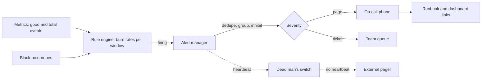

## In one minute
- Monitoring collects signals about a system; **alerting** decides which of those signals should interrupt a human, and how urgently.
- Page on **symptoms users feel** (errors, latency, unavailability), not on causes like CPU, which belong on dashboards and tickets.
- The best alerting signal is an **SLO burn rate**: how fast you are spending the error budget. Multi-window burn rate alerts catch fast outages quickly and slow leaks reliably, with few false pages.
- Every page must be **actionable, urgent, and owned**. Alerts that are routinely ignored train people to ignore the real one.
- The alerting system itself must be monitored from outside.

## How it works

### Black-box and white-box monitoring
**Black-box** probes test the system from outside like a user, catching total outages and DNS or certificate failures that internal metrics miss. **White-box** monitoring uses internal metrics, logs, and traces to explain why. You need both: black-box tells you it is broken, white-box tells you where. A cheap middle ground is a health endpoint probed from locations that represent your users: keep the liveness check shallow and let only the readiness check touch required dependencies, so a database outage does not restart every instance ([Azure health endpoint pattern](https://learn.microsoft.com/en-us/azure/architecture/patterns/health-endpoint-monitoring)). Google's rule for anything that pages is short: every page should be actionable and should need human judgement, not a scripted response ([Google SRE book](https://sre.google/sre-book/monitoring-distributed-systems/)).

### From SLO to error budget
An SLO such as "99.9 percent of checkout requests succeed over 30 days" allows 0.1 percent failures, the **error budget**. At 10 million requests per day, that is 300,000 failed requests per 30 days. **Burn rate** is the observed error ratio divided by the allowed ratio. A burn rate of 1 spends exactly the budget in 30 days; a burn rate of 14.4 spends 2 percent of the monthly budget in one hour.

### Multi-window, multi-burn-rate alerts
A single threshold such as "error rate above 0.1 percent for 5 minutes" pages on every brief blip and is slow to notice gradual leaks. A better pattern combines a long and a short window for each severity:

- Page if burn rate exceeds 14.4 over 1 hour **and** over 5 minutes (2 percent of budget burned in an hour, and still happening).
- Page if burn rate exceeds 6 over 6 hours **and** over 30 minutes (5 percent of budget in 6 hours).
- Open a ticket if burn rate exceeds 1 over 3 days **and** over 6 hours.

The long window gives significance; the short window makes the alert reset quickly once the problem is fixed. These are the defaults the Google SRE Workbook recommends for a 99.9 percent SLO, with the short window set to about one twelfth of the long one ([SRE Workbook](https://sre.google/workbook/alerting-on-slos/)).

### Routing, grouping, and silences
Alert rules fire into a manager (Alertmanager, PagerDuty, Jira Service Management; Atlassian stopped selling Opsgenie in June 2025 and shuts it down on 5 April 2027 ([Atlassian](https://www.atlassian.com/software/opsgenie/migration))) that **deduplicates** identical alerts, **groups** related ones (all pods of one service into one page), **inhibits** downstream alerts when an upstream one is firing (do not page for 40 services when the database is down), and routes by team and severity. Silences cover maintenance and must expire automatically.

## Down the stack

### Layer 1: The contract
An alerting pipeline promises that when a rule's condition has held for its `for` duration, a notification reaches the routed receiver within a bounded delay (typically under a minute plus the group wait), that identical alerts are not re-sent more often than the repeat interval, and that a resolved notification follows when the condition clears. It promises nothing if the pipeline itself is down, which is why a heartbeat to an external service is part of the design. Rules evaluate on a fixed interval, so detection time is quantised to that interval.

### Layer 2: The mechanism
Prometheus evaluates each rule group every `evaluation_interval` (often 15 to 60 seconds). An alert rule's expression returns a vector; each element becomes an alert instance identified by its labels and moves through a state machine: **inactive**, **pending** (condition true but `for` not yet elapsed), then **firing**. Prometheus re-sends each firing alert to Alertmanager no more often than `--rules.alert.resend-delay` (1 minute by default), and each send pushes the alert's end time forward, so Alertmanager resolves it if the updates stop ([Prometheus flags](https://prometheus.io/docs/prometheus/latest/command-line/prometheus/)). An optional `keep_firing_for` keeps an alert firing for a while after the condition clears, which stops flapping alerts from resolving and re-paging ([Prometheus alerting rules](https://prometheus.io/docs/prometheus/latest/configuration/alerting_rules/)). Alertmanager walks a **routing tree** of matchers to pick a receiver, groups alerts by configured labels (for example `alertname`, `service`), waits `group_wait` (30 seconds by default) to collect related alerts into one notification, sends further changes after `group_interval` (5 minutes), and resends unchanged firing groups after `repeat_interval` (4 hours) ([Alertmanager configuration](https://prometheus.io/docs/alerting/latest/configuration/)). Routes and inhibitions now use `matchers`; the older `match` and `match_re` fields are deprecated. **Inhibition rules** suppress alerts whose labels match a firing source alert. In a highly available pair, each Alertmanager instance gossips notification logs and silences so only one sends each notification. Burn-rate rules are usually built on **recording rules** that precompute error ratios over each window, so alert evaluation reads a few cheap series instead of raw histograms.

### Layer 3: The machine
A 30-day burn-rate window evaluated directly would scan 172,800 samples per series at 15-second resolution every evaluation; across hundreds of series and dozens of rules that is billions of sample decodes per minute, which is why long windows rely on recording rules or downsampled data. Notification delivery is ordinary network I/O: an HTTPS POST to a paging provider with a TLS handshake costing one or two round trips, then the provider's own push to phone networks, which commonly adds 5 to 30 seconds. End to end, a page lands roughly evaluation interval plus `for` plus `group_wait` plus delivery after the condition becomes true, often 1 to 3 minutes even for a perfect rule.

### Why it's built this way
1. Humans are the scarcest resource in operations, so alerts must be few and meaningful.
2. Brief blips are normal in distributed systems, so rules require conditions to persist and use windows.
3. One failure triggers many correlated alerts, so the manager groups and inhibits them into one notification.
4. Any monitoring component can fail silently, so the pipeline sends heartbeats to an independent system that pages on their absence.

## Diagram


## Worked example
Checkout serves 10 million requests per day with a 99.9 percent 30-day success SLO, a budget of 300,000 errors per month.

Incident 1: a bad deploy makes 5 percent of requests fail. Burn rate is 5 / 0.1 = 50. The 1-hour window crosses 14.4 within about 17 minutes (because 50 times 17/60 is about 14.4); the 5-minute window crossed almost immediately. The page arrives around 17 minutes in. To page faster, many teams add a third tier: burn rate above 14.4 over 5 minutes alone for very high burn, accepting more noise.

Incident 2: a slow memory leak causes 0.3 percent errors. Burn rate is 3. The page tiers never fire, but the ticket tier fires about 24 hours in, when the 3-day average burn passes 1, with 90 percent of the budget left. A naive "0.5 percent for 5 minutes" alert never fires at all.

Noise check: during a normal week, error rate fluctuates between 0.02 and 0.08 percent, with occasional one-minute spikes to 0.6 percent during deploys. A 5-minute threshold at 0.5 percent would page on most deploys. The multi-window rules do not, because a one-minute spike barely moves the 1-hour burn rate.

## In the wild
- **Slack, 2021: the dashboards went dark with everything else.** On 4 January, the first workday after the holidays, AWS Transit Gateways overloaded and Slack's success rate fell to about 99 percent against a normal 99.999. The team was first paged by an external monitoring service, but its own dashboarding and alerting service ran in a different VPC from its database and needed the same overloaded gateways, so it became unavailable, and replacement instances could not be provisioned. Engineers fell back to command-line tools, logs and direct metric queries. Afterwards the dashboard service moved into the same VPC as its database, and monitoring was kept as independent of Slack's own infrastructure as possible ([Slack](https://slack.engineering/slacks-outage-on-january-4th-2021/)).
- **GitLab, 2017: backup failure alerts that nobody received.** When an engineer deleted the primary database's data directory, the team found that `pg_dump` backups had been failing silently: the job used `pg_dump` 9.2 against PostgreSQL 9.6. Cron sent failure emails, but they were rejected by the receiving side because of DMARC, so no one saw them. Recovery used an LVM snapshot taken 6 hours earlier, and changes from about 17:20 to 23:30 UTC on 31 January were lost. GitLab then built backup monitoring with Prometheus and a public dashboard ([GitLab](https://about.gitlab.com/blog/postmortem-of-database-outage-of-january-31/)).

## Trade-offs

| Option | Strengths | Weaknesses | Choose when |
|---|---|---|---|
| Static threshold on a cause (CPU over 90 percent) | Easy to write and understand | Pages when users are fine; misses novel failures | Tickets for capacity, never for paging |
| Symptom threshold (error rate over X) | Tied to user pain | Flaky on low traffic; picks one window | Simple services without SLOs yet |
| Multi-window burn rate | High precision and recall; budget-aware | Needs SLO definitions and good SLIs | Any user-facing service with an SLO |
| Anomaly detection | Catches unknown patterns | Hard to explain; false positives on seasonality | Supplementary signals, not primary paging |
| Synthetic probes | Detect total outages and external failures | Cover only scripted paths | Critical journeys, DNS, TLS, regions |

## Pitfalls in production
- **Alert fatigue.** Hundreds of low-value alerts per week and on-call stops reading them. Review every page weekly; delete or demote anything that was not actionable.
- **Low-traffic services.** At 10 requests per minute, two failures look like a 20 percent error rate. Require a minimum event count, use longer windows, or add synthetic traffic.
- **Monitoring the monitor.** Prometheus or the alert manager dies and nothing pages. Run a dead man's switch: an always-firing alert whose absence pages via an external service.
- **Paging on causes.** A CPU alert wakes someone at 3 a.m. while users are fine. Page on SLO symptoms and route cause alerts to tickets.
- **No runbook.** The page says "HighErrorRate" with no context. Every alert links to a runbook, a dashboard, and the owning team.

## Leadership lens
- Track on-call load as a metric: pages per shift, percentage actionable, and time to acknowledge. Google budgets at most two incidents per 12-hour shift; more than that is a reliability problem to fund ([Google SRE book](https://sre.google/sre-book/being-on-call/)).
- Require SLOs agreed with product for each critical journey; alerts follow from them.
- Hold a regular alert review. Ownership of noise is as important as ownership of code.
- Decide who gets paged for shared dependencies, and use inhibition so a single root cause produces one page.

## Check yourself
1. Why combine a long and a short window in a burn-rate alert?
   **Answer:** The long window ensures enough budget was spent to matter, and the short window confirms it is still happening so the alert resets quickly after recovery.
2. What does a burn rate of 1 mean?
   **Answer:** The service is failing at exactly the allowed rate and will use all of its error budget by the end of the SLO period.
3. Why page on symptoms rather than causes?
   **Answer:** Symptoms directly reflect user pain and cover unknown failure modes, while cause alerts fire when users are unaffected and miss failures nobody anticipated.

## Practice
**Task:** Implement a multi-window burn-rate evaluator. `burn_rate(errors, total, slo)` returns `(errors / total) / (1 - slo)`, or 0.0 when `total` is 0. `evaluate(windows, slo, rules)` receives `windows`, a dict from window name to `(errors, total)`, and `rules`, a list of `(severity, threshold, long_window, short_window)`. A rule fires when both windows' burn rates exceed the threshold. Return the severity of the first firing rule in list order, or `None`. Use a strict greater-than comparison.

```python starter
def burn_rate(errors, total, slo):
    # TODO
    raise NotImplementedError

def evaluate(windows, slo, rules):
    # TODO
    raise NotImplementedError
```

```python tests
RULES = [("page", 14.4, "1h", "5m"), ("page", 6, "6h", "30m"), ("ticket", 1, "3d", "6h")]

def test_burn_rate_basic():
    assert abs(burn_rate(50, 1000, 0.999) - 50.0) < 1e-6

def test_burn_rate_zero_traffic():
    assert burn_rate(0, 0, 0.999) == 0.0

def test_fast_burn_pages():
    w = {"1h": (500, 10000), "5m": (60, 1000), "6h": (600, 60000), "30m": (50, 5000), "3d": (700, 700000)}
    assert evaluate(w, 0.999, RULES) == "page"

def test_recovered_short_window_does_not_page():
    w = {"1h": (500, 10000), "5m": (0, 1000), "6h": (500, 60000), "30m": (0, 5000),
         "3d": (500, 700000)}
    assert evaluate(w, 0.999, RULES) is None

def test_slow_leak_tickets():
    w = {"1h": (3, 1000), "5m": (0, 100), "6h": (18, 6000), "30m": (2, 500),
         "3d": (2100, 700000)}
    assert evaluate(w, 0.999, RULES) == "ticket"
```

```python solution
def burn_rate(errors, total, slo):
    if total == 0:
        return 0.0
    return (errors / total) / (1 - slo)

def evaluate(windows, slo, rules):
    for severity, threshold, long_w, short_w in rules:
        lw = burn_rate(*windows.get(long_w, (0, 0)), slo=slo)
        sw = burn_rate(*windows.get(short_w, (0, 0)), slo=slo)
        if lw > threshold and sw > threshold:
            return severity
    return None
```

```typescript starter
export type Rule = [string, number, string, string];
export function burnRate(errors: number, total: number, slo: number): number {
  throw new Error("TODO");
}
export function evaluate(windows: Record<string, [number, number]>, slo: number, rules: Rule[]): string | null {
  throw new Error("TODO");
}
```

```typescript tests
const RULES: Rule[] = [["page", 14.4, "1h", "5m"], ["page", 6, "6h", "30m"], ["ticket", 1, "3d", "6h"]];
test("burn rate basic", () => assert(Math.abs(burnRate(50, 1000, 0.999) - 50) < 1e-6, "burn"));
test("zero traffic", () => assertEqual(burnRate(0, 0, 0.999), 0));
test("fast burn pages", () => assertEqual(evaluate({ "1h": [500, 10000], "5m": [60, 1000],
  "6h": [600, 60000], "30m": [50, 5000], "3d": [700, 700000] }, 0.999, RULES), "page"));
test("recovered short window does not page", () => assertEqual(evaluate({ "1h": [500, 10000],
  "5m": [0, 1000], "6h": [500, 60000], "30m": [0, 5000], "3d": [500, 700000] }, 0.999, RULES), null));
test("slow leak tickets", () => assertEqual(evaluate({ "1h": [3, 1000], "5m": [0, 100],
  "6h": [18, 6000], "30m": [2, 500], "3d": [2100, 700000] }, 0.999, RULES), "ticket"));
```

```typescript solution
export type Rule = [string, number, string, string];
export function burnRate(errors: number, total: number, slo: number): number {
  return total === 0 ? 0 : errors / total / (1 - slo);
}
export function evaluate(windows: Record<string, [number, number]>, slo: number, rules: Rule[]): string | null {
  for (const [severity, threshold, longW, shortW] of rules) {
    const [le, lt] = windows[longW] ?? [0, 0];
    const [se, st] = windows[shortW] ?? [0, 0];
    if (burnRate(le, lt, slo) > threshold && burnRate(se, st, slo) > threshold) return severity;
  }
  return null;
}
```

```go starter
package practice

type Counts struct{ Errors, Total float64 }

type Rule struct {
	Severity    string
	Threshold   float64
	Long, Short string
}

func BurnRate(errors, total, slo float64) float64 { panic("TODO") }

// Evaluate returns the first firing severity, or "" if none fires.
func Evaluate(windows map[string]Counts, slo float64, rules []Rule) string { panic("TODO") }
```

```go tests
package practice

import (
	"math"
	"testing"
)

var rules = []Rule{{"page", 14.4, "1h", "5m"}, {"page", 6, "6h", "30m"}, {"ticket", 1, "3d", "6h"}}

func TestBurnRate(t *testing.T) {
	if math.Abs(BurnRate(50, 1000, 0.999)-50) > 1e-6 {
		t.Fatal(BurnRate(50, 1000, 0.999))
	}
}

func TestZeroTraffic(t *testing.T) {
	if BurnRate(0, 0, 0.999) != 0 {
		t.Fatal("want 0")
	}
}

func TestFastBurnPages(t *testing.T) {
	w := map[string]Counts{"1h": {500, 10000}, "5m": {60, 1000}, "6h": {600, 60000}, "30m": {50, 5000}, "3d": {700, 700000}}
	if got := Evaluate(w, 0.999, rules); got != "page" {
		t.Fatalf("got %q", got)
	}
}

func TestRecoveredDoesNotPage(t *testing.T) {
	w := map[string]Counts{"1h": {500, 10000}, "5m": {0, 1000}, "6h": {500, 60000}, "30m": {0, 5000}, "3d": {500, 700000}}
	if got := Evaluate(w, 0.999, rules); got != "" {
		t.Fatalf("got %q", got)
	}
}

func TestSlowLeakTickets(t *testing.T) {
	w := map[string]Counts{"1h": {3, 1000}, "5m": {0, 100}, "6h": {18, 6000}, "30m": {2, 500}, "3d": {2100, 700000}}
	if got := Evaluate(w, 0.999, rules); got != "ticket" {
		t.Fatalf("got %q", got)
	}
}
```

```go solution
package practice

type Counts struct{ Errors, Total float64 }

type Rule struct {
	Severity    string
	Threshold   float64
	Long, Short string
}

func BurnRate(errors, total, slo float64) float64 {
	if total == 0 {
		return 0
	}
	return errors / total / (1 - slo)
}

func Evaluate(windows map[string]Counts, slo float64, rules []Rule) string {
	for _, r := range rules {
		l, s := windows[r.Long], windows[r.Short]
		if BurnRate(l.Errors, l.Total, slo) > r.Threshold && BurnRate(s.Errors, s.Total, slo) > r.Threshold {
			return r.Severity
		}
	}
	return ""
}
```

## Mock interview
**Prompt:** Your team's on-call gets 60 pages a week, most ignored, and a real outage last month went unnoticed for 40 minutes. Redesign alerting for a payments API handling 3,000 requests per second.

- Follow-up: How quickly would your design page for a total outage, and for 1 percent errors?
- Follow-up: The alerting stack itself goes down at night. What happens?
- Follow-up: Some endpoints get 5 requests per minute. How do you alert on them?

**A strong answer covers:**
- SLIs and SLOs for key journeys, with error budgets in concrete numbers.
- Multi-window burn-rate rules with detection-time arithmetic for different failure rates.
- Black-box probes for total outages and a dead man's switch for the alerting pipeline.
- Grouping, inhibition, and routing to reduce duplicate pages, plus a weekly alert review.
- Handling low-traffic endpoints with minimum counts, longer windows, or synthetic traffic.

## Sources and further study
**Primary**
- [Google SRE book: Being On-Call](https://sre.google/sre-book/being-on-call/): the 25 percent on-call cap and the two-incidents-per-shift budget.
- [Google SRE book: Practical Alerting from Time-Series Data](https://sre.google/sre-book/practical-alerting/): Borgmon rules and alerting, the design Prometheus follows.

**Systems docs**
- [Prometheus alerting rules](https://prometheus.io/docs/prometheus/latest/configuration/alerting_rules/): `for`, `keep_firing_for`, labels and annotations.
- [Alertmanager configuration](https://prometheus.io/docs/alerting/latest/configuration/): routing tree, timing defaults, inhibition and the deprecated matcher fields.
- [Atlassian: Opsgenie migration](https://www.atlassian.com/software/opsgenie/migration): end-of-sale and end-of-support dates and the move to Jira Service Management.

**Books**
- *The Site Reliability Workbook*, Beyer et al., chapter 4 "Monitoring": testing alerting logic and managing the monitoring system as code.
- *Observability Engineering*, Majors, Fong-Jones and Miranda, chapter 12 "Using Service-Level Objectives for Reliability" and chapter 13 "Acting on and Debugging SLO-Based Alerts": alert fatigue and predictive burn alerts.

**Other curricula**
- [Azure Architecture Center: Health Endpoint Monitoring pattern](https://learn.microsoft.com/en-us/azure/architecture/patterns/health-endpoint-monitoring): frames black-box checks as a design pattern with its own trade-offs (what the endpoint checks, how often, from where).
- [roadmap.sh System Design](https://roadmap.sh/system-design): puts "Visualization & Alerts" next to health, availability, performance, security and usage monitoring.
- [donnemartin/system-design-primer](https://github.com/donnemartin/system-design-primer): has no alerting or SLO section.

## Watch
- [Applied Alerting Philosophy (Björn Rabenstein, DevOps Fest 2019)](https://www.youtube.com/watch?v=JhxfZ0VIPP0): a Prometheus maintainer on symptom-based alerting in practice.
- [How I learned to stop worrying and love burn rates (Ashley Chen, SLOconf 2023)](https://www.youtube.com/watch?v=ra0cCmEVKS8): burn-rate alerting from a practitioner's viewpoint.

## Free resources
- [Alerting on SLOs (Google SRE Workbook)](https://sre.google/workbook/alerting-on-slos/): the derivation of multi-window, multi-burn-rate alerts with worked numbers.
- [Monitoring Distributed Systems (Google SRE Book)](https://sre.google/sre-book/monitoring-distributed-systems/): symptoms versus causes and the four golden signals.
- [Prometheus alerting practices](https://prometheus.io/docs/practices/alerting/): concise guidance on what to alert on.
- [Alertmanager](https://prometheus.io/docs/alerting/latest/alertmanager/): grouping, inhibition, silences, and routing explained.
