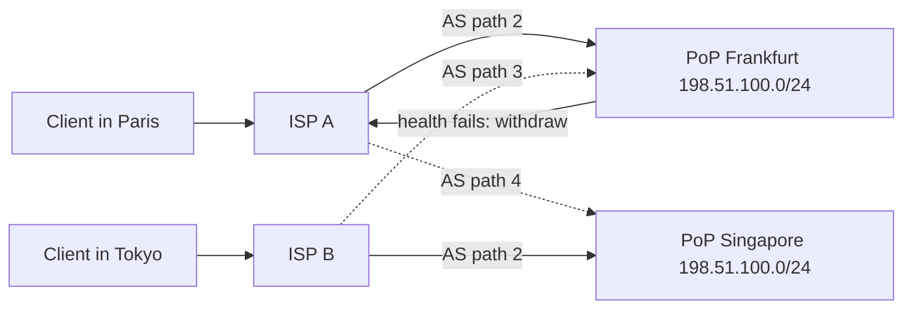

## In one minute
- Anycast announces the *same IP prefix* from many locations; internet routing delivers each packet to the "nearest" one by BGP's definition of near.
- No client-side cache is involved, so withdrawing a site moves traffic in seconds rather than TTL-bound minutes.
- "Nearest" means best BGP path (policy and AS-path length), not lowest latency, so routing can be surprisingly suboptimal.
- Stateless or short-lived protocols (DNS over UDP, short HTTP) fit naturally; long-lived TCP sessions can break when routes shift.
- Anycast also spreads volumetric DDoS across every site instead of concentrating it on one.

## How it works

### One prefix, many origins
Each point of presence (PoP) runs routers that announce, say, `198.51.100.0/24` to their transit providers and peers. Every network on the internet now holds several candidate paths to that prefix and picks one using BGP's decision process: highest local preference (usually "customers before peers before transit"), then shortest AS path, then lowest origin type, then lower MED (compared only between routes from the same neighbouring AS), then eBGP over iBGP, nearest next hop, and finally lowest BGP identifier ([RFC 4271, section 9.1.2.2](https://www.rfc-editor.org/rfc/rfc4271)). Each network forwards toward its chosen path, so the set of clients that reach a given PoP, its *catchment*, emerges from thousands of independent policy decisions.

### Failover by withdrawal
When a PoP is unhealthy, its routers withdraw the announcement. Neighbouring networks drop that path and fall back to their next-best route, typically within seconds to tens of seconds as the withdrawal propagates. No DNS answer has to expire. Health checking is local: a daemon on each edge router or server stops announcing when the service fails its checks.

### Why TCP mostly works
A TCP connection needs every packet to reach the same server. Anycast cannot guarantee that, but internet routes are stable over minutes to hours for most paths, so short connections almost always complete. Measurement backs this up: probing 11 anycast services from over 9,000 vantage points, Wei and Heidemann found about 1% of vantage points flipping between sites often, and TCP flips in only about 0.15% of cases ([Wei and Heidemann, 2018](https://ant.isi.edu/bib/Wei18a.html)). Problems appear when routes flap (a peering session resets, a provider does traffic engineering) mid-connection: packets land at a PoP with no state for that connection and get a reset. Operators reduce this with stable announcements and, inside each PoP, L4 balancers that combine consistent hashing with connection tracking so a server change does not move existing flows ([Maglev, NSDI 2016](https://research.google/pubs/maglev-a-fast-and-reliable-software-network-load-balancer/)).

### Controlling catchments
Because BGP ignores latency, operators shape catchments with tools: AS-path prepending (making a PoP look farther), selective announcement to specific peers, BGP communities that ask providers to lower preference, and announcing more specific prefixes from certain sites. Measuring catchments continuously, with probes from many networks, is part of running an anycast network. The cost of not doing so is measurable: a year of data from the D-Root server (over 400 million queries a day, 100+ sites) showed unbalanced site loads and most queries travelling farther than necessary, many by more than 5,000 km, partly because BGP tells a network nothing about how good each reachable site is ([Li et al., SIGCOMM 2018](https://www.cs.umd.edu/~dml/papers/anycast_sigcomm18.pdf)).

## Down the stack

### Layer 1: The contract
IP routing promises best-effort delivery of each packet toward *some* origin of the destination prefix. With anycast there is no promise which origin, no promise that consecutive packets reach the same one, and no notification when the choice changes. After a site withdraws its announcement, the internet converges on other sites in seconds to a few minutes. Anything stronger, such as connection affinity or latency targets, is an operational outcome you engineer and measure, not a guarantee.

### Layer 2: The mechanism
BGP speakers exchange UPDATE messages. Each carries withdrawn routes, path attributes (`ORIGIN`, `AS_PATH`, `NEXT_HOP`, `LOCAL_PREF`, `MULTI_EXIT_DISC`, `COMMUNITIES`) and the prefixes (NLRI) they apply to. A router stores what each neighbour sent in an Adj-RIB-In, runs the decision process to choose one best path per prefix into the Loc-RIB, installs it in the forwarding table (FIB), and advertises its choice onward. At each PoP, a health daemon such as ExaBGP or BIRD peers with the edge router and announces the service prefix only while local checks pass. Providers filter IPv4 prefixes longer than /24 (and IPv6 longer than /48), so anycast needs at least a whole /24. Its owner signs a Route Origin Authorization (ROA) in RPKI naming the origin AS and a maximum length, so networks that validate can drop a hijacker's more-specific route; networks that do not validate still accept it ([Cloudflare, 2024](https://blog.cloudflare.com/cloudflare-1111-incident-on-june-27-2024/)). Inside the PoP, routers spread flows across servers with ECMP, hashing the 5-tuple, and L4 balancers such as Katran or Maglev use consistent hashing so a server change remaps few flows.

### Layer 3: The machine
BGP sessions run over TCP port 179. The standard suggests a 90-second hold time with keepalives at a third of that, a 30-second minimum advertisement interval toward eBGP neighbours and 5 seconds toward iBGP ([RFC 4271, section 10](https://www.rfc-editor.org/rfc/rfc4271)). Tens of seconds is far too slow to detect a dead peer, so operators add BFD, whose detection time is a few missed packets at intervals of milliseconds ([RFC 5880](https://www.rfc-editor.org/rfc/rfc5880)). Route flap damping slows propagation deliberately; RFC 7196 calls the common default suppress threshold of 2,000 too aggressive and recommends at least 6,000 ([RFC 7196](https://www.rfc-editor.org/rfc/rfc7196)), so a prefix that flaps a few times during a health-check wobble can be suppressed for far longer than the wobble. Forwarding itself is hardware: a longest-prefix match in TCAM or SRAM takes nanoseconds, against a global IPv4 table that passed a million routes and stood at about 1.085 million active entries in October 2026 ([BGP table report](https://bgp.potaroo.net/as2.0/bgp-active.html)). Switch ASICs and server NICs hash packet headers to choose ECMP paths and receive queues (RSS), which is why flows stay pinned as long as nothing in the path changes.

### Why it's built this way
1. Services need one stable address reachable from everywhere, and IP already chooses among paths, so reuse routing instead of inventing a directory.
2. BGP chooses paths by business policy (customers before peers before paid transit), so "nearest" follows money and AS hops, not milliseconds.
3. Routers carry no per-flow state, so nothing keeps a TCP connection on one site; anycast suits short or stateless exchanges.
4. Router memory is finite and the global table is huge, so the minimum routable prefix is /24, which makes anycast a commitment of real address space.
5. Fast route changes destabilise the whole internet, so timers and damping trade failover speed for global stability.

## Diagram



## Worked example
A DNS provider runs 30 PoPs, each with 100 Gbps of transit, serving 2 million queries per second at about 120 bytes per response.

Normal traffic is about 2M x 120 B x 8, roughly 2 Gbps in total, so capacity is mostly there for attacks. A 1.2 Tbps reflection attack sourced from botnets in many countries spreads across catchments: if it splits roughly in proportion to where bots sit, the busiest PoP may take 15% (180 Gbps) and saturate, while the rest absorb 30 to 60 Gbps each. The operator withdraws the prefix from the overloaded PoP's most congested transit, shifting part of its catchment to neighbours, or announces only to peers there.

Failover timing: health daemon detects the failure in 3 seconds, BGP withdrawal reaches most of the internet in 10 to 60 seconds. Compare that with DNS failover, where a 60-second TTL plus resolver behaviour gives several minutes.

Suboptimal routing: probes show that 8% of clients in Brazil reach the Miami PoP (130 ms) instead of São Paulo (15 ms) because their provider prefers a transit path. The fix is peering directly with that provider in São Paulo, not tuning servers.

## In the wild
- **Meta, 2021: health checks withdraw every DNS site at once.** On 4 October a command meant to assess backbone capacity disconnected all of Facebook's backbone links, and a bug in the audit tool failed to stop it. Facebook's authoritative DNS servers are designed to withdraw their anycast BGP announcements when they cannot reach the data centres, and every site did exactly that, so the names could not be resolved anywhere. Internal tools broke too and engineers had to recover on site ([Meta](https://engineering.fb.com/2021/10/05/networking-traffic/outage-details/)).
- **Cloudflare, 2025: a latent addressing config withdraws 1.1.1.1.** A 6 June change for an unreleased service accidentally included the 1.1.1.1 prefixes and did nothing visible. On 14 July, attaching an offline test location refreshed the global config and mapped those prefixes to that one offline site, so every location withdrew them; the resolver was down worldwide for 62 minutes and about 23% of edge servers needed manual rebinding. Cloudflare is moving addressing changes to progressive, health-checked rollouts ([Cloudflare](https://blog.cloudflare.com/cloudflare-1-1-1-1-incident-on-july-14-2025/)).
- **Cloudflare, 2024: a /32 hijack beats the /24 anycast route.** On 27 June AS267613 originated 1.1.1.1/32, which longest-prefix matching prefers over 1.1.1.0/24; it was RPKI-invalid, but a Tier 1 accepted it as a blackhole route, and a separate leak of the /24 spread through an exchange. Users on more than 300 networks in 70 countries lost or slowed access; the /32 hijack lasted about 3.5 hours and the /24 leak took about 7.5 hours to clear. Cloudflare pushed for origin validation, rejecting prefixes longer than /24, and ASPA ([Cloudflare](https://blog.cloudflare.com/cloudflare-1111-incident-on-june-27-2024/)).

## Trade-offs

| Option | Strengths | Weaknesses | Choose when |
| --- | --- | --- | --- |
| Global anycast | Fast failover, DDoS dilution, one IP | BGP ignores latency; needs owned prefix and ASN | DNS, CDN edges, public resolvers |
| DNS geo routing | Fine-grained control per region | Slow failover, resolver location errors | Origin region selection behind the edge |
| Regional anycast | Smaller blast radius, easier capacity | More IPs to manage | Isolating regions for compliance or capacity |
| Anycast to edge, unicast to origin | Stateless edge, stable backend | Two tiers to operate | Most CDN and API edge designs |

## Pitfalls in production
- **Route flaps break connections.** A peering reset mid-download sends packets to another PoP and the client sees a reset. Keep announcements stable, dampen health-check flapping, and keep long transfers on unicast.
- **Health check that withdraws everything.** A global bug that fails checks everywhere withdraws the prefix from every PoP and takes the service offline. Never let automation withdraw more than a fraction of sites at once.
- **Catchment imbalance.** One PoP draws far more traffic than its capacity. Measure catchments, use prepending and communities, and keep capacity headroom.
- **Route leaks and hijacks.** Another network announcing your prefix can blackhole traffic. Publish RPKI route origin authorizations and monitor BGP feeds.
- **Hard to debug.** "Which PoP did this user hit?" is not obvious. Return a PoP identifier in a response header or a special DNS query.

## Leadership lens
- Anycast is an organisational commitment: an ASN, IP space, peering relationships and network engineers on call. Usually you buy it from a CDN or a cloud product such as AWS Global Accelerator, whose static addresses are anycast from AWS edge locations ([AWS docs](https://docs.aws.amazon.com/global-accelerator/latest/dg/introduction-how-it-works.html)).
- Ask in review: what is the blast radius of a bad announcement, and who can make one?
- Keep the anycast tier stateless and push stateful work to unicast backends.
- Track per-PoP latency percentiles from real users, since catchments drift as providers change policy.

## Check yourself
1. Why can anycast send a user to a farther PoP than the nearest one?
   **Answer:** BGP picks paths by policy and AS-path length, not latency. A provider may prefer a transit path to a distant PoP over a peering path to a close one.
2. Why is anycast failover faster than DNS failover?
   **Answer:** Withdrawal propagates through routers within seconds, and there is no client or resolver cache holding the old answer.
3. What happens to an open TCP connection if routing shifts to another PoP?
   **Answer:** Packets arrive at a server with no connection state and it responds with a reset, unless the operator forwards strays to the original PoP.

## Practice
**Task:** Model how one network picks among anycast announcements. `best_pop(routes, withdrawn)` takes a list of route dicts with keys `pop`, `local_pref`, `as_path`, `med` and `router_id`, plus a set of withdrawn PoP names, and returns the chosen PoP (or `None`). Apply BGP order: highest `local_pref`, then shortest `as_path`, then lowest `med`, then lowest `router_id`. `catchments(table, withdrawn)` takes a dict mapping network name to its route list and returns a dict mapping each network to its chosen PoP.

```python starter
def best_pop(routes, withdrawn):
    # TODO
    raise NotImplementedError

def catchments(table, withdrawn):
    # TODO
    raise NotImplementedError
```

```python tests
def r(pop, lp=100, path=3, med=0, rid=1):
    return {"pop": pop, "local_pref": lp, "as_path": path, "med": med, "router_id": rid}

def test_shortest_path_wins():
    assert best_pop([r("FRA", path=4), r("SIN", path=2)], set()) == "SIN"

def test_local_pref_beats_path():
    assert best_pop([r("FRA", lp=200, path=6), r("SIN", path=1)], set()) == "FRA"

def test_med_then_router_id():
    assert best_pop([r("A", med=10), r("B", med=5)], set()) == "B"
    assert best_pop([r("A", rid=9), r("B", rid=3)], set()) == "B"

def test_withdrawal_falls_back():
    assert best_pop([r("FRA", path=2), r("SIN", path=4)], {"FRA"}) == "SIN"

def test_all_withdrawn():
    assert best_pop([r("FRA")], {"FRA"}) is None

def test_catchments_shift():
    table = {"isp1": [r("FRA", path=2), r("SIN", path=4)],
             "isp2": [r("SIN", path=2), r("FRA", path=3)]}
    assert catchments(table, set()) == {"isp1": "FRA", "isp2": "SIN"}
    assert catchments(table, {"SIN"}) == {"isp1": "FRA", "isp2": "FRA"}
```

```python solution
def best_pop(routes, withdrawn):
    live = [x for x in routes if x["pop"] not in withdrawn]
    if not live:
        return None
    key = lambda x: (-x["local_pref"], x["as_path"], x["med"], x["router_id"])
    return min(live, key=key)["pop"]

def catchments(table, withdrawn):
    return {net: best_pop(routes, withdrawn) for net, routes in table.items()}
```

```typescript starter
export interface Route { pop: string; localPref: number; asPath: number; med: number; routerId: number; }

export function bestPop(routes: Route[], withdrawn: Set<string>): string | null {
  throw new Error("TODO");
}

export function catchments(table: Record<string, Route[]>, withdrawn: Set<string>): Record<string, string | null> {
  throw new Error("TODO");
}
```

```typescript tests
function r(pop: string, o: Partial<Route> = {}): Route {
  return { pop, localPref: 100, asPath: 3, med: 0, routerId: 1, ...o };
}
const none = new Set<string>();
test("shortest path wins", () => {
  assertEqual(bestPop([r("FRA", { asPath: 4 }), r("SIN", { asPath: 2 })], none), "SIN");
});
test("local pref beats path", () => {
  assertEqual(bestPop([r("FRA", { localPref: 200, asPath: 6 }), r("SIN", { asPath: 1 })], none), "FRA");
});
test("med then router id", () => {
  assertEqual(bestPop([r("A", { med: 10 }), r("B", { med: 5 })], none), "B");
  assertEqual(bestPop([r("A", { routerId: 9 }), r("B", { routerId: 3 })], none), "B");
});
test("withdrawal falls back", () => {
  assertEqual(bestPop([r("FRA", { asPath: 2 }), r("SIN", { asPath: 4 })], new Set(["FRA"])), "SIN");
});
test("all withdrawn", () => {
  assertEqual(bestPop([r("FRA")], new Set(["FRA"])), null);
});
test("catchments shift", () => {
  const table = {
    isp1: [r("FRA", { asPath: 2 }), r("SIN", { asPath: 4 })],
    isp2: [r("SIN", { asPath: 2 }), r("FRA", { asPath: 3 })],
  };
  assertEqual(catchments(table, none), { isp1: "FRA", isp2: "SIN" });
  assertEqual(catchments(table, new Set(["SIN"])), { isp1: "FRA", isp2: "FRA" });
});
```

```typescript solution
export interface Route { pop: string; localPref: number; asPath: number; med: number; routerId: number; }

function better(a: Route, b: Route): boolean {
  if (a.localPref !== b.localPref) return a.localPref > b.localPref;
  if (a.asPath !== b.asPath) return a.asPath < b.asPath;
  if (a.med !== b.med) return a.med < b.med;
  return a.routerId < b.routerId;
}

export function bestPop(routes: Route[], withdrawn: Set<string>): string | null {
  let best: Route | null = null;
  for (const x of routes) {
    if (withdrawn.has(x.pop)) continue;
    if (best === null || better(x, best)) best = x;
  }
  return best ? best.pop : null;
}

export function catchments(table: Record<string, Route[]>, withdrawn: Set<string>): Record<string, string | null> {
  const out: Record<string, string | null> = {};
  for (const net of Object.keys(table)) out[net] = bestPop(table[net], withdrawn);
  return out;
}
```

```go starter
package practice

type Route struct {
	Pop       string
	LocalPref int
	ASPath    int
	MED       int
	RouterID  int
}

// BestPop returns the chosen PoP and false if every route is withdrawn.
func BestPop(routes []Route, withdrawn map[string]bool) (string, bool) {
	panic("TODO")
}

func Catchments(table map[string][]Route, withdrawn map[string]bool) map[string]string {
	panic("TODO")
}
```

```go tests
package practice

import (
	"reflect"
	"testing"
)

func r(pop string, lp, path, med, rid int) Route { return Route{pop, lp, path, med, rid} }

var none = map[string]bool{}

func want(t *testing.T, routes []Route, w map[string]bool, exp string) {
	t.Helper()
	got, ok := BestPop(routes, w)
	if !ok || got != exp {
		t.Fatalf("got %q ok=%v, want %q", got, ok, exp)
	}
}

func TestShortestPath(t *testing.T) { want(t, []Route{r("FRA", 100, 4, 0, 1), r("SIN", 100, 2, 0, 1)}, none, "SIN") }
func TestLocalPref(t *testing.T)    { want(t, []Route{r("FRA", 200, 6, 0, 1), r("SIN", 100, 1, 0, 1)}, none, "FRA") }

func TestMedThenRouterID(t *testing.T) {
	want(t, []Route{r("A", 100, 3, 10, 1), r("B", 100, 3, 5, 1)}, none, "B")
	want(t, []Route{r("A", 100, 3, 0, 9), r("B", 100, 3, 0, 3)}, none, "B")
}

func TestWithdrawal(t *testing.T) {
	want(t, []Route{r("FRA", 100, 2, 0, 1), r("SIN", 100, 4, 0, 1)}, map[string]bool{"FRA": true}, "SIN")
	if _, ok := BestPop([]Route{r("FRA", 100, 3, 0, 1)}, map[string]bool{"FRA": true}); ok {
		t.Fatal("expected no route")
	}
}

func TestCatchments(t *testing.T) {
	table := map[string][]Route{
		"isp1": {r("FRA", 100, 2, 0, 1), r("SIN", 100, 4, 0, 1)},
		"isp2": {r("SIN", 100, 2, 0, 1), r("FRA", 100, 3, 0, 1)},
	}
	if got := Catchments(table, none); !reflect.DeepEqual(got, map[string]string{"isp1": "FRA", "isp2": "SIN"}) {
		t.Fatalf("got %v", got)
	}
	if got := Catchments(table, map[string]bool{"SIN": true}); !reflect.DeepEqual(got, map[string]string{"isp1": "FRA", "isp2": "FRA"}) {
		t.Fatalf("got %v", got)
	}
}
```

```go solution
package practice

type Route struct {
	Pop       string
	LocalPref int
	ASPath    int
	MED       int
	RouterID  int
}

func better(a, b Route) bool {
	if a.LocalPref != b.LocalPref {
		return a.LocalPref > b.LocalPref
	}
	if a.ASPath != b.ASPath {
		return a.ASPath < b.ASPath
	}
	if a.MED != b.MED {
		return a.MED < b.MED
	}
	return a.RouterID < b.RouterID
}

// BestPop returns the chosen PoP and false if every route is withdrawn.
func BestPop(routes []Route, withdrawn map[string]bool) (string, bool) {
	var best *Route
	for i := range routes {
		if withdrawn[routes[i].Pop] {
			continue
		}
		if best == nil || better(routes[i], *best) {
			best = &routes[i]
		}
	}
	if best == nil {
		return "", false
	}
	return best.Pop, true
}

func Catchments(table map[string][]Route, withdrawn map[string]bool) map[string]string {
	out := map[string]string{}
	for net, routes := range table {
		if pop, ok := BestPop(routes, withdrawn); ok {
			out[net] = pop
		}
	}
	return out
}
```

## Mock interview
**Prompt:** Design the edge for a public DNS resolver serving 2 million queries per second worldwide, which must survive the loss of any site and absorb terabit-scale DDoS.

- Follow-up: How does a site take itself out of rotation, and how fast?
- Follow-up: A config bug makes every site fail its health check. What happens and how do you prevent it?
- Follow-up: Users in one country see 150 ms latency to a site 3,000 km away. How do you diagnose and fix it?

**A strong answer covers:**
- Anycast prefix from every site, with local health daemons controlling announcements.
- BGP decision process and why catchments do not equal geographic nearest.
- Guardrails that cap how many sites can withdraw at once.
- DDoS dilution through catchments plus per-site capacity headroom.
- Catchment measurement and tools like prepending, communities, and new peering.

## Sources and further study
**Primary**
- [RFC 4271: BGP-4](https://www.rfc-editor.org/rfc/rfc4271): the decision process, UPDATE format and the timer defaults.
- [Li, Levin, Spring and Bhattacharjee, Internet Anycast: Performance, Problems, & Potential (SIGCOMM 2018)](https://www.cs.umd.edu/~dml/papers/anycast_sigcomm18.pdf): why catchments inflate paths, measured on a root DNS server.
- [Wei and Heidemann, Does Anycast Hang up on You (UDP and TCP)? (2018)](https://ant.isi.edu/bib/Wei18a.html): how often real clients flip between anycast sites.
- [Eisenbud et al., Maglev (NSDI 2016)](https://research.google/pubs/maglev-a-fast-and-reliable-software-network-load-balancer/): ECMP plus consistent hashing and connection tracking behind an anycast VIP.

- [RFC 7196: Making Route Flap Damping Usable](https://www.rfc-editor.org/rfc/rfc7196): measured damping thresholds and why the old defaults hurt.

**Systems docs**
- [How AWS Global Accelerator works](https://docs.aws.amazon.com/global-accelerator/latest/dg/introduction-how-it-works.html): anycast bought as a service, with two static IPv4 addresses announced from AWS edge locations.
- [ExaBGP](https://github.com/Exa-Networks/exabgp): the scriptable BGP speaker many operators use to announce and withdraw service prefixes from health checks.
- [BGP table statistics (potaroo.net)](https://bgp.potaroo.net/as2.0/bgp-active.html): the live size of the global routing table.

**Books**
- *Computer Networking: A Top-Down Approach* (8th ed.), Kurose and Ross, chapter 5 "The Network Layer: Control Plane": BGP route selection and policy.

**Other curricula**
- [Google SRE book, chapter 19 "Load Balancing at the Frontend"](https://sre.google/sre-book/load-balancing-frontend/): frames anycast as the way to reach the nearest nameserver, with VIPs and balancers doing the real work behind it.

## Watch
- [What is BGP Anycast? (NetActuate)](https://www.youtube.com/watch?v=u9S5e71hoWg): animated walkthrough of BGP anycast routing.
- [Anycast vs Global Server Load Balancing (F5 DevCentral)](https://www.youtube.com/watch?v=-2WnHiKPrgE): when to use anycast versus DNS-based steering.

## Free resources
- [A Brief Primer on Anycast (Cloudflare blog)](https://blog.cloudflare.com/a-brief-anycast-primer/): an operator's view of why anycast suits DNS and CDNs.
- [RFC 4786: Operation of Anycast Services](https://www.rfc-editor.org/rfc/rfc4786): best current practice for running anycast, including failure modes.
- [RFC 7094: Architectural Considerations of IP Anycast](https://www.rfc-editor.org/rfc/rfc7094): the IAB's analysis of anycast and stateful protocols.
- [Anycast (Wikipedia)](https://en.wikipedia.org/wiki/Anycast): background and history.
