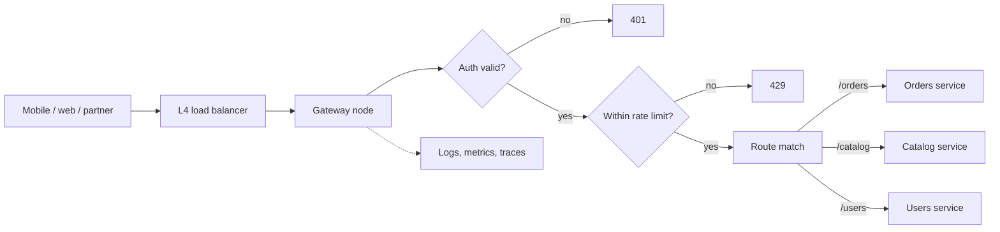

## In one minute
- An API gateway is a single entry point that sits between clients and backend services. It routes requests and applies cross-cutting policy: authentication, rate limiting, TLS, request shaping, and observability.
- Clients see one stable API surface while backend services can be split, merged, moved, or versioned behind it.
- It can also aggregate several backend calls into one response, which matters for mobile clients on high-latency networks.
- Because all traffic passes through it, the gateway is a potential bottleneck and single point of failure, and a magnet for business logic that does not belong there.

## How it works

### The request path
A typical request goes through these stages: TLS termination, request parsing and size limits, authentication (validate a JWT signature or an API key), authorisation at coarse grain (does this key have the `orders:read` scope?), rate limiting per key or tenant, route matching to an upstream service, request transformation (header injection, path rewriting), the upstream call with a timeout and retry policy, response transformation, and finally logging and metrics. Each stage adds microseconds to a few milliseconds; a well-run gateway adds 1 to 5 ms at p50.

### Routing
Routes match on host, path prefix, method, and sometimes headers. Longest-prefix matching is the norm, so `/orders/returns` can go to a different service than `/orders`. Routing tables can also do weighted splits for canary releases (5% to `orders-v2`; Envoy calls this [`weighted_clusters`](https://www.envoyproxy.io/docs/envoy/latest/api-v3/config/route/v3/route_components.proto)) or tenant-based routing for dedicated deployments.

### Policy enforcement at the edge
Centralising authentication means services can trust an injected identity header (for example a verified user ID and tenant) instead of each re-implementing token validation. Envoy's JWT filter, for instance, can forward the verified claims upstream in a header of your choosing ([Envoy docs](https://www.envoyproxy.io/docs/envoy/latest/configuration/http/http_filters/jwt_authn_filter)). Rate limiting at the gateway protects every service from abusive clients; a distributed limiter uses a shared store such as Redis or a local token bucket per gateway node with limits divided by node count. Envoy's own guidance is to run both: a coarse local bucket absorbs large bursts so they never reach the global service, which then applies the precise limit ([Envoy docs](https://www.envoyproxy.io/docs/envoy/latest/intro/arch_overview/other_features/global_rate_limiting)). Request size limits, schema validation, and WAF rules stop bad input early.

### Aggregation
A gateway can fan out to several services and merge results, turning six mobile round trips of 150 ms each into one. Keep aggregation shallow and generic; if it starts needing client-specific shaping, that belongs in a Backend for Frontend.

### Deployment
Gateways run as a horizontally scaled, stateless fleet behind a layer 4 load balancer, with configuration pushed from a control plane or a declarative repository. Products include managed services (AWS API Gateway, Azure API Management, Apigee) and self-hosted proxies (Kong, Envoy-based gateways, NGINX).

On Kubernetes, the configuration surface is changing. The Gateway API reached v1.0 in October 2023 and is the successor to the older Ingress resource ([Kubernetes blog](https://kubernetes.io/blog/2023/10/31/gateway-api-ga/)). The community `ingress-nginx` controller, once the default choice, was retired: best-effort maintenance ended in March 2026, with no further releases or security fixes ([Kubernetes blog](https://kubernetes.io/blog/2025/11/11/ingress-nginx-retirement/)). A gateway design written today should target the Gateway API rather than Ingress annotations.

## Down the stack

### Layer 1: The contract
For each request the gateway promises: reject unauthenticated calls before any upstream sees them; return 429 when a caller exceeds its limit (the spec allows, but does not require, a `Retry-After` header, and says 429 responses must not be cached; [RFC 6585](https://www.rfc-editor.org/rfc/rfc6585.html#section-4)); route to exactly one upstream cluster according to current config; apply a bounded timeout and a declared retry policy; and emit one access log line and metrics. Config changes are eventually consistent: different nodes may run different versions for a few seconds during a rollout.

### Layer 2: The mechanism
In Envoy, a request flows through a listener, a filter chain, and the HTTP connection manager, which runs an ordered list of HTTP filters. A typical chain is `jwt_authn` (verifies the token signature against a cached JWKS and checks `iss`, `exp` and `nbf`, plus `aud` only if you list `audiences`: leave that out and any audience is accepted), `ext_authz` for custom policy, `local_ratelimit` (a token bucket per node), and finally `router`, which matches the route table (prefix, path, header matchers), picks a cluster, asks its load balancer for an endpoint, and takes a connection from that cluster's pool. Global limits call a rate-limit service over gRPC (`ShouldRateLimit`) with descriptors such as `("api_key", "abc")`, backed by Redis counters. Route and cluster config arrives from a control plane over xDS streams, so updates apply without restarts.

### Layer 3: The machine
Envoy runs one worker thread per hardware thread (set by `--concurrency`), each with its own non-blocking event loop over `epoll`; an accepted connection stays on one worker for its whole life, avoiding locks on the hot path ([Envoy threading model](https://www.envoyproxy.io/docs/envoy/latest/intro/arch_overview/intro/threading_model)). TLS 1.3 costs one round trip and, on the server, an X25519 key exchange plus a certificate signature, tens to a few hundred microseconds of CPU per full handshake, which is why session resumption and keep-alive matter. Verifying an RS256 JWT is an RSA public-key operation of tens of microseconds; fetching JWKS on the request path would add a network round trip, so keys are cached. A Redis rate-limit check adds a same-zone round trip of about 0.2 to 0.5 ms. Upstream connections are pooled and multiplexed over HTTP/2, so the gateway does not pay TCP and TLS setup per request.

### Why it's built this way
1. Every request must be authenticated and limited, and doing it once at the edge is cheaper than in every service.
2. Cryptography and connection setup cost CPU and round trips, so TLS is terminated once and upstream connections are reused.
3. Shared counters require a network hop, so most limiting is local and only strict limits use a central store.
4. Nodes must scale horizontally and fail independently, so they are stateless and receive config from a control plane.

## Diagram


## Worked example
A SaaS company exposes a public API to 3,000 partner integrations, peaking at 40,000 requests per second. Before the gateway, six services each implemented API-key checks differently, and one partner's bug flooded the search service with 15,000 requests per second, causing an outage.

They deploy an Envoy-based gateway fleet: 12 nodes, each comfortably handling 8,000 requests per second, leaving headroom for a node failure and a 2x spike. Rate limits are 100 requests per second per partner by default, enforced by a local token bucket on each node (100 / 12, about 8.3 per second per node, with burst capacity of 50) plus a global Redis check for the top 50 partners with custom contracts. The local approach avoids a Redis round trip on 95% of requests.

Gateway latency is 1.8 ms p50 and 6 ms p99. JWT validation uses cached signing keys refreshed every 5 minutes, so no call to the identity provider is on the hot path. The next time a partner misbehaves, it receives 429s within a second and no backend sees the excess load.

## In the wild
- **Google Cloud, 2025: a policy check takes down the API front door.** On 12 June a quota-policy row with blank fields replicated to every region within seconds and crashed Service Control, the component that checks authorisation, policy and quota on each Google API request. A code path shipped on 29 May without a feature flag or error handling hit a null pointer, so external APIs across dozens of Cloud and Workspace products returned 503s. A kill switch was rolled out within about 40 minutes, but restarting tasks without randomised backoff overloaded the Spanner table they read in us-central1, so that region took about 2 h 40 min to recover fully. Google is changing Service Control to fail open and flag-gating changes to critical binaries ([Google Cloud](https://status.cloud.google.com/incidents/ow5i3PPK96RduMcb1SsW)).
- **Google Cloud, 2021: a config race makes the global load balancer serve 404s.** A latent race in the pipeline that pushes customer routing config to Google's external HTTP(S) load balancer corrupted a config file in a form that newly added input validation did not catch. From 09:35 to 10:08 Pacific on 16 November most endpoints returned 404, taking down routes for Cloud Run, App Engine, Cloud Functions, Apigee and Firebase, and customers could not change load balancer config until 11:28. Google rolled back to the last known-good config and added correctness checks before configs are applied ([Google Cloud](https://status.cloud.google.com/incidents/6PM5mNd43NbMqjCZ5REh)).
- **HubSpot, 2024: the Envoy edge collapses under its own readiness checks.** HubSpot's Envoy routing pods were packed unevenly onto Kubernetes nodes, and a fix deployed the night before had silently not taken effect. At the morning peak on 25 September pods on the hot nodes failed readiness together, were pulled from service, and pushed their load onto the rest, giving two waves of 5xx errors totalling about 52 minutes. HubSpot rolled the routing layer back to its older NGINX setup, fixed pod spread, and capped how many pods the load balancers can eject at once ([HubSpot](https://product.hubspot.com/blog/hubspot-incident-sept25)).

## Trade-offs
| Option | Strengths | Weaknesses | Choose when |
|---|---|---|---|
| No gateway (clients call services) | No extra hop, no central bottleneck | Policy duplicated, internal topology exposed | Internal tools with few services |
| Single shared gateway | One place for auth, limits, observability | Bottleneck for changes and capacity, shared blast radius | Moderate service count, one platform team |
| Gateway per domain or per client type | Smaller blast radius, team autonomy | More fleets to run, policy drift risk | Large organisations, distinct client needs |
| Managed gateway service | No fleet to run, built-in features | Per-request cost, hard vendor limits (AWS REST APIs: 29 s integration timeout by default, 10 MB payload; [AWS quotas](https://docs.aws.amazon.com/apigateway/latest/developerguide/api-gateway-execution-service-limits-table.html)) | Bursty or moderate traffic, small ops team |

## Pitfalls in production
- **Business logic creep.** Teams add pricing rules or data joins to gateway plugins, making the gateway a monolith owned by nobody. Keep it to routing and policy; move domain logic into services or BFFs.
- **Single point of failure.** A bad config push takes down every API. Validate configs, roll them out gradually by node, and keep the previous version ready for instant rollback.
- **Timeout mismatch.** The gateway times out at 30 seconds while services time out at 5, holding connections for nothing. Set gateway timeouts slightly above upstream deadlines and propagate the deadline.
- **Retry amplification.** Gateway retries on top of client and service retries multiply load during incidents: five layers that each try three times turn one failing call into 243 at the bottom ([AWS Builders' Library](https://builder.aws.com/content/3EumjoZascWd1oZiEgL8ORlv3qE/timeouts-retries-and-backoff-with-jitter)). Retry only idempotent requests, at one layer, with a budget.
- **Policy checks that fail closed by accident.** If the auth or quota service behind the gateway crashes, every API returns errors even though the services are healthy. Decide per check whether it fails open or closed, and make that a written decision rather than a side effect of the code ([Google Cloud incident report](https://status.cloud.google.com/incidents/ow5i3PPK96RduMcb1SsW)).
- **Inaccurate distributed rate limits.** Per-node limits drift when the fleet scales. Recompute per-node shares on scale events, or use a central store for strict limits.

## Leadership lens
- Define what is allowed in the gateway and enforce it in review. A short written charter prevents years of plugin sprawl.
- Treat gateway config as code with tests, staged rollout, and fast rollback.
- Decide ownership: a platform team runs the fleet, service teams own their routes through self-service.
- Size for failure: N+2 nodes, headroom for spikes, and load tests that include the rate-limit store.

## Check yourself
1. Why can services trust an identity header injected by the gateway, and what must be true for that to be safe?
   **Answer:** The gateway validated the credential before injecting it. It is only safe if services are unreachable except through the gateway (or via mTLS-authenticated callers) and the gateway strips any client-supplied copy of that header.
2. Why do many gateways enforce rate limits locally per node instead of always using a central store?
   **Answer:** A central check adds a network round trip and a dependency to every request; dividing the limit across nodes is accurate enough for most keys and much faster.
3. When should aggregation move out of the gateway into a BFF?
   **Answer:** When it becomes specific to one client's screens, because then the gateway accumulates client logic and couples all clients to one team's release cycle.

## Practice
**Task:** Write a `Gateway(routes, limit, window)` where `routes` maps path prefixes to service names. `handle(path, api_key, now)` returns a `(status, service)` tuple. Check in this order: a missing or empty key gives `(401, None)`; no matching route gives `(404, None)`; more than `limit` requests from one key in the same fixed window (window number is `now // window`) gives `(429, None)`; otherwise `(200, service)`. Use longest-prefix matching on whole path segments: `/orders` matches `/orders` and `/orders/7` but not `/ordersx`. Only requests that pass auth and routing count toward the limit.

```python starter
class Gateway:
    def __init__(self, routes, limit, window):
        # TODO
        raise NotImplementedError

    def handle(self, path, api_key, now):
        raise NotImplementedError
```

```python tests
ROUTES = {"/orders": "orders", "/orders/returns": "returns", "/catalog": "catalog"}

def test_routes_longest_prefix():
    g = Gateway(ROUTES, 100, 1000)
    assert g.handle("/orders/7", "k", 0) == (200, "orders")
    assert g.handle("/orders/returns/3", "k", 0) == (200, "returns")

def test_segment_boundary():
    g = Gateway(ROUTES, 100, 1000)
    assert g.handle("/ordersx", "k", 0) == (404, None)
    assert g.handle("/catalog", "k", 0) == (200, "catalog")

def test_missing_key():
    g = Gateway(ROUTES, 100, 1000)
    assert g.handle("/orders", None, 0) == (401, None)
    assert g.handle("/orders", "", 0) == (401, None)

def test_rate_limit_and_window_reset():
    g = Gateway(ROUTES, 2, 1000)
    assert g.handle("/orders", "k", 0)[0] == 200
    assert g.handle("/orders", "k", 500)[0] == 200
    assert g.handle("/orders", "k", 999) == (429, None)
    assert g.handle("/orders", "k", 1000)[0] == 200

def test_limits_are_per_key():
    g = Gateway(ROUTES, 1, 1000)
    assert g.handle("/orders", "a", 0)[0] == 200
    assert g.handle("/orders", "b", 0)[0] == 200
    assert g.handle("/orders", "a", 1)[0] == 429

def test_404_does_not_consume_quota():
    g = Gateway(ROUTES, 1, 1000)
    assert g.handle("/nope", "k", 0) == (404, None)
    assert g.handle("/orders", "k", 0) == (200, "orders")
```

```python solution
class Gateway:
    def __init__(self, routes, limit, window):
        self.routes = sorted(routes.items(), key=lambda kv: -len(kv[0]))
        self.limit = limit
        self.window = window
        self.counts = {}

    def _match(self, path):
        for prefix, service in self.routes:
            if path == prefix or path.startswith(prefix.rstrip("/") + "/"):
                return service
        return None

    def handle(self, path, api_key, now):
        if not api_key:
            return (401, None)
        service = self._match(path)
        if service is None:
            return (404, None)
        key = (api_key, now // self.window)
        self.counts[key] = self.counts.get(key, 0) + 1
        if self.counts[key] > self.limit:
            return (429, None)
        return (200, service)
```

```typescript starter
export type Result = [number, string | null];

export class Gateway {
  constructor(routes: Record<string, string>, limit: number, window: number) {}
  handle(path: string, apiKey: string | null, now: number): Result {
    throw new Error("TODO");
  }
}
```

```typescript tests
const ROUTES = { "/orders": "orders", "/orders/returns": "returns", "/catalog": "catalog" };
test("longest prefix", () => {
  const g = new Gateway(ROUTES, 100, 1000);
  assertEqual(g.handle("/orders/7", "k", 0), [200, "orders"]);
  assertEqual(g.handle("/orders/returns/3", "k", 0), [200, "returns"]);
});
test("segment boundary", () => {
  const g = new Gateway(ROUTES, 100, 1000);
  assertEqual(g.handle("/ordersx", "k", 0), [404, null]);
  assertEqual(g.handle("/catalog", "k", 0), [200, "catalog"]);
});
test("missing key", () => {
  const g = new Gateway(ROUTES, 100, 1000);
  assertEqual(g.handle("/orders", null, 0), [401, null]);
  assertEqual(g.handle("/orders", "", 0), [401, null]);
});
test("rate limit and window reset", () => {
  const g = new Gateway(ROUTES, 2, 1000);
  assertEqual(g.handle("/orders", "k", 0)[0], 200);
  assertEqual(g.handle("/orders", "k", 500)[0], 200);
  assertEqual(g.handle("/orders", "k", 999), [429, null]);
  assertEqual(g.handle("/orders", "k", 1000)[0], 200);
});
test("limits per key", () => {
  const g = new Gateway(ROUTES, 1, 1000);
  assertEqual(g.handle("/orders", "a", 0)[0], 200);
  assertEqual(g.handle("/orders", "b", 0)[0], 200);
  assertEqual(g.handle("/orders", "a", 1)[0], 429);
});
test("404 does not consume quota", () => {
  const g = new Gateway(ROUTES, 1, 1000);
  assertEqual(g.handle("/nope", "k", 0), [404, null]);
  assertEqual(g.handle("/orders", "k", 0), [200, "orders"]);
});
```

```typescript solution
export type Result = [number, string | null];

export class Gateway {
  private routes: [string, string][];
  private counts = new Map<string, number>();
  constructor(routes: Record<string, string>, private limit: number, private window: number) {
    this.routes = Object.entries(routes).sort((a, b) => b[0].length - a[0].length);
  }
  private match(path: string): string | null {
    for (const [prefix, svc] of this.routes) {
      if (path === prefix || path.startsWith(prefix.replace(/\/$/, "") + "/")) return svc;
    }
    return null;
  }
  handle(path: string, apiKey: string | null, now: number): Result {
    if (!apiKey) return [401, null];
    const svc = this.match(path);
    if (svc === null) return [404, null];
    const key = apiKey + "|" + Math.floor(now / this.window);
    const n = (this.counts.get(key) ?? 0) + 1;
    this.counts.set(key, n);
    if (n > this.limit) return [429, null];
    return [200, svc];
  }
}
```

```go starter
package practice

type Gateway struct{}

func NewGateway(routes map[string]string, limit int, window int64) *Gateway {
	return &Gateway{}
}

// Handle returns an HTTP status and the target service ("" if none).
func (g *Gateway) Handle(path, apiKey string, now int64) (int, string) {
	panic("TODO")
}
```

```go tests
package practice

import "testing"

var routes = map[string]string{"/orders": "orders", "/orders/returns": "returns", "/catalog": "catalog"}

func expect(t *testing.T, g *Gateway, path, key string, now int64, code int, svc string) {
	t.Helper()
	c, s := g.Handle(path, key, now)
	if c != code || s != svc {
		t.Fatalf("%s: got (%d,%q), want (%d,%q)", path, c, s, code, svc)
	}
}

func TestLongestPrefix(t *testing.T) {
	g := NewGateway(routes, 100, 1000)
	expect(t, g, "/orders/7", "k", 0, 200, "orders")
	expect(t, g, "/orders/returns/3", "k", 0, 200, "returns")
}

func TestSegmentBoundary(t *testing.T) {
	g := NewGateway(routes, 100, 1000)
	expect(t, g, "/ordersx", "k", 0, 404, "")
	expect(t, g, "/catalog", "k", 0, 200, "catalog")
}

func TestMissingKey(t *testing.T) {
	expect(t, NewGateway(routes, 100, 1000), "/orders", "", 0, 401, "")
}

func TestRateLimitWindow(t *testing.T) {
	g := NewGateway(routes, 2, 1000)
	expect(t, g, "/orders", "k", 0, 200, "orders")
	expect(t, g, "/orders", "k", 500, 200, "orders")
	expect(t, g, "/orders", "k", 999, 429, "")
	expect(t, g, "/orders", "k", 1000, 200, "orders")
}

func TestPerKey(t *testing.T) {
	g := NewGateway(routes, 1, 1000)
	expect(t, g, "/orders", "a", 0, 200, "orders")
	expect(t, g, "/orders", "b", 0, 200, "orders")
	expect(t, g, "/orders", "a", 1, 429, "")
}

func TestNotFoundNoQuota(t *testing.T) {
	g := NewGateway(routes, 1, 1000)
	expect(t, g, "/nope", "k", 0, 404, "")
	expect(t, g, "/orders", "k", 0, 200, "orders")
}
```

```go solution
package practice

import (
	"sort"
	"strings"
)

type route struct{ prefix, svc string }

type windowKey struct {
	key    string
	window int64
}

type Gateway struct {
	routes []route
	limit  int
	window int64
	counts map[windowKey]int
}

func NewGateway(routes map[string]string, limit int, window int64) *Gateway {
	g := &Gateway{limit: limit, window: window, counts: map[windowKey]int{}}
	for p, s := range routes {
		g.routes = append(g.routes, route{p, s})
	}
	sort.Slice(g.routes, func(i, j int) bool { return len(g.routes[i].prefix) > len(g.routes[j].prefix) })
	return g
}

// Handle returns an HTTP status and the target service ("" if none).
func (g *Gateway) Handle(path, apiKey string, now int64) (int, string) {
	if apiKey == "" {
		return 401, ""
	}
	svc := ""
	for _, r := range g.routes {
		if path == r.prefix || strings.HasPrefix(path, strings.TrimSuffix(r.prefix, "/")+"/") {
			svc = r.svc
			break
		}
	}
	if svc == "" {
		return 404, ""
	}
	k := windowKey{apiKey, now / g.window}
	g.counts[k]++
	if g.counts[k] > g.limit {
		return 429, ""
	}
	return 200, svc
}
```

## Mock interview
**Prompt:** Design the API edge for a company with 80 microservices, a public partner API at 50,000 requests per second, and separate mobile and web apps. Partners have contractual rate limits that differ per plan.

- Follow-up: How do you enforce a partner limit of 1,000 requests per second across 20 gateway nodes?
- Follow-up: A config change to one route took down all APIs for 7 minutes. How do you make that impossible?
- Follow-up: The mobile team wants a combined "home screen" endpoint. Gateway or something else?

**A strong answer covers:**
- The request pipeline: TLS, auth, rate limit, routing, upstream policy, observability.
- Local token buckets with per-node shares plus a central store for strict or high-value limits.
- Stateless horizontally scaled fleet with N+2 capacity and staged config rollout.
- Header hygiene and network policy so injected identity cannot be spoofed.
- Clear boundary between gateway policy and client-specific aggregation in BFFs.

## Sources and further study
**Primary**
- [RFC 6585, section 4: 429 Too Many Requests](https://www.rfc-editor.org/rfc/rfc6585.html#section-4): the status code every gateway rate limiter returns, and its optional `Retry-After`.
- [Kubernetes blog: Gateway API v1.0](https://kubernetes.io/blog/2023/10/31/gateway-api-ga/): the GA release of the API that replaces Ingress for configuring gateways.

**Systems docs**
- [Envoy: JWT authentication filter](https://www.envoyproxy.io/docs/envoy/latest/configuration/http/http_filters/jwt_authn_filter): JWKS caching, issuer and audience checks, and forwarding verified claims.
- [Envoy: global rate limiting](https://www.envoyproxy.io/docs/envoy/latest/intro/arch_overview/other_features/global_rate_limiting): the external rate-limit service, descriptors, and pairing with local token buckets.
- [Amazon API Gateway: REST API quotas](https://docs.aws.amazon.com/apigateway/latest/developerguide/api-gateway-execution-service-limits-table.html): the timeout, payload and header limits a managed gateway imposes.

**Books**
- *Building Microservices* (2nd edition), Sam Newman, chapter 5 "Implementing Microservice Communication": its "Service Meshes and API Gateways" section treats the two side by side, as the two places shared network policy can live.
- *Release It!* (2nd edition), Michael T. Nygard, chapter 9 "Interconnect": load balancing and demand control at the edge.
- *Building Secure and Reliable Systems*, Google, chapter 3 "Case Study: Safe Proxies": a policy-enforcing proxy as the single choke point for access.

**Other curricula**
- [AWS Builders' Library: timeouts, retries and backoff with jitter](https://builder.aws.com/content/3EumjoZascWd1oZiEgL8ORlv3qE/timeouts-retries-and-backoff-with-jitter): treats the edge as one layer in a retry stack and argues for retrying at a single point.
- [donnemartin/system-design-primer](https://github.com/donnemartin/system-design-primer): covers the gateway's job under "Reverse proxy" (TLS termination, compression, hiding backends) but has no separate gateway, auth or rate-limit coverage.
- [roadmap.sh System Design](https://roadmap.sh/system-design): splits the topic into the Gateway Routing, Gateway Aggregation and Gateway Offloading nodes taken from the Azure pattern catalogue.

## Watch
- [What is API Gateway? (ByteByteGo)](https://www.youtube.com/watch?v=6ULyxuHKxg8): a concise tour of gateway responsibilities.
- [Reverse Proxy vs API Gateway vs Load Balancer (ByteByteGo)](https://www.youtube.com/watch?v=RqfaTIWc3LQ): clarifies how the three roles overlap and differ.

## Free resources
- [API Gateway pattern (microservices.io)](https://microservices.io/patterns/apigateway.html): the pattern with its variations and related patterns.
- [API gateways (Azure Architecture Center)](https://learn.microsoft.com/en-us/azure/architecture/microservices/design/gateway): gateway routing, aggregation, and offloading, with product choices.
- [Gateway Routing pattern (Azure Architecture Center)](https://learn.microsoft.com/en-us/azure/architecture/patterns/gateway-routing): routing in detail, including versioning and canaries.
- [What is Envoy](https://www.envoyproxy.io/docs/envoy/latest/intro/what_is_envoy): the proxy behind many modern gateways.
