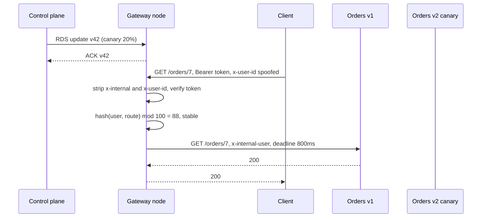

## In one minute
- An API gateway is a programmable reverse proxy at the edge of your services: it terminates client connections, decides who the caller is, picks an upstream, and enforces the rules every API should obey.
- Every gateway product splits into a **data plane** (the proxies that touch every request) and a **control plane** (the store and API that compile routes, keys and policies and push them to the proxies).
- The gateway's real value is a uniform edge contract: one place that strips spoofed headers, attaches a verified identity, sets a deadline, and shifts traffic between versions.
- Its main risks are the same as any shared choke point: a bad config push breaks every API at once, and a retry or timeout policy set wrong multiplies load during an incident.

## How it works

### Data plane and control plane
The data plane is a fleet of identical proxy nodes (Envoy, NGINX, HAProxy, or a managed service's hidden fleet). Each node holds a compiled copy of the configuration in memory and never asks anyone a question on the hot path if it can avoid it. The control plane owns the source of truth: routes, upstream clusters, API keys, plugin settings. Kong stores this in Postgres or declarative YAML; Envoy-based gateways such as Envoy Gateway, Contour and Istio's ingress translate Kubernetes objects into Envoy config and stream it out.

The two halves fail differently. If the control plane dies, proxies keep serving the last good config: you lose the ability to change things, not to serve. If the data plane dies, everything stops.

### The configuration model
A `GatewayClass` names the implementation, owned by the platform team. A `Gateway` declares listeners (ports, hostnames, TLS certificates), owned by whoever runs the edge. An `HTTPRoute` attaches to a Gateway and says which paths, headers and methods go to which backends with what weights, and it is owned by the service team. Platform teams own the door; product teams own the rooms behind it. Gateway, GatewayClass and HTTPRoute are stable, and a `GRPCRoute` does the same job for gRPC ([Gateway API docs](https://gateway-api.sigs.k8s.io/docs/)). This model is now the default path: the community Ingress NGINX controller was retired in March 2026 with no further releases or security fixes, and the Kubernetes project points users to Gateway API ([Kubernetes blog](https://kubernetes.io/blog/2025/11/11/ingress-nginx-retirement/)).

### The edge contract
Azure's architecture guide splits gateway work into three patterns: *routing* one endpoint to many services, *aggregation* of several backend calls into one response, and *offloading* cross-cutting work such as TLS, authentication and throttling ([Azure Architecture Center](https://learn.microsoft.com/en-us/azure/architecture/microservices/design/gateway)). Offloading is what makes a gateway worth having. What it gives you, beyond routing, is a set of promises every service can rely on:

- **Header hygiene.** Anything the gateway will assert on the caller's behalf, such as `x-user-id`, `x-tenant-id` or a client certificate subject, is deleted from the incoming request before the verified value is added. Otherwise any client can forge an identity by sending the header itself.
- **Identity attachment.** The gateway validates the credential (a JWT signature against cached keys, an API key lookup, an mTLS certificate) and forwards a small verified identity, so services do not each parse tokens.
- **Deadline propagation.** The gateway picks a total time budget for the request and forwards the remaining budget, so services stop working on requests the client has already given up on.
- **Traffic shifting.** Weighted routes send a stable slice of users to a canary. The slice is chosen by hashing a stable key, usually the user or session, so one user does not bounce between versions on every click.

### The problem shapes
A gateway is the **overload** shape (it must shed and limit load before it reaches services) combined with **trust but verify** (it turns an untrusted request into a verified one). The same shape appears in an LLM gateway that fronts several model providers: one door, a verified tenant, a token budget, and a weighted route to a cheaper model for a slice of traffic.

## Down the stack

### Layer 1: The contract
For each request the gateway promises: a request whose credential fails verification never reaches an upstream; internal identity headers seen by an upstream were set by the gateway, never by the client; the upstream receives a deadline no larger than the route's configured timeout; the same user hashes to the same side of a weighted split while the weight is unchanged; and the request either gets an upstream response or a gateway-generated status (`401`, `404`, `429`, `502`, `503`, `504`) within the route timeout. For configuration the promise is weaker: a change becomes visible on each node within seconds, nodes may disagree during that window, and a config that a node rejects leaves that node on its previous version.

### Layer 2: The mechanism
Envoy receives config through xDS, a set of gRPC streams: LDS for listeners, RDS for route tables, CDS for clusters, EDS for endpoints. Each `DiscoveryResponse` carries a `version_info` and a `nonce`. The proxy replies with a `DiscoveryRequest` echoing the nonce; if it accepted the update it echoes the new version (an ACK), and if validation failed it repeats the old version with an `error_detail` (a NACK). That is how a control plane learns that half the fleet rejected a route. An ACK only means the resources passed validation, not that traffic is already flowing through them ([Envoy xDS protocol](https://www.envoyproxy.io/docs/envoy/latest/api-docs/xds_protocol)). Delta xDS sends only changed resources, which matters once you have tens of thousands of routes.

On the request path, the HTTP connection manager runs filters in order, typically `jwt_authn`, `ext_authz`, `local_ratelimit`, then `router`. The router enforces a route timeout (15 seconds by default, and it covers all retries) and optional `per_try_timeout` ([Envoy route API](https://www.envoyproxy.io/docs/envoy/latest/api-v3/config/route/v3/route_components.proto)), and tells the upstream its budget with the `x-envoy-expected-rq-timeout-ms` header on internal requests ([Envoy router filter](https://www.envoyproxy.io/docs/envoy/latest/configuration/http/http_filters/router_filter)). Retries are capped by the cluster's circuit breaker (3 concurrent retries by default) or by an optional retry budget, whose defaults let retries be at most 20% of active requests to a cluster, with a floor of 3 concurrent retries, so a failing upstream cannot be hit with three times its normal load ([Envoy circuit breakers](https://www.envoyproxy.io/docs/envoy/latest/api-v3/config/cluster/v3/circuit_breaker.proto)). Weighted clusters choose a backend per request by a random draw, or by a hash of a header when you configure the policy to make it sticky.

### Layer 3: The machine
Envoy runs one worker thread per core, and a connection lives on one worker for its whole life, so the hot path takes no locks. New configuration is built on the main thread and published to workers through thread-local slots, so a route update is a pointer swap per worker, not a pause. Bodies are the expensive part. A gateway that buffers a request body (to verify a signature over it, or transcode it) holds it in memory; Envoy's default `per_connection_buffer_limit_bytes` is 1 MiB ([Envoy listener API](https://www.envoyproxy.io/docs/envoy/latest/api-v3/config/listener/v3/listener.proto)), so 5,000 concurrent 1 MiB uploads would need about 5 GB of RAM if fully buffered. Streaming avoids that, which is why body-inspecting plugins should be the exception.

Restarting a proxy without dropping connections relies on the kernel. Envoy's hot restart passes listening sockets from the old process to the new one over a Unix domain socket using `SCM_RIGHTS`, then the old process drains for a configurable period. NGINX does the same with a master process that forks new workers on reload while old workers finish their requests. Either way the listen socket never closes, so the kernel's accept queue keeps taking SYNs throughout.

### Why it's built this way
1. Every service needs the same edge rules, and implementing them in each language drifts, so the rules move into one proxy.
2. That proxy is on every request, so it must answer from memory, which forces config to be compiled and pushed rather than looked up.
3. Pushed config can be wrong, so the protocol carries versions and ACK or NACK, and proxies keep serving the last good version.
4. A shared retry or timeout policy multiplies load across every service, since attempts multiply at each layer ([Google SRE book](https://sre.google/sre-book/addressing-cascading-failures/)), so retries are budgeted as a fraction of traffic rather than counted per request.
5. Memory per connection is the scaling limit, so gateways stream bodies and buffer only when a plugin demands it.

## Diagram


## Worked example
A retail API serves 30,000 requests per second at peak through 10 gateway nodes. The orders team ships v2 and asks for a 5% canary. With per-request random weighting, a user making 20 calls in a session has a 1 - 0.95^20, about 64%, chance of touching v2 at least once, and v1 and v2 disagree about a cart field. Switching to a sticky split, a hash of the user ID modulo 100 compared against 5, puts exactly the same 5% of users on v2 every time, and raising the weight to 20% only adds users; nobody who was on v2 leaves it.

Deadlines next. The mobile client times out at 2 seconds. The gateway route timeout is 1.5 seconds, and the client sends `x-timeout-ms: 1200`, so the gateway forwards a budget of 1,200 ms. Orders calls inventory and pricing in sequence; after 700 ms in inventory, orders knows it has 500 ms left and passes that down. Without propagation, pricing would run on its own 3 second timeout for a response nobody reads.

Retries last. During a v2 bug, 20% of orders requests fail. With a policy of 2 retries per request and no budget, failing requests triple, adding about 30,000 x 0.2 x 2 = 12,000 extra requests per second to an already sick service. With a 20% retry budget, the retries are capped at a fifth of active requests, which is roughly what the healthy fleet can absorb.

## In the wild
- **Google Cloud, 2025: a policy check on every API call crash-loops worldwide.** A new quota-policy check in Service Control, the component that authorizes and meters Google's API requests, shipped on 29 May without a feature flag or error handling. On 12 June a policy row with blank fields replicated globally within seconds and crashed Service Control in every region, so APIs across Google Cloud and Workspace returned 503s. Tasks restarting without randomized backoff then overloaded a Spanner table, stretching recovery in us-central1 to about 2 hours 40 minutes. Google is making Service Control fail open and rolling out global data incrementally ([Google Cloud](https://status.cloud.google.com/incidents/ow5i3PPK96RduMcb1SsW)).
- **Cloudflare, 2019: one edge rule pushed everywhere at once.** A new WAF rule with a catastrophically backtracking regex went to the whole network in seconds, because rule changes skipped staged rollout. HTTP-serving CPUs hit about 100%, and about 80% of traffic was lost for 27 minutes. Cloudflare restored a removed CPU guard, reviewed all 3,868 rules, moved toward linear-time regex engines and staged rule rollouts ([Cloudflare](https://blog.cloudflare.com/details-of-the-cloudflare-outage-on-july-2-2019/)).
- **Google Cloud, 2021: a config pipeline race makes the global load balancer serve 404s.** A race condition in the pipeline that pushes customer configs to Google's external proxy load balancer corrupted a file after validation had already run. Most endpoints returned 404 for about 33 minutes, taking down Cloud Run, App Engine, Cloud Functions, Apigee and Firebase routes. Google rolled back to the last good config, closed the race and added checks before configs are applied ([Google Cloud](https://status.cloud.google.com/incidents/6PM5mNd43NbMqjCZ5REh)).

## Trade-offs
| Option | Strengths | Weaknesses | Choose when |
|---|---|---|---|
| Managed gateway (AWS API Gateway, Apigee) | No fleet to run, built-in keys, quotas and usage plans | Per-request price, payload limits, a 29-second default integration timeout that only Regional and private REST APIs can raise, at the cost of throttle quota ([AWS](https://aws.amazon.com/about-aws/whats-new/2024/06/amazon-api-gateway-integration-timeout-limit-29-seconds/)) | Public APIs with moderate traffic and a small platform team |
| Self-hosted Envoy-based gateway | Fast, xDS-driven, rich routing and retry control | You run the control plane and the upgrade cadence | High traffic, Kubernetes, need for fine control |
| Kong or NGINX with plugins | Huge plugin ecosystem, simple to extend | Plugin code runs on the hot path; Lua and config sprawl | Many teams needing auth, keys and transforms quickly |
| Thin edge plus service mesh | Edge stays small, policy lives near services | Two systems to understand and debug | Many internal services that also need mTLS and retries |

## Pitfalls in production
- **Forgetting to strip identity headers.** A service trusts `x-user-id`, and one route bypasses the auth filter, so clients set it themselves. Strip every internal header prefix on every route by default, before any filter runs.
- **Timeouts that increase inward.** The gateway waits 30 seconds for a service whose own timeout is 60. Make timeouts shrink as you go deeper and forward the remaining budget.
- **Unbudgeted retries.** Per-request retry counts turn a partial outage into a full one. Retry only idempotent methods and use a retry budget.
- **Non-sticky canaries.** Random per-request weighting mixes versions inside one session. Hash a stable key so each user stays on one side.
- **A single config push to every node.** A route with a broken regex is accepted by the control plane and NACKed or, worse, accepted by every node at once. Validate in CI, roll out to a few nodes first, and alarm on NACKs.

## Leadership lens
- Write down what belongs in the gateway (identity, limits, routing, deadlines) and what does not (business rules, data joins), and review new plugins against it.
- Give the edge one owner and route ownership to service teams through self-service resources, such as `HTTPRoute`, so the platform team is not a ticket queue.
- Track the time from config merge to fleet-wide ACK and the NACK rate as first-class SLOs; they predict the next outage better than request latency does.

## Check yourself
1. The control plane is down for 20 minutes. What still works and what does not?
   **Answer:** Proxies keep serving with their last accepted config, so traffic flows. You cannot add routes, rotate keys pushed through config, or change weights until it returns.
2. Why must the gateway delete `x-user-id` from the client request even on routes that require authentication?
   **Answer:** If the filter that sets it is skipped or misconfigured on one route, the client's own value would reach the service. Stripping first makes the safe outcome the default.
3. Why hash user ID and route together for a canary split rather than user ID alone?
   **Answer:** With the route in the hash, the same users are not the canary population for every service at once, so one unlucky group does not absorb every experiment.
4. How does a retry budget differ from a retry count?
   **Answer:** A count limits retries per request, so total retries grow with failures. A budget caps retries as a fraction of current traffic, so retry load stays bounded however many requests fail.

## Practice
**Task:** Build the request-preparation step of a gateway node. `Gateway(routes, tokens)` takes routes keyed by the first path segment, each with `stable`, `canary`, `percent` (0 to 100) and `timeout_ms`, and a map from bearer token to user ID. `handle(path, headers)` gets lowercase header names and returns `(status, upstream, forwarded)`. Check in order: the `authorization` header must be exactly `Bearer <token>` with a known token, otherwise 401; the first non-empty path segment must be a route, otherwise 404; if `x-timeout-ms` is present it must be a positive integer made only of digits, otherwise 400. On any error return an empty upstream and empty headers. On success, the budget is the smaller of `x-timeout-ms` and the route's `timeout_ms`; the upstream is `canary` when `fnv1a32(user + "|" + segment) % 100 < percent`, else `stable` (FNV-1a 32-bit: start at 2166136261, for each UTF-8 byte xor then multiply by 16777619 modulo 2^32). Forward every client header except `authorization` and any name starting with `x-internal-`, then add `x-internal-user` and `x-internal-deadline-ms` (as a decimal string).

```python starter
def fnv1a32(s):
    # TODO
    raise NotImplementedError


class Gateway:
    def __init__(self, routes, tokens):
        self.routes = routes
        self.tokens = tokens

    def handle(self, path, headers):
        # TODO: return (status, upstream, forwarded)
        raise NotImplementedError
```

```python tests
ROUTES = {
    "orders": {"stable": "orders-v1", "canary": "orders-v2", "percent": 20, "timeout_ms": 1500},
    "search": {"stable": "search-v1", "canary": "search-v2", "percent": 20, "timeout_ms": 800},
}
TOKENS = {"t-alice": "alice", "t-bob": "bob"}

def gw():
    return Gateway(ROUTES, TOKENS)

def test_fnv_known_values():
    assert fnv1a32("") == 2166136261
    assert fnv1a32("a") == 0xE40C292C

def test_missing_or_bad_token_is_401():
    assert gw().handle("/orders/7", {}) == (401, "", {})
    assert gw().handle("/orders/7", {"authorization": "Bearer nope"}) == (401, "", {})
    assert gw().handle("/orders/7", {"authorization": "t-alice"}) == (401, "", {})

def test_auth_checked_before_routing():
    assert gw().handle("/admin", {}) == (401, "", {}), "do not reveal routes to anonymous callers"
    assert gw().handle("/admin", {"authorization": "Bearer t-alice"}) == (404, "", {})

def test_strips_spoofed_headers_and_adds_identity():
    status, up, fwd = gw().handle("/orders/7", {
        "authorization": "Bearer t-alice",
        "x-internal-user": "root",
        "x-internal-deadline-ms": "999999",
        "accept": "application/json",
    })
    assert status == 200 and up == "orders-v1"
    assert fwd == {"accept": "application/json", "x-internal-user": "alice", "x-internal-deadline-ms": "1500"}

def test_sticky_canary_salted_by_route():
    assert gw().handle("/orders", {"authorization": "Bearer t-bob"})[1] == "orders-v2"
    assert gw().handle("/orders", {"authorization": "Bearer t-alice"})[1] == "orders-v1"
    assert gw().handle("/search", {"authorization": "Bearer t-alice"})[1] == "search-v2"
    assert gw().handle("/search", {"authorization": "Bearer t-bob"})[1] == "search-v1"

def test_deadline_takes_the_smaller_budget():
    h = {"authorization": "Bearer t-alice", "x-timeout-ms": "1200"}
    assert gw().handle("/orders", h)[2]["x-internal-deadline-ms"] == "1200"
    assert gw().handle("/search", h)[2]["x-internal-deadline-ms"] == "800"

def test_bad_timeout_is_400():
    for bad in ["0", "-5", "abc", "", "1.5"]:
        h = {"authorization": "Bearer t-alice", "x-timeout-ms": bad}
        assert gw().handle("/orders", h) == (400, "", {}), bad

def test_percent_edges_and_empty_segments():
    routes = {"pay": {"stable": "p1", "canary": "p2", "percent": 0, "timeout_ms": 100},
              "all": {"stable": "a1", "canary": "a2", "percent": 100, "timeout_ms": 100}}
    g = Gateway(routes, TOKENS)
    h = {"authorization": "Bearer t-bob"}
    assert g.handle("//pay/x", h)[1] == "p1"
    assert g.handle("/all/", h)[1] == "a2"
    assert g.handle("/", h)[0] == 404
```

```python solution
def fnv1a32(s):
    h = 2166136261
    for b in s.encode("utf-8"):
        h ^= b
        h = (h * 16777619) & 0xFFFFFFFF
    return h


class Gateway:
    def __init__(self, routes, tokens):
        self.routes = routes
        self.tokens = tokens

    def handle(self, path, headers):
        auth = headers.get("authorization", "")
        if not auth.startswith("Bearer ") or auth[7:] not in self.tokens:
            return (401, "", {})
        user = self.tokens[auth[7:]]
        segments = [s for s in path.split("/") if s]
        if not segments or segments[0] not in self.routes:
            return (404, "", {})
        seg = segments[0]
        route = self.routes[seg]
        budget = route["timeout_ms"]
        if "x-timeout-ms" in headers:
            raw = headers["x-timeout-ms"]
            if not raw.isdigit() or int(raw) <= 0:
                return (400, "", {})
            budget = min(budget, int(raw))
        if fnv1a32(user + "|" + seg) % 100 < route["percent"]:
            upstream = route["canary"]
        else:
            upstream = route["stable"]
        fwd = {}
        for k, v in headers.items():
            if k == "authorization" or k.startswith("x-internal-"):
                continue
            fwd[k] = v
        fwd["x-internal-user"] = user
        fwd["x-internal-deadline-ms"] = str(budget)
        return (200, upstream, fwd)
```

```typescript starter
export interface Route {
  stable: string;
  canary: string;
  percent: number;
  timeoutMs: number;
}

export interface Result {
  status: number;
  upstream: string;
  forwarded: Record<string, string>;
}

export function fnv1a32(s: string): number {
  throw new Error("TODO");
}

export class Gateway {
  constructor(private routes: Record<string, Route>, private tokens: Record<string, string>) {}
  handle(path: string, headers: Record<string, string>): Result {
    throw new Error("TODO");
  }
}
```

```typescript tests
const ROUTES: Record<string, Route> = {
  orders: { stable: "orders-v1", canary: "orders-v2", percent: 20, timeoutMs: 1500 },
  search: { stable: "search-v1", canary: "search-v2", percent: 20, timeoutMs: 800 },
};
const TOKENS: Record<string, string> = { "t-alice": "alice", "t-bob": "bob" };
const gw = () => new Gateway(ROUTES, TOKENS);
const fail = (status: number): Result => ({ status, upstream: "", forwarded: {} });

test("fnv known values", () => {
  assertEqual(fnv1a32(""), 2166136261);
  assertEqual(fnv1a32("a"), 0xe40c292c);
});
test("missing or bad token is 401", () => {
  assertEqual(gw().handle("/orders/7", {}), fail(401));
  assertEqual(gw().handle("/orders/7", { authorization: "Bearer nope" }), fail(401));
  assertEqual(gw().handle("/orders/7", { authorization: "t-alice" }), fail(401));
});
test("auth checked before routing", () => {
  assertEqual(gw().handle("/admin", {}), fail(401), "do not reveal routes to anonymous callers");
  assertEqual(gw().handle("/admin", { authorization: "Bearer t-alice" }), fail(404));
});
test("strips spoofed headers and adds identity", () => {
  const r = gw().handle("/orders/7", {
    authorization: "Bearer t-alice",
    "x-internal-user": "root",
    "x-internal-deadline-ms": "999999",
    accept: "application/json",
  });
  assertEqual([r.status, r.upstream], [200, "orders-v1"]);
  assertEqual(Object.keys(r.forwarded).sort(), ["accept", "x-internal-deadline-ms", "x-internal-user"]);
  assertEqual(r.forwarded["accept"], "application/json");
  assertEqual(r.forwarded["x-internal-user"], "alice");
  assertEqual(r.forwarded["x-internal-deadline-ms"], "1500");
});
test("sticky canary salted by route", () => {
  assertEqual(gw().handle("/orders", { authorization: "Bearer t-bob" }).upstream, "orders-v2");
  assertEqual(gw().handle("/orders", { authorization: "Bearer t-alice" }).upstream, "orders-v1");
  assertEqual(gw().handle("/search", { authorization: "Bearer t-alice" }).upstream, "search-v2");
  assertEqual(gw().handle("/search", { authorization: "Bearer t-bob" }).upstream, "search-v1");
});
test("deadline takes the smaller budget", () => {
  const h = { authorization: "Bearer t-alice", "x-timeout-ms": "1200" };
  assertEqual(gw().handle("/orders", h).forwarded["x-internal-deadline-ms"], "1200");
  assertEqual(gw().handle("/search", h).forwarded["x-internal-deadline-ms"], "800");
});
test("bad timeout is 400", () => {
  for (const bad of ["0", "-5", "abc", "", "1.5"]) {
    assertEqual(gw().handle("/orders", { authorization: "Bearer t-alice", "x-timeout-ms": bad }), fail(400), bad);
  }
});
test("percent edges and empty segments", () => {
  const g = new Gateway(
    {
      pay: { stable: "p1", canary: "p2", percent: 0, timeoutMs: 100 },
      all: { stable: "a1", canary: "a2", percent: 100, timeoutMs: 100 },
    },
    TOKENS,
  );
  const h = { authorization: "Bearer t-bob" };
  assertEqual(g.handle("//pay/x", h).upstream, "p1");
  assertEqual(g.handle("/all/", h).upstream, "a2");
  assertEqual(g.handle("/", h).status, 404);
});
```

```typescript solution
export interface Route {
  stable: string;
  canary: string;
  percent: number;
  timeoutMs: number;
}

export interface Result {
  status: number;
  upstream: string;
  forwarded: Record<string, string>;
}

function utf8(s: string): number[] {
  const out: number[] = [];
  for (const ch of s) {
    let c = ch.codePointAt(0) as number;
    if (c < 0x80) out.push(c);
    else if (c < 0x800) out.push(0xc0 | (c >> 6), 0x80 | (c & 63));
    else if (c < 0x10000) out.push(0xe0 | (c >> 12), 0x80 | ((c >> 6) & 63), 0x80 | (c & 63));
    else out.push(0xf0 | (c >> 18), 0x80 | ((c >> 12) & 63), 0x80 | ((c >> 6) & 63), 0x80 | (c & 63));
  }
  return out;
}

export function fnv1a32(s: string): number {
  let h = 2166136261;
  for (const b of utf8(s)) {
    h ^= b;
    h = Math.imul(h, 16777619) >>> 0;
  }
  return h >>> 0;
}

export class Gateway {
  constructor(private routes: Record<string, Route>, private tokens: Record<string, string>) {}

  handle(path: string, headers: Record<string, string>): Result {
    const fail = (status: number): Result => ({ status, upstream: "", forwarded: {} });
    const auth = headers["authorization"] ?? "";
    const token = auth.startsWith("Bearer ") ? auth.slice(7) : "";
    if (!Object.prototype.hasOwnProperty.call(this.tokens, token)) return fail(401);
    const user = this.tokens[token];
    const segments = path.split("/").filter((s) => s.length > 0);
    if (segments.length === 0 || !Object.prototype.hasOwnProperty.call(this.routes, segments[0])) return fail(404);
    const seg = segments[0];
    const route = this.routes[seg];
    let budget = route.timeoutMs;
    if (Object.prototype.hasOwnProperty.call(headers, "x-timeout-ms")) {
      const raw = headers["x-timeout-ms"];
      if (!/^[0-9]+$/.test(raw) || parseInt(raw, 10) <= 0) return fail(400);
      budget = Math.min(budget, parseInt(raw, 10));
    }
    const upstream = fnv1a32(user + "|" + seg) % 100 < route.percent ? route.canary : route.stable;
    const forwarded: Record<string, string> = {};
    for (const k of Object.keys(headers)) {
      if (k === "authorization" || k.startsWith("x-internal-")) continue;
      forwarded[k] = headers[k];
    }
    forwarded["x-internal-user"] = user;
    forwarded["x-internal-deadline-ms"] = String(budget);
    return { status: 200, upstream, forwarded };
  }
}
```

```go starter
package practice

type Route struct {
	Stable    string
	Canary    string
	Percent   uint32
	TimeoutMs int
}

func Fnv1a32(s string) uint32 { panic("TODO") }

type Gateway struct {
	routes map[string]Route
	tokens map[string]string
}

func NewGateway(routes map[string]Route, tokens map[string]string) *Gateway {
	return &Gateway{routes: routes, tokens: tokens}
}

// Handle returns status, upstream and forwarded headers.
func (g *Gateway) Handle(path string, headers map[string]string) (int, string, map[string]string) {
	panic("TODO")
}
```

```go tests
package practice

import (
	"reflect"
	"testing"
)

var routes = map[string]Route{
	"orders": {Stable: "orders-v1", Canary: "orders-v2", Percent: 20, TimeoutMs: 1500},
	"search": {Stable: "search-v1", Canary: "search-v2", Percent: 20, TimeoutMs: 800},
}
var tokens = map[string]string{"t-alice": "alice", "t-bob": "bob"}

func gw() *Gateway { return NewGateway(routes, tokens) }

func expectFail(t *testing.T, g *Gateway, path string, h map[string]string, want int) {
	t.Helper()
	st, up, fwd := g.Handle(path, h)
	if st != want || up != "" || len(fwd) != 0 {
		t.Fatalf("%s %v: got %d %q %v, want %d", path, h, st, up, fwd, want)
	}
}

func TestFnvKnownValues(t *testing.T) {
	if Fnv1a32("") != 2166136261 || Fnv1a32("a") != 0xE40C292C {
		t.Fatal("wrong fnv")
	}
}

func TestMissingOrBadTokenIs401(t *testing.T) {
	expectFail(t, gw(), "/orders/7", map[string]string{}, 401)
	expectFail(t, gw(), "/orders/7", map[string]string{"authorization": "Bearer nope"}, 401)
	expectFail(t, gw(), "/orders/7", map[string]string{"authorization": "t-alice"}, 401)
}

func TestAuthCheckedBeforeRouting(t *testing.T) {
	expectFail(t, gw(), "/admin", map[string]string{}, 401)
	expectFail(t, gw(), "/admin", map[string]string{"authorization": "Bearer t-alice"}, 404)
}

func TestStripsSpoofedHeadersAndAddsIdentity(t *testing.T) {
	st, up, fwd := gw().Handle("/orders/7", map[string]string{
		"authorization":          "Bearer t-alice",
		"x-internal-user":        "root",
		"x-internal-deadline-ms": "999999",
		"accept":                 "application/json",
	})
	want := map[string]string{"accept": "application/json", "x-internal-user": "alice", "x-internal-deadline-ms": "1500"}
	if st != 200 || up != "orders-v1" || !reflect.DeepEqual(fwd, want) {
		t.Fatalf("got %d %q %v", st, up, fwd)
	}
}

func TestStickyCanarySaltedByRoute(t *testing.T) {
	cases := []struct{ path, tok, want string }{
		{"/orders", "t-bob", "orders-v2"},
		{"/orders", "t-alice", "orders-v1"},
		{"/search", "t-alice", "search-v2"},
		{"/search", "t-bob", "search-v1"},
	}
	for _, c := range cases {
		_, up, _ := gw().Handle(c.path, map[string]string{"authorization": "Bearer " + c.tok})
		if up != c.want {
			t.Fatalf("%s %s: got %q want %q", c.path, c.tok, up, c.want)
		}
	}
}

func TestDeadlineTakesTheSmallerBudget(t *testing.T) {
	h := map[string]string{"authorization": "Bearer t-alice", "x-timeout-ms": "1200"}
	if _, _, f := gw().Handle("/orders", h); f["x-internal-deadline-ms"] != "1200" {
		t.Fatalf("orders: %v", f)
	}
	if _, _, f := gw().Handle("/search", h); f["x-internal-deadline-ms"] != "800" {
		t.Fatalf("search: %v", f)
	}
}

func TestBadTimeoutIs400(t *testing.T) {
	for _, bad := range []string{"0", "-5", "abc", "", "1.5"} {
		expectFail(t, gw(), "/orders", map[string]string{"authorization": "Bearer t-alice", "x-timeout-ms": bad}, 400)
	}
}

func TestPercentEdgesAndEmptySegments(t *testing.T) {
	g := NewGateway(map[string]Route{
		"pay": {Stable: "p1", Canary: "p2", Percent: 0, TimeoutMs: 100},
		"all": {Stable: "a1", Canary: "a2", Percent: 100, TimeoutMs: 100},
	}, tokens)
	h := map[string]string{"authorization": "Bearer t-bob"}
	if _, up, _ := g.Handle("//pay/x", h); up != "p1" {
		t.Fatalf("pay: %q", up)
	}
	if _, up, _ := g.Handle("/all/", h); up != "a2" {
		t.Fatalf("all: %q", up)
	}
	if st, _, _ := g.Handle("/", h); st != 404 {
		t.Fatalf("root: %d", st)
	}
}
```

```go solution
package practice

import (
	"strconv"
	"strings"
)

type Route struct {
	Stable    string
	Canary    string
	Percent   uint32
	TimeoutMs int
}

func Fnv1a32(s string) uint32 {
	h := uint32(2166136261)
	for i := 0; i < len(s); i++ {
		h ^= uint32(s[i])
		h *= 16777619
	}
	return h
}

type Gateway struct {
	routes map[string]Route
	tokens map[string]string
}

func NewGateway(routes map[string]Route, tokens map[string]string) *Gateway {
	return &Gateway{routes: routes, tokens: tokens}
}

func allDigits(s string) bool {
	if s == "" {
		return false
	}
	for _, c := range s {
		if c < '0' || c > '9' {
			return false
		}
	}
	return true
}

// Handle returns status, upstream and forwarded headers.
func (g *Gateway) Handle(path string, headers map[string]string) (int, string, map[string]string) {
	auth := headers["authorization"]
	if !strings.HasPrefix(auth, "Bearer ") {
		return 401, "", map[string]string{}
	}
	user, ok := g.tokens[strings.TrimPrefix(auth, "Bearer ")]
	if !ok {
		return 401, "", map[string]string{}
	}
	var seg string
	for _, s := range strings.Split(path, "/") {
		if s != "" {
			seg = s
			break
		}
	}
	route, ok := g.routes[seg]
	if seg == "" || !ok {
		return 404, "", map[string]string{}
	}
	budget := route.TimeoutMs
	if raw, present := headers["x-timeout-ms"]; present {
		if !allDigits(raw) {
			return 400, "", map[string]string{}
		}
		v, err := strconv.Atoi(raw)
		if err != nil || v <= 0 {
			return 400, "", map[string]string{}
		}
		if v < budget {
			budget = v
		}
	}
	upstream := route.Stable
	if Fnv1a32(user+"|"+seg)%100 < route.Percent {
		upstream = route.Canary
	}
	fwd := map[string]string{}
	for k, v := range headers {
		if k == "authorization" || strings.HasPrefix(k, "x-internal-") {
			continue
		}
		fwd[k] = v
	}
	fwd["x-internal-user"] = user
	fwd["x-internal-deadline-ms"] = strconv.Itoa(budget)
	return 200, upstream, fwd
}
```

## Mock interview
**Prompt:** You run the API edge for a fintech with 120 services, 40,000 requests per second at peak, a public partner API and first-party mobile apps. Design the gateway layer, including how teams change routes safely and how a new service version is rolled out to a slice of users.

- Follow-up: A route config with a bad regex was pushed and half the fleet rejected it. How do you find out, and what state is each node in?
- Follow-up: A service trusted `x-user-id` and a partner impersonated another customer. Walk through how that happened and how you prevent it structurally.
- Follow-up: Would you put the canary split in the gateway or in a service mesh, and why?

**A strong answer covers:**
- Data plane and control plane separation, with proxies serving the last good config when the control plane is down.
- Config as code with validation, staged rollout, ACK and NACK monitoring, and fast rollback.
- Header hygiene by default on every route, verified identity attached by the gateway, and network policy so services are reachable only through it.
- Deadline propagation with timeouts that shrink inward, and retry budgets instead of per-request retry counts.
- Sticky, route-salted canary splits and a clear ownership model for routes versus the gateway fleet.

## Sources and further study
**Primary**
- [Envoy xDS protocol](https://www.envoyproxy.io/docs/envoy/latest/api-docs/xds_protocol): versions, nonces, ACK and NACK, and delta updates between control plane and proxies.
- [Ingress NGINX retirement (Kubernetes blog, 2025)](https://kubernetes.io/blog/2025/11/11/ingress-nginx-retirement/): why the community controller ended in March 2026 and where users should move.
- [Amazon API Gateway: integration timeouts beyond 29 seconds (2024)](https://aws.amazon.com/about-aws/whats-new/2024/06/amazon-api-gateway-integration-timeout-limit-29-seconds/): the limit change and its throttle-quota trade-off.

**Systems docs**
- [Envoy circuit breakers](https://www.envoyproxy.io/docs/envoy/latest/api-v3/config/cluster/v3/circuit_breaker.proto): `max_retries`, retry budgets and their defaults.
- [Envoy router filter](https://www.envoyproxy.io/docs/envoy/latest/configuration/http/http_filters/router_filter): timeout and retry headers the gateway sets and honours.

**Books**
- *Understanding Distributed Systems* (2nd ed.), Roberto Vitillo, chapter "Control planes and data planes": why the config path and the request path should fail independently.
- *Release It!* (2nd ed.), Michael Nygard, chapter 10 "Control Plane": the platform that configures production is itself production.
- *Site Reliability Engineering*, chapter 22 "Addressing Cascading Failures" ([read free](https://sre.google/sre-book/addressing-cascading-failures/)): deadline propagation and retry amplification across layers.

**Other curricula**
- [Azure Architecture Center: API gateways](https://learn.microsoft.com/en-us/azure/architecture/microservices/design/gateway): frames the gateway as routing, aggregation and offloading patterns, and compares reverse proxies, mesh ingress and managed services.
- [donnemartin/system-design-primer](https://github.com/donnemartin/system-design-primer#reverse-proxy-web-server): covers the gateway only as a reverse proxy (security, TLS termination, caching) and does not discuss control planes or config rollout.

## Watch
- [What is API Gateway? (ByteByteGo)](https://www.youtube.com/watch?v=6ULyxuHKxg8): a short tour of what gateways do.
- [Reverse Proxy vs API Gateway vs Load Balancer (ByteByteGo)](https://www.youtube.com/watch?v=RqfaTIWc3LQ): where the three roles overlap and where they differ.

## Free resources
- [Kubernetes Gateway API](https://gateway-api.sigs.k8s.io/): the role-oriented resource model (GatewayClass, Gateway, HTTPRoute) and its rationale.
- [Envoy xDS configuration API overview](https://www.envoyproxy.io/docs/envoy/latest/intro/arch_overview/operations/dynamic_configuration): how proxies receive listeners, routes and clusters from a control plane.
- [Envoy HTTP routing](https://www.envoyproxy.io/docs/envoy/latest/intro/arch_overview/http/http_routing): route matching, weighted clusters, timeouts and retry policy.
- [gRPC deadlines](https://grpc.io/docs/guides/deadlines/): why and how to propagate a deadline across service hops.
- [Timeouts, retries, and backoff with jitter (AWS Builders' Library)](https://aws.amazon.com/builders-library/timeouts-retries-and-backoff-with-jitter/): how retries amplify load and how to bound them.
- [What is Amazon API Gateway?](https://docs.aws.amazon.com/apigateway/latest/developerguide/welcome.html): a managed gateway's feature set and limits.
