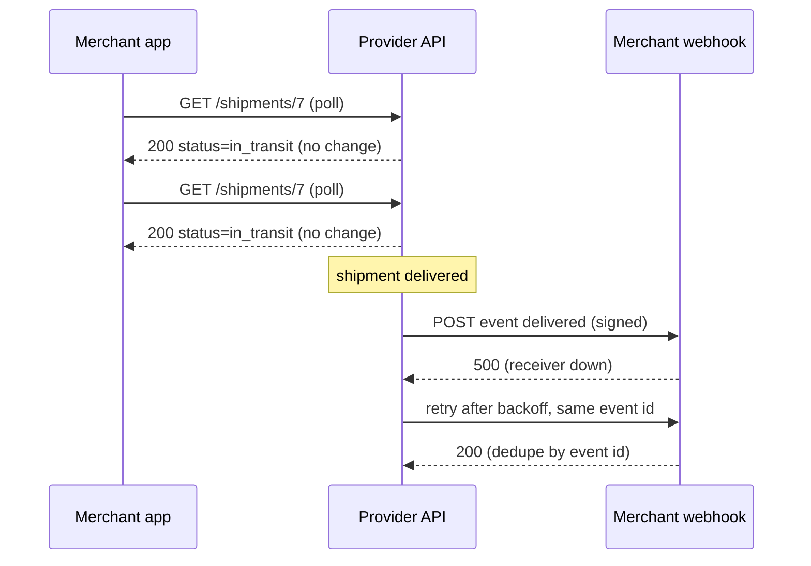

## In one minute
- An API style is the shape of the conversation: what the unit of the interface is (a resource, a procedure, a query, an event or a stream), who starts each exchange, and where errors and retries live.
- Request and response styles (REST, RPC such as gRPC or JSON-RPC, and GraphQL) differ mainly in what the caller names: a thing, an action, or a shape of data.
- Push styles (webhooks, Server-Sent Events, WebSockets, message brokers) exist because polling for changes that rarely happen wastes almost every request.
- Each style moves cost somewhere: REST pushes work into many round trips but gets HTTP caching for free, GraphQL pushes it into the server's query planner, push styles push it into long-lived connections and delivery guarantees.
- Real systems mix styles per boundary: REST or GraphQL at the public edge, gRPC between services, webhooks to partners, events inside.

## How it works

### What a style decides
Every style answers four questions. What does the caller name: a resource (`/orders/42`), a procedure (`CancelOrder`), or a query (`{ order(id: 42) { status } }`)? Who starts the exchange, client or server? Is there one response, many, or none? How does a failure look, and is it safe to retry? Seen this way, the styles stop looking like brands and start looking like choices.

### Resource style (REST)
REST names things, and a small uniform set of methods acts on them. Because method semantics are standardised, every proxy, cache and client library knows which calls are safe to cache or retry; a CDN can cache a `GET` it has never seen. The cost is that actions ("refund part of this order and notify the buyer") must be bent into resource operations, and a screen that needs five resources needs five round trips or a custom aggregate endpoint.

### Procedure style (RPC)
RPC names actions. The caller invokes `Refund(order_id, amount)` as if it were a local function, and the server routes by method name. gRPC adds a schema in Protobuf, generated clients, deadlines and streaming over HTTP/2. JSON-RPC 2.0 is the minimal version: one JSON object with `method`, `params` and `id`, sent over any transport ([JSON-RPC 2.0](https://www.jsonrpc.org/specification)). It is small enough that new protocols adopt it directly; the Language Server Protocol used by code editors and the Model Context Protocol used by AI agents to call tools are both JSON-RPC 2.0. Protocols built on it may still narrow it: MCP's 2025-06-18 revision removed JSON-RPC batching from the protocol ([MCP changelog](https://modelcontextprotocol.io/specification/2025-06-18/changelog)), so check the protocol's own rules, not just the base spec. RPC fits internal calls and command-shaped operations well. Its danger is that it makes a network call look like a function call, so callers forget timeouts and partial failure.

### Query style (GraphQL)
GraphQL names a shape of data. The client sends a query describing exactly which fields of which related objects it needs, and gets JSON of that shape back in one round trip. That suits many clients with different screens over one connected data model. The cost moves to the server: arbitrary queries make load unpredictable, so you need cost limits, and HTTP caching mostly stops working because most clients send every operation as a `POST` to one URL. The GraphQL-over-HTTP working draft does allow `GET` for queries, never for mutations ([GraphQL over HTTP](https://graphql.github.io/graphql-over-http/draft/)), but long queries do not fit well in a URL.

That gap is why HTTP gained a new method. `QUERY` (RFC 10008, June 2026) carries the query in the request body like `POST` but is defined as safe and idempotent, and its responses are cacheable with a cache key that must include the body ([RFC 10008](https://www.rfc-editor.org/rfc/rfc10008.html)). It gives any query-shaped API, GraphQL or a complex search endpoint, the retry and caching semantics that `GET` has, once clients, proxies and CDNs support it.

### Push styles
When the interesting thing is a change, asking repeatedly is wasteful. **Webhooks** reverse the direction: the provider makes an HTTP `POST` to a URL the consumer registered, signed so the consumer can verify it, and retried until the consumer answers 2xx. **Server-Sent Events** keep one HTTP response open and stream text events from server to browser, with automatic reconnection. **WebSockets** upgrade an HTTP connection into a two-way channel of frames, for chat, collaborative editing and games. **Message brokers** (Kafka, RabbitMQ, SQS) decouple producer and consumer in time, so neither needs the other to be up. AsyncAPI plays the role for event channels that OpenAPI plays for HTTP endpoints.

Push styles bring the fan-out and ordering problem shapes with them. A webhook sender must deliver one event to thousands of subscribers, retry the slow ones, and accept that a retried "payment succeeded" may arrive after "payment refunded". The same shapes appear in a chat app delivering a message to every member of a group.

One older style sits outside these families. SOAP, which wraps RPC calls in XML envelopes described by WSDL files, survives in banking, insurance and government integrations; you meet it when integrating with them, rarely when designing new systems.

## Down the stack

### Layer 1: The contract
The styles differ most in where failure is reported and what a retry means. REST reports failure in the HTTP status line, and method semantics say which calls may be retried blindly (`GET`, `PUT`, `DELETE`) and which need an idempotency key (`POST`). gRPC carries its own status in HTTP/2 trailers (`grpc-status`), and only some codes, such as `UNAVAILABLE`, are safe to retry. gRPC has no default retry policy; a service opts in through a service config that lists the retryable codes, a maximum attempt count and a retry-throttling token bucket ([gRPC docs](https://grpc.io/docs/guides/retry/)). JSON-RPC defines an error object with reserved codes: -32700 parse error, -32600 invalid request, -32601 method not found, -32602 invalid params, -32603 internal error, and -32000 to -32099 for server-defined errors; a request without an `id` is a notification that gets no response at all, even on failure. GraphQL usually answers `200 OK` with partial `data` and an `errors` array, so a response can be half success. Webhooks are at-least-once: the provider retries on any non-2xx or timeout, often for days. Stripe retries live-mode events with exponential backoff for up to three days, treats a redirect as a failure, and states plainly that it does not guarantee event order ([Stripe docs](https://docs.stripe.com/webhooks)). So receivers must deduplicate by event ID and must not assume order. SSE promises that a reconnecting client sends `Last-Event-ID`, but replaying from that point is the server's job.

### Layer 2: The mechanism
On the wire each style is a small convention on top of HTTP or TCP. A gRPC call is an HTTP/2 `POST` to `/package.Service/Method` with `content-type: application/grpc` and each message prefixed by a 1-byte compression flag and a 4-byte big-endian length; the deadline travels as a `grpc-timeout` header, and `grpc-status` arrives in trailers even on success ([gRPC over HTTP/2](https://github.com/grpc/grpc/blob/master/doc/PROTOCOL-HTTP2.md)). A GraphQL call is a `POST /graphql` with a JSON body of `query`, `variables` and `operationName`. A JSON-RPC call is `{"jsonrpc": "2.0", "method": "add", "params": [2, 3], "id": 1}`; an array of them is a batch whose responses are matched by `id`. An SSE body is `text/event-stream` lines such as `id: 42` and `data: {...}` separated by blank lines. A WebSocket starts as an HTTP/1.1 `GET` with `Upgrade: websocket` and a random `Sec-WebSocket-Key`; the server answers `101 Switching Protocols` with `Sec-WebSocket-Accept`, the base64 SHA-1 of that key plus a fixed GUID. Then come frames with a 2 to 14 byte header, and client frames are masked with a 4-byte key so cache-poisoning attacks on intermediaries fail ([RFC 6455](https://www.rfc-editor.org/rfc/rfc6455)). Webhook signatures are typically an HMAC-SHA256 over a timestamp and the raw body, in a header such as `Stripe-Signature: t=...,v1=...`; the timestamp lets receivers reject old replays, and Stripe's libraries default to a 5-minute tolerance ([Stripe docs](https://docs.stripe.com/webhooks)). Any framework that re-parses the JSON before verification breaks the signature, because the HMAC is over the exact bytes.

### Layer 3: The machine
Request and response styles cost a round trip per call, plus TCP and TLS handshakes on a new connection; keep-alive and HTTP/2 multiplexing amortise those, and HPACK shrinks repeated headers to a few bytes, which is why gRPC's many small calls are cheap. Push styles trade round trips for held state. Each open WebSocket or SSE connection is a kernel socket with auto-tuned send and receive buffers, a TLS session, and the application's own per-connection objects: realistically 10 to 50 KB per idle connection, so one million connected clients needs roughly 10 to 50 GB of memory across the fleet, and `epoll` lets a single thread watch tens of thousands of them because it reports only sockets with activity. Load balancers close idle connections (AWS Application Load Balancer defaults to 60 seconds, configurable from 1 to 4,000), so long-lived streams send heartbeats: a WebSocket ping frame is 2 bytes plus payload, an SSE comment line is a handful. Check what the middlebox counts as activity: an ALB does not treat HTTP/2 PING frames as traffic, so gRPC keepalive pings alone will not hold a connection open through one ([AWS docs](https://docs.aws.amazon.com/elasticloadbalancing/latest/application/edit-load-balancer-attributes.html)). Polling has the opposite profile: no held state, but every poll pays a full request, typically 500 bytes to 1 KB of headers each way plus server CPU, even when nothing changed.

### Why it's built this way
1. A network call can fail halfway, so every style must say where errors live and which calls are safe to repeat.
2. Standard semantics let intermediaries help (caches, proxies, retries), so REST bets on a uniform interface; when callers need actions or shapes instead, RPC and GraphQL trade that help for expressiveness.
3. Round trips dominate latency on mobile and across regions, so styles that batch (GraphQL, JSON-RPC batches, aggregate endpoints) appear wherever clients are far away.
4. Most data changes rarely compared with how often clients want to know, so push styles keep a connection or a callback instead of paying for empty polls.
5. Held connections cost memory and break when proxies time them out, so push protocols add heartbeats, resumption IDs and at-least-once retries.

## Diagram


## Worked example
A logistics provider tracks 1 million active shipments for 50,000 merchants. Each shipment changes status about 5 times over a 2-day life.

With polling every 60 seconds per shipment, merchants send 1,000,000 / 60, about 16,700 requests per second. Status changes happen at 1,000,000 × 5 / 172,800 seconds, about 29 per second. So about 99.8% of polls return nothing new. At roughly 1.5 KB per request and response pair, polling costs about 25 MB/s of traffic and a fleet of API servers sized for 16,700 requests per second, to deliver 29 events per second, each up to 60 seconds late.

With webhooks the provider sends about 29 `POST`s per second plus retries, and events arrive in seconds. If 2% of merchant endpoints are down at any moment, the retry queue holds a few thousand events, not millions. The new costs are a durable delivery queue, per-merchant signing secrets, and a page showing failed deliveries.

The merchant dashboard is a third shape: 20,000 people at a time watch a live map, and updates flow one way, so SSE fits. At about 30 KB per held connection that is 600 MB across the SSE tier, with a heartbeat every 30 seconds to stay under a 60-second idle timeout. Internal services call each other with gRPC because they share a Protobuf schema and need deadlines. Four styles, each where it fits.

## In the wild
- **GitHub, 2018: a webhook backlog during a 24-hour degradation.** A 43-second network partition led Orchestrator to promote West Coast MySQL primaries, and GitHub spent 24 hours 11 minutes restoring and re-replicating. Webhook delivery was paused to protect data integrity: more than 5 million events queued, and about 200,000 payloads outlived their internal time-to-live and were dropped. GitHub afterwards changed failover so it could not promote across regions ([GitHub](https://github.blog/news-insights/company-news/oct21-post-incident-analysis/)). Webhook receivers need a way to catch up that does not depend on every push arriving.
- **Discord, 2026: held connections turn a scale-down into a reconnect storm.** A config change halved the number of session pods in one zone, and pods were killed before handing off, so 17% of sessions ended ungracefully. The reconnects hit an untuned rate limit and ran gateways out of memory, and voice and video were mostly down for about 3 hours 17 minutes. Fixes included an admission webhook that blocks scale-down until pods drain, plus retuned rate limits in front of the overloaded voice services ([Discord](https://discord.com/blog/behind-the-scenes-of-the-3-25-26-voice-outage)). Push styles move cost into long-lived state, and every deploy has to move that state carefully.

## Trade-offs
| Style | Strengths | Weaknesses | Choose when |
|---|---|---|---|
| REST | Uniform semantics, HTTP caching, universal tooling | Chatty for complex screens, actions fit awkwardly | Public APIs, CRUD over resources |
| gRPC | Typed schema, codegen, deadlines, streaming, compact | Needs a proxy for browsers, harder to debug by hand | Internal service-to-service calls |
| JSON-RPC | Tiny spec, any transport, batching, notifications | No schema or HTTP caching built in | Tool and editor protocols, simple command APIs |
| GraphQL | One round trip per screen, client picks fields | Cost control, caching and monitoring are harder | Many client types over one data graph |
| Webhooks | No polling, near real-time, simple HTTP | At-least-once, unordered, receivers must be reachable | Notifying partners of events |
| SSE | One-way streaming over plain HTTP, auto-reconnect | Server to client only, text only | Live feeds and dashboards in browsers |
| WebSockets | Two-way, low latency | Stateful connections, custom protocol on top | Chat, collaboration, games |

## Pitfalls in production
- **GraphQL or JSON-RPC errors hidden behind 200.** Dashboards built on HTTP status codes show 100% success while half the responses carry errors. Emit metrics from the error objects, not from the status line.
- **Unsigned or replayable webhooks.** Anyone who finds the URL can forge a "payment succeeded". Verify an HMAC over the raw body with a constant-time comparison and reject timestamps older than about five minutes.
- **Assuming webhook order.** Retries and parallel delivery reorder events. Carry a version or timestamp in each event, or fetch the current state from the API when an event arrives.
- **Idle timeouts killing streams.** Load balancers and NATs drop quiet connections. Send heartbeats well inside the shortest idle timeout on the path and make clients resume from the last event ID.

## Leadership lens
- Choose a style per boundary (public edge, partner integration, service to service, live client updates) and standardise on one per boundary. Three styles used deliberately is fine; seven used by accident is a tax on every team.
- Ask in review: how does a caller learn that something changed, how late can that be, and what happens when the receiver is down for an hour?
- Count the platform cost before adopting a style: GraphQL needs cost analysis and persisted queries, webhooks need a delivery service and a retry dashboard, WebSockets need connection-aware deploys.

## Check yourself
1. Why can a CDN cache a REST `GET` it has never seen but not a typical GraphQL request?
   **Answer:** The `GET` names a resource by URL with standard safe semantics, so the URL is the cache key. GraphQL queries usually travel as `POST` bodies to one URL, so the cache sees neither a key nor a promise that the call is read-only.
2. A JSON-RPC batch contains five notifications. What does the server return, and why?
   **Answer:** Nothing. Notifications have no `id`, so there is nothing to correlate a response with, and the spec says the server must not reply to them, even on error.
3. Your webhook receiver gets `refund.created` before `charge.succeeded` for the same charge. Is the provider broken?
   **Answer:** No. Webhooks are at-least-once and unordered because of retries and parallel delivery. Handle each event idempotently and reconcile against the current state from the API.
4. When would you pick SSE over WebSockets?
   **Answer:** When data flows only from server to client, such as a live dashboard. SSE is plain HTTP, works through standard proxies, and reconnects with `Last-Event-ID` for free; WebSockets add two-way framing you would not use.

## Practice
**Task:** Implement a JSON-RPC 2.0 dispatcher. `dispatch(methods, raw)` takes a map from method name to a pair of arity and handler, and a raw JSON string; handlers take a list of numbers and return a number, or raise (throw, or return an error in Go) with a message. Return the response as a JSON string, or no response (`None`, `null`, or `"", false` in Go). Invalid JSON gives error -32700 `Parse error`. A request must be an object with `jsonrpc` equal to `"2.0"`, a string `method`, and an `id` that, if present, is a string, number or null; otherwise give -32600 `Invalid Request` with `id` null. An unknown method gives -32601 `Method not found`; `params` that are missing count as `[]`, and params that are not a list of numbers of the right length give -32602 `Invalid params`; a handler failure gives -32000 with the handler's message. A request with no `id` is a notification: run it but never respond. A non-empty array is a batch: respond with an array of the non-notification responses in input order, or no response if there are none; an empty array gives a single -32600 error. Responses are objects with keys in the order `jsonrpc`, `result` or `error` (itself `code` then `message`), `id`.

```python starter
import json


def dispatch(methods, raw):
    # TODO
    raise NotImplementedError
```

```python tests
import json

def _methods(log=None):
    def div(p):
        if p[1] == 0:
            raise ValueError("division by zero")
        return p[0] / p[1]
    def record(p):
        if log is not None:
            log.append(p[0])
        return 0
    return {"add": (2, lambda p: p[0] + p[1]), "div": (2, div), "record": (1, record)}

def _call(raw, log=None):
    out = dispatch(_methods(log), raw)
    return None if out is None else json.loads(out)

def _err(code, msg, id_):
    return {"jsonrpc": "2.0", "error": {"code": code, "message": msg}, "id": id_}

def test_single_call_and_string_id():
    assert _call('{"jsonrpc":"2.0","method":"add","params":[2,3],"id":1}') == {"jsonrpc": "2.0", "result": 5, "id": 1}
    assert _call('{"jsonrpc":"2.0","method":"div","params":[7,2],"id":"a"}') == {"jsonrpc": "2.0", "result": 3.5, "id": "a"}

def test_parse_error():
    assert _call('{"jsonrpc":"2.0","method"') == _err(-32700, "Parse error", None)

def test_invalid_request():
    assert _call('{"jsonrpc":"1.0","method":"add","params":[1,2],"id":1}') == _err(-32600, "Invalid Request", None)
    assert _call('{"jsonrpc":"2.0","method":5,"id":1}') == _err(-32600, "Invalid Request", None)
    assert _call('{"jsonrpc":"2.0","method":"add","params":[1,2],"id":{}}') == _err(-32600, "Invalid Request", None)
    assert _call('42') == _err(-32600, "Invalid Request", None)

def test_method_and_params_errors():
    assert _call('{"jsonrpc":"2.0","method":"mul","params":[1,2],"id":7}') == _err(-32601, "Method not found", 7)
    assert _call('{"jsonrpc":"2.0","method":"add","params":[1],"id":8}') == _err(-32602, "Invalid params", 8)
    assert _call('{"jsonrpc":"2.0","method":"add","params":[1,"x"],"id":9}') == _err(-32602, "Invalid params", 9)
    assert _call('{"jsonrpc":"2.0","method":"add","id":10}') == _err(-32602, "Invalid params", 10), "missing params is []"

def test_handler_error():
    assert _call('{"jsonrpc":"2.0","method":"div","params":[1,0],"id":3}') == _err(-32000, "division by zero", 3)

def test_notifications_run_but_never_respond():
    log = []
    assert _call('{"jsonrpc":"2.0","method":"record","params":[42]}', log) is None
    assert log == [42]
    assert _call('{"jsonrpc":"2.0","method":"nope"}', log) is None

def test_batch():
    log = []
    raw = ('[{"jsonrpc":"2.0","method":"add","params":[1,1],"id":1},'
           '{"jsonrpc":"2.0","method":"record","params":[5]},'
           '{"jsonrpc":"2.0","method":"nope","id":2},'
           '1]')
    assert _call(raw, log) == [
        {"jsonrpc": "2.0", "result": 2, "id": 1},
        _err(-32601, "Method not found", 2),
        _err(-32600, "Invalid Request", None),
    ]
    assert log == [5]

def test_empty_and_all_notification_batches():
    assert _call('[]') == _err(-32600, "Invalid Request", None)
    assert _call('[{"jsonrpc":"2.0","method":"record","params":[1]}]') is None
```

```python solution
import json


def _err(code, message, id_):
    return {"jsonrpc": "2.0", "error": {"code": code, "message": message}, "id": id_}


def _is_num(x):
    return isinstance(x, (int, float)) and not isinstance(x, bool)


def _one(methods, req):
    if not isinstance(req, dict) or req.get("jsonrpc") != "2.0" or not isinstance(req.get("method"), str):
        return _err(-32600, "Invalid Request", None)
    if "id" in req:
        rid = req["id"]
        if not (rid is None or isinstance(rid, str) or _is_num(rid)):
            return _err(-32600, "Invalid Request", None)
    notify = "id" not in req
    rid = req.get("id")
    entry = methods.get(req["method"])
    if entry is None:
        resp = _err(-32601, "Method not found", rid)
    else:
        arity, fn = entry
        params = req.get("params", [])
        if not isinstance(params, list) or len(params) != arity or not all(_is_num(p) for p in params):
            resp = _err(-32602, "Invalid params", rid)
        else:
            try:
                resp = {"jsonrpc": "2.0", "result": fn(params), "id": rid}
            except Exception as e:
                resp = _err(-32000, str(e), rid)
    return None if notify else resp


def dispatch(methods, raw):
    try:
        payload = json.loads(raw)
    except ValueError:
        return json.dumps(_err(-32700, "Parse error", None))
    if isinstance(payload, list):
        if not payload:
            return json.dumps(_err(-32600, "Invalid Request", None))
        out = []
        for item in payload:
            r = _one(methods, item)
            if r is not None:
                out.append(r)
        return json.dumps(out) if out else None
    r = _one(methods, payload)
    return None if r is None else json.dumps(r)
```

```typescript starter
export interface Method {
  arity: number;
  fn: (params: number[]) => number;
}

export function dispatch(methods: Record<string, Method>, raw: string): string | null {
  throw new Error("TODO");
}
```

```typescript tests
function methods(log?: number[]): Record<string, Method> {
  return {
    add: { arity: 2, fn: (p) => p[0] + p[1] },
    div: {
      arity: 2,
      fn: (p) => {
        if (p[1] === 0) throw new Error("division by zero");
        return p[0] / p[1];
      },
    },
    record: {
      arity: 1,
      fn: (p) => {
        if (log) log.push(p[0]);
        return 0;
      },
    },
  };
}

function call(raw: string, log?: number[]): unknown {
  const out = dispatch(methods(log), raw);
  return out === null ? null : JSON.parse(out);
}

function rpcErr(code: number, message: string, id: unknown) {
  return { jsonrpc: "2.0", error: { code, message }, id };
}

test("single call and string id", () => {
  assertEqual(call('{"jsonrpc":"2.0","method":"add","params":[2,3],"id":1}'), { jsonrpc: "2.0", result: 5, id: 1 });
  assertEqual(call('{"jsonrpc":"2.0","method":"div","params":[7,2],"id":"a"}'), { jsonrpc: "2.0", result: 3.5, id: "a" });
});
test("parse error", () => {
  assertEqual(call('{"jsonrpc":"2.0","method"'), rpcErr(-32700, "Parse error", null));
});
test("invalid request", () => {
  assertEqual(call('{"jsonrpc":"1.0","method":"add","params":[1,2],"id":1}'), rpcErr(-32600, "Invalid Request", null));
  assertEqual(call('{"jsonrpc":"2.0","method":5,"id":1}'), rpcErr(-32600, "Invalid Request", null));
  assertEqual(call('{"jsonrpc":"2.0","method":"add","params":[1,2],"id":{}}'), rpcErr(-32600, "Invalid Request", null));
  assertEqual(call("42"), rpcErr(-32600, "Invalid Request", null));
});
test("method and params errors", () => {
  assertEqual(call('{"jsonrpc":"2.0","method":"mul","params":[1,2],"id":7}'), rpcErr(-32601, "Method not found", 7));
  assertEqual(call('{"jsonrpc":"2.0","method":"add","params":[1],"id":8}'), rpcErr(-32602, "Invalid params", 8));
  assertEqual(call('{"jsonrpc":"2.0","method":"add","params":[1,"x"],"id":9}'), rpcErr(-32602, "Invalid params", 9));
  assertEqual(call('{"jsonrpc":"2.0","method":"add","id":10}'), rpcErr(-32602, "Invalid params", 10), "missing params is []");
});
test("handler error", () => {
  assertEqual(call('{"jsonrpc":"2.0","method":"div","params":[1,0],"id":3}'), rpcErr(-32000, "division by zero", 3));
});
test("notifications run but never respond", () => {
  const log: number[] = [];
  assertEqual(call('{"jsonrpc":"2.0","method":"record","params":[42]}', log), null);
  assertEqual(log, [42]);
  assertEqual(call('{"jsonrpc":"2.0","method":"nope"}', log), null);
});
test("batch", () => {
  const log: number[] = [];
  const raw =
    '[{"jsonrpc":"2.0","method":"add","params":[1,1],"id":1},' +
    '{"jsonrpc":"2.0","method":"record","params":[5]},' +
    '{"jsonrpc":"2.0","method":"nope","id":2},' +
    "1]";
  assertEqual(call(raw, log), [
    { jsonrpc: "2.0", result: 2, id: 1 },
    rpcErr(-32601, "Method not found", 2),
    rpcErr(-32600, "Invalid Request", null),
  ]);
  assertEqual(log, [5]);
});
test("empty and all-notification batches", () => {
  assertEqual(call("[]"), rpcErr(-32600, "Invalid Request", null));
  assertEqual(call('[{"jsonrpc":"2.0","method":"record","params":[1]}]'), null);
});
```

```typescript solution
export interface Method {
  arity: number;
  fn: (params: number[]) => number;
}

type Resp = Record<string, unknown>;

function err(code: number, message: string, id: unknown): Resp {
  return { jsonrpc: "2.0", error: { code, message }, id };
}

function isObject(x: unknown): x is Record<string, unknown> {
  return typeof x === "object" && x !== null && !Array.isArray(x);
}

function one(methods: Record<string, Method>, req: unknown): Resp | null {
  if (!isObject(req) || req.jsonrpc !== "2.0" || typeof req.method !== "string") {
    return err(-32600, "Invalid Request", null);
  }
  const hasId = Object.prototype.hasOwnProperty.call(req, "id");
  const id = hasId ? req.id : null;
  if (hasId && !(id === null || typeof id === "string" || typeof id === "number")) {
    return err(-32600, "Invalid Request", null);
  }
  let resp: Resp;
  const m = Object.prototype.hasOwnProperty.call(methods, req.method) ? methods[req.method] : undefined;
  if (m === undefined) {
    resp = err(-32601, "Method not found", id);
  } else {
    const params = req.params === undefined ? [] : req.params;
    if (!Array.isArray(params) || params.length !== m.arity || !params.every((p) => typeof p === "number")) {
      resp = err(-32602, "Invalid params", id);
    } else {
      try {
        resp = { jsonrpc: "2.0", result: m.fn(params as number[]), id };
      } catch (e) {
        resp = err(-32000, e instanceof Error ? e.message : String(e), id);
      }
    }
  }
  return hasId ? resp : null;
}

export function dispatch(methods: Record<string, Method>, raw: string): string | null {
  let payload: unknown;
  try {
    payload = JSON.parse(raw);
  } catch (e) {
    return JSON.stringify(err(-32700, "Parse error", null));
  }
  if (Array.isArray(payload)) {
    if (payload.length === 0) return JSON.stringify(err(-32600, "Invalid Request", null));
    const out: Resp[] = [];
    for (const item of payload) {
      const r = one(methods, item);
      if (r !== null) out.push(r);
    }
    return out.length > 0 ? JSON.stringify(out) : null;
  }
  const r = one(methods, payload);
  return r === null ? null : JSON.stringify(r);
}
```

```go starter
package practice

type Method struct {
	Arity int
	Fn    func(params []float64) (float64, error)
}

func Dispatch(methods map[string]Method, raw string) (string, bool) {
	panic("TODO")
}
```

```go tests
package practice

import (
	"encoding/json"
	"errors"
	"reflect"
	"testing"
)

func testMethods(log *[]float64) map[string]Method {
	return map[string]Method{
		"add": {2, func(p []float64) (float64, error) { return p[0] + p[1], nil }},
		"div": {2, func(p []float64) (float64, error) {
			if p[1] == 0 {
				return 0, errors.New("division by zero")
			}
			return p[0] / p[1], nil
		}},
		"record": {1, func(p []float64) (float64, error) {
			if log != nil {
				*log = append(*log, p[0])
			}
			return 0, nil
		}},
	}
}

func call(t *testing.T, raw string, log *[]float64) any {
	t.Helper()
	out, ok := Dispatch(testMethods(log), raw)
	if !ok {
		return nil
	}
	var v any
	if err := json.Unmarshal([]byte(out), &v); err != nil {
		t.Fatalf("response is not JSON: %q", out)
	}
	return v
}

func ok(result any, id any) map[string]any {
	return map[string]any{"jsonrpc": "2.0", "result": result, "id": id}
}

func rpcErr(code float64, msg string, id any) map[string]any {
	return map[string]any{"jsonrpc": "2.0", "error": map[string]any{"code": code, "message": msg}, "id": id}
}

func same(t *testing.T, got, want any) {
	t.Helper()
	if !reflect.DeepEqual(got, want) {
		t.Fatalf("got %#v, want %#v", got, want)
	}
}

func TestSingleCallAndStringID(t *testing.T) {
	same(t, call(t, `{"jsonrpc":"2.0","method":"add","params":[2,3],"id":1}`, nil), ok(5.0, 1.0))
	same(t, call(t, `{"jsonrpc":"2.0","method":"div","params":[7,2],"id":"a"}`, nil), ok(3.5, "a"))
}

func TestParseError(t *testing.T) {
	same(t, call(t, `{"jsonrpc":"2.0","method"`, nil), rpcErr(-32700, "Parse error", nil))
}

func TestInvalidRequest(t *testing.T) {
	want := rpcErr(-32600, "Invalid Request", nil)
	same(t, call(t, `{"jsonrpc":"1.0","method":"add","params":[1,2],"id":1}`, nil), want)
	same(t, call(t, `{"jsonrpc":"2.0","method":5,"id":1}`, nil), want)
	same(t, call(t, `{"jsonrpc":"2.0","method":"add","params":[1,2],"id":{}}`, nil), want)
	same(t, call(t, `42`, nil), want)
}

func TestMethodAndParamsErrors(t *testing.T) {
	same(t, call(t, `{"jsonrpc":"2.0","method":"mul","params":[1,2],"id":7}`, nil), rpcErr(-32601, "Method not found", 7.0))
	same(t, call(t, `{"jsonrpc":"2.0","method":"add","params":[1],"id":8}`, nil), rpcErr(-32602, "Invalid params", 8.0))
	same(t, call(t, `{"jsonrpc":"2.0","method":"add","params":[1,"x"],"id":9}`, nil), rpcErr(-32602, "Invalid params", 9.0))
	same(t, call(t, `{"jsonrpc":"2.0","method":"add","id":10}`, nil), rpcErr(-32602, "Invalid params", 10.0))
}

func TestHandlerError(t *testing.T) {
	same(t, call(t, `{"jsonrpc":"2.0","method":"div","params":[1,0],"id":3}`, nil), rpcErr(-32000, "division by zero", 3.0))
}

func TestNotificationsRunButNeverRespond(t *testing.T) {
	log := []float64{}
	if _, ok := Dispatch(testMethods(&log), `{"jsonrpc":"2.0","method":"record","params":[42]}`); ok {
		t.Fatal("notification must not get a response")
	}
	same(t, log, []float64{42})
	if _, ok := Dispatch(testMethods(&log), `{"jsonrpc":"2.0","method":"nope"}`); ok {
		t.Fatal("failed notification must not get a response")
	}
}

func TestBatch(t *testing.T) {
	log := []float64{}
	raw := `[{"jsonrpc":"2.0","method":"add","params":[1,1],"id":1},` +
		`{"jsonrpc":"2.0","method":"record","params":[5]},` +
		`{"jsonrpc":"2.0","method":"nope","id":2},1]`
	same(t, call(t, raw, &log), []any{
		ok(2.0, 1.0),
		rpcErr(-32601, "Method not found", 2.0),
		rpcErr(-32600, "Invalid Request", nil),
	})
	same(t, log, []float64{5})
}

func TestEmptyAndAllNotificationBatches(t *testing.T) {
	same(t, call(t, `[]`, nil), rpcErr(-32600, "Invalid Request", nil))
	if _, ok := Dispatch(testMethods(nil), `[{"jsonrpc":"2.0","method":"record","params":[1]}]`); ok {
		t.Fatal("all-notification batch must not get a response")
	}
}
```

```go solution
package practice

import "encoding/json"

type Method struct {
	Arity int
	Fn    func(params []float64) (float64, error)
}

func errResp(code int, msg string, id any) map[string]any {
	return map[string]any{"jsonrpc": "2.0", "error": map[string]any{"code": code, "message": msg}, "id": id}
}

// one handles a single request; the bool is false for notifications.
func one(methods map[string]Method, v any) (map[string]any, bool) {
	req, isObj := v.(map[string]any)
	if !isObj || req["jsonrpc"] != "2.0" {
		return errResp(-32600, "Invalid Request", nil), true
	}
	name, isStr := req["method"].(string)
	if !isStr {
		return errResp(-32600, "Invalid Request", nil), true
	}
	id, hasID := req["id"]
	if hasID {
		switch id.(type) {
		case nil, string, float64:
		default:
			return errResp(-32600, "Invalid Request", nil), true
		}
	}
	var resp map[string]any
	m, found := methods[name]
	if !found {
		resp = errResp(-32601, "Method not found", id)
	} else {
		raw, present := req["params"]
		if !present {
			raw = []any{}
		}
		list, isList := raw.([]any)
		params := []float64{}
		valid := isList && len(list) == m.Arity
		for _, p := range list {
			f, isNum := p.(float64)
			if !isNum {
				valid = false
				break
			}
			params = append(params, f)
		}
		if !valid {
			resp = errResp(-32602, "Invalid params", id)
		} else if result, err := m.Fn(params); err != nil {
			resp = errResp(-32000, err.Error(), id)
		} else {
			resp = map[string]any{"jsonrpc": "2.0", "result": result, "id": id}
		}
	}
	return resp, hasID
}

func encode(v any) string {
	b, _ := json.Marshal(v)
	return string(b)
}

func Dispatch(methods map[string]Method, raw string) (string, bool) {
	var payload any
	if err := json.Unmarshal([]byte(raw), &payload); err != nil {
		return encode(errResp(-32700, "Parse error", nil)), true
	}
	if batch, isBatch := payload.([]any); isBatch {
		if len(batch) == 0 {
			return encode(errResp(-32600, "Invalid Request", nil)), true
		}
		out := []any{}
		for _, item := range batch {
			if r, respond := one(methods, item); respond {
				out = append(out, r)
			}
		}
		if len(out) == 0 {
			return "", false
		}
		return encode(out), true
	}
	r, respond := one(methods, payload)
	if !respond {
		return "", false
	}
	return encode(r), true
}
```

## Mock interview
**Prompt:** You run a payments platform. Merchants today poll `GET /payments/{id}` to learn when a payment settles, and polling now makes up 80% of your 40,000 requests per second. Design how merchants should learn about payment state changes, and say which API styles you would use where.

- Follow-up: A merchant's endpoint is down for six hours. What happens to their events, and what do they see when they come back?
- Follow-up: A merchant processes `payment.refunded` before `payment.succeeded`. How do you design events so that this does not corrupt their state?
- Follow-up: A large merchant asks for a streaming connection instead of webhooks. What changes for you operationally?

**A strong answer covers:**
- Webhooks with per-merchant signing secrets, an HMAC over timestamp and body, and replay protection.
- A durable delivery queue with exponential backoff, a retry window of days, a dashboard and manual redelivery, and an events list endpoint so merchants can catch up after downtime.
- At-least-once and unordered delivery stated in the contract: event IDs for deduplication, a version or sequence per object, and "fetch current state" as the safe pattern.
- Keeping REST for reads and commands, gRPC for internal services, and evaluating a stream (SSE or a broker topic) for large merchants against the cost of held connections and resumption.
- The polling reduction measured and capacity plans updated, with rate limits on polling once webhooks are available.

## Sources and further study
**Primary**
- [gRPC over HTTP/2 protocol](https://github.com/grpc/grpc/blob/master/doc/PROTOCOL-HTTP2.md): the exact request path, message framing, timeouts and trailers.
- [RFC 10008: The HTTP QUERY Method](https://www.rfc-editor.org/rfc/rfc10008.html): a safe, idempotent, cacheable request with a body.
- [GraphQL over HTTP (working draft)](https://graphql.github.io/graphql-over-http/draft/): which methods, media types and status codes GraphQL servers should use.

**Systems docs**
- [Stripe: Receive events in your webhook endpoint](https://docs.stripe.com/webhooks): retries, ordering, duplicates and signature checks from a large webhook sender.
- [gRPC: Retry](https://grpc.io/docs/guides/retry/): opt-in retry policies and retry throttling.
- [Model Context Protocol changelog (2025-06-18)](https://modelcontextprotocol.io/specification/2025-06-18/changelog): a JSON-RPC-based protocol removing batching.

**Books**
- *High Performance Browser Networking*, Ilya Grigorik, chapter 16 "Server-Sent Events (SSE)" and chapter 17 "WebSocket": the wire formats and their performance costs.
- *Building Microservices* (2nd edition), Sam Newman, chapter 4 "Microservice Communication Styles": synchronous blocking, asynchronous, request-response and event-driven styles compared.
- *Designing Data-Intensive Applications* (2nd edition), Martin Kleppmann and Chris Riccomini, chapter 5 "Encoding and Evolution": dataflow through services, RPC and message brokers.

**Other curricula**
- [donnemartin/system-design-primer](https://github.com/donnemartin/system-design-primer): frames the choice as RPC versus REST with a side-by-side table; push styles and GraphQL are not covered.
- [Azure: Asynchronous Request-Reply pattern](https://learn.microsoft.com/en-us/azure/architecture/patterns/asynchronous-request-reply): when to poll a status endpoint and when SSE, WebSockets or webhooks fit better.

## Watch
- [Top 6 Most Popular API Architecture Styles (ByteByteGo)](https://www.youtube.com/watch?v=4vLxWqE94l4): REST, GraphQL, gRPC, WebSocket, webhooks and SOAP side by side in a few minutes.
- [GraphQL, gRPC or REST? Resolving the API Developer's Dilemma (NDC Conferences)](https://www.youtube.com/watch?v=LIaekiT6Ehs): Rob Crowley's conference talk on choosing between styles by constraints, not fashion.

## Free resources
- [JSON-RPC 2.0 specification](https://www.jsonrpc.org/specification): the whole protocol on one page, including batches, notifications and error codes.
- [REST vs. RPC: what problems are you trying to solve with your APIs? (Google Cloud)](https://cloud.google.com/blog/products/application-development/rest-vs-rpc-what-problems-are-you-trying-to-solve-with-your-apis): a clear comparison of resource and procedure styles from Google's API team.
- [Server-sent events (WHATWG HTML standard)](https://html.spec.whatwg.org/multipage/server-sent-events.html): the event stream format, reconnection and `Last-Event-ID`.
- [RFC 6455: The WebSocket Protocol](https://www.rfc-editor.org/rfc/rfc6455): the upgrade handshake, framing and masking.
- [Standard Webhooks](https://www.standardwebhooks.com/): a common specification for webhook signing, IDs and retries.
- [AsyncAPI concepts](https://www.asyncapi.com/docs/concepts): how event-driven APIs are described with channels, messages and operations.
