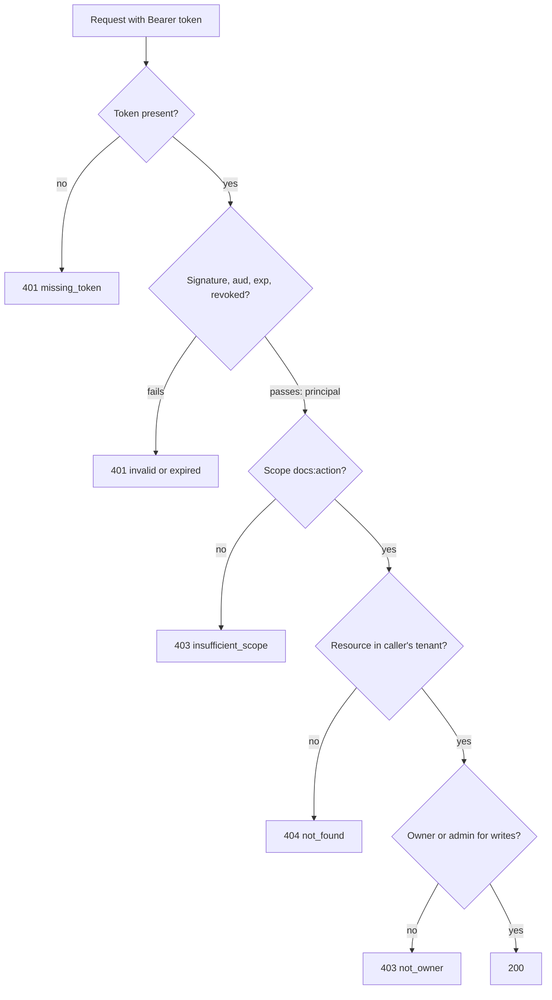

## In one minute
- **Authentication** answers "who is making this request?" and ends in a verified identity. **Authorization** answers "may this identity do this action to this resource, right now?" and ends in allow or deny.
- They fail with different HTTP codes for a reason: `401` means "I don't know who you are, authenticate", `403` means "I know who you are, and no". Hiding a resource you may not see behind `404` is often better still.
- Authentication is expensive and rare (a password hash, an MFA prompt, a redirect to an identity provider), so its result is turned into a cheap credential, a session or a token, that is checked on every request.
- Authorization happens on every request and must look at the specific object. The most common serious API bug is checking that the caller is logged in and forgetting to check that the object is theirs.

## How it works

### Authentication: proving identity
A caller proves identity with one or more factors: something it knows (a password), has (a phone, a hardware key, a private key) or is (a fingerprint). Services prove identity with keys: an mTLS client certificate, a signed JWT from a workload identity system, or a cloud IAM role. Whatever the method, the output is a *principal*: a stable subject ID plus attributes such as tenant, roles and how strongly it was authenticated.

Password guidance changed recently, and many codebases still enforce the old rules. NIST's 2025 revision of SP 800-63B requires passwords used as the only factor to be at least 15 characters, and forbids both composition rules and forced periodic changes. Its highest assurance level, AAL3, requires a phishing-resistant authenticator, and syncable passkeys are allowed at AAL2 but not at AAL3 ([NIST SP 800-63B-4](https://pages.nist.gov/800-63-4/sp800-63b.html)).

Because proving identity is slow and sometimes interactive, systems do it once and issue a credential. A **server-side session** is a random ID in a cookie that maps to state in a store; revoking it is a delete. A **self-contained token**, usually a JWT, carries signed claims (`sub`, `aud`, `exp`, scopes) so any service can verify it without a lookup; revoking it before `exp` needs a denylist or short lifetimes. Most systems combine them: short-lived access tokens (5 to 15 minutes) plus a long-lived refresh token that is checked against a store.

### Authorization: deciding access
Authorization needs four inputs: the principal, the action, the resource, and context (time, IP, device posture). Models differ in what they look at:

- **RBAC** grants permissions to roles and roles to users. Simple to audit, but "editor of *this* document" does not fit well.
- **ABAC** evaluates rules over attributes, such as `user.tenant == doc.tenant and user.clearance >= doc.level`. Flexible, harder to audit.
- **ReBAC** derives access from relationships, such as "Alice is in group Eng, and Eng is a viewer of folder F, which contains doc D". Google's Zanzibar and its open-source descendants work this way.

Two checks are always needed: a coarse one ("does this token carry the `docs:write` scope?") that a gateway can do, and an object-level one ("is this caller the owner of document 812, in the same tenant?") that only code with the data can do. OWASP ranks broken object level authorization as the top API security risk because the second check is so easy to forget, and calls it extremely common in API-based applications ([OWASP API1:2023](https://api-security.owasp.org/editions/2023/en/0xa1-broken-object-level-authorization)).

### Getting the status codes right
RFC 9110 says a `401` response must include a `WWW-Authenticate` header naming how to authenticate, for example `Bearer error="invalid_token"` ([RFC 9110 §15.5.2](https://www.rfc-editor.org/rfc/rfc9110#name-401-unauthorized)). A `403` says the server understood the identity and refuses. When the existence of a resource is itself sensitive, such as another tenant's invoice, return `404` so a caller cannot probe IDs to learn what exists. The same RFC explicitly allows this: a server that wants to hide a resource's existence may answer `404` instead of `403`.

### The problem shape
This is **trust but verify**: every hop decides how much to trust what the previous hop says. The same shape appears with AI agents. An agent acting for a user should authenticate as itself and be authorized with the intersection of its own permissions and the user's, never with a broad service account; otherwise it becomes a confused deputy that a prompt injection can steer toward data the user could never reach.

## Down the stack

### Layer 1: The contract
Authentication promises: if verification succeeds, the claims were issued by the trusted issuer, for this audience, are not expired (within a stated clock skew, often 60 seconds), and have not been revoked as of the last revocation sync. Authorization promises: for a given principal, action, resource and policy version, the decision is deterministic, and it fails closed, so a missing policy or an error in the decision service means deny. The useful precision is about staleness: "a revoked token stops working within 60 seconds" and "a removed permission takes effect within 5 seconds" are testable promises; "immediately" usually is not.

### Layer 2: The mechanism
A JWT is three base64url parts: a header such as `{"alg":"ES256","kid":"2024-07"}`, a payload of claims, and a signature over the first two. Verifiers fetch the issuer's public keys from a JWKS endpoint, cache them by `kid`, and must pin the accepted algorithms: accepting `alg: none`, or letting an attacker switch RS256 to HS256 and sign with the public key as an HMAC secret, are classic bypasses ([RFC 8725 §2.1](https://www.rfc-editor.org/rfc/rfc8725)). Then they check `iss`, `aud`, `exp` and `nbf`, and optionally a `jti` against a denylist. OAuth 2.0 bearer tokens are presented as `Authorization: Bearer <token>` ([RFC 6750](https://www.rfc-editor.org/rfc/rfc6750)).

On the authorization side, the vocabulary is a policy enforcement point (PEP), the code that intercepts the request, and a policy decision point (PDP), the engine that answers allow or deny. Envoy's `ext_authz` filter is a PEP that calls a PDP over gRPC or HTTP and returns `403` on deny; errors from the PDP are let through only if `failure_mode_allow` is set to true, so fail-closed is a configuration choice you must keep ([Envoy docs](https://www.envoyproxy.io/docs/envoy/latest/configuration/http/http_filters/ext_authz_filter)). Open Policy Agent, a CNCF graduated project, is a common PDP that evaluates Rego policies against a JSON `input` document and loaded `data` ([OPA docs](https://www.openpolicyagent.org/docs/latest/)). Zanzibar stores relation tuples written as `object#relation@user`, such as `doc:812#viewer@group:eng#member`, and answers `Check` by walking the graph. To avoid the "new enemy" problem, where a check runs against data older than a recent permission removal, Zanzibar issues *zookies*, opaque consistency tokens that let a client ask for a snapshot at least as fresh as its last change.

### Layer 3: The machine
The costs differ by orders of magnitude, and that drives the architecture. A password check with bcrypt at cost 12 takes around 250 ms of CPU on purpose. OWASP now prefers Argon2id (at least 19 MiB of memory, 2 iterations), which also makes GPU guessing expensive in memory, and keeps bcrypt for legacy systems with a work factor of at least 10 and a 72-byte input limit that silently truncates longer passwords ([OWASP Password Storage](https://cheatsheetseries.owasp.org/cheatsheets/Password_Storage_Cheat_Sheet.html)). Verifying an HMAC-SHA256 token signature takes about a microsecond; an ES256 verification is roughly 50 to 100 microseconds, and RSA-2048 verification about 20 to 30 microseconds because the public exponent is small. A session lookup in Redis is a 0.2 to 0.5 ms network round trip. A JWKS fetch on a cold cache is a TLS connection to the identity provider, tens of milliseconds, which is why keys are cached and refreshed in the background.

Authorization data is a memory and freshness problem. OPA keeps its data in process memory, so a check costs microseconds but every node must receive policy and data bundles. Zanzibar, per its paper, handles millions of checks per second across trillions of ACLs with a 95th-percentile latency under 10 ms and over 99.999% availability ([Pang et al., USENIX ATC 2019](https://www.usenix.org/conference/atc19/presentation/pang)), by caching heavily and using Spanner's timestamps to know which cached answers are still valid.

### Why it's built this way
1. Proving identity is slow and sometimes needs a human, so it happens once and produces a credential.
2. Checking a credential happens on every request, so it must be local and cheap, which favours signed tokens with short lifetimes.
3. Short lifetimes bound how long a stolen or revoked token works, trading a little refresh traffic for revocation without a lookup on every call.
4. Permissions depend on the specific object, which only the owning service has, so object-level checks live in services, while coarse checks can live at the edge.
5. Policies change and must be audited across many services, so decisions move into a shared engine with versioned policy, and enforcement stays local.

## Diagram


## Worked example
A document SaaS serves 12,000 requests per second. Users log in through the company's identity provider; login costs one redirect round trip and about 300 ms, and happens a few times a day per user. The identity provider issues ES256 access tokens valid for 10 minutes and refresh tokens valid for 30 days.

On the hot path the gateway verifies each token: 12,000 x 80 microseconds is about 1 CPU core across the fleet, with no shared store on the critical path. A session design would instead add a 0.3 ms Redis round trip, and a dependency whose outage logs everyone out, to all 12,000 requests per second. Revocation is the price. When an employee is fired, their refresh token is revoked at once, but the access token works for up to 10 more minutes. For admins the team cuts the lifetime to 2 minutes and pushes a `jti` denylist to gateways every 15 seconds.

Then a bug report: a user changed `/docs/812` to `/docs/813` in the URL and read another company's contract. The gateway had correctly checked the `docs:read` scope; the documents service had loaded document 813 by ID without comparing its tenant with the token's. The fix moves the tenant into every data access path, `WHERE id = ? AND tenant_id = ?`, returns `404` on mismatch, and adds a test that runs every endpoint with a token from a second tenant.

## In the wild
- **Facebook, 2018: a preview feature minted other people's tokens.** Three bugs combined inside "View As": the video uploader generated an access token for the profile being *viewed* rather than the viewer, and put it in the page. Attackers harvested tokens and hopped from account to account. About 50 million accounts were affected, about 90 million people were logged out as tokens were reset, and the feature was switched off pending review ([Facebook](https://about.fb.com/news/2018/09/security-update/)).
- **Google, 2020: the identity service lost its storage quota.** A quota migration wrongly read the User ID Service's usage as zero and cut its quota, so its Paxos leader could not write. For 47 minutes every Google account failed to authenticate, Workspace was down and Cloud APIs needing OAuth returned errors. The fix was to guard quota automation against fast global cuts ([Google Cloud](https://status.cloud.google.com/incident/zall/20013)).
- **Google Cloud, 2025: one blank policy row crashed authorization worldwide.** Service Control, which runs policy and quota checks on every API call, hit a null pointer on a replicated policy with blank fields, in a code path with no feature flag, and crash-looped in every region. External APIs returned 503 for hours. Among the follow-ups: make these checks fail open, which is the opposite default from user-data authorization, and a reminder that fail-open versus fail-closed is a per-check decision ([Google Cloud](https://status.cloud.google.com/incidents/ow5i3PPK96RduMcb1SsW)).

## Trade-offs
| Option | Strengths | Weaknesses | Choose when |
|---|---|---|---|
| Server-side session | Instant revocation, small cookie, easy to reason about | Store lookup on every request, shared dependency | Web apps on one domain, strict revocation needs |
| Signed access token (JWT) | Local verification, no shared store on the hot path | Revocation lags up to token lifetime; claims go stale | Many services, high request rates |
| Opaque token plus introspection | Revocable, claims always fresh | Introspection call per request unless cached | Third-party tokens, high-risk APIs |
| Authorization in each service | Uses local data, no extra hop | Logic duplicated and hard to audit | Few services, simple ownership rules |
| Central policy engine (OPA, Zanzibar-style) | One policy language, auditable, consistent | Data distribution, another critical dependency | Many services, sharing, complex permissions |

## Pitfalls in production
- **Authenticated is not authorized.** Endpoints check that a token is valid and then load any object by ID. Scope every query by tenant and owner, and test each endpoint with a second tenant's token.
- **Trusting unverified claims.** Decoding a JWT without verifying the signature, accepting `alg: none`, or skipping the `aud` check lets tokens for another service in. Use a vetted library with a pinned algorithm list and required audience.
- **Long-lived access tokens.** A 24-hour token turns every leaked log line into a day of access. Keep access tokens short and put revocation on refresh.
- **Fail-open authorization.** An exception in the policy client returns allow. Make deny the default path in code and alert on decision errors.
- **Stale permissions in tokens.** Roles baked into a token persist after they are removed. Keep tokens to identity and coarse scopes, and look up fine-grained permissions at decision time.
- **Leaking existence through 403.** Returning 403 for another tenant's object confirms it exists. Return 404 when existence is sensitive.

## Leadership lens
- Ask every design review two separate questions: how does this service know who is calling, and where exactly is the object-level check? Most authorization bugs are missing code, not wrong code.
- Set numeric targets for revocation and permission-change latency and test them; they are what auditors and incident reviews will ask about.
- Decide early whether authorization becomes a platform (a policy engine and relationship store owned by one team) or stays in services, because migrating later touches every endpoint.
- Treat agent and service identities like user identities: their own credentials, least privilege, short lifetimes and audit logs.

## Check yourself
1. A request carries a valid, unexpired token whose `aud` is `billing-api`, sent to `docs-api`. What should `docs-api` return, and why?
   **Answer:** `401`, because the token was not issued for this service; accepting it would let any service that receives a user's token replay it elsewhere.
2. Why can a gateway enforce scopes but not reliably enforce "only the owner may edit"?
   **Answer:** Scopes are in the token, but ownership is a property of the stored object, which only the service that owns the data can load and compare.
3. Access tokens live 10 minutes. A user's account is disabled. How long can they still act, and how would you shorten it?
   **Answer:** Up to 10 minutes on their current access token. Shorten the lifetime, push a denylist of token IDs to verifiers, or use introspection for sensitive operations.
4. When is `404` a better answer than `403`?
   **Answer:** When telling the caller that the resource exists is itself a leak, such as another tenant's records, so probing IDs reveals nothing.

## Practice
**Task:** Build the request guard that separates authentication from authorization. `Guard(audience, clock, verify, resources)` takes the expected audience, a clock returning seconds, a `verify(token)` function that returns verified claims (`sub`, `aud`, `exp`, `tenant`, `scopes`, `roles`, `jti`) or nothing, and a map from resource ID to its `tenant` and `owner`. `revoke(jti)` adds a token ID to a denylist. `decide(token, action, resource_id)` returns `(status, reason)`, stopping at the first failure in this order: empty token `(401, "missing_token")`; verify fails `(401, "invalid_token")`; wrong audience `(401, "wrong_audience")`; `now >= exp` `(401, "expired")`; revoked `jti` `(401, "revoked")`; scope `"docs:" + action` missing `(403, "insufficient_scope")`; resource unknown or in another tenant `(404, "not_found")`; action `write` or `delete` by someone who is neither the owner nor holds role `admin` `(403, "not_owner")`; otherwise `(200, "ok")`.

```python starter
class Guard:
    def __init__(self, audience, clock, verify, resources):
        self.audience = audience

    def revoke(self, jti):
        # TODO
        raise NotImplementedError

    def decide(self, token, action, resource_id):
        # TODO: return (status, reason)
        raise NotImplementedError
```

```python tests
def claims(sub, tenant, scopes, roles=(), aud="docs-api", exp=1000, jti=None):
    return {"sub": sub, "aud": aud, "exp": exp, "tenant": tenant,
            "scopes": list(scopes), "roles": list(roles), "jti": jti or sub + "-1"}

TOKENS = {
    "alice": claims("alice", "acme", ["docs:read", "docs:write"]),
    "bob": claims("bob", "acme", ["docs:read", "docs:write", "docs:delete"], ["admin"]),
    "carol": claims("carol", "globex", ["docs:read", "docs:write"]),
    "reader": claims("dan", "acme", ["docs:read"]),
    "billing": claims("alice", "acme", ["docs:read"], aud="billing-api"),
    "old": claims("alice", "acme", ["docs:read"], exp=100),
    "eve": claims("eve", "acme", ["docs:read", "docs:write"]),
}
RESOURCES = {"d1": {"tenant": "acme", "owner": "alice"}, "d2": {"tenant": "globex", "owner": "carol"}}

def make(now=500):
    t = {"now": now}
    g = Guard("docs-api", lambda: t["now"], lambda tok: TOKENS.get(tok), RESOURCES)
    return g, t

def test_authentication_failures_are_401():
    g, _ = make()
    assert g.decide("", "read", "d1") == (401, "missing_token")
    assert g.decide("forged", "read", "d1") == (401, "invalid_token")
    assert g.decide("billing", "read", "d1") == (401, "wrong_audience")
    assert g.decide("old", "read", "d1") == (401, "expired")

def test_expiry_boundary_uses_clock():
    g, t = make(999)
    assert g.decide("alice", "read", "d1") == (200, "ok")
    t["now"] = 1000
    assert g.decide("alice", "read", "d1") == (401, "expired")

def test_revoked_token():
    g, _ = make()
    g.revoke("alice-1")
    assert g.decide("alice", "read", "d1") == (401, "revoked")
    assert g.decide("bob", "read", "d1") == (200, "ok")

def test_missing_scope_is_403():
    g, _ = make()
    assert g.decide("reader", "write", "d1") == (403, "insufficient_scope")
    assert g.decide("alice", "delete", "d1") == (403, "insufficient_scope")

def test_other_tenant_or_unknown_is_404():
    g, _ = make()
    assert g.decide("carol", "read", "d1") == (404, "not_found")
    assert g.decide("alice", "read", "d2") == (404, "not_found")
    assert g.decide("alice", "read", "nope") == (404, "not_found")

def test_ownership_for_writes():
    g, _ = make()
    assert g.decide("reader", "read", "d1") == (200, "ok"), "reads only need tenant"
    assert g.decide("alice", "write", "d1") == (200, "ok")
    assert g.decide("carol", "write", "d2") == (200, "ok")
    assert g.decide("bob", "delete", "d1") == (200, "ok"), "admin may delete"

def test_non_owner_write_is_403():
    g, _ = make()
    assert g.decide("eve", "write", "d1") == (403, "not_owner")
```

```python solution
class Guard:
    def __init__(self, audience, clock, verify, resources):
        self.audience = audience
        self.clock = clock
        self.verify = verify
        self.resources = resources
        self.revoked = set()

    def revoke(self, jti):
        self.revoked.add(jti)

    def decide(self, token, action, resource_id):
        # Authentication: who is calling?
        if not token:
            return (401, "missing_token")
        c = self.verify(token)
        if c is None:
            return (401, "invalid_token")
        if c["aud"] != self.audience:
            return (401, "wrong_audience")
        if self.clock() >= c["exp"]:
            return (401, "expired")
        if c["jti"] in self.revoked:
            return (401, "revoked")
        # Authorization: may they do this to this object?
        if "docs:" + action not in c["scopes"]:
            return (403, "insufficient_scope")
        res = self.resources.get(resource_id)
        if res is None or res["tenant"] != c["tenant"]:
            return (404, "not_found")
        if action in ("write", "delete"):
            if c["sub"] != res["owner"] and "admin" not in c["roles"]:
                return (403, "not_owner")
        return (200, "ok")
```

```typescript starter
export interface Claims {
  sub: string;
  aud: string;
  exp: number;
  tenant: string;
  scopes: string[];
  roles: string[];
  jti: string;
}

export interface Resource {
  tenant: string;
  owner: string;
}

export class Guard {
  constructor(
    private audience: string,
    private clock: () => number,
    private verify: (token: string) => Claims | null,
    private resources: Record<string, Resource>,
  ) {}
  revoke(jti: string): void {
    throw new Error("TODO");
  }
  decide(token: string, action: string, resourceId: string): [number, string] {
    throw new Error("TODO");
  }
}
```

```typescript tests
function claims(sub: string, tenant: string, scopes: string[], roles: string[] = [], aud = "docs-api", exp = 1000): Claims {
  return { sub, aud, exp, tenant, scopes, roles, jti: sub + "-1" };
}
const TOKENS: Record<string, Claims> = {
  alice: claims("alice", "acme", ["docs:read", "docs:write"]),
  bob: claims("bob", "acme", ["docs:read", "docs:write", "docs:delete"], ["admin"]),
  carol: claims("carol", "globex", ["docs:read", "docs:write"]),
  reader: claims("dan", "acme", ["docs:read"]),
  billing: claims("alice", "acme", ["docs:read"], [], "billing-api"),
  old: claims("alice", "acme", ["docs:read"], [], "docs-api", 100),
  eve: claims("eve", "acme", ["docs:read", "docs:write"]),
};
const RESOURCES: Record<string, Resource> = {
  d1: { tenant: "acme", owner: "alice" },
  d2: { tenant: "globex", owner: "carol" },
};
function make(now = 500): { g: Guard; t: { now: number } } {
  const t = { now };
  const g = new Guard("docs-api", () => t.now, (tok) => (Object.prototype.hasOwnProperty.call(TOKENS, tok) ? TOKENS[tok] : null), RESOURCES);
  return { g, t };
}

test("authentication failures are 401", () => {
  const { g } = make();
  assertEqual(g.decide("", "read", "d1"), [401, "missing_token"]);
  assertEqual(g.decide("forged", "read", "d1"), [401, "invalid_token"]);
  assertEqual(g.decide("billing", "read", "d1"), [401, "wrong_audience"]);
  assertEqual(g.decide("old", "read", "d1"), [401, "expired"]);
});
test("expiry boundary uses clock", () => {
  const { g, t } = make(999);
  assertEqual(g.decide("alice", "read", "d1"), [200, "ok"]);
  t.now = 1000;
  assertEqual(g.decide("alice", "read", "d1"), [401, "expired"]);
});
test("revoked token", () => {
  const { g } = make();
  g.revoke("alice-1");
  assertEqual(g.decide("alice", "read", "d1"), [401, "revoked"]);
  assertEqual(g.decide("bob", "read", "d1"), [200, "ok"]);
});
test("missing scope is 403", () => {
  const { g } = make();
  assertEqual(g.decide("reader", "write", "d1"), [403, "insufficient_scope"]);
  assertEqual(g.decide("alice", "delete", "d1"), [403, "insufficient_scope"]);
});
test("other tenant or unknown is 404", () => {
  const { g } = make();
  assertEqual(g.decide("carol", "read", "d1"), [404, "not_found"]);
  assertEqual(g.decide("alice", "read", "d2"), [404, "not_found"]);
  assertEqual(g.decide("alice", "read", "nope"), [404, "not_found"]);
});
test("ownership for writes", () => {
  const { g } = make();
  assertEqual(g.decide("reader", "read", "d1"), [200, "ok"], "reads only need tenant");
  assertEqual(g.decide("alice", "write", "d1"), [200, "ok"]);
  assertEqual(g.decide("carol", "write", "d2"), [200, "ok"]);
  assertEqual(g.decide("bob", "delete", "d1"), [200, "ok"], "admin may delete");
});
test("non owner write is 403", () => {
  const { g } = make();
  assertEqual(g.decide("eve", "write", "d1"), [403, "not_owner"]);
});
```

```typescript solution
export interface Claims {
  sub: string;
  aud: string;
  exp: number;
  tenant: string;
  scopes: string[];
  roles: string[];
  jti: string;
}

export interface Resource {
  tenant: string;
  owner: string;
}

export class Guard {
  private revoked = new Set<string>();

  constructor(
    private audience: string,
    private clock: () => number,
    private verify: (token: string) => Claims | null,
    private resources: Record<string, Resource>,
  ) {}

  revoke(jti: string): void {
    this.revoked.add(jti);
  }

  decide(token: string, action: string, resourceId: string): [number, string] {
    if (!token) return [401, "missing_token"];
    const c = this.verify(token);
    if (c === null) return [401, "invalid_token"];
    if (c.aud !== this.audience) return [401, "wrong_audience"];
    if (this.clock() >= c.exp) return [401, "expired"];
    if (this.revoked.has(c.jti)) return [401, "revoked"];
    if (!c.scopes.includes("docs:" + action)) return [403, "insufficient_scope"];
    const res = Object.prototype.hasOwnProperty.call(this.resources, resourceId) ? this.resources[resourceId] : undefined;
    if (res === undefined || res.tenant !== c.tenant) return [404, "not_found"];
    if ((action === "write" || action === "delete") && c.sub !== res.owner && !c.roles.includes("admin")) {
      return [403, "not_owner"];
    }
    return [200, "ok"];
  }
}
```

```go starter
package practice

type Claims struct {
	Sub    string
	Aud    string
	Exp    int64
	Tenant string
	Scopes []string
	Roles  []string
	Jti    string
}

type Resource struct {
	Tenant string
	Owner  string
}

type Guard struct{}

func NewGuard(audience string, clock func() int64, verify func(string) (Claims, bool), resources map[string]Resource) *Guard {
	return &Guard{}
}

func (g *Guard) Revoke(jti string) { panic("TODO") }

func (g *Guard) Decide(token, action, resourceID string) (int, string) { panic("TODO") }
```

```go tests
package practice

import "testing"

func cl(sub, tenant string, scopes, roles []string, aud string, exp int64) Claims {
	return Claims{Sub: sub, Aud: aud, Exp: exp, Tenant: tenant, Scopes: scopes, Roles: roles, Jti: sub + "-1"}
}

var tokens = map[string]Claims{
	"alice":   cl("alice", "acme", []string{"docs:read", "docs:write"}, nil, "docs-api", 1000),
	"bob":     cl("bob", "acme", []string{"docs:read", "docs:write", "docs:delete"}, []string{"admin"}, "docs-api", 1000),
	"carol":   cl("carol", "globex", []string{"docs:read", "docs:write"}, nil, "docs-api", 1000),
	"reader":  cl("dan", "acme", []string{"docs:read"}, nil, "docs-api", 1000),
	"billing": cl("alice", "acme", []string{"docs:read"}, nil, "billing-api", 1000),
	"old":     cl("alice", "acme", []string{"docs:read"}, nil, "docs-api", 100),
	"eve":     cl("eve", "acme", []string{"docs:read", "docs:write"}, nil, "docs-api", 1000),
}

var resources = map[string]Resource{
	"d1": {Tenant: "acme", Owner: "alice"},
	"d2": {Tenant: "globex", Owner: "carol"},
}

func make_(now *int64) *Guard {
	return NewGuard("docs-api", func() int64 { return *now }, func(tok string) (Claims, bool) {
		c, ok := tokens[tok]
		return c, ok
	}, resources)
}

func expect(t *testing.T, g *Guard, tok, action, res string, status int, reason string) {
	t.Helper()
	s, r := g.Decide(tok, action, res)
	if s != status || r != reason {
		t.Fatalf("Decide(%q,%q,%q) = %d %q, want %d %q", tok, action, res, s, r, status, reason)
	}
}

func TestAuthenticationFailuresAre401(t *testing.T) {
	now := int64(500)
	g := make_(&now)
	expect(t, g, "", "read", "d1", 401, "missing_token")
	expect(t, g, "forged", "read", "d1", 401, "invalid_token")
	expect(t, g, "billing", "read", "d1", 401, "wrong_audience")
	expect(t, g, "old", "read", "d1", 401, "expired")
}

func TestExpiryBoundaryUsesClock(t *testing.T) {
	now := int64(999)
	g := make_(&now)
	expect(t, g, "alice", "read", "d1", 200, "ok")
	now = 1000
	expect(t, g, "alice", "read", "d1", 401, "expired")
}

func TestRevokedToken(t *testing.T) {
	now := int64(500)
	g := make_(&now)
	g.Revoke("alice-1")
	expect(t, g, "alice", "read", "d1", 401, "revoked")
	expect(t, g, "bob", "read", "d1", 200, "ok")
}

func TestMissingScopeIs403(t *testing.T) {
	now := int64(500)
	g := make_(&now)
	expect(t, g, "reader", "write", "d1", 403, "insufficient_scope")
	expect(t, g, "alice", "delete", "d1", 403, "insufficient_scope")
}

func TestOtherTenantOrUnknownIs404(t *testing.T) {
	now := int64(500)
	g := make_(&now)
	expect(t, g, "carol", "read", "d1", 404, "not_found")
	expect(t, g, "alice", "read", "d2", 404, "not_found")
	expect(t, g, "alice", "read", "nope", 404, "not_found")
}

func TestOwnershipForWrites(t *testing.T) {
	now := int64(500)
	g := make_(&now)
	expect(t, g, "reader", "read", "d1", 200, "ok")
	expect(t, g, "alice", "write", "d1", 200, "ok")
	expect(t, g, "carol", "write", "d2", 200, "ok")
	expect(t, g, "bob", "delete", "d1", 200, "ok")
}

func TestNonOwnerWriteIs403(t *testing.T) {
	now := int64(500)
	g := make_(&now)
	expect(t, g, "eve", "write", "d1", 403, "not_owner")
}
```

```go solution
package practice

import "sync"

type Claims struct {
	Sub    string
	Aud    string
	Exp    int64
	Tenant string
	Scopes []string
	Roles  []string
	Jti    string
}

type Resource struct {
	Tenant string
	Owner  string
}

type Guard struct {
	mu        sync.Mutex
	audience  string
	clock     func() int64
	verify    func(string) (Claims, bool)
	resources map[string]Resource
	revoked   map[string]bool
}

func NewGuard(audience string, clock func() int64, verify func(string) (Claims, bool), resources map[string]Resource) *Guard {
	return &Guard{audience: audience, clock: clock, verify: verify, resources: resources, revoked: map[string]bool{}}
}

func (g *Guard) Revoke(jti string) {
	g.mu.Lock()
	defer g.mu.Unlock()
	g.revoked[jti] = true
}

func contains(xs []string, x string) bool {
	for _, v := range xs {
		if v == x {
			return true
		}
	}
	return false
}

func (g *Guard) Decide(token, action, resourceID string) (int, string) {
	if token == "" {
		return 401, "missing_token"
	}
	c, ok := g.verify(token)
	if !ok {
		return 401, "invalid_token"
	}
	if c.Aud != g.audience {
		return 401, "wrong_audience"
	}
	if g.clock() >= c.Exp {
		return 401, "expired"
	}
	g.mu.Lock()
	revoked := g.revoked[c.Jti]
	g.mu.Unlock()
	if revoked {
		return 401, "revoked"
	}
	if !contains(c.Scopes, "docs:"+action) {
		return 403, "insufficient_scope"
	}
	res, ok := g.resources[resourceID]
	if !ok || res.Tenant != c.Tenant {
		return 404, "not_found"
	}
	if (action == "write" || action == "delete") && c.Sub != res.Owner && !contains(c.Roles, "admin") {
		return 403, "not_owner"
	}
	return 200, "ok"
}
```

## Mock interview
**Prompt:** Design authentication and authorization for a multi-tenant document platform with 2 million users across 8,000 companies, 15 backend services and 20,000 requests per second. Documents can be shared with individual users, groups and whole companies, and an AI assistant can read and edit documents on a user's behalf.

- Follow-up: An employee is removed from a sharing group. How quickly does access stop, and what in your design determines that?
- Follow-up: A penetration tester reads another tenant's document by changing an ID. Where was the missing check, and how do you prevent the whole class of bug?
- Follow-up: How is the AI assistant authenticated and authorized, and what stops it reading documents the user cannot?

**A strong answer covers:**
- A clear split: an identity provider and short-lived tokens for authentication; a policy or relationship service for authorization.
- Token verification at the edge and in services with pinned algorithms, audience checks, short lifetimes and a revocation path.
- Object-level checks in every service, tenant scoping in every query, and a cross-tenant test suite.
- A relationship model for sharing (users, groups, folders) with stated consistency, such as zookie-style freshness after permission changes.
- Delegated, least-privilege credentials for the assistant, scoped to the intersection of its and the user's permissions, with audit logs.

## Sources and further study
**Primary**
- [RFC 9110: HTTP Semantics, §15.5](https://www.rfc-editor.org/rfc/rfc9110#name-client-error-4xx): the exact meaning of `401`, `403` and `404`, including hiding a resource behind `404`.
- [RFC 8725: JWT Best Current Practices](https://www.rfc-editor.org/rfc/rfc8725): algorithm pinning, audience checks and explicit typing; an update (draft-ietf-oauth-rfc8725bis) is with the IESG.
- [RFC 6750: OAuth 2.0 Bearer Token Usage](https://www.rfc-editor.org/rfc/rfc6750): the `Bearer` scheme and the `invalid_token` and `insufficient_scope` error codes.

**Systems docs**
- [Open Policy Agent documentation](https://www.openpolicyagent.org/docs/latest/): decoupling policy decisions from enforcement, with Rego.
- [Envoy: External Authorization filter](https://www.envoyproxy.io/docs/envoy/latest/configuration/http/http_filters/ext_authz_filter): a PEP in a proxy, and the `failure_mode_allow` switch.

**Books**
- *Building Secure and Reliable Systems*, Adkins et al. (Google, 2020), Ch 5 "Design for Least Privilege": includes a policy framework for authentication and authorization decisions ([read free](https://google.github.io/building-secure-and-reliable-systems/raw/ch05.html)).
- *Building Microservices* (2nd ed.), Sam Newman, Ch 11 "Security": service-to-service and human authentication, the confused deputy problem, and centralized versus decentralized authorization.
- *Release It!* (2nd ed.), Michael Nygard, Ch 11 "Security": the OWASP Top 10 and least privilege from an operations view.

**Other curricula**
- [donnemartin/system-design-primer](https://github.com/donnemartin/system-design-primer): treats auth only as "keep sessions in a central store so web servers stay stateless"; it does not cover authorization models.
- [Azure Architecture Center: Gatekeeper pattern](https://learn.microsoft.com/en-us/azure/architecture/patterns/gatekeeper): frames the coarse edge check as a separate, low-privilege broker in front of trusted hosts.
- [OWASP Password Storage Cheat Sheet](https://cheatsheetseries.owasp.org/cheatsheets/Password_Storage_Cheat_Sheet.html): current hashing algorithms and parameters for the authentication step.

## Watch
- [Session vs Token Authentication in 100 Seconds (Fireship)](https://www.youtube.com/watch?v=UBUNrFtufWo): the two ways to carry an authenticated identity, side by side.
- [OAuth 2.0 and OpenID Connect (in plain English) (OktaDev)](https://www.youtube.com/watch?v=996OiexHze0): where delegated authorization ends and authentication with OIDC begins.

## Free resources
- [OWASP Authentication Cheat Sheet](https://cheatsheetseries.owasp.org/cheatsheets/Authentication_Cheat_Sheet.html): practical rules for logins, MFA, error messages and session handling.
- [OWASP Authorization Cheat Sheet](https://cheatsheetseries.owasp.org/cheatsheets/Authorization_Cheat_Sheet.html): deny by default, least privilege and checking on every request.
- [API1:2023 Broken Object Level Authorization (OWASP)](https://owasp.org/API-Security/editions/2023/en/0xa1-broken-object-level-authorization/): the most common API flaw, with attack scenarios and prevention.
- [RFC 7519: JSON Web Token](https://www.rfc-editor.org/rfc/rfc7519): the claims (`iss`, `aud`, `exp`, `jti`) and how they are meant to be validated.
- [Zanzibar: Google's Consistent, Global Authorization System (USENIX ATC 2019)](https://www.usenix.org/conference/atc19/presentation/pang): relationship-based authorization at planet scale and the new enemy problem.
- [NIST SP 800-63B-4 Digital Identity Guidelines (2025)](https://pages.nist.gov/800-63-4/sp800-63b.html): authenticator types, assurance levels and modern password rules; replaces the 800-63-3 edition.
