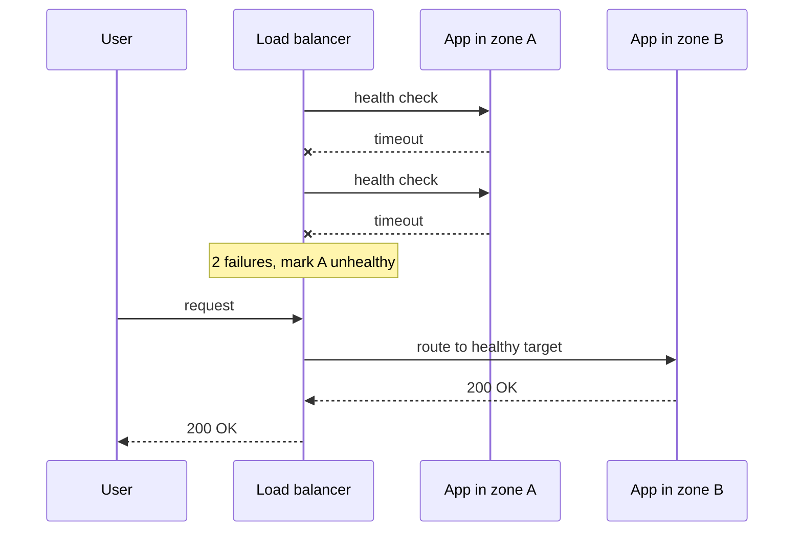

## In one minute
- Availability is the fraction of time, or of requests, for which a system does its job for its users. It is measured from the user's side, not from the server's uptime.
- Each extra "nine" cuts allowed downtime tenfold: 99.9% allows 43 minutes a month, 99.99% about 4 minutes. Every nine costs more than the last.
- Components in series multiply their availabilities, so every dependency on the critical path lowers the ceiling. Redundant components in parallel raise it, but only if their failures are independent.
- Most downtime is detection plus failover time, so fast, correct failure detection matters as much as spare capacity.
- The cheapest nine is often removing a dependency from the request path, not adding a replica.

## How it works

### Defining and measuring it
The classic formula is time-based: uptime divided by total time. It hides a lot. A service that fails 2% of requests all month is "up" by a ping check and broken for users. Most modern teams use a request-based measure instead: successful requests divided by valid requests over a window, where "successful" includes a latency limit (a checkout that takes 30 seconds is not a success). Google's SRE practice calls this the service level indicator, and the target for it the SLO; Google measures most services by request success rate rather than uptime ([SRE book, Ch 3](https://sre.google/sre-book/embracing-risk/)).

The time-based view still explains what to improve. Availability equals MTBF / (MTBF + MTTR): mean time between failures over that plus mean time to repair. Repair time includes detection time (MTTD), so there are three levers: fail less often, notice sooner, and recover faster ([AWS, Availability and Beyond](https://docs.aws.amazon.com/whitepapers/latest/availability-and-beyond-improving-resilience/understanding-availability.html)). A service that fails once a month and takes 20 minutes to recover sits near 99.95%. Halving the recovery time buys as much as halving the failure rate.

Where you measure changes the number. Server logs miss requests that never arrived because DNS or the load balancer failed, so combine load balancer metrics with synthetic probes from outside.

### The nines

| Availability | Downtime per year | Downtime per 30 days |
|---|---|---|
| 99% | 3.65 days | 7.2 hours |
| 99.9% | 8.76 hours | 43.2 minutes |
| 99.99% | 52.6 minutes | 4.3 minutes |
| 99.999% | 5.3 minutes | 26 seconds |

At four nines, a single incident that takes 5 minutes to notice and 10 minutes to fix spends more than three months of budget. That is why high targets force automation: humans cannot be paged, log in and act inside a 4-minute monthly budget.

### Composition
If a request needs A and B and both must work, availability is `A × B`. Five dependencies at 99.9% each give about 99.5%, well below any one of them. If a request can be served by either of two independent replicas, availability is `1 − (1 − A)(1 − B)`: two 99% replicas give 99.99%. Quorum systems need k of n replicas up, which is a binomial sum. A 2-of-3 group of 99% nodes is up 99.97% of the time.

The word that matters is *independent*. Azure's guidance spells out what the parallel formula `1 − (1 − A)^N` silently assumes: copies fail independently, hold identical or no state, lose no work in progress, and the survivors absorb the load without failing themselves ([Azure Architecture Center](https://learn.microsoft.com/en-us/azure/architecture/guide/design-principles/redundancy)). Replicas on the same rack, the same power feed, the same deploy pipeline or the same expired certificate fail together, and then the parallel formula is fiction. Real redundancy is placed across failure domains: hosts, racks, availability zones and regions, with deploys staggered so one bad release cannot reach all copies at once.

### Redundancy patterns
- **Active-passive:** a standby takes over when the primary fails. Simple and consistent, but the standby may be cold, and failover takes seconds to minutes.
- **Active-active:** all copies serve traffic, so losing one just shifts load. Needs spare capacity on survivors and a story for writes that land in two places.
- **N+1 and N+2:** provision one or two units beyond peak need, so a failure (or a failure during maintenance) does not overload the rest.
- **Static stability:** survivors already have the capacity and data they need, so the system rides out a zone loss without making any control-plane calls. AWS describes this as pre-provisioning so that a failure does not require new action ([AWS Builders' Library](https://aws.amazon.com/builders-library/static-stability-using-availability-zones/)).

### Degrade instead of fail
A product page can render without recommendations or reviews. Timeouts, fallbacks and flags that switch off non-critical calls keep the core path up when a dependency is down. This is the **partial failure** shape: ask what still works when one part is not. A ride-hailing app shows a coarse ETA when the ETA service is down; an AI assistant answers without retrieval when the vector store times out, and says its answer is not grounded.

Availability also trades against consistency. During a network partition, a system that refuses writes on the minority side stays correct but unavailable there; one that accepts them stays available but must reconcile later. The Network Partitions and Consistency Models lessons go deeper.

## Down the stack

### Layer 1: The contract
A usable availability contract names the indicator, the target, the window and the consequence: "99.95% of valid API requests in each calendar month return a non-5xx response within 1 second, measured at the load balancer; below that, customers receive a 10% service credit." Cloud SLAs usually exclude scheduled maintenance and customer-caused errors. The internal SLO is set tighter than the external SLA, so the team reacts before the contract is breached.

### Layer 2: The mechanism
Availability is delivered by detection and rerouting. An AWS Application Load Balancer target group checks every 30 seconds by default and marks a target unhealthy after 2 consecutive failures, so detection can take a minute. If every target fails at once, the ALB fails open and sends traffic to all of them, so a health check that breaks everywhere at once cannot by itself take the service down ([AWS ALB docs](https://docs.aws.amazon.com/elasticloadbalancing/latest/application/target-group-health-checks.html)). Envoy's passive outlier detection ejects a host after 5 consecutive 5xx responses for a base of 30 seconds, and caps ejection at 10% of hosts so a bad signal cannot empty the pool ([Envoy docs](https://www.envoyproxy.io/docs/envoy/latest/api-v3/config/cluster/v3/outlier_detection.proto)). Route 53 marks an endpoint unhealthy once it fails a set number of consecutive checks and 18% or fewer of its checkers around the world still see it healthy, a rule meant to stop one isolated checker region from failing a healthy endpoint ([Route 53 docs](https://docs.aws.amazon.com/Route53/latest/DeveloperGuide/dns-failover-determining-health-of-endpoints.html)); clients must then expire their cached answer. For databases, Patroni holds a leader key in etcd with a TTL (30 seconds by default, renewed every 10-second loop) ([Patroni docs](https://patroni.readthedocs.io/en/latest/dynamic_configuration.html)); if the primary stops renewing it, a replica takes the key and promotes itself. VRRP (keepalived) moves a virtual IP to a backup router after about three missed one-second advertisements, plus a small skew that depends on priority ([RFC 5798](https://www.rfc-editor.org/rfc/rfc5798.html)).

### Layer 3: The machine
The slowest detector is often the kernel. An established TCP connection to a peer that vanished, with no data in flight and default keepalive settings, waits 7,200 seconds before the first keepalive probe. With data in flight, Linux retransmits with exponential backoff and the default `tcp_retries2 = 15` gives up only after at least 924.6 seconds, about 15 minutes ([kernel docs](https://docs.kernel.org/networking/ip-sysctl.html)). A client without its own timeout can therefore hang far longer than any failover takes. Moving a virtual IP relies on gratuitous ARP so switches update their tables within milliseconds. DNS failover is bounded by TTLs, and some resolvers and runtimes cache answers longer than the TTL says. Finally, a standby that has never served traffic has cold caches: a database whose 200 GB working set lives in the page cache can be up but serve 10x slower for minutes after promotion.

### Why it's built this way
1. Hardware, software and operators all fail, so no single component can be trusted for long enough to promise four nines.
2. Redundancy only helps if copies fail independently, so copies are spread across failure domains.
3. Redundant copies are useless until traffic moves, so detection and rerouting are automated with health checks, leases and virtual IPs.
4. Detection too eager causes needless failovers and flapping, so checks use consecutive-failure thresholds and ejection caps, which trades a little detection time for stability.
5. Each nine costs roughly an order of magnitude more effort, so targets are set by what users and the business need, not by what sounds impressive.

## Diagram


## Worked example
A checkout path calls a CDN (99.99%), a load balancer (99.99%), an app tier of three instances each up 99.5%, a Postgres primary with automatic failover (99.95%), and a third-party payment API (99.9%). The app tier in parallel is 1 − 0.005³, effectively 100%. The chain multiplies to about 99.83%, or 73 minutes of downtime a month. The payment API alone accounts for more than half of it.

Adding a fourth app instance changes nothing visible. Moving payment authorization off the synchronous path does: the checkout writes an order with status `pending` to a durable queue (99.99%) and confirms to the user, and a worker charges the card with retries. The chain becomes about 99.92%, or 35 minutes a month, and payment outages now delay confirmation emails instead of losing sales. The next nine would come from the database: multi-zone synchronous standbys and a tested failover under 30 seconds.

## In the wild
- **GitHub, 2018: a 43-second partition and a failover that made it worse.** Network maintenance cut the US East hub off from the primary data center for 43 seconds. Orchestrator used Raft to promote West Coast MySQL primaries, writes then landed on both coasts, and a clean failback was impossible. GitHub restored from backups and replayed data, and the site was degraded for 24 hours 11 minutes, with one cluster holding 954 writes that had never replicated. GitHub planned to stop Orchestrator promoting primaries across regions ([GitHub](https://github.blog/news-insights/company-news/oct21-post-incident-analysis/)).
- **Datadog, 2023: "isolated" regions with a shared update window.** An automatic security update restarted systemd-networkd on Ubuntu 22.04, which deleted the routes the Cilium network plugin had installed. A legacy update channel used the same 06:00 to 07:00 UTC window everywhere, so tens of thousands of nodes in five otherwise independent regions went offline within an hour, and full recovery took about 48 hours. Datadog disabled the channel and stopped networkd from touching those routes ([Datadog](https://www.datadoghq.com/blog/2023-03-08-multiregion-infrastructure-connectivity-issue/)).
- **AWS, 2025: one dependency, many services.** A race in DynamoDB's DNS automation left the us-east-1 endpoint with an empty record, and DynamoDB errors lasted about 2 hours 52 minutes. EC2's lease manager depended on DynamoDB and fell into congestive collapse, and load balancer health checks then removed healthy capacity, so the whole event ran about 14.5 hours. AWS added velocity limits to health-check failover and queue-based throttling in EC2 ([AWS](https://aws.amazon.com/message/101925/)).

## Trade-offs
| Option | Strengths | Weaknesses | Choose when |
|---|---|---|---|
| Single instance plus fast restore | Cheap, simple | Minutes to hours of downtime | Internal tools, batch jobs |
| Active-passive | Simple consistency, one writer | Failover gap, idle standby | Stateful stores with a single writer |
| Active-active in one region | No failover gap for stateless tiers | Needs N+1 capacity | Most web and API tiers |
| Multi-region active-active | Survives a region loss | Write conflicts, high cost and complexity | Revenue-critical global services |
| Graceful degradation | Core path survives dependency loss | More code paths to test | Many optional dependencies |

## Pitfalls in production
- **Correlated failures.** Three replicas share one deploy, one config push or one certificate. Stagger rollouts by zone and treat config like code with canaries.
- **Health checks that lie.** A `/health` endpoint returns 200 while the database pool is exhausted, or checks a dependency so deeply that one slow database ejects every host at once. Check what the instance itself needs, and cap ejection.
- **Untested failover.** The standby has drifted, the runbook is stale, and the first failover in a year takes an hour. Fail over on purpose, regularly, during working hours.
- **No headroom on survivors.** Two zones at 70% each cannot absorb a third zone's load. Plan capacity for N−1 zones.
- **Automatic failback.** The primary region recovers, traffic flips back on its own, and it flips again when the half-healthy region fails its next check. Automate failover but fail back by hand, after checking every subsystem and the data ([Azure Architecture Center](https://learn.microsoft.com/en-us/azure/architecture/guide/design-principles/redundancy)).
- **Missing client timeouts.** A dead dependency holds threads until the kernel gives up after minutes, and the caller goes down too. Set timeouts on every network call.

## Leadership lens
- Ask which user journeys need which target; one number for the whole product either overspends on admin pages or underserves checkout.
- Every dependency added to a critical path lowers its availability ceiling. Make teams justify synchronous dependencies in design review.
- Fund failover drills and game days as recurring work; untested redundancy is a cost with no proven benefit.
- An extra nine roughly multiplies engineering and infrastructure cost. Tie the target to revenue at risk per minute.

## Check yourself
1. A service depends on six internal services, each at 99.95%. What is its best possible availability, and what does that imply?
   **Answer:** About 0.9995⁶ ≈ 99.7%. It cannot promise 99.9% unless it removes dependencies from the path, makes some optional, or gets them to higher targets.
2. Why can two replicas in the same availability zone give far less than the parallel formula predicts?
   **Answer:** The formula assumes independent failures. A zone outage, shared power or a shared bad deploy takes both down together.
3. When does a 2-of-3 quorum have lower availability than a single node?
   **Answer:** When each node's availability is below 50%. Requiring a majority then makes the group less likely to be up than one node, which is why quorums need individually reliable members.

## Practice
**Task:** Build an availability calculator. `serial(avails)` returns the availability of components that must all work (an empty list gives 1.0). `parallel(avails)` returns the availability of independent replicas where any one is enough (an empty list gives 0.0). `k_of_n(a, k, n)` returns the probability that at least `k` of `n` independent replicas, each up with probability `a`, are up (return 1.0 if `k <= 0` and 0.0 if `k > n`). `downtime_minutes(a, days)` returns the allowed downtime in minutes over `days` days.

```python starter
def serial(avails):
    # TODO
    raise NotImplementedError

def parallel(avails):
    # TODO
    raise NotImplementedError

def k_of_n(a, k, n):
    # TODO
    raise NotImplementedError

def downtime_minutes(a, days):
    # TODO
    raise NotImplementedError
```

```python tests
def test_serial_multiplies():
    assert round(serial([0.999, 0.999]), 6) == 0.998001
    assert serial([]) == 1.0

def test_parallel_complements():
    assert round(parallel([0.99, 0.99]), 6) == 0.9999
    assert parallel([]) == 0.0

def test_quorum():
    assert round(k_of_n(0.99, 2, 3), 6) == 0.999702
    assert round(k_of_n(0.9, 2, 3), 6) == 0.972

def test_quorum_edges():
    assert k_of_n(0.9, 0, 3) == 1.0
    assert k_of_n(0.9, 4, 3) == 0.0
    assert round(k_of_n(0.9, 1, 1), 6) == 0.9

def test_bad_nodes_make_quorum_worse():
    assert k_of_n(0.4, 2, 3) < 0.4, "majority of unreliable nodes is worse than one"

def test_downtime_budget():
    assert round(downtime_minutes(0.999, 30), 6) == 43.2
    assert round(downtime_minutes(0.9999, 365), 2) == 52.56
```

```python solution
from math import comb

def serial(avails):
    result = 1.0
    for a in avails:
        result *= a
    return result

def parallel(avails):
    down = 1.0
    for a in avails:
        down *= 1 - a
    return 1 - down

def k_of_n(a, k, n):
    if k <= 0:
        return 1.0
    if k > n:
        return 0.0
    return sum(comb(n, i) * a ** i * (1 - a) ** (n - i) for i in range(k, n + 1))

def downtime_minutes(a, days):
    return (1 - a) * days * 24 * 60
```

```typescript starter
export function serial(avails: number[]): number { throw new Error("TODO"); }
export function parallel(avails: number[]): number { throw new Error("TODO"); }
export function kOfN(a: number, k: number, n: number): number { throw new Error("TODO"); }
export function downtimeMinutes(a: number, days: number): number { throw new Error("TODO"); }
```

```typescript tests
const r = (x: number, d: number) => Math.round(x * 10 ** d) / 10 ** d;
test("serial multiplies", () => {
  assertEqual(r(serial([0.999, 0.999]), 6), 0.998001);
  assertEqual(serial([]), 1);
});
test("parallel complements", () => {
  assertEqual(r(parallel([0.99, 0.99]), 6), 0.9999);
  assertEqual(parallel([]), 0);
});
test("quorum", () => {
  assertEqual(r(kOfN(0.99, 2, 3), 6), 0.999702);
  assertEqual(r(kOfN(0.9, 2, 3), 6), 0.972);
});
test("quorum edges", () => {
  assertEqual(kOfN(0.9, 0, 3), 1);
  assertEqual(kOfN(0.9, 4, 3), 0);
  assertEqual(r(kOfN(0.9, 1, 1), 6), 0.9);
});
test("bad nodes make quorum worse", () => {
  assert(kOfN(0.4, 2, 3) < 0.4, "majority of unreliable nodes is worse than one");
});
test("downtime budget", () => {
  assertEqual(r(downtimeMinutes(0.999, 30), 6), 43.2);
  assertEqual(r(downtimeMinutes(0.9999, 365), 2), 52.56);
});
```

```typescript solution
export function serial(avails: number[]): number {
  return avails.reduce((acc, a) => acc * a, 1);
}
export function parallel(avails: number[]): number {
  return 1 - avails.reduce((acc, a) => acc * (1 - a), 1);
}
function comb(n: number, k: number): number {
  let c = 1;
  for (let i = 1; i <= k; i++) c = (c * (n - k + i)) / i;
  return c;
}
export function kOfN(a: number, k: number, n: number): number {
  if (k <= 0) return 1;
  if (k > n) return 0;
  let total = 0;
  for (let i = k; i <= n; i++) total += comb(n, i) * a ** i * (1 - a) ** (n - i);
  return total;
}
export function downtimeMinutes(a: number, days: number): number {
  return (1 - a) * days * 24 * 60;
}
```

```go starter
package practice

func Serial(avails []float64) float64 { panic("TODO") }

func Parallel(avails []float64) float64 { panic("TODO") }

func KOfN(a float64, k, n int) float64 { panic("TODO") }

func DowntimeMinutes(a, days float64) float64 { panic("TODO") }
```

```go tests
package practice

import (
	"math"
	"testing"
)

func approx(a, b, eps float64) bool { return math.Abs(a-b) < eps }

func TestSerialMultiplies(t *testing.T) {
	if !approx(Serial([]float64{0.999, 0.999}), 0.998001, 1e-9) || Serial(nil) != 1 {
		t.Fatal("serial wrong")
	}
}

func TestParallelComplements(t *testing.T) {
	if !approx(Parallel([]float64{0.99, 0.99}), 0.9999, 1e-9) || Parallel(nil) != 0 {
		t.Fatal("parallel wrong")
	}
}

func TestQuorum(t *testing.T) {
	if !approx(KOfN(0.99, 2, 3), 0.999702, 1e-9) || !approx(KOfN(0.9, 2, 3), 0.972, 1e-9) {
		t.Fatal("quorum wrong")
	}
}

func TestQuorumEdges(t *testing.T) {
	if KOfN(0.9, 0, 3) != 1 || KOfN(0.9, 4, 3) != 0 || !approx(KOfN(0.9, 1, 1), 0.9, 1e-9) {
		t.Fatal("edge cases wrong")
	}
}

func TestBadNodesMakeQuorumWorse(t *testing.T) {
	if KOfN(0.4, 2, 3) >= 0.4 {
		t.Fatal("majority of unreliable nodes is worse than one")
	}
}

func TestDowntimeBudget(t *testing.T) {
	if !approx(DowntimeMinutes(0.999, 30), 43.2, 1e-6) || !approx(DowntimeMinutes(0.9999, 365), 52.56, 1e-3) {
		t.Fatal("downtime wrong")
	}
}
```

```go solution
package practice

import "math"

func Serial(avails []float64) float64 {
	result := 1.0
	for _, a := range avails {
		result *= a
	}
	return result
}

func Parallel(avails []float64) float64 {
	down := 1.0
	for _, a := range avails {
		down *= 1 - a
	}
	return 1 - down
}

func comb(n, k int) float64 {
	c := 1.0
	for i := 1; i <= k; i++ {
		c = c * float64(n-k+i) / float64(i)
	}
	return c
}

func KOfN(a float64, k, n int) float64 {
	if k <= 0 {
		return 1
	}
	if k > n {
		return 0
	}
	total := 0.0
	for i := k; i <= n; i++ {
		total += comb(n, i) * math.Pow(a, float64(i)) * math.Pow(1-a, float64(n-i))
	}
	return total
}

func DowntimeMinutes(a, days float64) float64 {
	return (1 - a) * days * 24 * 60
}
```

## Mock interview
**Prompt:** You run a food-delivery ordering API at 99.9% today. The business wants 99.99% for placing orders within a year. Traffic peaks at 12,000 orders per minute across two regions. Walk me through how you would get there.

- Follow-up: Your error budget at 99.99% is about 4 minutes a month. What does that imply for detection, paging and failover?
- Follow-up: A config push broke all three zones at once. What changes so that cannot happen again?
- Follow-up: The restaurant menu service is at 99.9%. Do you need it to reach 99.99% as well?

**A strong answer covers:**
- Defining the SLI precisely (successful order placements within a latency limit, measured at the edge) and the window.
- Mapping the critical path, multiplying dependency availabilities, and removing or decoupling dependencies (caching menus, queueing downstream work).
- Redundancy across independent failure domains with N+1 capacity, plus staggered deploys and config canaries to avoid correlated failure.
- Automated detection and failover in seconds, client timeouts, and regular failover drills.
- Graceful degradation for optional features and an honest cost estimate for the extra nine.

## Sources and further study
**Primary**
- [RFC 5798: VRRP version 3](https://www.rfc-editor.org/rfc/rfc5798.html): advertisement intervals and the master-down timer behind virtual-IP failover.
- [Kleppmann, Distributed Systems lecture notes (Cambridge)](https://www.cl.cam.ac.uk/teaching/2122/ConcDisSys/dist-sys-notes.pdf): failure detectors, and why a timeout cannot tell a crashed node from a slow one.

**Systems docs**
- [AWS ALB: health checks for target groups](https://docs.aws.amazon.com/elasticloadbalancing/latest/application/target-group-health-checks.html): defaults for interval, thresholds and timeout, and the fail-open rule.
- [Envoy: outlier detection](https://www.envoyproxy.io/docs/envoy/latest/intro/arch_overview/upstream/outlier): passive health checking, ejection and the ejection cap.
- [Patroni: dynamic configuration](https://patroni.readthedocs.io/en/latest/dynamic_configuration.html): the leader-key TTL and loop timings that set Postgres failover speed.

**Books**
- *The Site Reliability Workbook* (2018), Beyer et al., Ch 2 "Implementing SLOs": choosing indicators, windows and targets, with a worked example ([read free](https://sre.google/workbook/implementing-slos/)).
- *Release It!* (2nd ed., 2018), Michael Nygard, Ch 5 "Stability Patterns": timeouts, circuit breakers, bulkheads and fail-fast, the code-level tools for degrading instead of failing.
- *Designing Data-Intensive Applications* (2nd ed., 2026), Kleppmann and Riccomini, Ch 9 "The Trouble with Distributed Systems": partial failures, unreliable networks and timeouts.

**Other curricula**
- [Azure Architecture Center: Make all things redundant](https://learn.microsoft.com/en-us/azure/architecture/guide/design-principles/redundancy): frames redundancy as a business decision tied to RTO and RPO, and recommends zone-redundant designs for most workloads.
- [donnemartin/system-design-primer](https://github.com/donnemartin/system-design-primer): frames availability as numbers, with the sequence and parallel formulas and a table of nines.

## Watch
- [Distributed Systems 2.4: Fault tolerance (Martin Kleppmann)](https://www.youtube.com/watch?v=43TDfUNsM3E): a Cambridge lecture on availability, failure detectors and why timeouts cannot be perfect.
- [Risk and Error Budgets (Google Cloud Tech)](https://www.youtube.com/watch?v=y2ILKr8kCJU): a short explanation of why 100% is the wrong target and how error budgets follow from an SLO.

## Free resources
- [Google SRE book: Availability table](https://sre.google/sre-book/availability-table/): allowed downtime for each target over different windows.
- [Google SRE book: Embracing Risk](https://sre.google/sre-book/embracing-risk/): how Google picks availability targets and measures them by requests rather than uptime.
- [AWS Builders' Library: Static stability using Availability Zones](https://aws.amazon.com/builders-library/static-stability-using-availability-zones/): designing so a zone loss requires no new actions to recover.
- [AWS whitepaper: Availability and Beyond](https://docs.aws.amazon.com/whitepapers/latest/availability-and-beyond-improving-resilience/availability-and-beyond-improving-resilience.html): the math of serial and parallel availability, and how to reason about it in distributed systems.
- [High availability (Wikipedia)](https://en.wikipedia.org/wiki/High_availability): background on the nines, measurement and common design principles.
