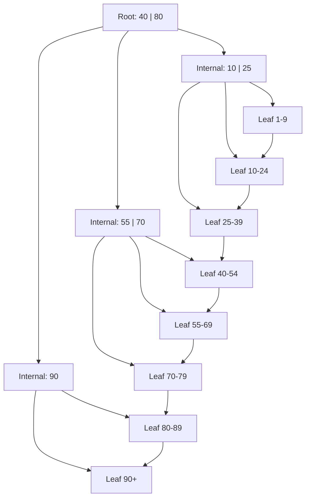

## In one minute
- A B-tree is a balanced search tree whose nodes are disk pages holding hundreds of keys, so a lookup over a billion rows touches only 3 to 4 pages.
- A B+ tree keeps all values (or row pointers) in the leaves and links the leaves in key order. Internal nodes hold only separator keys, which raises fan-out and makes range scans a sequential walk.
- Inserts that overflow a page split it and push a separator up; the tree grows at the root, so every leaf stays at the same depth.
- B+ trees are the default index in PostgreSQL, MySQL InnoDB, SQL Server, Oracle, and SQLite because they give predictable reads and in-place updates. Their cost is random writes and fragmentation.

## How it works

### Pages, not nodes
Disks and SSDs read in blocks, and the database buffer pool caches fixed-size pages (8 KB in PostgreSQL, 16 KB in InnoDB). A B-tree maps one node to one page. With 16-byte keys plus 6-byte child pointers, an internal page holds around 500 entries, so the *fan-out* is about 500. Three levels index 500 × 500 × 500 = 125 million leaf entries, and the top two levels (about 250,000 pages, roughly 4 GB) usually sit in memory. A point lookup therefore costs about one physical read.

### B-tree versus B+ tree
In a classic B-tree any node can hold a key with its value. In a B+ tree, internal nodes hold only separator keys, every key with its payload lives in a leaf, and leaves point to their right sibling. Three effects follow:
- Internal nodes are smaller per entry, so fan-out is higher and the tree is shallower.
- A range query finds the first key, then follows sibling pointers without climbing back up.
- Every lookup does the same number of page reads, which keeps latency predictable.

Almost every database "B-tree" is a B+ tree. InnoDB goes further: the table itself is a B+ tree clustered on the primary key, and secondary indexes store the primary key as their pointer.

### Search, insert, split
Search binary-searches the keys inside each page and follows the child pointer until it reaches a leaf. Insert finds the target leaf and places the key in sorted position. If the page overflows, it splits: half the entries move to a new page, and the first key of the new page becomes a separator inserted into the parent. If the parent overflows, it splits too. When the root splits, a new root is created, which is the only way the tree gets taller.

Deletes remove the leaf entry. Textbook B-trees merge underfull pages, and engines differ here. InnoDB tries to merge a page once it drops below `MERGE_THRESHOLD`, 50% by default ([MySQL docs](https://dev.mysql.com/doc/refman/8.4/en/innodb-physical-structure.html)). PostgreSQL never merges half-empty pages; VACUUM only removes pages that become completely empty, so space otherwise comes back through rebuilds.

### Concurrency and crash safety
A split touches several pages, so it is WAL-logged and protected by short page latches taken while descending ("latch crabbing"). PostgreSQL uses the Lehman-Yao design from 1981: a reader that lands on a page that just split follows its right link instead of locking the parent ([nbtree README](https://github.com/postgres/postgres/blob/master/src/backend/access/nbtree/README)).

### Write and space behaviour
Changing one 100-byte row rewrites a whole 8 to 16 KB page eventually, which is *write amplification* of 80 to 160 times at the page level, before WAL and full-page images. Pages split at 50% full, so random inserts leave the tree around 67 to 70% full on average. Sequential keys (auto-increment ids, timestamps) fill pages much fuller because engines detect right-edge appends and split unevenly, but not to 100%: they deliberately leave room for later updates. PostgreSQL fills right-edge leaves to the index `fillfactor`, 90 by default ([PostgreSQL CREATE INDEX](https://www.postgresql.org/docs/current/sql-createindex.html)), and InnoDB leaves 1/16 of each page free, so sequential inserts give pages about 15/16 full while random ones land anywhere from 1/2 to 15/16 ([MySQL docs](https://dev.mysql.com/doc/refman/8.4/en/innodb-physical-structure.html)).

## Down the stack

### Layer 1: The contract
A B+ tree index promises an ordered map: point lookups, ordered range scans in either direction, and uniqueness checks, each costing O(log_F N) page reads where F is the fan-out, so the cost grows by one page only when the data grows by a factor of several hundred. Concurrent readers never see a half-split page, and after a crash the tree is structurally valid because every split is WAL-logged as one atomic action. It does not promise space efficiency or physical order: after heavy churn, pages may be half empty and leaves scattered on disk.

### Layer 2: The mechanism
A PostgreSQL B-tree page (`nbtree`) is an ordinary 8 KB heap-style page. It starts with a 24-byte `PageHeaderData`, followed by an array of 4-byte line pointers that grows forward, while index tuples are packed from the end of the page backward. Line pointers are kept in key order, so binary search runs over them. At the end sits a special area (`BTPageOpaqueData`) with left and right sibling block numbers, the tree level, and flags. Every page except the rightmost on its level stores a *high key*, the upper bound of keys it may hold. High key plus right link is the Lehman-Yao trick: a reader that arrives after a concurrent split sees its key exceeds the high key and moves right. Since version 13, leaves deduplicate equal keys into posting-list tuples ([PostgreSQL 13 release notes](https://www.postgresql.org/docs/release/13.0/)), and since version 14 *bottom-up deletion* removes dead versions from a leaf that is about to split because of non-HOT updates, delaying the split ([PostgreSQL B-tree docs](https://www.postgresql.org/docs/current/btree.html)).

InnoDB uses 16 KB pages. Records form a singly linked list in key order between two sentinel records, *infimum* and *supremum*, and a sparse *page directory* at the end of the page holds a slot for every 4 to 8 records. Search binary-searches the directory, then walks a few links.

### Layer 3: The machine
A page read costs on the order of 100 microseconds on NVMe and several milliseconds on a spinning disk. Inside memory, the cost moves to the CPU cache. An 8 KB page is 128 cache lines of 64 bytes. Binary search over a few hundred keys needs about 8 or 9 probes, each touching a line pointer and then a tuple elsewhere in the page, so a search inside one page costs a handful of cache misses. That is one reason PostgreSQL truncates unneeded suffix columns from separator keys: shorter keys mean more per page and fewer lines touched.

Writes meet two size mismatches. First, devices typically guarantee atomic writes of 4 KiB at most, so a 16 KB InnoDB page can tear in a power cut; InnoDB writes pages to the doublewrite buffer first, and PostgreSQL logs a full-page image after each checkpoint. Second, flash cannot overwrite in place. NAND is programmed in pages of several KiB and erased in blocks of several megabytes, so the SSD's flash translation layer redirects each rewrite to a fresh location and later garbage-collects. Scattered in-place page updates therefore add device-level write amplification on top of the engine's own.

### Why it's built this way
1. Storage reads in blocks and random reads are expensive, so each node is a page and high fan-out keeps the tree 3 to 4 levels deep.
2. Upper levels are small and hot, so they stay cached and a lookup costs about one physical read.
3. Ranges must be cheap, so data lives only in linked leaves and a scan becomes a sibling walk.
4. Pages are larger than the atomic write unit, so the engine needs WAL plus full-page images or doublewrite to survive torn writes.
5. Splits must not block readers, so high keys and right links let readers recover without locking the parent.

## Diagram


## Worked example
An `events` table has 2 billion rows. The primary key is a 16-byte UUID; a secondary index covers `(user_id, created_at)` at 16 bytes per key.

With 8 KB pages and about 24 bytes per internal entry, fan-out is roughly 300. Leaves hold about 200 entries at 70% fill. Two billion entries need 10 million leaf pages (80 GB), 33,000 level-two pages, 110 level-one pages, and one root. That is a four-level tree. The upper three levels total about 260 MB and stay cached, so a point lookup costs one leaf read: around 100 microseconds on NVMe if not cached.

With random UUIDv4 keys at 20,000 inserts per second, each insert lands on a random leaf. The working set is the whole 80 GB leaf level, so with a 32 GB buffer pool most inserts miss cache, read a page, and later write it back. Switching to time-ordered keys (UUIDv7 or a sequence) makes inserts hit the rightmost few leaves, which stay hot in memory. UUIDv7 is now standard: RFC 9562 (May 2024) replaced RFC 4122, puts a 48-bit Unix millisecond timestamp in the top bits, and says outright that random UUIDs have poor index locality ([RFC 9562](https://www.rfc-editor.org/rfc/rfc9562.html)). PostgreSQL 18 generates them natively with `uuidv7()` ([PostgreSQL docs](https://www.postgresql.org/docs/18/functions-uuid.html)). Write I/O for that index drops by an order of magnitude, and pages fill to around 90%, shrinking the index by roughly a quarter.

## In the wild
- **Shopify, 2022: time-ordered idempotency keys halve insert time.** Shopify's payments systems store an idempotency key for every request. Moving those keys from random UUIDv4 to time-ordered ULIDs cut INSERT statement duration by 50 percent in one high-throughput system, because new keys stopped landing on random leaf pages of the index ([Shopify Engineering](https://shopify.engineering/building-resilient-payment-systems)).
- **Uber, 2016: every update touches every index.** Uber explained why it moved most Postgres databases to MySQL. A Postgres row update writes a new tuple at a new physical location, so every secondary B-tree index on the table needs a new entry pointing at it, and physical WAL replication then ships all those index page changes across data centers. InnoDB secondary indexes point at the primary key instead, so updates to non-indexed columns leave them alone. Postgres's HOT updates and bottom-up deletion narrow this gap, but only when the update changes no indexed column ([Uber Engineering](https://www.uber.com/en-US/blog/postgres-to-mysql-migration/)).

## Trade-offs
| Option | Strengths | Weaknesses | Choose when |
|---|---|---|---|
| B+ tree index | Predictable point and range reads, in-place updates | Random write I/O, page-level write amplification | Read-heavy or mixed OLTP |
| Clustered B+ tree (InnoDB) | Primary key range scans read contiguous rows | Wide PK bloats every secondary index; random PK fragments table | Access mostly by primary key |
| Heap plus B+ tree indexes (PostgreSQL) | Cheap secondary indexes, stable row addresses | Index lookups need an extra heap fetch | Many secondary access paths |
| LSM tree | Sequential writes, better compression | Read and space amplification, compaction debt | Write-heavy ingestion |
| Hash index | O(1) point lookups | No range scans or ordering | Pure key-value equality lookups |

## Pitfalls in production
- **Random primary keys.** UUIDv4 spreads inserts across all leaves, thrashing cache and bloating pages. Use time-ordered ids or a sequence with a separate public id.
- **Index bloat after mass deletes.** Leaves stay half empty and the tree stays large. Rebuild concurrently (`REINDEX CONCURRENTLY`, `OPTIMIZE TABLE`) during quiet hours.
- **Hot right edge.** Monotonic keys make every writer contend for the same last leaf latch. At very high insert rates, shard the key or use hash partitioning.
- **Too many indexes.** Each index is another tree to update per write. Remove indexes that usage stats show are unused.
- **Wide keys.** A 200-byte composite key cuts fan-out by ten, adding a level. Index the narrowest columns that serve the query, and use `INCLUDE` for payload.

## Leadership lens
- Primary key choice is an architecture decision: it fixes insert locality, secondary index size, and sharding options.
- In design review, ask for the expected key distribution and insert rate per index, not only the queries.
- Budget index maintenance (rebuilds, bloat monitoring) as recurring operational work.
- Know when B+ trees stop fitting: sustained write rates beyond what random page I/O can absorb suggest an LSM-based store.

## Check yourself
1. Why does a B+ tree usually have higher fan-out than a classic B-tree with the same page size?
   **Answer:** Internal nodes hold only keys and child pointers, not values, so more entries fit per page.
2. Why do sequential inserts produce a smaller index than random inserts?
   **Answer:** Engines detect right-edge appends and leave full pages behind, while random inserts split pages at 50% and leave them partly filled.
3. A point lookup on a 4-level tree costs about one disk read. Why not four?
   **Answer:** The upper levels are small and hot, so they stay in the buffer pool; only the leaf is usually read from disk.
4. What problem do right-link pointers solve for concurrent readers?
   **Answer:** A reader that reaches a page just after it split can follow the right link to the new sibling instead of restarting or locking the parent.

## Practice
**Task:** Implement a B+ tree in memory with `BPlusTree(max_keys)`. `insert(key, value)` adds or overwrites a key, splitting any node that holds more than `max_keys` keys. `get(key)` returns the value or `None`. `range(lo, hi)` returns sorted `(key, value)` pairs with `lo <= key <= hi` by walking linked leaves. `height()` returns the number of levels (1 for a lone leaf). All leaves must stay at the same depth.

```python starter
class BPlusTree:
    def __init__(self, max_keys=4):
        self.max_keys = max_keys

    def insert(self, key, value):
        raise NotImplementedError

    def get(self, key):
        raise NotImplementedError

    def range(self, lo, hi):
        raise NotImplementedError

    def height(self):
        raise NotImplementedError
```

```python tests
import random

def test_get_after_insert():
    t = BPlusTree(3)
    for k in [5, 1, 9, 3, 7]:
        t.insert(k, k * 10)
    assert t.get(7) == 70
    assert t.get(4) is None

def test_overwrite():
    t = BPlusTree(3)
    t.insert(1, "a")
    t.insert(1, "b")
    assert t.get(1) == "b"
    assert t.range(0, 10) == [(1, "b")]

def test_range_after_many_random_inserts():
    rng = random.Random(7)
    keys = list(range(200))
    rng.shuffle(keys)
    t = BPlusTree(4)
    for k in keys:
        t.insert(k, -k)
    assert t.range(50, 54) == [(k, -k) for k in range(50, 55)]
    assert [k for k, _ in t.range(-5, 500)] == list(range(200))

def test_single_leaf_height():
    t = BPlusTree(4)
    t.insert(1, 1)
    assert t.height() == 1

def test_height_is_logarithmic():
    t = BPlusTree(4)
    for k in range(1000):
        t.insert(k, k)
    assert 4 <= t.height() <= 9

def test_empty_range():
    t = BPlusTree(4)
    for k in range(10):
        t.insert(k, k)
    assert t.range(20, 30) == []
```

```python solution
import bisect

class Node:
    def __init__(self, leaf):
        self.leaf, self.keys, self.kids, self.vals, self.next = leaf, [], [], [], None

class BPlusTree:
    def __init__(self, max_keys=4):
        self.max_keys, self.root = max_keys, Node(True)

    def _insert(self, n, key, value):
        if n.leaf:
            i = bisect.bisect_left(n.keys, key)
            if i < len(n.keys) and n.keys[i] == key:
                n.vals[i] = value
                return None
            n.keys.insert(i, key)
            n.vals.insert(i, value)
            if len(n.keys) <= self.max_keys:
                return None
            m, r = len(n.keys) // 2, Node(True)
            r.keys, r.vals, n.keys, n.vals = n.keys[m:], n.vals[m:], n.keys[:m], n.vals[:m]
            r.next, n.next = n.next, r
            return r.keys[0], r
        i = bisect.bisect_right(n.keys, key)
        split = self._insert(n.kids[i], key, value)
        if split is None:
            return None
        n.keys.insert(i, split[0])
        n.kids.insert(i + 1, split[1])
        if len(n.keys) <= self.max_keys:
            return None
        m, r = len(n.keys) // 2, Node(False)
        sep = n.keys[m]
        r.keys, r.kids, n.keys, n.kids = n.keys[m + 1:], n.kids[m + 1:], n.keys[:m], n.kids[:m + 1]
        return sep, r

    def insert(self, key, value):
        split = self._insert(self.root, key, value)
        if split:
            root = Node(False)
            root.keys, root.kids = [split[0]], [self.root, split[1]]
            self.root = root

    def _leaf(self, key):
        n = self.root
        while not n.leaf:
            n = n.kids[bisect.bisect_right(n.keys, key)]
        return n

    def get(self, key):
        n = self._leaf(key)
        i = bisect.bisect_left(n.keys, key)
        return n.vals[i] if i < len(n.keys) and n.keys[i] == key else None

    def range(self, lo, hi):
        out, n = [], self._leaf(lo)
        while n:
            for k, v in zip(n.keys, n.vals):
                if k > hi:
                    return out
                if k >= lo:
                    out.append((k, v))
            n = n.next
        return out

    def height(self):
        h, n = 1, self.root
        while not n.leaf:
            h, n = h + 1, n.kids[0]
        return h
```

```typescript starter
export class BPlusTree {
  constructor(public maxKeys: number = 4) {}
  insert(key: number, value: number): void {
    throw new Error("TODO");
  }
  get(key: number): number | undefined {
    throw new Error("TODO");
  }
  range(lo: number, hi: number): [number, number][] {
    throw new Error("TODO");
  }
  height(): number {
    throw new Error("TODO");
  }
}
```

```typescript tests
function shuffled(n: number, seed: number): number[] {
  const a = Array.from({ length: n }, (_, i) => i);
  let s = seed;
  for (let i = n - 1; i > 0; i--) {
    s = (s * 1103515245 + 12345) % 2147483648;
    const j = s % (i + 1);
    [a[i], a[j]] = [a[j], a[i]];
  }
  return a;
}
test("get after insert", () => {
  const t = new BPlusTree(3);
  for (const k of [5, 1, 9, 3, 7]) t.insert(k, k * 10);
  assertEqual(t.get(7), 70);
  assert(t.get(4) === undefined, "missing key");
});
test("overwrite", () => {
  const t = new BPlusTree(3);
  t.insert(1, 10);
  t.insert(1, 20);
  assertEqual(t.range(0, 10), [[1, 20]]);
});
test("range after many random inserts", () => {
  const t = new BPlusTree(4);
  for (const k of shuffled(200, 7)) t.insert(k, -k);
  assertEqual(t.range(50, 54), [50, 51, 52, 53, 54].map((k) => [k, -k]));
  assertEqual(t.range(-5, 500).map((p) => p[0]), shuffled(200, 0).sort((a, b) => a - b));
});
test("single leaf height", () => {
  const t = new BPlusTree(4);
  t.insert(1, 1);
  assertEqual(t.height(), 1);
});
test("height is logarithmic", () => {
  const t = new BPlusTree(4);
  for (let k = 0; k < 1000; k++) t.insert(k, k);
  assert(t.height() >= 4 && t.height() <= 9, "height " + t.height());
});
test("empty range", () => {
  const t = new BPlusTree(4);
  for (let k = 0; k < 10; k++) t.insert(k, k);
  assertEqual(t.range(20, 30), []);
});
```

```typescript solution
class BNode {
  keys: number[] = [];
  kids: BNode[] = [];
  vals: number[] = [];
  next: BNode | null = null;
  constructor(public leaf: boolean) {}
}

function lowerBound(a: number[], x: number): number {
  let lo = 0, hi = a.length;
  while (lo < hi) {
    const m = (lo + hi) >> 1;
    if (a[m] < x) lo = m + 1; else hi = m;
  }
  return lo;
}

function upperBound(a: number[], x: number): number {
  let lo = 0, hi = a.length;
  while (lo < hi) {
    const m = (lo + hi) >> 1;
    if (a[m] <= x) lo = m + 1; else hi = m;
  }
  return lo;
}

export class BPlusTree {
  private root = new BNode(true);
  constructor(public maxKeys: number = 4) {}

  private ins(n: BNode, key: number, value: number): [number, BNode] | null {
    if (n.leaf) {
      const i = lowerBound(n.keys, key);
      if (i < n.keys.length && n.keys[i] === key) { n.vals[i] = value; return null; }
      n.keys.splice(i, 0, key);
      n.vals.splice(i, 0, value);
      if (n.keys.length <= this.maxKeys) return null;
      const m = n.keys.length >> 1, r = new BNode(true);
      r.keys = n.keys.splice(m);
      r.vals = n.vals.splice(m);
      r.next = n.next;
      n.next = r;
      return [r.keys[0], r];
    }
    const i = upperBound(n.keys, key);
    const split = this.ins(n.kids[i], key, value);
    if (!split) return null;
    n.keys.splice(i, 0, split[0]);
    n.kids.splice(i + 1, 0, split[1]);
    if (n.keys.length <= this.maxKeys) return null;
    const m = n.keys.length >> 1, r = new BNode(false);
    const sep = n.keys[m];
    r.keys = n.keys.splice(m + 1);
    n.keys.pop();
    r.kids = n.kids.splice(m + 1);
    return [sep, r];
  }

  insert(key: number, value: number): void {
    const split = this.ins(this.root, key, value);
    if (split) {
      const root = new BNode(false);
      root.keys = [split[0]];
      root.kids = [this.root, split[1]];
      this.root = root;
    }
  }

  private leafFor(key: number): BNode {
    let n = this.root;
    while (!n.leaf) n = n.kids[upperBound(n.keys, key)];
    return n;
  }

  get(key: number): number | undefined {
    const n = this.leafFor(key);
    const i = lowerBound(n.keys, key);
    return i < n.keys.length && n.keys[i] === key ? n.vals[i] : undefined;
  }

  range(lo: number, hi: number): [number, number][] {
    const out: [number, number][] = [];
    let n: BNode | null = this.leafFor(lo);
    while (n) {
      for (let i = 0; i < n.keys.length; i++) {
        if (n.keys[i] > hi) return out;
        if (n.keys[i] >= lo) out.push([n.keys[i], n.vals[i]]);
      }
      n = n.next;
    }
    return out;
  }

  height(): number {
    let h = 1, n = this.root;
    while (!n.leaf) { h++; n = n.kids[0]; }
    return h;
  }
}
```

```go starter
package practice

type BPlusTree struct {
	MaxKeys int
}

func NewBPlusTree(maxKeys int) *BPlusTree {
	return &BPlusTree{MaxKeys: maxKeys}
}

func (t *BPlusTree) Insert(key, value int)    { panic("TODO") }
func (t *BPlusTree) Get(key int) (int, bool)  { panic("TODO") }
func (t *BPlusTree) Range(lo, hi int) [][2]int { panic("TODO") }
func (t *BPlusTree) Height() int              { panic("TODO") }
```

```go tests
package practice

import (
	"math/rand"
	"reflect"
	"testing"
)

func TestGetAfterInsert(t *testing.T) {
	tr := NewBPlusTree(3)
	for _, k := range []int{5, 1, 9, 3, 7} {
		tr.Insert(k, k*10)
	}
	if v, ok := tr.Get(7); !ok || v != 70 {
		t.Fatalf("Get(7) = %d, %v", v, ok)
	}
	if _, ok := tr.Get(4); ok {
		t.Fatal("Get(4) should miss")
	}
}

func TestOverwrite(t *testing.T) {
	tr := NewBPlusTree(3)
	tr.Insert(1, 10)
	tr.Insert(1, 20)
	if got := tr.Range(0, 10); !reflect.DeepEqual(got, [][2]int{{1, 20}}) {
		t.Fatalf("got %v", got)
	}
}

func TestRangeAfterManyRandomInserts(t *testing.T) {
	tr := NewBPlusTree(4)
	for _, k := range rand.New(rand.NewSource(7)).Perm(200) {
		tr.Insert(k, -k)
	}
	want := [][2]int{{50, -50}, {51, -51}, {52, -52}, {53, -53}, {54, -54}}
	if got := tr.Range(50, 54); !reflect.DeepEqual(got, want) {
		t.Fatalf("got %v", got)
	}
	all := tr.Range(-5, 500)
	for i, p := range all {
		if p[0] != i {
			t.Fatalf("position %d holds key %d", i, p[0])
		}
	}
	if len(all) != 200 {
		t.Fatalf("len %d", len(all))
	}
}

func TestSingleLeafHeight(t *testing.T) {
	tr := NewBPlusTree(4)
	tr.Insert(1, 1)
	if tr.Height() != 1 {
		t.Fatalf("height %d", tr.Height())
	}
}

func TestHeightIsLogarithmic(t *testing.T) {
	tr := NewBPlusTree(4)
	for k := 0; k < 1000; k++ {
		tr.Insert(k, k)
	}
	if h := tr.Height(); h < 4 || h > 9 {
		t.Fatalf("height %d", h)
	}
}

func TestEmptyRange(t *testing.T) {
	tr := NewBPlusTree(4)
	for k := 0; k < 10; k++ {
		tr.Insert(k, k)
	}
	if got := tr.Range(20, 30); len(got) != 0 {
		t.Fatalf("got %v", got)
	}
}
```

```go solution
package practice

import "sort"

type node struct {
	leaf bool
	keys []int
	kids []*node
	vals []int
	next *node
}

type BPlusTree struct {
	MaxKeys int
	root    *node
}

func NewBPlusTree(maxKeys int) *BPlusTree {
	return &BPlusTree{MaxKeys: maxKeys, root: &node{leaf: true}}
}

func insertAt[T any](s []T, i int, v T) []T {
	s = append(s, v)
	copy(s[i+1:], s[i:])
	s[i] = v
	return s
}

func (t *BPlusTree) ins(n *node, key, value int) (int, *node) {
	if n.leaf {
		i := sort.SearchInts(n.keys, key)
		if i < len(n.keys) && n.keys[i] == key {
			n.vals[i] = value
			return 0, nil
		}
		n.keys, n.vals = insertAt(n.keys, i, key), insertAt(n.vals, i, value)
		if len(n.keys) <= t.MaxKeys {
			return 0, nil
		}
		m := len(n.keys) / 2
		r := &node{leaf: true, next: n.next}
		r.keys = append([]int{}, n.keys[m:]...)
		r.vals = append([]int{}, n.vals[m:]...)
		n.keys, n.vals, n.next = n.keys[:m], n.vals[:m], r
		return r.keys[0], r
	}
	i := sort.SearchInts(n.keys, key+1)
	sep, right := t.ins(n.kids[i], key, value)
	if right == nil {
		return 0, nil
	}
	n.keys, n.kids = insertAt(n.keys, i, sep), insertAt(n.kids, i+1, right)
	if len(n.keys) <= t.MaxKeys {
		return 0, nil
	}
	m := len(n.keys) / 2
	up := n.keys[m]
	r := &node{keys: append([]int{}, n.keys[m+1:]...), kids: append([]*node{}, n.kids[m+1:]...)}
	n.keys, n.kids = n.keys[:m], n.kids[:m+1]
	return up, r
}

func (t *BPlusTree) Insert(key, value int) {
	if sep, right := t.ins(t.root, key, value); right != nil {
		t.root = &node{keys: []int{sep}, kids: []*node{t.root, right}}
	}
}

func (t *BPlusTree) leafFor(key int) *node {
	n := t.root
	for !n.leaf {
		n = n.kids[sort.SearchInts(n.keys, key+1)]
	}
	return n
}

func (t *BPlusTree) Get(key int) (int, bool) {
	n := t.leafFor(key)
	i := sort.SearchInts(n.keys, key)
	if i < len(n.keys) && n.keys[i] == key {
		return n.vals[i], true
	}
	return 0, false
}

func (t *BPlusTree) Range(lo, hi int) [][2]int {
	out := [][2]int{}
	for n := t.leafFor(lo); n != nil; n = n.next {
		for i, k := range n.keys {
			if k > hi {
				return out
			}
			if k >= lo {
				out = append(out, [2]int{k, n.vals[i]})
			}
		}
	}
	return out
}

func (t *BPlusTree) Height() int {
	h := 1
	for n := t.root; !n.leaf; n = n.kids[0] {
		h++
	}
	return h
}
```

## Mock interview
**Prompt:** A multi-tenant SaaS stores 3 billion order rows in MySQL with a UUIDv4 primary key. Insert latency and buffer pool misses have climbed steadily over a year. Diagnose and propose a fix.

- Follow-up: How would you change the key without a long outage?
- Follow-up: After switching to sequential keys, inserts stall on one hot page. Why?
- Follow-up: When would you move this table to an LSM-based store instead?

**A strong answer covers:**
- Random keys scatter inserts across all leaves, so the working set is the whole index.
- Clustered PK in InnoDB means the wide UUID is copied into every secondary index.
- Time-ordered keys (UUIDv7 or a sequence) restore locality and page fill.
- Online migration: dual write or a shadow table with backfill, then cut over.
- Right-edge contention at very high rates and how partitioning spreads it.
- Comparing write amplification and read cost against an LSM alternative.

## Sources and further study
**Primary**
- [Bayer and McCreight, Organization and Maintenance of Large Ordered Indices (1970)](https://infolab.usc.edu/csci585/Spring2010/den_ar/indexing.pdf): the original B-tree report from Boeing Scientific Research Laboratories.
- [Comer, The Ubiquitous B-Tree (ACM Computing Surveys 1979)](https://carlosproal.com/ir/papers/p121-comer.pdf): the classic survey that contrasts B-trees, B*-trees and B+-trees.
- [Lehman and Yao, Efficient Locking for Concurrent Operations on B-Trees (ACM TODS 1981)](https://www.csd.uoc.gr/~hy460/pdf/p650-lehman.pdf): right links and high keys, still the basis of PostgreSQL's nbtree.
- [RFC 9562: Universally Unique IDentifiers](https://www.rfc-editor.org/rfc/rfc9562.html): defines UUIDv7 and explains why time ordering helps indexes.

**Systems docs**
- [PostgreSQL nbtree README](https://github.com/postgres/postgres/blob/master/src/backend/access/nbtree/README): concurrency, page deletion, deduplication and suffix truncation as implemented.
- [MySQL: The physical structure of an InnoDB index](https://dev.mysql.com/doc/refman/8.4/en/innodb-physical-structure.html): page size, fill behaviour and merge threshold.

**Books**
- *Database Internals* (1st ed.), Alex Petrov, chapter 2 "B-Tree Basics" and chapter 4 "Implementing B-Trees": page headers, binary search in slotted pages, splits, merges and right-only appends.
- *Designing Data-Intensive Applications* (1st ed.), Martin Kleppmann, chapter 3 "Storage and Retrieval": B-trees compared with log-structured storage.

**Other curricula**
- [CMU 15-445 lecture notes: Indexes and Filters I (Fall 2024)](https://15445.courses.cs.cmu.edu/fall2024/notes/08-indexes1.pdf): treats the B+ tree as the default order-preserving index and walks through its node layout and operations.
- [donnemartin/system-design-primer](https://github.com/donnemartin/system-design-primer): mentions B-trees in one sentence under indexes, as the structure that gives logarithmic search and ordered access.

## Watch
- [#08 - Tree Indexes: B+Trees (CMU Database Group)](https://www.youtube.com/watch?v=scUtG_6M_lU): search, insert, split, and design choices in real engines.
- [F2023 #08 - B+Tree Indexes (CMU Database Group)](https://www.youtube.com/watch?v=5gXn5fLkbM0): a later version of the lecture with more on concurrency and node layout.

## Free resources
- [Use The Index, Luke: Anatomy of an index](https://use-the-index-luke.com/sql/anatomy/the-tree): how a B-tree index serves real SQL queries.
- [PostgreSQL: B-Tree Indexes](https://www.postgresql.org/docs/current/btree.html): PostgreSQL's B-tree behaviour, deduplication, and bottom-up deletion.
- [SQLite File Format](https://www.sqlite.org/fileformat2.html): byte-level layout of B-tree pages in a real database.
- [Wikipedia: B+ tree](https://en.wikipedia.org/wiki/B%2B_tree): background, history, and complexity bounds.
