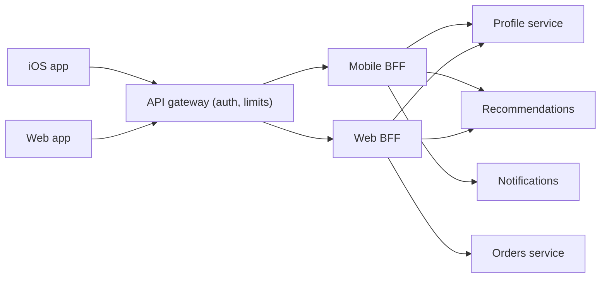

## In one minute
- A Backend for Frontend is a server-side component built for one specific client experience, such as the iOS app, the web app, or a TV app. It aggregates and shapes data from downstream services into exactly what that client's screens need.
- It is usually owned by the same team that owns the client, so UI changes do not wait on a shared API team.
- It reduces round trips and payload size for constrained clients and keeps client-specific logic out of both the generic gateway and the domain services.
- The risks are duplicated logic across BFFs, a growing number of services to run, and BFFs quietly turning into domain services.

## How it works

### Why one API does not fit all clients
A web dashboard on fibre can make ten parallel calls and render a dense table. A phone on a 4G connection with 120 ms round trips wants one call returning a small, pre-shaped payload. A smart TV needs different image sizes and fewer fields. A single general-purpose API either over-fetches for some clients or forces chatty call patterns on others. Teams then add client-specific parameters (`?fields=...&platform=ios`) until the shared API becomes a negotiation between every client team.

### What a BFF does
For a given screen, the BFF calls the necessary downstream services in parallel, applies per-call timeouts, merges the results, drops unneeded fields, formats values for display (currency strings, localised dates), and returns one response. It can also hold client-specific concerns: session handling for a web app with cookies, token exchange for a mobile app, feature flags, and A/B variants of a screen layout.

### The BFF as a security boundary
For browser apps the BFF now has a second, standardised job. RFC 10017 (August 2026), the IETF's best current practice for OAuth in browser-based apps, ranks the BFF as the most secure of its three architectures and strongly recommends it for business apps and apps that handle personal data ([RFC 10017](https://www.rfc-editor.org/rfc/rfc10017.html)). The BFF is the confidential OAuth client: access and refresh tokens stay on the server, and the browser holds only a session cookie marked `Secure` and `HttpOnly`, ideally `SameSite=Strict` with a `__Host-` name prefix. JavaScript injected into the page can still make calls through the BFF while the user is there, but it cannot steal a token to use elsewhere.

### What a BFF should not do
It should not own business rules or data. If two BFFs both compute "is this order refundable?", that rule belongs in the Orders service. A useful guideline: a BFF orchestrates and formats; it does not decide. Some duplication of fetch-and-merge code across BFFs is expected; Sam Newman is relaxed about duplication across services, because extracting shared code risks tight coupling that costs more ([Sam Newman](https://samnewman.io/patterns/architectural/bff/)).

### Partial failure
A home screen built from profile, recommendations, notifications, and promotions should not fail because promotions are down. The BFF marks each dependency as required or optional, applies tight timeouts to optional ones (for example 80 ms), and returns a degraded response with defaults. The client renders what it receives, so clients must be built to handle partial responses ([Sam Newman](https://samnewman.io/patterns/architectural/bff/)). This is where much of the user-perceived reliability is won or lost.

### Ownership and placement
The typical layout is: generic API gateway at the edge for authentication and rate limiting, then one BFF per client type, then domain services. GraphQL is a common way to implement a BFF, letting the client team define queries while resolvers call domain services. Microsoft's guidance goes further: if you already run GraphQL with frontend-specific resolvers, or clients make the same requests, a separate BFF may add nothing ([Azure Architecture Center](https://learn.microsoft.com/en-us/azure/architecture/patterns/backends-for-frontends)).

How many BFFs is an ownership question as much as a technical one. "One experience, one BFF" means iOS and Android can share a mobile BFF when their screens match and one team owns both apps; when separate teams own them, separate BFFs avoid recreating the shared-API bottleneck ([Sam Newman](https://samnewman.io/patterns/architectural/bff/)).

## Down the stack

### Layer 1: The contract
A BFF endpoint promises one response per screen within a latency budget, for example 300 ms at p99 server time. The response always contains the required parts or fails clearly; optional parts may be missing or defaulted, and the response says which ones degraded. The BFF promises not to make business decisions: given the same downstream data, the web and mobile BFFs must produce the same facts, only shaped differently.

### Layer 2: The mechanism
The handler starts all independent downstream calls at once (goroutines, `CompletableFuture`s, or `Promise.all`), each with its own deadline derived from the incoming request's deadline, for example `context.WithTimeout(ctx, 80*time.Millisecond)` for optional calls. Results are collected as they finish; when the overall budget expires, unfinished optional calls are cancelled and replaced with defaults. GraphQL BFFs add DataLoader-style batching: resolvers that each need one user's data within the same tick are coalesced into a single `getUsers(ids)` call, preventing N+1 fan-out. DataLoader's cache lives for one request only and is not a substitute for a shared cache ([DataLoader](https://github.com/graphql/dataloader)). Responses are compressed with gzip or Brotli and often cached per user for a few seconds.

### Layer 3: The machine
The client's network dominates. A 4G round trip is typically 50 to 150 ms, and radio wake-up from idle can add hundreds more. A new HTTPS connection costs a TCP handshake plus a TLS 1.3 handshake: two round trips before the request can even be sent, and a third before the first response byte. HTTP/3 removes one of them, because QUIC combines the transport and cryptographic handshakes ([RFC 9000](https://www.rfc-editor.org/rfc/rfc9000.html#section-7)). TCP then starts with an initial congestion window of 10 segments, 14,600 bytes on a standard 1,500-byte MTU ([RFC 6928](https://www.rfc-editor.org/rfc/rfc6928.html)): a 180 KB response needs roughly four more round trips on a fresh connection, while a 14 KB compressed response fits in one flight. Inside the data centre, the BFF's downstream calls cost 0.2 to 0.5 ms of network each over warm, pooled connections. Moving fan-out from the phone to the server trades several 150 ms round trips for several sub-millisecond ones plus one slow one.

### Why it's built this way
1. Client round trips over mobile radio are the most expensive resource, so many calls are collapsed into one server-side.
2. Bytes on the wire cost extra round trips through TCP's congestion window, so payloads are trimmed to what the screen uses.
3. Different devices have different screens and networks, so each experience gets a backend shaped for it.
4. UI changes happen at the client team's pace, so the team that owns the client owns its backend.

## Diagram


## Worked example
A streaming service's mobile home screen originally made 7 API calls: profile, continue-watching, three recommendation rows, notifications count, and a promo banner. On a mobile network with 150 ms round-trip time and a limit of 4 parallel connections, the screen took about 2 round-trip batches plus server time, around 900 ms, and downloaded 180 KB of JSON because each API returned full objects.

The mobile team builds a BFF. It calls all seven services in parallel from the data centre, where each call takes 10 to 40 ms. It trims each title to the 6 fields the tile needs and picks the image URL for the device's resolution. The response is 22 KB compressed and arrives in one request, one or two round trips on a warm connection: server time 60 ms p50, total perceived latency about 260 ms.

For resilience, profile and continue-watching are required; recommendations, notifications, and promos are optional with an 80 ms timeout each. During a recommendations outage, the home screen still loads, showing a cached "popular" row and a `degraded` flag the app uses to suppress a spinner. The BFF fleet costs about 15 small containers, owned and on-called by the mobile team.

## In the wild
- **SoundCloud, 2011-2015: where the name came from (engineering write-up).** SoundCloud's own web and iOS apps called the same public API as third-party developers. Simple screens needed many fine-grained calls, features could not be exclusive to the official apps without OAuth-scope checks everywhere, and every endpoint change risked breaking outside clients. Client teams were given their own backends, a name coined by the web tech lead, and a profile page that took several calls (`/tracks/1234.json`, `/users/86762.json`, `/users/me.json`) became one call to `/user-profile/123.json`. With about five BFFs in production, each re-implemented profile merging slightly differently, and the team took that duplication as the signal to build a shared `UserProfileService` ([Phil Calçado](https://philcalcado.com/2015/09/18/the_back_end_for_front_end_pattern_bff.html)).
- **Peloton, 2021: client-facing APIs that trusted the client.** Researchers found a REST endpoint and GraphQL gateways serving Peloton's apps that answered unauthenticated requests with riders' user IDs, location, age, gender and workout stats, including for private profiles. Reported on 20 January, the first silent fix in February only required a login, which anyone could create, so other users' data stayed visible; the issues were largely fixed within 7 days of press contact in May. A backend shaped for one client still has to enforce authorisation on every field it returns ([Pen Test Partners](https://www.pentestpartners.com/security-blog/tour-de-peloton-exposed-user-data/)).

## Trade-offs
| Option | Strengths | Weaknesses | Choose when |
|---|---|---|---|
| One general-purpose API | Single codebase, consistent behaviour | Over-fetching, chatty clients, cross-team negotiation | Few clients with similar needs |
| BFF per client type | Payloads fit each client, client team autonomy | More services, duplicated orchestration | Clients differ significantly in screens or networks |
| GraphQL layer | Clients pick fields, one schema | Query cost control, caching is harder | Many client variants with overlapping data |
| Aggregation in gateway | No extra service | Gateway becomes client-specific and crowded | Very small, simple aggregations |

## Pitfalls in production
- **Business logic leaking into BFFs.** Refund rules or pricing appear in two BFFs and drift. Push rules down into domain services and keep BFFs to orchestration and formatting.
- **Serial fan-out.** Calls are made one after another, adding latencies. Call independent services in parallel and measure the critical path.
- **No partial-failure policy.** One optional service failing returns a 500 for the whole screen. Classify dependencies as required or optional, with timeouts and defaults.
- **BFF sprawl.** A BFF per screen or per minor client variant multiplies services. Draw BFFs per user experience (mobile, web, TV), not per page.
- **Unowned BFFs.** A platform team owns them, and client teams are blocked again. Give each BFF to the team that owns the client.
- **Tokens in the browser.** A single-page app keeps OAuth tokens in `localStorage`, where any injected script can read and exfiltrate them. Let the web BFF hold the tokens and give the browser an `HttpOnly` session cookie instead ([RFC 10017](https://www.rfc-editor.org/rfc/rfc10017.html)).

## Leadership lens
- Ask what makes this client different enough to deserve its own backend, and where the shared logic will live.
- Make the client team own and operate the BFF, including on-call. Without ownership, the pattern's main benefit disappears.
- Set latency budgets per screen and require every downstream call to declare required or optional plus a timeout.
- Review periodically for duplicated rules across BFFs and push them into services.

## Check yourself
1. Why does a BFF reduce latency for mobile clients even though it adds a hop?
   **Answer:** It replaces many high-latency client round trips with one, and makes the fan-out calls inside the data centre where round trips are a few milliseconds.
2. Two BFFs both decide whether a user may cancel a subscription. What is wrong?
   **Answer:** A business rule is duplicated in presentation-layer services and will drift. The rule belongs in the subscription service, which both BFFs should call.
3. How should a BFF behave when an optional dependency times out?
   **Answer:** Return the rest of the response with a default or cached value for that part, and signal degradation so the client can render accordingly.

## Practice
**Task:** Write `build_home(platform, clients)` for a home-screen BFF. `clients` is a dict of zero-argument functions: `"profile"` (required, returns a dict with `"name"`), `"recs"` (optional, returns a list), and `"unread"` (optional, returns an int); any of them may raise. If profile raises, return `{"error": "profile unavailable"}`. Otherwise return `{"name": ..., "recs": ..., "unread": ..., "degraded": [...]}`, where recs are truncated to 5 items for `"mobile"` and 20 for `"web"`, a failed optional part becomes `[]` for recs or `0` for unread, and `degraded` lists the failed optional parts in alphabetical order.

```python starter
def build_home(platform, clients):
    # TODO
    raise NotImplementedError
```

```python tests
def ok(value):
    return lambda: value

def boom():
    raise RuntimeError("down")

def test_mobile_truncates_recs():
    res = build_home("mobile", {"profile": ok({"name": "Ana"}), "recs": ok(list(range(30))), "unread": ok(3)})
    assert res == {"name": "Ana", "recs": [0, 1, 2, 3, 4], "unread": 3, "degraded": []}

def test_web_gets_more_recs():
    res = build_home("web", {"profile": ok({"name": "Ana"}), "recs": ok(list(range(30))), "unread": ok(0)})
    assert len(res["recs"]) == 20

def test_optional_failures_degrade():
    res = build_home("mobile", {"profile": ok({"name": "Ana"}), "recs": boom, "unread": boom})
    assert res == {"name": "Ana", "recs": [], "unread": 0, "degraded": ["recs", "unread"]}

def test_required_failure():
    res = build_home("web", {"profile": boom, "recs": ok([1]), "unread": ok(1)})
    assert res == {"error": "profile unavailable"}

def test_short_recs_untouched():
    res = build_home("web", {"profile": ok({"name": "B"}), "recs": ok([9, 8]), "unread": ok(2)})
    assert res["recs"] == [9, 8] and res["degraded"] == []
```

```python solution
LIMITS = {"mobile": 5, "web": 20}

def build_home(platform, clients):
    try:
        profile = clients["profile"]()
    except Exception:
        return {"error": "profile unavailable"}
    degraded = []
    try:
        recs = list(clients["recs"]())[:LIMITS[platform]]
    except Exception:
        recs = []
        degraded.append("recs")
    try:
        unread = clients["unread"]()
    except Exception:
        unread = 0
        degraded.append("unread")
    return {"name": profile["name"], "recs": recs, "unread": unread,
            "degraded": sorted(degraded)}
```

```typescript starter
export type Clients = {
  profile: () => { name: string };
  recs: () => number[];
  unread: () => number;
};
export type Home =
  | { name: string; recs: number[]; unread: number; degraded: string[] }
  | { error: string };

export function buildHome(platform: "mobile" | "web", clients: Clients): Home {
  throw new Error("TODO");
}
```

```typescript tests
const ok = <T>(v: T) => () => v;
const boom = (): never => { throw new Error("down"); };
const range = (n: number) => Array.from({ length: n }, (_, i) => i);
test("mobile truncates recs", () => {
  assertEqual(buildHome("mobile", { profile: ok({ name: "Ana" }), recs: ok(range(30)), unread: ok(3) }),
    { name: "Ana", recs: [0, 1, 2, 3, 4], unread: 3, degraded: [] });
});
test("web gets more recs", () => {
  const r = buildHome("web", { profile: ok({ name: "Ana" }), recs: ok(range(30)), unread: ok(0) });
  assert("recs" in r && r.recs.length === 20, "expected 20 recs");
});
test("optional failures degrade", () => {
  assertEqual(buildHome("mobile", { profile: ok({ name: "Ana" }), recs: boom, unread: boom }),
    { name: "Ana", recs: [], unread: 0, degraded: ["recs", "unread"] });
});
test("required failure", () => {
  assertEqual(buildHome("web", { profile: boom, recs: ok([1]), unread: ok(1) }), { error: "profile unavailable" });
});
test("short recs untouched", () => {
  assertEqual(buildHome("web", { profile: ok({ name: "B" }), recs: ok([9, 8]), unread: ok(2) }),
    { name: "B", recs: [9, 8], unread: 2, degraded: [] });
});
```

```typescript solution
export type Clients = {
  profile: () => { name: string };
  recs: () => number[];
  unread: () => number;
};
export type Home =
  | { name: string; recs: number[]; unread: number; degraded: string[] }
  | { error: string };

const LIMITS = { mobile: 5, web: 20 };

export function buildHome(platform: "mobile" | "web", clients: Clients): Home {
  let profile: { name: string };
  try { profile = clients.profile(); } catch (e) { return { error: "profile unavailable" }; }
  const degraded: string[] = [];
  let recs: number[] = [];
  let unread = 0;
  try { recs = clients.recs().slice(0, LIMITS[platform]); } catch (e) { degraded.push("recs"); }
  try { unread = clients.unread(); } catch (e) { degraded.push("unread"); }
  return { name: profile.name, recs, unread, degraded: degraded.sort() };
}
```

```go starter
package practice

import "errors"

// ErrProfileUnavailable is returned when the required profile call fails.
var ErrProfileUnavailable = errors.New("profile unavailable")

type Clients struct {
	Profile func() (string, error) // returns the user's name
	Recs    func() ([]int, error)
	Unread  func() (int, error)
}

type Home struct {
	Name     string
	Recs     []int
	Unread   int
	Degraded []string
}

func BuildHome(platform string, c Clients) (Home, error) {
	panic("TODO")
}
```

```go tests
package practice

import (
	"errors"
	"reflect"
	"testing"
)

var errDown = errors.New("down")

func name(n string) func() (string, error) { return func() (string, error) { return n, nil } }
func recs(n int) func() ([]int, error) {
	return func() ([]int, error) {
		r := make([]int, n)
		for i := range r {
			r[i] = i
		}
		return r, nil
	}
}
func unread(n int) func() (int, error) { return func() (int, error) { return n, nil } }

func TestMobileTruncates(t *testing.T) {
	h, err := BuildHome("mobile", Clients{name("Ana"), recs(30), unread(3)})
	want := Home{"Ana", []int{0, 1, 2, 3, 4}, 3, []string{}}
	if err != nil || !reflect.DeepEqual(h, want) {
		t.Fatalf("got %+v %v", h, err)
	}
}

func TestWebMoreRecs(t *testing.T) {
	h, _ := BuildHome("web", Clients{name("Ana"), recs(30), unread(0)})
	if len(h.Recs) != 20 {
		t.Fatalf("got %d recs", len(h.Recs))
	}
}

func TestOptionalDegrade(t *testing.T) {
	h, err := BuildHome("mobile", Clients{name("Ana"),
		func() ([]int, error) { return nil, errDown },
		func() (int, error) { return 0, errDown }})
	want := Home{"Ana", []int{}, 0, []string{"recs", "unread"}}
	if err != nil || !reflect.DeepEqual(h, want) {
		t.Fatalf("got %+v %v", h, err)
	}
}

func TestRequiredFailure(t *testing.T) {
	_, err := BuildHome("web", Clients{func() (string, error) { return "", errDown }, recs(1), unread(1)})
	if !errors.Is(err, ErrProfileUnavailable) {
		t.Fatalf("got %v", err)
	}
}

func TestShortRecs(t *testing.T) {
	h, _ := BuildHome("web", Clients{name("B"), recs(2), unread(2)})
	if !reflect.DeepEqual(h.Recs, []int{0, 1}) || len(h.Degraded) != 0 {
		t.Fatalf("got %+v", h)
	}
}
```

```go solution
package practice

import (
	"errors"
	"sort"
)

// ErrProfileUnavailable is returned when the required profile call fails.
var ErrProfileUnavailable = errors.New("profile unavailable")

type Clients struct {
	Profile func() (string, error) // returns the user's name
	Recs    func() ([]int, error)
	Unread  func() (int, error)
}

type Home struct {
	Name     string
	Recs     []int
	Unread   int
	Degraded []string
}

var limits = map[string]int{"mobile": 5, "web": 20}

func BuildHome(platform string, c Clients) (Home, error) {
	n, err := c.Profile()
	if err != nil {
		return Home{}, ErrProfileUnavailable
	}
	h := Home{Name: n, Recs: []int{}, Degraded: []string{}}
	if r, err := c.Recs(); err != nil {
		h.Degraded = append(h.Degraded, "recs")
	} else {
		if len(r) > limits[platform] {
			r = r[:limits[platform]]
		}
		h.Recs = r
	}
	if u, err := c.Unread(); err != nil {
		h.Degraded = append(h.Degraded, "unread")
	} else {
		h.Unread = u
	}
	sort.Strings(h.Degraded)
	return h, nil
}
```

## Mock interview
**Prompt:** A retailer has web, iOS, Android, and an in-store kiosk app, all calling one REST API owned by a central team. Mobile home screens take 1.4 seconds and the API team is a bottleneck for every UI change. Propose an architecture.

- Follow-up: iOS and Android need nearly the same data. One BFF or two?
- Follow-up: The recommendations service has a 2% error rate. How does the home screen behave?
- Follow-up: Six months later you find discount logic in three BFFs. What do you do?

**A strong answer covers:**
- BFFs per user experience behind a generic gateway, owned by the client teams.
- Parallel fan-out with per-dependency timeouts and required versus optional classification.
- Payload shaping per device: fields, image sizes, localisation.
- Grouping clients with the same experience (one mobile BFF for iOS and Android) to limit sprawl.
- Keeping business rules in domain services, with a process to detect and remove duplication.

## Sources and further study
**Primary**
- [RFC 10017: OAuth 2.0 for Browser-Based Applications](https://www.rfc-editor.org/rfc/rfc10017.html): section 6.1 defines the BFF pattern for token handling and its cookie rules.
- [RFC 6928: Increasing TCP's Initial Window](https://www.rfc-editor.org/rfc/rfc6928.html): the 10-segment initial window behind the "fit the first screen in one flight" rule.
- [Phil Calçado: The Back-end for Front-end Pattern](https://philcalcado.com/2015/09/18/the_back_end_for_front_end_pattern_bff.html): the SoundCloud history of the pattern, including its duplication problem.

**Systems docs**
- [graphql/dataloader](https://github.com/graphql/dataloader): per-request batching and caching for GraphQL resolvers.
- [RFC 9000: QUIC](https://www.rfc-editor.org/rfc/rfc9000.html): the transport under HTTP/3 and its combined handshake.

**Books**
- *Building Microservices* (2nd edition), Sam Newman, chapter 14 "User Interfaces": central aggregating gateway versus BFF, "How Many BFFs?", reuse across BFFs, and GraphQL.
- *High Performance Browser Networking*, Ilya Grigorik, chapter 8 "Optimizing for Mobile Networks": why radio wake-ups and round trips dominate mobile latency.

**Other curricula**
- [roadmap.sh System Design](https://roadmap.sh/system-design): lists "Backends for Frontend" as a node beside Gateway Aggregation, taken from the Azure pattern catalogue.
- [donnemartin/system-design-primer](https://github.com/donnemartin/system-design-primer): does not cover the BFF pattern; its "Microservices" section stops at service boundaries and discovery.

## Watch
- [Backend for Frontend Pattern in Microservices (Arpit Bhayani)](https://www.youtube.com/watch?v=GCx0aouuEkU): motivation, structure, and trade-offs of the pattern.

## Free resources
- [Backends For Frontends (Sam Newman)](https://samnewman.io/patterns/architectural/bff/): the canonical write-up from the person who named the pattern.
- [Backends for Frontends pattern (Azure Architecture Center)](https://learn.microsoft.com/en-us/azure/architecture/patterns/backends-for-frontends): when to use it and issues to consider.
- [API Gateway pattern (microservices.io)](https://microservices.io/patterns/apigateway.html): covers the BFF variation of the gateway pattern.
- [API gateways (Azure Architecture Center)](https://learn.microsoft.com/en-us/azure/architecture/microservices/design/gateway): where gateway responsibilities end and BFF responsibilities begin.
