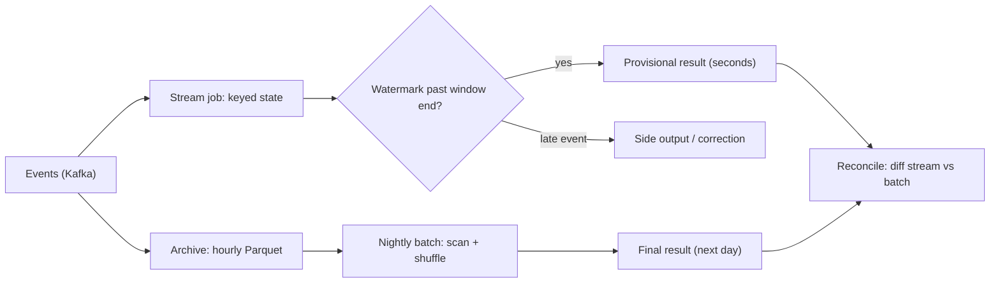

## In one minute
- Batch processing runs a job over a **bounded** input that is complete before the job starts, and produces one final answer. Stream processing runs continuously over an **unbounded** input and produces answers that are updated as data arrives.
- The real difference is not speed but **when you decide the input is complete**. Batch decides by schedule ("yesterday's partition is closed"); streaming decides per window with a watermark, which is a guess.
- Batch is cheaper per record, simpler to reason about, and trivially rerunnable. Streaming buys freshness with always-on capacity, durable state, and the need to handle late and out-of-order events.
- Micro-batching (Spark Structured Streaming) sits between them: small batches every few seconds, with batch-style execution and stream-style state.
- Most real platforms run both: a stream for fresh, provisional numbers and a batch recompute, or a stream replay, for the numbers that close the books.

## How it works

### Bounded versus unbounded
A batch job reads a fixed dataset, such as every order in `dt=2026-10-15`, and computes the result once. Because the input is finite, the engine can sort it, scan it twice, and take its time. If the job fails, rerun it; the input has not changed, so neither will the answer.

A streaming job never sees the end of its input. Events arrive from Kafka, Kinesis or a change-data-capture feed, and the job must emit something useful before it knows whether more relevant events are coming. It keeps per-key **state** (running counts, open sessions, join buffers) between events, and it needs a policy for deciding when a result is final enough to publish.

### Two clocks
Every event has an **event time** (when it happened) and a **processing time** (when the job saw it). In batch the gap barely matters: late uploads are in the partition by the time the job runs, or they are not. In streaming it is the central problem. A user's phone goes offline in a tunnel, and its events arrive four minutes late. A streaming job that grouped by processing time would count them in the wrong minute; one that groups by event time has to keep the minute open, or accept that it will be wrong.

That is the trade every streaming design makes: **completeness, latency and cost, pick a balance**. Wait longer and results are more complete but later. Emit early and update later, and downstream systems must handle changing answers. The [streaming engines lesson](streaming-engines.md) covers how watermarks and triggers express that choice; this lesson is about when to pay for it at all.

### Batch is a special case
The Dataflow model (Google, 2015) frames batch as streaming over a bounded input where the watermark jumps to infinity at the end ([Akidau et al.](https://www.vldb.org/pvldb/vol8/p1792-Akidau.pdf)). Seen that way, the two are the same computation with a different completeness signal. Apache Beam, Flink and Spark all take this view: the same windowed aggregation code can run over a Kafka topic or a directory of Parquet files. Flink's batch mode makes it literal: it ignores user watermark generators and emits a single maximum watermark at the end of input, so every timer fires once ([Flink docs](https://nightlies.apache.org/flink/flink-docs-stable/docs/dev/datastream/execution_mode/)). The engines still execute the two cases differently, which is where the cost difference comes from.

### Micro-batch
Spark Structured Streaming chops the stream into small batches, by default starting the next one as soon as the previous one finishes ([Spark docs](https://spark.apache.org/docs/latest/streaming/apis-on-dataframes-and-datasets.html)), and runs each as a tiny batch job with state carried between them. Latency is the batch interval plus scheduling overhead, typically one to several seconds. In exchange it reuses the batch engine's optimiser, columnar execution and fault model. Record-at-a-time engines such as Flink and Kafka Streams reach tens of milliseconds but pay per-record overhead.

The line between the two is moving. Spark 4.1 (December 2025) added an opt-in Real-time Mode that keeps long-running tasks and streams records through them, with Databricks reporting single-digit-millisecond p99 for simple queries ([Databricks](https://www.databricks.com/blog/introducing-apache-sparkr-41)). In 4.1 it covers stateless queries only, from Kafka to Kafka or `foreach` sinks, and the trigger duration becomes a checkpoint interval rather than a latency target ([Spark docs](https://github.com/apache/spark/blob/master/docs/streaming/real-time-mode.md)). Choose an engine by the operators you need, not by the micro-batch label alone.

### Problem shape: completeness versus timeliness
The same choice appears outside data pipelines. Accounting closes the month after all invoices land, while fraud scoring must judge a payment in 50 ms. An embedding index for retrieval rebuilt nightly is simple and consistent; one updated on every document change is fresh but must handle deletes, reordering and partial failures.

## Down the stack

### Layer 1: The contract
A batch job promises a deterministic function of an immutable input snapshot: same input, same code, same output, and a failed run can be retried from scratch with no visible side effects if the output is written atomically (write to a temporary path, then rename or commit a table snapshot). A streaming job promises a result per key and window that is emitted once the watermark passes the window end, reflects every on-time event exactly once after recovery from a checkpoint, and treats events behind the watermark according to a stated lateness policy. The precise difference: batch's completeness is a fact about the input; streaming's completeness is an estimate, and the contract must say what happens when the estimate is wrong.

### Layer 2: The mechanism
Batch engines are built around the **shuffle**. Spark writes each map task's output sorted by partition into one data file plus an index file, and reducers fetch their byte ranges from every mapper; [MapReduce](mapreduce.md) did the same with spill files merged on disk. Grouping happens by sorting or hashing a whole partition at once. Flink's batch execution mode (`execution.runtime-mode: BATCH`) switches from pipelined to blocking shuffles, groups by sorting instead of keeping state in a key-value store (the configured state backend is ignored), skips checkpoints entirely, and recovers by rerunning failed stages, because the input can be read again ([Flink docs](https://nightlies.apache.org/flink/flink-docs-stable/docs/dev/datastream/execution_mode/)).

Streaming engines are built around **keyed state and timers**. Each record updates its key's state in place; a timer per window fires when the watermark passes. Recovery restores the last checkpoint and replays the source from its saved offsets. Micro-batch engines sit in between: Spark records the offset range of each batch in a write-ahead log before running it and stores state in a versioned store per partition, so a failed batch reruns over the same offset range.

### Layer 3: The machine
Batch wins on hardware efficiency because it can do large sequential I/O. A Parquet file stores data in row groups, each holding one chunk per column: parquet-java writes 128 MB row groups by default ([parquet-java](https://github.com/apache/parquet-java/blob/master/parquet-hadoop/README.md)) and the format's docs recommend 512 MB to 1 GB for larger sequential reads ([Parquet docs](https://parquet.apache.org/docs/file-format/configurations/)). A query reading 3 of 40 columns touches under a tenth of the bytes, and those bytes arrive in multi-megabyte reads that saturate disks and object-store connections. Vectorised operators process batches of values per call (Spark's columnar readers default to 4,096 rows ([Spark config](https://spark.apache.org/docs/latest/configuration.html))), keeping data in CPU caches and amortising function-call overhead. A sort-based shuffle turns a random regrouping into sequential writes plus sequential range reads.

Streaming pays per record. Each event is deserialised, routed through operator code, and usually triggers a state lookup; with an on-disk state store that read can cost 1 to 100 microseconds depending on cache hits. Records are batched into network buffers that flush when full or after a timeout (Flink's `execution.buffer-timeout.interval`, 100 ms by default; older guides call it `execution.buffer-timeout` ([Flink config](https://nightlies.apache.org/flink/flink-docs-stable/docs/deployment/config/))), so latency and throughput trade directly against each other. Checkpoints write state snapshots to object storage every few seconds to minutes. And the capacity is always on: a streaming job sized for the evening peak burns the same cores at 4 a.m.

Batch has its own machine-level failure: burstiness. Google's SRE book describes thousands of workers of a periodic pipeline starting at once and swamping shared services (a thundering herd), and unrelated pipelines whose schedules drift into overlap and spike the same resource together ([Google SRE book](https://sre.google/sre-book/data-processing-pipelines/)). Staggered start times, jittered retries and per-pipeline quotas are the batch equivalent of capacity planning.

### Why it's built this way
1. Data that is all available can be scanned sequentially and sorted, which is the cheapest thing hardware does, so batch engines organise everything around full scans and shuffles.
2. Some decisions are worth more in seconds than tomorrow (fraud, alerting, personalisation), so streaming accepts per-record overhead to act early.
3. Acting early means acting on incomplete data, so streams need event time, watermarks and a lateness policy.
4. Keeping running answers across failures needs durable state and replayable sources, which adds checkpoints, log retention and operational weight.
5. Because batch is cheaper and more certain while streaming is fresher, mature platforms keep both and reconcile them.

## Diagram


## Worked example
A ride-hailing company emits 2 billion trip and app events a day, about 1 KB each: 2 TB a day, averaging 23,000 events per second with an evening peak of 80,000. Two consumers want session metrics (how long riders browse before booking).

**Batch.** A nightly job reads the day's Parquet (compressed to about 400 GB), sessionises by rider, and writes results. With 200 executor cores reading at about 100 MB/s each, the scan takes around 20 seconds of I/O; the shuffle and sort of 2 billion rows dominates, and the job finishes in about 20 minutes. That is roughly 70 core-hours a day, which can run on spot capacity at a deep discount. Results are 1 to 25 hours old but include events from phones that came back online hours late.

**Streaming.** A Flink job sessionises in real time with a 10-minute inactivity gap and a 2-minute watermark delay. Each core handles about 10,000 events per second with state lookups, so the peak needs 8 cores; with 2x headroom for catch-up after a restart, 16 cores run 24 hours: 384 core-hours a day, about five times the batch cost, on on-demand capacity. Sessions are published about 12 minutes after they end. Measured on real traffic, 0.4% of events arrive more than 2 minutes late; those land in a side output.

**The decision.** The marketing dashboard reviewed weekly takes batch. The surge-pricing model, which needs to know that browse sessions in one district have doubled in the last 15 minutes, takes the stream, and its 0.4% loss is acceptable. The finance report on completed trips takes batch because it must match the payment ledger exactly. To catch drift, a daily reconciliation job compares the stream's session counts for yesterday with the batch result and alerts if they differ by more than 1%.

## In the wild
- **Shopify, 2021: from hourly batch extracts to log-based CDC.** The old Longboat system queried each table at most once an hour, so warehouse data was up to an hour stale, and hard deletes or updates that skipped `updated_at` never showed up. The Debezium replacement ran about 150 connectors over more than 100 MySQL shards, averaging 65,000 records per second (peaks of 100,000) during Black Friday 2020 with p99 under 10 seconds into Kafka. The streaming path brought its own costs: snapshots that held read locks for hours and schema changes that broke consumers ([Shopify](https://shopify.engineering/capturing-every-change-shopify-sharded-monolith)).
- **AWS, 2020: the stream itself is a dependency.** On 25 November, adding capacity to the Kinesis Data Streams front-end fleet pushed every server past its OS thread limit, because each server ran a thread per peer. Shard-map caches could not build, Kinesis was impaired for about 17 hours, and services that consume it (Cognito, CloudWatch, EventBridge, autoscaling) degraded too. AWS moved to fewer, larger servers, thread alarms and faster cellularization ([AWS](https://aws.amazon.com/message/11201/)).
- **Amazon Prime Video, 2023: per-event orchestration costs.** A stream-quality monitor built from Step Functions, Lambda and S3 hit account limits at about 5% of expected load, because each second of video drove several billed state transitions and frames moved through S3. Running the same detectors in one process on ECS cut infrastructure cost by more than 90% ([Prime Video, archived](http://web.archive.org/web/20240805183535/https://www.primevideotech.com/video-streaming/scaling-up-the-prime-video-audio-video-monitoring-service-and-reducing-costs-by-90)).

## Trade-offs
| Option | Strengths | Weaknesses | Choose when |
|---|---|---|---|
| Batch | Cheapest per record, complete input, easy reruns and backfills | Hours of staleness, bursty cluster load | Reporting, billing, training data, backfills |
| Micro-batch | Batch engine and optimiser, seconds of latency | Per-batch scheduling overhead, not sub-second | Near-real-time ETL and dashboards |
| Record-at-a-time stream | Milliseconds to seconds, continuous state | Always-on cost, watermarks, harder ops | Fraud, alerting, live features, CDC fan-out |
| Stream plus batch reconcile | Fresh numbers and exact numbers | Two outputs to explain, drift to monitor | Money, compliance, anything audited |
| Stream with replay (Kappa) | One codebase, reprocess by replaying the log | Long log retention, slow full replays | Logic that is naturally incremental |

## Pitfalls in production
- **Streaming by default.** A pipeline whose only consumer is a daily report pays five times the cost for freshness nobody reads. Name the decision that needs low latency first.
- **Processing-time windows.** Grouping by arrival time makes results depend on lag; a consumer restart that replays an hour piles that hour into the current minute. Window by event time.
- **Batch jobs that read an open partition.** A nightly job that starts at 00:05 misses events still being flushed for the previous day. Gate the job on a completeness signal (a `_SUCCESS` marker, a table snapshot, or the upstream watermark) instead of the wall clock. Google's SRE workbook puts the rule plainly: stale data is almost always better than incorrect data ([SRE workbook](https://sre.google/workbook/data-processing/)).
- **Silent late-data loss.** Dropped late events show up as a small, persistent gap between stream and batch numbers. Route late events to a side output, count them, and alert when the rate moves.
- **Non-deterministic batch jobs.** `now()`, unstable sorts or live lookups break the promise that reruns match. Pass the logical date in and pin reference data to a snapshot.
- **Two codebases drifting.** Batch SQL and stream Java implementing "the same" metric diverge within months. Share the logic (Beam, Flink SQL in both modes, or one library) and reconcile outputs daily.

## Leadership lens
- Make teams state the freshness requirement as a number and the decision it serves. "Real time" is not a requirement; "block the payment within 200 ms" is.
- Streaming jobs are services needing on-call, capacity planning and state migration. Budget operational time, not just compute.
- Insist on a reconciliation path for any streamed number that touches money or external reporting, and decide up front which number wins when they disagree.
- Keep backfill as a first-class requirement: the team must be able to recompute last quarter after a bug fix in a predictable number of hours.

## Check yourself
1. Why can a failed batch job simply be rerun, while a failed streaming job needs checkpoints?
   **Answer:** The batch input is an immutable snapshot, so a rerun from scratch produces the same output. A streaming job's accumulated state reflects input it may no longer be able to reread cheaply, so it must snapshot state together with source offsets to resume consistently.
2. A streaming job with a 1-minute watermark delay and a batch job over the same day disagree by 0.3%. Which is more likely to be right, and why?
   **Answer:** Usually the batch job, because it ran after the data settled and saw events that arrived behind the stream's watermark. The gap is the late-data rate, which should be measured rather than guessed.
3. When is micro-batching a better choice than a record-at-a-time engine?
   **Answer:** When seconds of latency are acceptable and the team benefits from the batch engine's SQL optimiser, columnar execution and simpler operations. Sub-second requirements push toward record-at-a-time.
4. Why does the Dataflow model call batch a special case of streaming?
   **Answer:** A bounded input is a stream whose watermark jumps to infinity after the last record, so every window is known to be complete and fires exactly once with the full answer.

## Practice
**Task:** Build session windows both ways and show when they agree. A session for a user is a maximal set of events where each event is less than `gap` after the previous one; it spans `[first_ts, last_ts + gap)`. `batch_sessions(events, gap)` takes `(user, ts)` pairs in any order and returns `(user, start, end, count)` tuples sorted by user then start. `SessionStream(gap, max_delay)` processes events one at a time: `on_event(user, ts)` treats the event as late (record it, return nothing) if `ts` is below the current watermark; otherwise it opens the window `[ts, ts + gap)`, merges it with every open session of that user it overlaps (which may join two sessions into one), then raises the watermark to `ts - max_delay` if that is higher, and returns all open sessions (any user) whose end is at or below the watermark, sorted by user then start. `flush()` returns every remaining open session in the same order, and `late_events()` returns the late `(user, ts)` pairs in arrival order. The watermark starts below every timestamp.

```python starter
def batch_sessions(events, gap):
    # TODO
    raise NotImplementedError

class SessionStream:
    def __init__(self, gap, max_delay):
        self.gap = gap
        self.max_delay = max_delay

    def on_event(self, user, ts):
        # TODO
        raise NotImplementedError

    def flush(self):
        # TODO
        raise NotImplementedError

    def late_events(self):
        # TODO
        raise NotImplementedError
```

```python tests
def run_stream(events, gap, delay):
    s = SessionStream(gap, delay)
    out = []
    for user, ts in events:
        out.extend(s.on_event(user, ts))
    out.extend(s.flush())
    return s, out

def test_batch_basic():
    events = [("a", 20), ("b", 3), ("a", 1), ("a", 5)]
    assert batch_sessions(events, 10) == [("a", 1, 15, 2), ("a", 20, 30, 1), ("b", 3, 13, 1)]

def test_gap_equal_splits():
    assert batch_sessions([("a", 0), ("a", 10)], 10) == [("a", 0, 10, 1), ("a", 10, 20, 1)]

def test_stream_emits_when_watermark_passes_end():
    s = SessionStream(10, 5)
    assert s.on_event("a", 1) == []
    assert s.on_event("a", 5) == []
    assert s.on_event("a", 30) == [("a", 1, 15, 2)]
    assert s.flush() == [("a", 30, 40, 1)]

def test_out_of_order_event_bridges_sessions():
    s, out = run_stream([("a", 0), ("a", 18), ("a", 9)], 10, 20)
    assert out == [("a", 0, 28, 3)]
    assert s.late_events() == []

def test_late_event_dropped_and_batch_differs():
    events = [("a", 0), ("a", 50), ("a", 45)]
    s, out = run_stream(events, 10, 0)
    assert out == [("a", 0, 10, 1), ("a", 50, 60, 1)]
    assert s.late_events() == [("a", 45)]
    assert batch_sessions(events, 10) == [("a", 0, 10, 1), ("a", 45, 60, 2)]

def test_one_event_closes_many_sorted():
    s = SessionStream(5, 0)
    s.on_event("b", 1)
    s.on_event("a", 2)
    assert s.on_event("c", 100) == [("a", 2, 7, 1), ("b", 1, 6, 1)]

def test_stream_matches_batch_with_bounded_disorder():
    events = [("u1", 3), ("u2", 1), ("u1", 1), ("u2", 9), ("u1", 12), ("u2", 6),
              ("u1", 30), ("u1", 25), ("u2", 40), ("u1", 36), ("u2", 38), ("u1", 60)]
    s, out = run_stream(events, 8, 6)
    assert s.late_events() == []
    assert sorted(out) == batch_sessions(events, 8)
```

```python solution
def batch_sessions(events, gap):
    by_user = {}
    for user, ts in events:
        by_user.setdefault(user, []).append(ts)
    out = []
    for user in sorted(by_user):
        times = sorted(by_user[user])
        start = prev = times[0]
        count = 1
        for ts in times[1:]:
            if ts - prev < gap:
                count += 1
            else:
                out.append((user, start, prev + gap, count))
                start, count = ts, 1
            prev = ts
        out.append((user, start, prev + gap, count))
    return out

class SessionStream:
    def __init__(self, gap, max_delay):
        self.gap = gap
        self.max_delay = max_delay
        self.watermark = None
        self.open = {}
        self.late = []

    def on_event(self, user, ts):
        if self.watermark is not None and ts < self.watermark:
            self.late.append((user, ts))
            return []
        start, end, count = ts, ts + self.gap, 1
        keep = []
        for s, e, c in self.open.get(user, []):
            if s < end and start < e:
                start, end, count = min(start, s), max(end, e), count + c
            else:
                keep.append((s, e, c))
        keep.append((start, end, count))
        self.open[user] = keep
        wm = ts - self.max_delay
        if self.watermark is None or wm > self.watermark:
            self.watermark = wm
        return self._emit(lambda e: e <= self.watermark)

    def _emit(self, ready):
        out = []
        for user in list(self.open):
            stay = []
            for s, e, c in self.open[user]:
                if ready(e):
                    out.append((user, s, e, c))
                else:
                    stay.append((s, e, c))
            if stay:
                self.open[user] = stay
            else:
                del self.open[user]
        return sorted(out)

    def flush(self):
        return self._emit(lambda e: True)

    def late_events(self):
        return list(self.late)
```

```typescript starter
export type Session = [string, number, number, number];

export function batchSessions(events: [string, number][], gap: number): Session[] {
  throw new Error("TODO");
}

export class SessionStream {
  constructor(public gap: number, public maxDelay: number) {}
  onEvent(user: string, ts: number): Session[] {
    throw new Error("TODO");
  }
  flush(): Session[] {
    throw new Error("TODO");
  }
  lateEvents(): [string, number][] {
    throw new Error("TODO");
  }
}
```

```typescript tests
function runStream(events: [string, number][], gap: number, delay: number): [SessionStream, Session[]] {
  const s = new SessionStream(gap, delay);
  const out: Session[] = [];
  for (const [u, ts] of events) out.push(...s.onEvent(u, ts));
  out.push(...s.flush());
  return [s, out];
}

function byUserStart(a: Session, b: Session): number {
  if (a[0] !== b[0]) return a[0] < b[0] ? -1 : 1;
  return a[1] - b[1];
}

test("batch basic", () => {
  assertEqual(batchSessions([["a", 20], ["b", 3], ["a", 1], ["a", 5]], 10),
    [["a", 1, 15, 2], ["a", 20, 30, 1], ["b", 3, 13, 1]]);
});
test("gap equal splits", () => {
  assertEqual(batchSessions([["a", 0], ["a", 10]], 10), [["a", 0, 10, 1], ["a", 10, 20, 1]]);
});
test("stream emits when watermark passes end", () => {
  const s = new SessionStream(10, 5);
  assertEqual(s.onEvent("a", 1), []);
  assertEqual(s.onEvent("a", 5), []);
  assertEqual(s.onEvent("a", 30), [["a", 1, 15, 2]]);
  assertEqual(s.flush(), [["a", 30, 40, 1]]);
});
test("out of order event bridges sessions", () => {
  const [s, out] = runStream([["a", 0], ["a", 18], ["a", 9]], 10, 20);
  assertEqual(out, [["a", 0, 28, 3]]);
  assertEqual(s.lateEvents(), []);
});
test("late event dropped and batch differs", () => {
  const events: [string, number][] = [["a", 0], ["a", 50], ["a", 45]];
  const [s, out] = runStream(events, 10, 0);
  assertEqual(out, [["a", 0, 10, 1], ["a", 50, 60, 1]]);
  assertEqual(s.lateEvents(), [["a", 45]]);
  assertEqual(batchSessions(events, 10), [["a", 0, 10, 1], ["a", 45, 60, 2]]);
});
test("one event closes many sorted", () => {
  const s = new SessionStream(5, 0);
  s.onEvent("b", 1);
  s.onEvent("a", 2);
  assertEqual(s.onEvent("c", 100), [["a", 2, 7, 1], ["b", 1, 6, 1]]);
});
test("stream matches batch with bounded disorder", () => {
  const events: [string, number][] = [["u1", 3], ["u2", 1], ["u1", 1], ["u2", 9], ["u1", 12], ["u2", 6],
    ["u1", 30], ["u1", 25], ["u2", 40], ["u1", 36], ["u2", 38], ["u1", 60]];
  const [s, out] = runStream(events, 8, 6);
  assertEqual(s.lateEvents(), []);
  assertEqual(out.slice().sort(byUserStart), batchSessions(events, 8));
});
```

```typescript solution
export type Session = [string, number, number, number];

function sortSessions(xs: Session[]): Session[] {
  return xs.sort((a, b) => (a[0] !== b[0] ? (a[0] < b[0] ? -1 : 1) : a[1] - b[1]));
}

export function batchSessions(events: [string, number][], gap: number): Session[] {
  const byUser = new Map<string, number[]>();
  for (const [u, ts] of events) {
    if (!byUser.has(u)) byUser.set(u, []);
    byUser.get(u)!.push(ts);
  }
  const out: Session[] = [];
  for (const u of Array.from(byUser.keys()).sort()) {
    const times = byUser.get(u)!.slice().sort((a, b) => a - b);
    let start = times[0];
    let prev = times[0];
    let count = 1;
    for (const ts of times.slice(1)) {
      if (ts - prev < gap) {
        count++;
      } else {
        out.push([u, start, prev + gap, count]);
        start = ts;
        count = 1;
      }
      prev = ts;
    }
    out.push([u, start, prev + gap, count]);
  }
  return out;
}

export class SessionStream {
  private watermark = -Infinity;
  private open = new Map<string, [number, number, number][]>();
  private late: [string, number][] = [];

  constructor(public gap: number, public maxDelay: number) {}

  onEvent(user: string, ts: number): Session[] {
    if (ts < this.watermark) {
      this.late.push([user, ts]);
      return [];
    }
    let start = ts;
    let end = ts + this.gap;
    let count = 1;
    const keep: [number, number, number][] = [];
    for (const [s, e, c] of this.open.get(user) ?? []) {
      if (s < end && start < e) {
        start = Math.min(start, s);
        end = Math.max(end, e);
        count += c;
      } else {
        keep.push([s, e, c]);
      }
    }
    keep.push([start, end, count]);
    this.open.set(user, keep);
    this.watermark = Math.max(this.watermark, ts - this.maxDelay);
    const wm = this.watermark;
    return this.emit((e) => e <= wm);
  }

  private emit(ready: (end: number) => boolean): Session[] {
    const out: Session[] = [];
    for (const [user, list] of Array.from(this.open.entries())) {
      const stay: [number, number, number][] = [];
      for (const [s, e, c] of list) {
        if (ready(e)) out.push([user, s, e, c]);
        else stay.push([s, e, c]);
      }
      if (stay.length > 0) this.open.set(user, stay);
      else this.open.delete(user);
    }
    return sortSessions(out);
  }

  flush(): Session[] {
    return this.emit(() => true);
  }

  lateEvents(): [string, number][] {
    return this.late.slice();
  }
}
```

```go starter
package practice

type Event struct {
	User string
	TS   int
}

type Session struct {
	User       string
	Start, End int
	Count      int
}

func BatchSessions(events []Event, gap int) []Session { panic("TODO") }

type SessionStream struct{}

func NewSessionStream(gap, maxDelay int) *SessionStream { return &SessionStream{} }

func (s *SessionStream) OnEvent(user string, ts int) []Session { panic("TODO") }
func (s *SessionStream) Flush() []Session                      { panic("TODO") }
func (s *SessionStream) LateEvents() []Event                   { panic("TODO") }
```

```go tests
package practice

import (
	"reflect"
	"sort"
	"testing"
)

func runStream(events []Event, gap, delay int) (*SessionStream, []Session) {
	s := NewSessionStream(gap, delay)
	out := []Session{}
	for _, e := range events {
		out = append(out, s.OnEvent(e.User, e.TS)...)
	}
	out = append(out, s.Flush()...)
	return s, out
}

func same(t *testing.T, got, want interface{}) {
	t.Helper()
	if !reflect.DeepEqual(got, want) {
		t.Fatalf("got %v, want %v", got, want)
	}
}

func TestBatchBasic(t *testing.T) {
	got := BatchSessions([]Event{{"a", 20}, {"b", 3}, {"a", 1}, {"a", 5}}, 10)
	same(t, got, []Session{{"a", 1, 15, 2}, {"a", 20, 30, 1}, {"b", 3, 13, 1}})
}

func TestGapEqualSplits(t *testing.T) {
	same(t, BatchSessions([]Event{{"a", 0}, {"a", 10}}, 10), []Session{{"a", 0, 10, 1}, {"a", 10, 20, 1}})
}

func TestStreamEmitsWhenWatermarkPassesEnd(t *testing.T) {
	s := NewSessionStream(10, 5)
	same(t, s.OnEvent("a", 1), []Session{})
	same(t, s.OnEvent("a", 5), []Session{})
	same(t, s.OnEvent("a", 30), []Session{{"a", 1, 15, 2}})
	same(t, s.Flush(), []Session{{"a", 30, 40, 1}})
}

func TestOutOfOrderEventBridgesSessions(t *testing.T) {
	s, out := runStream([]Event{{"a", 0}, {"a", 18}, {"a", 9}}, 10, 20)
	same(t, out, []Session{{"a", 0, 28, 3}})
	same(t, s.LateEvents(), []Event{})
}

func TestLateEventDroppedAndBatchDiffers(t *testing.T) {
	events := []Event{{"a", 0}, {"a", 50}, {"a", 45}}
	s, out := runStream(events, 10, 0)
	same(t, out, []Session{{"a", 0, 10, 1}, {"a", 50, 60, 1}})
	same(t, s.LateEvents(), []Event{{"a", 45}})
	same(t, BatchSessions(events, 10), []Session{{"a", 0, 10, 1}, {"a", 45, 60, 2}})
}

func TestOneEventClosesManySorted(t *testing.T) {
	s := NewSessionStream(5, 0)
	s.OnEvent("b", 1)
	s.OnEvent("a", 2)
	same(t, s.OnEvent("c", 100), []Session{{"a", 2, 7, 1}, {"b", 1, 6, 1}})
}

func TestStreamMatchesBatchWithBoundedDisorder(t *testing.T) {
	events := []Event{{"u1", 3}, {"u2", 1}, {"u1", 1}, {"u2", 9}, {"u1", 12}, {"u2", 6},
		{"u1", 30}, {"u1", 25}, {"u2", 40}, {"u1", 36}, {"u2", 38}, {"u1", 60}}
	s, out := runStream(events, 8, 6)
	same(t, s.LateEvents(), []Event{})
	sort.Slice(out, func(i, j int) bool {
		if out[i].User != out[j].User {
			return out[i].User < out[j].User
		}
		return out[i].Start < out[j].Start
	})
	same(t, out, BatchSessions(events, 8))
}
```

```go solution
package practice

import "sort"

type Event struct {
	User string
	TS   int
}

type Session struct {
	User       string
	Start, End int
	Count      int
}

func sortSessions(xs []Session) {
	sort.Slice(xs, func(i, j int) bool {
		if xs[i].User != xs[j].User {
			return xs[i].User < xs[j].User
		}
		return xs[i].Start < xs[j].Start
	})
}

func BatchSessions(events []Event, gap int) []Session {
	byUser := map[string][]int{}
	for _, e := range events {
		byUser[e.User] = append(byUser[e.User], e.TS)
	}
	users := make([]string, 0, len(byUser))
	for u := range byUser {
		users = append(users, u)
	}
	sort.Strings(users)
	out := []Session{}
	for _, u := range users {
		times := append([]int(nil), byUser[u]...)
		sort.Ints(times)
		start, prev, count := times[0], times[0], 1
		for _, ts := range times[1:] {
			if ts-prev < gap {
				count++
			} else {
				out = append(out, Session{u, start, prev + gap, count})
				start, count = ts, 1
			}
			prev = ts
		}
		out = append(out, Session{u, start, prev + gap, count})
	}
	return out
}

type window struct{ start, end, count int }

type SessionStream struct {
	gap, maxDelay int
	hasWM         bool
	watermark     int
	open          map[string][]window
	late          []Event
}

func NewSessionStream(gap, maxDelay int) *SessionStream {
	return &SessionStream{gap: gap, maxDelay: maxDelay, open: map[string][]window{}, late: []Event{}}
}

func (s *SessionStream) OnEvent(user string, ts int) []Session {
	if s.hasWM && ts < s.watermark {
		s.late = append(s.late, Event{user, ts})
		return []Session{}
	}
	cur := window{ts, ts + s.gap, 1}
	keep := []window{}
	for _, w := range s.open[user] {
		if w.start < cur.end && cur.start < w.end {
			if w.start < cur.start {
				cur.start = w.start
			}
			if w.end > cur.end {
				cur.end = w.end
			}
			cur.count += w.count
		} else {
			keep = append(keep, w)
		}
	}
	s.open[user] = append(keep, cur)
	if wm := ts - s.maxDelay; !s.hasWM || wm > s.watermark {
		s.watermark, s.hasWM = wm, true
	}
	return s.emit(func(end int) bool { return end <= s.watermark })
}

func (s *SessionStream) emit(ready func(int) bool) []Session {
	out := []Session{}
	for user, list := range s.open {
		stay := []window{}
		for _, w := range list {
			if ready(w.end) {
				out = append(out, Session{user, w.start, w.end, w.count})
			} else {
				stay = append(stay, w)
			}
		}
		if len(stay) > 0 {
			s.open[user] = stay
		} else {
			delete(s.open, user)
		}
	}
	sortSessions(out)
	return out
}

func (s *SessionStream) Flush() []Session {
	return s.emit(func(int) bool { return true })
}

func (s *SessionStream) LateEvents() []Event {
	return append([]Event{}, s.late...)
}
```

## Mock interview
**Prompt:** An e-commerce company wants per-seller revenue numbers. Sellers want to see today's sales updating within a minute, and finance needs monthly totals that match the payment ledger to the cent. Orders peak at 15,000 per second, and about 1% of order events arrive more than five minutes late because of mobile clients and retries. Design the processing.

- Follow-up: A seller's live dashboard shows a different daily total from the next morning's report. How do you explain and bound the difference?
- Follow-up: You find a currency-conversion bug that has been live for three weeks. How do you fix both the live numbers and the historical ones?
- Follow-up: Leadership asks to drop the batch pipeline to save money. What would you need to be true first?

**A strong answer covers:**
- Event-time windows with a stated watermark delay for the live view, and late events routed to corrections instead of silently dropped.
- A batch (or full replay) computation over a closed, immutable input for the monthly ledger-matching totals, gated on a completeness signal rather than a clock.
- A daily reconciliation job with an alert threshold, and a rule for which number is authoritative where.
- Backfill: deterministic jobs keyed by logical date, rerun over the archive or replayed from the log, with atomic output swaps.
- Cost reasoning: always-on streaming capacity sized for peak versus scheduled batch on cheaper capacity, and the conditions (shared logic, proven replay, monitored late rate) for retiring one path.

## Sources and further study
**Primary**
- [Zaharia et al., Discretized Streams (SOSP 2013)](https://people.csail.mit.edu/matei/papers/2013/sosp_spark_streaming.pdf): the original micro-batch design and why it recovers by recomputing small batches.
- [Armbrust et al., Structured Streaming (SIGMOD 2018)](https://people.eecs.berkeley.edu/~matei/papers/2018/sigmod_structured_streaming.pdf): incrementalising a batch query, and running streaming and batch side by side in production.
- [Akidau et al., MillWheel (VLDB 2013)](https://research.google/pubs/millwheel-fault-tolerant-stream-processing-at-internet-scale/): Google's record-at-a-time engine with persistent state and logical time.

**Systems docs**
- [Spark Real-time Mode](https://github.com/apache/spark/blob/master/docs/streaming/real-time-mode.md): what changes when Structured Streaming stops waiting for batch boundaries, and what it does not yet support.
- [Flink: generating watermarks](https://nightlies.apache.org/flink/flink-docs-stable/docs/dev/datastream/event-time/generating_watermarks/): how event-time completeness is estimated and what idle sources do to it.

**Books**
- *Designing Data-Intensive Applications*, Martin Kleppmann, chapters 10 "Batch Processing" and 11 "Stream Processing" (chapters 11 and 12 in the 2026 second edition with Chris Riccomini).
- *Streaming Systems*, Tyler Akidau, Slava Chernyak and Reuven Lax, chapters 1 "Streaming 101" to 3 "Watermarks": bounded versus unbounded data and the what, where, when and how of processing.

**Other curricula**
- [Google SRE book, chapter 25 "Data Processing Pipelines"](https://sre.google/sre-book/data-processing-pipelines/): frames periodic batch pipelines as fragile at scale and argues for continuous processing once work is continuous.
- [Google SRE workbook, "Data Processing Pipelines"](https://sre.google/workbook/data-processing/): treats freshness, correctness and coverage as SLOs, with Spotify's event delivery as the case study.
- [Azure Architecture Center: big data architectures](https://learn.microsoft.com/en-us/azure/architecture/databases/guide/big-data-architectures): presents batch and stream as cold and hot paths of one platform, then Lambda, Kappa and lakehouse.

## Watch
- [Streaming vs Batch Processing explained with examples (Jenny Man)](https://www.youtube.com/watch?v=cZ55nYW82HE): a short comparison with concrete cases for each.
- [Batch vs Realtime Stream Processing: A Deep Dive (The Geek Narrator)](https://www.youtube.com/watch?v=pOqQ-0cRWKU): a long-form conversation on costs, latency and where each approach fits.

## Free resources
- [Streaming 101: The world beyond batch (Tyler Akidau)](https://www.oreilly.com/radar/the-world-beyond-batch-streaming-101/): bounded versus unbounded data, event time versus processing time, and why batch is a special case.
- [Streaming 102 (Tyler Akidau)](https://www.oreilly.com/radar/the-world-beyond-batch-streaming-102/): watermarks, triggers and accumulation modes with worked diagrams.
- [The Dataflow Model (Akidau et al., VLDB 2015)](https://www.vldb.org/pvldb/vol8/p1792-Akidau.pdf): the paper that unified batch and streaming semantics.
- [Flink execution mode: batch and streaming](https://nightlies.apache.org/flink/flink-docs-stable/docs/dev/datastream/execution_mode/): how the same program runs differently over bounded input.
- [Spark Structured Streaming programming guide](https://spark.apache.org/docs/latest/structured-streaming-programming-guide.html): micro-batch triggers, watermarks and state in a batch-derived engine.
