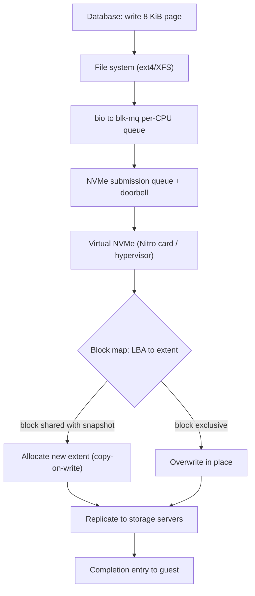

## In one minute
- Block storage exposes a device as a flat array of fixed-size blocks addressed by number (logical block address, LBA); the only operations are read N blocks, write N blocks, flush, and discard.
- It knows nothing about files, names or permissions. A file system or database on top supplies all of that, which is why block storage is the layer under nearly every database, VM disk and container volume.
- It comes as local disks (NVMe, SATA), shared SANs (iSCSI, Fibre Channel, NVMe over Fabrics), and cloud network volumes (Amazon EBS, Google Persistent Disk, Ceph RBD) that are replicated and attached to one machine at a time.
- Performance is three numbers, IOPS, throughput and latency, tied together by queue depth. Network volumes trade some latency for durability, snapshots and the ability to move between hosts.
- Snapshots are copy-on-write: a snapshot freezes a block map, and later writes go to new blocks. The problem shapes are "partial failure" (torn writes, lost flushes) and "trust but verify" (is the data durable when the call returns?).

## How it works

### The interface
A 1 TiB NVMe drive with 4 KiB logical blocks is an array of 268,435,456 blocks. The host submits commands such as "read 8 blocks at LBA 1,048,576 into this buffer", and a completion arrives later. Block 77 is just 4,096 bytes with no name. A file system (ext4, XFS) keeps its superblock, inodes, bitmaps and journal inside those blocks, and databases on top think in 8 KiB or 16 KiB pages that line up with them.

**Flush** (or a FUA write) makes previously acknowledged writes durable; it is what `fsync` ultimately triggers. **Discard** (TRIM, UNMAP, NVMe Deallocate) says a range holds no data, so an SSD can erase it and a thin volume can release the space.

### Block, file and object
File storage (NFS, SMB, EFS) moves the file system to a server shared by many clients. Object storage (its own lesson) drops in-place updates: whole objects by key over HTTP. Block storage is the lowest and fastest of the three, usually attached to one host at a time, because two hosts mounting one ext4 file system would corrupt each other's caches and allocation maps.

### Where block storage lives
**Local disks** give the lowest latency, roughly 80 to 100 microseconds for a 4 KiB random read on a datacenter NVMe SSD, but die with the host. **SANs** put disk arrays on a dedicated network and present LUNs to servers over iSCSI or Fibre Channel. **Cloud volumes** are SANs at fleet scale: replicated extents on storage servers that a card or hypervisor presents to the guest as a local NVMe device, which you can detach, reattach elsewhere, resize and snapshot.

### Snapshots and thin provisioning
A cloud volume is a map from logical block to physical location, and a **snapshot** freezes that map. The first write to a block afterwards goes to a new physical block, leaving the old one to the snapshot: copy-on-write, so a snapshot costs nothing up front and grows only with changes. AWS stores EBS snapshots incrementally in S3, replicated across the Region's zones ([EBS snapshots](https://docs.aws.amazon.com/ebs/latest/userguide/ebs-snapshots.html)), so a daily snapshot of a 1 TiB volume that changes 20 GiB a day costs about 20 GiB per day, not 1 TiB. **Thin provisioning** uses the same map: a 1 TiB volume consumes physical space only for blocks ever written, and discard returns it.

## Down the stack

### Layer 1: The contract
A write that has completed may still sit in a volatile device cache; only after a completed flush, or a write with Force Unit Access, must it survive power loss. Writes are atomic only up to the device's atomic write unit, typically one logical block (512 B or 4 KiB). A 16 KiB InnoDB page written as four 4 KiB blocks can be torn: half old, half new after a crash. There is no ordering promise between concurrently outstanding writes, so a file system that needs "journal before data" must wait for completion and flush in between. Cloud volumes add availability and durability numbers: AWS states 99.8% to 99.9% annual durability for gp3 and 99.999% for io2 Block Express ([EBS volume types](https://docs.aws.amazon.com/ebs/latest/userguide/ebs-volume-types.html)), and performance limits, such as gp3's baseline of 3,000 IOPS and 125 MiB/s, provisionable up to 80,000 IOPS and 2,000 MiB/s at 500 IOPS per GiB ([gp3 docs](https://docs.aws.amazon.com/ebs/latest/userguide/general-purpose.html)). Those gp3 ceilings were 16 TiB, 16,000 IOPS and 1,000 MiB/s until September 2025 ([AWS announcement](https://aws.amazon.com/about-aws/whats-new/2025/09/amazon-ebs-size-provisioned-performance-gp3-volumes)), so older sizing guides that stripe several gp3 volumes for performance may no longer need to. Note the durability figure is per volume, not per byte: a 0.1% to 0.2% annual failure rate means one or two lost volumes per 1,000 a year, which is why snapshots are not optional.

### Layer 2: The mechanism
In Linux, a file system submits I/O as `struct bio` requests, which the multi-queue block layer (`blk-mq`) places on per-CPU software queues, optionally merges and schedules, and maps to hardware dispatch queues ([blk-mq docs](https://www.kernel.org/doc/html/latest/block/blk-mq.html)). NVMe allows up to 65,535 I/O queues, each holding up to about 64K outstanding commands ([NVM Express FAQ](https://nvmexpress.org/faq-items/what-makes-nvme-architecture-so-efficient/)), so every core can have its own queue without locks. The driver writes a 64-byte command into the submission queue, rings a doorbell register, and the device posts a 16-byte completion entry and raises an interrupt or is polled.

Network volumes add a translation layer. Ceph RBD stripes an image across RADOS objects, 4 MiB by default ([rbd manual](https://docs.ceph.com/en/latest/man/8/rbd/)), placed on OSDs by the CRUSH algorithm and replicated three ways; the primary OSD acknowledges a write only after every replica has persisted it. Each OSD runs BlueStore, which writes straight to the raw device, keeps its block map in an embedded RocksDB with a write-ahead log, and checksums everything it stores; the older FileStore backend, which journaled into a local file system, is unsupported from the Reef release on ([Ceph storage devices](https://docs.ceph.com/en/latest/rados/configuration/storage-devices/)). Snapshots are tracked per object, so the first write to an object after a snapshot clones it. Linux device-mapper's thin provisioning ([kernel docs](https://docs.kernel.org/admin-guide/device-mapper/thin-provisioning.html)) keeps a B-tree from virtual block to data block on a metadata device, with reference counts so snapshots can share blocks; a block whose count drops to zero returns to the pool. EBS keeps its volume configuration in a cell-based store called Physalia, described in an NSDI 2020 paper as "millions" of small databases rather than one ([Brooker et al.](https://www.usenix.org/conference/nsdi20/presentation/brooker)), so that re-mirroring after a server failure does not depend on one central database.

### Layer 3: The machine
Every I/O on a network volume is a network round trip plus a replicated write. On AWS Nitro instances, a dedicated card presents the EBS volume to the guest as an NVMe device and speaks AWS's own transport to storage servers; AWS promises gp3 only single-digit millisecond latency, and designs io2 Block Express for an average under 500 microseconds on 16 KiB I/Os ([gp3 docs](https://docs.aws.amazon.com/ebs/latest/userguide/general-purpose.html)), against roughly 0.1 ms for instance-store NVMe.

Latency and IOPS are linked by Little's law: `IOPS = outstanding I/Os / latency`. At 0.5 ms per I/O, a single-threaded synchronous writer (queue depth 1) gets at most 2,000 IOPS no matter what was provisioned; reaching 16,000 IOPS needs at least 8 I/Os in flight. Throughput limits bind with large I/Os instead: at 125 MiB/s, 256 KiB writes top out near 500 per second. A database `fsync` on a network volume therefore costs about a millisecond, which is why commit-heavy workloads lean on group commit.

Databases guard against torn pages themselves: Postgres logs a full page image on the first change after a checkpoint (`full_page_writes`, [Postgres docs](https://www.postgresql.org/docs/current/runtime-config-wal.html)), and InnoDB writes pages to a doublewrite buffer first, on by default ([MySQL docs](https://dev.mysql.com/doc/refman/8.4/en/innodb-doublewrite-buffer.html)). Both spend write bandwidth that a larger atomic write unit would save, and that unit now exists in places. EBS offers torn write prevention for aligned 4, 8 and 16 KiB writes on every volume attached to a Nitro instance ([EC2 docs](https://docs.aws.amazon.com/AWSEC2/latest/UserGuide/supported-block-sizes.html)), and Linux 6.11 added the `RWF_ATOMIC` flag so an application can ask for an all-or-nothing write: `O_DIRECT` only, a power-of-two length within the limits `statx` reports, at a naturally aligned offset ([pwritev2(2)](https://man7.org/linux/man-pages/man2/pwritev2.2.html)). An end-to-end atomic 16 KiB write is what makes it safe to switch off the doublewrite buffer; without one, switching it off trades integrity for speed.

### Why it's built this way
1. Disks and flash read and write in fixed units (512 B sectors, 4 KiB to 16 KiB flash pages), so the interface is fixed-size blocks, not bytes.
2. Different software wants different structures on top (file systems, databases, VM images), so the device offers only an address space and leaves meaning to the layer above.
3. Device caches are volatile and reordering raises throughput, so durability and order are opt-in through flush and FUA, not free on every write.
4. A local disk dies with its host, so cloud volumes replicate over the network and accept extra latency in exchange for durability and detach-and-reattach.
5. Copying a full volume to back it up is slow and expensive, so volumes keep a block map and snapshot by freezing it, paying only for changed blocks.

## Diagram


## Worked example
A Postgres primary on a 2 TiB gp3 volume does 6,000 commits per second at peak, each touching a few 8 KiB pages, with a 300 GB working set.

Commits first. Each commit needs a WAL `fsync`. At about 1 ms per flush and queue depth 1, one flushing process could commit 1,000 times per second. Group commit lets one `fsync` cover every transaction that arrived meanwhile, so 6,000 commits per second need only a few hundred flushes per second. The volume never sees 6,000 flush IOPS; latency is the limit, not provisioned IOPS.

Then page I/O. Checkpoints write dirty pages: if 40 GB of pages are dirtied between checkpoints every 15 minutes, that is about 45 MB/s spread over the interval, comfortably below gp3's 125 MiB/s baseline. Cache misses on a 300 GB working set with 128 GB of RAM produce perhaps 4,000 random 8 KiB reads per second, above gp3's 3,000 IOPS baseline, so provision 8,000 IOPS for headroom. Provisioning IOPS and throughput separately from size is the point of gp3; on a volume type that scales IOPS with size you would be buying unused terabytes to get the IOPS.

Snapshots: with 60 GB of changed blocks a day and 30-day retention, storage is one full copy of the written blocks plus 1.8 TB of increments. A restored volume loads lazily from S3, block by block on first read, so a freshly restored replica is much slower until it has touched its working set. Two paid options remove the guesswork: fast snapshot restore, which delivers full performance at creation, or a provisioned initialization rate of 100 to 300 MiB/s; at 300 MiB/s, 1.2 TB of written blocks takes a little over an hour ([EBS docs](https://docs.aws.amazon.com/ebs/latest/userguide/initalize-volume.html)).

## In the wild
- **AWS, 2011: the EBS re-mirroring storm.** A mistaken network change in one US-East zone pushed primary traffic onto a low-capacity backup network, cutting many EBS nodes off from their replicas. When the network returned, every node searched for free space to re-mirror at once, exhausted the cluster's spare capacity, and about 13% of the zone's volumes got stuck; slow control-plane calls then starved the regional API. Recovery took about three days and 0.07% of volumes could not be restored to a consistent state. AWS added spare capacity, made nodes back off and reconnect to their old replicas, and fenced the control plane per zone ([AWS summary](https://aws.amazon.com/message/65648/)).
- **AWS, 2012: a stale DNS entry leaks memory on every storage server.** After a data-collection server was replaced, a DNS update did not reach every internal resolver, so a data-collection agent on some EBS storage servers kept retrying the dead address and slowly leaked memory. Aggregate memory alarms stayed quiet because storage servers use memory dynamically. Starting at 10:00 PDT, volumes in one zone degraded and then stuck in large numbers, and EBS's own failover logic accelerated the slide; nearly all were back by 16:15. AWS added alarms for that leak, moved to per-process memory monitoring, and planned resource limits for low-priority processes on storage hosts ([AWS summary](https://aws.amazon.com/message/680342/)).

## Trade-offs
| Option | Strengths | Weaknesses | Choose when |
|---|---|---|---|
| Local NVMe (instance store) | Lowest latency, highest IOPS, no network cost | Lost when the host dies or stops; no snapshots | Caches, scratch, replicated stores that rebuild from peers |
| Cloud network volume (EBS, PD) | Durable, detachable, snapshots, online resize | Higher latency; IOPS and throughput caps; single AZ | Most single-node databases and VM boot disks |
| SAN (iSCSI, FC, NVMe-oF) | Shared arrays, enterprise features, central management | Specialist network and team; array is a shared failure domain | On-premises virtualisation and databases |
| Distributed block (Ceph RBD) | Scale-out, self-healing, open source | Operational complexity; tail latency under recovery | Private clouds, Kubernetes on premises |
| File storage (NFS, EFS) | Many clients share files and directories | Weaker semantics for databases, higher latency | Shared content and home directories |

## Pitfalls in production
- **Assuming a completed write is durable.** Disabling barriers, mounting with `nobarrier`, or using a device with a volatile cache and no power-loss protection loses acknowledged commits on power failure. Keep flushes on, and test with crash tools that cut power mid-write.
- **Provisioning IOPS but running at queue depth 1.** A single synchronous writer at 1 ms latency gets 1,000 IOPS from a 16,000 IOPS volume. Measure latency and queue depth, then add parallelism or group commit before paying for more IOPS.
- **Restored volumes that start cold.** Snapshots restore lazily, so the first query storm after a failover reads from object storage. Pre-warm or use fast snapshot restore before promoting a restored replica.
- **Multi-volume snapshots taken separately.** Data and WAL volumes captured at different moments do not restore cleanly. Use crash-consistent multi-volume snapshots.
- **Treating a volume as zone-proof.** A network volume lives in one availability zone. Replicate the database across zones, or copy snapshots elsewhere, instead of relying on the volume to survive a zone outage.

## Leadership lens
- Ask for each stateful service: what happens to its data if this host disappears now, and how many minutes until it serves again? The answer decides local NVMe versus network volumes.
- Storage cost hides in three places: provisioned IOPS, snapshot retention, and over-sized volumes bought for performance. Review all three quarterly.
- Restore drills are the real test of a snapshot policy. Measure time to a warm, serving replica, not time for the API to return.

## Check yourself
1. A gp3 volume is provisioned for 10,000 IOPS, but a single-threaded loader sees 1,200. Why?
   **Answer:** At queue depth 1, IOPS is capped by latency: about 0.8 ms per I/O gives roughly 1,200 per second. More parallel I/O, not more provisioned IOPS, is the fix.
2. Why does deleting a week-old snapshot often free less space than its size suggests?
   **Answer:** Snapshots share unchanged blocks. Only blocks referenced by no other snapshot or by the live volume are freed.
3. Why does Postgres write full page images to the WAL after each checkpoint?
   **Answer:** An 8 KiB page spans two 4 KiB blocks and can be torn by a crash. The full image in the WAL lets recovery restore a whole page before replaying changes.

## Practice
**Task:** Build a thin-provisioned block volume with copy-on-write snapshots. `Volume(num_blocks, block_size)` has logical blocks `0..num_blocks-1`; an unwritten or trimmed block reads as `block_size` zero bytes and uses no physical block. `write(lba, data)` takes exactly `block_size` bytes and stores a copy: an unmapped LBA gets a new physical block, a physical block referenced only by the live volume is overwritten in place, and one shared with a snapshot is left alone while the live volume gets a new block. `snapshot()` freezes the current map and returns ids 1, 2, 3 and so on; `read_snapshot(id, lba)` reads through it. `delete_snapshot(id)` releases its references, `restore(id)` makes the live map a copy of the snapshot's map, and `trim(lba)` unmaps a live block. A physical block is freed when nothing references it, and `physical_used()` counts allocated physical blocks. A bad LBA, a wrong data length or an unknown snapshot id is an error (`ValueError`, a thrown `Error`, or a Go `error`).

```python starter
class Volume:
    def __init__(self, num_blocks, block_size):
        self.num_blocks = num_blocks
        self.block_size = block_size

    def write(self, lba, data):
        # TODO
        raise NotImplementedError

    def read(self, lba):
        # TODO
        raise NotImplementedError

    def snapshot(self):
        # TODO
        raise NotImplementedError

    def read_snapshot(self, snap_id, lba):
        # TODO
        raise NotImplementedError

    def delete_snapshot(self, snap_id):
        # TODO
        raise NotImplementedError

    def restore(self, snap_id):
        # TODO
        raise NotImplementedError

    def trim(self, lba):
        # TODO
        raise NotImplementedError

    def physical_used(self):
        # TODO
        raise NotImplementedError
```

```python tests
def test_thin_volume_reads_zeros():
    v = Volume(8, 4)
    assert v.read(5) == bytes(4)
    assert v.physical_used() == 0

def test_overwrite_in_place_and_copy_on_write():
    v = Volume(8, 4)
    v.write(0, b"aaaa")
    v.write(0, b"bbbb")
    assert v.physical_used() == 1, "exclusive block is overwritten in place"
    s = v.snapshot()
    v.write(0, b"cccc")
    assert v.physical_used() == 2, "shared block is copied on write"
    assert v.read(0) == b"cccc"
    assert v.read_snapshot(s, 0) == b"bbbb"
    v.write(0, b"dddd")
    assert v.physical_used() == 2, "the new block is exclusive again"

def test_write_stores_a_copy():
    v = Volume(2, 4)
    buf = bytearray(b"abcd")
    v.write(1, bytes(buf))
    buf[0] = ord("z")
    assert v.read(1) == b"abcd"

def test_delete_snapshot_frees_unshared_blocks():
    v = Volume(8, 4)
    v.write(0, b"aaaa")
    v.write(1, b"1111")
    s1 = v.snapshot()
    s2 = v.snapshot()
    v.write(0, b"bbbb")
    assert v.physical_used() == 3
    v.delete_snapshot(s1)
    assert v.physical_used() == 3, "s2 still holds the old block"
    v.delete_snapshot(s2)
    assert v.physical_used() == 2

def test_restore():
    v = Volume(8, 4)
    v.write(0, b"aaaa")
    s = v.snapshot()
    v.write(0, b"bbbb")
    v.write(3, b"cccc")
    assert v.physical_used() == 3
    v.restore(s)
    assert v.read(0) == b"aaaa"
    assert v.read(3) == bytes(4)
    assert v.physical_used() == 1
    v.write(0, b"eeee")
    assert v.read_snapshot(s, 0) == b"aaaa", "restore must not let writes leak into the snapshot"

def test_trim():
    v = Volume(8, 4)
    v.write(2, b"aaaa")
    v.write(5, b"bbbb")
    s = v.snapshot()
    v.trim(2)
    assert v.read(2) == bytes(4)
    assert v.read_snapshot(s, 2) == b"aaaa"
    assert v.physical_used() == 2
    v.delete_snapshot(s)
    v.trim(5)
    assert v.physical_used() == 0

def test_errors():
    v = Volume(4, 4)
    for bad in [lambda: v.write(4, b"aaaa"), lambda: v.read(-1), lambda: v.write(0, b"abc"), lambda: v.read_snapshot(9, 0), lambda: v.delete_snapshot(9), lambda: v.restore(9)]:
        try:
            bad()
            assert False, "expected ValueError"
        except ValueError:
            pass
```

```python solution
class Volume:
    def __init__(self, num_blocks, block_size):
        self.num_blocks = num_blocks
        self.block_size = block_size
        self.live = {}
        self.snaps = {}
        self.next_snap = 1
        self.next_phys = 0
        self.data = {}
        self.refs = {}

    def _check(self, lba):
        if not (0 <= lba < self.num_blocks):
            raise ValueError("bad lba")

    def _snap(self, snap_id):
        if snap_id not in self.snaps:
            raise ValueError("unknown snapshot")
        return self.snaps[snap_id]

    def _unref(self, p):
        self.refs[p] -= 1
        if self.refs[p] == 0:
            del self.refs[p]
            del self.data[p]

    def write(self, lba, data):
        self._check(lba)
        if len(data) != self.block_size:
            raise ValueError("bad length")
        p = self.live.get(lba)
        if p is not None and self.refs[p] == 1:
            self.data[p] = bytes(data)
            return
        if p is not None:
            self._unref(p)
        p = self.next_phys
        self.next_phys += 1
        self.data[p] = bytes(data)
        self.refs[p] = 1
        self.live[lba] = p

    def _read(self, mapping, lba):
        self._check(lba)
        p = mapping.get(lba)
        return bytes(self.block_size) if p is None else self.data[p]

    def read(self, lba):
        return self._read(self.live, lba)

    def snapshot(self):
        sid = self.next_snap
        self.next_snap += 1
        self.snaps[sid] = dict(self.live)
        for p in self.live.values():
            self.refs[p] += 1
        return sid

    def read_snapshot(self, snap_id, lba):
        return self._read(self._snap(snap_id), lba)

    def delete_snapshot(self, snap_id):
        for p in self._snap(snap_id).values():
            self._unref(p)
        del self.snaps[snap_id]

    def restore(self, snap_id):
        mapping = self._snap(snap_id)
        for p in mapping.values():
            self.refs[p] += 1
        for p in self.live.values():
            self._unref(p)
        self.live = dict(mapping)

    def trim(self, lba):
        self._check(lba)
        p = self.live.pop(lba, None)
        if p is not None:
            self._unref(p)

    def physical_used(self):
        return len(self.data)
```

```typescript starter
export class Volume {
  constructor(public numBlocks: number, public blockSize: number) {}
  write(lba: number, data: Uint8Array): void {
    throw new Error("TODO");
  }
  read(lba: number): Uint8Array {
    throw new Error("TODO");
  }
  snapshot(): number {
    throw new Error("TODO");
  }
  readSnapshot(snapId: number, lba: number): Uint8Array {
    throw new Error("TODO");
  }
  deleteSnapshot(snapId: number): void {
    throw new Error("TODO");
  }
  restore(snapId: number): void {
    throw new Error("TODO");
  }
  trim(lba: number): void {
    throw new Error("TODO");
  }
  physicalUsed(): number {
    throw new Error("TODO");
  }
}
```

```typescript tests
function b(s: string): Uint8Array {
  return new Uint8Array(Array.from(s).map((c) => c.charCodeAt(0)));
}
function s(u: Uint8Array): string {
  return Array.from(u).map((x) => String.fromCharCode(x)).join("");
}
const Z4 = "\0\0\0\0";
function throws(fn: () => unknown): boolean {
  try {
    fn();
    return false;
  } catch (e) {
    return true;
  }
}

test("thin volume reads zeros", () => {
  const v = new Volume(8, 4);
  assertEqual(s(v.read(5)), Z4);
  assertEqual(v.physicalUsed(), 0);
});
test("overwrite in place and copy on write", () => {
  const v = new Volume(8, 4);
  v.write(0, b("aaaa"));
  v.write(0, b("bbbb"));
  assertEqual(v.physicalUsed(), 1, "exclusive block is overwritten in place");
  const sn = v.snapshot();
  v.write(0, b("cccc"));
  assertEqual(v.physicalUsed(), 2, "shared block is copied on write");
  assertEqual(s(v.read(0)), "cccc");
  assertEqual(s(v.readSnapshot(sn, 0)), "bbbb");
  v.write(0, b("dddd"));
  assertEqual(v.physicalUsed(), 2, "the new block is exclusive again");
});
test("write stores a copy", () => {
  const v = new Volume(2, 4);
  const buf = b("abcd");
  v.write(1, buf);
  buf[0] = "z".charCodeAt(0);
  assertEqual(s(v.read(1)), "abcd");
});
test("delete snapshot frees unshared blocks", () => {
  const v = new Volume(8, 4);
  v.write(0, b("aaaa"));
  v.write(1, b("1111"));
  const s1 = v.snapshot();
  const s2 = v.snapshot();
  v.write(0, b("bbbb"));
  assertEqual(v.physicalUsed(), 3);
  v.deleteSnapshot(s1);
  assertEqual(v.physicalUsed(), 3, "s2 still holds the old block");
  v.deleteSnapshot(s2);
  assertEqual(v.physicalUsed(), 2);
});
test("restore", () => {
  const v = new Volume(8, 4);
  v.write(0, b("aaaa"));
  const sn = v.snapshot();
  v.write(0, b("bbbb"));
  v.write(3, b("cccc"));
  assertEqual(v.physicalUsed(), 3);
  v.restore(sn);
  assertEqual(s(v.read(0)), "aaaa");
  assertEqual(s(v.read(3)), Z4);
  assertEqual(v.physicalUsed(), 1);
  v.write(0, b("eeee"));
  assertEqual(s(v.readSnapshot(sn, 0)), "aaaa", "restore must not let writes leak into the snapshot");
});
test("trim", () => {
  const v = new Volume(8, 4);
  v.write(2, b("aaaa"));
  v.write(5, b("bbbb"));
  const sn = v.snapshot();
  v.trim(2);
  assertEqual(s(v.read(2)), Z4);
  assertEqual(s(v.readSnapshot(sn, 2)), "aaaa");
  assertEqual(v.physicalUsed(), 2);
  v.deleteSnapshot(sn);
  v.trim(5);
  assertEqual(v.physicalUsed(), 0);
});
test("errors", () => {
  const v = new Volume(4, 4);
  assert(throws(() => v.write(4, b("aaaa"))), "lba too large");
  assert(throws(() => v.read(-1)), "negative lba");
  assert(throws(() => v.write(0, b("abc"))), "short write");
  assert(throws(() => v.readSnapshot(9, 0)), "unknown snapshot read");
  assert(throws(() => v.deleteSnapshot(9)), "unknown snapshot delete");
  assert(throws(() => v.restore(9)), "unknown snapshot restore");
});
```

```typescript solution
export class Volume {
  private live = new Map<number, number>();
  private snaps = new Map<number, Map<number, number>>();
  private data = new Map<number, Uint8Array>();
  private refs = new Map<number, number>();
  private nextSnap = 1;
  private nextPhys = 0;

  constructor(public numBlocks: number, public blockSize: number) {}

  private check(lba: number): void {
    if (!Number.isInteger(lba) || lba < 0 || lba >= this.numBlocks) throw new Error("bad lba");
  }

  private snap(id: number): Map<number, number> {
    const m = this.snaps.get(id);
    if (!m) throw new Error("unknown snapshot");
    return m;
  }

  private ref(p: number, d: number): void {
    const n = (this.refs.get(p) ?? 0) + d;
    if (n === 0) {
      this.refs.delete(p);
      this.data.delete(p);
    } else {
      this.refs.set(p, n);
    }
  }

  write(lba: number, data: Uint8Array): void {
    this.check(lba);
    if (data.length !== this.blockSize) throw new Error("bad length");
    const p = this.live.get(lba);
    if (p !== undefined && this.refs.get(p) === 1) {
      this.data.set(p, new Uint8Array(data));
      return;
    }
    if (p !== undefined) this.ref(p, -1);
    const np = this.nextPhys++;
    this.data.set(np, new Uint8Array(data));
    this.refs.set(np, 1);
    this.live.set(lba, np);
  }

  private readFrom(m: Map<number, number>, lba: number): Uint8Array {
    this.check(lba);
    const p = m.get(lba);
    return p === undefined ? new Uint8Array(this.blockSize) : new Uint8Array(this.data.get(p) as Uint8Array);
  }

  read(lba: number): Uint8Array {
    return this.readFrom(this.live, lba);
  }

  snapshot(): number {
    const id = this.nextSnap++;
    this.snaps.set(id, new Map(this.live));
    for (const p of this.live.values()) this.ref(p, 1);
    return id;
  }

  readSnapshot(snapId: number, lba: number): Uint8Array {
    return this.readFrom(this.snap(snapId), lba);
  }

  deleteSnapshot(snapId: number): void {
    for (const p of this.snap(snapId).values()) this.ref(p, -1);
    this.snaps.delete(snapId);
  }

  restore(snapId: number): void {
    const m = this.snap(snapId);
    for (const p of m.values()) this.ref(p, 1);
    for (const p of this.live.values()) this.ref(p, -1);
    this.live = new Map(m);
  }

  trim(lba: number): void {
    this.check(lba);
    const p = this.live.get(lba);
    if (p !== undefined) {
      this.live.delete(lba);
      this.ref(p, -1);
    }
  }

  physicalUsed(): number {
    return this.data.size;
  }
}
```

```go starter
package practice

type Volume struct {
	numBlocks, blockSize int
}

func NewVolume(numBlocks, blockSize int) *Volume {
	return &Volume{numBlocks: numBlocks, blockSize: blockSize}
}

func (v *Volume) Write(lba int, data []byte) error                 { panic("TODO") }
func (v *Volume) Read(lba int) ([]byte, error)                     { panic("TODO") }
func (v *Volume) Snapshot() int                                    { panic("TODO") }
func (v *Volume) ReadSnapshot(snapID, lba int) ([]byte, error)     { panic("TODO") }
func (v *Volume) DeleteSnapshot(snapID int) error                  { panic("TODO") }
func (v *Volume) Restore(snapID int) error                         { panic("TODO") }
func (v *Volume) Trim(lba int) error                               { panic("TODO") }
func (v *Volume) PhysicalUsed() int                                { panic("TODO") }
```

```go tests
package practice

import "testing"

func mustRead(t *testing.T, v *Volume, lba int) string {
	t.Helper()
	b, err := v.Read(lba)
	if err != nil {
		t.Fatal(err)
	}
	return string(b)
}

func mustSnap(t *testing.T, v *Volume, id, lba int) string {
	t.Helper()
	b, err := v.ReadSnapshot(id, lba)
	if err != nil {
		t.Fatal(err)
	}
	return string(b)
}

func mustWrite(t *testing.T, v *Volume, lba int, s string) {
	t.Helper()
	if err := v.Write(lba, []byte(s)); err != nil {
		t.Fatal(err)
	}
}

func used(t *testing.T, v *Volume, want int) {
	t.Helper()
	if got := v.PhysicalUsed(); got != want {
		t.Fatalf("physical used = %d, want %d", got, want)
	}
}

const z4 = "\x00\x00\x00\x00"

func TestThinVolumeReadsZeros(t *testing.T) {
	v := NewVolume(8, 4)
	if mustRead(t, v, 5) != z4 {
		t.Fatal("expected zeros")
	}
	used(t, v, 0)
}

func TestOverwriteInPlaceAndCopyOnWrite(t *testing.T) {
	v := NewVolume(8, 4)
	mustWrite(t, v, 0, "aaaa")
	mustWrite(t, v, 0, "bbbb")
	used(t, v, 1)
	s := v.Snapshot()
	mustWrite(t, v, 0, "cccc")
	used(t, v, 2)
	if mustRead(t, v, 0) != "cccc" || mustSnap(t, v, s, 0) != "bbbb" {
		t.Fatal("copy on write broken")
	}
	mustWrite(t, v, 0, "dddd")
	used(t, v, 2)
}

func TestWriteStoresACopy(t *testing.T) {
	v := NewVolume(2, 4)
	buf := []byte("abcd")
	if err := v.Write(1, buf); err != nil {
		t.Fatal(err)
	}
	buf[0] = 'z'
	if mustRead(t, v, 1) != "abcd" {
		t.Fatal("volume aliased the caller's buffer")
	}
}

func TestDeleteSnapshotFreesUnsharedBlocks(t *testing.T) {
	v := NewVolume(8, 4)
	mustWrite(t, v, 0, "aaaa")
	mustWrite(t, v, 1, "1111")
	s1 := v.Snapshot()
	s2 := v.Snapshot()
	mustWrite(t, v, 0, "bbbb")
	used(t, v, 3)
	if err := v.DeleteSnapshot(s1); err != nil {
		t.Fatal(err)
	}
	used(t, v, 3)
	if err := v.DeleteSnapshot(s2); err != nil {
		t.Fatal(err)
	}
	used(t, v, 2)
}

func TestRestore(t *testing.T) {
	v := NewVolume(8, 4)
	mustWrite(t, v, 0, "aaaa")
	s := v.Snapshot()
	mustWrite(t, v, 0, "bbbb")
	mustWrite(t, v, 3, "cccc")
	used(t, v, 3)
	if err := v.Restore(s); err != nil {
		t.Fatal(err)
	}
	if mustRead(t, v, 0) != "aaaa" || mustRead(t, v, 3) != z4 {
		t.Fatal("restore content wrong")
	}
	used(t, v, 1)
	mustWrite(t, v, 0, "eeee")
	if mustSnap(t, v, s, 0) != "aaaa" {
		t.Fatal("write leaked into snapshot")
	}
}

func TestTrim(t *testing.T) {
	v := NewVolume(8, 4)
	mustWrite(t, v, 2, "aaaa")
	mustWrite(t, v, 5, "bbbb")
	s := v.Snapshot()
	if err := v.Trim(2); err != nil {
		t.Fatal(err)
	}
	if mustRead(t, v, 2) != z4 || mustSnap(t, v, s, 2) != "aaaa" {
		t.Fatal("trim wrong")
	}
	used(t, v, 2)
	_ = v.DeleteSnapshot(s)
	_ = v.Trim(5)
	used(t, v, 0)
}

func TestErrors(t *testing.T) {
	v := NewVolume(4, 4)
	if v.Write(4, []byte("aaaa")) == nil {
		t.Fatal("lba too large")
	}
	if _, err := v.Read(-1); err == nil {
		t.Fatal("negative lba")
	}
	if v.Write(0, []byte("abc")) == nil {
		t.Fatal("short write")
	}
	if _, err := v.ReadSnapshot(9, 0); err == nil {
		t.Fatal("unknown snapshot read")
	}
	if v.DeleteSnapshot(9) == nil || v.Restore(9) == nil {
		t.Fatal("unknown snapshot")
	}
}
```

```go solution
package practice

import (
	"errors"
	"sync"
)

type Volume struct {
	mu                   sync.Mutex
	numBlocks, blockSize int
	live                 map[int]int
	snaps                map[int]map[int]int
	data                 map[int][]byte
	refs                 map[int]int
	nextSnap, nextPhys   int
}

func NewVolume(numBlocks, blockSize int) *Volume {
	return &Volume{
		numBlocks: numBlocks, blockSize: blockSize,
		live: map[int]int{}, snaps: map[int]map[int]int{},
		data: map[int][]byte{}, refs: map[int]int{}, nextSnap: 1,
	}
}

var (
	ErrBadLBA          = errors.New("bad lba")
	ErrBadLength       = errors.New("bad length")
	ErrUnknownSnapshot = errors.New("unknown snapshot")
)

func (v *Volume) check(lba int) error {
	if lba < 0 || lba >= v.numBlocks {
		return ErrBadLBA
	}
	return nil
}

func (v *Volume) ref(p, d int) {
	v.refs[p] += d
	if v.refs[p] == 0 {
		delete(v.refs, p)
		delete(v.data, p)
	}
}

func copyMap(m map[int]int) map[int]int {
	out := make(map[int]int, len(m))
	for k, x := range m {
		out[k] = x
	}
	return out
}

func (v *Volume) Write(lba int, data []byte) error {
	v.mu.Lock()
	defer v.mu.Unlock()
	if err := v.check(lba); err != nil {
		return err
	}
	if len(data) != v.blockSize {
		return ErrBadLength
	}
	buf := append([]byte(nil), data...)
	p, mapped := v.live[lba]
	if mapped && v.refs[p] == 1 {
		v.data[p] = buf
		return nil
	}
	if mapped {
		v.ref(p, -1)
	}
	np := v.nextPhys
	v.nextPhys++
	v.data[np] = buf
	v.refs[np] = 1
	v.live[lba] = np
	return nil
}

func (v *Volume) readFrom(m map[int]int, lba int) ([]byte, error) {
	if err := v.check(lba); err != nil {
		return nil, err
	}
	p, ok := m[lba]
	if !ok {
		return make([]byte, v.blockSize), nil
	}
	return append([]byte(nil), v.data[p]...), nil
}

func (v *Volume) Read(lba int) ([]byte, error) {
	v.mu.Lock()
	defer v.mu.Unlock()
	return v.readFrom(v.live, lba)
}

func (v *Volume) Snapshot() int {
	v.mu.Lock()
	defer v.mu.Unlock()
	id := v.nextSnap
	v.nextSnap++
	v.snaps[id] = copyMap(v.live)
	for _, p := range v.live {
		v.ref(p, 1)
	}
	return id
}

func (v *Volume) ReadSnapshot(snapID, lba int) ([]byte, error) {
	v.mu.Lock()
	defer v.mu.Unlock()
	m, ok := v.snaps[snapID]
	if !ok {
		return nil, ErrUnknownSnapshot
	}
	return v.readFrom(m, lba)
}

func (v *Volume) DeleteSnapshot(snapID int) error {
	v.mu.Lock()
	defer v.mu.Unlock()
	m, ok := v.snaps[snapID]
	if !ok {
		return ErrUnknownSnapshot
	}
	for _, p := range m {
		v.ref(p, -1)
	}
	delete(v.snaps, snapID)
	return nil
}

func (v *Volume) Restore(snapID int) error {
	v.mu.Lock()
	defer v.mu.Unlock()
	m, ok := v.snaps[snapID]
	if !ok {
		return ErrUnknownSnapshot
	}
	for _, p := range m {
		v.ref(p, 1)
	}
	for _, p := range v.live {
		v.ref(p, -1)
	}
	v.live = copyMap(m)
	return nil
}

func (v *Volume) Trim(lba int) error {
	v.mu.Lock()
	defer v.mu.Unlock()
	if err := v.check(lba); err != nil {
		return err
	}
	if p, ok := v.live[lba]; ok {
		delete(v.live, lba)
		v.ref(p, -1)
	}
	return nil
}

func (v *Volume) PhysicalUsed() int {
	v.mu.Lock()
	defer v.mu.Unlock()
	return len(v.data)
}
```

## Mock interview
**Prompt:** Design the block storage service behind a cloud's VM disks: 1 GiB to 64 TiB volumes attached to one VM at a time, sub-millisecond median reads, 99.99% annual durability, and incremental snapshots to object storage.

- Follow-up: a storage server holding one replica of 40,000 volume extents dies. What happens in the next five minutes, and what stops the re-mirroring storm from hurting everyone else?
- Follow-up: the VM's host loses network to one replica mid-write. What does the guest see, and how do you prevent two replicas from both accepting writes afterwards?
- Follow-up: customers want to attach one volume to two VMs. What would you have to add?

**A strong answer covers:**
- A block map from volume offset to replicated extents (for example 1 to 64 GiB chunks on different servers and racks), and a client on the host that writes to all replicas and acknowledges after they persist.
- Chain or primary-replica replication with a configuration authority that fences old replicas by epoch, so only one replica set accepts writes after a failure.
- Re-mirroring on failure, rate-limited and spread across many servers, with a separate control plane so configuration lookups survive the storm.
- Snapshots as frozen block maps, copy-on-write on the next write, and background upload of changed blocks only; lazy restore with prefetching.
- Per-volume IOPS and throughput token buckets, and SLOs on p99 latency, not just the median.
- For multi-attach: the devices can be shared, but the guest needs a cluster file system or NVMe reservations to coordinate writers.

## Sources and further study
**Primary**
- [pwritev2(2): RWF_ATOMIC](https://man7.org/linux/man-pages/man2/pwritev2.2.html): the Linux contract for untorn writes, with its alignment and size rules.
- [NVM Express: what makes NVMe efficient](https://nvmexpress.org/faq-items/what-makes-nvme-architecture-so-efficient/): queue counts and depths from the standards body.

**Systems docs**
- [EBS: torn write prevention block sizes](https://docs.aws.amazon.com/AWSEC2/latest/UserGuide/supported-block-sizes.html): which writes EBS and instance store make atomic.
- [EBS: initialize volumes](https://docs.aws.amazon.com/ebs/latest/userguide/initalize-volume.html): why restored volumes start slow and the three ways to fix it.
- [Ceph: storage devices and BlueStore](https://docs.ceph.com/en/latest/rados/configuration/storage-devices/): how an OSD lays data on a raw device, and FileStore's retirement.
- [MySQL: doublewrite buffer](https://dev.mysql.com/doc/refman/8.4/en/innodb-doublewrite-buffer.html): the database side of torn-page protection.

**Books**
- *Systems Performance* (2nd ed.), Brendan Gregg, Ch 9 "Disks": queueing, latency, IOPS and how to measure a block device.
- *Understanding Distributed Systems* (2nd ed.), Roberto Vitillo, chapter "File storage": how cloud storage layers block, file and object services.

**Other curricula**
- [Azure Architecture Center: choose a storage service](https://learn.microsoft.com/en-us/azure/architecture/guide/technology-choices/storage-options): frames block storage as managed disks for single VMs versus Elastic SAN for pooled, shared iSCSI volumes.
- [donnemartin/system-design-primer](https://github.com/donnemartin/system-design-primer): does not cover block storage; it only lists GFS and HDFS among real-world architectures.

## Watch
- [AWS re:Invent 2023: Behind the scenes of Amazon EBS innovation and operational excellence (AWS Events)](https://www.youtube.com/watch?v=1EWh2aDvHzY): how EBS evolved its storage servers, network transport and operations over 15 years.
- [AWS re:Invent 2021: Amazon EBS, a tech deep dive (AWS Events)](https://www.youtube.com/watch?v=kaWzAEVZ6k8): volume types, performance limits and how to size volumes for databases.
- [Understanding the Differences Between File, Block, and Object Storage (45Drives)](https://www.youtube.com/watch?v=HbsVp9wpGTU): a practical comparison of the three storage models.

## Free resources
- [Amazon EBS volume types](https://docs.aws.amazon.com/ebs/latest/userguide/ebs-volume-types.html): the current IOPS, throughput, size and durability numbers for each volume type.
- [Amazon EBS snapshots](https://docs.aws.amazon.com/ebs/latest/userguide/ebs-snapshots.html): how incremental snapshots share blocks and what deleting one frees.
- [Millions of Tiny Databases (NSDI 2020)](https://www.usenix.org/conference/nsdi20/presentation/brooker): the Physalia paper on how EBS stores volume configuration so failures stay contained.
- [Ceph block device (RBD)](https://docs.ceph.com/en/latest/rbd/): an open-source distributed block store with striping, snapshots and clones.
- [Linux device-mapper thin provisioning](https://docs.kernel.org/admin-guide/device-mapper/thin-provisioning.html): a real refcounted block map with snapshots in the kernel.
- [Linux multi-queue block layer (blk-mq)](https://www.kernel.org/doc/html/latest/block/blk-mq.html): how Linux maps per-CPU queues onto device hardware queues.
