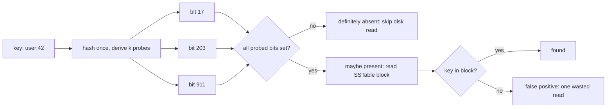

## In one minute
- A Bloom filter answers "might this key be in the set?" using a bit array and `k` hash functions. "No" is always right; "yes" is wrong with a small, tunable probability.
- It costs about `1.44 * log2(1/p)` bits per key regardless of key size: 9.6 bits for a 1% false-positive rate, 14.4 bits for 0.1%.
- Its job is to skip expensive work: a disk read in an LSM tree, a cache write for a one-hit object, a network round trip to a peer that does not have the data.
- A plain Bloom filter cannot delete and degrades if you insert more keys than it was sized for. Counting, scalable, blocked and cuckoo variants each fix one of those limits at a price.
- Size it from two numbers you must know up front: how many keys it will hold and what a false positive costs you.

## How it works

### The structure
Start with `m` bits, all zero, and `k` hash functions that each map a key to a position in `[0, m)`. To add a key, set the `k` bits it maps to. To query, check those `k` bits: if any is zero, the key was never added; if all are one, the key was probably added, or other keys happened to set every one of those bits.

That asymmetry is the whole point. A false negative is impossible because adding a key only ever sets bits, so a key's bits stay set. A false positive happens when other keys collectively cover all `k` of a new key's positions.

### The math you actually use
After inserting `n` keys, the chance that a given bit is still zero is about `e^(-kn/m)`. A query for an absent key returns "yes" only if all `k` probed bits are one, so the false-positive rate is about `(1 - e^(-kn/m))^k`.

For a fixed memory budget, that rate is lowest when `k = (m/n) ln 2`, at which point about half the bits are set. Solving for `m` at a target rate `p` gives `m = -n ln p / (ln 2)^2`, which is where `1.44 * log2(1/p)` bits per key comes from. Useful anchors: 1 million keys at 1% need about 9.6 million bits (1.2 MB) and 7 hash functions; 0.1% needs 14.4 bits and 10 hashes ([Redis docs](https://redis.io/docs/latest/develop/data-types/probabilistic/bloom-filter/)). Each extra 4.8 bits per key cuts the rate by ten.

Two consequences matter in practice. The filter's size depends only on the count and the rate, not on whether keys are 8-byte ids or 2 KB URLs. And the rate is a function of `n`: insert twice the planned keys into a 1% filter and it climbs to about 15%.

### Where it earns its keep
The pattern is always "a cheap, probably-correct no in front of an expensive, definitely-correct check". This is the *finding things fast* problem shape:

- **Storage engines.** RocksDB, Cassandra and HBase keep a filter per SSTable, so a lookup for a missing key skips the file instead of reading a block.
- **CDNs.** Cache an object only on its second request, so one-hit wonders never evict useful content. On one Akamai cluster, 74% of roughly 400 million cached objects were requested only once in two days ([Maggs and Sitaraman](https://people.cs.umass.edu/~ramesh/Site/HOME_files/CCRpaper_1.pdf)).
- **Distributed joins.** Ship a filter of join keys to the other side so it sends only rows that might match.
- **AI retrieval pipelines.** Check whether a chunk was already embedded before paying for the embedding call.

### Variants
A **counting Bloom filter** replaces each bit with a small counter, so deletes become decrements. Four-bit counters are enough in practice, but memory grows fourfold ([Fan et al.](https://pages.cs.wisc.edu/~cao/papers/summary-cache/)). A **scalable Bloom filter** chains new, larger sub-filters, each with its error rate multiplied by a tightening ratio (0.8 to 0.9 works well), so the total rate stays bounded without knowing `n` in advance ([Almeida et al.](https://gsd.di.uminho.pt/members/cbm/ps/dbloom.pdf)). A **blocked Bloom filter** puts all `k` probes for a key in one cache line, trading a slightly higher rate for one memory miss per lookup. A **cuckoo filter** (its own lesson) stores fingerprints, supports deletes and beats Bloom on space below about 3%.

## Down the stack

### Layer 1: The contract
For any key that was added and not removed, `might_contain` returns true: no false negatives, ever, including after a merge by bitwise OR of two filters with the same `m`, `k` and hash functions. For a key never added, the probability of true is about `(1 - e^(-kn/m))^k` where `n` is the number of keys actually inserted, assuming hashes behave like independent uniform functions. There is no enumeration, no count, and, for the plain form, no delete. A counting filter adds delete, but only for keys that were actually added: removing a key that was never added can create false negatives for others.

### Layer 2: The mechanism
Real implementations do not run `k` independent hash functions. Kirsch and Mitzenmacher showed that two hashes are enough: probe `h1 + i * h2 mod m` for `i` from 0 to `k - 1`, with no asymptotic loss in accuracy ([Kirsch and Mitzenmacher](https://www.eecs.harvard.edu/~michaelm/postscripts/rsa2008.pdf)). RocksDB computes one 64-bit hash per key and derives every probe from it.

RocksDB's full filter, in the implementation used from `format_version=5` (RocksDB 6.6) onward, confines all of a key's probes to one 64-byte cache line. Its documentation works through the cost: at 10 bits per key and 6 probes, the cache-local filter has about a 0.95% false-positive rate against 0.84% for an unconstrained one, a factor of 1.13, accepted for one cache miss per lookup instead of six. Since 6.15 RocksDB also offers Ribbon filters, which reach 1% at about 7 bits per key instead of 10, at 3 to 4 times the construction CPU ([RocksDB wiki](https://github.com/facebook/rocksdb/wiki/RocksDB-Bloom-Filter)). Ribbon solves a small linear system over the keys instead of setting bits, so it suits filters built once per file ([Dillinger and Walzer](https://arxiv.org/abs/2103.02515)).

Cassandra exposes the rate directly as `bloom_filter_fp_chance` per table, defaulting to 0.01, or 0.1 for tables using leveled compaction, where each read touches fewer SSTables. The filters live off-heap, and a changed setting applies only to SSTables written afterwards, so existing files keep the old filter until compaction or `nodetool upgradesstables -a` ([Cassandra docs](https://cassandra.apache.org/doc/latest/cassandra/managing/operating/bloom_filters.html)). Redis's `BF.RESERVE key error_rate capacity` builds a scalable filter: when it fills, it adds a sub-filter with twice the capacity (the `EXPANSION` default) and more hash functions, and lookups check every sub-filter. `NONSCALING` saves one hash function but lets the rate climb past capacity. These commands were the RedisBloom module until Redis 8, which builds them into the server and sets defaults such as `bf-error-rate 0.01` in `redis.conf` ([Redis docs](https://redis.io/docs/latest/develop/data-types/probabilistic/configuration/)).

### Layer 3: The machine
A filter for a billion keys at 1% is about 1.2 GB, far beyond the last-level cache, so each random probe is a DRAM access of roughly 80 to 100 ns. A classic filter with `k = 7` touches up to seven cache lines; a negative lookup usually stops at the first zero bit, but a positive one pays for all seven. A blocked filter pays one miss, then tests bits within a 512-bit line with shifts and masks. Hashing a short key costs 10 to 20 ns.

Those nanoseconds are free next to what they save: an NVMe random read costs about 100 µs and a cloud block-storage read 0.5 to 2 ms. The constraint that bites is memory: filters must stay resident, or the lookup itself starts missing the block cache and hitting disk.

### Why it's built this way
1. Exact membership needs space proportional to the keys themselves, and keys can be large, so a fixed number of bits per key buys a bounded error instead.
2. Bits are only ever set, so no false negatives are possible; the price is that a bit cannot be cleared without risking another key's answer, hence no delete.
3. Independent hash functions are expensive, so two hashes are combined into `k` probes.
4. Random probes into a large array miss cache, so modern filters confine probes to one cache line and accept a slightly higher rate.
5. The filter's value is the expensive operation it skips, so the rate is chosen by comparing false-positive cost against memory cost, not by a rule of thumb.

## Diagram


## Worked example
An edge cache sees 50 million distinct URLs a day, and logs show about 70% of them are requested exactly once. Caching those wastes disk writes and evicts content that would have been reused. The fix: admit an object to cache only if its URL is already in a "seen" filter; otherwise just add it.

Sizing at `p = 1%`: `m = 50,000,000 * 9.585 ≈ 479 million bits`, about 60 MB, with `k = 7`. Because a plain filter cannot delete, the server keeps two: `current` receives new URLs and `previous` holds yesterday's; a lookup checks both, and at midnight `previous` is dropped and `current` takes its place. Memory is 120 MB, small next to a multi-terabyte disk cache.

The effect: of 50 million first requests, 35 million one-hit objects are never written to disk. False positives admit 1% of first requests anyway, about 500,000 extra writes a day, which is negligible. If traffic doubles to 100 million URLs without resizing, the rate climbs to about 15% and 7.5 million extra writes appear, so the filter should be sized from peak traffic with headroom, or replaced with a scalable filter.

In a storage engine the same arithmetic sets the RAM bill. An LSM store with 2 billion keys across 7 levels needs 2.5 GB for 10-bit-per-key filters; a missing-key lookup then expects 0.07 wasted block reads instead of up to 7. Halving to 5 bits per key saves 1.25 GB but raises the rate to about 9%, or 0.6 wasted reads per miss.

## In the wild
- **Akamai, 2015: cache-on-second-hit with two rotating filters.** Akamai's CDN servers keep a Bloom filter of recently requested objects and write an object to disk only on its second request, swapping a primary and secondary filter so old entries age out. When the filters were switched on for a cluster serving web traffic, byte hit rate rose from about 74% to 83%, and disk writes fell from 10,209 to 5,738 per second, a 44% drop, because one-hit wonders no longer displaced popular content ([Maggs and Sitaraman](https://people.cs.umass.edu/~ramesh/Site/HOME_files/CCRpaper_1.pdf)).
- **Bitcoin, 2014–2019: BIP37 filters leak and cost too much to serve.** Lightweight wallets sent full nodes a Bloom filter of their addresses so nodes would relay only matching transactions. Gervais et al. showed that a wallet with fewer than 20 addresses could reveal almost all of them, and more with each restart or extra filter collected ([ACSAC 2014](https://eprint.iacr.org/2014/763)). Serving these filters also opened well-known denial-of-service vectors, worst on nodes with spinning disks, so Bitcoin Core 0.19 turned `-peerbloomfilters` off by default ([release notes](https://bitcoin.org/en/release/v0.19.0.1)). A filter's false positives are a privacy budget, not a privacy guarantee.

## Trade-offs
| Option | Strengths | Weaknesses | Choose when |
|---|---|---|---|
| Classic Bloom | Simple, mergeable by OR, inserts never fail | No delete, k cache misses per positive lookup | Append-only sets of known size |
| Blocked Bloom | One cache miss per lookup | Slightly higher rate at the same memory | Large in-memory filters on hot read paths |
| Counting Bloom | Supports delete | About 4x memory, counter overflow must be handled | Sets with churn, where memory is cheap |
| Scalable Bloom | No need to know n up front | Lookups check every sub-filter, more memory overall | Sets that grow unpredictably |
| Cuckoo filter | Delete, less memory below about 3% | Inserts can fail near full | Low target rates with deletes |
| Ribbon filter | About 30% smaller than Bloom at the same rate | Slower to build, immutable | Write-once filters such as SSTables |

## Pitfalls in production
- **Under-sizing.** Filters sized for launch traffic drift from 1% to 15% as data grows. Export the fill ratio (ideally near 0.5) and rebuild or rotate before it passes about 0.6.
- **Weak or correlated hashes.** Short, similar keys through a weak 32-bit hash cluster probes and inflate the rate. Use a well-mixed 64-bit hash and double hashing.
- **Deleting from a plain filter.** Clearing bits creates false negatives for other keys. Use a counting or cuckoo filter, or rebuild periodically.
- **Removing never-added keys from a counting filter.** An absent key that passes the check decrements other keys' counters. Remove only keys you inserted.
- **Merging incompatible filters.** OR-ing filters with different `m`, `k` or seeds produces garbage. Serialise the parameters with the filter.
- **Trusting "yes" for correctness.** A "yes" must be followed by the real check; using it to reject a username as taken fails 1% of legitimate users.

## Leadership lens
- In design review, ask what a false positive costs and what a false negative would cost. If false negatives are unacceptable and false positives cost one disk read, a filter fits; if a false positive denies a user something, it does not.
- Ask for the memory bill at projected scale, and whether filters must stay resident. Filter memory is often the hidden reason an LSM cluster needs larger instances.
- Treat filter parameters as configuration with an owner and a dashboard, not constants buried in code.
- Prefer the variant your platform already ships (RocksDB, Cassandra, RedisBloom, Postgres's `bloom` extension) over a custom implementation.

## Check yourself
1. A 1% filter sized for 10 million keys now holds 20 million. Roughly what is its false-positive rate, and why?
   **Answer:** About 15%. With the same `m` and `k`, doubling `n` doubles `kn/m`, so far more bits are set and the chance that all seven probes hit set bits rises sharply.
2. Why can a plain Bloom filter never return a false negative?
   **Answer:** Adding a key only sets bits and nothing ever clears them, so every bit a key set on insert is still set when it is queried.
3. Why do RocksDB's filters confine probes to one cache line even though it raises the false-positive rate?
   **Answer:** A large filter lives in DRAM, and each random probe costs a cache miss. One miss per lookup instead of six is worth a rate increase of about 1.13x.
4. When would you pick a counting Bloom filter over a cuckoo filter?
   **Answer:** When the target rate is relatively high, memory is not tight and you want inserts that never fail; cuckoo filters win on space at low rates but can reject inserts near full.

## Practice
**Task:** Implement a counting Bloom filter with sizing helpers. `optimal_params(n, p)` returns `(m, k)` with `m = ceil(-n ln p / (ln 2)^2)` and `k = max(1, floor(m / n * ln 2 + 0.5))`, raising an error unless `n > 0` and `0 < p < 1`. `false_positive_rate(m, k, n)` returns `(1 - e^(-kn/m))^k`. `CountingBloom(m, k, counter_bits)` keeps `m` counters that saturate at `2^counter_bits - 1`; probe `i` of a key is `(h1 + i * h2) mod m` with `h1 = mix(fnv1a(key))` and `h2 = mix(h1 XOR 0x9E3779B9) | 1` (both helpers given, 32-bit). `add` increments each probed counter unless saturated; `might_contain` is true when every probed counter is non-zero; `remove` returns false and changes nothing if the key is not possibly present, otherwise decrements each probed counter that is not saturated (saturated counters are sticky) and returns true. `indexes(key)` returns the probe list.

```python starter
import math

def fnv1a(s):
    h = 2166136261
    for b in s.encode("utf-8"):
        h ^= b
        h = (h * 16777619) & 0xFFFFFFFF
    return h

def mix(h):
    h ^= h >> 16
    h = (h * 0x85EBCA6B) & 0xFFFFFFFF
    h ^= h >> 13
    h = (h * 0xC2B2AE35) & 0xFFFFFFFF
    h ^= h >> 16
    return h

def optimal_params(n, p):
    # TODO
    raise NotImplementedError

def false_positive_rate(m, k, n):
    # TODO
    raise NotImplementedError

class CountingBloom:
    def __init__(self, m, k, counter_bits=4):
        self.m = m
        self.k = k

    def indexes(self, key):
        # TODO
        raise NotImplementedError

    def add(self, key):
        # TODO
        raise NotImplementedError

    def might_contain(self, key):
        # TODO
        raise NotImplementedError

    def remove(self, key):
        # TODO
        raise NotImplementedError
```

```python tests
def test_optimal_params():
    assert optimal_params(1000000, 0.01) == (9585059, 7)
    assert optimal_params(500, 0.02) == (4072, 6)
    try:
        optimal_params(100, 1.5)
        assert False, "expected ValueError"
    except ValueError:
        pass

def test_false_positive_rate_matches_target():
    m, k = optimal_params(1000000, 0.01)
    assert abs(false_positive_rate(m, k, 1000000) - 0.01) < 0.0005
    assert false_positive_rate(m, k, 2000000) > 0.1, "overfilled filter degrades"

def test_indexes_are_deterministic():
    assert CountingBloom(1000, 4).indexes("apple") == [288, 863, 438, 13]

def test_no_false_negatives():
    m, k = optimal_params(500, 0.02)
    b = CountingBloom(m, k)
    for i in range(500):
        b.add("k%d" % i)
    assert all(b.might_contain("k%d" % i) for i in range(500))

def test_measured_rate_near_theory():
    m, k = optimal_params(500, 0.02)
    b = CountingBloom(m, k)
    for i in range(500):
        b.add("k%d" % i)
    fp = sum(1 for i in range(5000) if b.might_contain("x%d" % i))
    assert 40 <= fp <= 200, fp

def test_remove():
    b = CountingBloom(1000, 4)
    b.add("apple")
    b.add("pear")
    assert b.remove("apple") is True
    assert not b.might_contain("apple")
    assert b.might_contain("pear")
    assert b.remove("plum") is False

def test_saturated_counters_are_sticky():
    b = CountingBloom(1000, 4, counter_bits=2)
    for _ in range(5):
        b.add("a")
    for _ in range(5):
        assert b.remove("a") is True
    assert b.might_contain("a"), "saturated counters never decrement"
```

```python solution
import math

def fnv1a(s):
    h = 2166136261
    for b in s.encode("utf-8"):
        h ^= b
        h = (h * 16777619) & 0xFFFFFFFF
    return h

def mix(h):
    h ^= h >> 16
    h = (h * 0x85EBCA6B) & 0xFFFFFFFF
    h ^= h >> 13
    h = (h * 0xC2B2AE35) & 0xFFFFFFFF
    h ^= h >> 16
    return h

def optimal_params(n, p):
    if n <= 0 or not (0 < p < 1):
        raise ValueError("need n > 0 and 0 < p < 1")
    m = math.ceil(-n * math.log(p) / (math.log(2) ** 2))
    k = max(1, int(math.floor(m / n * math.log(2) + 0.5)))
    return m, k

def false_positive_rate(m, k, n):
    return (1 - math.exp(-k * n / m)) ** k

class CountingBloom:
    def __init__(self, m, k, counter_bits=4):
        self.m = m
        self.k = k
        self.max = (1 << counter_bits) - 1
        self.counters = [0] * m

    def indexes(self, key):
        h1 = mix(fnv1a(key))
        h2 = mix(h1 ^ 0x9E3779B9) | 1
        return [(h1 + i * h2) % self.m for i in range(self.k)]

    def add(self, key):
        for i in self.indexes(key):
            if self.counters[i] < self.max:
                self.counters[i] += 1

    def might_contain(self, key):
        return all(self.counters[i] > 0 for i in self.indexes(key))

    def remove(self, key):
        if not self.might_contain(key):
            return False
        for i in self.indexes(key):
            if self.counters[i] < self.max:
                self.counters[i] -= 1
        return True
```

```typescript starter
export function fnv1a(s: string): number {
  let h = 2166136261;
  for (let i = 0; i < s.length; i++) {
    h ^= s.charCodeAt(i);
    h = Math.imul(h, 16777619) >>> 0;
  }
  return h >>> 0;
}

export function mix(h: number): number {
  h ^= h >>> 16;
  h = Math.imul(h, 0x85ebca6b) >>> 0;
  h ^= h >>> 13;
  h = Math.imul(h, 0xc2b2ae35) >>> 0;
  h ^= h >>> 16;
  return h >>> 0;
}

export function optimalParams(n: number, p: number): [number, number] {
  throw new Error("TODO");
}

export function falsePositiveRate(m: number, k: number, n: number): number {
  throw new Error("TODO");
}

export class CountingBloom {
  constructor(public m: number, public k: number, counterBits: number = 4) {}
  indexes(key: string): number[] {
    throw new Error("TODO");
  }
  add(key: string): void {
    throw new Error("TODO");
  }
  mightContain(key: string): boolean {
    throw new Error("TODO");
  }
  remove(key: string): boolean {
    throw new Error("TODO");
  }
}
```

```typescript tests
test("optimal params", () => {
  assertEqual(optimalParams(1000000, 0.01), [9585059, 7]);
  assertEqual(optimalParams(500, 0.02), [4072, 6]);
  let threw = false;
  try {
    optimalParams(100, 1.5);
  } catch (e) {
    threw = true;
  }
  assert(threw, "expected an error for p >= 1");
});
test("false positive rate matches target", () => {
  const [m, k] = optimalParams(1000000, 0.01);
  assert(Math.abs(falsePositiveRate(m, k, 1000000) - 0.01) < 0.0005, "near 1%");
  assert(falsePositiveRate(m, k, 2000000) > 0.1, "overfilled filter degrades");
});
test("indexes are deterministic", () => {
  assertEqual(new CountingBloom(1000, 4).indexes("apple"), [288, 863, 438, 13]);
});
test("no false negatives", () => {
  const [m, k] = optimalParams(500, 0.02);
  const b = new CountingBloom(m, k);
  for (let i = 0; i < 500; i++) b.add("k" + i);
  for (let i = 0; i < 500; i++) assert(b.mightContain("k" + i), "k" + i);
});
test("measured rate near theory", () => {
  const [m, k] = optimalParams(500, 0.02);
  const b = new CountingBloom(m, k);
  for (let i = 0; i < 500; i++) b.add("k" + i);
  let fp = 0;
  for (let i = 0; i < 5000; i++) if (b.mightContain("x" + i)) fp++;
  assert(fp >= 40 && fp <= 200, "fp = " + fp);
});
test("remove", () => {
  const b = new CountingBloom(1000, 4);
  b.add("apple");
  b.add("pear");
  assertEqual(b.remove("apple"), true);
  assert(!b.mightContain("apple"), "apple removed");
  assert(b.mightContain("pear"), "pear kept");
  assertEqual(b.remove("plum"), false);
});
test("saturated counters are sticky", () => {
  const b = new CountingBloom(1000, 4, 2);
  for (let i = 0; i < 5; i++) b.add("a");
  for (let i = 0; i < 5; i++) assertEqual(b.remove("a"), true);
  assert(b.mightContain("a"), "saturated counters never decrement");
});
```

```typescript solution
export function fnv1a(s: string): number {
  let h = 2166136261;
  for (let i = 0; i < s.length; i++) {
    h ^= s.charCodeAt(i);
    h = Math.imul(h, 16777619) >>> 0;
  }
  return h >>> 0;
}

export function mix(h: number): number {
  h ^= h >>> 16;
  h = Math.imul(h, 0x85ebca6b) >>> 0;
  h ^= h >>> 13;
  h = Math.imul(h, 0xc2b2ae35) >>> 0;
  h ^= h >>> 16;
  return h >>> 0;
}

export function optimalParams(n: number, p: number): [number, number] {
  if (!(n > 0) || !(p > 0 && p < 1)) throw new Error("need n > 0 and 0 < p < 1");
  const m = Math.ceil((-n * Math.log(p)) / (Math.LN2 * Math.LN2));
  const k = Math.max(1, Math.floor((m / n) * Math.LN2 + 0.5));
  return [m, k];
}

export function falsePositiveRate(m: number, k: number, n: number): number {
  return Math.pow(1 - Math.exp((-k * n) / m), k);
}

export class CountingBloom {
  private max: number;
  private counters: number[];
  constructor(public m: number, public k: number, counterBits: number = 4) {
    this.max = (1 << counterBits) - 1;
    this.counters = new Array(m).fill(0);
  }
  indexes(key: string): number[] {
    const h1 = mix(fnv1a(key));
    const h2 = (mix((h1 ^ 0x9e3779b9) >>> 0) | 1) >>> 0;
    const out: number[] = [];
    for (let i = 0; i < this.k; i++) out.push((h1 + i * h2) % this.m);
    return out;
  }
  add(key: string): void {
    for (const i of this.indexes(key)) {
      if (this.counters[i] < this.max) this.counters[i]++;
    }
  }
  mightContain(key: string): boolean {
    return this.indexes(key).every((i) => this.counters[i] > 0);
  }
  remove(key: string): boolean {
    if (!this.mightContain(key)) return false;
    for (const i of this.indexes(key)) {
      if (this.counters[i] < this.max) this.counters[i]--;
    }
    return true;
  }
}
```

```go starter
package practice

func Fnv1a(s string) uint32 {
	h := uint32(2166136261)
	for i := 0; i < len(s); i++ {
		h ^= uint32(s[i])
		h *= 16777619
	}
	return h
}

func Mix(h uint32) uint32 {
	h ^= h >> 16
	h *= 0x85ebca6b
	h ^= h >> 13
	h *= 0xc2b2ae35
	h ^= h >> 16
	return h
}

func OptimalParams(n int, p float64) (int, int, error) {
	panic("TODO")
}

func FalsePositiveRate(m, k, n int) float64 {
	panic("TODO")
}

type CountingBloom struct {
	M, K int
}

func NewCountingBloom(m, k, counterBits int) *CountingBloom {
	return &CountingBloom{M: m, K: k}
}

func (b *CountingBloom) Indexes(key string) []int       { panic("TODO") }
func (b *CountingBloom) Add(key string)                 { panic("TODO") }
func (b *CountingBloom) MightContain(key string) bool   { panic("TODO") }
func (b *CountingBloom) Remove(key string) bool         { panic("TODO") }
```

```go tests
package practice

import (
	"fmt"
	"math"
	"reflect"
	"testing"
)

func TestOptimalParams(t *testing.T) {
	m, k, err := OptimalParams(1000000, 0.01)
	if err != nil || m != 9585059 || k != 7 {
		t.Fatalf("got %d %d %v", m, k, err)
	}
	m, k, err = OptimalParams(500, 0.02)
	if err != nil || m != 4072 || k != 6 {
		t.Fatalf("got %d %d %v", m, k, err)
	}
	if _, _, err := OptimalParams(100, 1.5); err == nil {
		t.Fatal("expected error for p >= 1")
	}
}

func TestFalsePositiveRate(t *testing.T) {
	m, k, _ := OptimalParams(1000000, 0.01)
	if r := FalsePositiveRate(m, k, 1000000); math.Abs(r-0.01) >= 0.0005 {
		t.Fatalf("rate %f", r)
	}
	if r := FalsePositiveRate(m, k, 2000000); r <= 0.1 {
		t.Fatalf("overfilled rate %f", r)
	}
}

func TestIndexesDeterministic(t *testing.T) {
	got := NewCountingBloom(1000, 4, 4).Indexes("apple")
	if !reflect.DeepEqual(got, []int{288, 863, 438, 13}) {
		t.Fatalf("got %v", got)
	}
}

func filled() *CountingBloom {
	m, k, _ := OptimalParams(500, 0.02)
	b := NewCountingBloom(m, k, 4)
	for i := 0; i < 500; i++ {
		b.Add(fmt.Sprintf("k%d", i))
	}
	return b
}

func TestNoFalseNegatives(t *testing.T) {
	b := filled()
	for i := 0; i < 500; i++ {
		if !b.MightContain(fmt.Sprintf("k%d", i)) {
			t.Fatalf("k%d missing", i)
		}
	}
}

func TestMeasuredRate(t *testing.T) {
	b := filled()
	fp := 0
	for i := 0; i < 5000; i++ {
		if b.MightContain(fmt.Sprintf("x%d", i)) {
			fp++
		}
	}
	if fp < 40 || fp > 200 {
		t.Fatalf("fp = %d", fp)
	}
}

func TestRemove(t *testing.T) {
	b := NewCountingBloom(1000, 4, 4)
	b.Add("apple")
	b.Add("pear")
	if !b.Remove("apple") || b.MightContain("apple") || !b.MightContain("pear") {
		t.Fatal("remove broke membership")
	}
	if b.Remove("plum") {
		t.Fatal("removing an absent key must return false")
	}
}

func TestSaturatedSticky(t *testing.T) {
	b := NewCountingBloom(1000, 4, 2)
	for i := 0; i < 5; i++ {
		b.Add("a")
	}
	for i := 0; i < 5; i++ {
		if !b.Remove("a") {
			t.Fatal("remove should succeed")
		}
	}
	if !b.MightContain("a") {
		t.Fatal("saturated counters never decrement")
	}
}
```

```go solution
package practice

import (
	"errors"
	"math"
)

func Fnv1a(s string) uint32 {
	h := uint32(2166136261)
	for i := 0; i < len(s); i++ {
		h ^= uint32(s[i])
		h *= 16777619
	}
	return h
}

func Mix(h uint32) uint32 {
	h ^= h >> 16
	h *= 0x85ebca6b
	h ^= h >> 13
	h *= 0xc2b2ae35
	h ^= h >> 16
	return h
}

func OptimalParams(n int, p float64) (int, int, error) {
	if n <= 0 || p <= 0 || p >= 1 {
		return 0, 0, errors.New("need n > 0 and 0 < p < 1")
	}
	m := int(math.Ceil(-float64(n) * math.Log(p) / (math.Ln2 * math.Ln2)))
	k := int(math.Floor(float64(m)/float64(n)*math.Ln2 + 0.5))
	if k < 1 {
		k = 1
	}
	return m, k, nil
}

func FalsePositiveRate(m, k, n int) float64 {
	return math.Pow(1-math.Exp(-float64(k)*float64(n)/float64(m)), float64(k))
}

type CountingBloom struct {
	M, K     int
	max      uint8
	counters []uint8
}

func NewCountingBloom(m, k, counterBits int) *CountingBloom {
	return &CountingBloom{M: m, K: k, max: uint8(1<<counterBits - 1), counters: make([]uint8, m)}
}

func (b *CountingBloom) Indexes(key string) []int {
	h1 := uint64(Mix(Fnv1a(key)))
	h2 := uint64(Mix(uint32(h1)^0x9E3779B9) | 1)
	out := make([]int, b.K)
	for i := 0; i < b.K; i++ {
		out[i] = int((h1 + uint64(i)*h2) % uint64(b.M))
	}
	return out
}

func (b *CountingBloom) Add(key string) {
	for _, i := range b.Indexes(key) {
		if b.counters[i] < b.max {
			b.counters[i]++
		}
	}
}

func (b *CountingBloom) MightContain(key string) bool {
	for _, i := range b.Indexes(key) {
		if b.counters[i] == 0 {
			return false
		}
	}
	return true
}

func (b *CountingBloom) Remove(key string) bool {
	if !b.MightContain(key) {
		return false
	}
	for _, i := range b.Indexes(key) {
		if b.counters[i] < b.max {
			b.counters[i]--
		}
	}
	return true
}
```

## Mock interview
**Prompt:** A web crawler fetches 500 million pages a day across 200 workers and must avoid re-fetching URLs it has already crawled in the last 30 days. Exact storage of every URL is too expensive to query on every link. Design the "have we seen this URL?" check.

- Follow-up: How much memory does your filter need, and where does it live: on each worker, sharded, or in a shared service?
- Follow-up: URLs must become eligible again after 30 days. Plain Bloom filters cannot delete. What do you do?
- Follow-up: The product team says missing 1% of new pages is unacceptable for news sites. How does that change the design?

**A strong answer covers:**
- Sizing arithmetic: about 15 billion URLs over 30 days at 1% is roughly 18 GB, so the filter is sharded by URL hash across workers or a dedicated service.
- Time-bucketed filters (one per day, query all 30, drop the oldest) instead of deletes, and the effect on lookup cost and combined false-positive rate.
- That a false positive here means a missed page, so tighten the rate for high-value domains or confirm "seen" answers against an exact store for them.
- Blocked or Ribbon filters to cut memory or cache misses, and the reason for choosing one.
- Monitoring fill ratio and rebuilding when traffic exceeds the sizing assumption.

## Sources and further study
**Primary**
- [Bloom: Space/Time Trade-offs in Hash Coding with Allowable Errors (CACM, 1970)](https://dl.acm.org/doi/10.1145/362686.362692): the original paper.
- [Almeida et al.: Scalable Bloom Filters (2007)](https://gsd.di.uminho.pt/members/cbm/ps/dbloom.pdf): growing a filter by stacking sub-filters with a tightening error ratio.
- [Dillinger and Walzer: Ribbon filter, practically smaller than Bloom and Xor (2021)](https://arxiv.org/abs/2103.02515): the design behind RocksDB's Ribbon filters.
- [Maggs and Sitaraman: Algorithmic Nuggets in Content Delivery (CCR, 2015)](https://people.cs.umass.edu/~ramesh/Site/HOME_files/CCRpaper_1.pdf): Bloom filters for cache admission at Akamai, with measurements.

**Systems docs**
- [Redis probabilistic configuration](https://redis.io/docs/latest/develop/data-types/probabilistic/configuration/): Redis 8 defaults for error rate, initial size and expansion.
- [PostgreSQL bloom index](https://www.postgresql.org/docs/current/bloom.html): a signature index over many columns built from per-row Bloom filters.

**Books**
- *Designing Data-Intensive Applications* (1st ed.), Martin Kleppmann, Ch 3: Storage and Retrieval, on filters in front of SSTables.
- *Database Internals* (1st ed.), Alex Petrov, Ch 7: Log-Structured Storage, read path and implementation details of LSM filters.
- *System Design Interview Vol. 1*, Alex Xu, Ch 9: Design A Web Crawler, the "URL seen?" check.

**Other curricula**
- [Stanford CS166: Data Structures](https://web.stanford.edu/class/cs166/): frames filters as hashing with provable error bounds, next to cuckoo hashing.

## Watch
- [Bloom Filters, Algorithms You Should Know #2 (ByteByteGo)](https://www.youtube.com/watch?v=V3pzxngeLqw): a short visual explanation with real-world uses.
- [What Are Bloom Filters? (Spanning Tree)](https://www.youtube.com/watch?v=kfFacplFY4Y): an animated walk through the structure and why false positives happen.

## Free resources
- [RocksDB Bloom Filter (RocksDB wiki)](https://github.com/facebook/rocksdb/wiki/RocksDB-Bloom-Filter): bits per key, cache-local filters, Ribbon filters and the math behind each.
- [Less Hashing, Same Performance (Kirsch and Mitzenmacher)](https://www.eecs.harvard.edu/~michaelm/postscripts/rsa2008.pdf): the proof that two hash functions are enough.
- [Network Applications of Bloom Filters: A Survey (Broder and Mitzenmacher)](https://www.eecs.harvard.edu/~michaelm/postscripts/im2005b.pdf): the standard survey of variants and uses.
- [Summary Cache (Fan, Cao, Almeida and Broder)](https://pages.cs.wisc.edu/~cao/papers/summary-cache/): the paper that introduced counting Bloom filters for sharing web cache contents.
- [Bloom filters in Cassandra (Apache Cassandra docs)](https://cassandra.apache.org/doc/latest/cassandra/managing/operating/bloom_filters.html): how the per-table false-positive setting trades memory for reads.
- [Bloom filter (Redis docs)](https://redis.io/docs/latest/develop/data-types/probabilistic/bloom-filter/): a production scalable Bloom filter with capacity, error rate and expansion.
