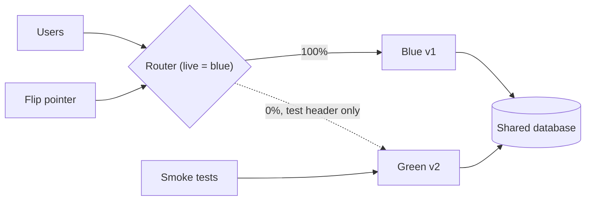

## In one minute
- Blue-green runs two complete production environments. One (say blue) serves all traffic; the new version is deployed to the idle one (green).
- After green passes checks against production dependencies, a single routing change moves all traffic from blue to green.
- Rollback is the same switch in reverse, which takes seconds as long as blue is still running and compatible.
- The cost is up to double compute during the release window, plus discipline around shared state such as databases and queues.
- Blue-green removes version mixing at the compute layer but not at the data layer.

## How it works

### Two fleets, one pointer
Each environment is a full copy of the stateless tier: instances, config, and a target group behind the load balancer. Martin Fowler's 2010 description notes a side benefit: the switch is the same mechanism a hot standby needs, so every release also rehearses the disaster-recovery cutover ([Fowler](https://martinfowler.com/bliki/BlueGreenDeployment.html)). A pointer decides which color is live. The pointer can be a load balancer listener rule, a weighted DNS record, a service mesh route, a Kubernetes Service selector that matches `color: green` instead of `color: blue`, or a Gateway API `HTTPRoute` whose backend weights go from 1/0 to 0/1 ([Gateway API](https://gateway-api.sigs.k8s.io/guides/traffic-splitting/)). Some platforms now run the whole sequence for you: Amazon ECS has built-in blue/green with test-traffic routing, lifecycle hooks and a bake time during which blue keeps running after the shift ([AWS docs](https://docs.aws.amazon.com/AmazonECS/latest/developerguide/deployment-type-blue-green.html)).

### The release sequence
1. Deploy the new artifact to the idle color and scale it to production size.
2. Run smoke tests against it through a private route or a test header, hitting real dependencies.
3. Warm it: prime caches, open connection pools, let JIT compilation settle.
4. Flip the pointer. New connections go to green.
5. Drain blue: let in-flight requests finish, but keep blue running for a bake period.
6. If metrics stay healthy through the bake period, scale blue down or keep it as the next idle target.

### Where the switch lives matters
Load balancer and mesh switches take effect in seconds. DNS-based switches depend on resolver caching and client behaviour. Even with a 60-second TTL, some clients and corporate resolvers hold records for much longer, so a DNS flip is never truly atomic. Even AWS's own load balancer names resolve with a 60-second TTL, and clients may hold old addresses until it expires ([AWS docs](https://docs.aws.amazon.com/elasticloadbalancing/latest/application/load-balancer-target-groups.html)). Prefer switching at a layer you control.

### Shared state
Both colors usually talk to the same database, cache, and queues. That means the schema must work for both versions during the window (Fowler's rule is to deploy schema changes separately from application upgrades, schema first), and background consumers in the idle color must not start processing messages before it is live, or both versions will consume from the same queue. A common pattern is to gate workers on an "active color" flag read at runtime.

When a release changes a data format, split it into two deployments so the flip back stays safe. Amazon's version: first deploy code that can read both the old and new format but still writes the old one, let it bake, then deploy the change that starts writing the new format. At every point the version you might roll back to can read everything on disk ([AWS Builders' Library](https://builder.aws.com/content/3F04j2yRAAMBuPSPs50xwXZqg01/ensuring-rollback-safety-during-deployments)).

### Long-lived connections
The flip affects new connections only; WebSockets and gRPC streams stay on blue until they close or are told to reconnect.

## Down the stack
### Layer 1: The contract
After the flip, every new request or connection reaches exactly one color, the live one. The flip is a single configuration change, so rollback is the same operation with the old value. What it does not promise: existing connections are not moved, shared state is not versioned, and background work in the idle color is not paused unless you build that.

### Layer 2: The mechanism
On AWS, an Application Load Balancer listener rule forwards to target groups with weights (0 to 999), and one `ModifyListener` call moves weight from blue's group to green's ([AWS docs](https://docs.aws.amazon.com/elasticloadbalancing/latest/application/rule-action-types.html)). Weighted routing is not health-aware between groups: if green's group is empty or all unhealthy, the balancer does not fall back to blue. Target group stickiness, an encrypted `AWSALBTG` cookie, keeps a client on the color it first reached. Deregistered targets enter a deregistration delay (300 seconds by default, configurable from 0 to 3,600) during which in-flight requests complete ([AWS docs](https://docs.aws.amazon.com/elasticloadbalancing/latest/application/load-balancer-target-groups.html)). In Kubernetes, changing a Service's selector from `color: blue` to `color: green` makes the EndpointSlice controller rewrite the endpoint list. In Envoy-based meshes, the control plane pushes a new route configuration over xDS with `weighted_clusters` ([Envoy docs](https://www.envoyproxy.io/docs/envoy/latest/api-v3/config/route/v3/route_components.proto)), and every sidecar applies it independently, usually within about a second. DNS-based switching changes weighted records and waits for TTLs to expire.

### Layer 3: The machine
An ALB terminates HTTP and chooses a target per request, so a client's keep-alive connection to the load balancer survives the flip and its next request goes to green. A Network Load Balancer works at layer 4 and pins each TCP flow to a target until it closes, so long connections stay on blue. DNS is worse: operating system resolvers, language runtimes (the JVM's `networkaddress.cache.ttl`), and connection pools all cache addresses independently of the record's TTL. Green also starts cold. If 60 green instances each open 20 database connections, PostgreSQL forks 1,200 new backend processes at roughly 5 to 10 MB each, on top of blue's 1,200, which can hit `max_connections` or exhaust memory during the overlap.

### Why it's built this way
Only the router sees every request, so the switch lives there. Stateless compute is cheap to duplicate but databases are not, so both colors share one data layer and compatibility becomes the developer's job. Connections are long-lived, so draining is needed. DNS caching is outside your control, so serious blue-green setups avoid DNS as the switch.

## Diagram


## Worked example
A search API runs 60 instances at 0.10 USD per hour each, 6 USD per hour. Releases happen twice a week.

If green is created fresh for each release and lives for 1 hour of testing plus a 2-hour bake, the extra cost is 60 x 3 x 0.10 = 18 USD per release, about 150 USD a month. Keeping a permanent second fleet would cost 6 x 730 = 4,380 USD a month, so ephemeral green is the obvious choice here.

Now consider failure. A bad release raises the error rate from 0.1 percent to 5 percent at 20,000 RPS. With a rolling deploy of 60 instances in batches of 6, rollback takes about 10 minutes: roughly 10 x 60 x 20,000 x 0.049 = 588,000 extra failed requests. With blue-green, detection takes 2 minutes and the flip takes 10 seconds: about 2.2 x 60 x 20,000 x 0.049 = 129,000. The 150 USD a month buys a large cut in blast radius.

The catch: if the release also ran a destructive migration, such as dropping a column v1 reads, the flip back fails just as badly. Blue-green only gives fast rollback when the data layer stays compatible.

## In the wild
- **Slack, 2021: a DNS-level change whose rollback was capped by caches.** Slack enabled DNSSEC on slack.com, and a Route 53 bug in signed answers for wildcard names made some validating resolvers cache "no such records". Rolling back made it worse, because resolvers had cached the DS record for up to 24 hours and returned SERVFAIL until it expired. Most users recovered within hours, but a long tail on smaller resolvers waited out the 24-hour TTL. It is the same reason a DNS flip is a weak blue-green switch: the old answer lives in caches you do not control ([Slack](https://slack.engineering/what-happened-during-slacks-dnssec-rollout/)).
- **Stripe, 2019: a rollback that was not compatible with the present.** A latent failover bug in a database version shipped months earlier left one shard unable to elect a primary, and most API requests failed for about 27 minutes. Responders then rolled back the election protocol, but the old version clashed with a configuration change made since, starved CPU on every shard and caused a second outage of about 93 minutes. Going back is only fast and safe if the old version still fits the current config and data ([Stripe](https://stripe.com/rcas/2019-07-10)).

## Trade-offs
| Option | Strengths | Weaknesses | Choose when |
| --- | --- | --- | --- |
| Blue-green | Seconds to roll back, full pre-release test on prod infra | Double capacity during window, all users switch at once | Rollback speed is critical, deploy is risky |
| Rolling | No duplicate fleet | Slow rollback, mixed versions during rollout | Routine releases of stateless services |
| Canary | Limits blast radius to a small fraction | Needs good metrics and routing control, slower | High traffic with clear health signals |
| Blue-green plus canary step | Fast rollback and gradual exposure | Most moving parts | Critical services with mature tooling |

## Pitfalls in production
- Background workers in the idle color consume from production queues. Gate consumers on the live-color flag.
- Green is tested at zero load, then gets full traffic cold. Warm caches and pools, or shift through 10 and 50 percent first.
- DNS flips leave stragglers on blue for minutes or hours. Switch at the load balancer or mesh instead.
- Schema changes are not covered by the flip. Use expand-and-contract migrations so both versions work against the same schema.
- Blue gets scaled down right after the flip, so "instant rollback" is no longer available. Keep it warm through a defined bake period.
- The flip points at a group nobody checked. On an ALB, weight 100 to an empty or unhealthy green group fails requests rather than falling back to blue. Gate the flip on green's healthy-target count, not just on the deploy finishing.

## Leadership lens
- Decide how long the previous color stays warm and who can trigger the flip back without approval.
- Ask what stateful components are shared and how each one behaves when two versions touch it.
- Weigh the cost of a second fleet against the measured cost of slow rollback for this service.

## Check yourself
1. Why does blue-green give near-instant rollback for code but not for a migration that drops a column?
   **Answer:** The flip only changes which compute fleet gets traffic. Both fleets share the database, so once the column is gone v1 fails as well, and the flip back does not restore it.
2. Why is a DNS-based switch weaker than switching at the load balancer?
   **Answer:** Resolvers and clients cache records, sometimes beyond the TTL, so traffic moves gradually and unpredictably. A load balancer rule change is applied centrally within seconds.
3. What goes wrong if green's queue consumers start as soon as green boots?
   **Answer:** Both versions process messages from the same queue before release, so untested v2 code touches production data and duplicates or conflicts are possible.
4. When is keeping a permanent second fleet worth it?
   **Answer:** When releases are frequent enough that spin-up time dominates, or when the warm standby doubles as disaster recovery capacity.

## Practice
**Task:** Implement a `BlueGreen` router. `BlueGreen(version)` starts with blue live on that version and green empty. `deploy(version)` puts a version on the idle color and marks it unhealthy. `set_healthy(color, ok)` records smoke test results. `cutover()` makes the idle color live and returns the new live version, raising `ValueError` if the idle color is empty or unhealthy. `rollback()` makes the other color live again if it still holds a version, else raises `ValueError`. `live_version()` returns the version serving traffic.

```python starter
class BlueGreen:
    def __init__(self, version):
        pass

    def deploy(self, version):
        raise NotImplementedError

    def set_healthy(self, color, ok):
        raise NotImplementedError

    def cutover(self):
        raise NotImplementedError

    def rollback(self):
        raise NotImplementedError

    def live_version(self):
        raise NotImplementedError
```

```python tests
def test_initial():
    assert BlueGreen("v1").live_version() == "v1"

def test_cutover_requires_health():
    bg = BlueGreen("v1")
    bg.deploy("v2")
    try:
        bg.cutover()
        assert False, "expected ValueError"
    except ValueError:
        pass
    bg.set_healthy("green", True)
    assert bg.cutover() == "v2"

def test_rollback_restores_previous():
    bg = BlueGreen("v1")
    bg.deploy("v2")
    bg.set_healthy("green", True)
    bg.cutover()
    bg.rollback()
    assert bg.live_version() == "v1"

def test_next_deploy_goes_to_old_color():
    bg = BlueGreen("v1")
    bg.deploy("v2"); bg.set_healthy("green", True); bg.cutover()
    bg.deploy("v3"); bg.set_healthy("blue", True)
    assert bg.cutover() == "v3"

def test_rollback_without_other_color():
    try:
        BlueGreen("v1").rollback()
        assert False, "expected ValueError"
    except ValueError:
        pass

def test_cutover_empty_idle():
    try:
        BlueGreen("v1").cutover()
        assert False, "expected ValueError"
    except ValueError:
        pass
```

```python solution
class BlueGreen:
    def __init__(self, version):
        self.versions = {"blue": version, "green": None}
        self.healthy = {"blue": True, "green": False}
        self.live = "blue"

    def idle(self):
        return "green" if self.live == "blue" else "blue"

    def deploy(self, version):
        self.versions[self.idle()] = version
        self.healthy[self.idle()] = False

    def set_healthy(self, color, ok):
        self.healthy[color] = ok

    def cutover(self):
        target = self.idle()
        if self.versions[target] is None or not self.healthy[target]:
            raise ValueError("idle color not ready")
        self.live = target
        return self.versions[target]

    def rollback(self):
        if self.versions[self.idle()] is None:
            raise ValueError("nothing to roll back to")
        self.live = self.idle()

    def live_version(self):
        return self.versions[self.live]
```

```typescript starter
export class BlueGreen {
  constructor(version: string) {}
  deploy(version: string): void { throw new Error("TODO"); }
  setHealthy(color: string, ok: boolean): void { throw new Error("TODO"); }
  cutover(): string { throw new Error("TODO"); }
  rollback(): void { throw new Error("TODO"); }
  liveVersion(): string { throw new Error("TODO"); }
}
```

```typescript tests
function throws(fn: () => void): boolean {
  try { fn(); return false; } catch (e) { return true; }
}

test("initial", () => {
  assertEqual(new BlueGreen("v1").liveVersion(), "v1");
});

test("cutover requires health", () => {
  const bg = new BlueGreen("v1");
  bg.deploy("v2");
  assert(throws(() => bg.cutover()), "expected error");
  bg.setHealthy("green", true);
  assertEqual(bg.cutover(), "v2");
});

test("rollback restores previous", () => {
  const bg = new BlueGreen("v1");
  bg.deploy("v2"); bg.setHealthy("green", true); bg.cutover();
  bg.rollback();
  assertEqual(bg.liveVersion(), "v1");
});

test("next deploy goes to old color", () => {
  const bg = new BlueGreen("v1");
  bg.deploy("v2"); bg.setHealthy("green", true); bg.cutover();
  bg.deploy("v3"); bg.setHealthy("blue", true);
  assertEqual(bg.cutover(), "v3");
});

test("rollback without other color", () => {
  assert(throws(() => new BlueGreen("v1").rollback()), "expected error");
});

test("cutover with empty idle", () => {
  assert(throws(() => new BlueGreen("v1").cutover()), "expected error");
});
```

```typescript solution
export class BlueGreen {
  private versions: Record<string, string | null> = { blue: null, green: null };
  private healthy: Record<string, boolean> = { blue: true, green: false };
  private live = "blue";

  constructor(version: string) {
    this.versions.blue = version;
  }

  private idle(): string {
    return this.live === "blue" ? "green" : "blue";
  }

  deploy(version: string): void {
    this.versions[this.idle()] = version;
    this.healthy[this.idle()] = false;
  }

  setHealthy(color: string, ok: boolean): void {
    this.healthy[color] = ok;
  }

  cutover(): string {
    const target = this.idle();
    const v = this.versions[target];
    if (v === null || !this.healthy[target]) throw new Error("idle color not ready");
    this.live = target;
    return v;
  }

  rollback(): void {
    if (this.versions[this.idle()] === null) throw new Error("nothing to roll back to");
    this.live = this.idle();
  }

  liveVersion(): string {
    return this.versions[this.live] as string;
  }
}
```

```go starter
package practice

type BlueGreen struct{}

func NewBlueGreen(version string) *BlueGreen { return &BlueGreen{} }

func (b *BlueGreen) Deploy(version string)            { panic("TODO") }
func (b *BlueGreen) SetHealthy(color string, ok bool) { panic("TODO") }
func (b *BlueGreen) Cutover() (string, error)         { panic("TODO") }
func (b *BlueGreen) Rollback() error                  { panic("TODO") }
func (b *BlueGreen) LiveVersion() string              { panic("TODO") }
```

```go tests
package practice

import "testing"

func TestInitial(t *testing.T) {
	if v := NewBlueGreen("v1").LiveVersion(); v != "v1" {
		t.Fatalf("got %s", v)
	}
}

func TestCutoverRequiresHealth(t *testing.T) {
	bg := NewBlueGreen("v1")
	bg.Deploy("v2")
	if _, err := bg.Cutover(); err == nil {
		t.Fatal("expected error")
	}
	bg.SetHealthy("green", true)
	if v, err := bg.Cutover(); err != nil || v != "v2" {
		t.Fatalf("got %s %v", v, err)
	}
}

func TestRollbackRestoresPrevious(t *testing.T) {
	bg := NewBlueGreen("v1")
	bg.Deploy("v2")
	bg.SetHealthy("green", true)
	bg.Cutover()
	if err := bg.Rollback(); err != nil || bg.LiveVersion() != "v1" {
		t.Fatalf("got %s %v", bg.LiveVersion(), err)
	}
}

func TestNextDeployGoesToOldColor(t *testing.T) {
	bg := NewBlueGreen("v1")
	bg.Deploy("v2")
	bg.SetHealthy("green", true)
	bg.Cutover()
	bg.Deploy("v3")
	bg.SetHealthy("blue", true)
	if v, _ := bg.Cutover(); v != "v3" {
		t.Fatalf("got %s", v)
	}
}

func TestRollbackWithoutOther(t *testing.T) {
	if err := NewBlueGreen("v1").Rollback(); err == nil {
		t.Fatal("expected error")
	}
}

func TestCutoverEmptyIdle(t *testing.T) {
	if _, err := NewBlueGreen("v1").Cutover(); err == nil {
		t.Fatal("expected error")
	}
}
```

```go solution
package practice

import "errors"

type BlueGreen struct {
	versions map[string]string
	healthy  map[string]bool
	live     string
}

func NewBlueGreen(version string) *BlueGreen {
	return &BlueGreen{
		versions: map[string]string{"blue": version, "green": ""},
		healthy:  map[string]bool{"blue": true, "green": false},
		live:     "blue",
	}
}

func (b *BlueGreen) idle() string {
	if b.live == "blue" {
		return "green"
	}
	return "blue"
}

func (b *BlueGreen) Deploy(version string) {
	b.versions[b.idle()] = version
	b.healthy[b.idle()] = false
}

func (b *BlueGreen) SetHealthy(color string, ok bool) { b.healthy[color] = ok }

func (b *BlueGreen) Cutover() (string, error) {
	target := b.idle()
	if b.versions[target] == "" || !b.healthy[target] {
		return "", errors.New("idle color not ready")
	}
	b.live = target
	return b.versions[target], nil
}

func (b *BlueGreen) Rollback() error {
	if b.versions[b.idle()] == "" {
		return errors.New("nothing to roll back to")
	}
	b.live = b.idle()
	return nil
}

func (b *BlueGreen) LiveVersion() string { return b.versions[b.live] }
```

## Mock interview
**Prompt:** An airline booking service handles 8,000 RPS with strict uptime targets, and a bad release last quarter took 25 minutes to roll back. Design a blue-green release process for it, including its PostgreSQL database and Kafka consumers.

- Follow-up: How do you test green against production before any customer sees it?
- Follow-up: The release needs a column rename. How do you keep rollback instant?
- Follow-up: Finance asks why you need double capacity. What is your answer?

**A strong answer covers:**
- Switching at the load balancer or mesh, not DNS, with automated, audited flips.
- Smoke tests through a header-routed path, plus cache and pool warming before the flip.
- Expand-and-contract migrations so both versions run on one schema, and contract only after the bake.
- Consumer gating on the active color to avoid double processing.
- Cost math: ephemeral green for hours per release versus the cost of minutes of errors at 8,000 RPS.

## Sources and further study
**Primary**
- [Slack: what happened during Slack's DNSSEC rollout](https://slack.engineering/what-happened-during-slacks-dnssec-rollout/): why DNS changes cannot be rolled back faster than resolver caches expire.
- [Stripe: root cause analysis, July 2019](https://stripe.com/rcas/2019-07-10): a rollback that collided with newer configuration.

**Systems docs**
- [AWS: listener rule action types](https://docs.aws.amazon.com/elasticloadbalancing/latest/application/rule-action-types.html): weighted target groups, their limits and target group stickiness.
- [Amazon ECS blue/green deployments](https://docs.aws.amazon.com/AmazonECS/latest/developerguide/deployment-type-blue-green.html): managed blue/green with lifecycle hooks and bake time.
- [Kubernetes Gateway API: traffic splitting](https://gateway-api.sigs.k8s.io/guides/traffic-splitting/): weight-based switching between two backends.

**Books**
- *Release It!* (2nd edition), Michael T. Nygard, chapter 13 "Design for Deployment": the fallacy of planned downtime and deploying in phases.
- *Building Microservices* (2nd edition), Sam Newman, chapter 8 "Deployment": deployment options and principles for independently deployable services.

**Other curricula**
- [Azure Well-Architected: safe deployment practices](https://learn.microsoft.com/en-us/azure/well-architected/operational-excellence/safe-deployments): treats blue-green as progressive, shifting traffic to green in growing waves rather than a single flip.
- [donnemartin/system-design-primer](https://github.com/donnemartin/system-design-primer): has no section on blue-green; its nearest topic is active-passive fail-over, which uses a similar standby but for failures rather than releases.

## Watch
- [An in-depth introduction to Blue Green Deployments (Arpit Bhayani)](https://www.youtube.com/watch?v=W6HANd8c9t4): walks through the switch, rollback, and the database caveat.
- [Top 5 Most-Used Deployment Strategies (ByteByteGo)](https://www.youtube.com/watch?v=AWVTKBUnoIg): compares blue-green with rolling, canary, and others.

## Free resources
- [BlueGreenDeployment (Martin Fowler)](https://martinfowler.com/bliki/BlueGreenDeployment.html): the original short description of the technique and its database concerns.
- [Blue/Green Deployments on AWS (whitepaper)](https://docs.aws.amazon.com/whitepapers/latest/blue-green-deployments/welcome.html): concrete switch mechanisms at the DNS, load balancer, and autoscaling levels.
- [Ensuring rollback safety during deployments (AWS Builders' Library)](https://aws.amazon.com/builders-library/ensuring-rollback-safety-during-deployments/): why rollback needs compatible data formats, which blue-green alone does not give you.
