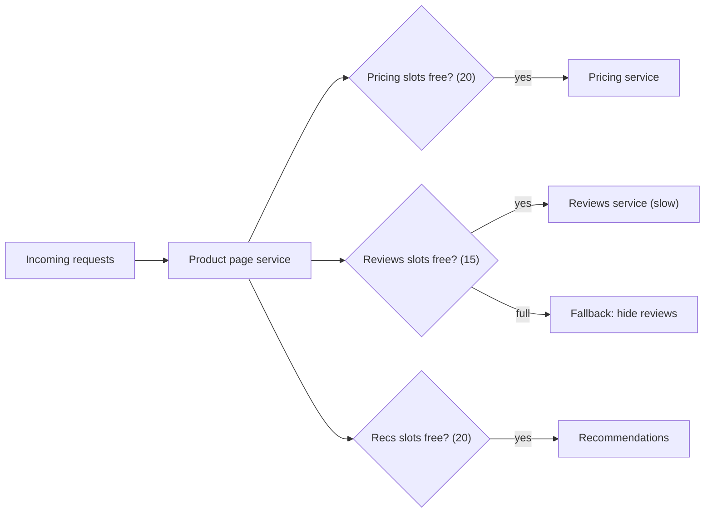

## In one minute
- A bulkhead partitions resources (threads, connections, memory, instances, whole cells) so that a failure or overload in one partition cannot consume everything and sink the rest.
- The name comes from ships: watertight compartments mean one breach floods one compartment, not the hull.
- Inside a service, it usually means a separate bounded pool or semaphore per dependency. Across a system, it means isolating tenants, customers, or workloads onto separate capacity.
- The trade-off is utilisation: reserved capacity sits idle while another partition is starved. You buy predictability and blast-radius control with some efficiency.

## How it works

### The failure it prevents
A service has one shared pool of 200 threads for all outbound calls. One dependency slows from 20 ms to 5 seconds. Threads waiting on it accumulate until all 200 are stuck, and calls to perfectly healthy dependencies queue behind them. A failure in one feature becomes an outage of every feature. Timeouts and circuit breakers reduce how long this lasts; bulkheads cap how much it can take ([Azure Architecture Center](https://learn.microsoft.com/en-us/azure/architecture/patterns/bulkhead)).

### Bulkheads inside a process
Give each dependency its own concurrency limit. Two common implementations:

- **Semaphore bulkhead.** A counter limits concurrent calls (say 30 for recommendations). Calls over the limit wait briefly in a bounded queue or are rejected immediately. Cheap, works with async code.
- **Thread-pool bulkhead.** Each dependency gets its own pool and queue. The caller's thread is freed even when the dependency hangs, at the cost of context switches and more memory.

Sizing uses Little's law: concurrency needed equals request rate times latency. At 300 calls per second and 50 ms, you need about 15 concurrent slots; give 2 to 3 times headroom, so 30 to 45. When a call is rejected, the caller falls back exactly as with an open breaker.

### Bulkheads across a system
The same idea applies at larger scale. Separate connection pools for interactive and batch queries to the same database. Separate instance groups for public API traffic and internal admin traffic. Separate queues and consumers per tenant tier. At the largest scale, **cell-based architecture** splits the whole stack into independent cells, each serving a subset of customers, so a bad deploy or poison request hurts one cell. AWS says its service teams have built this way for more than a decade, and its Well-Architected guidance presents cells as the bulkhead practice applied to a whole workload ([AWS whitepaper](https://docs.aws.amazon.com/wellarchitected/latest/reducing-scope-of-impact-with-cell-based-architecture/reducing-scope-of-impact-with-cell-based-architecture.html)). **Shuffle sharding** assigns each customer a small set of workers from a larger pool, so two customers rarely share all of their workers, and one bad customer affects very few others. Even 8 workers in pairs give 28 distinct shards; Route 53 splits capacity into 2,048 virtual name servers and gives each domain 4, about 730 billion combinations. Route 53 also assigns them so that no two domains share more than two name servers ([AWS Builders' Library](https://aws.amazon.com/builders-library/workload-isolation-using-shuffle-sharding/)).

### Interaction with other patterns
Bulkheads limit concurrency; timeouts bound how long a slot is held; circuit breakers stop sending to a dependency that is clearly broken. Use all three together.

## Down the stack

### Layer 1: The contract
A bulkhead promises that at most N units of work run concurrently in its partition, that excess work either waits for a bounded time or is rejected immediately, and that saturation of one partition does not reduce the capacity available to others. At the infrastructure level, a CPU or memory bulkhead promises a ceiling: a workload cannot use more than its share, even if that means it is throttled or killed.

### Layer 2: The mechanism
In process, a semaphore bulkhead is a counter with `tryAcquire(timeout)`: Resilience4j exposes this as `maxConcurrentCalls` (default 25) and `maxWaitDuration` (default 0, so a full bulkhead rejects at once). A thread-pool bulkhead is a fixed pool with a bounded queue and a rejection policy; Resilience4j sizes it from the CPU count with a 100-entry queue by default ([Resilience4j docs](https://resilience4j.readme.io/docs/bulkhead)). Defaults are a starting point, not a sizing: 25 slots is far too many for a 2-slot dependency and far too few for one that needs 200. Connection pools (HikariCP's `maximumPoolSize`, Envoy's `max_requests` per cluster) are bulkheads too. At the OS level, Kubernetes resource limits become cgroup v2 settings: `cpu.max` with a quota and period such as `200000 100000` (two CPUs' worth per 100 ms period; the default is `max 100000`, no limit) ([kernel docs](https://docs.kernel.org/admin-guide/cgroup-v2.html)) and `memory.max`, beyond which the kernel's OOM killer acts inside that cgroup only. Cells and shuffle sharding apply the same idea one level up, with a routing layer mapping each customer to its partition.

### Layer 3: The machine
Partitions exist because the underlying resources are physical. Each Postgres connection is a separate backend process, forked when the client connects ([Postgres docs](https://www.postgresql.org/docs/current/tutorial-arch.html)), using several MB of memory, so a database supports hundreds, not tens of thousands, of connections. Each thread costs stack memory and a context switch of a few microseconds when the scheduler moves between them. CPU quotas are enforced by the CFS bandwidth controller per period, and a group that spends its quota stays throttled until the next period refills it ([kernel docs](https://docs.kernel.org/scheduler/sched-bwc.html)): a container that burns its quota in the first 40 ms of a 100 ms period is throttled for the remaining 60 ms, which shows up as tail latency even when average CPU looks low. Queueing theory adds the last piece: as utilisation of any resource approaches 100%, waiting time grows without bound, so a capped pool that rejects early keeps latency predictable.

### Why it's built this way
1. Threads, connections, CPU, and memory are finite and shared, so one runaway consumer can starve all others.
2. Queues near full utilisation have exploding latency, so concurrency is capped and excess is rejected rather than queued indefinitely.
3. The kernel can enforce limits cheaply per cgroup, so isolation is pushed down to the OS where possible.
4. Deploys, configs, and poison requests are shared resources too, so large systems extend bulkheads to whole cells.

## Diagram


## Worked example
A product page service handles 1,500 requests per second. Each request calls pricing (required, 15 ms), reviews (optional, 30 ms), and recommendations (optional, 40 ms), in parallel. It runs on 10 instances, so each instance handles 150 requests per second.

Per instance, Little's law gives concurrency of 150 x 0.015 = 2.25 for pricing, 4.5 for reviews, and 6 for recommendations. The team sets semaphore limits of 20, 15, and 20, a generous multiple of normal load, with no waiting queue for optional calls and a 50-slot queue for pricing.

When the reviews database degrades and latency climbs to 3 seconds, reviews concurrency would need 450 slots per instance. Instead it hits its limit of 15 immediately; the other 135 review calls per second are rejected in microseconds and the page renders without reviews. Pricing and recommendations keep their full slots and normal latency. Without the bulkhead, the shared HTTP client's 200 connections would fill with review calls in under 2 seconds and pages would fail entirely.

At the system level, the same company moved its 20 largest enterprise customers onto shuffle-sharded worker sets of 4 out of 64 workers. The number of possible 4-worker combinations is over 635,000, so the chance that a poison request from one customer takes out all of another customer's workers is tiny.

## In the wild
- **Roblox, 2021: one Consul cluster under everything.** Roblox was down for 73 hours from 28 October. One Consul cluster supported many workloads and was a single point of failure, and it went unhealthy after a new streaming feature caused contention under heavy load, and Roblox's telemetry depended on Consul too, so engineers lost their diagnostics at the same moment. Afterwards Roblox moved critical services onto dedicated Consul clusters, removed telemetry's dependency on Consul, and started moving to multiple availability zones ([Roblox](https://about.roblox.com/newsroom/2022/01/roblox-return-to-service-10-28-10-31-2021)).
- **AWS, 2020: Kinesis takes its neighbours with it.** On 25 November a small capacity addition pushed every Kinesis front-end server past the OS thread limit, because each server keeps a thread per other server in the fleet. Kinesis was impaired from early morning until 10:23 PM PST, and Cognito, CloudWatch, Lambda, autoscaling and EventBridge were hit through their dependency on it. Fixes included moving CloudWatch to a separate, partitioned front-end fleet and speeding up cellularization of the front end ([AWS](https://aws.amazon.com/message/11201/)).

## Trade-offs
| Option | Strengths | Weaknesses | Choose when |
|---|---|---|---|
| Shared pool | Best utilisation, simplest | One slow dependency can exhaust everything | Few dependencies, all equally critical |
| Semaphore per dependency | Cheap, async-friendly, strong isolation of concurrency | Caller thread still blocks in sync code | Most service-to-service calls |
| Thread pool per dependency | Frees caller even on hangs, per-pool queues | More threads, memory, and context switching | Blocking clients that cannot time out reliably |
| Cells or shuffle sharding | Contains bad deploys and poison tenants | Cost, routing layer, cross-cell operations | Large multi-tenant platforms |

## Pitfalls in production
- **Limits sized by guesswork.** Too small and normal spikes are rejected; too large and the bulkhead protects nothing. Size from rate times latency at p99, then load test.
- **Unbounded queues behind bulkheads.** The limit holds but a queue grows without bound and latency explodes. Bound queues and prefer rejection for optional work.
- **Shared resources underneath.** Separate thread pools still share one HTTP connection pool or one database pool. Partition the real bottleneck.
- **Shared control planes and monitoring.** Fleets split into bulkheads can still share one service-discovery cluster, one config pipeline or one telemetry system, and that shared piece becomes the single point of failure. Give critical services their own coordination clusters and keep monitoring off the systems it watches, as Roblox did after its 73-hour outage ([Roblox](https://about.roblox.com/newsroom/2022/01/roblox-return-to-service-10-28-10-31-2021)).
- **No fallback on rejection.** Rejected calls become user-facing errors. Define a fallback per dependency, as with breakers.
- **Silent saturation.** Bulkheads reject quietly for days. Export utilisation and rejection counts and alert on sustained rejection.

## Leadership lens
- Ask where the shared pools are: threads, connections, queues, instances, databases. Each shared pool is a potential cross-feature failure.
- Separate critical paths from optional features and interactive traffic from batch traffic first; that captures most of the value.
- For multi-tenant systems, discuss cells or shuffle sharding early, because retrofitting them is expensive.
- Budget the idle capacity explicitly. Finance will see it; make the reliability argument up front.

## Check yourself
1. A dependency handles 400 calls per second at 25 ms. What concurrency does it need, and how would you set the bulkhead?
   **Answer:** About 10 slots by Little's law, so a limit of roughly 20 to 30 gives headroom for spikes without letting a slowdown consume the whole process.
2. Why might a thread-pool bulkhead be chosen over a semaphore?
   **Answer:** If the client library can block without honouring timeouts, a separate pool keeps the caller's threads free even when the dependency hangs.
3. What does shuffle sharding add over simple sharding?
   **Answer:** Each customer gets a different random subset of workers, so a customer that breaks its workers overlaps fully with very few others, shrinking the blast radius.

## Practice
**Task:** Implement a semaphore bulkhead with a bounded wait queue. `Bulkhead(max_concurrent, max_queue)` has `acquire(task_id)`, which returns `"run"` if a slot is free, `"queued"` if all slots are busy but the queue has room, and `"rejected"` otherwise. `release(task_id)` frees the slot of a running task and promotes the oldest queued task to running, returning its ID (or `None` if the queue is empty). Releasing a task that is not running raises `ValueError`. `running()` returns the number of running tasks.

```python starter
class Bulkhead:
    def __init__(self, max_concurrent, max_queue):
        # TODO
        raise NotImplementedError

    def acquire(self, task_id):
        raise NotImplementedError

    def release(self, task_id):
        raise NotImplementedError

    def running(self):
        raise NotImplementedError
```

```python tests
def test_runs_up_to_limit_then_queues_then_rejects():
    b = Bulkhead(2, 1)
    assert [b.acquire(i) for i in range(4)] == ["run", "run", "queued", "rejected"]
    assert b.running() == 2

def test_release_promotes_fifo():
    b = Bulkhead(1, 2)
    b.acquire("a"); b.acquire("b"); b.acquire("c")
    assert b.release("a") == "b"
    assert b.release("b") == "c"
    assert b.release("c") is None and b.running() == 0

def test_release_unknown_raises():
    b = Bulkhead(1, 1)
    b.acquire("a"); b.acquire("q")
    for bad in ("zz", "q"):
        try:
            b.release(bad)
            assert False, "expected ValueError"
        except ValueError:
            pass

def test_zero_queue_rejects_immediately():
    b = Bulkhead(1, 0)
    assert b.acquire(1) == "run" and b.acquire(2) == "rejected"

def test_isolation_between_bulkheads():
    reviews, pricing = Bulkhead(1, 0), Bulkhead(1, 0)
    reviews.acquire("r1")
    assert reviews.acquire("r2") == "rejected"
    assert pricing.acquire("p1") == "run"

def test_slot_reusable_after_release():
    b = Bulkhead(1, 0)
    b.acquire("a")
    b.release("a")
    assert b.acquire("b") == "run"
```

```python solution
from collections import deque

class Bulkhead:
    def __init__(self, max_concurrent, max_queue):
        self.max_concurrent = max_concurrent
        self.max_queue = max_queue
        self.active = set()
        self.queue = deque()

    def acquire(self, task_id):
        if len(self.active) < self.max_concurrent:
            self.active.add(task_id)
            return "run"
        if len(self.queue) < self.max_queue:
            self.queue.append(task_id)
            return "queued"
        return "rejected"

    def release(self, task_id):
        if task_id not in self.active:
            raise ValueError("task is not running")
        self.active.remove(task_id)
        if self.queue:
            nxt = self.queue.popleft()
            self.active.add(nxt)
            return nxt
        return None

    def running(self):
        return len(self.active)
```

```typescript starter
export type Outcome = "run" | "queued" | "rejected";

export class Bulkhead {
  constructor(maxConcurrent: number, maxQueue: number) {}
  acquire(taskId: string): Outcome {
    throw new Error("TODO");
  }
  release(taskId: string): string | null {
    throw new Error("TODO");
  }
  running(): number {
    throw new Error("TODO");
  }
}
```

```typescript tests
test("run, queue, reject", () => {
  const b = new Bulkhead(2, 1);
  assertEqual(["0", "1", "2", "3"].map((id) => b.acquire(id)), ["run", "run", "queued", "rejected"]);
  assertEqual(b.running(), 2);
});
test("release promotes FIFO", () => {
  const b = new Bulkhead(1, 2);
  b.acquire("a"); b.acquire("b"); b.acquire("c");
  assertEqual(b.release("a"), "b");
  assertEqual(b.release("b"), "c");
  assertEqual(b.release("c"), null);
  assertEqual(b.running(), 0);
});
test("release unknown throws", () => {
  const b = new Bulkhead(1, 1);
  b.acquire("a"); b.acquire("q");
  for (const bad of ["zz", "q"]) {
    let threw = false;
    try { b.release(bad); } catch (e) { threw = true; }
    assert(threw, "expected error for " + bad);
  }
});
test("zero queue rejects", () => {
  const b = new Bulkhead(1, 0);
  assertEqual([b.acquire("1"), b.acquire("2")], ["run", "rejected"]);
});
test("isolation between bulkheads", () => {
  const reviews = new Bulkhead(1, 0);
  const pricing = new Bulkhead(1, 0);
  reviews.acquire("r1");
  assertEqual(reviews.acquire("r2"), "rejected");
  assertEqual(pricing.acquire("p1"), "run");
});
test("slot reusable", () => {
  const b = new Bulkhead(1, 0);
  b.acquire("a");
  b.release("a");
  assertEqual(b.acquire("b"), "run");
});
```

```typescript solution
export type Outcome = "run" | "queued" | "rejected";

export class Bulkhead {
  private active = new Set<string>();
  private queue: string[] = [];
  constructor(private maxConcurrent: number, private maxQueue: number) {}
  acquire(taskId: string): Outcome {
    if (this.active.size < this.maxConcurrent) {
      this.active.add(taskId);
      return "run";
    }
    if (this.queue.length < this.maxQueue) {
      this.queue.push(taskId);
      return "queued";
    }
    return "rejected";
  }
  release(taskId: string): string | null {
    if (!this.active.delete(taskId)) throw new Error("task is not running");
    const next = this.queue.shift();
    if (next === undefined) return null;
    this.active.add(next);
    return next;
  }
  running(): number {
    return this.active.size;
  }
}
```

```go starter
package practice

import "sync"

// Bulkhead limits concurrency with a bounded FIFO wait queue. Safe for concurrent use.
type Bulkhead struct {
	mu sync.Mutex
}

func NewBulkhead(maxConcurrent, maxQueue int) *Bulkhead { return &Bulkhead{} }

// Acquire returns "run", "queued" or "rejected".
func (b *Bulkhead) Acquire(taskID string) string { panic("TODO") }

// Release frees a running task's slot and returns the promoted task ID ("" if none).
func (b *Bulkhead) Release(taskID string) (string, error) { panic("TODO") }

func (b *Bulkhead) Running() int { panic("TODO") }
```

```go tests
package practice

import (
	"sync"
	"testing"
)

func TestRunQueueReject(t *testing.T) {
	b := NewBulkhead(2, 1)
	got := []string{b.Acquire("0"), b.Acquire("1"), b.Acquire("2"), b.Acquire("3")}
	want := []string{"run", "run", "queued", "rejected"}
	for i := range want {
		if got[i] != want[i] {
			t.Fatalf("got %v", got)
		}
	}
}

func TestPromoteFIFO(t *testing.T) {
	b := NewBulkhead(1, 2)
	b.Acquire("a")
	b.Acquire("b")
	b.Acquire("c")
	if n, _ := b.Release("a"); n != "b" {
		t.Fatalf("got %q", n)
	}
	if n, _ := b.Release("b"); n != "c" {
		t.Fatalf("got %q", n)
	}
	if n, err := b.Release("c"); n != "" || err != nil || b.Running() != 0 {
		t.Fatal("expected empty")
	}
}

func TestReleaseUnknown(t *testing.T) {
	b := NewBulkhead(1, 1)
	b.Acquire("a")
	b.Acquire("q")
	if _, err := b.Release("zz"); err == nil {
		t.Fatal("expected error")
	}
	if _, err := b.Release("q"); err == nil {
		t.Fatal("queued task is not running")
	}
}

func TestZeroQueue(t *testing.T) {
	b := NewBulkhead(1, 0)
	if b.Acquire("1") != "run" || b.Acquire("2") != "rejected" {
		t.Fatal("expected run then rejected")
	}
}

func TestConcurrentAcquire(t *testing.T) {
	b := NewBulkhead(10, 0)
	var wg sync.WaitGroup
	for i := 0; i < 100; i++ {
		wg.Add(1)
		go func(i int) { defer wg.Done(); b.Acquire(string(rune('A' + i))) }(i)
	}
	wg.Wait()
	if b.Running() != 10 {
		t.Fatalf("running = %d", b.Running())
	}
}
```

```go solution
package practice

import (
	"errors"
	"sync"
)

// Bulkhead limits concurrency with a bounded FIFO wait queue. Safe for concurrent use.
type Bulkhead struct {
	mu            sync.Mutex
	maxConcurrent int
	maxQueue      int
	active        map[string]bool
	queue         []string
}

func NewBulkhead(maxConcurrent, maxQueue int) *Bulkhead {
	return &Bulkhead{maxConcurrent: maxConcurrent, maxQueue: maxQueue, active: map[string]bool{}}
}

// Acquire returns "run", "queued" or "rejected".
func (b *Bulkhead) Acquire(taskID string) string {
	b.mu.Lock()
	defer b.mu.Unlock()
	if len(b.active) < b.maxConcurrent {
		b.active[taskID] = true
		return "run"
	}
	if len(b.queue) < b.maxQueue {
		b.queue = append(b.queue, taskID)
		return "queued"
	}
	return "rejected"
}

// Release frees a running task's slot and returns the promoted task ID ("" if none).
func (b *Bulkhead) Release(taskID string) (string, error) {
	b.mu.Lock()
	defer b.mu.Unlock()
	if !b.active[taskID] {
		return "", errors.New("task is not running")
	}
	delete(b.active, taskID)
	if len(b.queue) == 0 {
		return "", nil
	}
	next := b.queue[0]
	b.queue = b.queue[1:]
	b.active[next] = true
	return next, nil
}

func (b *Bulkhead) Running() int {
	b.mu.Lock()
	defer b.mu.Unlock()
	return len(b.active)
}
```

## Mock interview
**Prompt:** A multi-tenant analytics API serves 2,000 customers on a shared fleet of 40 instances. Last quarter, one customer's pathological query pattern caused three platform-wide outages. Design isolation so that one customer or one slow dependency cannot take everyone down.

- Follow-up: How do you size per-dependency limits inside each instance?
- Follow-up: What is the probability that two customers share all their workers under shuffle sharding with 4 of 40 workers each?
- Follow-up: What does this cost, and how do you justify it?

**A strong answer covers:**
- Per-dependency semaphores or pools inside instances, sized with Little's law and load tests.
- Separating interactive and batch workloads onto different pools or fleets.
- Shuffle sharding or cells for tenant isolation, with the combinatorics (91,390 combinations for 4 of 40).
- Bounded queues, fast rejection, and fallbacks.
- Metrics on saturation and rejection, plus the explicit cost of reserved capacity.

## Sources and further study
**Primary**
- [AWS: Reducing the Scope of Impact with Cell-Based Architecture](https://docs.aws.amazon.com/wellarchitected/latest/reducing-scope-of-impact-with-cell-based-architecture/reducing-scope-of-impact-with-cell-based-architecture.html): the whitepaper on cells, cell routers and sizing, from the team that runs them.
- [AWS Well-Architected: Use bulkhead architectures to limit scope of impact](https://docs.aws.amazon.com/wellarchitected/latest/reliability-pillar/rel_fault_isolation_use_bulkhead.html): the best practice the cell whitepaper expands on.

**Systems docs**
- [Linux cgroup v2](https://docs.kernel.org/admin-guide/cgroup-v2.html): `cpu.max`, `memory.max` and the other controllers that enforce bulkheads in the kernel.
- [Linux CFS bandwidth control](https://docs.kernel.org/scheduler/sched-bwc.html): how CPU quotas and periods throttle a group.
- [Envoy: circuit breaker thresholds](https://www.envoyproxy.io/docs/envoy/latest/api-v3/config/cluster/v3/circuit_breaker.proto): per-cluster connection and request caps, which are bulkheads in a proxy.

**Books**
- *Release It!* (2nd ed.), Michael T. Nygard, Ch 5 "Stability Patterns": the Bulkheads pattern alongside Timeouts and Circuit Breaker.
- *Understanding Distributed Systems* (2nd ed.), Roberto Vitillo, chapters "Fault isolation" and "Upstream resiliency": shuffle sharding, cells, load shedding and bulkheads.

**Other curricula**
- [roadmap.sh: System Design](https://roadmap.sh/system-design): a Bulkhead node among its reliability patterns, framed as isolating elements into pools so one failure does not cascade.
- [donnemartin/system-design-primer](https://github.com/donnemartin/system-design-primer): does not cover bulkheads; its closest material is back pressure on bounded queues.

## Watch
- [The Bulkhead Pattern: How To Make Your System Fault-tolerant (CodeOpinion)](https://www.youtube.com/watch?v=d-QQvJIBrUc): isolation of resources explained with practical examples.
- [Mastering Chaos: A Netflix Guide to Microservices (InfoQ)](https://www.youtube.com/watch?v=CZ3wIuvmHeM): bulkheads, breakers, and fallbacks in a large real system.

## Free resources
- [Bulkhead pattern (Azure Architecture Center)](https://learn.microsoft.com/en-us/azure/architecture/patterns/bulkhead): the pattern, its granularity choices, and issues.
- [Workload isolation using shuffle-sharding (AWS Builders' Library)](https://aws.amazon.com/builders-library/workload-isolation-using-shuffle-sharding/): system-level bulkheads with the maths behind them.
- [Resilience4j Bulkhead](https://resilience4j.readme.io/docs/bulkhead): semaphore and thread-pool bulkheads with configuration details.
- [Addressing Cascading Failures (Google SRE book)](https://sre.google/sre-book/addressing-cascading-failures/): resource exhaustion and how it spreads.
