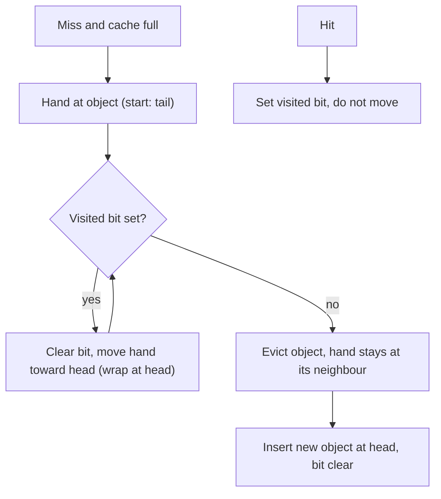

## In one minute
- When a cache is full, the eviction policy decides which entry to drop. The ideal is Belady's MIN: evict the entry whose next use is farthest away. It needs the future, so it serves as a yardstick, not an implementation.
- Real policies guess the future from two signals: recency (LRU, CLOCK) and frequency (LFU). Recency adapts quickly but is flushed by scans; frequency resists scans but clings to items that used to be popular.
- Modern policies win by treating new items with suspicion: S3-FIFO and SIEVE evict one-hit wonders quickly, and W-TinyLFU only admits a newcomer if it is more frequent than the victim.
- Throughput matters as much as hit ratio. An LRU hit is a write to shared pointers; a CLOCK or SIEVE hit only sets a bit, which scales across cores.
- Choose with a trace. Replay real access logs through candidate policies at your real cache size and compare miss ratios against Belady's bound.

## How it works

### What the policy is trying to do
Every eviction bets that this entry will be needed later than the others. Belady showed in 1966 that evicting the entry used farthest in the future minimises misses. No online cache knows the future, but simulating MIN on a recorded trace bounds the possible gain: if LRU misses 12% and MIN 9% at the same size, no policy saves more than a quarter of your misses.

### Recency: LRU and its weakness
LRU evicts the entry unused for the longest time and adapts instantly when popularity shifts. Its weakness is **scans**: a one-off pass over many keys (a backup, a crawler, an analytics query) pushes every hot key out for keys that will never be read again. A loop slightly larger than the cache makes it miss on every access. The LLD lesson on designing an LRU cache covers its implementation.

### Frequency: LFU and its weakness
LFU evicts the entry with the fewest accesses, so scans barely affect it. But a pure count never forgets: yesterday's viral video keeps its count long after interest moves on, so practical LFU ages counts. Redis's `allkeys-lfu` keeps an 8-bit logarithmic counter per key that is incremented probabilistically (`lfu-log-factor`, default 10, saturates around a million hits) and decremented when the key has been idle for `lfu-decay-time` minutes (default 1) ([Redis docs](https://redis.io/docs/latest/develop/reference/eviction/)). LFU can be O(1) with a list of frequency buckets, moving a key to the next bucket on each hit (Shah, Mitra and Matani).

### Approximations: CLOCK and sampling
**CLOCK** approximates LRU with a circular buffer and a reference bit per slot. A hit sets the bit; to evict, a hand sweeps the circle, clearing set bits and evicting the first slot whose bit is clear. PostgreSQL's buffer manager uses a generalised version, the clock sweep, with a `usage_count` per buffer that a hit increments up to 5 and the sweep decrements, so frequently used pages survive several passes. Postgres also fences off scans instead of trusting the policy: a large sequential scan reuses a private 256 KB ring of buffers, and `COPY` uses a ring of at most 16 MB, so one big query cannot flush `shared_buffers` ([Postgres buffer README](https://github.com/postgres/postgres/blob/master/src/backend/storage/buffer/README)). Redis avoids lists entirely: it samples `maxmemory-samples` keys (default 5) and keeps a small pool of the best candidates across evictions. Redis 8.6 added a third signal, least recently *modified* (`allkeys-lrm`, `volatile-lrm`): the timestamp moves only on writes, so keys that are read constantly but never updated still age out ([Redis docs](https://redis.io/docs/latest/develop/reference/eviction/)).

### Combining both signals
**2Q** and **segmented LRU** put new entries on a probationary list and promote them on a second hit, so scans churn only probation. **ARC** (Megiddo and Modha, 2003) keeps recency and frequency lists plus "ghost" lists of evicted keys, and shifts space towards whichever ghost list gets hits ([ARC paper](https://www.usenix.org/legacy/events/fast03/tech/full_papers/megiddo/megiddo.pdf)). Linux uses active and inactive lists, and since kernel 6.1 offers the multi-generational LRU (MGLRU).

### Suspicion of newcomers: TinyLFU, S3-FIFO and SIEVE
Objects requested once and never again (one-hit wonders) are common, and more so at cache scale. Across 6,594 production traces, the median share of one-hit wonders was 26% over a whole trace but 72% within a slice holding 10% of the trace's objects, which is roughly what a cache sees between evictions ([S3-FIFO paper](https://jasony.me/publication/sosp23-s3fifo.pdf)). Recent policies get most of their gain by evicting these fast.

**W-TinyLFU**, used by Caffeine and adopted by many Java and Go caches, adds an *admission* step. A small LRU window catches bursts. The paper's Caffeine release fixed it at 1% of capacity ([TinyLFU paper](https://arxiv.org/abs/1512.00727)); current Caffeine sizes window and main regions at runtime by hill climbing on the hit rate ([Caffeine design](https://github.com/ben-manes/caffeine/wiki/Design)). When the window evicts a candidate, a compact frequency sketch decides whether it beats the main region's victim; if not, the newcomer is dropped and the established entry stays. The sketch is a Count-Min sketch of 4-bit counters, halved periodically so old popularity fades.

**S3-FIFO** (SOSP 2023) uses three FIFO queues: a small one (about 10% of the cache) for new objects, a main one, and a ghost queue of recently evicted keys. Objects not re-accessed while in the small queue are evicted quickly; objects found in the ghost queue go straight to main.

**SIEVE** (NSDI 2024) is simpler still: one FIFO queue with a visited bit per object. A hit sets the bit without moving the object. To evict, a hand walks from tail toward head, clearing bits and evicting the first unvisited object, and stays where it stopped. An object never re-read is evicted on the hand's next pass. On 1,559 traces it had a lower miss ratio than nine other modern policies on over 45% of traces, and adding it to five production cache libraries took fewer than 20 changed lines on average ([SIEVE paper](https://www.usenix.org/system/files/nsdi24-zhang-yazhuo.pdf)).

### Expiry comes before eviction
In caches with TTLs, many entries are dead before the policy ever looks at them. Twitter's study of 153 production cache clusters found that TTLs often set the effective working set, so removing expired objects promptly matters more than the choice of eviction policy, and at reasonable sizes FIFO often matched LRU ([Twitter OSDI 2020](https://www.usenix.org/conference/osdi20/presentation/yang)). Redis, for example, deletes expired keys lazily on access and also periodically samples keys with TTLs to delete the dead ones nobody reads ([Redis docs](https://redis.io/docs/latest/commands/expire/)).

### The same problem shape elsewhere
Eviction is the overload shape applied to memory: when demand exceeds capacity, drop by predicted value. An LLM server dropping KV-cache blocks of idle conversations and a Kubernetes node evicting pods under memory pressure make the same bet, and fail the same way when a burst of low-value work pushes out high-value work.

## Down the stack

### Layer 1: The contract
An eviction policy promises nothing about any particular key. It promises bounded memory (entries or bytes never exceed the limit), near-constant time per operation, and implicitly a miss ratio close to what the workload allows. What can be tested is behaviour on a trace: for a given capacity, hits and evictions are deterministic for LRU, LFU, CLOCK and SIEVE, and probabilistic for sampled policies such as Redis's.

### Layer 2: The mechanism
LRU is a hash map plus a doubly linked list: two pointers per entry and six pointer writes per hit. O(1) LFU is a list of frequency nodes, each owning a list of entries, plus a hash map from key to entry; a hit unlinks the entry and appends it to the next frequency node, creating it if needed. CLOCK is an array of slots, a bit per slot and one hand index. SIEVE is a FIFO list, a visited bit per node and a hand pointer that persists between evictions. W-TinyLFU's sketch is four rows of 4-bit counters, eight bytes of sketch per cache entry in Caffeine ([Caffeine design](https://github.com/ben-manes/caffeine/wiki/Design)), indexed by hashes of the key; an estimate is the minimum of the four counters, and when the number of recorded accesses reaches a sample size (ten times the maximum entries in the original paper), every counter is halved. Redis stores a 24-bit field in each object header: a minutes-resolution clock for LRU, or a 16-bit decay timestamp plus the 8-bit counter for LFU.

### Layer 3: The machine
The hidden cost of LRU is that a read becomes a write. Moving a node to the head writes to the node, its two neighbours and the head, dirtying several 64-byte cache lines that other cores then have to fetch back, and the list needs a lock. On a 32-core server the lock and cache-line traffic, not the hash lookup, cap throughput. Caffeine works around this by recording hits in striped, lossy ring buffers and replaying them under a lock in batches. CLOCK and SIEVE avoid the problem: a hit is a single store to a bit or byte that is often already set, so reads scale with cores. The SIEVE authors report twice the throughput of an optimised LRU at 16 threads ([SIEVE paper](https://www.usenix.org/system/files/nsdi24-zhang-yazhuo.pdf)).

Metadata matters at scale: two 8-byte list pointers for 100 million small objects is 1.6 GB. A FIFO can be a ring of indices and a sketch costs a few bytes per entry, which is why Redis squeezes recency into 24 bits of the object header.

### Why it's built this way
1. Memory is finite and misses are expensive, so every cache needs a rule for what to drop.
2. The optimal rule needs the future, so policies predict it from recency and frequency.
3. Recency alone is fooled by scans and frequency alone by stale popularity, so good policies combine them or filter newcomers.
4. Most new objects are never reused, so evicting or rejecting them early gives most of the gain cheaply.
5. Updating shared order on every hit limits multicore throughput, so modern policies keep hits to a bit flip and do the work at eviction time.

## Diagram


## Worked example
A product image cache at an edge site holds 2 million objects. Normal traffic is 20,000 requests per second, and a nightly partner sync walks 5 million distinct catalogue images once, at 5,000 requests per second for about 17 minutes.

Replaying a day of logs through a simulator gives these miss ratios (illustrative numbers in the shape such studies usually show). Belady's MIN: 8%. W-TinyLFU: 10%. SIEVE: 10.5%. LRU: 13% for the day, but during the sync window LRU's miss ratio for normal traffic jumps to 40%, because the scan pushes most of the hot set out, and it takes about an hour of normal traffic to refill.

Translate to the origin. LRU at 13% sends 2,600 requests per second to the image origin on average, and the post-sync refill spikes it toward 8,000. W-TinyLFU at 10% sends 2,000, and during the sync it rejects the one-off images at admission, so the hot set barely moves. SIEVE also protects the hot set: hot objects have their visited bit set, so the hand clears it and moves on, while scanned objects are evicted on the hand's next pass.

Both cut origin load by about a quarter versus LRU and remove the nightly spike; SIEVE needs one bit per object, W-TinyLFU gets slightly better ratios. Either beats buying 30% more memory, which the miss-ratio curve says would only bring LRU to about 11.5%.

## In the wild
- **Discord, 2020: an LRU cache that the garbage collector had to keep scanning.** Read States, the service that tracks which messages each user has read, held a large in-memory LRU cache in Go. Latency and CPU spiked about every two minutes, because Go forces a collection at least that often and each one walked the whole cache. Shrinking the cache cut the spikes but raised p99 latency, because more reads fell through to the database. A Rust rewrite with no garbage collector removed the spikes and let them raise the cache to 8 million Read States per server, a reminder that an eviction policy's metadata lives inside a runtime with its own costs ([Discord](https://discord.com/blog/why-discord-is-switching-from-go-to-rust)).
- **Twitter, 2020: what 153 production cache clusters actually do.** Traces from Twitter's Twemcache fleet showed more than 35% of clusters were write-heavy (over 30% writes), popularity was roughly Zipfian with sometimes extreme skew, object sizes shifted daily, and TTL often bounded the working set. In simulation, FIFO frequently matched LRU, and LRU won mainly when the cache was severely undersized. The data fed the later S3-FIFO and SIEVE work ([paper](https://www.usenix.org/system/files/osdi20-yang.pdf)).

## Trade-offs
| Policy | Strengths | Weaknesses | Choose when |
|---|---|---|---|
| LRU | Simple, adapts quickly | Scan and loop pollution, hits need locking | Small caches, recency-driven workloads |
| LFU with aging | Scan resistant, keeps steady favourites | Slow to adapt, tuning of decay | Stable popularity, such as reference data |
| CLOCK | Cheap hits, approximates LRU | Same scan weakness as LRU | Buffer pools, page caches |
| ARC or 2Q | Balances recency and frequency | More metadata, ghost lists | Storage caches with mixed scans |
| W-TinyLFU | Near-optimal on many traces, scan resistant | Sketch and window add complexity | Library caches (Caffeine, Ristretto) |
| SIEVE or S3-FIFO | Very simple, cheap hits, evicts one-hit wonders | Less suited to loops with heavy reuse | Web and key-value caches with high churn |

## Pitfalls in production
- **Choosing by reputation.** A policy that wins on CDN traces may lose on a buffer pool. Replay your own trace at your real size and compare against MIN.
- **Batch jobs flushing the online cache.** Backups and re-indexers evict the hot set under LRU. Use a scan-resistant policy, or keep batch traffic out of the cache.
- **Frequency that never forgets.** LFU without decay keeps last month's hits. Configure aging, such as Redis's `lfu-decay-time`.
- **Counting entries when memory is bytes.** A policy limited by entry count lets a few huge values exhaust memory. Weigh entries by size, or use separate pools for large objects.
- **Eviction hiding a capacity problem.** Evicted keys that are re-read soon mean the working set does not fit. Track them, and grow the cache when the miss-ratio curve says it pays.

## Leadership lens
- Ask for a trace-driven comparison before changing a policy or buying memory. A policy change is often cheaper than hardware.
- Treat batch and online traffic as separate tenants of any shared cache, and make that a design review question.
- Prefer proven libraries (Caffeine, Ristretto, Redis's built-in policies) over custom eviction code.
- Monitor the eviction rate and the age of evicted keys, not just the hit ratio, to see pressure before users do.

## Check yourself
1. Why can LRU miss on every access when a workload loops over 1,001 keys with a cache of 1,000?
   **Answer:** Each key is the least recently used exactly when it is about to be needed, so it is always evicted just in time to miss. MIN would keep most keys resident.
2. Why does a hit in SIEVE scale better across cores than a hit in LRU?
   **Answer:** A SIEVE hit only sets a visited bit, while an LRU hit relinks list nodes, which needs a lock and writes several shared cache lines.
3. What problem does TinyLFU's admission step solve that eviction alone does not?
   **Answer:** It stops a newcomer from displacing an entry that is accessed more often. A scan can then pass through the small window without evicting the established hot set.
4. Why do LFU caches need aging?
   **Answer:** Without it, items that were popular long ago keep high counts and never leave, so new popular items cannot get in.

## Practice
**Task:** Implement the SIEVE eviction policy and Belady's MIN for comparison. `SieveCache(capacity)` rejects capacity below 1 (raise `ValueError`, throw, or return an error in Go). `access(key)` returns true on a hit, which sets the key's visited bit without moving it. On a miss in a full cache, evict: start at the hand (or the tail, the oldest end, if the hand is unset), and while the object there is visited, clear its bit and move toward the head, wrapping to the tail after the head; evict the first unvisited object and set the hand to its neighbour toward the head (unset if it was the head). Then insert the new key at the head, unvisited. `keys()` lists keys from head (newest) to tail. `belady_hits(trace, capacity)` returns the hit count of the offline optimal policy, which on a miss in a full cache evicts the cached key whose next use is farthest away (never used again counts as farthest; break ties by the smallest key); capacity 0 gives 0.

```python starter
class SieveCache:
    def __init__(self, capacity):
        self.capacity = capacity

    def access(self, key):
        # TODO
        raise NotImplementedError

    def keys(self):
        # TODO
        raise NotImplementedError


def belady_hits(trace, capacity):
    # TODO
    raise NotImplementedError
```

```python tests
def test_rejects_bad_capacity():
    try:
        SieveCache(0)
    except ValueError:
        return
    assert False, "expected ValueError"

def test_hits_do_not_move_objects():
    c = SieveCache(3)
    assert [c.access(k) for k in ["a", "b", "c", "a"]] == [False, False, False, True]
    assert c.keys() == ["c", "b", "a"]

def test_visited_object_survives_and_hand_persists():
    c = SieveCache(3)
    for k in ["a", "b", "c", "a"]:
        c.access(k)
    c.access("d")
    assert c.keys() == ["d", "c", "a"], "a was visited, b evicted"
    c.access("e")
    assert c.keys() == ["e", "d", "a"], "hand continued to c"

def test_hand_wraps_after_clearing_all():
    c = SieveCache(2)
    for k in ["a", "b", "a", "b"]:
        c.access(k)
    c.access("c")
    assert c.keys() == ["c", "b"]
    c.access("d")
    assert c.keys() == ["d", "c"]

def test_one_hit_wonders_go_first():
    c = SieveCache(3)
    for k in ["a", "b", "a", "b", "x1", "x2"]:
        c.access(k)
    assert c.keys() == ["x2", "b", "a"]

def test_belady_basic():
    assert belady_hits(["a", "b", "c", "a", "b"], 2) == 1
    assert belady_hits(["a", "b", "a"], 1) == 0
    assert belady_hits(["a", "b", "a"], 2) == 1
    assert belady_hits(["a", "a"], 0) == 0

def test_belady_bounds_sieve():
    trace = list("abcdabeabcdeaabfgab")
    expected = {2: (1, 5), 3: (4, 9), 4: (9, 11)}
    for cap, (sieve, best) in expected.items():
        c = SieveCache(cap)
        assert sum(1 for k in trace if c.access(k)) == sieve
        assert belady_hits(trace, cap) == best
```

```python solution
class SieveCache:
    def __init__(self, capacity):
        if capacity < 1:
            raise ValueError("capacity must be at least 1")
        self.capacity = capacity
        self.queue = []
        self.visited = {}
        self.hand = None

    def access(self, key):
        if key in self.visited:
            self.visited[key] = True
            return True
        if len(self.queue) >= self.capacity:
            self._evict()
        self.queue.insert(0, key)
        self.visited[key] = False
        if self.hand is not None:
            self.hand += 1
        return False

    def _evict(self):
        i = self.hand if self.hand is not None else len(self.queue) - 1
        while self.visited[self.queue[i]]:
            self.visited[self.queue[i]] = False
            i = i - 1 if i > 0 else len(self.queue) - 1
        victim = self.queue.pop(i)
        del self.visited[victim]
        self.hand = i - 1 if i > 0 else None

    def keys(self):
        return list(self.queue)


def belady_hits(trace, capacity):
    if capacity < 1:
        return 0
    n = len(trace)
    next_use = [n] * n
    last = {}
    for i in range(n - 1, -1, -1):
        next_use[i] = last.get(trace[i], n)
        last[trace[i]] = i
    cached = {}
    hits = 0
    for i, key in enumerate(trace):
        if key in cached:
            hits += 1
        elif len(cached) >= capacity:
            victim = None
            for k in cached:
                if victim is None or cached[k] > cached[victim] or (cached[k] == cached[victim] and k < victim):
                    victim = k
            del cached[victim]
        cached[key] = next_use[i]
    return hits
```

```typescript starter
export class SieveCache {
  constructor(public capacity: number) {}
  access(key: string): boolean {
    throw new Error("TODO");
  }
  keys(): string[] {
    throw new Error("TODO");
  }
}

export function beladyHits(trace: string[], capacity: number): number {
  throw new Error("TODO");
}
```

```typescript tests
function feed(c: SieveCache, ks: string[]): boolean[] {
  return ks.map((k) => c.access(k));
}

test("rejects bad capacity", () => {
  let threw = false;
  try {
    new SieveCache(0);
  } catch (e) {
    threw = true;
  }
  assert(threw, "expected an error");
});
test("hits do not move objects", () => {
  const c = new SieveCache(3);
  assertEqual(feed(c, ["a", "b", "c", "a"]), [false, false, false, true]);
  assertEqual(c.keys(), ["c", "b", "a"]);
});
test("visited object survives and hand persists", () => {
  const c = new SieveCache(3);
  feed(c, ["a", "b", "c", "a", "d"]);
  assertEqual(c.keys(), ["d", "c", "a"], "a was visited, b evicted");
  c.access("e");
  assertEqual(c.keys(), ["e", "d", "a"], "hand continued to c");
});
test("hand wraps after clearing all", () => {
  const c = new SieveCache(2);
  feed(c, ["a", "b", "a", "b", "c"]);
  assertEqual(c.keys(), ["c", "b"]);
  c.access("d");
  assertEqual(c.keys(), ["d", "c"]);
});
test("one hit wonders go first", () => {
  const c = new SieveCache(3);
  feed(c, ["a", "b", "a", "b", "x1", "x2"]);
  assertEqual(c.keys(), ["x2", "b", "a"]);
});
test("belady basic", () => {
  assertEqual(beladyHits(["a", "b", "c", "a", "b"], 2), 1);
  assertEqual(beladyHits(["a", "b", "a"], 1), 0);
  assertEqual(beladyHits(["a", "b", "a"], 2), 1);
  assertEqual(beladyHits(["a", "a"], 0), 0);
});
test("belady bounds sieve", () => {
  const trace = "abcdabeabcdeaabfgab".split("");
  const expected: [number, number, number][] = [[2, 1, 5], [3, 4, 9], [4, 9, 11]];
  for (const [cap, sieve, best] of expected) {
    const c = new SieveCache(cap);
    assertEqual(feed(c, trace).filter((h) => h).length, sieve);
    assertEqual(beladyHits(trace, cap), best);
  }
});
```

```typescript solution
export class SieveCache {
  private queue: string[] = [];
  private visited = new Map<string, boolean>();
  private hand: number | null = null;

  constructor(public capacity: number) {
    if (capacity < 1) throw new Error("capacity must be at least 1");
  }

  access(key: string): boolean {
    if (this.visited.has(key)) {
      this.visited.set(key, true);
      return true;
    }
    if (this.queue.length >= this.capacity) this.evict();
    this.queue.unshift(key);
    this.visited.set(key, false);
    if (this.hand !== null) this.hand++;
    return false;
  }

  private evict(): void {
    let i = this.hand !== null ? this.hand : this.queue.length - 1;
    while (this.visited.get(this.queue[i])) {
      this.visited.set(this.queue[i], false);
      i = i > 0 ? i - 1 : this.queue.length - 1;
    }
    const [victim] = this.queue.splice(i, 1);
    this.visited.delete(victim);
    this.hand = i > 0 ? i - 1 : null;
  }

  keys(): string[] {
    return [...this.queue];
  }
}

export function beladyHits(trace: string[], capacity: number): number {
  if (capacity < 1) return 0;
  const n = trace.length;
  const nextUse: number[] = new Array(n).fill(n);
  const last = new Map<string, number>();
  for (let i = n - 1; i >= 0; i--) {
    nextUse[i] = last.has(trace[i]) ? last.get(trace[i])! : n;
    last.set(trace[i], i);
  }
  const cached = new Map<string, number>();
  let hits = 0;
  trace.forEach((key, i) => {
    if (cached.has(key)) {
      hits++;
    } else if (cached.size >= capacity) {
      let victim: string | null = null;
      for (const [k, nu] of cached) {
        if (victim === null) {
          victim = k;
          continue;
        }
        const vu = cached.get(victim)!;
        if (nu > vu || (nu === vu && k < victim)) victim = k;
      }
      cached.delete(victim!);
    }
    cached.set(key, nextUse[i]);
  });
  return hits;
}
```

```go starter
package practice

type SieveCache struct{}

func NewSieveCache(capacity int) (*SieveCache, error) { return &SieveCache{}, nil }

func (c *SieveCache) Access(key string) bool { panic("TODO") }
func (c *SieveCache) Keys() []string         { panic("TODO") }

func BeladyHits(trace []string, capacity int) int { panic("TODO") }
```

```go tests
package practice

import (
	"reflect"
	"strings"
	"testing"
)

func mustCache(t *testing.T, capacity int) *SieveCache {
	t.Helper()
	c, err := NewSieveCache(capacity)
	if err != nil {
		t.Fatalf("unexpected error: %v", err)
	}
	return c
}

func feed(c *SieveCache, keys ...string) []bool {
	out := []bool{}
	for _, k := range keys {
		out = append(out, c.Access(k))
	}
	return out
}

func wantKeys(t *testing.T, c *SieveCache, want ...string) {
	t.Helper()
	if got := c.Keys(); !reflect.DeepEqual(got, want) {
		t.Fatalf("keys = %v, want %v", got, want)
	}
}

func TestRejectsBadCapacity(t *testing.T) {
	if _, err := NewSieveCache(0); err == nil {
		t.Fatal("expected an error")
	}
}

func TestHitsDoNotMoveObjects(t *testing.T) {
	c := mustCache(t, 3)
	if got := feed(c, "a", "b", "c", "a"); !reflect.DeepEqual(got, []bool{false, false, false, true}) {
		t.Fatalf("hits = %v", got)
	}
	wantKeys(t, c, "c", "b", "a")
}

func TestVisitedObjectSurvivesAndHandPersists(t *testing.T) {
	c := mustCache(t, 3)
	feed(c, "a", "b", "c", "a", "d")
	wantKeys(t, c, "d", "c", "a")
	c.Access("e")
	wantKeys(t, c, "e", "d", "a")
}

func TestHandWrapsAfterClearingAll(t *testing.T) {
	c := mustCache(t, 2)
	feed(c, "a", "b", "a", "b", "c")
	wantKeys(t, c, "c", "b")
	c.Access("d")
	wantKeys(t, c, "d", "c")
}

func TestOneHitWondersGoFirst(t *testing.T) {
	c := mustCache(t, 3)
	feed(c, "a", "b", "a", "b", "x1", "x2")
	wantKeys(t, c, "x2", "b", "a")
}

func TestBeladyBasic(t *testing.T) {
	cases := []struct {
		trace []string
		cap   int
		want  int
	}{
		{[]string{"a", "b", "c", "a", "b"}, 2, 1},
		{[]string{"a", "b", "a"}, 1, 0},
		{[]string{"a", "b", "a"}, 2, 1},
		{[]string{"a", "a"}, 0, 0},
	}
	for _, tc := range cases {
		if got := BeladyHits(tc.trace, tc.cap); got != tc.want {
			t.Fatalf("BeladyHits(%v, %d) = %d, want %d", tc.trace, tc.cap, got, tc.want)
		}
	}
}

func TestBeladyBoundsSieve(t *testing.T) {
	trace := strings.Split("abcdabeabcdeaabfgab", "")
	for _, tc := range [][3]int{{2, 1, 5}, {3, 4, 9}, {4, 9, 11}} {
		c := mustCache(t, tc[0])
		hits := 0
		for _, h := range feed(c, trace...) {
			if h {
				hits++
			}
		}
		if hits != tc[1] || BeladyHits(trace, tc[0]) != tc[2] {
			t.Fatalf("cap %d: sieve %d, belady %d; want %d, %d", tc[0], hits, BeladyHits(trace, tc[0]), tc[1], tc[2])
		}
	}
}
```

```go solution
package practice

import (
	"errors"
	"sync"
)

type node struct {
	key        string
	visited    bool
	prev, next *node // prev points toward the head (newer), next toward the tail (older)
}

type SieveCache struct {
	mu         sync.Mutex
	capacity   int
	items      map[string]*node
	head, tail *node
	hand       *node
}

func NewSieveCache(capacity int) (*SieveCache, error) {
	if capacity < 1 {
		return nil, errors.New("capacity must be at least 1")
	}
	return &SieveCache{capacity: capacity, items: map[string]*node{}}, nil
}

func (c *SieveCache) Access(key string) bool {
	c.mu.Lock()
	defer c.mu.Unlock()
	if n, ok := c.items[key]; ok {
		n.visited = true
		return true
	}
	if len(c.items) >= c.capacity {
		c.evict()
	}
	n := &node{key: key, next: c.head}
	if c.head != nil {
		c.head.prev = n
	}
	c.head = n
	if c.tail == nil {
		c.tail = n
	}
	c.items[key] = n
	return false
}

func (c *SieveCache) evict() {
	n := c.hand
	if n == nil {
		n = c.tail
	}
	for n.visited {
		n.visited = false
		if n.prev != nil {
			n = n.prev
		} else {
			n = c.tail
		}
	}
	c.hand = n.prev
	if n.prev != nil {
		n.prev.next = n.next
	} else {
		c.head = n.next
	}
	if n.next != nil {
		n.next.prev = n.prev
	} else {
		c.tail = n.prev
	}
	delete(c.items, n.key)
}

func (c *SieveCache) Keys() []string {
	c.mu.Lock()
	defer c.mu.Unlock()
	out := []string{}
	for n := c.head; n != nil; n = n.next {
		out = append(out, n.key)
	}
	return out
}

func BeladyHits(trace []string, capacity int) int {
	if capacity < 1 {
		return 0
	}
	n := len(trace)
	nextUse := make([]int, n)
	last := map[string]int{}
	for i := n - 1; i >= 0; i-- {
		nextUse[i] = n
		if j, ok := last[trace[i]]; ok {
			nextUse[i] = j
		}
		last[trace[i]] = i
	}
	cached := map[string]int{}
	hits := 0
	for i, key := range trace {
		if _, ok := cached[key]; ok {
			hits++
		} else if len(cached) >= capacity {
			victim, first := "", true
			for k, nu := range cached {
				if first || nu > cached[victim] || (nu == cached[victim] && k < victim) {
					victim, first = k, false
				}
			}
			delete(cached, victim)
		}
		cached[key] = nextUse[i]
	}
	return hits
}
```

## Mock interview
**Prompt:** You run a 64 GB in-process cache in front of a recommendation feature store, serving 200,000 lookups per second across 32 cores. Hit ratio sits at 85%, but every night an embedding backfill reads all 400 million keys once and hit ratio falls to 40% for an hour. Fix it.

- Follow-up: How would you prove a new policy is better before rolling it out?
- Follow-up: Profiling shows the cache lock is the top contended mutex. What changes?
- Follow-up: Values range from 200 bytes to 2 MB. Does that change your policy?

**A strong answer covers:**
- Diagnosing the backfill as a scan polluting an LRU-like policy; bypassing the cache for it or using a scan-resistant policy.
- Choosing W-TinyLFU, S3-FIFO or SIEVE with reasons, and why admission filtering stops one-off keys at the door.
- Trace-driven evaluation against Belady's MIN, then a canary.
- Concurrency: hits that only set a bit, or buffered hit recording as in Caffeine, instead of a global list lock.
- Size awareness: weighing entries by bytes and keeping very large values in a separate tier.

## Sources and further study
**Primary**
- [Yang, Yue and Rashmi, A large scale analysis of hundreds of in-memory cache clusters at Twitter (OSDI 2020)](https://www.usenix.org/conference/osdi20/presentation/yang): production evidence on TTLs, skew and when FIFO is enough.
- [Einziger, Friedman and Manes, TinyLFU (full paper)](https://arxiv.org/pdf/1512.00727): the reset-by-halving proof, the 10x sample size and the window experiments.

**Systems docs**
- [PostgreSQL buffer manager README](https://github.com/postgres/postgres/blob/master/src/backend/storage/buffer/README): clock sweep, the background writer and ring buffers for scans, VACUUM and bulk writes.
- [Multi-Gen LRU (Linux kernel docs)](https://docs.kernel.org/admin-guide/mm/multigen_lru.html): how to enable and tune the kernel's generational page reclaim.
- [Caffeine efficiency](https://github.com/ben-manes/caffeine/wiki/Efficiency): W-TinyLFU against LRU, ARC, LIRS and Belady's bound on several traces.

**Books**
- *Database Internals*, Alex Petrov, chapter 5 "Transaction Processing and Recovery": buffer management, page replacement, CLOCK and LFU from the storage engine's side.
- *Systems Performance* (2nd ed.), Brendan Gregg, chapter 7 "Memory": page scanning, reclaim and how to observe memory pressure.

**Other curricula**
- [donnemartin/system-design-primer](https://github.com/donnemartin/system-design-primer#cache): mentions LRU as the way to keep hot data in RAM and stops there; no scan resistance or admission.
- [Caching guidance (Azure Architecture Center)](https://learn.microsoft.com/en-us/azure/architecture/best-practices/caching): lists eviction types (most recently used, first-in-first-out, explicit removal) and warns against pinning items so they never leave.

## Watch
- [NSDI '24: SIEVE is Simpler than LRU (USENIX)](https://www.youtube.com/watch?v=IcnBckIhJnM): the authors explain SIEVE, lazy promotion and quick demotion, with results on 1,559 traces.

## Free resources
- [SIEVE is Simpler than LRU (NSDI 2024 paper)](https://www.usenix.org/system/files/nsdi24-zhang-yazhuo.pdf): the algorithm, its analysis and the trace study.
- [FIFO queues are all you need for cache eviction (S3-FIFO, SOSP 2023)](https://jasony.me/publication/sosp23-s3fifo.pdf): why one-hit wonders dominate and how three FIFO queues exploit that.
- [TinyLFU: A Highly Efficient Cache Admission Policy (arXiv)](https://arxiv.org/abs/1512.00727): the frequency sketch, aging by halving, and W-TinyLFU.
- [Caffeine design notes](https://github.com/ben-manes/caffeine/wiki/Design): how a production cache buffers hits and applies W-TinyLFU concurrently.
- [ARC: A Self-Tuning, Low Overhead Replacement Cache (FAST 2003)](https://www.usenix.org/legacy/events/fast03/tech/full_papers/megiddo/megiddo.pdf): the adaptive recency and frequency policy with ghost lists.
- [Key eviction (Redis docs)](https://redis.io/docs/latest/develop/reference/eviction/): Redis's sampled LRU and LFU, `maxmemory-samples` and the LFU tuning knobs.
