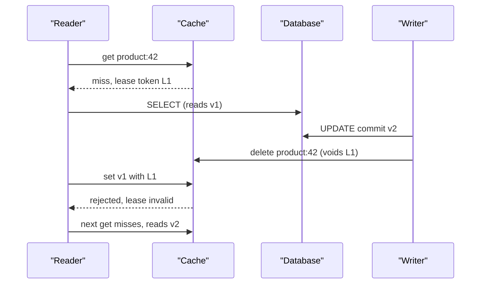

## In one minute
- A cache holds copies; invalidation is how copies stop being served after the source of truth changes.
- Every strategy picks a point on a line between *staleness* (how long a wrong value can be served) and *cost* (extra reads, writes, and moving parts).
- TTLs bound staleness without coordination; explicit invalidation shrinks it but introduces races between readers and writers.
- The classic bug is a slow reader writing an old value into the cache *after* a writer invalidated it; leases, versions or delayed second deletes fix it.
- Decide the acceptable staleness per data type first, then pick the cheapest mechanism that meets it.

## How it works

### TTL only
Each entry expires after a fixed time. No writer needs to know the cache exists, and staleness is bounded by the TTL. It suits data where minutes of staleness are acceptable (recommendations, counts, profile pictures). The cost is a miss on every expiry even when nothing changed, and a hard ceiling on freshness.

### Invalidate on write
In the cache-aside pattern, the application writes the database and then *deletes* the cache key, so the next reader repopulates it. Deleting is preferred over updating the cache, because two concurrent writers updating the cache can apply in the opposite order from their database commits, leaving the cache permanently wrong. Deleting converges: whoever reads next gets the committed value.

### The stale-set race
Deleting is still not enough. Reader R misses, reads value v1 from the database, then pauses (GC, slow network). Writer W commits v2 and deletes the key. R resumes and sets v1 into the cache. The cache now holds v1 with a full TTL, and nothing will fix it until expiry. Fixes:

1. **Leases.** On a miss the cache hands the reader a token. A delete invalidates outstanding tokens, so R's late set is rejected.
2. **Versioned values.** Store a version (row version or commit timestamp) with the value, and only accept sets with a newer version than what the cache has seen, including deletes as tombstones.
3. **Delayed double delete.** Delete again a few hundred milliseconds after the write. Cheap, but probabilistic.
4. **Delete with a hold-off.** Memcached deletes can carry a hold-off time during which `add` for that key fails, so a late fill bounces. Facebook issued every delete to a warming cluster with a two-second hold-off ([Facebook NSDI 2013](https://www.usenix.org/system/files/conference/nsdi13/nsdi13-final170_update.pdf)).

### Invalidation from the database log
Application-level deletes are lost if the process crashes between commit and delete, and every write path must remember to do them. Tailing the database's change log (MySQL binlog, PostgreSQL logical replication) and issuing deletes from it guarantees every committed change produces an invalidation, in commit order, at the cost of a pipeline with its own lag. Debezium's Postgres connector, for example, reads logical decoding output through the built-in `pgoutput` plugin and a replication slot it creates for itself ([Debezium docs](https://debezium.io/documentation/reference/stable/connectors/postgresql.html)).

### Measure staleness, do not assume it
Invalidation bugs hide in rare error paths, so mature teams measure consistency from outside. Meta's Polaris acts like a cache server to receive invalidations, then queries replicas and reports keys still stale after 1, 5 or 10 minutes. With it, Meta raised TAO's cache consistency from six nines to ten nines of writes consistent within five minutes. One bug it caught: an invalidation hit a transient error, the error handler dropped the key only if the cached version was older, the stale value carried the newest version, and so it stayed forever ([Meta engineering](https://engineering.fb.com/2022/06/08/core-infra/cache-made-consistent/)).

### Many layers and regions
Real systems cache in several places: in-process, a shared cache cluster, a CDN, the browser. Each layer needs its own mechanism, and the outermost (browser) can only be controlled by TTL and versioned URLs. A content-hashed URL served with `Cache-Control: max-age=31536000, immutable` never needs invalidating, and the `immutable` flag stops browsers revalidating it on reload ([RFC 8246](https://www.rfc-editor.org/rfc/rfc8246)). Across regions, invalidations must reach every regional cache, usually by replicating the database and running the log-tailing invalidator in each region, so a region never invalidates before its replica has the new data.

## Down the stack

### Layer 1: The contract
A cache layer should state its staleness bound: "a read may return a value up to N seconds older than the latest commit", or "reads after an invalidation completes see the new value". TTL gives the first form with N equal to the TTL. Log-driven invalidation gives N equal to pipeline lag, typically under a second, with a guarantee that every commit eventually invalidates. Without leases or versions, neither form holds strictly, because the stale-set race can extend staleness to a full TTL.

### Layer 2: The mechanism
Memcached as deployed at Facebook issues a 64-bit lease token on a miss ([Facebook NSDI 2013](https://www.usenix.org/system/files/conference/nsdi13/nsdi13-final170_update.pdf)); a `delete` invalidates any outstanding lease for that key, and a `set` carrying an invalidated token is refused. Their invalidation daemon, mcsqueal, tails the MySQL commit log, extracts keys from annotated statements, batches deletes and sends them to routers in each region. Debezium does the same against PostgreSQL logical decoding or the MySQL binlog, publishing change events to Kafka for an invalidator service to consume. CDNs support *surrogate keys* (cache tags): responses are labelled with keys like `product-42`, and one purge call removes every cached URL carrying that tag. A *soft purge* marks matching objects stale instead of deleting them, so the next request is served the old copy while the CDN refetches ([Fastly docs](https://www.fastly.com/documentation/guides/concepts/edge-state/cache/purging/)). Redis has no lease primitive, so teams implement compare-on-version sets with a Lua script, or with `WATCH` and `MULTI`, where the transaction aborts if a watched key changed ([Azure caching guidance](https://learn.microsoft.com/en-us/azure/architecture/best-practices/caching)).

### Layer 3: The machine
A memcached or Redis delete is a single small request, roughly 100 to 300 microseconds round trip inside a data centre, so invalidation itself is cheap; the cost is in the misses it causes. Log tailing reads the binlog sequentially from disk or page cache, and its lag is dominated by batching intervals and cross-region replication, typically 10 ms to a few seconds. A CDN purge must reach hundreds of edge locations. Cloudflare reported a global median of 149 ms for tag, hostname and prefix purges in August 2024, down from about 1.6 seconds in May 2022 ([Cloudflare](https://blog.cloudflare.com/instant-purge/)); slower providers take seconds to minutes. Memory matters too: a cache with tombstones or version entries stores extra bytes per key, and at 500 million keys an extra 16 bytes each is 8 GB.

### Why it's built this way
1. Databases are expensive to read at high rates, so we copy hot data into memory close to readers.
2. Copies drift when the source changes, and pushing every change to every copy is costly, so TTL bounds drift cheaply.
3. Tighter freshness needs explicit invalidation, and concurrent readers and writers race, so caches add leases or versions.
4. Application code forgets or crashes before invalidating, so the commit log, which records every change in order, becomes the invalidation source.
5. Outer caches (browsers, CDNs) cannot be reached reliably, so immutable versioned URLs replace invalidation there.

## Diagram



## Worked example
A product catalog serves 50,000 reads per second with a 98% hit rate from a Redis cluster; the database handles the 1,000 misses per second. Merchants make 200 price updates per second.

With TTL only at 10 minutes, a price change can be wrong for 10 minutes, which breaks checkout when the cart price differs from the charged price. With cache-aside deletes, staleness drops to milliseconds, but consider the stale-set race. A reader's miss-to-set window is about 5 ms (database read plus serialisation). Each update deletes one key; the race needs a concurrent miss on that same key inside the window. For popular products, with 50 reads per second on one key at 2% miss probability, the expected misses in a 5 ms window are 50 x 0.02 x 0.005 = 0.005 per update. Across 200 updates per second that is about one stale entry per second, or 86,000 per day, each lasting up to the TTL. Leases bring that to near zero.

The team adds log-based invalidation via change data capture so batch jobs that update prices directly in SQL also invalidate. Pipeline lag is about 300 ms p99, so for checkout the service reads the price from the primary database rather than the cache, a deliberate exception covering 2% of traffic.

## In the wild
- **Facebook, 2010: an invalidation loop took the site down for 2.5 hours.** An automated system checked cached configuration values and, when one looked invalid, replaced it from the persistent store. On 23 September an invalid value was written to the persistent store itself, so every client saw it as invalid and queried a database cluster to fix it, hundreds of thousands of queries per second. Clients also treated any database error as an invalid value and deleted the cache key, so failures created more misses. The only way to break the loop was to stop all traffic to the cluster, which meant turning the site off, then letting users back gradually. The correction system was disabled ([Facebook](https://engineering.fb.com/2010/09/23/uncategorized/more-details-on-today-s-outage/)).
- **Meta, 2022: measuring and fixing TAO cache consistency.** Meta built Polaris to check, from the client's point of view, that every invalidation reached every cache replica, and consistency tracing to reconstruct a key's history. Together they raised TAO's consistency from 99.9999% to 99.99999999% of writes consistent within five minutes, and let on-call engineers find a version-check bug in an invalidation error path in under 30 minutes ([Meta engineering](https://engineering.fb.com/2022/06/08/core-infra/cache-made-consistent/)).

## Trade-offs

| Option | Strengths | Weaknesses | Choose when |
| --- | --- | --- | --- |
| TTL only | No coordination, simple | Stale up to TTL; misses on unchanged data | Staleness of minutes is acceptable |
| Delete on write (cache-aside) | Fresh within milliseconds | Stale-set race, every writer must remember | Most read-heavy app data |
| Write-through update | Cache always populated | Out-of-order updates, writes to cold keys | Small hot datasets with one writer |
| Log-driven invalidation (CDC) | Catches every commit, ordered | Pipeline to operate, lag | Many write paths, strict correctness |
| Versioned keys or URLs | No invalidation needed | Old versions linger until evicted | Static assets, immutable snapshots |

## Pitfalls in production
- **Updating instead of deleting.** Two writers race and the cache keeps the older value. Delete, and let readers repopulate.
- **Invalidating before commit.** A reader refills from the old row before the transaction commits. Invalidate after commit, or from the commit log.
- **Forgotten write paths.** Admin tools, migrations and batch jobs bypass the delete. Use CDC so the database is the trigger.
- **Derived keys.** A product change must also invalidate category pages and search results that embed it. Managed caches have the same gap: DAX updates its item cache on writes but never invalidates its query cache, which stays stale until its TTL ([DAX docs](https://docs.aws.amazon.com/amazondynamodb/latest/developerguide/DAX.consistency.html)). Track dependencies with tags or keep derived caches on short TTLs.
- **Cross-region ordering.** A region invalidates before its replica has the new data, then refills with old data. Run invalidation from each region's own replica log.

## Leadership lens
- Write down the staleness budget per data type; it settles most arguments about mechanism.
- Ask in review: list every path that writes this data, and show how each one invalidates.
- Prefer CDC-driven invalidation once more than a couple of services write the same data.
- Identify the few flows that must bypass the cache entirely (payments, inventory reservation) rather than making the whole cache strongly consistent.

## Check yourself
1. Why is deleting a key safer than updating it on write?
   **Answer:** Concurrent updates can reach the cache in a different order from their database commits and leave an old value. A delete makes the next reader fetch the committed value.
2. How can a reader put a stale value into the cache after a writer deleted it?
   **Answer:** The reader fetched the old row before the write, then set it after the writer's delete; nothing stops the late set without leases or versions.
3. Why drive invalidation from the database log rather than application code?
   **Answer:** The log records every committed change in order, including from batch jobs and tools, and survives application crashes between commit and delete.

## Practice
**Task:** Implement a cache with leases that blocks the stale-set race. `get(key)` returns `("hit", value)` if cached; otherwise, if no lease is outstanding for the key, it issues one and returns `("miss", token)`; if a lease is already outstanding it returns `("wait", None)`. `set(key, value, token)` stores the value and returns `True` only if `token` is the key's current outstanding lease, which it then clears. `delete(key)` removes the value and voids any outstanding lease. Tokens come from an incrementing counter starting at 1.

```python starter
class LeaseCache:
    def __init__(self):
        pass

    def get(self, key):
        raise NotImplementedError

    def set(self, key, value, token):
        raise NotImplementedError

    def delete(self, key):
        raise NotImplementedError
```

```python tests
def test_miss_then_fill_then_hit():
    c = LeaseCache()
    kind, tok = c.get("p")
    assert kind == "miss"
    assert c.set("p", "v1", tok)
    assert c.get("p") == ("hit", "v1")

def test_second_reader_waits():
    c = LeaseCache()
    c.get("p")
    assert c.get("p") == ("wait", None)

def test_delete_voids_lease_blocks_stale_set():
    c = LeaseCache()
    _, tok = c.get("p")
    c.delete("p")
    assert c.set("p", "stale", tok) is False
    assert c.get("p")[0] == "miss"

def test_token_used_once():
    c = LeaseCache()
    _, tok = c.get("p")
    assert c.set("p", "v1", tok)
    assert c.set("p", "v2", tok) is False
    assert c.get("p") == ("hit", "v1")

def test_unique_tokens_per_key():
    c = LeaseCache()
    _, a = c.get("a")
    _, b = c.get("b")
    assert a != b
    assert c.set("b", "vb", b) and not c.set("a", "va", b)
```

```python solution
class LeaseCache:
    def __init__(self):
        self.values = {}
        self.leases = {}
        self.next_token = 1

    def get(self, key):
        if key in self.values:
            return ("hit", self.values[key])
        if key in self.leases:
            return ("wait", None)
        tok = self.next_token
        self.next_token += 1
        self.leases[key] = tok
        return ("miss", tok)

    def set(self, key, value, token):
        if self.leases.get(key) != token:
            return False
        del self.leases[key]
        self.values[key] = value
        return True

    def delete(self, key):
        self.values.pop(key, None)
        self.leases.pop(key, None)
```

```typescript starter
export type GetResult = ["hit", string] | ["miss", number] | ["wait", null];

export class LeaseCache {
  get(key: string): GetResult { throw new Error("TODO"); }
  set(key: string, value: string, token: number): boolean { throw new Error("TODO"); }
  delete(key: string): void { throw new Error("TODO"); }
}
```

```typescript tests
test("miss then fill then hit", () => {
  const c = new LeaseCache();
  const [kind, tok] = c.get("p");
  assertEqual(kind, "miss");
  assert(c.set("p", "v1", tok as number), "set with lease");
  assertEqual(c.get("p"), ["hit", "v1"]);
});
test("second reader waits", () => {
  const c = new LeaseCache();
  c.get("p");
  assertEqual(c.get("p"), ["wait", null]);
});
test("delete voids lease", () => {
  const c = new LeaseCache();
  const tok = c.get("p")[1] as number;
  c.delete("p");
  assertEqual(c.set("p", "stale", tok), false);
  assertEqual(c.get("p")[0], "miss");
});
test("token used once", () => {
  const c = new LeaseCache();
  const tok = c.get("p")[1] as number;
  assert(c.set("p", "v1", tok), "first set");
  assertEqual(c.set("p", "v2", tok), false);
  assertEqual(c.get("p"), ["hit", "v1"]);
});
test("unique tokens per key", () => {
  const c = new LeaseCache();
  const a = c.get("a")[1] as number;
  const b = c.get("b")[1] as number;
  assert(a !== b, "distinct tokens");
  assert(c.set("b", "vb", b) && !c.set("a", "va", b), "token bound to key");
});
```

```typescript solution
export type GetResult = ["hit", string] | ["miss", number] | ["wait", null];

export class LeaseCache {
  private values = new Map<string, string>();
  private leases = new Map<string, number>();
  private nextToken = 1;
  get(key: string): GetResult {
    const v = this.values.get(key);
    if (v !== undefined) return ["hit", v];
    if (this.leases.has(key)) return ["wait", null];
    const tok = this.nextToken++;
    this.leases.set(key, tok);
    return ["miss", tok];
  }
  set(key: string, value: string, token: number): boolean {
    if (this.leases.get(key) !== token) return false;
    this.leases.delete(key);
    this.values.set(key, value);
    return true;
  }
  delete(key: string): void {
    this.values.delete(key);
    this.leases.delete(key);
  }
}
```

```go starter
package practice

type LeaseCache struct{}

func NewLeaseCache() *LeaseCache { return &LeaseCache{} }

// Get returns kind ("hit", "miss" or "wait"), the value on a hit, and the token on a miss.
func (c *LeaseCache) Get(key string) (string, string, int) { panic("TODO") }

func (c *LeaseCache) Set(key, value string, token int) bool { panic("TODO") }

func (c *LeaseCache) Delete(key string) { panic("TODO") }
```

```go tests
package practice

import "testing"

func TestMissFillHit(t *testing.T) {
	c := NewLeaseCache()
	kind, _, tok := c.Get("p")
	if kind != "miss" || !c.Set("p", "v1", tok) {
		t.Fatal("fill failed")
	}
	if kind, v, _ := c.Get("p"); kind != "hit" || v != "v1" {
		t.Fatal(kind, v)
	}
}

func TestSecondReaderWaits(t *testing.T) {
	c := NewLeaseCache()
	c.Get("p")
	if kind, _, _ := c.Get("p"); kind != "wait" {
		t.Fatal(kind)
	}
}

func TestDeleteVoidsLease(t *testing.T) {
	c := NewLeaseCache()
	_, _, tok := c.Get("p")
	c.Delete("p")
	if c.Set("p", "stale", tok) {
		t.Fatal("stale set accepted")
	}
	if kind, _, _ := c.Get("p"); kind != "miss" {
		t.Fatal(kind)
	}
}

func TestTokenUsedOnce(t *testing.T) {
	c := NewLeaseCache()
	_, _, tok := c.Get("p")
	c.Set("p", "v1", tok)
	if c.Set("p", "v2", tok) {
		t.Fatal("token reused")
	}
	if _, v, _ := c.Get("p"); v != "v1" {
		t.Fatal(v)
	}
}

func TestUniqueTokens(t *testing.T) {
	c := NewLeaseCache()
	_, _, a := c.Get("a")
	_, _, b := c.Get("b")
	if a == b || !c.Set("b", "vb", b) || c.Set("a", "va", b) {
		t.Fatal("tokens not per key")
	}
}
```

```go solution
package practice

type LeaseCache struct {
	values map[string]string
	leases map[string]int
	next   int
}

func NewLeaseCache() *LeaseCache {
	return &LeaseCache{values: map[string]string{}, leases: map[string]int{}, next: 1}
}

// Get returns kind ("hit", "miss" or "wait"), the value on a hit, and the token on a miss.
func (c *LeaseCache) Get(key string) (string, string, int) {
	if v, ok := c.values[key]; ok {
		return "hit", v, 0
	}
	if _, ok := c.leases[key]; ok {
		return "wait", "", 0
	}
	tok := c.next
	c.next++
	c.leases[key] = tok
	return "miss", "", tok
}

func (c *LeaseCache) Set(key, value string, token int) bool {
	if cur, ok := c.leases[key]; !ok || cur != token {
		return false
	}
	delete(c.leases, key)
	c.values[key] = value
	return true
}

func (c *LeaseCache) Delete(key string) {
	delete(c.values, key)
	delete(c.leases, key)
}
```

## Mock interview
**Prompt:** A product catalog cache serves 50,000 reads per second with 200 price updates per second from three services and a nightly batch job. Customers sometimes see old prices for minutes. Redesign invalidation.

- Follow-up: Walk through exactly how a stale price ends up in the cache after a successful delete.
- Follow-up: The batch job writes directly to the database. How do you make sure it invalidates?
- Follow-up: Which reads, if any, should bypass the cache entirely?

**A strong answer covers:**
- Delete rather than update, after commit, and why.
- The stale-set race and a fix: leases, versions, or delayed double delete.
- Change data capture from the database log as the single invalidation source.
- Dependency tracking for derived keys and per-layer strategies (CDN tags, versioned URLs).
- A staleness budget per data type and cache bypass for checkout-critical reads.

## Sources and further study
**Primary**
- [RFC 8246: HTTP Immutable Responses](https://www.rfc-editor.org/rfc/rfc8246): why versioned URLs plus `immutable` remove the need to invalidate browser caches.
- [RFC 5861: stale-while-revalidate and stale-if-error](https://www.rfc-editor.org/rfc/rfc5861): letting HTTP caches serve a stale copy while a fresh one is fetched.

**Systems docs**
- [DynamoDB Accelerator: consistency models](https://docs.aws.amazon.com/amazondynamodb/latest/developerguide/DAX.consistency.html): write-through item cache, an uninvalidated query cache, and what happens when writers bypass the cache.
- [Fastly: purging](https://www.fastly.com/documentation/guides/concepts/edge-state/cache/purging/): surrogate keys, soft purge and purge rate limits.
- [Cloudflare: Instant Purge](https://blog.cloudflare.com/instant-purge/): how a CDN moved purges from a central hub to a distributed index, with latency numbers.
- [Debezium PostgreSQL connector](https://debezium.io/documentation/reference/stable/connectors/postgresql.html): change data capture from logical decoding, the usual source for log-driven invalidation.

**Books**
- *Designing Data-Intensive Applications* (1st ed.), Martin Kleppmann, chapter 11 "Stream Processing", section "Databases and Streams": change data capture and keeping derived data such as caches in sync.
- *Understanding Distributed Systems* (2nd ed.), Roberto Vitillo, chapter "HTTP caching": freshness, validation and how CDNs and browsers decide what is stale.

**Other curricula**
- [donnemartin/system-design-primer](https://github.com/donnemartin/system-design-primer#cache): calls invalidation "a difficult problem" and contrasts object-level with query-level caching, where one changed row can stale many entries.
- [Caching guidance (Azure Architecture Center)](https://learn.microsoft.com/en-us/azure/architecture/best-practices/caching): expiration, invalidating client-side caches, and optimistic versus pessimistic concurrency on shared entries.

## Watch
- [NSDI '13 - Scaling Memcache at Facebook (USENIX)](https://www.youtube.com/watch?v=m4_7W4XzRgk): the conference talk covering leases and regional invalidation.
- [Lecture 16: Cache Consistency: Memcached at Facebook (MIT 6.824)](https://www.youtube.com/watch?v=Myp8z0ybdzM): Robert Morris dissects the paper's consistency races.

## Free resources
- [Scaling Memcache at Facebook (NSDI 2013 paper)](https://www.usenix.org/system/files/conference/nsdi13/nsdi13-final170_update.pdf): leases, mcsqueal and cross-region invalidation in detail.
- [Cache made consistent (Meta engineering)](https://engineering.fb.com/2022/06/08/core-infra/cache-made-consistent/): how Meta measures and fixes cache inconsistencies.
- [Caching challenges and strategies (AWS Builders' Library)](https://aws.amazon.com/builders-library/caching-challenges-and-strategies/): practical lessons from Amazon services.
- [Cache-Aside pattern (Azure Architecture Center)](https://learn.microsoft.com/en-us/azure/architecture/patterns/cache-aside): the base pattern and its consistency caveats.
- [RFC 9111: HTTP Caching](https://www.rfc-editor.org/rfc/rfc9111): freshness and validation rules for browser and CDN layers.
