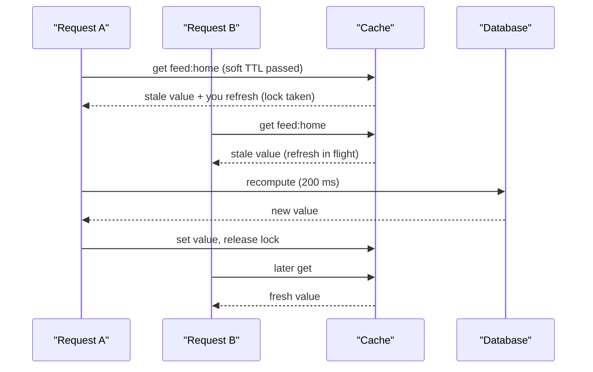

## In one minute
- A cache stampede (thundering herd, dog-piling) happens when a hot key expires or is evicted and many concurrent requests all miss and recompute it at once.
- The backend sees a sudden multiple of normal load for exactly the most expensive, most popular data, which can push it over and keep the cache empty.
- Defences either *collapse* duplicate work (locks, request coalescing, leases), *avoid* synchronised expiry (jittered TTLs, probabilistic early refresh), or *serve stale* while one caller refreshes.
- Mass versions of the same problem come from cold starts, cache node failures, and deploys that flush caches.
- Design so the database survives a 0% hit rate for some window, or so that window can never happen.

## How it works

### Anatomy of a stampede
A key is read 2,000 times per second and takes 200 ms to compute. When it expires, every request in the next 200 ms misses before the first recompute finishes: 400 identical queries hit the database at once. If that pushes query latency to 2 seconds, the window grows to 2 seconds and 4,000 requests pile up, connection pools exhaust, and requests for other keys start failing too. The cache cannot recover because every recompute is slow.

### Collapse duplicate work
- **Per-key lock or lease.** The first miss takes a short lock (Redis `SET key:lock NX PX 5000`, or a memcached lease); others wait briefly and re-read, or get a stale value. The lock needs a timeout so a crashed holder does not block the key forever.
- **Request coalescing in-process.** Within one server, concurrent requests for the same key share a single in-flight fetch (Go's `singleflight`, a promise map in Node). Go's `Group.Do` hands every waiter the same value and error, and `Forget` lets the next caller start a fresh fetch instead of joining a stuck one ([Go docs](https://pkg.go.dev/golang.org/x/sync/singleflight)). This cuts duplicates to one per server, so 200 servers still send 200 queries, but not 400 per server.
- **Coalescing at a tier.** CDNs and reverse proxies collapse concurrent misses for one URL into one origin request. NGINX's `proxy_cache_lock` lets one request fill a new entry while others wait up to `proxy_cache_lock_timeout` (5 seconds by default); after that they go to the origin and the response is not cached ([NGINX docs](https://nginx.org/en/docs/http/ngx_http_proxy_module.html)). Coalescing needs that timeout: without one, every waiter is tied to the fate of a single slow fetch.

### Avoid synchronised expiry
Keys loaded at the same moment (after a deploy or a batch job) with the same TTL expire together. Adding random jitter, say TTL x uniform(0.9, 1.1), spreads them out. For individual hot keys, *probabilistic early expiration* lets each reader decide to refresh slightly before expiry, with probability rising as expiry approaches and scaled by how long the recompute takes ([Vattani et al.](https://cseweb.ucsd.edu/~avattani/papers/cache_stampede.pdf)). One reader usually refreshes early while everyone else still hits.

### Serve stale
Keep values past their soft TTL. A request that finds a stale value returns it immediately and, if nobody else is refreshing, triggers a background refresh. HTTP formalises this as `stale-while-revalidate` and `stale-if-error`: `max-age=600, stale-while-revalidate=30` allows 30 seconds of stale service while a background check runs ([RFC 5861](https://www.rfc-editor.org/rfc/rfc5861)). Amazon calls the same idea a soft TTL, after which you refresh, and a hard TTL, until which you may keep serving if the refresh fails ([AWS Builders' Library](https://builder.aws.com/content/3K9TeXp6strMiJ4vhakpRD7BQWO/caching-challenges-and-strategies)). This turns a stampede into one refresh per key and also protects users when the backend is down.

### Mass stampedes
A cache node dying moves its keys elsewhere, all cold. A full flush during a deploy makes everything cold. Consistent hashing limits how many keys move, and warming or gradual traffic shifting limits how fast the cold keys are hit.

## Down the stack

### Layer 1: The contract
Without protection, a cache promises nothing about backend load on a miss: N concurrent misses become N backend calls. A stampede-safe cache promises that at most one recompute per key is in flight (per process or per cluster), that callers during a refresh receive either a value no older than the soft TTL plus a stale window, or a bounded wait, and that a failed recompute releases the key within a known timeout.

### Layer 2: The mechanism
Go's `singleflight.Group` keeps a map from key to an in-flight call struct holding a `sync.WaitGroup`; the first caller runs the function, later callers block on the wait group and receive the same result and error. A distributed lock in Redis is `SET lock:key token NX PX 3000`. Release must delete only if the stored token still matches, so a slow holder cannot delete a successor's lock. That used to need a Lua script; since Redis 8.4 it is one command, `DELEX lock:key IFEQ token`, and `SET ... IFEQ token PX 3000` extends a lock you still hold ([Redis docs](https://redis.io/docs/latest/commands/delex/)). The XFetch algorithm from Vattani and colleagues stores the recompute duration `delta` with the value; each reader refreshes early if `now - delta * beta * ln(rand()) >= expiry`, where `rand()` is uniform in (0, 1] and `beta` (default 1) tunes eagerness. Because `ln(rand())` is negative, the left side jumps ahead by an exponentially distributed amount proportional to `delta`. Memcached leases at Facebook rate-limit lease issuance to one per key every 10 seconds, so other readers wait a few milliseconds or accept a slightly stale value. On keys prone to herds, that cut the peak database query rate from 17,000 to 1,300 per second ([Facebook NSDI 2013](https://www.usenix.org/system/files/conference/nsdi13/nsdi13-final170_update.pdf)).

### Layer 3: The machine
A recompute that takes 200 ms usually means a database query that reads many pages or an aggregation over many rows, consuming a connection, CPU and buffer pool space for its duration. Connection pools are small (often 10 to 50 per app server), so 400 concurrent recomputes queue in the pool and turn into timeouts. On the cache, a lock is one extra round trip of about 0.2 ms; waiting callers that poll every 20 ms add a few round trips, far cheaper than a database query. Inside a process, coalesced waiters cost a goroutine or a promise each, a few kilobytes of memory, versus a full query each.

### Why it's built this way
1. Caches exist because the backend cannot handle full read load, so any moment of 0% hit rate on hot keys exceeds backend capacity.
2. Misses on one key arrive concurrently before the first recompute finishes, so duplicate work must be collapsed, not just cached afterwards.
3. Locks add latency and failure modes, so serving slightly stale data is often the better trade.
4. Expiries align after bulk loads, so randomness in TTLs and early refresh breaks the alignment.
5. Recompute cost varies by key, so early refresh scales with measured recompute time instead of a fixed margin.

## Diagram



## Worked example
A news site's home feed key is read 3,000 times per second across 60 app servers. Computing it takes 250 ms and runs a query the database can handle at most 80 of concurrently.

No protection: at expiry, 3,000 x 0.25 = 750 requests miss in the first 250 ms. The database saturates at 80 concurrent queries, latency climbs to seconds, and the window keeps growing. The site goes down every 5 minutes, on the TTL.

In-process coalescing only: 60 servers each send one query, so 60 concurrent queries. Survivable, but close to the limit, and any other hot key expiring at the same time tips it over.

Serve stale plus a distributed lock: exactly one query per expiry, users get a value at most one recompute old (about 250 ms beyond soft TTL). The cost: one extra Redis round trip per refresh and storing values for an extra stale window (soft TTL 5 minutes, hard TTL 1 hour).

XFetch with `delta` = 0.25 s and `beta` = 1: the expected early-refresh lead is about `delta` x `beta`, so refreshes typically start in the last fraction of a second before expiry, triggered by one of the 3,000 readers per second. Combined with the lock, the key effectively never expires under load.

## In the wild
- **Canva, 2024: request coalescing held 270,000 requests, then released them at once.** On 12 November a stale CDN route sent traffic over a lossy path, and one JavaScript file for the editor took about 20 minutes to fetch. The CDN merged identical requests into that one stalled fetch, so over 270,000 user requests waited on it without erroring, and the canary saw nothing. When it completed, clients hit the API gateway at about 1.5 million requests per second, roughly three times peak, and canva.com was down for about 52 minutes. Fixes included asset fetch timeouts, load shedding and page-load events as a canary signal ([Canva](https://www.canva.dev/blog/engineering/canva-incident-report-api-gateway-outage/)).
- **Google Cloud, 2025: restarts without jitter overloaded the backing store.** A null field in a replicated policy row crash-looped Service Control in every region on 12 June. When tasks in us-central1 restarted together, with no randomised backoff, they overloaded the us-central1 Spanner table behind the service, so recovery there was slower than elsewhere (up to about 2 hours 40 minutes for Service Control in us-central1, after other regions had been mitigated earlier). Google is auditing backoff and making Service Control fail open ([Google Cloud](https://status.cloud.google.com/incidents/ow5i3PPK96RduMcb1SsW)).
- **Facebook, 2013: leases measured against herds.** Over a week of misses on herd-prone keys, Facebook's memcached leases (one token per key per 10 seconds, other readers wait briefly and retry) cut the peak database query rate from 17,000 to 1,300 per second. Since databases are provisioned for peak, that was a direct capacity saving ([paper](https://www.usenix.org/conference/nsdi13/technical-sessions/presentation/nishtala)).

## Trade-offs

| Option | Strengths | Weaknesses | Choose when |
| --- | --- | --- | --- |
| TTL jitter | Trivial, spreads bulk expiry | Does nothing for a single hot key | Always, as a baseline |
| In-process coalescing | No coordination, no extra hops | One recompute per server still | Many servers, moderate cost |
| Distributed lock or lease | One recompute cluster-wide | Lock timeouts, extra round trip, waiters | Very expensive recomputes |
| Serve stale while revalidating | No user waits, survives backend outages | Users see slightly old data | Feeds, catalogs, most read paths |
| Probabilistic early refresh | No locks, refresh before expiry | Probabilistic, needs recompute time | Hot keys with known compute cost |

## Pitfalls in production
- **Lock without timeout.** The holder crashes and the key stays locked. Use a lease TTL a few times the expected compute time, plus a token-checked release.
- **Waiters that never give up.** Followers poll forever while the leader is stuck, and when it finally returns they all proceed at once. Cap waits and fall back to stale data or an error.
- **Same TTL for bulk loads.** A batch import sets 1 million keys that all expire together. Add jitter.
- **Caching errors as misses.** A failing backend returns errors, nothing is cached, and every request retries the backend. Cache failures briefly as their own entry, as DNS resolvers must for 1 second to 5 minutes ([RFC 9520](https://www.rfc-editor.org/rfc/rfc9520)), and serve stale on error.
- **Flush on deploy.** Changing the key format makes everything cold. Version keys gradually or warm the new namespace first.

## Leadership lens
- Identify the top 100 keys by read rate times recompute cost; those need explicit stampede protection.
- Ask in review: what happens to the database at the moment this key expires, at peak traffic?
- Make serve-stale the default in the shared cache client, with per-call opt-out for data that must be fresh.
- Load-test cache failure: kill a cache node at peak in staging and watch the database.

## Check yourself
1. Why does a stampede grow instead of resolving itself?
   **Answer:** The concurrent recomputes slow the backend, which lengthens the window during which new requests also miss, adding more load in a feedback loop.
2. Why is in-process coalescing not always enough?
   **Answer:** It allows one recompute per server, so a large fleet still sends one query per server for every hot key that expires.
3. How does probabilistic early expiration avoid a lock?
   **Answer:** Each reader independently decides to refresh with a probability that rises near expiry, so typically one reader refreshes early while the rest keep hitting the still-valid value.

## Practice
**Task:** Build a stampede guard with serve-stale semantics plus an XFetch helper. `Guard(ttl, stale_ttl)` has `get(key, now)` returning `("fresh", v)` if the value has not expired; otherwise, if a refresh is in flight, `("stale", v)` when a value exists that expired less than `stale_ttl` ago, else `("wait", None)`; otherwise it marks the key in flight and returns `("recompute", None)`. `put(key, value, now)` stores the value with expiry `now + ttl` and clears in-flight; `abandon(key)` clears in-flight after a failed recompute. `xfetch(now, expiry, delta, beta, r)` returns whether `now - delta * beta * ln(r) >= expiry` for `r` in (0, 1].

```python starter
import math

class Guard:
    def __init__(self, ttl, stale_ttl):
        pass

    def get(self, key, now):
        raise NotImplementedError

    def put(self, key, value, now):
        raise NotImplementedError

    def abandon(self, key):
        raise NotImplementedError

def xfetch(now, expiry, delta, beta, r):
    raise NotImplementedError
```

```python tests
import math

def test_fresh_hit():
    g = Guard(10, 5)
    g.put("k", "v1", 0)
    assert g.get("k", 9) == ("fresh", "v1")

def test_one_recompute_others_stale():
    g = Guard(10, 5)
    g.put("k", "v1", 0)
    assert g.get("k", 11) == ("recompute", None)
    assert g.get("k", 12) == ("stale", "v1")
    assert g.get("k", 13) == ("stale", "v1")

def test_wait_when_too_stale_or_empty():
    g = Guard(10, 5)
    assert g.get("new", 0) == ("recompute", None)
    assert g.get("new", 0) == ("wait", None)
    g.put("k", "v1", 0)
    g.get("k", 20)
    assert g.get("k", 20) == ("wait", None)

def test_put_and_abandon_clear_inflight():
    g = Guard(10, 5)
    g.get("k", 0)
    g.abandon("k")
    assert g.get("k", 1) == ("recompute", None)
    g.put("k", "v2", 1)
    assert g.get("k", 2) == ("fresh", "v2")

def test_xfetch():
    assert xfetch(9.0, 10.0, 0.5, 1.0, 1.0) is False
    assert xfetch(10.0, 10.0, 0.5, 1.0, 1.0) is True
    assert xfetch(9.0, 10.0, 0.5, 1.0, math.exp(-4)) is True
    assert xfetch(9.0, 10.0, 0.5, 1.0, math.exp(-1)) is False
```

```python solution
import math

class Guard:
    def __init__(self, ttl, stale_ttl):
        self.ttl, self.stale_ttl = ttl, stale_ttl
        self.entries = {}
        self.inflight = set()

    def get(self, key, now):
        e = self.entries.get(key)
        if e and now < e[1]:
            return ("fresh", e[0])
        if key in self.inflight:
            if e and now < e[1] + self.stale_ttl:
                return ("stale", e[0])
            return ("wait", None)
        self.inflight.add(key)
        return ("recompute", None)

    def put(self, key, value, now):
        self.entries[key] = (value, now + self.ttl)
        self.inflight.discard(key)

    def abandon(self, key):
        self.inflight.discard(key)

def xfetch(now, expiry, delta, beta, r):
    return now - delta * beta * math.log(r) >= expiry
```

```typescript starter
export type GuardResult = ["fresh", string] | ["stale", string] | ["wait", null] | ["recompute", null];

export class Guard {
  constructor(ttl: number, staleTtl: number) {}
  get(key: string, now: number): GuardResult { throw new Error("TODO"); }
  put(key: string, value: string, now: number): void { throw new Error("TODO"); }
  abandon(key: string): void { throw new Error("TODO"); }
}

export function xfetch(now: number, expiry: number, delta: number, beta: number, r: number): boolean {
  throw new Error("TODO");
}
```

```typescript tests
test("fresh hit", () => {
  const g = new Guard(10, 5);
  g.put("k", "v1", 0);
  assertEqual(g.get("k", 9), ["fresh", "v1"]);
});
test("one recompute, others stale", () => {
  const g = new Guard(10, 5);
  g.put("k", "v1", 0);
  assertEqual(g.get("k", 11), ["recompute", null]);
  assertEqual(g.get("k", 12), ["stale", "v1"]);
  assertEqual(g.get("k", 13), ["stale", "v1"]);
});
test("wait when too stale or empty", () => {
  const g = new Guard(10, 5);
  assertEqual(g.get("new", 0), ["recompute", null]);
  assertEqual(g.get("new", 0), ["wait", null]);
  g.put("k", "v1", 0);
  g.get("k", 20);
  assertEqual(g.get("k", 20), ["wait", null]);
});
test("put and abandon clear inflight", () => {
  const g = new Guard(10, 5);
  g.get("k", 0);
  g.abandon("k");
  assertEqual(g.get("k", 1), ["recompute", null]);
  g.put("k", "v2", 1);
  assertEqual(g.get("k", 2), ["fresh", "v2"]);
});
test("xfetch", () => {
  assertEqual(xfetch(9, 10, 0.5, 1, 1), false);
  assertEqual(xfetch(10, 10, 0.5, 1, 1), true);
  assertEqual(xfetch(9, 10, 0.5, 1, Math.exp(-4)), true);
  assertEqual(xfetch(9, 10, 0.5, 1, Math.exp(-1)), false);
});
```

```typescript solution
export type GuardResult = ["fresh", string] | ["stale", string] | ["wait", null] | ["recompute", null];

export class Guard {
  private entries = new Map<string, { value: string; expires: number }>();
  private inflight = new Set<string>();
  constructor(private ttl: number, private staleTtl: number) {}
  get(key: string, now: number): GuardResult {
    const e = this.entries.get(key);
    if (e && now < e.expires) return ["fresh", e.value];
    if (this.inflight.has(key)) {
      if (e && now < e.expires + this.staleTtl) return ["stale", e.value];
      return ["wait", null];
    }
    this.inflight.add(key);
    return ["recompute", null];
  }
  put(key: string, value: string, now: number): void {
    this.entries.set(key, { value, expires: now + this.ttl });
    this.inflight.delete(key);
  }
  abandon(key: string): void {
    this.inflight.delete(key);
  }
}

export function xfetch(now: number, expiry: number, delta: number, beta: number, r: number): boolean {
  return now - delta * beta * Math.log(r) >= expiry;
}
```

```go starter
package practice

type Guard struct{}

func NewGuard(ttl, staleTTL float64) *Guard { return &Guard{} }

// Get returns ("fresh"|"stale"|"wait"|"recompute", value).
func (g *Guard) Get(key string, now float64) (string, string) { panic("TODO") }

func (g *Guard) Put(key, value string, now float64) { panic("TODO") }

func (g *Guard) Abandon(key string) { panic("TODO") }

func XFetch(now, expiry, delta, beta, r float64) bool { panic("TODO") }
```

```go tests
package practice

import (
	"math"
	"testing"
)

func want(t *testing.T, g *Guard, key string, now float64, kind, val string) {
	t.Helper()
	k, v := g.Get(key, now)
	if k != kind || v != val {
		t.Fatalf("got (%s,%s), want (%s,%s)", k, v, kind, val)
	}
}

func TestFreshHit(t *testing.T) {
	g := NewGuard(10, 5)
	g.Put("k", "v1", 0)
	want(t, g, "k", 9, "fresh", "v1")
}

func TestOneRecompute(t *testing.T) {
	g := NewGuard(10, 5)
	g.Put("k", "v1", 0)
	want(t, g, "k", 11, "recompute", "")
	want(t, g, "k", 12, "stale", "v1")
	want(t, g, "k", 13, "stale", "v1")
}

func TestWait(t *testing.T) {
	g := NewGuard(10, 5)
	want(t, g, "new", 0, "recompute", "")
	want(t, g, "new", 0, "wait", "")
	g.Put("k", "v1", 0)
	g.Get("k", 20)
	want(t, g, "k", 20, "wait", "")
}

func TestPutAbandon(t *testing.T) {
	g := NewGuard(10, 5)
	g.Get("k", 0)
	g.Abandon("k")
	want(t, g, "k", 1, "recompute", "")
	g.Put("k", "v2", 1)
	want(t, g, "k", 2, "fresh", "v2")
}

func TestXFetch(t *testing.T) {
	if XFetch(9, 10, 0.5, 1, 1) || !XFetch(10, 10, 0.5, 1, 1) {
		t.Fatal("r=1 should refresh only at expiry")
	}
	if !XFetch(9, 10, 0.5, 1, math.Exp(-4)) || XFetch(9, 10, 0.5, 1, math.Exp(-1)) {
		t.Fatal("early refresh threshold wrong")
	}
}
```

```go solution
package practice

import "math"

type entry struct {
	value   string
	expires float64
}

type Guard struct {
	ttl, staleTTL float64
	entries       map[string]entry
	inflight      map[string]bool
}

func NewGuard(ttl, staleTTL float64) *Guard {
	return &Guard{ttl, staleTTL, map[string]entry{}, map[string]bool{}}
}

// Get returns ("fresh"|"stale"|"wait"|"recompute", value).
func (g *Guard) Get(key string, now float64) (string, string) {
	e, ok := g.entries[key]
	if ok && now < e.expires {
		return "fresh", e.value
	}
	if g.inflight[key] {
		if ok && now < e.expires+g.staleTTL {
			return "stale", e.value
		}
		return "wait", ""
	}
	g.inflight[key] = true
	return "recompute", ""
}

func (g *Guard) Put(key, value string, now float64) {
	g.entries[key] = entry{value, now + g.ttl}
	delete(g.inflight, key)
}

func (g *Guard) Abandon(key string) { delete(g.inflight, key) }

func XFetch(now, expiry, delta, beta, r float64) bool {
	return now-delta*beta*math.Log(r) >= expiry
}
```

## Mock interview
**Prompt:** A news site's home feed is read 3,000 times per second from 60 servers and takes 250 ms to compute. Every 5 minutes, when the cache entry expires, the database falls over. Fix it.

- Follow-up: You add a Redis lock. The server holding it crashes mid-recompute. What happens?
- Follow-up: A cache node with 15% of keys fails at peak. How does the database fare?
- Follow-up: When would you prefer probabilistic early refresh over a lock?

**A strong answer covers:**
- Why the stampede self-amplifies, with the concurrency math.
- Collapsing duplicate work: in-process coalescing and a cluster-wide lock or lease with timeouts and token-checked release.
- Serve-stale with background refresh as the user-facing default.
- TTL jitter and XFetch-style early refresh to avoid synchronised expiry.
- Mass-miss scenarios: node loss, deploy flushes, and capacity to survive them.

## Sources and further study
**Primary**
- [RFC 9111: HTTP Caching](https://www.rfc-editor.org/rfc/rfc9111): when a shared cache may serve stale responses and how revalidation works.
- [RFC 9520: Negative Caching of DNS Resolution Failures](https://www.rfc-editor.org/rfc/rfc9520): DNS's rule for caching failures briefly so retries do not stampede broken servers.

**Systems docs**
- [NGINX proxy module](https://nginx.org/en/docs/http/ngx_http_proxy_module.html): `proxy_cache_lock`, its timeout and age, `proxy_cache_background_update` and `proxy_cache_use_stale updating`.
- [Redis DELEX](https://redis.io/docs/latest/commands/delex/): compare-and-delete in one command, replacing the Lua release script for token locks.
- [Caffeine: Refresh](https://github.com/ben-manes/caffeine/wiki/Refresh): refresh-ahead that serves the old value while one reload runs.

**Books**
- *Site Reliability Engineering*, Beyer et al., chapter 22 "Addressing Cascading Failures": how slow startup, cold caches and retries feed overload.
- *Release It!* (2nd ed.), Michael Nygard, chapter 4 "Stability Antipatterns": chain reactions and cascading failures, the larger family a stampede belongs to.

**Other curricula**
- [Caching challenges and strategies (AWS Builders' Library)](https://builder.aws.com/content/3K9TeXp6strMiJ4vhakpRD7BQWO/caching-challenges-and-strategies): request coalescing, soft and hard TTLs, and load testing with caches disabled.
- [donnemartin/system-design-primer](https://github.com/donnemartin/system-design-primer#cache): covers the update patterns but not stampedes, coalescing or jitter, a gap worth knowing when you study from it.

## Watch
- [Caching Pitfalls Every Developer Should Know (ByteByteGo)](https://www.youtube.com/watch?v=wh98s0XhMmQ): covers stampede, penetration and avalanche in one short video.
- [NSDI '13 - Scaling Memcache at Facebook (USENIX)](https://www.youtube.com/watch?v=m4_7W4XzRgk): includes leases as a thundering herd defence.

## Free resources
- [Optimal Probabilistic Cache Stampede Prevention (Vattani et al.)](https://cseweb.ucsd.edu/~avattani/papers/cache_stampede.pdf): the XFetch paper with its proof and parameters.
- [Cache stampede (Wikipedia)](https://en.wikipedia.org/wiki/Cache_stampede): overview of locking, external recomputation and early expiration.
- [Go singleflight package](https://pkg.go.dev/golang.org/x/sync/singleflight): a minimal, widely used request-coalescing implementation.
- [RFC 5861: stale-while-revalidate and stale-if-error](https://www.rfc-editor.org/rfc/rfc5861): the HTTP form of serve-stale.
- [Scaling Memcache at Facebook (NSDI 2013 paper)](https://www.usenix.org/system/files/conference/nsdi13/nsdi13-final170_update.pdf): leases used against thundering herds at scale.
