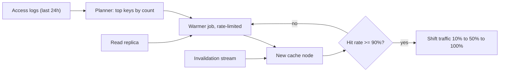

## In one minute
- Cache warming fills a cache with likely-needed data *before* it takes real traffic, so users and backends never see the cold-start miss storm.
- Caches go cold more often than people expect: deploys, restarts, new nodes, scale-outs, failovers, new regions, and key-format changes.
- Because access is skewed, warming the hottest few percent of keys recovers most of the hit rate.
- Sources for warming: access logs, the database, a warm peer or replica, or a persisted snapshot; delivery is either preloading or a gradual traffic ramp.
- Warming is itself load, so it needs rate limits, a read source that is not the primary, and a rule for freshness.

## How it works

### Why cold caches hurt
Backends behind a cache are sized for the miss traffic at a steady hit rate. At 95% hits, the database sees 5% of reads; at 0% it sees 20 times as much. A cold cache taking full traffic is a self-inflicted stampede across every key at once, and often the database cannot serve it.

Google's SRE book names the two cases. A *latency cache* only speeds things up: the service can carry its expected load with the cache empty. A *capacity cache* is one the service cannot survive without, and it needs warming, slow load ramps and overprovisioning ([Google SRE book, ch. 22](https://sre.google/sre-book/addressing-cascading-failures/)). Know which kind you run, and test it the way Amazon suggests: load-test with the cache disabled ([AWS Builders' Library](https://builder.aws.com/content/3K9TeXp6strMiJ4vhakpRD7BQWO/caching-challenges-and-strategies)).

### Choosing what to warm
Access patterns are heavily skewed: a small fraction of keys gets most reads. Sources for the hot set, from best to worst:

1. **Recent access logs or cache key sampling**, counting keys over the last hour or day.
2. **A warm peer**: another replica of the cache, whose keys can be dumped and copied.
3. **Domain knowledge**: today's top products, active users, the home page.
4. **The whole dataset**, when it fits in memory and is small.

### Ways to deliver
- **Preload.** A job reads the hot keys from a read replica (or computes them) and writes them into the cache before the node joins. Simple and predictable; needs a list and capacity.
- **Copy from a peer or snapshot.** Restore Redis from an RDB file, start a new replica that syncs from a primary, or copy keys from a warm cache replica. Fast and exact, but copies whatever staleness the source had.
- **Read-through from a warm tier.** A cold cluster fetches misses from a warm cluster instead of the database, as Facebook did when bringing up new memcached clusters, so the database never sees the cold traffic. It brought cold clusters to full capacity in a few hours instead of a few days ([Facebook NSDI 2013](https://www.usenix.org/system/files/conference/nsdi13/nsdi13-final170_update.pdf)).
- **Gradual traffic shift.** Route 5% of traffic to the new node or region, let organic misses warm it, then step up. No list needed; takes longer and needs weighted routing.
- **Shadow traffic.** Mirror reads to the new cache without serving its responses, so it warms on real patterns before cutover.

### Keeping warmed data correct
Make sure the warm-up actually fills the cache your readers use. DAX keeps item and query results in separate caches, so a `Scan` cannot warm the item cache that `GetItem` reads ([DAX docs](https://docs.aws.amazon.com/amazondynamodb/latest/developerguide/DAX.consistency.html)). Warmed entries are as fresh as their source at copy time. Invalidations issued while warming must also reach the new cache, or it will hold values that the rest of the system already invalidated. The safe order is: subscribe the new cache to invalidations first, then load.

## Down the stack

### Layer 1: The contract
A warm-up procedure should promise three things: the new cache reaches a target hit rate (say 90% of steady state) before it serves real traffic; the warm-up never pushes the source above a stated load budget (for example 2,000 extra queries per second on a read replica); and every entry it loads is subject to invalidations issued from the moment warm-up started, so warm data is no staler than normal cached data.

### Layer 2: The mechanism
Redis persists to RDB snapshots by forking and letting the child write the dataset while the parent keeps serving, relying on copy-on-write pages; on restart it loads the RDB and starts warm ([Redis persistence docs](https://redis.io/docs/latest/operate/oss_and_stack/management/persistence/)). A new Redis replica sends `PSYNC` to its primary, receives a full RDB transfer, then streams the replication backlog. Memcached 1.5.18 and later supports warm restarts: started with `-e` pointing at a file on tmpfs, it keeps its item memory in that mapped file and, after a graceful `SIGUSR1` shutdown, rebuilds its hash table from it in seconds, or minutes near a billion items. Sets and deletes sent while it was down are simply missed, so pause or buffer writes around the restart ([memcached docs](https://docs.memcached.org/features/restart/)). Facebook's cold cluster warmup let a cold cluster's clients, on a miss, read from a warm cluster and populate locally with `add`; to avoid races with deletes they used a two-second hold-off during which adds for a recently deleted key fail ([Facebook NSDI 2013](https://www.usenix.org/system/files/conference/nsdi13/nsdi13-final170_update.pdf)). Netflix's EVCache warms new replicas by dumping keys from an existing replica to object storage and bulk-loading them. CDNs offer prefetch or prepopulate APIs, and an origin shield tier means new edge locations warm from the shield instead of the origin.

### Layer 3: The machine
Moving 100 GB over a 25 Gbps link takes at least 32 seconds at line rate, but per-key writes are the real limit: a single-threaded Redis shard accepts roughly 100,000 to 200,000 simple writes per second with pipelining, so 100 million keys on one shard take 10 to 15 minutes. Forking a 50 GB Redis process for an RDB snapshot copies its page tables (hundreds of megabytes) and pauses the parent for tens to hundreds of milliseconds, up to a second on a big dataset and a slow CPU ([Redis persistence docs](https://redis.io/docs/latest/operate/oss_and_stack/management/persistence/)); heavy writes during the snapshot duplicate pages and can nearly double memory. Reading the hot set from a database is fastest as sequential range scans on a replica; millions of random point lookups would hit random pages and cost far more I/O.

### Why it's built this way
1. Cache memory is volatile and nodes are replaced constantly, so cold caches are a routine event, not an exception.
2. Backends are sized for steady-state misses, so a cold cache under full traffic exceeds their capacity.
3. Access follows a skewed popularity curve, so loading a small hot set restores most of the hit rate cheaply.
4. Warm-up traffic competes with production load, so it reads from replicas or peers and is rate-limited.
5. Data keeps changing during warm-up, so invalidations must reach the new cache before loading begins.

## Diagram



## Worked example
A user-profile cache serves 40,000 reads per second at a 95% hit rate, so the database handles 2,000 per second and can take at most 6,000. The cache cluster is being replaced by a new one in a different instance family.

Cutting over cold would send 40,000 reads per second to a database rated for 6,000. Not an option.

Plan: access logs over 24 hours show 30 million distinct profiles, but the top 4 million account for 85% of reads. At about 2 KB per profile that is 8 GB, well within the new cluster's 64 GB. The warmer reads from a read replica in batches of 500 ids with `WHERE id IN (...)`, at 80 batched queries per second, roughly 40,000 profiles per second, a load the replica absorbs easily. Loading 4 million takes about 100 seconds; with conservative throttling to protect the replica, 5 minutes.

The new cluster subscribes to the invalidation stream before the warmer starts. After warm-up, the load balancer shifts 10% of reads, then 50%, then 100% over 30 minutes, watching hit rate and database queries. Hit rate starts at about 85% and climbs to 95% as the long tail fills organically. Peak extra database load during the ramp is about 3,000 queries per second, inside the 6,000 limit.

## In the wild
- **Slack, 2022: empty spare caches turned a scatter query into a metastable overload.** A gradual Consul agent rollout briefly deregistered memcached nodes, and Slack's cache control plane swapped in empty spares, so hit rates fell. The group DM membership query was sharded by user but looked up by channel, so every miss hit every Vitess shard and database load grew faster than the miss rate. Timeouts stopped the cache refilling and client retries held the system in overload. Slack throttled client boots, read only the missing data from replicas, re-sharded the table by channel and changed how Consul rolls out ([Slack](https://slack.engineering/slacks-incident-on-2-22-22/)).
- **GitHub, 2012: failing over to a cold database buffer pool.** A schema migration overloaded the active MySQL node, health checks failed, and Pacemaker moved the active role to a node whose InnoDB buffer pool was cold. That node performed so badly that the role flipped back, adding to 1 hour 46 minutes of downtime across two days. Afterwards GitHub required a human to start failover and looked into warming replica buffer pools ([GitHub](https://github.blog/2012-09-14-github-availability-this-week/)).
- **Slack, 2021: cold client caches on the first Monday back.** After the holidays, clients with cold caches drove a traffic jump that AWS Transit Gateways could not scale for fast enough. Packet loss failed health checks, autoscaling removed instances and tried to add about 1,200, and provisioning hit file and quota limits. Slack was down from about 7:00 to 9:15 PT. Slack plans to request preemptive gateway scale-up before known surges such as the end of the holidays ([Slack](https://slack.engineering/slacks-outage-on-january-4th-2021/)).

## Trade-offs

| Option | Strengths | Weaknesses | Choose when |
| --- | --- | --- | --- |
| Preload from logs + replica | Targets real hot set, controllable rate | Needs logs, a planner and a job | Planned migrations and scale-outs |
| Snapshot or replica sync | Exact copy, fast | Copies staleness; same software only | Redis restarts and replica adds |
| Read-through from warm tier | Database untouched, organic | Cross-cluster latency during warm-up | New clusters or regions next to a warm one |
| Gradual traffic shift | No list needed, real patterns | Slow; needs weighted routing | Deploys behind a load balancer |
| No warming, lazy fill | Zero effort | Miss storm on every cold start | Small caches, backends with headroom |

## Pitfalls in production
- **Warming from the primary database.** The warm-up job takes down production writes. Read from replicas or peers and rate-limit.
- **Missing invalidations during warm-up.** The new cache holds values deleted elsewhere for a full TTL. Subscribe to invalidations before loading.
- **Same TTL on every warmed key.** Everything loaded at once expires at once, causing a stampede an hour later. Add TTL jitter.
- **Warming the wrong set.** A list from last month's logs misses today's hot keys. Use recent logs and include domain-known hot keys.
- **Write-through without a fallback.** A cache filled only on writes leaves a new node empty until each key is written again. Combine write-through with lazy loading so reads fill the gaps ([ElastiCache docs](https://docs.aws.amazon.com/AmazonElastiCache/latest/dg/Strategies.html)).
- **Declaring success too early.** Hit rate looks fine at 10% traffic but long-tail misses grow at 100%. Ramp in steps and watch database load at each step.

## Leadership lens
- Treat "cache starts empty" as a design scenario: what is the maximum database load and how long does it last?
- Make warm-up part of the deploy pipeline for stateful cache changes, not a one-off script.
- Ask in review: where does warm-up read from, at what rate, and what stops it if the source slows down?
- Keep access-frequency data (sampled key logs) as a standing asset; it pays for warming, capacity planning and hot-key detection.

## Check yourself
1. Why does warming only the top few percent of keys recover most of the hit rate?
   **Answer:** Access is heavily skewed, so a small set of hot keys receives most reads; the long tail fills organically at a rate the backend can handle.
2. Why must the new cache subscribe to invalidations before loading?
   **Answer:** Otherwise changes made during warm-up never invalidate the copied entries, which stay stale until their TTL expires.
3. What is the risk of warming every key with the same TTL?
   **Answer:** They all expire together later, recreating a cold cache and a stampede at that moment.

## Practice
**Task:** Plan a warm-up. `plan_warmup(log, sizes, budget)` takes a list of accessed keys, a dict of key sizes in bytes, and a byte budget. It ranks keys by access count (descending, ties broken by key ascending) and greedily selects keys in that order, skipping any key that would exceed the remaining budget but continuing with later, smaller keys. Keys missing from `sizes` are skipped. `batches(keys, rate)` splits the plan into consecutive lists of at most `rate` keys, one per second of a rate-limited loader; `rate` must be positive, otherwise raise `ValueError`.

```python starter
def plan_warmup(log, sizes, budget):
    raise NotImplementedError

def batches(keys, rate):
    raise NotImplementedError
```

```python tests
def test_ranks_by_frequency():
    log = ["a", "b", "a", "c", "a", "b"]
    assert plan_warmup(log, {"a": 1, "b": 1, "c": 1}, 10) == ["a", "b", "c"]

def test_tie_broken_by_key():
    assert plan_warmup(["y", "x"], {"x": 1, "y": 1}, 10) == ["x", "y"]

def test_budget_skips_large_continues_small():
    log = ["big", "big", "big", "mid", "mid", "small"]
    sizes = {"big": 8, "mid": 5, "small": 2}
    assert plan_warmup(log, sizes, 10) == ["big", "small"]

def test_unknown_and_empty():
    assert plan_warmup(["ghost", "a"], {"a": 3}, 10) == ["a"]
    assert plan_warmup([], {"a": 1}, 10) == []

def test_batches():
    assert batches(["a", "b", "c", "d", "e"], 2) == [["a", "b"], ["c", "d"], ["e"]]
    assert batches([], 3) == []

def test_bad_rate():
    try:
        batches(["a"], 0)
        assert False, "expected ValueError"
    except ValueError:
        pass
```

```python solution
from collections import Counter

def plan_warmup(log, sizes, budget):
    counts = Counter(log)
    ranked = sorted(counts, key=lambda k: (-counts[k], k))
    out, used = [], 0
    for k in ranked:
        if k not in sizes:
            continue
        if used + sizes[k] <= budget:
            out.append(k)
            used += sizes[k]
    return out

def batches(keys, rate):
    if rate <= 0:
        raise ValueError("rate must be positive")
    return [keys[i:i + rate] for i in range(0, len(keys), rate)]
```

```typescript starter
export function planWarmup(log: string[], sizes: Record<string, number>, budget: number): string[] {
  throw new Error("TODO");
}

export function batches(keys: string[], rate: number): string[][] {
  throw new Error("TODO");
}
```

```typescript tests
test("ranks by frequency", () => {
  assertEqual(planWarmup(["a", "b", "a", "c", "a", "b"], { a: 1, b: 1, c: 1 }, 10), ["a", "b", "c"]);
});
test("tie broken by key", () => {
  assertEqual(planWarmup(["y", "x"], { x: 1, y: 1 }, 10), ["x", "y"]);
});
test("budget skips large, continues small", () => {
  const log = ["big", "big", "big", "mid", "mid", "small"];
  assertEqual(planWarmup(log, { big: 8, mid: 5, small: 2 }, 10), ["big", "small"]);
});
test("unknown and empty", () => {
  assertEqual(planWarmup(["ghost", "a"], { a: 3 }, 10), ["a"]);
  assertEqual(planWarmup([], { a: 1 }, 10), []);
});
test("batches", () => {
  assertEqual(batches(["a", "b", "c", "d", "e"], 2), [["a", "b"], ["c", "d"], ["e"]]);
  assertEqual(batches([], 3), []);
});
test("bad rate", () => {
  let threw = false;
  try { batches(["a"], 0); } catch (e) { threw = true; }
  assert(threw, "expected an error");
});
```

```typescript solution
export function planWarmup(log: string[], sizes: Record<string, number>, budget: number): string[] {
  const counts = new Map<string, number>();
  for (const k of log) counts.set(k, (counts.get(k) ?? 0) + 1);
  const ranked = [...counts.keys()].sort((a, b) =>
    counts.get(b)! - counts.get(a)! || (a < b ? -1 : a > b ? 1 : 0));
  const out: string[] = [];
  let used = 0;
  for (const k of ranked) {
    if (!(k in sizes)) continue;
    if (used + sizes[k] <= budget) {
      out.push(k);
      used += sizes[k];
    }
  }
  return out;
}

export function batches(keys: string[], rate: number): string[][] {
  if (rate <= 0) throw new Error("rate must be positive");
  const out: string[][] = [];
  for (let i = 0; i < keys.length; i += rate) out.push(keys.slice(i, i + rate));
  return out;
}
```

```go starter
package practice

func PlanWarmup(log []string, sizes map[string]int, budget int) []string { panic("TODO") }

func Batches(keys []string, rate int) ([][]string, error) { panic("TODO") }
```

```go tests
package practice

import (
	"reflect"
	"testing"
)

func eq(t *testing.T, got, want interface{}) {
	t.Helper()
	if !reflect.DeepEqual(got, want) {
		t.Fatalf("got %v, want %v", got, want)
	}
}

func TestRanksByFrequency(t *testing.T) {
	eq(t, PlanWarmup([]string{"a", "b", "a", "c", "a", "b"}, map[string]int{"a": 1, "b": 1, "c": 1}, 10), []string{"a", "b", "c"})
}

func TestTieBreak(t *testing.T) {
	eq(t, PlanWarmup([]string{"y", "x"}, map[string]int{"x": 1, "y": 1}, 10), []string{"x", "y"})
}

func TestBudget(t *testing.T) {
	log := []string{"big", "big", "big", "mid", "mid", "small"}
	eq(t, PlanWarmup(log, map[string]int{"big": 8, "mid": 5, "small": 2}, 10), []string{"big", "small"})
}

func TestUnknownAndEmpty(t *testing.T) {
	eq(t, PlanWarmup([]string{"ghost", "a"}, map[string]int{"a": 3}, 10), []string{"a"})
	eq(t, len(PlanWarmup(nil, map[string]int{"a": 1}, 10)), 0)
}

func TestBatches(t *testing.T) {
	b, err := Batches([]string{"a", "b", "c", "d", "e"}, 2)
	if err != nil {
		t.Fatal(err)
	}
	eq(t, b, [][]string{{"a", "b"}, {"c", "d"}, {"e"}})
	if _, err := Batches([]string{"a"}, 0); err == nil {
		t.Fatal("expected error for rate 0")
	}
}
```

```go solution
package practice

import (
	"errors"
	"sort"
)

func PlanWarmup(log []string, sizes map[string]int, budget int) []string {
	counts := map[string]int{}
	for _, k := range log {
		counts[k]++
	}
	ranked := make([]string, 0, len(counts))
	for k := range counts {
		ranked = append(ranked, k)
	}
	sort.Slice(ranked, func(i, j int) bool {
		if counts[ranked[i]] != counts[ranked[j]] {
			return counts[ranked[i]] > counts[ranked[j]]
		}
		return ranked[i] < ranked[j]
	})
	out, used := []string{}, 0
	for _, k := range ranked {
		size, ok := sizes[k]
		if ok && used+size <= budget {
			out = append(out, k)
			used += size
		}
	}
	return out
}

func Batches(keys []string, rate int) ([][]string, error) {
	if rate <= 0 {
		return nil, errors.New("rate must be positive")
	}
	out := [][]string{}
	for i := 0; i < len(keys); i += rate {
		end := i + rate
		if end > len(keys) {
			end = len(keys)
		}
		out = append(out, keys[i:end])
	}
	return out, nil
}
```

## Mock interview
**Prompt:** You are migrating a 40,000 reads-per-second profile cache to a new cluster. The database can absorb at most 6,000 reads per second and the current hit rate is 95%. Plan the cutover so nobody notices.

- Follow-up: How do you decide which keys to load, and how long will loading take?
- Follow-up: A profile changes during warm-up. How do you make sure the new cache does not serve the old version?
- Follow-up: Compare preloading with gradually shifting traffic. When would you choose each?

**A strong answer covers:**
- Load math: cold-start database load versus capacity, and why a cold cutover fails.
- Choosing the hot set from recent access logs and the skew that makes it small.
- Reading from replicas or a warm peer with rate limits and backoff.
- Subscribing to invalidations before loading, and TTL jitter on warmed keys.
- Stepwise traffic ramp with hit rate and database load as gates.

## Sources and further study
**Primary**
- [Yang, Yue and Rashmi, A large scale analysis of hundreds of in-memory cache clusters at Twitter (OSDI 2020)](https://www.usenix.org/conference/osdi20/presentation/yang): how skewed real cache traffic is, which is why a small warm set goes a long way.

**Systems docs**
- [Memcached warm restart](https://docs.memcached.org/features/restart/): the `-e` memory file, graceful restart and what is missed while the process is down.
- [Redis persistence](https://redis.io/docs/latest/operate/oss_and_stack/management/persistence/): RDB snapshots, `fork` costs and restarting from a snapshot.
- [DynamoDB Accelerator: consistency models](https://docs.aws.amazon.com/amazondynamodb/latest/developerguide/DAX.consistency.html): why item and query caches warm separately.

**Books**
- *Site Reliability Engineering*, Beyer et al., chapter 22 "Addressing Cascading Failures", section "Slow Startup and Cold Caching": latency versus capacity caches and ramping load slowly.
- *Release It!* (2nd ed.), Michael Nygard, chapter 15 "Case Study: Trampled by Your Own Customers": a launch where real traffic patterns overwhelmed a system that load tests had passed.

**Other curricula**
- [Caching guidance (Azure Architecture Center)](https://learn.microsoft.com/en-us/azure/architecture/best-practices/caching): calls warming *seeding* and advises choosing between full, partial and on-demand loading from usage data.
- [donnemartin/system-design-primer](https://github.com/donnemartin/system-design-primer#cache): notes that a new or replaced node starts empty under cache-aside and adds latency; it has no warming procedure.

## Watch
- [Cache Systems Every Developer Should Know (ByteByteGo)](https://www.youtube.com/watch?v=dGAgxozNWFE): where caches sit in a stack and why each layer can go cold.
- [NSDI '13 - Scaling Memcache at Facebook (USENIX)](https://www.youtube.com/watch?v=m4_7W4XzRgk): includes cold cluster warmup from a warm cluster.

## Free resources
- [Scaling Memcache at Facebook (NSDI 2013 paper)](https://www.usenix.org/system/files/conference/nsdi13/nsdi13-final170_update.pdf): section on cold cluster warmup and its hold-off rule.
- [Caching challenges and strategies (AWS Builders' Library)](https://aws.amazon.com/builders-library/caching-challenges-and-strategies/): cold starts and sizing backends for cache failure.
- [ElastiCache caching strategies](https://docs.aws.amazon.com/AmazonElastiCache/latest/dg/Strategies.html): lazy loading versus write-through and TTL advice.
- [CloudFront Origin Shield](https://docs.aws.amazon.com/AmazonCloudFront/latest/DeveloperGuide/origin-shield.html): a central caching tier that keeps cold edges off the origin.
- [Cache-Aside pattern (Azure Architecture Center)](https://learn.microsoft.com/en-us/azure/architecture/patterns/cache-aside): includes guidance on priming a cache at startup.
