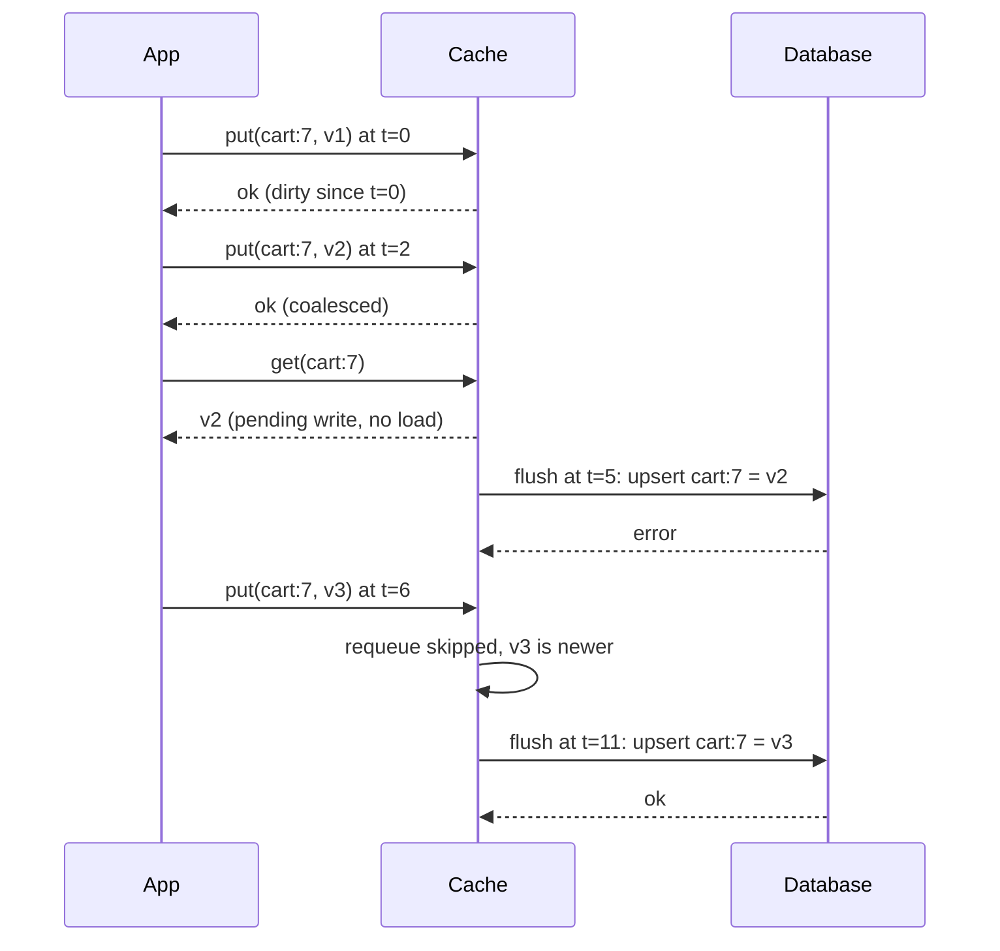

## In one minute
- A caching strategy is two separate choices: how reads fill the cache (cache-aside, read-through, refresh-ahead) and how writes reach the source (write-around, write-through, write-behind).
- The choices differ in three measurable properties: how stale a read can be, whether a writer can read its own write, and how much acknowledged data is lost if the cache dies.
- Write-behind is the only strategy where the cache briefly holds data the database does not have. Its payoff is coalescing and batching; its price is a durability window you must name in seconds.
- Negative caching (remembering "not found") protects the source from repeated lookups for missing keys, but only with a short TTL. Failures can be cached too, for seconds, but never as "not found".
- The same choices show up outside servers: the Linux page cache is write-behind, a CPU's L1 is write-back, and an offline-first mobile app is a write-behind queue to the server.

## How it works

### Two independent choices
Lists of five or six "caching patterns" hide the structure. Every cache answers two questions: on a read miss, who loads the value; and on a write, is the caller told "done" before or after the source of truth has it? A strategy is one read policy plus one write policy. Cache-aside with delete-on-write is the default covered in the caching overview; this lesson covers what the other combinations promise.

### The read path
**Cache-aside** puts the logic in the application: check the cache, on a miss read the source and populate the cache. The cache stays a dumb key-value store, but every service repeats the logic and must get invalidation right.

**Read-through** moves the loading into the cache layer. The caller asks only the cache; on a miss the cache calls a registered loader. Guava and Caffeine `LoadingCache`, Hazelcast `MapLoader`, and DynamoDB Accelerator (DAX) work this way; on a DAX miss, the cluster reads DynamoDB and stores the result before answering ([DAX docs](https://docs.aws.amazon.com/amazondynamodb/latest/developerguide/DAX.concepts.html)). Centralising the loader is what makes it practical to collapse concurrent misses for the same key into one load (covered in the cache stampede lesson) and to apply negative caching consistently.

**Refresh-ahead** reloads a value before it expires, so hot keys never take a miss. Caffeine's `refreshAfterWrite` marks an entry eligible for refresh after a duration; the next read returns the old value immediately and triggers an asynchronous reload, and if the reload throws, the old value stays ([Caffeine wiki](https://github.com/ben-manes/caffeine/wiki/Refresh)). Combined with a longer `expireAfterWrite`, it gives bounded staleness at hit latency. Trigger refreshes from reads, not a timer over every key, or you keep refreshing keys nobody reads.

### The write path
**Write-around** (or write-invalidate) writes only the source and deletes the cache entry; the next read reloads. It is simple and safe, and unread data never occupies memory.

**Write-through** writes the source and the cache together, synchronously, before acknowledging. Reads right after a write are warm and fresh. DAX's item cache works this way: the write goes to DynamoDB first, then to the cache, and succeeds only if both do ([DAX docs](https://docs.aws.amazon.com/amazondynamodb/latest/developerguide/DAX.concepts.html)). Write-through covers only the cache it writes to. DAX's separate query cache is not touched by item writes, so a `Query` result stays stale until its own TTL ends, and writes that go straight to DynamoDB bypass the item cache entirely ([DAX consistency](https://docs.aws.amazon.com/amazondynamodb/latest/developerguide/DAX.consistency.html)). The other costs are two writes on the critical path, caching data that may never be read, and partial failure: if the commit succeeds and the cache update fails, the key must be invalidated or it serves the old value until the TTL ends.

**Write-behind** (write-back) acknowledges once the cache has the write and flushes to the source later. That enables two optimisations no other strategy has. **Coalescing**: ten updates to one key within the flush window become one write of the latest value. **Batching**: hundreds of keys go to the database in one statement, amortising round trips and commits. The price is a **durability window**: anything acknowledged but not flushed is lost if the cache node dies, unless the cache replicates or logs it.

### Getting write-behind right
Four details separate write-behind from a data-loss bug. Reads must see pending writes: a dirty key must never be reloaded from the stale source or expired. A failed flush must be retried, but never over a newer value written after the batch was taken. The pending queue must be bounded, or an hour-long database outage becomes an out-of-memory crash that loses everything. And coalescing does not preserve order across keys, so rows with constraints between them (an order and its line items) can be flushed in a violating order.

### Negative caching
If misses for absent keys are not cached, every request for them reaches the source. That is normal for some workloads (is this username taken?) and an attack vector for others (random IDs that bypass the cache). A "not found" marker with a short TTL fixes it. DNS formalised this in RFC 2308: resolvers cache `NXDOMAIN` for the smaller of the SOA record's TTL and its MINIMUM field, and the RFC suggests capping negative TTLs at one to three hours ([RFC 2308](https://www.rfc-editor.org/rfc/rfc2308)). Keep negative TTLs much shorter than positive ones and let a write replace the marker immediately.

Failures are a separate case. Never store an error or timeout as "not found", or an outage outlives itself by the TTL. But not caching failures at all lets every caller hammer a broken dependency. DNS settled this in 2023: RFC 9520 requires resolvers to cache resolution failures (SERVFAIL, timeouts, validation failures) for at least 1 second and at most 5 minutes, separately from `NXDOMAIN` ([RFC 9520](https://www.rfc-editor.org/rfc/rfc9520)). Amazon's guidance is the same: keep failures in a negative cache with their own, shorter TTL ([AWS Builders' Library](https://builder.aws.com/content/3K9TeXp6strMiJ4vhakpRD7BQWO/caching-challenges-and-strategies)).

### The same problem shape elsewhere
Write-behind combines the duplicates and multi-step consistency shapes: coalescing removes duplicate work, and the gap between acknowledgement and persistence is a two-step update that can fail halfway. An offline-first mobile app has the same structure. It shows local edits immediately, coalesces repeated edits to a field, and syncs in batches when the network returns, and its hard bugs are the same: edits lost when the app is killed, and retries that overwrite newer changes.

## Down the stack

### Layer 1: The contract
State each strategy's promise in three properties. Staleness: cache-aside and write-around readers may see a value up to the TTL old; write-through readers of the same cache see fresh data except after a partial failure; refresh-ahead bounds staleness by the expiry at hit latency. Read-your-writes: guaranteed by write-through and write-behind for readers of the same cache. Durability window: zero except for write-behind, where it is the flush delay plus queue drain time, unless pending writes are replicated.

### Layer 2: The mechanism
Hazelcast's `MapStore` shows the knobs plainly ([Hazelcast docs](https://docs.hazelcast.com/hazelcast/latest/mapstore/configuration-guide)). `write-delay-seconds` of 0 (the default) means write-through; anything above 0 enables write-behind. `write-coalescing`, true by default, writes only the latest value of a key changed within the delay window. `write-batch-size` groups entries into batches for `storeAll`. Linux's page cache is the canonical write-behind cache: a `write()` dirties pages and returns, flusher threads wake every `dirty_writeback_centisecs` (500, so 5 seconds) and write back pages dirty for longer than `dirty_expire_centisecs` (3000, so 30 seconds), and `dirty_background_ratio` and `dirty_ratio` start background writeback and then make writing processes do the writeback themselves when too much memory is dirty ([kernel docs](https://www.kernel.org/doc/html/latest/admin-guide/sysctl/vm.html)). `fsync()` is how an application closes the durability window for one file. On the read side, NGINX's `proxy_cache_lock` lets one request populate a cache element while others wait, `proxy_cache_use_stale updating` serves the old response during refresh, and `proxy_cache_valid 404 1m` is negative caching in one directive ([NGINX docs](https://nginx.org/en/docs/http/ngx_http_proxy_module.html)).

### Layer 3: The machine
CPUs use write-back caches for the same reason. A store marks the 64-byte line dirty (Modified in MESI), and the line reaches memory only when evicted or requested by another core, so a loop incrementing a counter a billion times touches memory about once.

At the storage level the gain is commit cost. A durable commit needs a flush to stable media: tens of microseconds on an NVMe drive with power-loss protection, and around a millisecond or more on many network-attached cloud volumes. Writing 1,000 rows as 1,000 transactions pays that 1,000 times; writing them as one multi-row `INSERT ... ON CONFLICT DO UPDATE` pays it once and sends one round trip of roughly 0.5 ms instead of a thousand. The cost is memory: a million pending 200-byte entries is a few hundred megabytes that a crash discards.

### Why it's built this way
1. The source of truth is slow and durable, the cache fast and volatile, so every strategy is a choice about which one a caller waits for.
2. Waiting for the source on every write is safe but slow, so write-through is chosen when reads after writes matter more than write latency.
3. Many writes are repeated or small, so delaying them allows coalescing and batching, which is write-behind.
4. Delay means acknowledged data lives only in volatile memory, so write-behind needs bounded queues, replication or fsync-like checkpoints.
5. Misses for absent keys are as expensive as misses for present ones, so caches remember absence too, briefly.

## Diagram


## Worked example
A messaging app records each user's "last active" timestamp. There are 2 million concurrently active users, and clients send a heartbeat every 30 seconds, which is about 66,700 writes per second. Writing each one to Postgres as its own transaction would need a large primary just for a field nobody reads with second-level precision.

With write-through, the database still sees 66,700 writes per second; only reads benefit. With write-behind and a 5-minute flush delay, coalescing turns ten heartbeats per user into one write: 2 million rows every 300 seconds, about 6,700 rows per second. Batching 500 rows per upsert makes that about 13 statements per second, each a single commit. The primary goes from saturated to nearly idle.

The durability window is up to 5 minutes of "last active" updates, lost if a cache node dies before flushing. For presence that is acceptable: the next heartbeat repairs it within 30 seconds. The pending queue is at most 2 million entries of about 60 bytes (user ID, timestamp, bookkeeping), about 120 MB per cluster, bounded because coalescing caps it at one entry per user.

Message history must not use this strategy: an acknowledged but lost message is a correctness bug. Messages use write-around with cache-aside reads; only presence uses write-behind.

## In the wild
- **Valve Steam, 2015: a caching rule served logged-in pages to other users.** On 25 December, with store traffic about 2,000% above a normal sale because of a DoS attack, a second caching configuration was deployed that cached responses for authenticated users. For about 90 minutes, pages for roughly 34,000 users, including billing addresses and partial card digits, may have been shown to others. Valve closed the store, shipped a corrected configuration and confirmed edge caches were purged before reopening. The lesson for strategy design: the cache key and the "may this be cached at all" rule are part of the strategy, not an afterthought ([Valve](https://store.steampowered.com/oldnews/19852)).
- **Okta, 2024: a read-through fallback cache keyed on a truncated hash.** For AD/LDAP delegated authentication, Okta cached successful logins under a bcrypt hash of user ID, username and password, and used the cache when the AD agent was unreachable. bcrypt ignores input past 72 bytes, so with usernames of 52 or more characters the password fell outside the key, and for users without MFA a previously cached login could succeed with any password. Okta switched the key derivation to PBKDF2 ([Okta](https://trust.okta.com/security-advisories/okta-ad-ldap-delegated-authentication-username/)).

## Trade-offs
| Strategy | Strengths | Weaknesses | Choose when |
|---|---|---|---|
| Cache-aside | Simple, cache is optional, caches only what is read | Logic repeated in every service, first read after write misses | Default for read-heavy data |
| Read-through | One loader, enables coalescing and negative caching | Cache layer must know the source | Many callers share one data source |
| Refresh-ahead | Hot keys never miss, bounded staleness | Wasted refreshes on keys going cold | Hot, expensive, slowly changing values |
| Write-through | Fresh, warm reads after writes | Slower writes, caches unread data, partial failures | Read-after-write is common and must be fast |
| Write-around | Safe, no cache pollution | Read after write misses | Written data is rarely read soon |
| Write-behind | Fast writes, coalescing, batching | Durability window, retry and ordering complexity | High write rates of loss-tolerant or replicated data |

## Pitfalls in production
- **Retries that overwrite newer writes.** A failed flush requeued blindly replaces a value written after the batch was taken. Requeue only if no newer write for the key is pending, or carry a version and use conditional writes.
- **Unbounded pending queues.** A database outage turns write-behind into a memory leak, then a crash that loses every pending write. Cap the queue, apply backpressure to writers, and alert on queue age.
- **Dirty entries evicted.** If eviction or TTL removes an unflushed entry, the write is gone and the next read loads the old value. Pin dirty entries or flush before evicting, as page caches do.
- **Caching errors as absence.** A timeout stored as "not found" hides recovery for a full TTL. Store definitive not-found answers with a short TTL, and failures, if at all, as a distinct entry that lives seconds.
- **Write-through partial failure.** The database commit succeeds and the cache write fails, leaving the old value cached. Delete the key on any cache write error and rely on TTL as the backstop.

## Leadership lens
- Require every write-behind design to state its durability window in seconds and the data that may be lost, and get the data owner to sign off.
- Choose strategies per data type, not per system. One service can rightly use write-behind for presence and write-around for payments.
- Ask what the pending queue does during a one-hour database outage.
- Prefer shared read-through libraries to hand-rolled cache-aside, so coalescing and negative caching are written and reviewed once.

## Check yourself
1. Why can write-behind reduce database writes while write-through cannot?
   **Answer:** Write-behind holds writes for a window, so repeats coalesce and many keys share one commit. Write-through must persist every write before acknowledging.
2. A write-behind cache evicts a dirty entry under memory pressure. What does the next read return, and why is that bad?
   **Answer:** It misses and loads the old value from the database, so an acknowledged write silently disappears. Dirty entries must be flushed before eviction or pinned.
3. Why should negative entries have a shorter TTL than positive ones?
   **Answer:** Keys become present when created, and a long negative TTL hides new data for that long.
4. A flush of key k fails, and k was written again before the retry. What should the retry do?
   **Answer:** Drop the failed value for k, because the newer pending write supersedes it. Retrying the old value would overwrite newer data or reorder the writes.

## Practice
**Task:** Build a read-through, write-behind cache with negative caching; time is passed in as `now`. `WriteBehindCache(loader, ttl, neg_ttl, flush_delay, max_batch)` uses `loader(key)`, which returns a value or nothing. `get(key, now)` returns a pending (dirty) value if there is one, never reloading it; otherwise a cached entry if `now < expires_at`; otherwise it calls the loader once and caches the result, a value for `ttl` or a "not found" marker for `neg_ttl`. `put(key, value, now)` caches the value for `ttl` and marks it dirty; a second put to a dirty key coalesces (keeps the original dirty time, updates the value, counts one coalesced write). `flush(now)` returns pending `(key, value)` writes and marks them clean: if at least `max_batch` keys are dirty all are due, otherwise only those dirty for at least `flush_delay`; it returns at most `max_batch`, oldest dirty time first, ties by key. `requeue(batch, now)` marks failed writes dirty again as of `now`, skipping any key that already has a newer pending write. `stats()` returns `(loads, coalesced)`.

```python starter
class WriteBehindCache:
    def __init__(self, loader, ttl, neg_ttl, flush_delay, max_batch):
        self.loader = loader

    def get(self, key, now):
        # TODO
        raise NotImplementedError

    def put(self, key, value, now):
        # TODO
        raise NotImplementedError

    def flush(self, now):
        # TODO
        raise NotImplementedError

    def requeue(self, batch, now):
        # TODO
        raise NotImplementedError

    def stats(self):
        # TODO
        raise NotImplementedError
```

```python tests
def make(db, ttl=10, neg_ttl=3, delay=5, batch=10):
    return WriteBehindCache(lambda k: db.get(k), ttl, neg_ttl, delay, batch)

def test_read_through_loads_once_until_expiry():
    c = make({"a": "A"})
    assert c.get("a", 0) == "A"
    assert c.get("a", 9) == "A"
    assert c.stats() == (1, 0)
    assert c.get("a", 10) == "A"
    assert c.stats() == (2, 0), "expired at now >= ttl"

def test_negative_caching_uses_short_ttl():
    c = make({})
    assert c.get("x", 0) is None
    assert c.get("x", 2) is None
    assert c.stats() == (1, 0)
    assert c.get("x", 3) is None
    assert c.stats() == (2, 0)

def test_put_replaces_negative_entry():
    c = make({})
    assert c.get("x", 0) is None
    c.put("x", "X", 1)
    assert c.get("x", 2) == "X"
    assert c.stats() == (1, 0)

def test_dirty_value_never_reloaded():
    c = make({"k": "old"})
    c.put("k", "new", 0)
    assert c.get("k", 100) == "new"
    assert c.stats() == (0, 0)

def test_coalescing_keeps_latest_and_first_time():
    c = make({})
    c.put("k", "v1", 0)
    c.put("k", "v2", 1)
    c.put("k", "v3", 2)
    assert c.flush(4) == []
    assert c.flush(5) == [("k", "v3")]
    assert c.stats() == (0, 2)
    assert c.flush(50) == []

def test_flush_order_and_delay():
    c = make({})
    c.put("b", "B", 0)
    c.put("a", "A", 0)
    c.put("c", "C", 3)
    assert c.flush(4) == []
    assert c.flush(5) == [("a", "A"), ("b", "B")]
    assert c.flush(8) == [("c", "C")]

def test_max_batch_forces_and_limits_flush():
    c = make({}, batch=2)
    c.put("a", "A", 0)
    c.put("b", "B", 1)
    c.put("c", "C", 2)
    assert c.flush(2) == [("a", "A"), ("b", "B")]
    assert c.flush(2) == []
    assert c.flush(7) == [("c", "C")]

def test_requeue_skips_keys_with_newer_writes():
    c = make({})
    c.put("k", "v1", 0)
    c.put("j", "J", 0)
    failed = c.flush(5)
    assert failed == [("j", "J"), ("k", "v1")]
    c.put("k", "v2", 6)
    c.requeue(failed, 7)
    assert c.flush(11) == [("k", "v2")]
    assert c.flush(12) == [("j", "J")]
```

```python solution
class WriteBehindCache:
    def __init__(self, loader, ttl, neg_ttl, flush_delay, max_batch):
        self.loader = loader
        self.ttl = ttl
        self.neg_ttl = neg_ttl
        self.flush_delay = flush_delay
        self.max_batch = max_batch
        self.entries = {}
        self.dirty = {}
        self.loads = 0
        self.coalesced = 0

    def get(self, key, now):
        if key in self.dirty:
            return self.dirty[key][0]
        e = self.entries.get(key)
        if e is not None and now < e[1]:
            return e[0]
        self.loads += 1
        value = self.loader(key)
        life = self.neg_ttl if value is None else self.ttl
        self.entries[key] = (value, now + life)
        return value

    def put(self, key, value, now):
        self.entries[key] = (value, now + self.ttl)
        if key in self.dirty:
            self.coalesced += 1
            self.dirty[key] = (value, self.dirty[key][1])
        else:
            self.dirty[key] = (value, now)

    def flush(self, now):
        force = len(self.dirty) >= self.max_batch
        due = [(since, key) for key, (_, since) in self.dirty.items()
               if force or now - since >= self.flush_delay]
        due.sort()
        out = []
        for _, key in due[:self.max_batch]:
            out.append((key, self.dirty.pop(key)[0]))
        return out

    def requeue(self, batch, now):
        for key, value in batch:
            if key not in self.dirty:
                self.dirty[key] = (value, now)

    def stats(self):
        return (self.loads, self.coalesced)
```

```typescript starter
export class WriteBehindCache {
  constructor(
    private loader: (key: string) => string | null,
    private ttl: number,
    private negTtl: number,
    private flushDelay: number,
    private maxBatch: number,
  ) {}
  get(key: string, now: number): string | null {
    throw new Error("TODO");
  }
  put(key: string, value: string, now: number): void {
    throw new Error("TODO");
  }
  flush(now: number): [string, string][] {
    throw new Error("TODO");
  }
  requeue(batch: [string, string][], now: number): void {
    throw new Error("TODO");
  }
  stats(): [number, number] {
    throw new Error("TODO");
  }
}
```

```typescript tests
function makeCache(db: Record<string, string>, batch = 10): WriteBehindCache {
  return new WriteBehindCache((k) => (k in db ? db[k] : null), 10, 3, 5, batch);
}

test("read through loads once until expiry", () => {
  const c = makeCache({ a: "A" });
  assertEqual(c.get("a", 0), "A");
  assertEqual(c.get("a", 9), "A");
  assertEqual(c.stats(), [1, 0]);
  assertEqual(c.get("a", 10), "A");
  assertEqual(c.stats(), [2, 0], "expired at now >= ttl");
});
test("negative caching uses short ttl", () => {
  const c = makeCache({});
  assertEqual(c.get("x", 0), null);
  assertEqual(c.get("x", 2), null);
  assertEqual(c.stats(), [1, 0]);
  assertEqual(c.get("x", 3), null);
  assertEqual(c.stats(), [2, 0]);
});
test("put replaces negative entry", () => {
  const c = makeCache({});
  assertEqual(c.get("x", 0), null);
  c.put("x", "X", 1);
  assertEqual(c.get("x", 2), "X");
  assertEqual(c.stats(), [1, 0]);
});
test("dirty value never reloaded", () => {
  const c = makeCache({ k: "old" });
  c.put("k", "new", 0);
  assertEqual(c.get("k", 100), "new");
  assertEqual(c.stats(), [0, 0]);
});
test("coalescing keeps latest and first time", () => {
  const c = makeCache({});
  c.put("k", "v1", 0);
  c.put("k", "v2", 1);
  c.put("k", "v3", 2);
  assertEqual(c.flush(4), []);
  assertEqual(c.flush(5), [["k", "v3"]]);
  assertEqual(c.stats(), [0, 2]);
  assertEqual(c.flush(50), []);
});
test("flush order and delay", () => {
  const c = makeCache({});
  c.put("b", "B", 0);
  c.put("a", "A", 0);
  c.put("c", "C", 3);
  assertEqual(c.flush(4), []);
  assertEqual(c.flush(5), [["a", "A"], ["b", "B"]]);
  assertEqual(c.flush(8), [["c", "C"]]);
});
test("max batch forces and limits flush", () => {
  const c = makeCache({}, 2);
  c.put("a", "A", 0);
  c.put("b", "B", 1);
  c.put("c", "C", 2);
  assertEqual(c.flush(2), [["a", "A"], ["b", "B"]]);
  assertEqual(c.flush(2), []);
  assertEqual(c.flush(7), [["c", "C"]]);
});
test("requeue skips keys with newer writes", () => {
  const c = makeCache({});
  c.put("k", "v1", 0);
  c.put("j", "J", 0);
  const failed = c.flush(5);
  assertEqual(failed, [["j", "J"], ["k", "v1"]]);
  c.put("k", "v2", 6);
  c.requeue(failed, 7);
  assertEqual(c.flush(11), [["k", "v2"]]);
  assertEqual(c.flush(12), [["j", "J"]]);
});
```

```typescript solution
export class WriteBehindCache {
  private entries = new Map<string, { value: string | null; expires: number }>();
  private dirty = new Map<string, { value: string; since: number }>();
  private loads = 0;
  private coalesced = 0;

  constructor(
    private loader: (key: string) => string | null,
    private ttl: number,
    private negTtl: number,
    private flushDelay: number,
    private maxBatch: number,
  ) {}

  get(key: string, now: number): string | null {
    const d = this.dirty.get(key);
    if (d) return d.value;
    const e = this.entries.get(key);
    if (e && now < e.expires) return e.value;
    this.loads++;
    const value = this.loader(key);
    this.entries.set(key, { value, expires: now + (value === null ? this.negTtl : this.ttl) });
    return value;
  }

  put(key: string, value: string, now: number): void {
    this.entries.set(key, { value, expires: now + this.ttl });
    const d = this.dirty.get(key);
    if (d) {
      this.coalesced++;
      d.value = value;
    } else {
      this.dirty.set(key, { value, since: now });
    }
  }

  flush(now: number): [string, string][] {
    const force = this.dirty.size >= this.maxBatch;
    const due: { key: string; since: number }[] = [];
    for (const [key, d] of this.dirty) {
      if (force || now - d.since >= this.flushDelay) due.push({ key, since: d.since });
    }
    due.sort((x, y) => x.since - y.since || (x.key < y.key ? -1 : x.key > y.key ? 1 : 0));
    const out: [string, string][] = [];
    for (const { key } of due.slice(0, this.maxBatch)) {
      out.push([key, this.dirty.get(key)!.value]);
      this.dirty.delete(key);
    }
    return out;
  }

  requeue(batch: [string, string][], now: number): void {
    for (const [key, value] of batch) {
      if (!this.dirty.has(key)) this.dirty.set(key, { value, since: now });
    }
  }

  stats(): [number, number] {
    return [this.loads, this.coalesced];
  }
}
```

```go starter
package practice

type Write struct {
	Key   string
	Value string
}

type Loader func(key string) (string, bool)

type WriteBehindCache struct{}

func NewWriteBehindCache(loader Loader, ttl, negTTL, flushDelay int64, maxBatch int) *WriteBehindCache {
	return &WriteBehindCache{}
}

func (c *WriteBehindCache) Get(key string, now int64) (string, bool) { panic("TODO") }
func (c *WriteBehindCache) Put(key, value string, now int64)          { panic("TODO") }
func (c *WriteBehindCache) Flush(now int64) []Write                   { panic("TODO") }
func (c *WriteBehindCache) Requeue(batch []Write, now int64)          { panic("TODO") }
func (c *WriteBehindCache) Stats() (int, int)                         { panic("TODO") }
```

```go tests
package practice

import (
	"reflect"
	"testing"
)

func makeCache(db map[string]string, batch int) *WriteBehindCache {
	return NewWriteBehindCache(func(k string) (string, bool) {
		v, ok := db[k]
		return v, ok
	}, 10, 3, 5, batch)
}

func wantGet(t *testing.T, c *WriteBehindCache, key string, now int64, want string, wantOK bool) {
	t.Helper()
	v, ok := c.Get(key, now)
	if v != want || ok != wantOK {
		t.Fatalf("Get(%q, %d) = %q, %v; want %q, %v", key, now, v, ok, want, wantOK)
	}
}

func wantStats(t *testing.T, c *WriteBehindCache, loads, coalesced int) {
	t.Helper()
	l, co := c.Stats()
	if l != loads || co != coalesced {
		t.Fatalf("stats = %d, %d; want %d, %d", l, co, loads, coalesced)
	}
}

func wantFlush(t *testing.T, got, want []Write) {
	t.Helper()
	if len(got) == 0 && len(want) == 0 {
		return
	}
	if !reflect.DeepEqual(got, want) {
		t.Fatalf("flush = %v, want %v", got, want)
	}
}

func TestReadThroughLoadsOnceUntilExpiry(t *testing.T) {
	c := makeCache(map[string]string{"a": "A"}, 10)
	wantGet(t, c, "a", 0, "A", true)
	wantGet(t, c, "a", 9, "A", true)
	wantStats(t, c, 1, 0)
	wantGet(t, c, "a", 10, "A", true)
	wantStats(t, c, 2, 0)
}

func TestNegativeCachingUsesShortTTL(t *testing.T) {
	c := makeCache(map[string]string{}, 10)
	wantGet(t, c, "x", 0, "", false)
	wantGet(t, c, "x", 2, "", false)
	wantStats(t, c, 1, 0)
	wantGet(t, c, "x", 3, "", false)
	wantStats(t, c, 2, 0)
}

func TestPutReplacesNegativeEntry(t *testing.T) {
	c := makeCache(map[string]string{}, 10)
	wantGet(t, c, "x", 0, "", false)
	c.Put("x", "X", 1)
	wantGet(t, c, "x", 2, "X", true)
	wantStats(t, c, 1, 0)
}

func TestDirtyValueNeverReloaded(t *testing.T) {
	c := makeCache(map[string]string{"k": "old"}, 10)
	c.Put("k", "new", 0)
	wantGet(t, c, "k", 100, "new", true)
	wantStats(t, c, 0, 0)
}

func TestCoalescingKeepsLatestAndFirstTime(t *testing.T) {
	c := makeCache(map[string]string{}, 10)
	c.Put("k", "v1", 0)
	c.Put("k", "v2", 1)
	c.Put("k", "v3", 2)
	wantFlush(t, c.Flush(4), nil)
	wantFlush(t, c.Flush(5), []Write{{"k", "v3"}})
	wantStats(t, c, 0, 2)
	wantFlush(t, c.Flush(50), nil)
}

func TestFlushOrderAndDelay(t *testing.T) {
	c := makeCache(map[string]string{}, 10)
	c.Put("b", "B", 0)
	c.Put("a", "A", 0)
	c.Put("c", "C", 3)
	wantFlush(t, c.Flush(4), nil)
	wantFlush(t, c.Flush(5), []Write{{"a", "A"}, {"b", "B"}})
	wantFlush(t, c.Flush(8), []Write{{"c", "C"}})
}

func TestMaxBatchForcesAndLimitsFlush(t *testing.T) {
	c := makeCache(map[string]string{}, 2)
	c.Put("a", "A", 0)
	c.Put("b", "B", 1)
	c.Put("c", "C", 2)
	wantFlush(t, c.Flush(2), []Write{{"a", "A"}, {"b", "B"}})
	wantFlush(t, c.Flush(2), nil)
	wantFlush(t, c.Flush(7), []Write{{"c", "C"}})
}

func TestRequeueSkipsKeysWithNewerWrites(t *testing.T) {
	c := makeCache(map[string]string{}, 10)
	c.Put("k", "v1", 0)
	c.Put("j", "J", 0)
	failed := c.Flush(5)
	wantFlush(t, failed, []Write{{"j", "J"}, {"k", "v1"}})
	c.Put("k", "v2", 6)
	c.Requeue(failed, 7)
	wantFlush(t, c.Flush(11), []Write{{"k", "v2"}})
	wantFlush(t, c.Flush(12), []Write{{"j", "J"}})
}
```

```go solution
package practice

import (
	"sort"
	"sync"
)

type Write struct {
	Key   string
	Value string
}

type Loader func(key string) (string, bool)

type entry struct {
	value   string
	found   bool
	expires int64
}

type pending struct {
	value string
	since int64
}

type WriteBehindCache struct {
	mu                         sync.Mutex
	loader                     Loader
	ttl, negTTL, flushDelay    int64
	maxBatch                   int
	entries                    map[string]entry
	dirty                      map[string]*pending
	loads, coalesced           int
}

func NewWriteBehindCache(loader Loader, ttl, negTTL, flushDelay int64, maxBatch int) *WriteBehindCache {
	return &WriteBehindCache{loader: loader, ttl: ttl, negTTL: negTTL, flushDelay: flushDelay,
		maxBatch: maxBatch, entries: map[string]entry{}, dirty: map[string]*pending{}}
}

func (c *WriteBehindCache) Get(key string, now int64) (string, bool) {
	c.mu.Lock()
	defer c.mu.Unlock()
	if p, ok := c.dirty[key]; ok {
		return p.value, true
	}
	if e, ok := c.entries[key]; ok && now < e.expires {
		return e.value, e.found
	}
	c.loads++
	v, found := c.loader(key)
	life := c.ttl
	if !found {
		life = c.negTTL
	}
	c.entries[key] = entry{value: v, found: found, expires: now + life}
	return v, found
}

func (c *WriteBehindCache) Put(key, value string, now int64) {
	c.mu.Lock()
	defer c.mu.Unlock()
	c.entries[key] = entry{value: value, found: true, expires: now + c.ttl}
	if p, ok := c.dirty[key]; ok {
		c.coalesced++
		p.value = value
		return
	}
	c.dirty[key] = &pending{value: value, since: now}
}

func (c *WriteBehindCache) Flush(now int64) []Write {
	c.mu.Lock()
	defer c.mu.Unlock()
	force := len(c.dirty) >= c.maxBatch
	keys := []string{}
	for k, p := range c.dirty {
		if force || now-p.since >= c.flushDelay {
			keys = append(keys, k)
		}
	}
	sort.Slice(keys, func(i, j int) bool {
		a, b := c.dirty[keys[i]], c.dirty[keys[j]]
		if a.since != b.since {
			return a.since < b.since
		}
		return keys[i] < keys[j]
	})
	if len(keys) > c.maxBatch {
		keys = keys[:c.maxBatch]
	}
	out := []Write{}
	for _, k := range keys {
		out = append(out, Write{Key: k, Value: c.dirty[k].value})
		delete(c.dirty, k)
	}
	return out
}

func (c *WriteBehindCache) Requeue(batch []Write, now int64) {
	c.mu.Lock()
	defer c.mu.Unlock()
	for _, w := range batch {
		if _, ok := c.dirty[w.Key]; !ok {
			c.dirty[w.Key] = &pending{value: w.Value, since: now}
		}
	}
}

func (c *WriteBehindCache) Stats() (int, int) {
	c.mu.Lock()
	defer c.mu.Unlock()
	return c.loads, c.coalesced
}
```

## Mock interview
**Prompt:** A ride-hailing app ingests driver GPS pings: 400,000 drivers, one ping every 4 seconds, and riders read the nearest drivers' positions 50,000 times per second. Positions are also stored in Postgres for trip auditing. Design the caching strategy for positions.

- Follow-up: What is your durability window, and what exactly is lost if a cache node dies?
- Follow-up: The database is unavailable for 20 minutes. What happens to your pending writes and to memory?
- Follow-up: Auditing later needs every ping, not just the latest. How does that change your choice?

**A strong answer covers:**
- Separate read and write policies: cached reads, write-behind with one row per driver per flush.
- The arithmetic: 100,000 pings per second coalesced to 400,000 rows per flush window, batched into multi-row upserts.
- A named durability window and why it is acceptable for latest position but not for trip records.
- Bounded queues with backpressure during an outage, and alerts on queue age.
- Recognising that "every ping" is an append-only log, better served by a stream such as Kafka than by write-behind coalescing.

## Sources and further study
**Primary**
- [RFC 9520: Negative Caching of DNS Resolution Failures (2023)](https://www.rfc-editor.org/rfc/rfc9520): the rules for caching failures separately from "does not exist", with a 1-second floor and 5-minute ceiling.
- [Nishtala et al., Scaling Memcache at Facebook (NSDI 2013)](https://www.usenix.org/conference/nsdi13/technical-sessions/presentation/nishtala): look-aside caching with delete-on-write at very large scale, and why leases were needed.

**Systems docs**
- [DynamoDB Accelerator: consistency models](https://docs.aws.amazon.com/amazondynamodb/latest/developerguide/DAX.consistency.html): a real write-through cache, its separate query cache, negative entries and write-around.
- [NGINX proxy module](https://nginx.org/en/docs/http/ngx_http_proxy_module.html): `proxy_cache_lock`, `proxy_cache_background_update` and `proxy_cache_valid` as read-path policies.

**Books**
- *Understanding Distributed Systems* (2nd ed.), Roberto Vitillo, chapter "Caching": policies, local versus external caches, and what happens when the cache fails.
- *Systems Performance* (2nd ed.), Brendan Gregg, chapter 8 "File Systems": the page cache, write-back and what `fsync` costs.
- *Building Microservices* (2nd ed.), Sam Newman, chapter 13 "Scaling": where to cache in a service architecture and how freshness is traded for load.

**Other curricula**
- [donnemartin/system-design-primer](https://github.com/donnemartin/system-design-primer#cache): lists cache-aside, write-through, write-behind and refresh-ahead with their disadvantages; it does not cover negative caching or flush ordering.
- [Caching guidance (Azure Architecture Center)](https://learn.microsoft.com/en-us/azure/architecture/best-practices/caching): frames strategy as private versus shared caches, seeding, expiration and optimistic or pessimistic concurrency.
- [Caching challenges and strategies (AWS Builders' Library)](https://builder.aws.com/content/3K9TeXp6strMiJ4vhakpRD7BQWO/caching-challenges-and-strategies): treats the cache as a source of modal behaviour, with soft and hard TTLs and negative caching of errors.

## Watch
- [Caching in distributed systems: A friendly introduction (Gaurav Sen)](https://www.youtube.com/watch?v=zw7VwIlkPPc): write-through versus write-back and when each fits.
- [Caching Strategies With Redis (Software With Shawn)](https://www.youtube.com/watch?v=8A6s9d0jnWI): cache-aside and write-through implemented against Redis, with their pitfalls.

## Free resources
- [Caching strategies (Amazon ElastiCache)](https://docs.aws.amazon.com/AmazonElastiCache/latest/dg/Strategies.html): lazy loading, write-through and TTLs with the trade-offs AWS sees in practice.
- [Cache-Aside pattern (Azure Architecture Center)](https://learn.microsoft.com/en-us/azure/architecture/patterns/cache-aside): consistency issues and when cache-aside is the wrong choice.
- [MapStore configuration guide (Hazelcast)](https://docs.hazelcast.com/hazelcast/latest/mapstore/configuration-guide): real write-through and write-behind knobs, including write coalescing and batch size.
- [Refresh (Caffeine wiki)](https://github.com/ben-manes/caffeine/wiki/Refresh): how refresh-ahead serves old values while reloading asynchronously.
- [Documentation for /proc/sys/vm (Linux kernel)](https://www.kernel.org/doc/html/latest/admin-guide/sysctl/vm.html): the page cache's write-behind tunables and what each one controls.
- [RFC 2308: Negative Caching of DNS Queries](https://www.rfc-editor.org/rfc/rfc2308): the original, precise specification of caching "does not exist".
