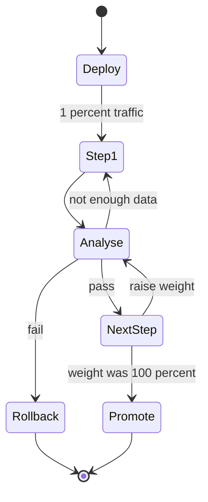

## In one minute
- A canary release sends a small slice of real traffic to the new version, compares its health against the old version, and widens exposure only while the comparison stays clean.
- The value is a bounded blast radius: a bad build hurts 1 percent of requests for a few minutes instead of everyone.
- The hard part is the judgement: enough traffic for statistical signal, the right metrics, and a fair baseline.
- Automated analysis with predefined thresholds beats humans staring at dashboards.
- Canaries catch problems that show up in metrics. They miss slow leaks, rare paths, and data corruption unless you plan for them.

## How it works

### Routing a slice
The router splits traffic by weight: 1 percent to canary, 99 percent to stable. Weight can be set in a service mesh, an ingress controller, or a load balancer with weighted target groups. Without a smart router you can approximate by replica count (1 canary pod among 50), but then the split is coarse and changes with autoscaling. Sticky assignment by user or session keeps one user from flipping between versions on each request.

### Baseline, not just stable
Comparing the canary to the whole stable fleet is unfair. Stable pods have warm caches and have run for days; the canary just started. The better design deploys a fresh baseline of the old version at the same size and time as the canary, so the only difference is the code. Netflix popularised this "baseline plus canary" pattern; when it and Google open-sourced Kayenta in 2018, the typical setup was three new instances each for baseline and canary, alongside the existing production instances ([Google Cloud](https://cloud.google.com/blog/products/gcp/introducing-kayenta-an-open-automated-canary-analysis-tool-from-google-and-netflix)). Google's later guidance is blunt: don't compare the canary with production, match the baseline on deploy time, instance count and traffic ([Google Cloud](https://cloud.google.com/blog/products/devops-sre/canary-analysis-lessons-learned-and-best-practices-from-google-and-waze)).

### Analysis
At each step the analyser pulls metrics for both groups: error rate, p99 latency, saturation, and business signals such as checkouts per minute. It applies rules like "canary error rate may not exceed baseline by more than 1.5x, with an absolute floor" and requires a minimum sample before deciding; Google suggests at least 50 data points per metric ([Google Cloud](https://cloud.google.com/blog/products/devops-sre/canary-analysis-lessons-learned-and-best-practices-from-google-and-waze)). Results are pass, fail, or not enough data yet. Choose few metrics, and ones users would feel: Google's SRE Workbook suggests stack-ranking candidates and keeping perhaps a dozen at most, and warns that raw CPU usage is a noisy canary signal because other processes on the host move it ([SRE Workbook, ch. 16](https://sre.google/workbook/canarying-releases/)).

### Progression
A typical schedule is 1, 5, 25, 50, 100 percent with a bake time at each step, often 10 to 30 minutes. A fail at any step routes all traffic back to stable and scales the canary down. Total rollout for a critical service can be an hour or more, which is fine if it is automated. Run one canary at a time: overlapping canaries contaminate each other's signal ([SRE Workbook, ch. 16](https://sre.google/workbook/canarying-releases/)).

### What canaries cannot see
A canary on 1 percent of traffic may never execute a rare code path, a nightly batch job, or a migration. If v2 writes subtly corrupt records, error rates stay flat while damage accumulates. Pair canaries with data validation and keep risky behaviour behind flags.

## Down the stack
### Layer 1: The contract
The router promises that a request reaches the canary with probability close to its weight, and with sticky routing that a given user stays on one side. The analyser promises a verdict per step from predefined metrics and thresholds, with a known tolerance for false alarms. The controller promises that a fail verdict sets canary weight to zero within seconds. Nothing promises that a bug will show up in the metrics you chose.

### Layer 2: The mechanism
In Envoy, a route uses `weighted_clusters`, for example stable at 99 and canary at 1. For each HTTP request the proxy draws a random number and picks a cluster by cumulative weight; for raw TCP it picks once per connection. Header or cookie matches can override the draw for sticky or internal traffic, and `use_hash_policy` makes the draw come from the route's hash policy (for example a user ID header), so a user lands on the same side at every proxy hop. The old `total_weight` field is deprecated; weights are simply summed ([Envoy docs](https://www.envoyproxy.io/docs/envoy/latest/api-v3/config/route/v3/route_components.proto)). Argo Rollouts drives the steps: a rollout lists `setWeight` and `pause` steps, and an `AnalysisTemplate` runs Prometheus queries such as the 5xx rate for pods labelled `version=canary`, with a `successCondition`, an `interval`, and a `failureLimit`. A run that is neither success nor failure is Inconclusive, which pauses the rollout for a human ([Argo Rollouts](https://argoproj.github.io/argo-rollouts/features/analysis/)). Netflix's Kayenta compares each metric's distribution in canary and baseline with a Mann-Whitney U test, and marks a metric high or low only when the 98% confidence interval lies wholly outside a tolerance band and the effect exceeds the allowed change. Each group's score is the share of passing metrics, groups combine into a weighted 0 to 100 score compared against pass and marginal thresholds, and a failing critical metric or 50% missing data forces the score to 0 ([Spinnaker docs](https://spinnaker.io/docs/guides/user/canary/judge/)).

### Layer 3: The machine
Detection latency is set by the metrics pipeline. Prometheus is commonly configured to scrape every 15 to 30 seconds (the built-in default is one minute ([Prometheus docs](https://prometheus.io/docs/prometheus/latest/configuration/configuration/))), and a `rate()` over a 2-minute window needs at least two samples, so a hard failure takes 1 to 2 minutes to appear in a query. Latency percentiles come from histogram buckets, so `histogram_quantile` interpolates within a bucket: with buckets at 250 and 500 ms, a p99 of "310 ms" could be anything in that range. A canary of two pods lands on two nodes; if one shares a host with a noisy neighbour, CPU steal or a long GC pause on that JVM shows as a latency regression that has nothing to do with the code. Counters reset when a pod restarts, which is why queries use `rate()` instead of raw totals.

### Why it's built this way
Failures are rare events, so meaningful comparison needs volume, and volume needs time or weight. Metrics are aggregated in windows, so every step needs a bake period longer than the window. Hosts are noisy, so the comparison group must be the same size and age as the canary. Per-request random routing is cheap but not sticky, so user consistency requires hashing on a key.

## Diagram


## Worked example
A feed service serves 50,000 RPS with a baseline error rate of 0.2 percent. A team wants to detect a regression to 0.4 percent.

At 1 percent canary weight the canary sees 500 RPS, 30,000 requests a minute. Expected errors at 0.2 percent are 60 per minute, at 0.4 percent 120. Poisson noise on 60 is about plus or minus 8, so a doubling is obvious within a minute or two. A 10 percent regression, from 0.2 to 0.22, is not: the difference of 6 errors a minute sits inside the noise, and you would need many minutes or a larger slice.

For a smaller service at 200 RPS, 1 percent is 2 RPS, 120 requests a minute, and at 0.2 percent errors that is a quarter of an error per minute. One error proves nothing. Such a service needs a larger canary share, say 10 to 20 percent, longer bakes, or a synthetic load generator. Canary sizing is a statistics problem, and it scales with traffic.

Blast radius at 50,000 RPS: if v2 fails 100 percent of requests and the analyser catches it in 2 minutes at 1 percent, about 60,000 requests fail. Without a canary, a full rolling deploy would fail far more before anyone noticed.

## In the wild
- **Google Cloud, 2016: the canary caught it, the rollout ignored it.** Removing an unused IP block left two config files out of sync, and a bug made the network config system withdraw every Compute Engine IP block. The canary flagged the problem, but a second bug stopped that result from halting the push, and the progressive rollout withdrew announcements site by site. External connectivity was lost for about 18 minutes, with inbound traffic down more than 95% ([Google Cloud](https://status.cloud.google.com/incident/compute/16007)).
- **CrowdStrike, 2024: a content update with no canary.** A new channel file used a real match on a 21st input field that the sensor code never supplied, so the content interpreter read past the end of an array and crashed Windows hosts. A validator bug let it through, and the file went to every sensor at once, because content updates did not get staged rollout. The fixes included bounds checks and staged canary deployment for template instances ([CrowdStrike RCA](https://www.crowdstrike.com/wp-content/uploads/2024/08/Channel-File-291-Incident-Root-Cause-Analysis-08.06.2024.pdf)).
- **OpenAI, 2024: the health signal arrived after the rollout finished.** A new telemetry DaemonSet made every node call the Kubernetes API in a way whose cost grew with cluster size, taking down control planes in most large clusters. Node DNS caches hid the failure for about 20 minutes, long enough for the rollout to keep going, and services were degraded or down for about 4h22m. OpenAI moved to phased rollouts that watch control-plane health ([OpenAI](https://status.openai.com/incidents/ctrsv3lwd797)).

## Trade-offs
| Option | Strengths | Weaknesses | Choose when |
| --- | --- | --- | --- |
| Weighted canary with automated analysis | Small blast radius, objective decisions | Needs mesh or smart LB and good metrics | High-traffic critical services |
| Replica-count canary | Works with plain load balancing | Coarse weights, drifts with autoscaling | No traffic-splitting layer |
| Cohort canary (internal users, one region) | Easy to reason about, low exposure | Cohort may not represent real traffic | Early dogfooding, regional rollouts |
| Blue-green | Instant rollback | Everyone switches at once | Low traffic where canary stats are weak |

## Pitfalls in production
- Comparing canary to the warm stable fleet produces false alarms. Deploy a fresh baseline alongside the canary.
- Deciding on too few requests leads to random promotions and rollbacks. Enforce a minimum sample per step.
- Metrics aggregated across versions hide the canary. Tag every metric with version or deployment id.
- Retries mask canary errors because a failed request succeeds on stable. Measure first-attempt errors per version.
- Shared side effects such as writes and emails are not contained by traffic weight. Gate risky side effects behind flags.
- Canary and control share databases, caches and clients, so a bad canary can hurt the control and a failing canary may not be the culprit. Back the A/B comparison with absolute SLO checks ([SRE Workbook, ch. 16](https://sre.google/workbook/canarying-releases/)).

## Leadership lens
- Ask which metrics decide promotion and who agreed on the thresholds. Unreviewed thresholds drift into "always pass".
- Size the canary for statistical power, not habit. 1 percent is right for some services and useless for others.
- Budget the total rollout time and keep it automated so slow does not mean toil.
- Track canary verdicts over time: a canary that never fails is either perfect or blind.

## Check yourself
1. Why compare the canary to a freshly deployed baseline instead of the existing stable fleet?
   **Answer:** The stable fleet differs in uptime, cache warmth, and host placement, so differences appear even with identical code. A fresh baseline isolates the code change.
2. Why can client retries hide a bad canary?
   **Answer:** A request that fails on the canary is retried, often lands on stable, and succeeds, so user-facing error rate stays flat while the canary fails many first attempts.
3. A service gets 100 RPS. Why might a 1 percent canary be pointless?
   **Answer:** 1 RPS gives too few events per minute to distinguish a regression from noise, so decisions are random. It needs a larger slice, longer bake, or synthetic traffic.
4. What class of bug does a canary reliably miss?
   **Answer:** Bugs that do not move monitored metrics quickly, such as silent data corruption, slow memory leaks, or rarely exercised paths.

## Practice
**Task:** Write `evaluate(base_err, base_total, can_err, can_total, min_requests, max_ratio, floor)` returning `"wait"` if the canary has fewer than `min_requests` requests, `"fail"` if the canary error rate exceeds `max(baseline_rate * max_ratio, floor)`, else `"pass"`. A baseline with zero requests counts as a 0 rate. Then write `advance(schedule, current, verdict)` that returns the next traffic weight: the next step in the sorted `schedule` on pass (stay at the last step if already there), the same weight on wait, and 0 on fail.

```python starter
def evaluate(base_err, base_total, can_err, can_total, min_requests, max_ratio, floor):
    raise NotImplementedError

def advance(schedule, current, verdict):
    raise NotImplementedError
```

```python tests
def test_wait_on_small_sample():
    assert evaluate(10, 10000, 0, 50, 1000, 1.5, 0.001) == "wait"

def test_pass_within_ratio():
    assert evaluate(20, 10000, 3, 1000, 1000, 1.5, 0.001) == "pass"

def test_fail_over_ratio():
    assert evaluate(20, 10000, 5, 1000, 1000, 1.5, 0.001) == "fail"

def test_floor_prevents_flapping_at_zero():
    assert evaluate(0, 10000, 1, 2000, 1000, 1.5, 0.001) == "pass"

def test_advance_steps():
    s = [1, 5, 25, 50, 100]
    assert advance(s, 5, "pass") == 25
    assert advance(s, 100, "pass") == 100
    assert advance(s, 25, "wait") == 25
    assert advance(s, 50, "fail") == 0
```

```python solution
def evaluate(base_err, base_total, can_err, can_total, min_requests, max_ratio, floor):
    if can_total < min_requests:
        return "wait"
    base_rate = base_err / base_total if base_total else 0.0
    can_rate = can_err / can_total
    if can_rate > max(base_rate * max_ratio, floor):
        return "fail"
    return "pass"

def advance(schedule, current, verdict):
    if verdict == "fail":
        return 0
    if verdict == "wait":
        return current
    steps = sorted(schedule)
    for w in steps:
        if w > current:
            return w
    return steps[-1]
```

```typescript starter
export function evaluate(baseErr: number, baseTotal: number, canErr: number, canTotal: number,
                         minRequests: number, maxRatio: number, floor: number): string {
  throw new Error("TODO");
}

export function advance(schedule: number[], current: number, verdict: string): number {
  throw new Error("TODO");
}
```

```typescript tests
test("wait on small sample", () => {
  assertEqual(evaluate(10, 10000, 0, 50, 1000, 1.5, 0.001), "wait");
});

test("pass within ratio", () => {
  assertEqual(evaluate(20, 10000, 3, 1000, 1000, 1.5, 0.001), "pass");
});

test("fail over ratio", () => {
  assertEqual(evaluate(20, 10000, 5, 1000, 1000, 1.5, 0.001), "fail");
});

test("floor prevents flapping at zero", () => {
  assertEqual(evaluate(0, 10000, 1, 2000, 1000, 1.5, 0.001), "pass");
});

test("advance steps", () => {
  const s = [1, 5, 25, 50, 100];
  assertEqual(advance(s, 5, "pass"), 25);
  assertEqual(advance(s, 100, "pass"), 100);
  assertEqual(advance(s, 25, "wait"), 25);
  assertEqual(advance(s, 50, "fail"), 0);
});
```

```typescript solution
export function evaluate(baseErr: number, baseTotal: number, canErr: number, canTotal: number,
                         minRequests: number, maxRatio: number, floor: number): string {
  if (canTotal < minRequests) return "wait";
  const baseRate = baseTotal ? baseErr / baseTotal : 0;
  const canRate = canErr / canTotal;
  return canRate > Math.max(baseRate * maxRatio, floor) ? "fail" : "pass";
}

export function advance(schedule: number[], current: number, verdict: string): number {
  if (verdict === "fail") return 0;
  if (verdict === "wait") return current;
  const steps = [...schedule].sort((a, b) => a - b);
  for (const w of steps) if (w > current) return w;
  return steps[steps.length - 1];
}
```

```go starter
package practice

func Evaluate(baseErr, baseTotal, canErr, canTotal, minRequests int, maxRatio, floor float64) string {
	panic("TODO")
}

func Advance(schedule []int, current int, verdict string) int {
	panic("TODO")
}
```

```go tests
package practice

import "testing"

func TestWaitOnSmallSample(t *testing.T) {
	if v := Evaluate(10, 10000, 0, 50, 1000, 1.5, 0.001); v != "wait" {
		t.Fatalf("got %s", v)
	}
}

func TestPassWithinRatio(t *testing.T) {
	if v := Evaluate(20, 10000, 3, 1000, 1000, 1.5, 0.001); v != "pass" {
		t.Fatalf("got %s", v)
	}
}

func TestFailOverRatio(t *testing.T) {
	if v := Evaluate(20, 10000, 5, 1000, 1000, 1.5, 0.001); v != "fail" {
		t.Fatalf("got %s", v)
	}
}

func TestFloor(t *testing.T) {
	if v := Evaluate(0, 10000, 1, 2000, 1000, 1.5, 0.001); v != "pass" {
		t.Fatalf("got %s", v)
	}
}

func TestAdvance(t *testing.T) {
	s := []int{1, 5, 25, 50, 100}
	if Advance(s, 5, "pass") != 25 || Advance(s, 100, "pass") != 100 {
		t.Fatal("pass steps wrong")
	}
	if Advance(s, 25, "wait") != 25 || Advance(s, 50, "fail") != 0 {
		t.Fatal("wait or fail wrong")
	}
}
```

```go solution
package practice

import (
	"math"
	"sort"
)

func Evaluate(baseErr, baseTotal, canErr, canTotal, minRequests int, maxRatio, floor float64) string {
	if canTotal < minRequests {
		return "wait"
	}
	baseRate := 0.0
	if baseTotal > 0 {
		baseRate = float64(baseErr) / float64(baseTotal)
	}
	canRate := float64(canErr) / float64(canTotal)
	if canRate > math.Max(baseRate*maxRatio, floor) {
		return "fail"
	}
	return "pass"
}

func Advance(schedule []int, current int, verdict string) int {
	switch verdict {
	case "fail":
		return 0
	case "wait":
		return current
	}
	steps := append([]int(nil), schedule...)
	sort.Ints(steps)
	for _, w := range steps {
		if w > current {
			return w
		}
	}
	return steps[len(steps)-1]
}
```

## Mock interview
**Prompt:** A ride-hailing dispatch service handles 30,000 RPS across 4 regions and ships 20 times a day. Design an automated canary system that decides promotion without a human.

- Follow-up: Which metrics would you use, and how do you avoid false positives?
- Follow-up: v2 double-charges 0.01 percent of trips. Would your canary notice?
- Follow-up: How does the design change for a service with 50 RPS?

**A strong answer covers:**
- Weighted routing with sticky assignment and version-tagged metrics.
- Baseline plus canary deployed together, minimum samples, ratio plus absolute floor thresholds.
- A schedule such as 1, 5, 25, 50, 100 percent with bakes, and region-by-region progression.
- Business and data-integrity checks, because error rates miss correctness bugs.
- Low-traffic fallback: larger slices, longer bakes, synthetic load, or blue-green.

## Sources and further study
**Primary**
- [Google and Netflix: introducing Kayenta (2018)](https://cloud.google.com/blog/products/gcp/introducing-kayenta-an-open-automated-canary-analysis-tool-from-google-and-netflix): the baseline-plus-canary setup and automated scoring.
- [Canary analysis: lessons learned from Google and Waze](https://cloud.google.com/blog/products/devops-sre/canary-analysis-lessons-learned-and-best-practices-from-google-and-waze): baseline matching, 50-point minimums and retrospective analysis.
- [Google Cloud incident 16007 (2016)](https://status.cloud.google.com/incident/compute/16007): a canary that worked and a pipeline that ignored it.

**Systems docs**
- [Spinnaker: how canary judgement works](https://spinnaker.io/docs/guides/user/canary/judge/): Kayenta's Mann-Whitney classification and score thresholds.
- [Argo Rollouts: analysis](https://argoproj.github.io/argo-rollouts/features/analysis/): AnalysisTemplates, failure limits and inconclusive runs.
- [Envoy route configuration](https://www.envoyproxy.io/docs/envoy/latest/api-v3/config/route/v3/route_components.proto): `weighted_clusters`, `use_hash_policy` and header-driven selection.

**Books**
- *The Site Reliability Workbook*, Beyer et al., chapter 16 "Canarying Releases": canary size, duration, metric choice and dependency caveats.
- *Observability Engineering*, Majors, Fong-Jones and Miranda, chapter 11 "Observability-Driven Development": using production telemetry to judge each change as it ships.

**Other curricula**
- [Azure Well-Architected: safe deployment practices](https://learn.microsoft.com/en-us/azure/well-architected/operational-excellence/safe-deployments): presents canary as the standard progressive-exposure model, usually driven by feature flags.
- [donnemartin/system-design-primer](https://github.com/donnemartin/system-design-primer): does not cover canary releases.

## Watch
- [Canary Deployment: Safer Releases Explained (Semaphore)](https://www.youtube.com/watch?v=dRAJVUaV958): the canary loop and what to measure.
- [Top 5 Most-Used Deployment Strategies (ByteByteGo)](https://www.youtube.com/watch?v=AWVTKBUnoIg): where canary fits among deployment strategies.

## Free resources
- [Canarying Releases (Google SRE Workbook)](https://sre.google/workbook/canarying-releases/): metric selection, canary sizing, and evaluation from Google's practice.
- [CanaryRelease (Martin Fowler)](https://martinfowler.com/bliki/CanaryRelease.html): short definition and the relation to feature toggles.
- [Argo Rollouts](https://argoproj.github.io/argo-rollouts/): an open-source controller for canary steps and automated analysis on Kubernetes.
- [Automating safe, hands-off deployments (AWS Builders' Library)](https://aws.amazon.com/builders-library/automating-safe-hands-off-deployments/): one-box stages, bake times, and automatic rollback at Amazon.
